# aclnnMaxUnpool3d 算子设计文档

## 一、需求背景

### 1.1 需求来源

通过社区任务完成开源仓算子贡献，补充完善 Ascend C 算子库能力。当前 `aclnnMaxUnpool3d` 算子的 `self` 输入不支持 `BFLOAT16` 数据类型，本任务需要在现有代码基础上增强 `aclnnMaxUnpool3d`，使 `self/outRef` 支持 `BFLOAT16`，并保证 `indices` 支持 `INT32/INT64`。

### 1.2 背景介绍

`aclnnMaxUnpool3d` 是 3D 最大池化的逆运算。算子根据 `outputSize` 决定输出 `outRef` 的 D、H、W 空间大小，并根据 `indices` 中记录的位置，把 `self` 中的元素写入输出张量，未被写入的位置填充为 0。

输入为 4 维时，代码按 `dimN = self[0]`、`dimC = 1`、`dimD/H/W = self[1]/self[2]/self[3]` 解析；
输入为 5 维时，代码按 `dimN = self[0]`、`dimC = self[1]`、`dimD/H/W = self[2]/self[3]/self[4]` 解析。

计算前会将 D、H、W 合并成一个线性轴，`i ∈ [0, D * H * W)`。

### 1.3 当前支持情况

当前 `aclnnMaxUnpool3d` 已支持 Atlas A2 训练系列产品 / Atlas A3 系列产品，已有实现为 ACLNN 组合算子，底层复用 `ScatterElements` 完成按索引写入。现有接口已经支持 `indices` 为 `INT32/INT64`，但 `self/outRef` 数据类型未放开 `BFLOAT16`。

## 二、需求分析

### 2.1 外部组件依赖

不涉及外部组件依赖。

### 2.2 内部适配模块

本任务主要适配 ACLNN 接口实现和接口文档。`aclnnMaxUnpool3d` 没有新增独立 AICore kernel，核心计算复用已有 `ScatterElements` L0 能力。

### 2.3 算子原型

| 参数名 | 输入/输出 | 描述 | 使用说明 | 数据类型 | 数据格式 | 维度 | 非连续 Tensor |
| --- | --- | --- | --- | --- | --- | --- | --- |
| self | 输入 | 待还原的 MaxPool3d 输出值 | 数据类型与 outRef 一致，shape 与 indices 一致；4 维为 N,D,H,W，5 维为 N,C,D,H,W | FLOAT、FLOAT16、BFLOAT16、INT16、INT32、INT64、INT8、UINT8、DOUBLE | ND/NCDHW | 4-5 | 支持 |
| indices | 输入 | self 中每个元素在输出空间中的线性索引 | shape 与 self 一致，索引范围在输出 D*H*W 内 | INT32、INT64 | ND/NCDHW | 4-5 | 支持 |
| outputSize | 输入 | 输出结果在 D、H、W 维度上的空间大小 | Host 侧 aclIntArray，size 为 3，乘积需大于等于 self 的 D*H*W | - | - | - | - |
| stride | 输入 | 最大池化窗口在 D、H、W 维度上的步长 | 预留参数，当前版本不参与计算，需传入 size 为 3 且值大于 0 的 aclIntArray | - | - | - | - |
| padding | 输入 | 最大池化窗口在 D、H、W 维度上的填充值 | 预留参数，当前版本不参与计算，需传入 size 为 3 的 aclIntArray | - | - | - | - |
| outRef | 输出 | 还原后的输出张量 | 数据类型与 self 一致；D、H、W 与 outputSize 一致，且需为连续 Tensor | FLOAT、FLOAT16、BFLOAT16、INT16、INT32、INT64、INT8、UINT8、DOUBLE | ND/NCDHW | 4-5 | 不支持 |

## 三、需求详细设计

### 3.1 使能方式

| 上层框架 | 是否涉及 |
| --- | --- |
| TF 训练/推理 |  |
| PyTorch 训练/推理 |  |
| ATC 推理 |  |
| ACLNN 直调 | √ |
| OPAT 调优 |  |
| SGAT 子图切分 |  |

### 3.2 详细设计

本次任务是在现有代码基础上做增量增强，主要修改 `op_api` 和文档，不新增独立 kernel。

#### 3.2.1 op_api 设计

在 `op_api/aclnn_max_unpool3d.cpp` 中放开 `BFLOAT16` 支持：

1. `DTYPE_SUPPORT_LIST` 增加 `DT_BF16`。
2. 参数校验保持 `self` 与 `outRef` 数据类型一致，`indices` 支持 `INT32/INT64`。
3. 保留原有空指针、shape、`outputSize`、`stride`、`padding` 合法性校验。

`BFLOAT16` 与非 `BFLOAT16` 类型复用同一套 ACLNN 组合路径：

```text
Contiguous -> Reshape -> ZerosLike -> ScatterElements -> Reshape -> ViewCopy
```

本次适配在 `DTYPE_SUPPORT_LIST` 中增加 `DT_BF16`，计算流程复用现有组合路径。

#### 3.2.2 op_host 设计

无需新增 op_host 侧 kernel tiling 逻辑。该算子为 ACLNN 组合接口，内部通过 L0 算子完成连续化、reshape、清零和 scatter 写入。

#### 3.2.3 op_kernel 设计

无需新增 `MaxUnpool3d` 专用 AICore kernel。底层按索引写入能力由 `ScatterElements` 提供，`aclnnMaxUnpool3d` 负责组合调度。

### 3.3 运行流程图

```mermaid
graph TD
    A[调用 aclnnMaxUnpool3dGetWorkspaceSize] --> B[OP_CHECK_COMM_INPUT<br/>检查 workspaceSize 和 executor]
    B --> C[L2_DFX_PHASE_1<br/>记录 self/indices/outputSize/stride/padding/outRef]
    C --> D[CREATE_EXECUTOR 创建 uniqueExecutor]
    D --> E{uniqueExecutor 是否创建成功}
    E -->|否| F[返回 ACLNN_ERR_INNER_CREATE_EXECUTOR]
    E -->|是| G[CheckParams 参数校验]

    G --> G1[CheckNotNull<br/>self/indices/outputSize/stride/padding/outRef 非空]
    G1 --> G2[CheckOutContiguous<br/>outRef 为连续 Tensor]
    G2 --> G3[CheckDtypeValid<br/>self 在 DTYPE_SUPPORT_LIST<br/>outRef dtype 等于 self dtype<br/>indices 为 INT32 或 INT64]
    G3 --> G4[CheckShape<br/>self 为 4D 或 5D<br/>self 与 indices 维度数相同<br/>self 与 indices shape 相同]
    G4 --> G5[CheckInpuNullTensorMaxUnPool3D<br/>从第 1 维开始检查非 batch 维度大于 0]
    G5 --> G6[CheckIntArrayShapeMaxUnPool3D<br/>outputSize/stride/padding 长度均为 3<br/>stride 与 outputSize 元素合法<br/>outputSize 体积大于等于输入 D*H*W]
    G6 --> G7[CheckOutShape<br/>outRef 维度数与 self 相同<br/>N/C 维度匹配<br/>D/H/W 维度匹配 outputSize]
    G7 --> H{CheckParams 是否成功}
    H -->|否| I[返回对应错误码]
    H -->|是| J{self IsEmpty}

    J -->|是| K[workspaceSize 置 0]
    K --> L[uniqueExecutor.ReleaseTo executor]
    L --> M[返回 ACLNN_SUCCESS]

    J -->|否| N[按 4D 初始化<br/>dimN=self 第 0 维, dimC=1<br/>dimD=第 1 维, dimH=第 2 维, dimW=第 3 维]
    N --> O{self 是否为 5D}
    O -->|是| P[按 5D 更新<br/>dimC=self 第 1 维<br/>dimD=第 2 维, dimH=第 3 维, dimW=第 4 维]
    O -->|否| Q[保持 4D 解析结果]
    P --> R[Contiguous self<br/>CHECK_RET selfContiguous 非空]
    Q --> R
    R --> S[Contiguous indices<br/>CHECK_RET indicesContiguous 非空]
    S --> T[Contiguous outRef<br/>CHECK_RET outRefContiguous 非空]

    T --> U[CalcMaxUnpool3dInputNewShape<br/>inputNewShape 为 dimN, dimC, dimD*dimH*dimW<br/>CHECK_RET inputNewShapeArray 非空]
    U --> V[CalcMaxUnpool3dInputNewShape<br/>outNewShape 为 dimN, dimC, outputSize0*outputSize1*outputSize2<br/>CHECK_RET outNewShapeArray 非空]
    V --> W[Reshape selfContiguous 到 selfReshape<br/>CHECK_RET selfReshape 非空]
    W --> X[Reshape indicesContiguous 到 indicesReshape<br/>CHECK_RET indicesReshape 非空]
    X --> Y[Reshape outRefContiguous 到 outRefReshape<br/>CHECK_RET outRefReshape 非空]

    Y --> Z[ZerosLike outRefReshape 得到 zeroOut<br/>CHECK_RET zeroOut 非空]
    Z --> AA[设置 reductionCurr = none]
    AA --> AB[ScatterElements<br/>zeroOut, indicesReshape, selfReshape, AXIS=2, reductionCurr<br/>CHECK_RET scatterRes 非空]
    AB --> AC[Reshape scatterRes<br/>shape 使用 outRef GetViewShape<br/>CHECK_RET outRefReshape2 非空]
    AC --> AD[ViewCopy<br/>outRefReshape2 写入 outRef<br/>CHECK_RET viewCopyResult 非空]
    AD --> AE[workspaceSize 设置为 uniqueExecutor GetWorkspaceSize]
    AE --> AF[uniqueExecutor.ReleaseTo executor]
    AF --> AG[返回 ACLNN_SUCCESS]

    AG --> AH[调用 aclnnMaxUnpool3d]
    AH --> AI[L2_DFX_PHASE_2]
    AI --> AJ[CommonOpExecutorRun<br/>workspace, workspaceSize, executor, stream]
```



### 3.4 支持硬件

支持 Atlas A2 训练系列产品 / Atlas A3 系列产品，对应 `ascend910b` 及 `ascend910_93`。

## 四、验收及可维可测标准

### 4.1 精度标准

使用 AscendOpTest 或 ACLNN 样例进行验证，`BFLOAT16` 输出需满足默认精度阈值，结果与 CPU golden 计算一致。

### 4.2 性能标准

`BFLOAT16` 复用原有组合路径；`indices` 使用 `INT32` 与 `INT64` 时功能均需正确，性能不低于可接受基线。

### 4.3 测试覆盖

测试需覆盖：

- `self/outRef` 为 `BFLOAT16`。
- `indices` 为 `INT32` 和 `INT64`。
- 4 维 NDHW 与 5 维 NCDHW 输入。
- `outputSize` 大于输入 D/H/W 和等于输入 D/H/W 的场景。
- `stride`、`padding` 合法参数场景。
- 常规场景和边界场景。

