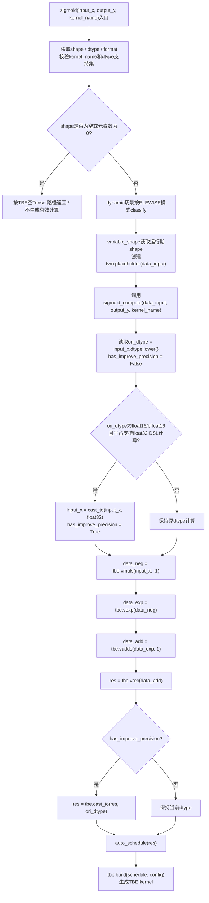
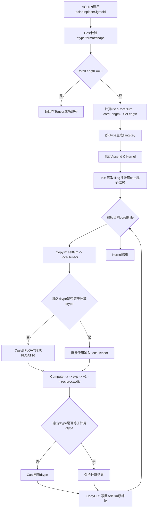

# 【社区任务】InplaceSigmoid算子设计文档

| 文档项 | 内容 |
| --- | --- |
| 算子名称 | InplaceSigmoid |
| 目标接口 | `aclnnInplaceSigmoid` |
| 提交位置 | `04_tasks/01_community-task-2026/tasklist/05-19-InplaceSigmoid/量智之星/docs/design.md` |
| 适配硬件 | Atlas A2 训练系列产品 / Atlas A3 系列产品 |
| 开发语言 | Ascend C |

## 一、需求背景

### 1.1 需求来源

本需求来源于 CANN 算子开源仓社区任务。任务要求参考昇腾版本内置 `aclnnInplaceSigmoid` 的 TBE 实现，在昇腾 NPU 上使用 Ascend C 重新实现同等功能，并在原有浮点类型能力基础上扩展 `int16`、`int8`、`uint8` 数据类型支持。设计、开发和测试完成后，算子需提交至昇腾算子开源仓并通过社区评审与验收。

### 1.2 背景介绍

#### 1.2.1 InplaceSigmoid算子实现优化

`InplaceSigmoid` 是 Sigmoid 激活函数的原地更新版本。其数学表达式为：

$$
self_i = \frac{1}{1 + e^{-self_i}}
$$

与普通 `Sigmoid` 不同，`InplaceSigmoid` 的输出写回输入 Tensor 对应的存储区域，调用侧语义为对 `self` 原地修改。后续 Ascend C 实现需要同时满足以下目标：

1. 与内置 TBE 算子的核心计算逻辑保持一致，保证 `FLOAT`、`FLOAT16`、`BFLOAT16` 等原始支持类型的结果对齐。
2. 按任务书扩展 `INT16`、`INT8`、`UINT8`，通过浮点中间计算完成 Sigmoid，再转换回原数据类型。
3. 支持 `ND` 格式、0-8 维 Shape、空 Tensor 和非连续 Tensor 场景。
4. 在所有 AI Core 参与计算的场景下，性能不低于原 TBE 算子的 95%。

本设计参考的 CANN 内置实现和接口信息如下，开发阶段需要在真实 CANN 环境中结合 `aclnnInplaceSigmoid` 接口声明再次核对文件是否匹配：

| 类别 | 参考路径 | 说明 |
| --- | --- | --- |
| TBE kernel 实现 | `/usr/local/Ascend/ascend-toolkit/latest/opp/built-in/op_impl/ai_core/tbe/impl/dynamic/sigmoid.py` | Sigmoid 主计算逻辑参考文件，重点分析不同硬件分支、精度模式和计算公式 |
| 算子原型 | `/usr/local/Ascend/ascend-toolkit/latest/opp/built-in/op_proto/inc/activation_ops.h` | activation 类算子原型参考文件，开发时通过 `Sigmoid` / `InplaceSigmoid` 名称核对入参、出参和约束 |
| 算子信息库 | `/usr/local/Ascend/ascend-toolkit/latest/opp/built-in/op_impl/ai_core/tbe/config/ascend910b/aic-ascend910b-ops-info.json` | Ascend910B/Atlas A2 类硬件的 dtype、format、kernel 名称等信息参考 |
| ACLNN 接口 | `/usr/local/Ascend/ascend-toolkit/latest/include/aclnnop/aclnn_inplace_sigmoid.h` | `aclnnInplaceSigmoidGetWorkspaceSize`、`aclnnInplaceSigmoid` 调用语义参考 |

#### 1.2.2 InplaceSigmoid算子现状分析

##### 1.2.2.1 TBE算子支持的数据类型和数据格式

根据任务书和 TBE 参考实现，原内置 Sigmoid 计算核心主要覆盖浮点类型，目标数据格式为 `ND`。本任务需要在 Ascend C 版本中保留原有浮点能力，并扩展整数类型，形成如下支持范围：

| 参数名 | 输入/输出/属性 | 支持数据类型 | 数据格式 | 维度范围 | 非连续Tensor |
| --- | --- | --- | --- | --- | --- |
| self | 输入 | `FLOAT`、`FLOAT16`、`BFLOAT16`、`INT16`、`INT8`、`UINT8` | `ND` | 0-8 | 支持 |
| out | 输出 | `FLOAT`、`FLOAT16`、`BFLOAT16`、`INT16`、`INT8`、`UINT8` | `ND` | 0-8 | 支持 |

`InplaceSigmoid` 语义要求 `out` 与 `self` 的 shape 一致，并在执行时写回 `self` 对应的内存。Ascend C 侧实现不引入广播逻辑，Host 侧仅需要根据展平后的元素总数进行 tiling。

##### 1.2.2.2 TBE算子实现描述

参考 MR 2679 中 GeluGradV2 设计文档对 TBE 流程图的处理方式，TBE 流程图应从源码入口、参数校验、placeholder 构造、`*_compute` 主体和 build 调度几个层次展开，不能只画抽象数学公式或泛泛的平台分支。本设计据此将 `sigmoid.py` 的基线流程描述为可与源码结构对应的 TBE DSL 构图过程。

TBE 版本 `sigmoid.py` 的核心计算公式为：

$$
y = \frac{1}{1 + e^{-x}}
$$

TBE 中的主要处理逻辑如下：

1. `sigmoid` 入口读取 `input_x` / `output_y` 描述，校验 shape、format、dtype 和 kernel_name。原始 TBE 基线支持 `float16`、`float32`、`bfloat16` 浮点输入，format 为 `ND`。
2. 动态 shape 场景下，入口侧根据 element-wise 模式对输入进行分类，创建 `tvm.placeholder`，再调用 `sigmoid_compute` 构造计算图。
3. `sigmoid_compute` 读取 `input_x.dtype`，初始化精度提升标记。若输入为低精度浮点且平台支持 `float32` 指数/除法等 DSL 计算，则先 `cast_to(float32)`，以 `float32` 中间域计算。
4. 主体计算严格按标准 Sigmoid DSL 串联：`data_neg = vmuls(input_x, -1)`，`data_exp = vexp(data_neg)`，`data_add = vadds(data_exp, 1)`，`res = vrec(data_add)`，得到 `1 / (1 + exp(-x))`。
5. 若前序发生过精度提升，则 `res = cast_to(res, 原始 dtype)`；否则保持当前 dtype。最后由 `auto_schedule` 和 `build` 完成 TBE kernel 生成。

整数类型不是 TBE 浮点 Sigmoid 的原始重点能力，本任务的 Ascend C 版本会在 Kernel 侧显式补齐整数到浮点再回写整数的路径。

##### 1.2.2.3 TBE算子实现流程图



## 二、需求分析

### 2.1 外部组件依赖

本算子需要适配 ACLNN 调用框架，提供 `aclnnInplaceSigmoidGetWorkspaceSize` 和 `aclnnInplaceSigmoid` 入口，供 PyTorch/ACLNN 直调链路使用。外部依赖主要包括：

| 外部组件 | 作用 | 适配要求 |
| --- | --- | --- |
| ACLNN | 上层调用入口、workspace 查询和执行调度 | 接口命名、参数语义、空 Tensor 行为与内置 `aclnnInplaceSigmoid` 对齐 |
| OPP 算子包 | 算子注册、编译、加载 | 需要补齐 op_host、op_kernel、算子信息配置和 CMake 编译项 |
| Ascend C 基础库 | 向量搬运、Cast、Exp、Div 等 Kernel API | API 使用需满足 Atlas A2/A3 支持范围 |
| AscendOpTest | 精度和功能验收工具 | 测试结果满足默认阈值，并覆盖泛化输入 |

### 2.2 内部适配模块

内部实现按照 Ascend C 算子常规结构拆分为 Host 侧、Kernel 侧和算子注册配置三部分：

| 模块 | 建议文件 | 职责 |
| --- | --- | --- |
| Host tiling | `op_host/inplace_sigmoid_tiling.cpp` | 解析 shape/dtype，计算元素总数、blockDim、单核数据量、tile 长度和 tilingKey |
| Tiling 数据定义 | `op_host/inplace_sigmoid_tiling.h` | 定义 Kernel 侧需要读取的 tiling 字段，如 `totalLength`、`coreLength`、`tileLength`、`tailLength` |
| Kernel 计算 | `op_kernel/inplace_sigmoid.cpp` | 完成 CopyIn、Cast、Sigmoid 向量计算、Cast 回原类型、CopyOut 原地写回 |
| 算子信息配置 | `op_host` 配置文件 / 算子信息库 | 注册 dtype、format、shape、kernel 名称和 tilingKey |
| ACLNN 适配 | 算子工程 ACLNN 相关入口 | 连接 `aclnnInplaceSigmoid` 的 workspace 查询与执行流程 |

### 2.3 需求模块设计

#### 2.3.1 AscendC算子原型

| 参数名 | 输入/输出/属性 | 描述 | 使用说明 | 数据类型 | 数据格式 | 维度(shape) | 非连续Tensor |
| --- | --- | --- | --- | --- | --- | --- | --- |
| self | 输入 | 待进行 Sigmoid 原地计算的 Tensor | 支持空 Tensor；shape 需要与 out 一致；执行后原内存被结果覆盖 | `FLOAT`、`FLOAT16`、`BFLOAT16`、`INT16`、`INT8`、`UINT8` | `ND` | 0-8 | 支持 |
| out | 输出 | 计算结果 Tensor | shape 需要与 self 一致；Inplace 语义下与 self 指向同一逻辑输出 | `FLOAT`、`FLOAT16`、`BFLOAT16`、`INT16`、`INT8`、`UINT8` | `ND` | 0-8 | 支持 |

接口层不新增属性参数。算子不需要 workspace 保存跨 tile 的状态，若 ACLNN 框架需要 workspace 指针，默认按 0 字节 workspace 处理。

#### 2.3.2 AscendC算子相关约束

1. 默认确定性实现，同一输入在同一硬件和同一 dtype 下结果稳定。
2. 仅支持 `ND` 数据格式，不设计广播逻辑，`self` 与 `out` 的 shape 必须一致。
3. 支持 0-8 维 Tensor；元素总数为 0 时 Host 侧返回空 Tensor 成功路径，不启动无意义 Kernel。
4. 支持非连续 Tensor。若 ACLNN 框架在下发前已经完成连续化或一维展开，Kernel 按连续 GM 地址处理；若后续工程要求原生 stride 访问，需要在 Host 侧补充 stride/offset tiling 字段。
5. 整数类型不直接参与 `Exp` 计算：`INT16` 使用 `FLOAT32` 作为计算类型，`INT8`、`UINT8` 使用 `FLOAT16` 作为计算类型，结果再 Cast 回原 dtype。
6. Inplace 写回阶段不得破坏尚未读取的数据。Kernel 必须按 tile 完成 CopyIn 后再 CopyOut 覆盖原 GM 区域。

## 三、需求详细设计

### 3.1 使能方式

本算子面向 ACLNN 直调场景使能，上层通过 `aclnnInplaceSigmoidGetWorkspaceSize` 获取 workspace 大小和 executor，再调用 `aclnnInplaceSigmoid` 执行。使能方式如下：

| 使用场景 | 是否支持 | 说明 |
| --- | --- | --- |
| ACLNN 直调 | 支持 | 本任务主要交付路径 |
| PyTorch 训练/推理适配 | 支持上层间接调用 | 通过 ACLNN 算子接入后由框架调用 |
| ATC 推理 | 不作为本次重点 | 任务书未要求独立图编译适配 |
| OPAT 调优 | 可用于后续性能分析 | 非功能必要项 |

### 3.2 需求总体设计

#### 3.2.1 Host侧设计

##### 3.2.1.1 分核策略

Host 侧将输入视为展平后的一维数组，元素总数记为 `totalLength`。根据平台可用 AI Core 数量和单核最小处理粒度确定实际使用核数：

```text
totalLength = self.shape元素乘积
maxCoreNum = platformInfo.aiCoreNum
usedCoreNum = min(maxCoreNum, ceil_div(totalLength, minElementsPerCore))
```

当 `totalLength == 0` 时，Host 返回空 Tensor 路径，`usedCoreNum` 可置 0 或 1，Kernel 不执行实际计算。

非空输入按核间尽量均分策略分配：

```text
baseCoreLength = ceil_div(totalLength, usedCoreNum)
formerCoreNum = totalLength % usedCoreNum
```

实际实现可采用大小核分配，前 `formerCoreNum` 个核处理 `baseCoreLength` 个元素，其余核处理 `baseCoreLength - 1` 个元素；也可以采用最后一核吃尾数的方式。为降低 Kernel 分支复杂度，推荐在 Host 侧计算并下发：

| 字段 | 含义 |
| --- | --- |
| `totalLength` | 总元素数 |
| `usedCoreNum` | 实际启用 AI Core 数 |
| `coreLength` | 大多数核的处理元素数 |
| `lastCoreLength` | 最后一核或尾核处理元素数 |
| `tileLength` | 单次 tile 处理元素数 |
| `lastTileLength` | 单核最后一个 tile 的有效元素数 |

分核原则为：大 shape 尽量满核，小 shape 避免启动过多空核；所有核参与计算的验收场景下，`usedCoreNum` 应尽可能等于硬件可用核数。

##### 3.2.1.2 数据分块和内存优化策略

Kernel 的 Local Memory 主要用于输入队列、输出队列和中间计算缓冲。不同 dtype 的计算类型不同，Host 侧计算 tile 大小时需要预留最坏路径的临时空间，避免 Kernel 内 UB 越界。

| 输入dtype | 计算dtype | Local Memory 规划 |
| --- | --- | --- |
| `FLOAT` | `FLOAT` | 输入/输出队列 + 1-2 个 `FLOAT` 临时 Tensor |
| `FLOAT16` | `FLOAT32` | `FLOAT16` 输入/输出队列 + `FLOAT32` 计算缓冲和临时缓冲 |
| `BFLOAT16` | `FLOAT32` | `BFLOAT16` 输入/输出队列 + `FLOAT32` 计算缓冲和临时缓冲 |
| `INT16` | `FLOAT32` | `INT16` 输入/输出队列 + `FLOAT32` 计算缓冲和临时缓冲 |
| `INT8` | `FLOAT16` | `INT8` 输入/输出队列 + `FLOAT16` 计算缓冲和临时缓冲 |
| `UINT8` | `FLOAT16` | `UINT8` 输入/输出队列 + `FLOAT16` 计算缓冲和临时缓冲 |

单 tile 元素数按 UB 容量、数据类型长度、Double Buffer 开关和 32B 对齐粒度综合计算：

```text
blockBytes = 32
inputBytes = sizeof(inputDtype)
calcBytes = sizeof(calcDtype)
bufferNum = 2
tmpTensorNum = 2

availableUb = ubSize - reservedBytes
tileBytes = availableUb / (bufferNum * (inputBytes * 2 + calcBytes * tmpTensorNum))
tileLength = align_down(tileBytes, blockBytes / inputBytes)
```

其中 `inputBytes * 2` 表示输入和输出队列占用；`calcBytes * tmpTensorNum` 为指数、分母、常量 1 等中间计算预留空间。若工程实现中复用同一 `TBuf`，可进一步放大 `tileLength`，但必须保证 `Exp`、`Adds`、`Div` 的输入输出别名满足 Ascend C API 约束。

##### 3.2.1.3 tilingKey规划策略

`tilingKey` 用于让 Kernel 侧选择不同模板实例，避免在 AI Core 上做复杂 dtype 判断。建议规划如下：

| tilingKey | 输入dtype | 计算路径 |
| --- | --- | --- |
| 1 | `FLOAT` | 原 dtype 计算并原 dtype 写回 |
| 2 | `FLOAT16` | Cast 到 `FLOAT32` 计算，Cast 回 `FLOAT16` |
| 3 | `BFLOAT16` | Cast 到 `FLOAT32` 计算，Cast 回 `BFLOAT16` |
| 4 | `INT16` | Cast 到 `FLOAT32` 计算，按确定 Cast 规则写回 `INT16` |
| 5 | `INT8` | Cast 到 `FLOAT16` 计算，按确定 Cast 规则写回 `INT8` |
| 6 | `UINT8` | Cast 到 `FLOAT16` 计算，按确定 Cast 规则写回 `UINT8` |

Host 侧还需要完成以下校验：

1. `self` 和 `out` 的 dtype、format、shape 一致。
2. dtype 不在任务书范围内时返回不支持。
3. 平台不属于 Atlas A2/A3 支持范围时返回不支持或编译期不注册。
4. 非连续 Tensor 的处理方式与 ACLNN 框架下发语义一致。

#### 3.2.2 Kernel侧设计

##### 3.2.2.1 Kernel侧实现描述

Kernel 侧采用 `Init` + `Process` 结构。`Init` 根据 tiling 数据计算当前 core 的 GM 起始偏移和有效长度；`Process` 按 tile 循环执行 CopyIn、Compute、CopyOut。

核心计算流程如下：

1. `CopyIn`：从 `selfGm` 当前偏移拷贝一个 tile 到输入 LocalTensor。
2. `CastToCalc`：若输入 dtype 与计算 dtype 不一致，先 Cast 到计算类型。
3. `ComputeSigmoid`：执行标准公式：

   ```text
   tmp = -x
   tmp = exp(tmp)
   tmp = tmp + 1
   y = 1 / tmp
   ```

4. `CastToOutput`：将计算结果转换回输入 dtype。浮点路径按目标类型转换；整数路径按 Ascend C Cast 的确定性舍入模式与 golden 对齐。
5. `CopyOut`：将输出 LocalTensor 写回与 `self` 对应的 GM 地址，完成 Inplace 更新。

各 dtype 的具体策略如下：

| dtype | Kernel策略 |
| --- | --- |
| `FLOAT` | 使用 `Muls`、`Exp`、`Adds`、`Div` 在 `FLOAT` 上直接计算 |
| `FLOAT16` | Cast 到 `FLOAT32`，高精度计算后 Cast 回 `FLOAT16` |
| `BFLOAT16` | Cast 到 `FLOAT32`，高精度计算后 Cast 回 `BFLOAT16` |
| `INT16` | Cast 到 `FLOAT32`，计算后 Cast 回 `INT16` |
| `INT8` | Cast 到 `FLOAT16`，计算后 Cast 回 `INT8` |
| `UINT8` | Cast 到 `FLOAT16`，计算后 Cast 回 `UINT8` |

对于 `NaN`、`+Inf`、`-Inf` 等特殊浮点输入，Ascend C 路径不额外手写分支，沿用底层 `Exp`、`Div` 指令行为，与 TBE 在 Atlas A2/A3 目标硬件上的标准路径保持一致。

##### 3.2.2.2 AscendC实现流程图



##### 3.2.2.3 AscendC实现流程图与TBE流程图存在的差异点和原因

| 差异点 | TBE实现 | Ascend C设计 | 原因 |
| --- | --- | --- | --- |
| 构图方式 | TBE 入口完成参数校验、placeholder 构造、调用 `sigmoid_compute`，再由 `auto_schedule` / `build` 生成 kernel | Ascend C 显式拆分 Host tiling 和 Kernel 计算，手动控制分核、UB 切分和流水 | 任务要求使用 Ascend C 原生实现，需要开发者显式管理并行和片上内存 |
| 整数类型 | 原浮点 Sigmoid 路径主要面向浮点 dtype | 显式增加 `INT16`、`INT8`、`UINT8` 的 Cast 计算路径 | 任务书要求扩展整数泛化能力 |
| Inplace写回 | TBE 普通 Sigmoid 输出新 Tensor，Inplace 语义依赖调用链路 | Kernel CopyOut 阶段直接写回 `selfGm` 对应位置 | 保证原地更新语义清晰，便于后续实现和自测 |
| 调度与tiling | TBE DSL 由自动调度系统处理较多切分细节 | Host 侧显式计算分核、tile 和 tilingKey | Ascend C 需要开发者控制多核并行和 UB 使用 |
| 精度路径 | TBE 在 `sigmoid_compute` 中对低精度浮点可先 `cast_to(float32)`，末尾再 cast 回原 dtype | Ascend C 固定按 dtype 选择计算类型，浮点低精度和 `INT16` 使用 `FLOAT32` | 保证结果稳定且便于和 AscendOpTest golden 对齐 |

### 3.3 支持硬件

| 硬件产品 | 是否支持 | 说明 |
| --- | --- | --- |
| Atlas A2 训练系列产品 | 支持 | 任务书指定硬件 |
| Atlas A3 系列产品 | 支持 | 任务书指定硬件 |
| 其他 Ascend 硬件 | 不承诺支持 | 不在本任务验收范围内，若后续扩展需重新确认 API 和性能 |

### 3.4 算子约束限制

1. 支持 dtype：`FLOAT`、`FLOAT16`、`BFLOAT16`、`INT16`、`INT8`、`UINT8`。
2. 支持 format：`ND`。
3. 支持维度：0-8 维，支持空 Tensor。
4. `self` 与 `out` 的 shape、dtype、format 必须一致。
5. 不支持广播，不支持额外属性参数。
6. 默认确定性实现。
7. Inplace 写回要求调用侧保证输入输出别名关系合法；Kernel 侧按 tile 读完再写，避免覆盖未消费数据。
8. 对整数输出，Sigmoid 浮点结果转换回整数时以 Ascend C Cast 规则和 AscendOpTest golden 为准，开发阶段需通过全类型用例固定舍入模式。

## 四、特性交叉分析

`InplaceSigmoid` 是单输入单输出的 element-wise 原地激活算子，不涉及归约、广播、排序、随机数或跨元素依赖。主要特性交叉点如下：

| 特性 | 交叉影响 | 处理策略 |
| --- | --- | --- |
| Inplace语义 | 写回输入地址可能覆盖后续未读取数据 | Kernel 以 tile 为单位先 CopyIn，再 Compute 和 CopyOut；每个 tile 内数据读写顺序封闭 |
| 非连续Tensor | 若直接按连续地址读取可能与上层 stride 语义不一致 | 依赖 ACLNN 框架下发的连续化/展开语义；若工程要求原生 stride，需补充 stride tiling |
| 空Tensor | 无元素时启动 Kernel 会产生无效开销 | Host 侧识别 `totalLength == 0` 并返回成功 |
| 整数dtype | Sigmoid 自然输出为浮点，回写整数存在舍入差异 | 固定 Cast 路径，并用 AscendOpTest golden 覆盖边界值和随机值 |
| 浮点特殊值 | `NaN`、`Inf` 可能影响 `Exp` 和 `Div` | 不额外改写硬件行为，保持 Atlas A2/A3 标准指令路径与 TBE 对齐 |
| 多核切分 | 尾核和尾 tile 可能越界 | Host 下发有效长度，Kernel 每次搬运使用当前 tile 的真实长度 |

综上，本算子没有与广播、维度推导、动态 shape 输出大小等复杂特性耦合；设计重点集中在 Inplace 写回安全、dtype Cast 一致性和多核 tiling 正确性。

## 五、可维可测分析

### 5.1 精度标准/性能标准

#### 5.1.1 精度标准

精度验收以 AscendOpTest 默认阈值为准，要求不低于 TBE 版本。测试 golden 参考 `aclnnInplaceSigmoid` 语义生成：

1. 浮点类型：使用标准 Sigmoid 公式生成参考结果，`FLOAT16`、`BFLOAT16` 按目标 dtype 精度比较。
2. `INT16`：输入 Cast 到 `FLOAT32` 计算 Sigmoid，再按实现确定的 Cast 规则转回 `INT16`。
3. `INT8`、`UINT8`：输入 Cast 到 `FLOAT16` 计算 Sigmoid，再按实现确定的 Cast 规则转回对应整数类型。
4. 覆盖特殊值：`0`、正负大值、接近溢出区间的浮点值、`NaN`、`Inf`、整数最小/最大值。

建议自测用例矩阵如下：

| 维度 | 覆盖范围 |
| --- | --- |
| dtype | `FLOAT`、`FLOAT16`、`BFLOAT16`、`INT16`、`INT8`、`UINT8` |
| shape | 空 Tensor、标量、1D、2D、4D、8D、大 shape、尾块非对齐 shape |
| 数据分布 | 全 0、全正、全负、正负混合、随机值、边界值 |
| Tensor布局 | 连续 Tensor、非连续 Tensor |
| Inplace校验 | 执行后 `self` 内容被更新，shape/dtype 不变 |

#### 5.1.2 性能标准

性能要求遵循任务书：

1. 在所有核参与计算场景下，Ascend C 实现性能不低于原 TBE 算子的 95%。
2. 若小 shape 场景执行时间低于 10us 且与 TBE 相差 3us 以内，需要提供性能仿真图和分析结论，说明差异来自启动、调度或固定开销，而非核心计算路径退化。

性能优化关注点：

1. Host 侧尽量让大 shape 使用满核，并控制尾核负载差异。
2. Kernel 侧使用 Double Buffer 提升 CopyIn/Compute/CopyOut 流水效率。
3. 根据 dtype 分配 tilingKey，减少 Kernel 运行时分支。
4. 合理复用 `TBuf`，减少 UB 占用并扩大 tileLength。
5. 对 `FLOAT16`、`INT8`、`UINT8` 等低字节类型保证 32B 对齐搬运，降低尾块开销。

### 5.2 兼容性分析

本设计以 Ascend C 方式重构 `aclnnInplaceSigmoid`，对上层接口保持兼容：

1. 参数名称、shape 关系、format 和默认确定性约束与任务书保持一致。
2. 原 TBE 支持的浮点类型继续支持，且计算公式与 Atlas A2/A3 目标路径对齐。
3. 新增整数类型属于任务要求的能力扩展，不改变原浮点调用行为。
4. 空 Tensor、非连续 Tensor 和 0-8 维泛化输入均纳入设计和测试范围。
5. 算子输出仍写回输入 Tensor，对已有依赖 Inplace 语义的模型或测试代码保持行为一致。

后续开发需以本设计为基线完成 Kernel、Host tiling、算子信息库和 ACLNN 调用测试，并在自验证报告中给出功能、精度、性能三类结果截图或日志。
