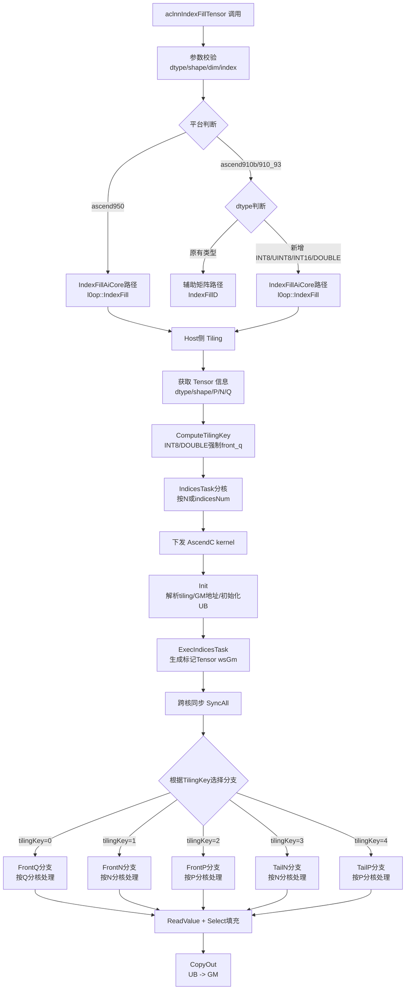

# aclnnIndexFillTensor 算子设计文档

## 一、需求背景

### 1.1 需求来源

通过社区任务完成开源仓算子贡献的需求，补充完善 Ascend C 算子库。为现有的 `aclnnIndexFillTensor` 算子在 Atlas A2 训练系列产品/Atlas A3 系列产品上增加对 `INT16`、`INT8`、`UINT8`、`DOUBLE` 数据类型的支持，以满足网络量化及端侧推理场景对底层核心算子的完备性要求。

- 开源仓地址：[https://gitcode.com/cann/ops-nn](https://gitcode.com/cann/ops-nn)
- 目标修改目录：[https://gitcode.com/cann/ops-nn/tree/master/experimental/index](https://gitcode.com/cann/ops-nn/tree/master/experimental/index)
- 开发语言：Ascend C

### 1.2 背景介绍

#### IndexFillTensor 算子功能说明

`aclnnIndexFillTensor` 算子用于沿输入 `self` 的给定轴 `dim`，将 `index` 指定位置的值使用 `value` 进行非原地填充替换。

**数学公式**：

$$
y_{i_0, \ldots, i_{\text{dim}-1}, j, i_{\text{dim}+1}, \ldots, i_{d-1}} =
\begin{cases}
\text{value}, & \text{if } j \in \text{index} \\
x_{i_0, \ldots, i_{\text{dim}-1}, j, i_{\text{dim}+1}, \ldots, i_{d-1}}, & \text{otherwise}
\end{cases}
$$

其中 $j$ 为 `dim` 轴上的下标，`index` 为指定的填充位置集合（支持负数索引）。

**示例**：

输入 x 为 `[[1, 2, 3], [4, 5, 6], [7, 8, 9]]`

- 若 dim=0，index=[0, 2]，value=0 → 输出 `[[0, 0, 0], [4, 5, 6], [0, 0, 0]]`
- 若 dim=1，index=[0, 2]，value=0 → 输出 `[[0, 2, 0], [0, 5, 0], [0, 8, 0]]`

#### IndexFillTensor 算子现有实现分析

当前算子已有 AscendC 实现的 `IndexFill` 算子，`aclnnIndexFillTensor` 接口内部调用该算子。通过对现有代码的功能分析，各平台支持的数据类型如下：

**ascend910b / ascend910_93（Atlas A2/A3 系列）：**

| 参数名 | 输入/输出/属性 | 支持数据类型 |
| --- | --- | --- |
| self | 输入 | FLOAT16、FLOAT、BF16、INT64、INT32、BOOL |
| dim | 属性 | INT64 |
| index | 输入 | INT32、INT64 |
| value | 输入 | 与 self 一致 |
| out | 输出 | 与 self 一致 |

**ascend950（Ascend 950 系列）：**

| 参数名 | 输入/输出/属性 | 支持数据类型 |
| --- | --- | --- |
| self | 输入 | FLOAT16、FLOAT、BF16、INT64、INT32、BOOL、**INT8、UINT8、INT16、DOUBLE** |
| dim | 属性 | INT64 |
| index | 输入 | INT32、INT64 |
| value | 输入 | 与 self 一致 |
| out | 输出 | 与 self 一致 |

可以看出，**ascend950 平台已经支持了 INT8/UINT8/INT16/DOUBLE 四种数据类型**，而 ascend910b/910_93 平台尚未支持。本任务的核心目标是将这四种数据类型的支持扩展到 Atlas A2/A3 系列产品。

#### 现有 Kernel 侧实现分析

IndexFill 算子的 kernel 侧采用 `sizeof(T)` 进行类型分发：

- `sizeof(T) == sizeof(half)`（2字节）→ 使用 `half` 模板实例化
- `sizeof(T) == sizeof(float)`（4字节）→ 使用 `float` 模板实例化
- `sizeof(T) == 1`（1字节）→ 使用 `uint8_t` 模板实例化，覆盖 INT8/UINT8/BOOL
- 其他（8字节）→ 使用 `uint64_t` 模板实例化，覆盖 INT64/DOUBLE

但是部分 kernel 分支（`index_fill_front_n`、`index_fill_front_p`、`index_fill_tail_n`、`index_fill_tail_p`）仅实例化了 `half` 和 `float` 两种类型，**缺少对 1 字节和 8 字节类型的实例化**。只有 `index_fill_front_q` 分支完整覆盖了所有类型。

此外，arch35（ascend950）的实现采用了新的模板化架构（SIMD/SIMT/SIMT_DenseIndices），已通过 `ComputeTypeGet<T>` 完成类型映射，完整支持所有数据类型。

## 二、需求分析

### 2.1 外部组件依赖

* 依赖 Ascend C 的 `DataCopy`、`Select`、`CompareScalar`、`Duplicate`、`Gather` 等 API
* 依赖原有的 IndexFill 算子框架和 aclnn 接口框架

### 2.2 内部适配模块

| 模块 | 变更项 | 说明 |
| --- | --- | --- |
| `op_host` | `index_fill_def.cpp` | 扩展 ascend910b/ascend910_93 配置的 `xDataType`，新增 INT8/UINT8/INT16/DOUBLE |
| `op_host` | `arch32/index_fill_tiling.cpp` | Tiling 策略需适配新类型：INT8/UINT8 的对齐方式、DOUBLE 的 8 字节内存布局 |
| `op_kernel` | `index_fill_front_n.h` | 补充 `sizeof(T)==1` 和 `sizeof(T)==8` 的模板实例化 |
| `op_kernel` | `index_fill_front_p.h` | 补充 `sizeof(T)==1` 和 `sizeof(T)==8` 的模板实例化 |
| `op_kernel` | `index_fill_tail_n.h` | 补充 `sizeof(T)==1` 和 `sizeof(T)==8` 的模板实例化 |
| `op_kernel` | `index_fill_tail_p.h` | 补充 `sizeof(T)==1` 和 `sizeof(T)==8` 的模板实例化 |
| `op_api` | `aclnn_index_fill_tensor.cpp` | 扩展 `DTYPE_910B_SUPPORT_LIST`，新增 INT8/UINT8/INT16/DOUBLE |
| 文档 | `README.md` | 补充新数据类型支持说明 |

### 2.3 需求描述

在现有 IndexFill 算子的代码基础上进行再开发，使 `aclnnIndexFillTensor` 接口在 Atlas A2 训练系列产品/Atlas A3 系列产品上支持 INT16、INT8、UINT8、DOUBLE 数据类型，然后 `aclnnIndexFillTensor` 接口调用扩展后的 IndexFill 算子。

### 2.4 需求拆解

1. 扩展 IndexFill 算子在 ascend910b/910_93 平台上支持 INT16、INT8、UINT8、DOUBLE 数据类型
2. 修改 `op_host/index_fill_def.cpp` 中 ascend910b/ascend910_93 的数据类型列表，新增四种类型
3. 修改 `op_kernel` 中各分支的类型实例化，补充 1 字节类型（INT8/UINT8/BOOL）和 8 字节类型（INT64/DOUBLE）的模板实例化
4. 修改 `op_host/arch32/index_fill_tiling.cpp` 中 tiling 策略，处理新类型对齐和分块逻辑
5. 修改 `aclnn_index_fill_tensor.cpp` 中 `DTYPE_910B_SUPPORT_LIST`，新增四种类型
6. 更新算子 README 文档，补充支持情况
7. 性能要求：INT16/INT8/UINT8 不劣化于 INT32，DOUBLE 不劣化于 INT64

## 三、需求详细设计

### 3.1 使能方式

| 上层框架 | 涉及的框架勾选 |
| --- | --- |
| TF训练/推理 | |
| Pytorch训练/推理 | |
| ATC推理 | |
| Aclnn直调 | √ |

### 3.2 算子分析

#### 3.2.1 数学公式

$$
y_{i_0, \ldots, i_{\text{dim}-1}, j, i_{\text{dim}+1}, \ldots, i_{d-1}} =
\begin{cases}
\text{value}, & \text{if } j \in \text{index} \\
x_{i_0, \ldots, i_{\text{dim}-1}, j, i_{\text{dim}+1}, \ldots, i_{d-1}}, & \text{otherwise}
\end{cases}
$$

#### 3.2.2 支持数据类型（变更后）

| 数据类型 | 变更前支持 | 本次新增 |
| --- | --- | --- |
| FLOAT16 | √ | |
| FLOAT | √ | |
| BFLOAT16 | √ | |
| INT32 | √ | |
| INT64 | √ | |
| BOOL | √ | |
| INT16 | | √ |
| INT8 | | √ |
| UINT8 | | √ |
| DOUBLE | | √ |

#### 3.2.3 算子特性分析

- **非计算密集型**：算子核心逻辑为条件选择（Select），不涉及复杂数学运算，整数类型无需升精度转换
- **标记 Tensor 与类型解耦**：kernel 侧使用 `half` 类型的标记 Tensor（wsGm）标记需填充位置，通过 `CompareScalar` 生成 mask，与输入数据类型完全解耦
- **多分支 TilingKey**：根据 dim 位置（front/tail）和数据维度（P/N/Q）划分为 5 种分支，不同分支的模板实例化完整度不同
- **跨核同步**：indices 处理阶段需跨核同步（通过 sysGm 标志位），与输入类型无关

### 3.3 算子原型设计

修改 `op_host/index_fill_def.cpp`，为 ascend910b/ascend910_93（Atlas A2/A3 系列）配置新增数据类型：

```cpp
// 新增 ascend910b/ascend910_93 的数据类型列表
static const std::vector<ge::DataType> ascend910bXDataType = {
    ge::DT_FLOAT16, ge::DT_FLOAT, ge::DT_BF16, ge::DT_INT64, ge::DT_INT32, ge::DT_BOOL,
    ge::DT_INT8, ge::DT_UINT8, ge::DT_INT16, ge::DT_DOUBLE,
    ge::DT_FLOAT16, ge::DT_FLOAT, ge::DT_BF16, ge::DT_INT64, ge::DT_INT32, ge::DT_BOOL,
    ge::DT_INT8, ge::DT_UINT8, ge::DT_INT16, ge::DT_DOUBLE};
// index 数据类型同步扩展
static const std::vector<ge::DataType> ascend910bIndicesDataType = {
    ge::DT_INT32, ge::DT_INT32, ge::DT_INT32, ge::DT_INT32, ge::DT_INT32, ge::DT_INT32,
    ge::DT_INT32, ge::DT_INT32, ge::DT_INT32, ge::DT_INT32,
    ge::DT_INT64, ge::DT_INT64, ge::DT_INT64, ge::DT_INT64, ge::DT_INT64, ge::DT_INT64,
    ge::DT_INT64, ge::DT_INT64, ge::DT_INT64, ge::DT_INT64};
```

### 3.4 详细设计

#### 3.4.1 Host 侧设计

##### 1. 分核策略

复用现有 IndexFill 分核策略，根据输入数据形状和 TilingKey 选择不同的分核方式：

- **front_q 分支**（tilingKey=0）：x reshape 为 [P, N, Q]，按 P→N→Q 三级分核
- **front_n 分支**（tilingKey=1）：x reshape 为 [P, N, Q]，按 P→N 二级分核
- **front_p 分支**（tilingKey=2）：x reshape 为 [P, N, Q]，按 P 分核
- **tail_n 分支**（tilingKey=3）：x reshape 为 [P, N]，按 N 分核
- **tail_p 分支**（tilingKey=4）：x reshape 为 [P, N]，按 P 分核

优先使用满核原则，无法整除时余出的数据块分配到前几个核上。

##### 2. 数据分块和内存优化策略

UB 空间主要用于标记 Tensor（wsLocal/half）、输入数据（xLocal/T）、偏移量（offsetLocal/int32_t）和比较掩码（compareMaskLocal/uint8_t）。新增数据类型对 UB 空间的影响分析：

- **INT8/UINT8**（1字节）：单个元素占用空间最小，UB 可容纳更多元素，但 32 字节对齐要求下需确保搬运长度为 32 的整数倍
- **INT16**（2字节）：与 FLOAT16 完全一致，UB 切分策略无需调整
- **DOUBLE**（8字节）：单个元素占用空间最大，UB 切分时 tileDataNum 相应减小，但整体分块逻辑不变

标记 Tensor 使用 `half` 类型存储，与输入数据类型无关，Workspace 计算无需修改。

##### 3. TilingKey 规划策略

当前 `ComputeTilingKey` 中对 `DT_INT64`、`DT_BOOL`、`DT_UINT8` 强制走 `tilingKey=0`（front_q 分支）。新增类型的 TilingKey 规划如下：

| 数据类型 | TilingKey 限制 | 原因 |
| --- | --- | --- |
| INT8 | 强制 tilingKey=0（front_q） | 1 字节类型，front_q 分支已完整覆盖 |
| UINT8 | 已强制 tilingKey=0 | 已有逻辑 |
| INT16 | 不限制，自然选择 | 2 字节类型，与 FLOAT16 一致，所有分支均可走 |
| DOUBLE | 强制 tilingKey=0（front_q） | 8 字节类型，与 INT64 一致，front_q 分支已完整覆盖 |

修改 `ComputeTilingKey` 中的类型判断逻辑：

```cpp
auto dtype = context->GetInputDesc(0)->GetDataType();
if (dtype == ge::DT_INT64 || dtype == ge::DT_BOOL || dtype == ge::DT_UINT8
    || dtype == ge::DT_INT8 || dtype == ge::DT_DOUBLE) {
    tilingData.tilingKey = 0;
}
```

> INT16 不强制限制，可自然走 front_n/front_p/tail_n/tail_p 分支。

#### 3.4.2 Kernel 侧设计

##### 1. 类型分发策略

IndexFill 算子的核心计算逻辑是 `Select(compareMask, xLocal, xLocal, value, SELMODE::VSEL_TENSOR_SCALAR_MODE)`，该 API 对模板类型 `T` 无特殊限制，**支持所有整数和浮点类型**。

标记 Tensor 使用 `half` 类型，通过 `CompareScalar` 生成 mask，与输入数据类型解耦，因此**新类型的引入不需要修改标记 Tensor 的处理逻辑**。

Kernel 侧类型通过 `sizeof(T)` 分发，与数据类型的映射关系：

| sizeof(T) | 实际类型 | 模板实例化类型 |
| --- | --- | --- |
| 1 | INT8, UINT8, BOOL | uint8_t |
| 2 | FLOAT16, INT16 | half |
| 4 | FLOAT, INT32 | float |
| 8 | INT64, DOUBLE | uint64_t |

##### 2. 各分支模板实例化补充

**front_q 分支**（`index_fill_front_q.h`）：已完整支持所有类型，无需修改。

**front_n 分支**（`index_fill_front_n.h`）：当前仅实例化 `half` 和 `float`。需补充：

```cpp
template <typename T, typename U>
__aicore__ void index_fill_front_n(GM_ADDR x, GM_ADDR indices, GM_ADDR value, GM_ADDR y, GM_ADDR workspace,
                                   GM_ADDR tiling, const IndexFillTilingData* tilingData, TPipe* tPipe) {
    if (sizeof(T) == sizeof(half)) {
        IndexFillFrontN<half, U> op;
        op.Init(x, indices, value, y, workspace, tiling, tilingData, tPipe);
        op.Process();
    } else if (sizeof(T) == sizeof(float)) {
        IndexFillFrontN<float, U> op;
        op.Init(x, indices, value, y, workspace, tiling, tilingData, tPipe);
        op.Process();
    } else if (sizeof(T) == 1) {
        // 新增：覆盖 INT8/UINT8/BOOL
        IndexFillFrontN<uint8_t, U> op;
        op.Init(x, indices, value, y, workspace, tiling, tilingData, tPipe);
        op.Process();
    } else {
        // 新增：覆盖 INT64/DOUBLE（8字节类型）
        IndexFillFrontN<uint64_t, U> op;
        op.Init(x, indices, value, y, workspace, tiling, tilingData, tPipe);
        op.Process();
    }
}
```

**front_p 分支**（`index_fill_front_p.h`）：同上补充 `sizeof(T)==1` 和 8 字节实例化。

**tail_n 分支**（`index_fill_tail_n.h`）：当前用 `sizeof(T)==2` 和 `sizeof(T)==4` 判断，需补充 `sizeof(T)==1` 和 `sizeof(T)==8`。

**tail_p 分支**（`index_fill_tail_p.h`）：同上补充。

##### 3. 核心计算流程

以 front_q 分支为例，INT8/UINT8/DOUBLE 的计算流程与现有 INT32/INT64 完全一致：

1. **ExecIndicesTask**：所有核协同处理 indices，生成标记 Tensor（wsGm），标记哪些 N 位置需要填充 value
2. **ReadValue**：从 GM 读取 value 标量
3. **RepeatValue**：将 value 复制 X_UB_LENGTH 份到 UB（使用 SetValue + DataCopy 倍增，兼容所有类型）
4. **FrontAxisQ**：遍历 P 和 N，根据标记 Tensor 决定填充 value 或拷贝原始数据

> **关键点**：`RepeatValue` 函数使用 `SetValue` + `DataCopy` 倍增方式而非 `Duplicate`，正是为了兼容更多数据类型（包括整型），因此新类型无需修改此逻辑。

##### 4. 新增类型数值行为分析

- **INT8/UINT8/INT16**：整数类型，`Select` 直接按位写入，不存在精度损失或溢出问题。value 的类型与 self 一致，标量值在有效范围内直接填充。
- **DOUBLE**：64 位浮点数，在 Ascend C 中通过 `uint64_t` 的 reinterpret 方式处理。`Select` API 支持 8 字节类型，且 `CompareScalar` 使用 `half` 标记 Tensor 生成 mask 与输入类型无关，因此 DOUBLE 类型**无需额外的精度转换**，直接在 kernel 中以 `uint64_t` 模板参数处理即可。

##### 5. Ascend C 实现流程图



#### 3.4.3 aclnn 接口层设计

修改 `aclnn_index_fill_tensor.cpp` 中的 `DTYPE_910B_SUPPORT_LIST`：

```cpp
static const std::initializer_list<op::DataType> DTYPE_910B_SUPPORT_LIST = {
    op::DataType::DT_INT32, op::DataType::DT_FLOAT16, op::DataType::DT_FLOAT,
    op::DataType::DT_INT64, op::DataType::DT_BOOL, op::DataType::DT_BF16,
    op::DataType::DT_INT8, op::DataType::DT_UINT8, op::DataType::DT_INT16,
    op::DataType::DT_DOUBLE};
```

同时修改 `CheckDtypeValid` 函数，确保 ascend910b/910_93 平台使用扩展后的列表：

```cpp
if (Ops::NN::AclnnUtil::IsRegbase()) {
    OP_CHECK_DTYPE_NOT_SUPPORT(self, DTYPE_950_SUPPORT_LIST, return false);
} else if (socVersion == SocVersion::ASCEND910B ||
           socVersion == SocVersion::ASCEND910_93) {
    OP_CHECK_DTYPE_NOT_SUPPORT(self, DTYPE_910B_SUPPORT_LIST, return false);
} else {
    OP_CHECK_DTYPE_NOT_SUPPORT(self, DTYPE_SUPPORT_LIST, return false);
}
```

当 ascend910b/910_93 平台检测到新数据类型时，走 `IndexFillAiCore` 路径（调用 `l0op::IndexFill`），而非辅助矩阵路径（`IndexFillD`）。

### 3.5 支持硬件

| 支持的芯片版本 | 涉及勾选 |
| --- | --- |
| Atlas A2 训练系列产品（ascend910b） | √ |
| Atlas A3 系列产品（ascend910_93） | √ |

### 3.6 算子约束限制

1. dim 的取值范围在 [-self.dim(), self.dim())，当 self 为 0 维时，dim 的取值范围在 [-1, 1)
2. index 中的元素值需小于 self 对应 dim 的维度大小，支持负数索引
3. value 的数据类型需可转化为 self 的数据类型
4. 输入 self 和输出 out 的 shape 必须一致
5. 张量最大维度数为 8
6. 非连续 Tensor 支持：self 和 out 均支持非连续 Tensor

## 四、特性交叉分析

IndexFill 为索引填充类算子，计算逻辑为条件选择（Select），不涉及广播、归约、量化等复杂操作。新增数据类型不引入新的特性交叉风险：

- **与广播无关**：算子不支持广播，输入输出 shape 严格一致
- **与量化无关**：新增整数类型为原生数据类型，不涉及量化/反量化转换
- **与图模式无关**：仅通过 aclnn 直调方式使能

## 五、可维可测分析

### 5.1 精度标准/性能标准

| 验收标准 | 描述 | 标准来源 |
| --- | --- | --- |
| 精度标准 | 满足 AscendOpTest 工具默认阈值 | 任务书 |
| 性能标准 | INT16/INT8/UINT8 不劣化于 INT32；DOUBLE 不劣化于 INT64 | 任务书 |

### 5.2 测试覆盖场景

1. 常规场景：各类 shape、不同 dim、不同 index 组合
2. 边界场景：空 Tensor、0 维 Tensor、dim=0、负数索引、index 为空
3. 数据类型场景：INT8/UINT8/INT16/DOUBLE 分别与 INT32/INT64/FLOAT16 对比验证
4. 非连续 Tensor 场景：self 和 out 均为非连续 Tensor
5. 大 shape 场景：验证各 TilingKey 分支的正确性
6. 原有数据类型回归：确保 FLOAT16/FLOAT/INT32/INT64/BOOL/BF16 功能不受影响

### 5.3 兼容性分析

本次变更为扩展现有算子支持的数据类型，不影响已有数据类型的功能和性能，**向下兼容**。新增数据类型仅在 ascend910b/910_93 平台上生效，ascend950 平台已有支持不受影响。

## 六、版本与仓库信息

- **上游开源仓地址**：[https://gitcode.com/cann/ops-nn](https://gitcode.com/cann/ops-nn)
- **目标修改目录**：[https://gitcode.com/cann/ops-nn/tree/master/experimental/index](https://gitcode.com/cann/ops-nn/tree/master/experimental/index)
- **开发语言**：Ascend C

## 七、变更文件清单

| 序号 | 文件路径 | 变更类型 | 变更说明 |
| --- | --- | --- | --- |
| 1 | `index/index_fill/op_host/index_fill_def.cpp` | 修改 | 扩展 ascend910b/ascend910_93 配置的 DataType 列表，新增 INT8/UINT8/INT16/DOUBLE |
| 2 | `index/index_fill/op_host/arch32/index_fill_tiling.cpp` | 修改 | `ComputeTilingKey` 中新增 INT8/DOUBLE 强制走 front_q 分支的判断 |
| 3 | `index/index_fill/op_host/config/ascend910b/index_fill_binary.json` | 修改 | 补充新数据类型的编译条目 |
| 4 | `index/index_fill/op_host/config/ascend910_93/index_fill_binary.json` | 修改 | 补充新数据类型的编译条目（Atlas A3） |
| 5 | `index/index_fill/op_kernel/index_fill_front_n.h` | 修改 | 补充 `sizeof(T)==1` 和 8 字节类型的模板实例化 |
| 6 | `index/index_fill/op_kernel/index_fill_front_p.h` | 修改 | 补充 `sizeof(T)==1` 和 8 字节类型的模板实例化 |
| 7 | `index/index_fill/op_kernel/index_fill_tail_n.h` | 修改 | 补充 `sizeof(T)==1` 和 8 字节类型的模板实例化 |
| 8 | `index/index_fill/op_kernel/index_fill_tail_p.h` | 修改 | 补充 `sizeof(T)==1` 和 8 字节类型的模板实例化 |
| 9 | `index/index_fill_d/op_api/aclnn_index_fill_tensor.cpp` | 修改 | 扩展 `DTYPE_910B_SUPPORT_LIST`，新增 INT8/UINT8/INT16/DOUBLE |
| 10 | `index/index_fill/README.md` | 修改 | 补充新数据类型支持说明 |
