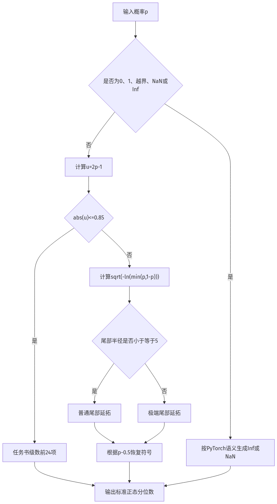
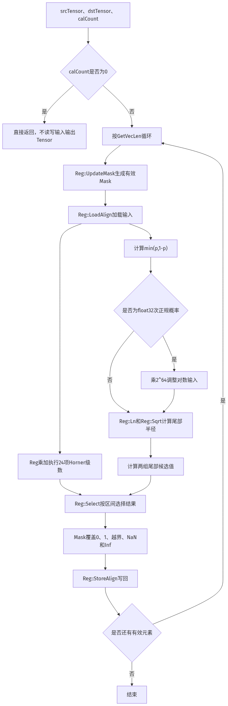

# 需求描述

## 需求来源

CANN社区任务，参考PyTorch IR `prims.ndtri`，在Ascend 950PR上使用Ascend C基础API实现Ndtri高阶API。接口输入概率$p$，逐元素输出标准正态分布的分位数$x$，满足：

$$
P(Z\le x)=p
$$

任务书给出的计算公式为：

$$
\mathrm{Ndtri}(p)=\sqrt{2}\,\sum_{k=0}^{\infty}c_k
\left(\frac{p-1/2}{1/2}\right)^{2k+1}
$$

本任务支持`float（float32）`和ND格式，适配及验收硬件为Ascend 950PR，开发和自验证使用任务指定的CANN 9.1环境。

## 需求分析

Ndtri是标准正态分布累积分布函数的反函数。令：

$$
u=\frac{p-1/2}{1/2}=2p-1
$$

则任务书公式可写为：

$$
\mathrm{Ndtri}(p)=\sqrt{2}\,\mathrm{erf}^{-1}(u)
=\sqrt{2}\,\sum_{k=0}^{\infty}c_k u^{2k+1}
$$

设备侧不能直接计算无穷项，因此需要在满足精度要求的前提下截断级数。数值实验表明，在$|u|\le0.85$时取前24项可以满足任务书的float32双万分之一精度要求。设备实现采用Horner形式：

$$
\mathrm{Ndtri}_{24}(p)=\sqrt{2}\,u
\left(c_0+u^2\left(c_1+u^2\left(\cdots+u^2c_{23}\right)\right)\right)
$$

当$p$接近0或1时，$|u|$接近1，固定24项级数的收敛速度不足以覆盖极端概率和float32次正规数。该区域使用固定阶尾部延拓计算。任务书级数是中央区的直接计算公式，尾部延拓只用于固定项数级数无法满足精度的区域。

输入边界语义与PyTorch `prims.ndtri`保持一致：

| 输入 | 输出 |
| --- | --- |
| $0<p<1$ | 标准正态分布对应分位数 |
| $p=0$ | $-\infty$ |
| $p=1$ | $+\infty$ |
| $p<0$或$p>1$ | NaN |
| NaN、$+\infty$、$-\infty$ | NaN |

其中，$p<0$、$p>1$以及正负Inf均属于越界或非法输入。除正常概率外，自验证需要覆盖越界值、极端概率、NaN和Inf，并按照任务书要求提供完整日志、整体通过截图和性能截图。

接口处理连续LocalTensor中的有效元素，不依赖逻辑维数。ND是调用方的逻辑数据格式，LocalTensor本身不携带格式元数据；标量和任意shape均按连续元素展平处理，输出shape和元素顺序由调用方保持。非连续数据由调用方连续化后传入。

交付内容包括API实现、中文接口文档、README、Kernel UT和多场景功能及性能自验证工程。

# 方案设计

## 接口内部实现

Ndtri共1个输入和1个输出。输入、输出数据类型均为float。接口使用Ascend C Reg矢量计算API，按一个矢量长度（VL）分批将LocalTensor数据加载到`RegTensor`，同时计算任务书级数、普通尾部和极端尾部候选值，通过`MaskReg`选择有效区间，最后覆盖特殊值并写回目标LocalTensor。接口计算流程如下图所示：


$$图1\ 接口计算流程图$$

图1描述接口对各类输入应呈现的语义流程。为避免逐lane分支，实际实现不会先退出特殊值分支，而是先计算各区间候选值，再通过Mask选择区间并覆盖0、1、越界值和NaN；实际指令组织以图2为准。

输入输出数据位于Local Memory，计算中间结果保存在`RegTensor`和`MaskReg`中。接口通过Reg数据搬入、Reg计算和Reg数据搬出接口完成计算，不申请额外临时Tensor，也不调用`PopStackBuffer`。将计算过程拆解为Ascend C基础API后，函数实现流程如下图所示：


$$图2\ 函数实现流程图$$

中央区24个$c_k$由任务书中的逆误差函数幂级数离线高精度展开得到，并以`constexpr float`保存。尾部计算令：

$$
t=\min(p,1-p),\qquad r=\sqrt{-\ln(t)}
$$

当$r\le5$时，以$r-1.6$为自变量计算第一组固定阶有理式；当$r>5$时，以$r-5$为自变量计算第二组固定阶有理式。两组尾部系数来源于Wichura Algorithm AS 241及R数学库`qnorm.c`公开实现，仅作为任务书级数的尾部延拓。

对于$t<2^{-126}$的float32次正规概率，先计算：

$$
t'=t\times2^{64}
$$

再恢复：

$$
\ln(t)=\ln(t')-64\ln2
$$

避免直接对极小次正规数计算对数时丢失有效范围。

## 接口设计

### Kernel侧接口

带临时Tensor的接口：不提供。Ndtri的中间结果全部保存在`RegTensor<float>`和`MaskReg`中，不需要额外Local Memory临时空间。

不带临时Tensor的接口包括指定计算元素数和处理整个源Tensor两种形式：

```cpp
template <typename T, bool isReuseSource = false>
__aicore__ inline void Ndtri(const LocalTensor<T>& dstTensor,
    const LocalTensor<T>& srcTensor, const uint32_t calCount)
```

```cpp
template <typename T, bool isReuseSource = false>
__aicore__ inline void Ndtri(const LocalTensor<T>& dstTensor,
    const LocalTensor<T>& srcTensor)
```

通用参数说明：

表1 模板参数说明

| 参数名 | 描述 |
| --- | --- |
| T | 操作数的数据类型。Ascend 950PR支持的数据类型为float（float32）。 |
| isReuseSource | 源操作数复用预留参数，当前实现不使用该参数，传入默认值false。 |

表2 接口参数说明

| 参数名 | 输入/输出 | 描述 |
| --- | --- | --- |
| dstTensor | 输出 | 目的操作数，类型为LocalTensor，支持的TPosition为VECIN、VECCALC、VECOUT。元素数不得小于实际计算元素数。 |
| srcTensor | 输入 | 源操作数，元素值表示概率，类型为LocalTensor，支持的TPosition为VECIN、VECCALC、VECOUT。数据类型需要与dstTensor保持一致。输入输出地址分离时，接口不修改源Tensor。 |
| calCount | 输入 | 参与计算的元素数，取值范围为[0, min(srcTensor.GetSize(), dstTensor.GetSize())]。取值为0时接口直接返回，不读取srcTensor、不写入dstTensor；不传入时，计算srcTensor.GetSize()个元素。 |

Kernel接口约束说明

- 当前仅支持Ascend 950PR的AI Vector Core。
- 当前仅支持float（float32）数据类型。ND为调用方逻辑数据格式，接口按连续LocalTensor元素处理。
- srcTensor和dstTensor的起始地址需要保证32字节对齐。
- 非32字节整数倍的有效元素数由最后一轮Vector Mask处理。
- calCount为0时接口执行空操作，输入输出Tensor内容均保持不变。
- 输入输出地址分离时，接口调用后srcTensor保持不变。
- 支持srcTensor和dstTensor起始地址完全相同的原地计算。
- 不支持srcTensor和dstTensor部分地址重叠。
- 接口只处理LocalTensor。GM与Local Memory之间的搬运、非对齐搬运、分核和大shape分块由调用方负责。
- 纯SIMT编译模式不支持该接口。

### Host侧接口

#### 获取Ndtri完成所有临时空间大小接口

不提供。Ndtri接口不需要额外临时Tensor，所需临时空间大小固定为0，因此无需提供最大、最小临时空间查询接口。

#### 获取Ndtri tiling结构接口

不提供。Ndtri为逐元素高阶API，不感知全局shape和核数，数据规模通过Kernel侧参数`calCount`表达。调用方根据UB容量完成分核、分块和GM/UB搬运，不需要Ndtri Host Tiling结构。

## 测试用例设计

| 用例编号 | 测试项 | 测试前端表达 |
| --- | --- | --- |
| 1 | 中央区任务书级数 | 输入float（float32）、ND格式，覆盖0.5及普通随机概率，与SciPy golden对比 |
| 2 | 任务书级数截断边界 | 输入$|2p-1|=0.85$边界两侧相邻float32值，验证分段连续性和精度 |
| 3 | 普通尾部 | 输入$10^{-2}$、$10^{-5}$、$10^{-10}$及其可表示上尾对称值，与SciPy golden对比 |
| 4 | 极端尾部 | 输入$10^{-20}$、$10^{-30}$和最小正float32概率，与SciPy golden对比 |
| 5 | 正规数和次正规数边界 | 输入最小正规数、最大次正规数和最小正次正规数，验证对数缩放路径 |
| 6 | 边界值0和1 | 输入0、1，输出分别为负无穷和正无穷且符号正确 |
| 7 | 非法值 | 输入小于0、大于1、NaN和正负Inf，输出为NaN |
| 8 | 对齐shape | 输入float（float32）、ND格式、shape为[32]，验证32字节对齐场景 |
| 9 | 非对齐shape | 输入float（float32）、ND格式、shape为[1]和[1023]，验证最后一轮Vector Mask |
| 10 | 零元素空操作 | calCount取0，Kernel UT验证该调用形式可正常执行，并检查实现是否在访问输入输出地址前直接返回 |
| 11 | 指定calCount重载 | 显式传入calCount，计算指定数量的有效元素并与SciPy golden对比 |
| 12 | 整Tensor重载 | 不传calCount，计算srcTensor.GetSize()个元素并与SciPy golden对比 |
| 13 | 完全同址原地计算 | srcTensor和dstTensor使用完全相同起始地址，计算结果与SciPy golden对比 |
| 14 | 源数据完整性 | srcTensor和dstTensor地址分离，调用前后逐字节比较源Tensor |
| 15 | 大shape分块 | 输入shape为[65536]，调用方按UB容量分块，验证分块结果一致性 |
| 16 | Kernel UT | 覆盖calCount为0、指定calCount、整Tensor和原地计算四种调用形式；UT用于验证编译和调用形式，数值精度由NPU自验证用例验证 |
| 17 | 性能验证 | 输入shape分别为[1024]、[4096]、[8192]、[16384]、[32768]、[65536]，使用msProf统计AIV_VEC流水占比 |

# 可维可测

## 精度标准/性能标准

| 验收标准 | 描述(不涉及说明原因) | 标准来源 |
| --- | --- | --- |
| 精度标准 | 对有限值计算绝对误差和相对误差；当绝对误差大于$10^{-4}$且相对误差大于$10^{-4}$时记为错误数据，错误数据比例不超过$10^{-4}$。golden为NaN时按分类比较，golden为Inf时按符号比较。 | Ndtri任务书及官方自验证样例 |
| 性能标准 | 1K、4K、8K、16K、32K、64K六档数据量的AIV_VEC流水占比均超过90%。 | Ndtri任务书及官方自验证样例 |

AIV_VEC流水占比按照官方自验证样例计算：

$$
\mathrm{AIV\_VEC占比}=\frac{computeTime}{total2-total1}
$$

其中，`total1`为纯搬运空跑基线的AIV时间，`total2`为搬运加1000次计算场景的AIV时间，`computeTime`为计算场景的AIV_VEC时间。原始`op_summary`、计算过程、完整日志、整体通过截图和性能截图保存在自验证报告中。

设计文档更新后，按照任务书要求在asc-devkit仓提交文档评审Issue；如方案更新，评审时间同步刷新。

## 兼容性分析

Ndtri为新增高阶API，不修改既有接口，不涉及已有接口兼容性。公共接口通过`adv_api/math/ndtri.h`和`adv_api/kernel_api.h`提供。未支持的数据类型在编译期报错，不执行隐式数据类型转换。

本设计和验证结论仅针对任务书指定的Ascend 950PR。同架构其他产品是否纳入正式产品支持范围，以仓库产品支持规范和对应硬件验证结果为准。
