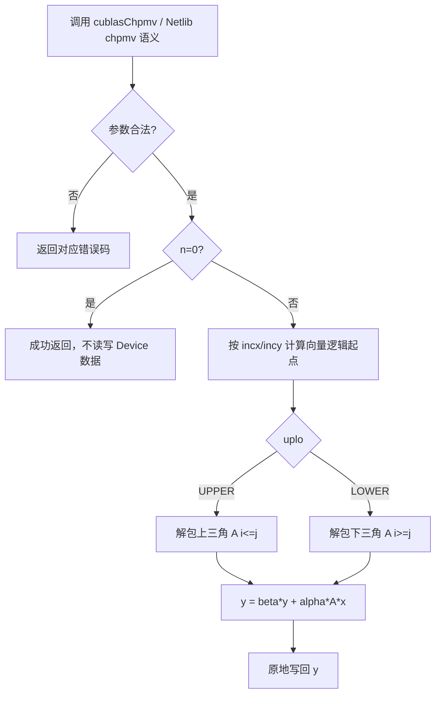
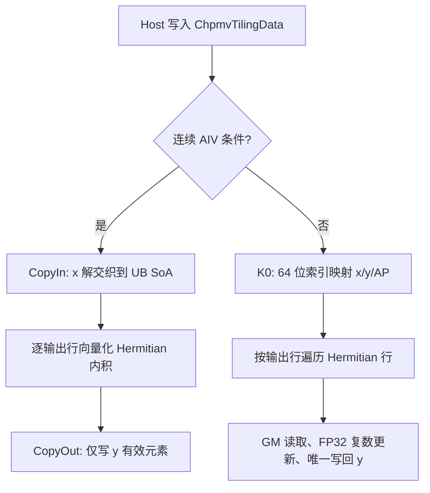

# 一、需求背景

## 1.1 需求来源

Ascend CANN 社区任务：在 Ascend 950PR 上基于 ops-blas 工程实现单精度复数（complex64）Hermitian（厄米特）压缩存储矩阵-向量乘算子 `aclblasChpmv`，并与 cuBLAS `cublasChpmv` / Netlib `chpmv` 的数学语义对齐。作者/提交人：JaneConan。

## 1.2 背景介绍

### 1.2.1 标杆来源、TBE 源码与算子信息库核查

本任务是向 `ops-blas` 增加公共 BLAS 接口 `aclblasChpmv` 的 Ascend C Kernel 直调实现，不是将既有 ACLNN/TBE 算子迁移为 Ascend C。因此，下列审核项的结论是**不适用**，而不是缺少材料：

| 审核对象 | 核查结论 | 依据及替代参考 |
| --- | --- | --- |
| 原 TBE 算子源码路径（含文件名） | 不适用：任务书未给出 `aclblasChpmv` 的 TBE 实现，目标仓也不存在该 complex64 接口 | 数学与 API 语义以 cuBLAS `cublasChpmv` 和 Netlib `chpmv.f` 的 Hermitian 压缩矩阵-向量乘为准 |
| 算子信息库路径（含文件名） | 不适用：本任务不注册 ACLNN 算子，不使用 ACLNN 算子信息库 | 公共接口声明位于 `ops-blas/include/cann_ops_blas.h`；接口不是 `aclnn*` |
| 可复用工程实现 | 适用 | `ops-blas/blas/spmv/arch35/`（同族实数 `aclblasSspmv` 的句柄、stream 与启动框架）及 `ops-blas/blas/spmv/README.md` |

因此本文不会把同族实数 `Sspmv` 误写成 `Chpmv` 的 TBE 标杆，也不会虚构 ACLNN 接口或算子信息库文件；它只作为工程接入参考。复数语义、Hermitian 共轭、压缩打包与特殊值行为仍以任务书指定的 cuBLAS/Netlib 参考为准。

### 1.2.2 aclblasChpmv 标杆算子现状分析

`aclblasChpmv` 是 BLAS HPMV 的 complex64 版本，面向 Hermitian 矩阵以**压缩（packed）格式**存储、原地计算输出向量 `y = alpha * A * x + beta * y`。正式实现位于 ops-blas：

```text
include/cann_ops_blas.h                      # 公共 C API（新增声明）
blas/spmv/arch35/chpmv_host.cpp              # Host 参数校验、tiling、stream launch
blas/spmv/arch35/chpmv_tiling_data.h         # Host–Kernel tiling ABI
blas/spmv/arch35/chpmv_kernel.cpp            # 通用 K0 基线 Kernel
blas/spmv/arch35/chpmv_aiv_kernel.cpp        # AIV 连续步长优化 Kernel（K1）
test/spmv/chpmv/arch35/                       # CSV、GTest 与 NPU wrapper、CPU Golden
```

#### 1.2.2.1 标杆支持的数据类型和数据格式

ops-blas 已有 `aclblasSspmv` 同族实现，可复用工程接入、句柄与 stream 绑定、Kernel 启动及构建自动发现机制；但**不能**直接复用其数值实现（实对称 vs 复 Hermitian、且无 `beta`）：

| 项目 | Chpmv 要求 |
| --- | --- |
| 数据类型 | `aclblasComplex`，实部与虚部均为 FP32 的 complex64 |
| 矩阵存储 | `AP`：长度 `n(n+1)/2` 的压缩向量，**无前导维度（lda）参数** |
| Hermitian 性质 | `A = A^H`；对角元素虚部假定为 0（AP 中对角虚部不被引用，只取实部） |
| 转置语义 | 由 Hermitian 共轭对称隐含；`A(i,j) = conj(A(j,i))` |
| 步长 | `incx`、`incy` 支持正负非零步长；`beta=(0,0)` 时不读旧 `y` |

#### 1.2.2.2 标杆实现描述

任务指定的语义标杆为 Netlib `chpmv.f` 的 Hermitian 压缩遍历规则，并与 cuBLAS `cublasChpmv` 的参数序列保持一致：先检查 `uplo/n/incx/incy/alpha/beta/AP/x/y`，对 `n=0` 做 quick return；随后按 `uplo` 解包打包三角，对每个输出 `y[i]` 累加 Hermitian 行 `sum_j A(i,j)*x[j]`（对角取实部、非对角取共轭对称项）。

#### 1.2.2.3 标杆算子实现流程图



## 1.3 aclblasChpmv 算子功能分析

计算公式：

```text
y = alpha * A * x + beta * y
```

其中 `alpha`、`beta` 为 complex64 标量，`x`、`y` 为 `n` 元素 complex64 向量，`A` 为 `n×n` Hermitian 矩阵，以压缩格式存于 `AP`（长度 `n(n+1)/2`）。对每个输出逻辑下标 `i`（0 基，物理位置 `i*incy`）：

```text
y[i] = beta * y[i] + alpha * ( sum_{j=0}^{n-1} A(i,j) * x[j] )
```

`A` 的 Hermitian 性质：对角 `A(i,i)` 为实数（虚部忽略），非对角 `A(i,j)=conj(A(j,i))`。因仅 `uplo` 指定的一半三角被打包，另一半经共轭对称隐含引用。

输入：`handle`、`uplo`、`n`、`alpha`、`AP`、`x`、`incx`、`beta`、`y`、`incy`。
输出：原地更新 `y`（逻辑长度 `n`）。

支持数据类型：仅 complex64（`aclblasComplex`）。
支持广播：不涉及。该接口是 BLAS 向量/矩阵接口，`AP/x/y` 通过 `n/incx/incy` 描述逻辑布局，不定义张量广播语义。

# 二、需求分析

## 2.1 外部组件依赖

| 组件 | 适配状态 | 用途 |
| --- | --- | --- |
| CANN 9.1.0 Ascend C / ACL runtime | 已适配 | 编译 Kernel、管理 Device 内存与在 stream 上启动 Kernel |
| Ascend 950PR（arch35，DAV_3510） | 已适配 | 本任务唯一正式验收硬件（UB 248KB、28 个 AIV 核） |
| cuBLAS / Netlib | 不作为运行时或生产依赖 | 仅作为 API/数学语义参考；Golden 由仓内独立 CPU 实现（`cblas_chpmv`，CblasColMajor）生成 |

不新增 CATLASS、GEMM、TBE、ACLNN 或其他生产第三方依赖。本算子为典型**访存受限（memory-bound）**的 level-2 BLAS（算术强度≈0.5 flop/byte，见 §3.2 推导），使用 AIV（向量）单元而非 Cube 单元。

## 2.2 内部适配模块

| 模块 | 仓内位置 | 适配内容 |
| --- | --- | --- |
| 公共 BLAS API | `include/cann_ops_blas.h` | 新增可供其他产品线复用的 `aclblasChpmv` 声明 |
| 句柄与 stream | `blas/spmv/arch35/chpmv_host.cpp` | 从 `aclblasHandle_t` 获取已绑定 stream，异步 launch |
| Kernel 与 tiling ABI | `blas/spmv/arch35/chpmv_*.{cpp,h}` | K0 通用基线、K1 AIV 连续优化及 `ChpmvTilingData` |
| 构建与测试 | `test/spmv/chpmv/` | CSV 参数化 GTest、NPU wrapper、独立 CPU Golden 与性能记录 |

## 2.3 需求模块设计

### 2.3.1 Ascend C 算子原型

使用 Ascend C 实现 `aclblasChpmv`，在 Ascend 950PR（arch35）上支持 complex64 的 UPPER/LOWER 压缩 Hermitian 矩阵-向量乘、原地 `beta*y` 项、非连续向量和正负步长；通过 handle 所绑定的 stream 异步启动 Kernel。

### 2.3.2 Ascend C 算子相关约束

1. 在 `include/cann_ops_blas.h` 新增与 cuBLAS 参数顺序一致的公共接口：

   ```cpp
   aclblasStatus_t aclblasChpmv(
       aclblasHandle_t handle,
       aclblasFillMode_t uplo,
       int n,
       const aclblasComplex* alpha,
       const aclblasComplex* AP,
       const aclblasComplex* x, int incx,
       const aclblasComplex* beta,
       aclblasComplex* y, int incy);
   ```

2. 支持 complex64 普通复乘、复加与共轭，保持 FP32 分量计算；对角元素只取实部参与计算，不写回、不校验对角虚部。
3. 支持 `ACLBLAS_UPPER` 与 `ACLBLAS_LOWER`，且只引用 `uplo` 指定三角；另一半由共轭对称隐含（不读、不写）。
4. 支持 `incx`、`incy` 为任意非零 `int`（含 `±1/±2/±3` 及更大绝对值），逻辑下标按带符号步长寻址。
5. 支持合法 quick return：`n == 0` 时不读取 Device 数据、不写 `y`、不启动 Kernel；`beta=(0,0)` 时不读旧 `y`；`alpha=(0,0)` 时结果为 `beta*y`（通用路径仍按 Hermitian 行累加，但 `alpha=0` 与含 Inf/NaN 的 `AP/x` 不得组合，故无需短路保护）。
6. 以正确性优先的通用 Kernel（K0）为基线；在 950PR profiling 有证据后，以向量缓存、连续访问和 UB 复用优化性能，目标不低于任务提供的 GPU 标杆的 0.4 倍（即 ≤2.5× GPU 平均耗时）。

#### 2.3.2.1 设计原则与非目标

| 原则 | 设计约束 |
| --- | --- |
| 单一公共接口 | 只新增 `aclblasChpmv`，不定义 950PR 私有 API、Device alpha/beta 模式、批量接口或 int64 公共签名 |
| Hermitian 语义优先 | 不展开完整 `n×n` 矩阵、不补另一半三角、不引入 GEMV 中间矩阵；按打包三角 + 共轭对称直接计算 |
| 正确性优先 | K0 通用路径覆盖所有合法布局；性能路径不适用时必须回退 K0，不得缩小 API 支持范围 |
| 证据驱动优化 | tile 大小、核心数、双缓冲与向量化仅由目标设备编译资源报告和 profiling 决定，不按固定性能 case 名称分派 |
| 无隐式同步 | API 只向 `handle` 绑定 stream 入队；异步错误由调用方在该 stream 同步时获得 |

不在本次范围内：arch22/arch20 Kernel 移植、全仓框架重构、引入 CATLASS/GEMM 依赖、改变现有 `aclblasSspmv` 行为、自动生成或覆盖用户提供的性能基线。

# 三、需求详细设计

## 3.1 调用方式

本算子采用 **ops-blas 句柄式 BLAS API + Ascend C Kernel 直调**，不是 ACLNN 或 PyTorch 框架算子。调用方创建 handle 并以 `aclblasSetStream` 绑定 stream，将 Host `alpha/beta` 和 Device `AP/x/y` 传入 `aclblasChpmv`；Host 校验和 tiling 后仅向该 stream 异步入队。调用方在读回 `y` 前负责同步同一 stream。


## 3.2 需求总体设计

### 算子数据模型

#### 数学公式

```text
y := alpha * A * x + beta * y
```

复数乘法按实部/虚部分量展开，`conj(a+bi) = a-bi`：

```text
(a+bi)*(c+di) = (ac - bd) + i*(ad + bc)
```

#### 支持数据类型

| 参数 | 数据类型 | 存储位置 |
| --- | --- | --- |
| `alpha`、`beta` | `const aclblasComplex*` | Host 标量 |
| `AP` | `const aclblasComplex*` | Device，只读（长度 `n(n+1)/2`） |
| `x` | `const aclblasComplex*` | Device，只读 |
| `y` | `aclblasComplex*` | Device，原地读写 |
| 索引与步长 | `int` API 入参；Kernel ABI 中步长为 `int64_t` | Host / Kernel tiling |

#### 支持形状与布局（压缩 Hermitian 索引）

`AP` 无前导维度。令 `N=n`，`UPPER` 时 `A(i,j)(i≤j)` 存于 `AP[idxU(i,j)]`，`LOWER` 时 `A(i,j)(i≥j)` 存于 `AP[idxL(i,j)]`：

```text
idxU(i,j) = i + j*(j+1)/2                       # i<=j，上三角按列打包
idxL(i,j) = i + ((2*N - j - 1) * j) / 2        # i>=j，下三角按列打包（等价 j*(2*N-j+1)/2 + (i-j)）
```

对任意 `(i,j)`，Hermitian 项归一为：

```text
# 对角（只取实部）
if i == j:
    a_real = real( AP[ idx(i,i) ] )            # idx = idxU 或 idxL，i==j 时两者相等
    term   = a_real * x[i]
# 非对角：i<j 时直接取存于上三角的 A(i,j)；i>j 时取存于上三角的 A(j,i) 再取共轭
elif i < j:
    aij = AP[ idxU(i,j) ]                       # 上三角被打包
    term = aij * x[j]
else: # i > j
    aji = AP[ idxU(j,i) ]                       # = conj(A(i,j))，上三角被打包
    term = conj(aji) * x[j]
yi += alpha * term
```

> 该归一式只依赖**上三角被打包**这一事实（无论 `uplo=UPPER` 还是 `LOWER`，`A(i,j)` 与 `A(j,i)` 中恰有一个存于 `AP`，另一由其共轭得到），因此 Kernel 可统一用 `idxU` 寻址，仅需据 `uplo` 决定**遍历哪些 (i,j) 组合**（UPPER 覆盖 `i<=j` 的打包值，LOWER 覆盖 `i>=j` 的打包值）。

| 项目 | 支持范围 |
| --- | --- |
| 矩阵阶数 | `n >= 0`，运行时入参；`AP` 物理长度 `≥ n(n+1)/2` |
| 选择三角 | UPPER：`i<=j` 被打包；LOWER：`i>=j` 被打包 |
| 向量逻辑元素 | `x[startX + i*incx]`、`y[startY + i*incy]` |
| 负步长起点 | `start = (1 - n) * inc`，等价于 `(n-1)*(-inc)` |
| 广播 | 不支持，也不适用 |

#### 算术强度与瓶颈预判（memory-bound 论证）

对 `n` 阶问题：打包 `AP` 字节数 `= 16 * n(n+1)/2 ≈ 8n²`；因每个打包元素同时贡献到 `y[i]` 与 `y[j]` 两个输出元素，被读约 2 次 → `AP` GM 流量 `≈16n²`；向量 `x` 缓存一次 `≈16n`；`y` 读/写各 `16n`。总 GM 流量 `≈16n²` 字节。浮点运算量 `≈8n²` flop（每输出 `n` 个复数乘加）。算术强度 `≈8n²/16n² = 0.5` flop/byte（保守口径），远低于 950PR 向量单元算力/带宽比 → **访存受限**。故优化重点是 GM 合并访问、`x` 的 UB 缓存与向量化，而非 Cube/计算密度。

### 3.2.1 Host 侧设计

Host 侧职责是校验公共接口契约、构造稳定的 Host–Kernel tiling 数据，并在 handle 绑定 stream 上异步启动 Kernel；Host 侧不做 `aclrtSynchronizeStream`。

#### 3.2.1.1 参数校验与启动边界（严格遵循任务书 §2.5 顺序）

| 顺序 | 条件 | 行为 |
| --- | --- | --- |
| 1 | `n < 0` | 返回 `ACLBLAS_STATUS_INVALID_VALUE` |
| 2 | `handle == nullptr` | 返回 `ACLBLAS_STATUS_HANDLE_IS_NULLPTR` |
| 3 | `n == 0` | 返回 `ACLBLAS_STATUS_SUCCESS`；不读取 `AP/x/y/alpha/beta`，不启动 Kernel |
| 4 | `uplo` 非 UPPER/LOWER | 返回 `ACLBLAS_STATUS_INVALID_VALUE` |
| 5 | `incx == 0` 或 `incy == 0` | 返回 `ACLBLAS_STATUS_INVALID_VALUE` |
| 6 | `alpha == nullptr` 或 `beta == nullptr` | 返回 `ACLBLAS_STATUS_INVALID_VALUE` |
| 7 | `n > 0` 且 `AP == nullptr` 或 `x == nullptr` 或 `y == nullptr` | 返回 `ACLBLAS_STATUS_INVALID_VALUE` |
| 8 | 其他合法输入 | 计算 tiling 并异步调用 Kernel，返回 `ACLBLAS_STATUS_SUCCESS` |

该顺序使合法 `n=0` no-op 可传递空 Device 指针，但不会掩盖非法 `n`、空 handle、非法枚举、零步长或空数据指针。任务书将非法 `uplo` 的返回码定义为 `ACLBLAS_STATUS_INVALID_VALUE`（非独立枚举码）。`-0.0` 的实部/虚部均视为零；含 NaN 的 `alpha/beta` 不是零，进入复数计算路径。`n=0` 时 `alpha/beta` 指针必须非空，但不读取其内容。

#### 3.2.1.2 分核、分块与 LocalMemory 优化策略

按**输出行 `i`** 划分工作，每个输出元素由唯一执行单元写出，避免跨核写冲突：

- 连续 `incx=incy=1` 且 `1≤n≤N_AIV_CACHE`（如 `N_AIV_CACHE=8192`）时，AIV 的 `numBlocks = min(n, aivCoreNum)`；其他布局按 `n`、SIMT 最小线程数和实际核数确定通用路径网格；
- `rowsPerBlock = ceil(n / numBlocks)`，并以 `numThreads` 对齐 SIMT 最小线程数且不超过硬件上限；
- Host 将 `n`、`uplo`、`alpha`、`beta` 的实虚部及带符号 `incx/incy` 写入 `ChpmvTilingData`；
- 所有乘法前的地址和步长计算在 Kernel 中提升到足够宽的有符号类型，避免负步长和大索引溢出。

AIV 路径的 LocalMemory（UB）规划：将整个 `x` 解交织为 2 个 float 平面（实部/虚部）缓存于 UB，容量 `16n` 字节；`y` 的输入/输出列段与当前 `AP` 块各占 2 个平面；剩余 UB 用于双缓冲 `AP` 流。以 `n≤8192` 计，`x` 缓存 `128KB`，加上 `y`（`≤16KB`）与 `AP` 双缓冲块，总 UB 占用在 248KB 上限内；更大 `n` 时 `x` 按 `X_CAP` 行分块迭代（见 §3.2.2.4）。

#### 3.2.1.3 tilingKey 规划策略

该 ops-blas 直调工程不使用 ACLNN/TBE 框架的 `tilingKey`。等价的可审计分派信息以 `ChpmvTilingData` 字段和 Host launch 条件传递，不能虚构未实现的 key 值：

| 分派标识 | 条件 | Kernel / 资源策略 |
| --- | --- | --- |
| K1 AIV 连续路径 | `incx=1`、`incy=1`、`1≤n≤N_AIV_CACHE` | 按 `numBlocks=min(n,aivCoreNum)` 分核；UB 缓存 `x` SoA，向量化内积 |
| K0 通用路径 | 其他合法布局，含负步长、非 1 步长、大 `n` | 64 位索引、GM 直访 `x`、按输出行唯一写回 |

`ChpmvTilingData` 传递 `n/uplo/alpha/beta/incx/incy/numBlocks/rowsPerBlock`；分派不读取 case 名称、随机 seed 或性能基线。

#### 3.2.1.4 索引、跨度与 ABI 边界

Host/Kernel 不得先以 `int` 相乘再转换。逻辑索引定义如下（见 §1.2.2.3 与 §3.2 索引归一）：

```text
N = int64(n)
sx = int64(incx); sy = int64(incy)
xStart = (sx < 0) ? (N - 1) * (-sx) : 0
yStart = (sy < 0) ? (N - 1) * (-sy) : 0
xIndex(i) = xStart + int64(i) * sx
yIndex(i) = yStart + int64(i) * sy
# AP 仅用上三角归一寻址：
idxU(i,j) = int64(i) + int64(j) * (int64(j) + 1) / 2      # i<=j
```

索引乘法在 64 位类型中完成，负步长先提升到 int64 再取相反数，避免 INT_MIN 取反溢出。调用方须提供满足物理跨度的有效 Device 分配。

`ChpmvTilingData` 按值传输 `n`、`uplo`、`alpha/beta` 实虚部、`int64` 步长、线程数和每 block 行数。Host 标量在提交前拷入 tiling，调用后修改 Host 标量不会改变已提交任务。

#### 3.2.1.5 实际分派策略

| 路径 | 条件 | 实现 |
| --- | --- | --- |
| K1 AIV | `incx=incy=1`、`1≤n≤N_AIV_CACHE` | UB 缓存 `x` SoA、向量化 Hermitian 内积、双缓冲 `AP` |
| K0 通用 | 其他合法布局，含负步长和大 `n` | 64 位逻辑索引，GM 读取 `x`、按输出行唯一写入 |

分派仅依据输入布局和规模，不读取 case 名称、seed 或基线值。`N_AIV_CACHE` 是 UB 缓存容量上限，不限制公共 API 的逻辑尺寸。

### 3.2.2 Kernel 侧设计

Kernel 划分为初始化/参数读取与执行两个阶段；执行阶段包含地址映射、GM/UB 数据搬运、复数计算与原地写回。

#### 3.2.2.1 Kernel 侧实现描述

```mermaid
flowchart LR
    A[Host 校验与 tiling] --> B[handle stream 启动 Kernel]
    B --> C[按 uplo 解包 AP，映射 x/y 行列地址]
    C --> D[CopyIn: 缓存 x / 流化 AP]
    D --> E[Compute: beta*y + alpha*Hermitian(x) 内积]
    E --> F[CopyOut: 原地写回 y]
```

1. 每个输出行 `i` 由唯一线程/核处理，禁止两个执行单元写同一 `y` 坐标。
2. 按 `uplo` 仅遍历有效三角的打包元素；另一半经共轭对称隐含引用，不读未打包三角。
3. 通用路径按带符号步长映射 `x/y` 的逻辑下标；负步长不重排输入。
4. complex64 以 FP32 实部/虚部运算完成；对角只取实部，非对角取共轭。
5. 连续路径可在 UB 缓存整段 `x`，向量化完成 `sum_j A(i,j)*x[j]`；padding、向量空隙和未打包三角不得因对齐而被读取或写入。
6. Kernel 仅由 Host 在 `n > 0` 且 `AP/x/y` 非空时调用；调用方在读回结果前自行同步绑定 stream。

#### 3.2.2.2 Ascend C 实现流程图



#### 3.2.2.3 K0：通用 GM 基线 Kernel

K0 是所有合法布局的正确性回退路径，不依赖 UB 容量或连续步长。以输出行 `i` 为主分配工作：

```text
for i = blockId; i < n; i += blockCount:
    yi = (beta == 0) ? (0,0) : beta * y[yIndex(i)]     # 仅在 beta!=0 时读旧 y
    xi = x[xIndex(i)]
    acc = yi
    for j = 0; j < n; j++:
        if j == i:
            a_real = real( AP[ idxU(i,i) ] )            # 对角实部
            acc += alpha * (a_real * xi)                # 实*复
        elif j > i:
            aij = AP[ idxU(i,j) ]                       # 上三角被打包
            acc += alpha * (aij * x[xIndex(j)])
        else: # j < i
            aji = AP[ idxU(j,i) ]                       # = conj(A(i,j))，上三角被打包
            acc += alpha * (conj(aji) * x[xIndex(j)])
    y[yIndex(i)] = acc
```

正确性要点：每个输出行 `i` 仅属于一个 block 的步进序列，且每个 `y[i]` 只被一个执行单元写出；`AP` 元素通过 `idxU` 唯一寻址（无论 `uplo`），只被读取、不被写，故无跨核写冲突、无需原子操作、无全局归约，亦无完整 `A` workspace。其已知代价是 `AP` 的逐行访问为跨步（strided）、`x` 重复读取和小规模启动开销；这些是 K1 优化的动机，而不是缩减 K0 适用范围的理由。

#### 3.2.2.4 K1：AIV 对齐向量复用与寄存器计算

`x` 在 CopyIn 阶段解交织为实部/虚部两个 float 平面并整体缓存于 UB（容量 `16n`，`n≤N_AIV_CACHE` 时全量缓存；更大 `n` 时按 `X_CAP` 行分块，外层迭代 `AP` 相应分段），避免 `K0` 中每个输出行重复从 GM 读取 `x`。`y` 的读/写各占 2 个平面，`AP` 流采用双缓冲块。

- 逐输出行在寄存器/UB 内完成 Hermitian 内积：对角取实部、非对角按 `j>i` 直接乘与 `j<i` 共轭乘两路累加；
- 列输入采用 B32 广播；乘、加、减独立，不使用 FMA，不对 `alpha=1/beta=0` 设置数值捷径；
- 复用行循环通过 MTE2→V、V→MTE3、MTE3→MTE2 事件约束读写依赖；每输出行只由一个核负责，不存在跨核写入重叠；
- 未实现的三角 tile/双缓冲不列为已实现能力，原 K0 始终作为正确回退保留。

#### 3.2.2.5 浮点顺序与特殊值

采用固定累加顺序 `y[i] = beta*y[i] + alpha*Σ_j A(i,j)*x[j]`，实部/虚部分开执行 FP32 运算；不共轭对角、不修改另一半三角。有限值满足同一 Hermitian 行公式；Inf/NaN 对重结合敏感，不能仅凭代数等价修改顺序。

`alpha=(0,0)` 时结果为 `beta*y`（`y` 旧值需有效，除非 `beta=(0,0)`）；任务书明确 "含 Inf/NaN 的 AP/x 用例不得与 `alpha=(0,0)` 组合"，故通用路径可不对该组合短路。`beta=(0,0)` 时不读旧 `y`（直接以 0 起步）。有限/非有限判定与 NaN/Inf 分类对齐见 §5.1 精度规则。

#### 3.2.2.6 Ascend C 实现与标杆流程差异及原因

| 维度 | Netlib/cuBLAS 语义标杆 | Ascend C 实现 | 差异原因与正确性约束 |
| --- | --- | --- | --- |
| 执行位置 | CPU 参考循环或 cuBLAS 内部实现 | 950PR 上 Host 异步 launch + arch35 Kernel | 适配 ops-blas 句柄和 stream；API 不在 Host 同步 |
| 三角遍历 | 按 `uplo` 解包一个三角 | K0/K1 均按 `idxU` 归一寻址，仅遍历 `uplo` 指定组合 | 保持未选三角、padding 与 guard 不被访问 |
| 负步长 | 通过逻辑起点和 signed increment 访问 | Kernel 使用 `int64` 索引，不在 wrapper 重排输入 | 防止负步长语义丢失和 `INT_MIN` 取反溢出 |
| 复数运算 | Hermitian 共轭、对角实部 | 实/虚 FP32 分量计算；`j<i` 取 `conj(AP[idxU(j,i)])` | 与 cuBLAS/Netlib 共轭对称与对角实部语义一致 |
| 性能优化 | 不规定 950PR 的资源分派 | 连续布局 AIV/UB 缓存 `x`，其他布局 K0 回退 | 优化不得缩减任何合法 API 输入范围 |

## 3.3 支持硬件

| 支持的芯片版本 | 涉及勾选 | 说明 |
| --- | --- | --- |
| Ascend 950PR（arch35） | √ | 正式目标平台，CANN 9.1.0，UB 248KB / 28 AIV 核 |
| 其他 Ascend 950 型号 | 辅助验证 | 同架构结果不能自动替代 950PR 正式验收 |
| Atlas A2/A3（arch22） | × | 需独立 Kernel 适配，不在本次实现范围 |
| Ascend 310P（arch20） | × | 需独立 Kernel 适配，不在本次实现范围 |

## 3.4 算子约束限制

1. 仅实现 complex64 的 `aclblasChpmv`；不包含 float、double 或其他复数精度的平行 API。
2. 不支持张量广播、高维 ND 语义或批处理语义。
3. `uplo` 仅允许 UPPER/LOWER；只保证 `uplo` 指定三角被引用，`AP` 中另一半不被读、不被写。
4. `incx` 和 `incy` 必须非零；`AP` 实际分配长度须 `≥ n(n+1)/2`。
5. `y` 与 `x/AP` 的别名行为需在正式接口契约确认前作为受限场景处理；实现和测试不得假设任意别名安全。
6. K1 AIV 路径在 Ascend 950PR/CANN 9.1.0 上验证；其他产品线不自动声明支持。
7. 不采用 `alpha=0` 或 `beta=0` 的整算子短路（仅作为可选优化）；`alpha=0` 与含 Inf/NaN 的 `AP/x` 不组合，`beta=0` 时不读旧 `y`。

# 四、特性交叉分析

| 交叉特性 | 组合 | 设计处理与验证重点 |
| --- | --- | --- |
| 三角与布局 | UPPER/LOWER × 紧凑 `AP` | 仅遍历并引用 `uplo` 指定三角；未选三角、guard 按位不变 |
| 三角与步长 | UPPER/LOWER × `incx/incy=±1/±2/±3` | 统一由逻辑起点和 signed 64 位索引寻址；负步长不重排 |
| quick return 与指针 | `n=0` × `AP/x/y=nullptr` | 先完成结构和空指针校验，再合法成功返回，不访问 Device 指针 |
| 特殊值与算术顺序 | Inf/NaN × 一般复数 `alpha/beta` | 固定 FP32 顺序，并单独比较 NaN 分类和 Inf 符号 |
| 性能分派与通用性 | 连续、`n≤N_AIV_CACHE` × 其他合法输入 | K1 仅优化连续范围；负步长、非 1 步长或更大 `n` 自动回退 K0，不降低接口能力 |
| 异步与原地 | 绑定 stream × 连续调用/双 stream | Host 不同步；每个 `y` 元素唯一写入，测试验证同 stream 累加及独立 stream 隔离 |

# 五、可维可测分析

## 5.1 精度标准/性能标准

| 验收标准 | 描述 | 标准来源 |
| --- | --- | --- |
| 数学正确性 | 对输出向量 `y`（n 元素）实部、虚部分别与独立复数 Golden 比对；未选三角、padding 与保护区按位不变 | 任务书、Netlib `chpmv` 语义 |
| FLOAT32 分量精度 | `rtol=2^-13`、`atol=2^-13`、`required_matched_ratio≥0.99`；逐元素最大误差按 `1e-2` 或 `32×ULP` 的确认口径处理 | 生态算子开源精度标准（ops-precision-standard，浮点计算类） |
| 特殊值 | NaN 分类、Inf 符号、零乘 Inf 和混合 Inf/NaN 单列判定；不允许 NaN 掩盖失败 | 任务书补充覆盖要求 |
| 性能 | 950PR 上 `msprof op` 采集单算子 task duration，5 次 warmup + 10 次有效样本取算术平均；平均单次耗时不高于 GPU 标杆的 2.5 倍（≥0.4× GPU） | 任务书 §3.3 |

### 精度判定与特殊值规则（依据 ops-precision-standard 浮点计算类）

对输出 `y` 的实部和虚部分开判定，分量总数均为 `n`，不将两者混合以稀释任一分量失败。对有限值 `g`（Golden）与 `o`（输出）：

```text
d = abs(double(o) - double(g))
element_match = d <= 2^-13 + 2^-13 * abs(double(g))
ULP(g) = 2^(max(floor(log2(abs(g))), -126) - 23), g != 0
ULP(0) = 2^-149
element_cap_ok = d <= max(1e-2, 32 * ULP(g))
component_pass = matched_count / total_count >= 0.99
                 AND every element_cap_ok
case_pass = real_pass AND imag_pass
```

NaN 仅比较分类，不比较 payload；同符号 Inf 视为一致；有限/非有限不一致、单侧 NaN 或 Inf 符号不一致均为硬失败，不能消耗 1% 容差。非有限值元素不计入 `matched_ratio` 与 `max_abs_error` 统计，单独记录非有限值元素总数及其中判定通过数；用例通过条件为有限值元素满足 `matched_ratio ≥ 0.99` 且 `max_abs_error ≤ max_abs_error_limit`，且非有限值元素全部按上述规则判定通过。

MERE/MARE 作为与生态混合阈值并列的报告指标：跳过完全相等、双 NaN 和 `abs(g)<threshold` 的分量后，以 `abs(o-g)/(abs(g)+2^-14)` 累计；无 eligible 分量时为 0。两套指标不得互相替代，最终应同时输出统计分母与最差坐标。

### 固定性能门槛（来自 test_cases/gpu_baseline.csv，判据：Avg ≤ 2.5× GPU）

| 用例 | uplo | n | GPU 标杆 (ms) | 平均耗时上限 (2.5×, us) |
| --- | --- | --- | --- | --- |
| chpmv-base-000 | UPPER | 512 | 0.031209 | 78.02 us |
| chpmv-base-001 | LOWER | 1024 | 0.059440 | 148.60 us |
| chpmv-base-002 | UPPER | 2048 | 0.121020 | 302.55 us |
| chpmv-base-003 | LOWER | 4096 | 0.503773 | 1259.43 us |
| chpmv-base-004 | UPPER | 8192 | 1.161690 | 2904.23 us |

完整性能用例（含更多规模与 uplo/步长组合）以 `test_cases/gpu_baseline.csv` 为准，判据同上（单 case ≥ 0.4× GPU）。

### 测试工程与数据流

测试链路必须保持 Golden 与待测 Kernel 的独立性：

```text
Python 生成器 / 验收驱动
  -> C++ CSV 参数化 GTest（唯一 case_id）
      -> CPU Golden（cblas_chpmv, CblasColMajor）、精度与保护区统计
      -> NPU wrapper：分配、上传、原参数调用、目标 stream 同步、分块读回
          -> aclblasChpmv -> Host -> arch35 Kernel
  <- GTest XML/JSON + 精度/性能/内存结构化记录 + 原始日志
```

- Golden 以 Netlib CBLAS `cblas_chpmv`（COMPLEX32，CblasColMajor）独立生成，不能调用待测 Kernel，也不能复用 Kernel 的 tile 解码、索引 helper 或复乘函数；对角元素仅取实部。
- 测试集 `test_cases/chpmv_test.csv` 共 **1200** 条用例，覆盖：uplo 全组合的小尺寸基础用例（`basic_*`/`cv_*`）、尺寸扫描（`sq_*`/`ex_*` 至 n=8192）、标量特殊值（`alpha0_*`/`beta0_*`/`ab_*`）、步长组合（含 `±1/±2/±3` 与零步长负向）、填充模式（含 Inf/NaN：`fill_ap_*`/`fill_x_*`）、边界与负向用例（`n=0` 期望 `SUCCESS`；非法 `uplo/incx/incy`/负 `n`/`AP·x·y` 空指针期望 `INVALID_VALUE`；空 `handle` 期望 `HANDLE_IS_NULLPTR`）以及性能用例（`pf_*`/`chpmv-base-*`）。
- wrapper 必须保留物理布局和原始负步长，不能重排数据；非法参数也必须原样传至公共 API。

### 性能测量与优化实验

性能计时只覆盖真实公共 API 的设备执行区间，排除分配、H2D/D2H、Golden、比较和逐调用日志。采用 `msprof op` 模式：自带 5 次 warmup（不计入），随后连续执行 10 次作为有效样本，取算术平均作为 Avg time；算子返回 `SUCCESS` 方计入有效样本：

```text
绑定 stream、上传、warmup 5 次后同步并检查错误
连续执行 10 次 Csyr2 -> 取 10 次 task duration 算术平均 = Avg time
```

| 实验 | 变更项 | 保留条件 |
| --- | --- | --- |
| E0 | msprof op 模式、warmup 5 + 样本 10 | 分辨率与 profiler 范围可解释 |
| E1 | K0 → K1 | 同一 FP32 计算语义下精度不退化 |
| E2 | `N_AIV_CACHE` 与 `X_CAP` 块大小 | 检查 GM 效率、尾块和 UB/寄存器占用 |
| E3 | 线程数与 block 数 | 分别评估小规模启动和大规模利用率 |
| E4 | UB 缓存 `x` 的 SoA 复用 | 重复 GM 读取下降足以抵消同步成本 |
| E5 | 双缓冲或 K2，一次一项 | profiler 原因明确且稳定收益 |

有效复数元素数为 `n`（输出向量）；`AP` 逻辑读量为 `Q_AP = 16 * n(n+1)/2` 字节；这些只是由门槛反推的逻辑流量率，不是 950PR 峰值带宽，也不能证明任何方案必然达标。

### 内存预算、结果协议与失败处理

最大 PF（n=8192）的一份 `AP` 约 128 MiB，输出 `y` 约 0.25 MiB。生产 API 无增量 GM workspace，显式 UB 预算 `≈ 16n（x 缓存）+ 2×16n（y 读写）+ AP 双缓冲块`，在 248KB 上限内（`n≤8192`）。任务书 §3.4 不设内存硬门槛；测试保留完整 `y0`、完整输出及一个 Golden 向量即可。

每次运行至少记录以下结构化证据：

| 记录 | 必备字段 |
| --- | --- |
| run_manifest | run_id、源码提交/diff 摘要、CSV/基线摘要、SoC、软件版本、设备号、命令、计时配置 |
| accuracy | case、完整参数、预期/实际 API 状态、实/虚部统计、最差点、保护区和最终状态 |
| performance | case、warmup、samples、原始样本、平均 us、GPU 标杆、2.5× 门槛和判定 |
| failure | 阶段、退出码、timeout/crash、原始日志、复现输入 |

运行状态至少区分 PASS、FAIL、ERROR、TIMEOUT、SKIPPED、NO_REF。缺失、跳过、无基线、超时、崩溃或部分执行不得汇总为 ALL PASS；GTest 结构化结果优先于日志解析，实际唯一完成集合必须与计划集合比对。

## 5.2 兼容性分析

新增公共 API，不改变既有 `aclblasSspmv` 或其他 BLAS API 的参数与行为。接口签名置于公共头文件，避免创建仅供 950PR 使用的私有平行接口。arch22/arch20 不提供伪实现或错误地宣称支持；如未来需要移植，应复用数学契约和测试资料，但独立实现 Kernel 与资源参数。

## 5.3 实现与验证状态

设计阶段（JaneConan）：公共 API 声明、Host 参数校验顺序、K0 通用 Kernel 与 K1 AIV 优化路径、CSV/NPU wrapper、独立 CPU Golden、实/虚部精度累计器、性能/内存记录均已在设计层面规划完毕，待编码实现与自验。逐项任务书清单与最终数值证据将在实现完成后于验证报告中补齐。设计文档遵循官方模板；社区 PR、开发者邀请、评审合入状态须以平台真实记录为准。
