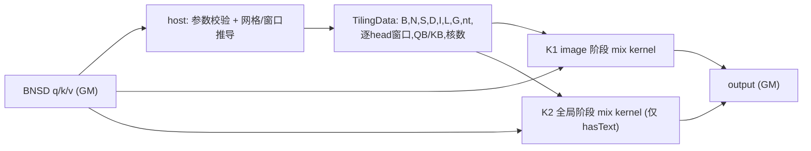

# SlidingTileAttention 算子设计文档（A2 / Ascend 910B）

> 任务：8月社区任务-SlidingTileAttention算子开发（A2）　截止时间：2026-10-25
> 对标接口：`FastVideo.sliding_tile_attention`（hao-ai-lab/FastVideo @ `4ddcdf54`）
> 本文档为设计评审稿，不含任何未经实测的性能或精度结论。

---

# 一、需求背景（required）

## 1.1 需求来源

| 项目 | 内容 |
| --- | --- |
| 任务名称 | 8月社区任务-SlidingTileAttention算子开发（A2） |
| 任务分类 | CANN |
| 任务书 | `SlidingTileAttention算子开发任务书.md`（随任务下发），昇腾社区任务中心同条目 |
| 随附自测包 | `slidingTileAttention_testCase/`（`all_sta.json` 50 例、`all_sta_reports-base.xlsx` GPU 基线报表、`gen.py`/`exe.py`/`node.yaml`/`perf.yaml`/`README.md`） |
| 设计文档模板 | `cann/cann-competitions` → `04_tasks/01_community-task-2026/resources/design_template.md` |
| 提交位置 | `cann-competitions` → `04_tasks/01_community-task-2026/tasklist/08-17-SlidingTileAttention-A2/<TeamName>/docs/design.md` |
| 算子合入目标仓 | `cann/ops-transformer` → `experimental/attention` |
| 目标硬件 | A2 系列（Ascend 910B，arch22 / `DAV_2201`），性能基线设备 910B3 |
| CANN 版本 | 9.0.0 及以上 |

## 1.2 背景介绍

SlidingTileAttention（STA，滑动瓦片注意力）是视频扩散模型（HunyuanVideo / Stepvideo / Wan）为把注意力的 O(S²) 降为 O(S·W) 而采用的稀疏注意力。序列由 **image 段**（按 3D 网格 `T×H×W` 排列的视频 latent token）和 **text 段** 组成。image 段以固定 3D tile（`6×8×8 = 384` token）为单位切块，每个 head 在自己的 3D tile 窗口内做稠密注意力；text token 对所有 image query 全局可见，text query 自己做一次全局注意力。

参考实现是 Python 包装 + GPU 内核，有两套后端：

- ThunderKittens C++ 内核 `sta_fwd`（快路径，按 `seq_shape` 枚举编译，见 `ops.py:9,30,51`）；
- Triton 回退内核 `triton_sta_kernel`（`triton_kernels/st_attn_triton.py`）。

两者语义一致，**Triton 版本可读、可逐行核对，本文把它当作语义基准（golden 定义），把 `ops.py` 的 Python 包装当作接口基准**。ATK 自测包中的 `exe.py:54` 直接在 A100 上调用 `fastvideo_kernel.ops.sliding_tile_attention`，因此验收对标的就是这个 Python 语义。

本任务要求在 A2 上基于 Ascend C、以 aclnn 工程模式实现功能一致的算子，并满足任务书的精度与性能门槛。

## 1.3 参考实现现状分析（逐条核对结论）

下表全部结论都来自对固定 commit 源码的逐行阅读，附 文件:行号。

| # | 事实 | 证据 |
| --- | --- | --- |
| R1 | 序列布局是 **image 在前、text 在后**：text 的 KV 起点是 `img_seq_len`，不是 `0` | `st_attn_triton.py:203` `kv_base_idx = img_seq_len`；`:120` `q_base_idx = img_seq_len + q_block_idx*BLOCK_Q` |
| R2 | 网格尺寸不来自 `seq_shape` 的自由解析，而是硬编码三张表，tile 恒为 `6×8×8` | `st_attn_triton.py:256-264` |
| R3 | 窗口是 **tile 粒度**、不是 token 粒度：`window_size` 的三个分量直接是沿 t/h/w 方向覆盖的 **tile 个数** | `:158-173`（`kernel_center`/`kv_tile_start` 由 tile 坐标与 `kernel_t//2` 推出） |
| R4 | 窗口在边界处 **整体平移**（Swin 式 center-clamp），不是裁边：同 head 内每个 query tile 的可见 tile 数恒定 | `:158-160` `clamp_int(q_tile_d, k_d//2, (num_tiles_d-1)-k_d//2)` |
| R5 | image query 的 KV = 窗口内 tile 的 image token ∪ text token；text 段的遍历上限是 `total_tile_size`(=384)，并按 `text_length` 屏蔽 | `:175-215`，尤其 `:204` `tl.range(0, total_tile_size, BLOCK_KV)` 与 `:207` `kv_mask = ... < text_length` |
| R6 | `has_text=true` 时额外跑一遍 **全局阶段**：query 覆盖 `[img_seq_len, img_seq_len+384)`，KV 覆盖全部 image tile + text | `:142-146`（`text_q` 分支窗口不设限）、`:308-316`（grid `= cdiv(384, BLOCK_Q)`） |
| R7 | padding 到 384 的倍数、用"重复末尾 token"补齐，算完再截断回原长 | `ops.py:33-38`、`:61` |
| R8 | 数值：`scale = 1/√D`，online softmax（m/l/acc 三段式），指数用 `exp2(scale·log2e)`，`acc/l` 归一后写回；`m/l/acc` 全程 fp32 | `:60-80`（`_attn_fwd_loop`）、`:225` |
| R9 | 每个 head 的 `BLOCK_Q/BLOCK_KV` 由 autotune 在 {32,64,128} 中选，**golden 的分块顺序不固定** | `:24-27` |
| R10 | 逐 head 调用时切片 `q[:, h:h+1]`，head 之间互不影响；`window_size` 长度必须等于 head 数（Python 层） | `ops.py:43-56`、`st_attn_triton.py:253` |

**由 R7 + R5 可以推出一条对本实现很有利的结论**（本文把它作为设计前提，实现阶段会用例验证）：padding 出来的 token 既不会成为 image 段的 query（image query 只覆盖 `[0, img_seq_len)`），也不会成为 KV（text KV 被 `text_length` 屏蔽），因此 **384 padding 对输出数值没有任何影响**，它只是为了让 Triton grid 对齐而存在的实现细节。本算子不需要复刻 padding/截断动作，只需保证"尾部容量区间"的语义与 golden 一致（见 §3.1.5）。

## 1.4 功能分析

输入：`q, k, v`（BNSD，fp16/bf16）＋ 属性 `window_size`、`text_length`、`has_text`、`seq_shape`。
输出：`output`（独立输出，BNSD，dtype/shape 与输入一致）。
计算：tile 级 3D 滑窗注意力 +（可选）text 全局注意力。
不支持：广播、反向、Causal、Dropout、GQA/MQA。

---

# 二、需求分析（required）

## 2.1 需求描述

用 Ascend C 以 aclnn 工程模式实现 `aclnnSlidingTileAttention`，在 A2（910B 系列）上与 `FastVideo.sliding_tile_attention` 功能一致：支持 fp16/bf16、BNSD 布局、tile 级 3D 滑窗 + text 全局两阶段语义、逐 head 窗口、确定性计算；精度满足生态算子开源标准，性能在 910B3 上达到 0.8×（A100 参考）水平。

## 2.2 需求拆解

| 模块 | 工作内容 | 完成判据（可核查） |
| --- | --- | --- |
| 语义对齐 | 以 R1–R10 为准写出可见集公式，并与任务书字面差异逐条登记 | 差异裁定表（§3.1.6）每项都有源码 文件:行号 或独立 golden 支撑 |
| aclnn 接口 | `GetWorkspaceSize` + 执行入口，两阶段调用；参数校验；独立 output | 签名与任务书 §2.3 一致；非法入参返回对应 aclnn 错误码且不启动 kernel |
| host tiling | 网格/窗口/分块/分核/workspace/tiling key 计算 | 输出 TilingData；核间负载可证明均衡（§3.2.2-3） |
| kernel 计算 | Cube+Vector 融合：QKᵀ → online softmax → PV，窗口按 tile 索引推导 | 不物化 S×S score/mask；50 例 ATK 通过 |
| 数据类型 | fp16 / bf16 模板化，中间量 fp32 | 两种 dtype 独立跑精度，不互相代替 |
| 逐 head 窗口 | 长度 1 广播、长度 N 逐 head | 性能用例 1（8 个不同窗口）必须逐 head 生效 |
| text 两阶段 | image 阶段 + 全局阶段；尾部容量语义定义清楚 | 全局阶段单独 kernel/分支；不跨 head 混用 KV |
| 确定性 | 固定单元→核映射、固定 KV 升序遍历、无原子累加 | 同输入 20 次复跑输出逐字节一致 |
| 精度验收 | 任务书判据 + ATK JSON 内 `high_precision` 判据双轨 | 两套判据都记录，不改脚本不改阈值 |
| 性能验收 | 两个性能用例，统一"一次完整前向设备时间"口径 | 与同夹具重测的 A100 基线相除，比值 ≥ 0.8 |
| 交付件 | 设计文档 PR、自测用例与 README、自测报告、个人仓 | 按任务书 §4 四项齐备 |

---

# 三、详细设计（required）

## 3.1 算子分析

### 3.1.1 接口定义（沿用任务书 §2.3）

```c
aclnnStatus aclnnSlidingTileAttentionGetWorkspaceSize(
    const aclTensor          *q,
    const aclTensor          *k,
    const aclTensor          *v,
    aclTensor                *output,
    const aclIntArray *const *windowSize,
    uint64_t                  windowSizeLen,
    int64_t                   textLength,
    bool                      hasText,
    const char               *seqShape,
    uint64_t                 *workspaceSize,
    aclOpExecutor           **executor);

aclnnStatus aclnnSlidingTileAttention(
    void *workspace, uint64_t workspaceSize, aclOpExecutor *executor, aclrtStream stream);
```

要点：`output` 是**独立输出**、在取 workspace 阶段就作为入参传入（与多数 aclnn 算子"由框架创建输出"的习惯不同），kernel 直接写用户 buffer；`windowSize` 是"数组的数组"，`windowSizeLen` 为 1 或 N。

### 3.1.2 记号

```
grid  (T, H, W)   = seq_shape 解析得到的 image 三维网格
tile  (tt,th,tw)  = (6, 8, 8)      tile_size = 384
G     (gt,gh,gw)  = (T/6, H/8, W/8)  各方向 tile 数；nt = gt*gh*gw  tile 总数
I     = T*H*W      image token 数（= nt*384）
L     = hasText ? textLength : 0      有效 text token 数
S     = q.shape[2] 实际序列长度，约束 S ≥ I + L
D     = head_dim； Dp = ceil(D/16)*16 对齐后的计算内维
N,B   = head 数、batch 数
w     = (wt,wh,ww) 该 head 的窗口（tile 个数，正奇数）
```

### 3.1.3 tile 编号与坐标

tile 采用 t-major → h → w 的 row-major 扁平编号（对齐 `st_attn_triton.py:185` 的 `kv_base_idx` 展开式）：

```
u = (qt*gh + qh)*gw + qw,      0 ≤ u < nt
token 索引:  image query 行 i = u*384 + r,  0 ≤ r < 384
```

### 3.1.4 可见集（本算子的规范定义）

对某个 head，令 `m_d = min(w_d, G_d)`、`r_d = w_d // 2`。query tile 坐标 `(qt,qh,qw)` 的窗口区间（闭开区间）：

```
若 w_d ≥ G_d:   start_d = 0,           cnt_d = G_d          // 覆盖该方向全部 tile
否则:           start_d = clamp(qt/qh/qw - r_d, 0, G_d - m_d)
                cnt_d   = m_d
```

* image query 行 `i = u*384 + r` 的可见 KV 集：
  `K(i) = { image token of tiles in (start_t,start_t+cnt_t) × (start_h,...) × (start_w,...) }  ∪  [I, I+L)`
* 全局 query 行 `i ∈ [I, S)` 的可见 KV 集：`K(i) = [0, I+L)`
* 输出行 `i ∈ [0, S)`，其余不写。

**一条对实现有利的结构性性质（记作 C1）**：tile 扁平编号 `u = (qt·gh + qh)·gw + qw` 下，窗口集合 `{start_t..end_t} × {start_h..end_h} × {start_w..end_w}` 在 `u` 上展开后是 **`cnt_t·cnt_h` 段连续区间，每段 `cnt_w` 个 tile**。因为同 head 内窗口尺寸恒定（D3），`cnt_t·cnt_h` 与 query tile 位置无关（只在贴边时该轴退化为 `G_d`）。于是：

```
每个 query tile 的 KV = 常量段数 R = cnt_t·cnt_h 段连续 token 块，
每段长度 = cnt_w·384（整段可连续 DMA，段内无需 gather）
```

⇒ 本算子既不需要物化 S×S mask，也不需要像 `block_sparse_attention` 那样先做 mask→index 压缩（`GatherMask` 前置阶段），kernel 只要按 `R` 段循环、每段按 `KB` 分块连续搬运即可。段起始地址由 `(qt,qh,qw)` 的整数除法直接算出（§3.2.3 Init 步 4）。

`scale = 1/√D`（**始终用原始 D，不随 Dp 改变**），softmax 在 `K(i)` 上归一：

```
O_i = Σ_{j∈K(i)} exp(s_ij - m_i)·V_j / Σ_{j∈K(i)} exp(s_ij - m_i),   s_ij = (Q_i·K_j)·scale
```

与参考实现的一致性：`w_d ≥ G_d` 时参考代码 `clamp_int` 的 min>max 退化路径同样收敛到全覆盖（`:158-160` 配合 `:51-54` 的两级 `tl.where` 顺序），本设计把它显式化为分支，避免依赖 `clamp` 的越界语义。

**本公式的本地验证（上机前完成，非推断）**：逐字镜像参考代码的 `clamp_int`（`:51-54`）与窗口起止（`:158-163`），对随附 50 例出现的全部 49 个 `(网格, 窗口)` 组合，遍历每个 tile 坐标、三个轴共 **33912 次**比对"参考实现的 tile 区间"与本设计的区间，**不一致 0 处**。同一脚本对偶数窗口测出 52 处偏离（参考实现覆盖 `w+1` 个 tile，如 `G=10,w=6` 时参考给 7 个），与 §3.1.6 的 D5 登记一致——所以本算子只承诺正奇数窗口的一致性。验证脚本随交付件提供（`tests/window_formula_mirror_check.py`）。

### 3.1.5 尾部容量区间 `[I+L, S)` 的处理

R7 推导出的结论在这里落地：

1. `S - I - L` 是随附用例中真实存在的区间（`gen.py` 用 `padding_length ∈ {64,128,256}` 决定 S，而 `textLength < padding_length`）。例如 ATK 用例 id=7：`S=115456, I=115200, L=87` ⇒ `[115287, 115456)` 共 169 行。
2. 参考实现的全局阶段 grid 覆盖 `[I, I+384)`（`:313`），**并且只在 `hasText` 时运行**。因此：
   - `hasText=true`：区间 `[I, min(S, I+384))` 的行**会被计算**，并出现在返回的 `output[:, :, :seq_length]` 里；本算子必须照做，按"全局 query 规则"计算这些行，`K(i) = [0, I+L)`。
   - `hasText=false`：参考实现不写这些行（`torch.empty_like` 的未初始化内存）；本算子对其**写 0**，并在交付说明中如实登记"参考实现此处未定义，不做逐元素一致性宣称"。随附 50 例中 `hasText=false` 的用例均满足 `S == I`，不会触发该分支。
3. 参考实现的两个隐性上限：全局 query 只算 384 行、text KV 只扫前 384 列（`:204`）。本算子按 §3.1.4 的完整语义实现（`S-I` 行全算、text KV 全算），**超出参考实现覆盖范围的部分用独立公式 golden 验证**，不宣称与 FastVideo 逐元素一致。随附用例的 `L ≤ 239 ≤ 384`、`S-I ≤ 256 ≤ 384`，两条上限在本批用例内都不会造成偏差。

### 3.1.6 与任务书字面的差异登记（评审要点）

任务书 §2.1 的公式与参考代码不完全等价。验收 golden 是参考代码，本设计**以参考代码为准**，逐条登记如下，请评审确认或给出官方口径：

| # | 任务书字面 | 参考代码实际 | 本设计取值 | 证据 |
| --- | --- | --- | --- | --- |
| D1 | "j 属于 text 段（`j < text_length`）" ⇒ text 在序列头部 | text 在 image 之后，起点 `I` | 按参考代码：text 在尾部 | `:203`、`:120` |
| D2 | 掩码按 **token** 3D 坐标：`\|i_t-j_t\| ≤ ⌊wt/2⌋` | 按 **tile** 坐标，窗口分量单位是 tile 个数 | 按参考代码：tile 粒度 | `:158-173`、`:180` |
| D3 | 边界可见性按 `\|·\| ≤ r` 判断（窗口在边缘会被裁小） | 窗口整体平移进网格内部，同 head 内每 tile 的可见 tile 数恒定 | 按参考代码：center-clamp 平移 | `:158-160` |
| D4 | `seq_shape` 为 "axbxc"，a/b/c 取值 [1,200] | 仅三张硬编码表，且要求被 6/8/8 整除 | 通用实现：任意被 6/8/8 整除的 `(T,H,W)`；不能整除时触发参数校验报错（随附用例三张表全部整除） | `:256-264` |
| D5 | `window_size` 值域 `(0, ∞)`，措辞为"奇数窗口" | 偶数窗口时 center-clamp 会覆盖 `w+1` 个 tile（`start=c-r`, `end=c+r+1`） | 只保证正奇数窗口；偶数窗口按参考代码同款算术自然执行，不做一致性宣称 | `:162-163` |
| D6 | "padding 到 384 的倍数（重复末尾 token）" | padding 只服务 Triton grid 对齐，对输出数值无影响 | 不复刻 padding/截断，按 §3.1.4/§3.1.5 的等价语义实现 | `ops.py:33-38` + R5/R7 |

### 3.1.7 支持数据类型

| 数据项 | 类型 |
| --- | --- |
| q / k / v / output | FLOAT16、BFLOAT16，四者必须一致 |
| 参与 Cube 乘法 | 原始 dtype（fp16/bf16） |
| `m`、`l`、`acc`、score 中间量 | FP32 |
| P（softmax 概率，作为第二次 Matmul 的 A 侧） | 与输入同 dtype（fp16/bf16），与 R8 一致（参考实现同样把 `exp_scores` 转成 v 的类型） |
| 索引/长度/偏移 | host 用带溢出检查的 `int64_t`；kernel 内 tile 级索引可用 `uint32_t` |

### 3.1.8 支持形状

- 张量恒为 4 维 BNSD，`q/k/v/output` shape 完全一致，`B,N,S,D` 均 > 0，不支持广播。
- `D` 目标支持 `0 < D ≤ 128`（与兄弟算子"D≤128 时 V 可全载 L1"同档，证据 `BSA/op_host/block_sparse_attention_tiling.cpp:1447-1470`）；随附用例覆盖 `D ∈ {16,32,64}`。非 16 倍数按 `Dp` 补零、scale 不变。`D > 128` 需要 D 方向分块累加，列为扩展项，**不宣称已验证**。
- `seq_shape`：三张官方网格 `30x48x80 / 36x48x48 / 18x48x80`（随附 50 例只出现这三种）为已验证范围；其余满足"被 6/8/8 整除"的网格为通用实现范围，用独立 golden 验证。

### 3.1.9 计算量与访存量（roofline，性能设计的前提）

单 batch 单 head 的注意力对数：

```
image 阶段:  nt × (cnt_t·cnt_h·cnt_w) × 384²      （每 query tile 的可见 tile 数与位置无关，见 D3）
text  KV  :  I × L
全局  阶段:  (S-I) × (I+L)
FLOPs     =  4 × D × B × Σ_h [...]                （QK 与 PV 各 2·D）
```

按该式子对随附 50 例逐例计算，再除以 `all_sta_reports-base.xlsx` 里 GPU 的 Device 时间，得到的 A100 有效算力分布：

| 统计 | 值 |
| --- | --- |
| 有效算力 min / median / max | **30.9 / 53.0 / 72.7 TFLOPS** |
| 50 例合计计算量 | 800.4 TFLOP |
| 50 例合计 GPU Device 时间 | 14.0 s |

分布高度集中（±30%），说明该公式与参考实现的实际工作量吻合，可以用来给本算子的目标定标。

两个任务书性能用例的量级：

| 用例 | 网格 | 逐 head 窗口 tile 数合计 | FLOPs / 一次完整前向 |
| --- | --- | --- | --- |
| P1 `30x48x80`, B1 N8 D64, L=128 | 5×6×10, nt=300 | 1+27+75+125+9+45+175+210 = 667 | **7.61 TFLOP** |
| P2 `36x48x48`, B1 N8 D64, 无 text | 6×6×6, nt=216 | 27×8 = 216 | **1.76 TFLOP** |

访存上界（不复用、每个 tile 都从 GM 重读 KV）：P1 每前向约 `Σ_h nt·|W_h|·384·D·2·2 ≈ 19.7 GB`，P2 ≈ `8·216·27·384·64·4B ≈ 4.5 GB`。**结论：本算子是算力主导（compute-bound）**，GM 带宽只有在核内 KV 完全不复用时才成为瓶颈；设计侧要靠 L1 常驻 KV 面板 + 双缓冲流水，而不是靠减少 tile 数量（tile 数量由语义决定，不能动）。

> 910B3 的 Cube 峰值与 HBM 带宽本文不写死，实现阶段实测后再回填"需要达到的有效算力 / 峰值占比"。片上资源常量已有仓内证据：arch22 的 `UB=192KB、L1=512KB、L0A/L0B=64KB、L0C=128KB、FIXBUF=7KB`（`ops-transformer@6bff8249` `experimental/attention/block_sparse_attention/op_kernel/attn_infra/arch/bsa_arch.hpp:18-26` 的 `struct AtlasA2`），本文的分层预算按该常量表推导。按 §4.1.3 的口径辨析换算，"0.8×A100"对本算子的要求落在 **约 38~44 TFLOPS 有效算力**区间（P2 按 8 launch/前向反推 A100 ≈ 47.7 TFLOPS ⇒ NPU ≈ 38 TFLOPS；以同夹具复测的 A100 前向时间为准），这是设计要盯住的目标数字。P1 的 launch 级基线与计算量不自洽（见 §4.1.3），其要求暂不能定量。

## 3.2 算子实现

### 3.2.1 总体方案

一次 aclnn 执行最多 **2 个 kernel**：

```
K1 image 阶段   工作单元 = (b, n, u)   u ∈ [0, nt)      每单元: 384 行 query × (窗口 tile + text) KV
K2 全局阶段     工作单元 = (b, n, qb)  qb ∈ [0, ceil((S-I)/QB))   仅 hasText 时启动；KV = [0, I+L)
```

选择"**直接读原始 Q/K/V + kernel 内算术推导窗口**"而不是"先按窗口 gather 成打包序列、再调变长 FlashAttention"，理由：

1. 窗口 tile 数在同 head 内恒定（D3），单元代价一致 ⇒ 分核可精确均衡，无需索引表。
2. 打包路线要物化 `qIndex/kvIndex/inverse` 三份索引和打包后的 Q/K/V 缓冲，按 `B·N·S·Dp` 与 `Σ 打包KV` 估算，P1 类配置下额外 GM 读写与 kernel 数都会压过滑窗带来的收益；而且窗口 tile 之间高度重叠，打包会重复存 KV。
3. `ops-transformer` 的 `sparse_flash_attention` / `block_sparse_attention` 一族已经是"块掩码 + flash"的形态，本算子只需把掩码从"入参张量"换成"tile 坐标算术"，可参照的已认证形态最多（具体 API 形态见 §3.2.4 的兄弟算子参照清单）。

数据流：



K1/K2 是同一个 kernel 模板、不同 tiling key（是否加窗口掩码、query 基址来源），共享 Cube/Vector 流水实现，减少一份代码的维护面。

### 3.2.2 host 侧设计

**1) 参数校验与执行计划**（顺序即报错优先级，全部在 `GetWorkspaceSize` 阶段完成）

1. 指针与 executor 非空；`q/k/v/output` 均 4 维、shape 完全一致、dtype 一致且 ∈ {fp16, bf16}；`B,N,S,D > 0`。
2. 解析 `seqShape` 字符串 `axbxc`：三个正整数、无多余字符、乘积不溢出（用 `int64_t` 带溢出检查）；`T%6==0 && H%8==0 && W%8==0`；得 `I`、`G`、`nt`。
3. `hasText==false ⇒ L=0`；`hasText==true ⇒ textLength ≥ 1`（任务书值域 `(0,∞)`）。校验 `S ≥ I + L`。
4. `windowSizeLen ∈ {1, N}`；每项长度 3；分量 > 0；`len==1` 时展开成 N 份（展开在 host 完成，kernel 只见逐 head 数组）。分量非奇数时不报错但记录为"不保证一致性"（D5）。
5. `Dp = (D+15)/16*16`；`D > 128`（超出 L1 常驻面板能力，见 §3.1.8）或 `Dp` 超出 Mmad 内维能力时按运行限制报错，不截断输入、不改语义。
6. 计算 `QB`、`KB`、核数、workspace，填 TilingData，落 tiling key。

**2) 分块与各级存储预算**

形态取自仓内认证做法（证据见 §3.2.4）：**Cube 侧操作数走 GM→L1→L0A/L0B，softmax 状态走 UB**，不是把 K/V 双缓冲全塞 UB。

`QB`（query 行块，384 的约数，默认 128）与 `KB`（KV 行块，默认 128，可降 64）。一个 image tile 384 行 ⇒ `QB=128` 时同 tile 的 3 个块共享一次窗口推导。

| 层级 | 用途 | 预算（`Dp=64`、`QB=128`、`KB=128`、元素 2B、累加 4B） | 容量 |
| --- | --- | --- | --- |
| L1 | Q 面板 `QB·Dp·2`=16KB（4 buf）、K/V 面板 `KB·Dp·2`=16KB（各 3 buf） | ≈ 160KB | 512KB ✔ |
| L0A / L0B | 单轮 Mmad 的 A/B tile | ≤ 64KB  each | 64KB ✔ |
| L0C | score `QB·KB·4`=64KB；PV 累加 `QB·Dp·4`=32KB | ≤ 128KB | 128KB ✔（2 buf 时按 64KB 单份用） |
| UB（AIV 侧） | score 落地 `QB·KB·4`=64KB、P 就地降位宽覆盖同一块、`acc` 跨块状态 `QB·Dp·4`=32KB、`m/l` 2KB、SoftmaxFlashV2 的 inMax/inSum ping-pong 与临时量 | ≈ 110~150KB（临时量按接口要求实测） | 192KB（含 FIXBUF 7KB 预留）⚠ 需实测确认余量 |

⇒ 默认档 `QB=128, KB=64`（score 落地 32KB，UB 余量最松），`KB=128` 作为对比档；两档都要在真机测"原语单价"后再定，不在设计里空口定档。若 UB 余量不足，退路是把 score 分片消费（`KB` 不变、L0C→UB 分两次搬），或按 `sparse_flash_attention` 的做法把单核中间量池化到 GM workspace（见 4)）。

**3) 分核策略**

采用仓内 `KERNEL_TYPE_MIX_AIC_1_2` 形态（1 个 AIC + 2 个 AIV 成一组，`blockDim = CalcTschBlockDim(2·usedCoreNum, usedCoreNum, 2·usedCoreNum)`；核内 `aiCoreIdx = GetBlockIdx()/2`，证据见 §3.2.4 C 节），即**以 AIC 核为调度单位**切分工作。

- 单元代价在同 head 内恒定 ⇒ 直接按 `B·N·nt` 展开成有序单元序列，用"前缀代价均分"切给 `usedCoreNum` 个 AIC 核：`cost(n) = |W_n|`（该 head 的窗口 tile 数），核 i 取展开序列上的区间 `[ceil(total·i/coreNum), ceil(total·(i+1)/coreNum))`。这样逐 head 窗口不同（性能用例 P1 就是 8 个不同窗口）时核间仍然均衡。
- 分核边界由 host 生成、随 TilingData 下发，kernel 读自己的上下界——照 `common/op_host/split_core_v2.h:122-140` 的 `SplitResult{usedCoreNum, vecCubeRatio, bN2End[], …}` 结构。注意该模块换算的是 1 维 band/滑窗（`SparseMode::BAND / INIT_SWA`，同文件 `:34-42`）的 S2 起止，本算子的窗口是 3D tile 语义，**只复用"边界数组下发 + kernel 读数组"这个结构，不复用它的坐标换算**。
- 核数来自 `platform_ascendc::PlatformAscendC(ctx->GetPlatformInfo())` 的 `GetCoreNumAic()/GetCoreNumAiv()`，不写死某张卡的核数。
- 单元数少于核数时（小 `B·N·nt`），把 tile 内 `QB` 块拆成独立单元（同一 KV 集合、代价仍一致），避免空核；不通过切 D 方向凑核。
- 全局阶段单元数 = `B·N·ceil((S-I)/QB)`，通常很小（L≤239 ⇒ 每 (b,n) 1~3 块），同一套均分逻辑；与 K1 分两次 launch 串行执行、互不重叠，保证确定性。

**4) workspace**

窗口由算术推导（C1 性质），不物化 mask/索引张量，因此 GM 侧只需要：TilingData + 逐 head 窗口数组（N×3 int64）+ 分核边界数组（coreNum×2）。设计上目标 `workspaceSize` 为常数级（另加 `GetLibApiWorkSpaceSize()` 返回的框架量），两条扩展路径按实测取舍：

1. 若 `KB=128` 档的 UB 余量不足，把单核中间量池化到 GM，照 `sparse_flash_attention` 的公式族 `preLoadNum × Σ(单核 S/O fp32 + P 低位宽) × actCoreNum`（`SFA/op_host/sparse_flash_attention_tiling.cpp:362-390`）；代价是每块多两次 MTE1/MTE2 往返，须实测后再决定是否启用。
2. 若 kernel 内的 tile 坐标除法实测显著，改为 host 预下发 KV 段表（每 query tile `cnt_t·cnt_h` 段，段长 `cnt_w·384`）。**默认不采用**，启用时把表大小公式写进交付说明。

最终值以 executor 返回与实测为准；任何超出常数级的占用都给出公式并留档。

**5) tiling key**

照 `sparse_flash_attention` 的模板自动编码写法（`ASCENDC_TPL_ARGS_DECL / ASCENDC_TPL_SEL` + host 侧 `GET_TPL_TILING_KEY`，`SFA/op_kernel/sparse_flash_attention_template_tiling_key.h:27-53`），而不是 `block_sparse_attention` 的手工 64bit 拼位（`BSA/op_kernel/block_sparse_attention_tilingkey.h:16-68`）。档位：

| 维度 | 取值 | 差异 |
| --- | --- | --- |
| 阶段 | image / 全局 | 全局阶段无窗口推导，KV 基址恒 0，query 基址 `I + qb·QB` |
| text | 关 / 开 | 开则追加 text KV 段（升序、尾块按 L 屏蔽） |
| dtype | fp16 / bf16 | 模板参数，两种精度独立验收 |
| 块档 | `KB=64` / `KB=128` | 换块大小即换 key：避免把块尺寸做成运行期分支插进内层循环（那会改变基线代码生成，使 A/B 不可比） |

### 3.2.3 kernel 侧设计

采用仓内认证的同 launch 混合核形态：`KERNEL_TASK_TYPE_DEFAULT(KERNEL_TYPE_MIX_AIC_1_2)`（`SFA/op_kernel/sparse_flash_attention.cpp:38`、`BSA/op_kernel/block_sparse_attention.cpp:25`），1 个 AIC 出 score / 累加 PV，2 个 AIV 做 softmax 与归一化，两侧用跨核旗标交接。结构为 `Init` / `Process`：

**Init**

1. 读 TilingData：`B,N,S,D,I,L,G,nt`、逐 head 窗口、`QB/KB`、本核单元上下界（来自 host 的分核边界数组）。
2. `aiCoreIdx = GetBlockIdx() / 2`（AIV 侧 `GetBlockIdx()` 是全局编号，cube 0-23 / vec 0-47 的换算见 §3.2.4 C 节；**不得再乘 `GetSubBlockNum()`**），由 `aiCoreIdx` 得到本核首个单元，展开为 `(b, n, u)`。
3. 基址：`base = ((b·N + n)·S)·D`，Q/K/V/output 共用同一 stride（BNSD 且 shape 一致）。
4. 窗口：`qt = u/(gh·gw)`、`qh = (u/gw)%gh`、`qw = u%gw`；按 §3.1.4 得三轴 `[start_d, end_d)`；按 C1 性质展开成 `cnt_t·cnt_h` 段连续 KV run，**段内 t 最外、w 最内**，与参考实现的三重循环同序（`st_attn_triton.py:175-184`）⇒ 遍历顺序一致、数值可复现。
5. AIC 侧 `TPipe` 分配 L1 面板（Q 常驻、K/V 多 buf）、L0A/L0B/L0C；AIV 侧按档分配 UB（score 落地、inMax/inSum ping-pong、acc 状态），并为 Q/K/V 建立 `BuffersPolicyDB` 双缓冲（`COM/op_kernel/matmul.h:951-952, 1042-1043`（`BuffersPolicyDB<BufferType::L0A/L0B>`））。

**Process（每个单元、每个 `QB` 块）**

```
AIV: m = -inf, l = 0, acc = 0
for kv_run in cnt_t*cnt_h 段连续 run:                 # 每段 cnt_w 个 tile = cnt_w*384 行
    for kv_blk in run step KB:
        AIC: CopyIn K_blk,V_blk: GM → L1 (Nd2Nz DataCopy) → L0B
        AIC: Mmad(L0C ← Q@Kᵀ)                        # cmatrixInitVal=true(首轮清零)
        AIC: L0C → UB (MTE1)                          # 交叉旗标 syncC1V1
        AIV: S_scaled = Muls(S, log2e/√D) 或按仓内 ln2 折算范式
        AIV: SoftmaxFlashV2(..., inMax=上一轮 m, inSum=上一轮 l, ...)   # 跨块在线续算
        AIV: P = Cast(概率, ROUND) → fp16/bf16         # 与 golden 的 exp_scores.to(v.dtype) 同策略
        AIC: Mmad(L0C ← P@V) 累加到 acc               # cmatrixInitVal=false 保持累计
        AIV: acc_rescale = acc · α                    # α = exp(m_old - m_new)
        ...
if hasText:                                            # tiling key: text 开
    对 [I, I+L) 逐 KB 块重复上述流程，尾块被屏蔽列不进分母
CopyOut: O = acc / l → Cast 到 dtype → 写 output 对应行段
```

关键实现约定：

1. **矩阵乘形态**：arch22 attention 族的调用点是两类实测存在的形态（本设计采信它们），**不使用 Template Matmul 的 `BlockTileShape/iterCompleteLast/bTrans` 写法**：① 裸 `Mmad(cL0, aL0, bL0, MmadParams{m,n,k,cmatrixInitVal,cmatrixSource,unitFlag})`（`SFA/op_kernel/sparse_flash_attention_service_cube_mla.h:740-748, 988-995`）；② 共享封装 `MatmulKPP<A,B,C,baseM,baseN,baseK,AL,BL>(aL1Tensor, bL1Tensor, cL0Tensor, aL0BuffsDb, bL0BuffsDb, MMParam&)`（定义 `COM/op_kernel/matmul.h:1042-1043`，双缓冲参数类型 `BuffersPolicyDB<BufferType::L0A/L0B>` 见同文件 `:951-952`；同族还有 `MatmulKM` `:948`）+ `MakeMMParam(singleM, singleN, singleK, isLeftT, isRightT, cmatrixInitVal, isOutKFisrt, unitFlag, realM)`（`COM/op_kernel/matmul.h:56-65`，`MMParam` 结构 `:47`）。本设计取 ②（少写一层地址算术），转置需求用 `isRightT` 表达（K 在 GM 是 `[S,D]` row-major，score 需要 `Kᵀ`），**不引入显式 transpose kernel**。跨 KV 块的 `acc` 累加靠 `cmatrixInitVal = isOutKFisrt && (k == 0)` 这一既有约定（`COM/op_kernel/matmul.h` 内多处，如 `mmadParams.cmatrixInitVal = param.isOutKFisrt && (k == 0)`），首轮清零、后续累加。
2. **softmax**：用 `AscendC` 的 `SoftmaxFlashV2<T, true, true, false, false, CFG>(…)` 配 `SoftMaxShapeInfo{rows, cols, rows, actualCols}`，把上一轮的 `inMax/inSum` 作为 ping-pong 输入实现跨块在线归一（`SFA/op_kernel/sparse_flash_attention_service_vector_mla.h:474-497`；同形 `COM/op_kernel/arch22/fia_block_vec_nonquant.h:384-388`），**不手写 MaxReduce/SumReduce**。指数按仓内范式 `RECIP_OF_LN2 → Cast(CAST_ROUND) → Muls(LN2) → Exp()`（同文件 `:146, 521-548`），与 golden 的 `exp2(x·log2e)` 在数学上同式、末级舍入路径不同；该差异计入容差判据（golden 自身分块序随 autotune 变化，本就不可逐位对，见 R9 与 §4.1.1）。
3. **尾块与屏蔽**：`KB ∈ {64,128}` 都整除 384 ⇒ image 段不出现半 tile；text 段尾块 `L % KB != 0` 时，屏蔽列**不进分母**：先把这些列的 score 置 `-inf` 再参与归一（参考实现即 `tl.where(..., -inf)` + `MASK_KV=True`，`st_attn_triton.py:70-72`，语义等价）。UB 侧不等长搬运用 `DataCopyPad + DataCopyExtParams + DataCopyPadExtParams`（`BSA/op_kernel/…_kernel_regular_arch22.h:157-163, 195-199`），基本块 32B 对齐。
4. **`l == 0` 保护**：可见集为空在参数校验后不可能出现（`hasText=true ⇒ L ≥ 1`），仍要求首个有效块直接建立状态、跳过空块，避免 `-inf - (-inf)`。
5. **D 补零**：`D < Dp` 时 Q/K 高位补 0，score 不受影响；输出只写前 `D` 列（行 stride 控制，不整块 pad 写回）；scale 恒为 `1/√D`。
6. **流水与同步**：核内用 `SetFlag/WaitFlag<HardEvent::…>` 先预置再回收（`SFA/…service_cube_mla.h:302-326`、`BSA/…arch22.h:123-130, 328-369`），跨核用 `CrossCoreSetFlag<…, PIPE_FIX>(flag)` / `CrossCoreWaitFlag(flag)`，旗标常量集中定义（`SFA/op_kernel/sparse_flash_attention_common.h:132`（`syncC1V1` 等旗标字段）；BSA 用 `NpuArch::Arch::CrossCoreFlag qkReady{…}` 封装，`arch22.h:768-770`）；`PipeBarrier<PIPE_V/PIPE_M/PIPE_ALL>` 仅在同一队列内需要排干时使用。注意 arch22 上 `PipeBarrier<PIPE_V>` **不排干向量侧的读**，复用同一块 UB 切片必须配 `V_MTE2` 后沿或独占缓冲——本设计让每个 KV 块独占缓冲以规避该竞态。
7. **写回**：单元之间输出行不重叠 ⇒ 无原子、无跨核归约 ⇒ 天然确定性。
8. **arch 门控**：仓内约定不是 `__NPU_ARCH__`，而是 kernel 侧 `#if (__CCE_AICORE__ == 220)` 引 arch22 头（`BSA/op_kernel/block_sparse_attention_kernel_interface.cpp:16-27`）、核类型 `#ifdef __DAV_C220_CUBE__/__DAV_C220_VEC__` 或运行期 `ASCEND_IS_AIC/ASCEND_IS_AIV`，host 侧 `this->AICore().AddConfig("ascend910b", …)`（`SFA/op_host/sparse_flash_attention_def.cpp:99-100`，另加 `ascend910_93`），目录约定 `op_kernel/arch22/`。arch22 上没有融合三元向量 op（既有结论：`Mac/Addcmul/Axs` 无 aicore API、`Fma` 被 arch3510 门控；上机后以本机 CANN 头文件复核），归一与 rescale 一律按"两次舍入"的 `Muls + Adds` 标准写法展开，不写 arch35 分支。
9. **不引入的前置阶段**：`block_sparse_attention` 的滑窗路径在仓内是**未支持状态**（`preTokens/nextTokens` 非哨兵值直接报错，`BSA/op_host/block_sparse_attention_tiling.cpp:1198-1204`），且它需要 mask→index 的 `GatherMask` 前置压缩（`arch22.h:85-233`）。本算子按 C1 性质直接走连续 run，**不照抄该前置阶段**，只在"块索引表消费"上作对照参考。

### 3.2.4 同仓兄弟算子参照清单（已认证形态，逐条核实）

调研对象：`cann/ops-transformer`，本地 `FETCH_HEAD` = `6bff8249`（2026-10-20）。缩写 **SFA**=`experimental/attention/sparse_flash_attention`、**BSA**=`experimental/attention/block_sparse_attention`、**COM**=`experimental/attention/common`。下列每条都在现场 `git show` 读源码后核对过行号（非二手结论）。

| 主题 | 照抄的形态 | 证据 | 本算子的适配 |
| --- | --- | --- | --- |
| aclnn 生成方式 | 只写 `op_host/{def,proto,tiling}`，用 `ExtendCfgInfo("aclnnSupport.value","support_aclnn")` + `add_modules_sources(OPTYPE … ACLNNTYPE aclnn)` 自动产出两式接口 | `SFA/op_host/sparse_flash_attention_def.cpp:98`、`SFA/op_host/CMakeLists.txt:27` | 本算子 `output` 是入参独立输出，原型按任务书签名声明即可走同一自动路径；不手写 `op_api` |
| 芯片配置 | `AICore().AddConfig("ascend910b")`（+`ascend910_93`），运行期 `GetSocVersion()` 分派 | `SFA/op_host/sparse_flash_attention_def.cpp:99-100`；`BSA/…tiling.cpp:196` | A2 只登记 910b 系列；不登记 950 |
| TilingData 组织 | 单一 `BaseParams` + 子结构，用 `TILING_DATA_FIELD_DEF_STRUCT` 聚合后 `REGISTER_TILING_DATA_CLASS` 一次 | `SFA/op_host/sparse_flash_attention_tiling.h:138-186` | 字段取 `batchSize/seqSize/scaleValue/outputLayout/pre-nextTokens` 同族命名 + 本算子的网格 `G/nt` 与逐 head 窗口 |
| 核数与 blockDim | `PlatformAscendC(ctx->GetPlatformInfo())` → `GetCoreNumAic/Aiv`、`CalcTschBlockDim(2N, N, 2N)`、`GetLibApiWorkSpaceSize()` | `SFA/…tiling.cpp:200-203, 393-396` | §3.2.2-3 分核基础；核数不写死 |
| mix kernel | `KERNEL_TASK_TYPE_DEFAULT(KERNEL_TYPE_MIX_AIC_1_2)` + `TPipe` + `GetUserWorkspace`；`ASCEND_IS_AIC/AIV` 或 `__DAV_C220_CUBE/VEC` 分支；`aiCoreIdx = GetBlockIdx()/2` | `SFA/op_kernel/sparse_flash_attention.cpp:38-40`、`BSA/op_kernel/block_sparse_attention.cpp:25`、`SFA/op_kernel/sparse_flash_attention_kernel_mla.h:368-374`（AIV `GetBlockIdx()/2`，AIC 直接用 `GetBlockIdx()`） | 本设计主形态（§3.2.3）；AIV 的 `GetBlockIdx()` 已是全局编号，禁止再乘 `GetSubBlockNum()` |
| 跨核同步 | `CrossCoreSetFlag<…, PIPE_FIX>(flag)` / `CrossCoreWaitFlag(flag)`，旗标常量集中定义；核内 `SetFlag/WaitFlag<HardEvent::…>` 先预置再回收 | `SFA/op_kernel/sparse_flash_attention_common.h:132`（`syncC1V1` 等旗标字段）、`kernel_mla.h:657/669`、`service_cube_mla.h:302-326`、`BSA/…arch22.h:123-130, 328-369, 768-770` | AIC↔AIV 交接 score / P / acc；同一队列内才用 `PipeBarrier` |
| 矩阵乘 | ① 裸 `Mmad(cL0,aL0,bL0,MmadParams{…})`；② 共享 `fa_base_matmul::MatmulKPP<…>` + `MakeMMParam(singleM,singleN,singleK,isLeftT,isRightT,cmatrixInitVal,isOutKFisrt,unitFlag,realM)`；K 尾轮 `unitFlag=3`；`m==1` 走规避 GEMV 分支；**这 4 个 attention 目录内未见 Template Matmul 写法（负断言，实现首周用带 `--line-number` 的仓内检索复核）** | `SFA/…service_cube_mla.h:740-748, 988-995`；`COM/op_kernel/matmul.h:41-70, 1016-1067`；调用点 `COM/op_kernel/arch22/fia_block_cube_nonquant_mla.h:693/706/907` | 取 ②；`acc` 跨块累加靠 `cmatrixInitVal = isOutKFisrt && (k==0)`（`matmul.h:486, 783`） |
| online softmax | `SoftmaxFlashV2<T,true,true,false,false,CFG>(…)` + `SoftMaxShapeInfo{rows,cols,rows,actualCols}`，`inMax/inSum` 取上一轮 ping-pong 缓冲实现跨块续算；指数走 `RECIP_OF_LN2 → CAST_ROUND → Muls(LN2) → Exp`；fp32→fp16/bf16 用 `Cast(…,CAST_ROUND)`，仓内无 `halfo` | `SFA/…service_vector_mla.h:474-497, 146, 521-552`；同形 `COM/op_kernel/arch22/fia_block_vec_nonquant.h:384-388` | §3.2.3-2；不手写 Max/Sum Reduce，与 golden 的 `exp2` 差异计入容差 |
| 搬入 | GM→L1 用 `DataCopy(l1, gm, Nd2NzParams{ndNum,nValue,dValue,srcDValue,dstNzC0Stride=(n+15)/16*16,dstNzNStride=1,…})`；L1→L0 用 `LoadDataToL0A/B + LoadData2DParams{startIndex,srcStride,dstGap}`；UB 不等长/尾块用 `DataCopyPad + DataCopyExtParams + DataCopyPadExtParams`；基本块 32B | `SFA/…service_cube_mla.h:328-341`、`COM/op_kernel/CopyInL1.h:53-62, 290-300`、`COM/op_kernel/matmul.h:1068-1080`、`BSA/…regular_arch22.h:157-162, 195, 218` | 每个 KV run 是连续段 ⇒ 直接走 Nd2Nz 批量搬入，无需 gather |
| 稀疏掩码消费 | SFA：入参即块索引表 `sparse_indices` INT32，`-1` 作结束哨兵，块尾按 `threshold` 截断（无物化 mask）；BSA：物化 uint8 块掩码 + AIV 前置 `GatherMask` 压缩成 selectIdx/selectNum | `SFA/README.md:37`、`kernel_mla.h:401, 608-621`、`service_cube_mla.h:487-508`；`BSA/…regular_arch22.h:157-218(GatherMask/DataCopyPad)` | 本算子按 C1 性质走"算术推导 + 连续 run"，比 SFA 连索引表都省；**不采用 BSA 的 mask 物化与 GatherMask 前置**（BSA 的滑窗至今未支持：`BSA/…tiling.cpp:1198-1204`） |
| 分核边界下发 | `SplitResult{usedCoreNum, vecCubeRatio, bN2End[], gS1End[], s2End[]}`，kernel 侧读数组定界 | `COM/op_host/split_core_v2.h:122-140`；`SparseMode{…, BAND, INIT_SWA}` 同文件 `:34-42`；kernel 读法 `COM/op_kernel/arch22/fia_kernel_nonquant.h:439-466` | 只复用"边界数组"结构；3D tile 窗口换算自实现 |
| L1/UB 常驻惯例 | Q 4 buf、KV 3 buf 常驻 L1；L0A/L0B 2×64KB、L0C 2×128KB；UB 按 `preLoadNum` 分片；注释明确"D≤128 时 V 全载开 2buf""Q 常驻后 QK 无 MTE2 重搬" | `SFA/…service_cube_mla.h:275-290`、`vector_mla.h:209-222`；`BSA/…tiling.cpp:1447-1470`、`…arch22.h:73-81, 111-122` | §3.2.2-2 预算表依据；arch 资源常量 `AtlasA2{UB=192K, L1=512K, L0A/B=64K, L0C=128K, FIXBUF=7K}`（`BSA/op_kernel/attn_infra/arch/bsa_arch.hpp:18-26`） |
| 中间精度 | `using T = float; // 中间计算数据类型为float，高精度模式`；BSA 把 softmax 精度做成 tilingKey 位 + attr `innerPrecise{ALL_HIGH,ALL_LOW,LOW_HIGH_MIXED}` | `SFA/…kernel_mla.h:54`；`BSA/op_kernel/block_sparse_attention_tilingkey.h:21-24`、`BSA/op_host/block_sparse_attention_tiling.h:158-162` | 本算子中间量恒 fp32（精度门是 fp16/bf16 输入的门槛，不预留低精度档，避免"改数值还宣称逐位同"） |
| 工程注册 | 顶层 `experimental/attention/CMakeLists.txt` 自动 `add_subdirectory`；算子目录 `CMakeLists.txt` → `op_host/CMakeLists.txt`：`add_op_to_compiled_list()` / `target_sources(op_host_aclnn PRIVATE …_def.cpp)`（`BUILD_OPEN_PROJECT` 内）/ `add_ops_compile_options(… --cce-auto-sync=off -Werror …)` / `add_modules_sources(OPTYPE … ACLNNTYPE aclnn)`；共享依赖 `set(<op>_depends ../attention/common CACHE INTERNAL …)` | `experimental/attention/CMakeLists.txt:13-34`、`SFA/op_host/CMakeLists.txt:10-27`、`flash_attn_exp/op_host/CMakeLists.txt:26`、`COM/op_host/CMakeLists.txt:11` | §3.2.7 目录结构按此裁剪 |
| 不适用参照 | `flash_attn_exp` **只有 arch35**（`AICore().AddConfig("ascend950")`，`op_kernel/` 下仅 `arch35/`）；`minimax_build_k2q_csr` 亦仅 arch35 | `flash_attn_exp/op_host/flash_attn_def.cpp:128` | A2 设计不引用它们，避免把 950 的形态写进 910B |

**一句话结论**：以 SFA 为骨架（自动 aclnn + `ASCENDC_TPL` tiling key + MIX_AIC_1_2 + `MatmulKPP`/`SoftmaxFlashV2` + 连续块搬入），把"块索引表 + threshold"换成"tile 坐标算术 + 连续 run"，不引入 BSA 的 mask 物化与 `GatherMask` 前置阶段。

### 3.2.5 确定性设计

1. 单元→核映射由 host 侧前缀切分（分核边界数组）唯一决定，运行期无抢占；`aiCoreIdx = GetBlockIdx()/2` 是静态映射。
2. KV 遍历序 = (tile t, h, w) 升序 → run 内 KB 块升序 → text 段块升序，与参考实现同序（R5/R9 的 `BLOCK_Q/BLOCK_KV` 由 autotune 决定，因此 golden 自身的分块序在不同运行中可能不同；这决定了**一致性验收只能按容差判，不能按逐位判**，见 §4.1.1）。
3. 无原子累加、无跨核归约，`acc` 只在单个 AIC/AIV 组内累计；两个阶段分两次 launch 串行执行。
4. 不依赖 padding 复刻（§3.1.5），同一 input tensor 的任意 `S ≥ I+L` 都走同一套算术。
5. 自测项：同输入连续 20 次执行，输出逐字节一致（fp16/bf16 各一次）。

### 3.2.6 数值精度设计

| 环节 | 本设计 | 与 golden 的差异来源 |
| --- | --- | --- |
| QK 点积 | Cube fp32 累加，乘数 fp16/bf16 | golden 在 A100 上是 **fp32 输入**（`exe.py:41-44` 把非 fp32 张量升 fp32 再算），我方是半精度输入 ⇒ bf16 尾数误差主要来源 |
| scale | 折进 score 的一次逐元素乘法（`Muls`），系数含 `1/√D` | 与 `:76,132` 同式；系数常量按仓内 ln2 折算范式取值 |
| softmax | `SoftmaxFlashV2` 跨块在线续算，`inMax/inSum` ping-pong，中间量恒 fp32 | 与 `:60-80` 同构；指数走 `RECIP_OF_LN2 → CAST_ROUND → Muls(LN2) → Exp`，与 golden 的 `exp2(x·log2e)` 末级舍入路径不同，计入容差（golden 分块序本身随 autotune 变，不可逐位对） |
| P → PV | P 用 `Cast(…,CAST_ROUND)` 降回 fp16/bf16 后做 Cube，fp32 累加 | 与 `:74`（`exp_scores.to(v.type.element_ty)`）同策略 |
| 归一 | `acc / l`（`Div`，或按仓内既有的"行倒数 + `Muls`"写法，实现时取实测更快的一档并留证据） | 末级舍入一次，量级 ≤ 1 ULP |
| arch22 表达力 | 归一/rescale 走 `Muls + Adds` 两次舍入 | arch22 无融合三元向量 op（`Mac/Addcmul/Axs` 无 aicore API、`Fma` 被 arch3510 门控），**不预留低精度档**，精度门按 fp32 中间量硬过 |
| 非有限值 | 输入域为 `[-5,5]` 正态、softmax 有界，理论上不产 NaN/Inf；仍单独统计非有限元素并判失败，不让 NaN 在比较中被漏掉 | 生态标准要求 |

### 3.2.7 工程目录结构

同时满足 `cann-competitions` 的交付目录要求与 `ops-transformer/experimental/attention` 的注册惯例（后者证据见 §3.2.4 最后一行）。走 aclnn 自动生成路线，因此**不需要 `op_api/` 目录**：

```
sliding_tile_attention/
├── CMakeLists.txt                      # 遍历子目录
├── README.md                           # 算子说明 + 测试步骤（验收人可复现）
├── docs/
│   ├── design.md                       # 本文件（合入 cann-competitions 的同名副本）
│   └── aclnnSlidingTileAttention.md    # API 接口文档：原型/参数/返回/约束/示例
├── op_host/
│   ├── CMakeLists.txt                  # add_op_to_compiled_list / target_sources(op_host_aclnn)
│   │                                   # add_ops_compile_options(...) / add_modules_sources(... ACLNNTYPE aclnn)
│   ├── sliding_tile_attention_def.cpp   # 原型 + ExtendCfgInfo(support_aclnn) + AddConfig("ascend910b")
│   ├── sliding_tile_attention_proto.cpp # InferShape / InferDataType
│   ├── sliding_tile_attention_tiling.h  # TilingData 结构 + REGISTER_TILING_DATA_CLASS
│   └── sliding_tile_attention_tiling.cpp# 参数校验、网格/窗口推导、分核、workspace、tiling key
├── op_kernel/
│   ├── arch22/                          # 本任务唯一交付 arch（A2）
│   │   ├── sliding_tile_attention.cpp   # KERNEL_TYPE_MIX_AIC_1_2 入口 + tiling key 分派
│   │   ├── st_attn_common.h             # 旗标常量、缓冲偏移、tile 常量
│   │   ├── st_attn_tiling_key.h         # ASCENDC_TPL_ARGS_DECL / SEL
│   │   ├── st_attn_cube.h               # MatmulKPP: QK^T / PV、L1 面板与双缓冲
│   │   └── st_attn_vec.h                # SoftmaxFlashV2 在线续算、屏蔽、归一、写回
│   └── sliding_tile_attention_impl.cpp  # 公共入口（含 arch 头文件门控）
├── examples/                            # test_aclnn_sliding_tile_attention.cpp，fp16/bf16 各一
└── tests/                               # ut / st / 用例 JSON / window_formula_mirror_check.py
```

对 `experimental/attention/common` 的依赖用 `set(sliding_tile_attention_depends ../attention/common CACHE INTERNAL …)` 声明；若最终未用到 common 的封装（自实现更短），则去掉该依赖而不空挂。

---

## 3.3 支持硬件

| 支持的芯片版本 | 涉及 |
| --- | --- |
| Atlas 800I / 800T A2 系列（Ascend 910B，arch22 / `DAV_2201`） | √ |
| Ascend 910B3 | √（任务书指定的性能验收设备） |
| GPU A100 | 仅用于跑 FastVideo 参考与 ATK golden，不运行本算子 |

CANN 9.0.0 及以上。开发/验证期使用的驱动、固件、芯片型号、CANN 版本、ATK 版本、参考 commit 全部写进自测报告的平台头。

## 3.4 算子约束限制

1. `q/k/v/output` 必须 4 维 BNSD、shape 与 dtype 完全一致；不支持广播，不支持不同 shape 或不同 dtype。
2. `B, N, S, D` 均 > 0；`S ≥ I + L`；`D` 上限受 Matmul 内维能力限制（实现阶段给出实测上限，不凭空声明）。
3. `seq_shape` 必须是 `axbxc` 三个正整数，且 `a%6==0`、`b%8==0`、`c%8==0`；否则参数校验报错（参考实现只支持三张硬编码网格，见 D4）。
4. `window_size` 长度必须为 1 或 N；分量必须为正整数；一致性保证只对正奇数成立（D5）。
5. `has_text=false` 时 `text_length` 按 0 处理；`has_text=true` 时 `text_length ≥ 1`。
6. `[I, I+L)` 之外的尾部容量 `[I+L, S)`：`has_text=true` 时按全局 query 规则计算（对齐参考实现），`has_text=false` 时输出写 0（参考实现此处为未初始化内存，不做一致性宣称）。
7. 只实现前向；无 Causal / Dropout / GQA / MQA；不实现反向与梯度。
8. 不做 padding/截断动作（等价性论证见 R7 + §3.1.5），因此 `S` 不必是 384 的倍数。
9. 确定性由"单核内累计 + 无原子 + 固定映射"保证；不承诺与 golden 逐位一致（golden 自身分块序随 autotune 变化）。
10. 交付 arch 为 arch22（`ascend910b` / `ascend910_93` 配置），arch35（950）不在本任务范围；仓内 `flash_attn_exp`、`minimax_build_k2q_csr` 均只有 arch35 分支，不能作为本算子的形态来源。

---

# 四、可维可测分析

## 4.1 验收标准

### 4.1.1 精度标准

**判据 A（任务书 §3.2，逐用例判定）**：

| 项 | FLOAT16 | BFLOAT16 |
| --- | --- | --- |
| rtol = atol | 2⁻⁹ (1.95e-3) | 2⁻⁶ (1.56e-2) |
| required_matched_ratio | 0.99 | 0.99 |
| max_abs_error_limit | 1e-1 或 32×ULP | 1e-0 或 32×ULP |

匹配式 `|actual - reference| ≤ atol + rtol·|reference|`；同一用例**同时**满足 matched_ratio ≥ 0.99 且 max_abs_error ≤ 上限才判通过。`"A or 32×ULP"` 按生态标准读作二者取大，即 fp16=0.1、bf16=1.0（该读法在自测报告中单独标注依据链接，随评审裁定）。

**判据 B（ATK 用例内自带的比较配置）**：随附 `all_sta.json` 每例带 `"standard.acc.single_bm": {"fp32_error": "2^-7+2^-13", "type": "high_precision"}`。两套判据**都要跑、都要留档**，不修改官方 JSON、输入分布或阈值；若两者结论不一致，以较严者作为发布门。

**参考口径**：golden = A100 上 fp32 输入的 `FastVideo.sliding_tile_attention` 输出（`exe.py:41-44, 63-71`），输出张量长度 = 原始 `S`。我方 fp16/bf16 输入直接进算子。

### 4.1.2 精度测试用例

| 分类 | 数量/覆盖 | 判据 |
| --- | --- | --- |
| 官方 ATK 用例 | `all_sta.json` 全 50 例（25 fp16 / 25 bf16；网格 1/2/3 分别 15/19/16 例，`hasText` true/false 分别 15/35 例；窗口分量取值 {1,3,5,7,9}；`textLength` 非零值 9~239；`B,N ∈ [1,16]`、`D ∈ {16,32,64}`；`hasText=true` 例的 `S-I ∈ {64,128,256}`） | 判据 A + B，逐例留日志 |
| 逐 head 混合窗口 | P1 的 8 个不同窗口，小形状版（`B=1,N=8`）便于 CPU 独立 golden 对拍 | 与独立 golden 一致 |
| 独立公式 golden | 自建 CPU fp64 掩码 + fp32 flash 实现，覆盖参考实现未支持的网格与 `S-I > 384` | 独立 golden，明确"非 FastVideo 对拍"身份 |
| 边界 | `L=1`、`S=I+1`、窗口 = 1、窗口 ≥ 网格、`D=16/64`、`N=1`、`B=1`、`nt=1` | 与独立 golden 一致 |
| 确定性 | 任取 3 例 × 20 次复跑 | 逐字节一致 |
| 异常参数 | 空指针、非 4 维、shape/dtype 不一致、`windowSizeLen∉{1,N}`、窗口 ≤0、`seqShape` 非法串、乘积溢出、`S < I+L` | 返回 aclnn 错误码，不启动 kernel，输入不被改写 |

输入分布遵循任务书 §3.5（q/k/v 正态；`window_size`、`text_length` 在 [1,100] 平均分布；`seq_shape` 三轴在 [1,200]）；官方 ATK 包内实际分布是 `range=[-5,5]`（见 JSON），两者都保留，补充用例按任务书分布另生成一套，并说明差异。

### 4.1.3 性能标准与口径

任务书 §3.3：fp16/bf16 下，910B3 的性能与 **0.8×（FastVideo + A100）** 持平。基线表：

| 用例 | 参数 | 任务书给的 A100 数据 |
| --- | --- | --- |
| P1 | B1 N8 D64，`30*48*80`，Text_len=128，8 个不同窗口 | 12510 Calls，Total 6.565 s，Avg 524.79 µs |
| P2 | B1 N8 D64，`36*48*48`，无 Text，`(3,3,3)×H` | 2204 Calls，Total 10.177 s，Avg 4618 µs |

**口径自洽性核验（必须先解决，否则性能比不了）**：按 §3.1.9 的计算量（P1 = 7.61 TFLOP/前向、P2 = 1.76 TFLOP/前向）与 A100 实测有效算力 30~73 TFLOPS 反推，一张表内两种读法差别巨大：

| 用例 | 表内 Avg 若为"一次完整前向" | 该读法隐含 A100 算力 | 是否物理可达 |
| --- | --- | --- | --- |
| P1 | 524.79 µs | ≈ 14 PFLOPS | **不可达** ⇒ 该 Avg 只能是"更细粒度单次调用"的平均 |
| P2 | 4618 µs | ≈ 0.38 PFLOPS | **不可达**；但按"每 head 一次 launch、8 launch/前向"读 ⇒ 前向 ≈ 36.9 ms ⇒ 47.7 TFLOPS ✔ 与 §3.1.9 分布吻合 |

⇒ 表内 "Calls / Avg time" 是 **launch 级统计**，不能直接当成"一次 `sliding_tile_attention(...)` 前向"的时间。**处理方式**：用同一 ATK 夹具（`perf.yaml` 的 gpu backend + `exe.py`）在自备 A100 上重跑两个用例，取"一次完整前向的设备时间"作为分母，与本算子"一次 aclnn 调用的端到端设备时间（含两个 kernel）"相除，要求比值 ≥ 0.8。同时报告 launch 级数据，两种口径并列披露，不混用。`all_sta_reports-base.xlsx` 中 50 例的 `Device性能(us)` 已经是"一次 API 调用"口径（与 §3.1.9 反推吻合），可作为交叉验证锚点。

在 A100 有效算力取 §3.1.9 实测分布的三档下，本算子的性能门槛换算成可执行的数字（`tools/sta_workload_analysis.py` 输出）：

| 用例 | FLOPs/前向 | A100 前向时间（@35 / 53 / 73 TFLOPS） | 本算子需达（÷0.8） | 等效需要 NPU 有效算力 |
| --- | --- | --- | --- | --- |
| P1 | 7.614 TFLOP | 217.5 / 143.7 / 104.3 ms | 271.9 / 179.6 / 130.4 ms | 28.0 / 42.4 / 58.4 TFLOPS |
| P2 | 1.761 TFLOP | 50.3 / 33.2 / 24.1 ms | 62.9 / 41.5 / 30.2 ms | 28.0 / 42.4 / 58.4 TFLOPS |

即：**目标锚点是"一次前向 ≤ 约 180 ms（P1）/ ≤ 约 42 ms（P2）"，对应 910B3 上约 42 TFLOPS 有效算力**；以 A100 同夹具复测值为准替换本表。

**性能测试矩阵**：P1 / P2 × {fp16, bf16} = 4 组，每组预热后多次测量，记录原始日志与 msprof 输出；采集范围覆盖整个 aclnn（不挑内部 kernel），并单独报告 `GetWorkspaceSize` 阶段耗时。

### 4.1.4 内存

任务书 §3.4 为"不涉及"。仍留观测项：workspace 实测大小、是否出现 GM 中转缓冲、`B·N·S·D` 最大例（id=49：15×12×82944×64）的输出与临时占用，写入自测报告备查。

## 4.2 测试执行流程

按随附 `README.md`（ATK 多机连跑离线版）：

```bash
atk server --devices 1 -p 6666 --plugin_path ./atk          # A100 侧（golden / 基线）
atk case  -en 0 -f sta.yaml -p gen.py -s 6666                # 或直接使用随附 all_sta.json
unset http_proxy https_proxy HTTP_PROXY HTTPS_PROXY
atkc task -c result/sta/json/all_sta.json -p exe.py -n node.yaml -wl [0]
```

适配层职责（不改变任何计算规则或阈值）：`node.yaml` 增加 `backend: pyaclnn` 节点（随附文件已如此配置，`task: ['accuracy']`）；`exe.py` 的 `npu` 分支目前是 `raise Exception('当前暂无pta实现！')`（`exe.py:56-57`），实现阶段改为按 `aclnnSlidingTileAttention` 的 pyaclnn 通道调用；`seqShape` 属性在 JSON 中是 int64 枚举（1/2/3），需映射为 `"30x48x80"/"36x48x48"/"18x48x80"` 字符串后再传 aclnn（`exe.py:70` 已有同款映射）；`windowSize` 三元组需包成 `aclIntArray` 列表（长度 1 或 N）。随附 `gen.py` 的窗口只生成奇数、`text_length < 384`，因此上述隐性上限在本批用例内不触发。

## 4.3 兼容性分析

- 新算子、新 aclnn 接口，不改任何既有算子的公开语义与公共张量约定。
- 工程规范对齐 `ops-transformer` 的 `experimental/attention` 目录（CMakeLists、op_host/op_kernel/docs/tests 命名、aclnn 错误码复用现有枚举，不自造错误码）。
- 最低版本声明 CANN 9.0.0；若开发中用到 9.1.x 才具备的能力，逐项核对 9.0.0 支持情况，不以"高版本编过"充当"低版本兼容"。链接 stub 库不作为运行库。
- 设计文档合入 `cann-competitions` 的 `tasklist/08-17-SlidingTileAttention-A2/<TeamName>/docs/design.md`；本方案与同任务其他提交的差异集中在：不复刻 padding（§1.3 R7 推论）、窗口用算术推导而非打包索引（§3.2.1）、逐 head 前缀代价均分（§3.2.2-3）、以及 §3.1.6 的差异登记表。

## 4.4 风险与待确认项

| # | 风险/待确认 | 影响 | 处置 |
| --- | --- | --- | --- |
| K1 | 任务书公式（token 粒度、边缘裁边）与参考代码（tile 粒度、窗口平移）不等价 | 若评审按任务书字面判，语义会整体错位 | 以参考代码为准并留 §3.1.6 登记表，设计评审时主动提出 |
| K2 | 性能基线表是 launch 级统计，分母口径未定 | 比值可能差 1~2 个数量级 | 同夹具自测 A100 基线，双口径并列披露（§4.1.3） |
| K3 | 参考实现对 `text_length > 384` 与 `S-I > 384` 只覆盖前 384 | 与通用语义必然偏离 | 本算子按完整语义实现，超范围部分用独立 golden 验证并如实登记 |
| K4 | 分块档（`QB/KB`）与 L1/UB 常驻策略需要真机定价；arch22 资源常量已核实（UB 192K / L1 512K / L0A-B 64K / L0C 128K），但 Cube 峰值与 HBM 带宽未测 | 默认档选错会让流水退化成搬运主导 | 实现首周先跑"原语单价"：单块 `Mmad(QK)`、`SoftmaxFlashV2`、`Mmad(PV)` 在 `KB∈{64,128}` 下的 µs/块曲线，加同码空对照臂定噪声下限，再定档 |
| K5 | arch22 无融合三元向量 op，`acc·α` 与归一要走两次舍入的 `Muls/Adds`；`PipeBarrier<PIPE_V>` 不排干向量侧的读 | bf16 末级误差、以及复用 UB 切片时的静默错值 | 每块 KV 独占缓冲（宁多占 UB 不串用）；精度若卡线，先查末级舍入路径再考虑改块大小；对 `SoftmaxFlashV2` 的 inMax/inSum ping-pong 做单块手算自检 |
| K6 | ATK 判据 A/B 双轨可能一个过一个不过 | 验收结论含糊 | 两套都跑、以严者为准，日志留全 |
| K7 | 任务书签名把 `output` 作为**入参独立输出**，与仓内多数 aclnn 算子"由框架创建输出"的原型形态不同 | 自动 aclnn 生成路线可能落不到该签名 | 先用 `def.cpp` 原型把 output 声明为 input-output 并跑通 stub；若自动生成不支持该形态，退回 BSA 式手写 `op_host/op_api/aclnn_*.cpp` + `ACLNNTYPE aclnn_exclude`（证据 `BSA/op_host/op_api/aclnn_block_sparse_attention_v3.cpp:405/478/483`） |

---

*本文所有代码事实均来自固定 commit 的源码阅读（`FastVideo@4ddcdf54`：`fastvideo-kernel/python/fastvideo_kernel/ops.py`、`.../triton_kernels/st_attn_triton.py`）与 `ops-transformer@6bff8249` 的源码阅读，标注 文件:行号 处可复核；§3.1.4 的窗口公式与 §3.1.9 的计算量/基线换算均有可复跑脚本（`tests/window_formula_mirror_check.py`、`tools/sta_workload_analysis.py`）。文中未标"实测"字样的数字均为推导值，不作为验收结论。*
