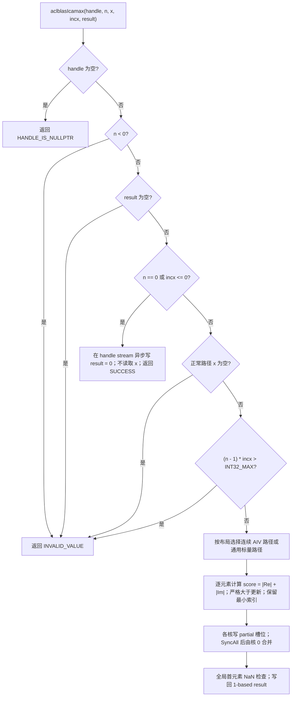
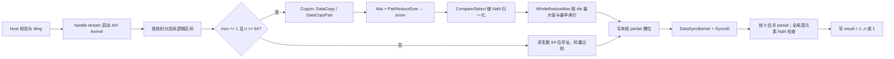
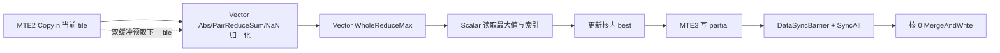

# aclblasIcamax 算子设计文档（Atlas A2/A3）

| 项目 | 内容 |
| --- | --- |
| 算子名称 | `aclblasIcamax` |
| 任务名称 | CANN 社区任务 aclblasIcamax 算子开发（Atlas A2/A3） |
| 目标硬件 | Atlas A2 / Atlas A3（arch22） |
| CANN 版本 | CANN 9.1.0 |
| 接口形式 | ops-blas 句柄式 BLAS API + Ascend C Kernel 直调 |
| 对标接口 | cuBLAS `cublasIcamax`；语义参考 Netlib BLAS 3.10.0 `icamax.f` / `SCABS1` |
| 代码仓与目录 | `cann/ops-blas`：`blas/iamax/arch22/`、`test/iamax/icamax/arch22/` |
| 开发者 | `Irene-` |
| 文档版本 | v1.0 |

# 一、需求背景

## 1.1 需求来源

本设计对应 CANN 社区任务《aclblasIcamax 算子开发任务书（Atlas A2/A3）》。任务要求在昇腾 NPU 的 Atlas A2/A3 系列产品（含 Atlas 800T A2 / Atlas 800T A3）上，基于 `cann/ops-blas` 工程，使用 Ascend C 编程语言和 Kernel 直调方式实现单精度复数（COMPLEX64）向量最大“模”元素索引算子 `aclblasIcamax`：

- 在向量 `x` 中查找 `|Re(x[k])| + |Im(x[k])|` 最大的元素，返回其 **1-based** 索引；
- 多个元素取得相同最大值时，取 **最小索引**；
- 输出为 Device 上的 INT32 标量，精度判定为与 golden **精确相等**；
- 验收通过后合入 `cann/ops-blas` 开源仓。

接口声明已在 `include/cann_ops_blas.h` 中提供，与 950PR 路径共用，本任务不定义私有平行接口。

## 1.2 背景介绍

### 1.2.1 标杆来源、TBE 源码与算子信息库核查

本任务是在 `ops-blas` 中新增公共 BLAS 接口的 arch22 Ascend C 实现，不是将既有 ACLNN/TBE 算子迁移为 Ascend C。任务书没有给出 `aclblasIcamax` 的 TBE 源码，目标仓也不存在该 TBE 实现。因此下列审核项的结论是**不适用**，而不是缺少材料：

| 审核对象 | 核查结论 | 依据及替代参考 |
| --- | --- | --- |
| 原 TBE 算子源码路径（含文件名） | 不适用：任务书未给出 `aclblasIcamax` 的 TBE 实现，目标仓不存在该 COMPLEX64 接口 | 数学与 API 语义以 cuBLAS `cublasIcamax` 和 Netlib `icamax.f` / `SCABS1` 为准 |
| 算子信息库路径（含文件名） | 不适用：本任务不注册 ACLNN 算子，不使用 ACLNN 算子信息库 | 公共接口声明位于 `ops-blas/include/cann_ops_blas.h`；接口不是 `aclnn*` |
| 可复用工程实现 | 适用 | `blas/iamax/arch22/isamax_*`（同族实数接口的 Ascend C、handle、stream 与启动框架）；`blas/iamax/arch35/icamax_*`（复数归约语义）；`test/iamax/icamax/`（共享参数、golden 与测试框架） |

因此本文不会把同族实数 `aclblasIsamax` 误写成 Icamax 的 TBE 标杆，也不会虚构 ACLNN 接口或算子信息库文件。`Isamax` 只作为工程接入参考；复数 1-范数比较、1-based 索引、并列与特殊值行为仍以任务书指定的 cuBLAS/Netlib 参考为准。

### 1.2.2 aclblasIcamax 标杆算子现状分析

`aclblasIcamax` 是 BLAS `ICAMAX` 的 COMPLEX64 版本。其语义不是欧氏模，而是 Netlib `SCABS1` 定义的 1-范数口径：

| 项目 | Icamax 要求 |
| --- | --- |
| 数据类型 | `aclblasComplex`，实部与虚部均为 FP32 的 COMPLEX64；按 `real, imag` 交错存储，每个复数 8 字节 |
| 比较量 | `score = \|Re(x)\| + \|Im(x)\|`，不是 `sqrt(Re² + Im²)` |
| 输出 | INT32 标量，1-based；`n == 0` 或 `incx <= 0` 时为 0 |
| 并列语义 | 严格大于才更新；相同 score 取最小逻辑索引 |
| 步长 | 正常路径 `incx >= 1`；`incx <= 0`（含 0 与负步长）为合法 quick return，不做负步长反向遍历 |
| 参数边界 | `n < 0` 非法；`result` 任意情况下不可为空；正常路径 `x` 不可为空 |
| 跨度上限 | `(n - 1) * incx` 在 Host 侧以 int64 计算，超过 INT32_MAX 时返回 `ACLBLAS_STATUS_INVALID_VALUE` |
| 执行方式 | 通过 handle 绑定 stream 异步下发；调用方在读回 `result` 前同步该 stream |

ops-blas 中与本任务直接相关的内容如下：

| 位置 | 已有内容 | 本任务处理 |
| --- | --- | --- |
| `include/cann_ops_blas.h` | 已声明 `aclblasIcamax` | 复用，不新增私有接口 |
| `include/cann_ops_blas_common.h` | `aclblasComplex`、状态码定义 | 复用 |
| `blas/iamax/arch22/isamax_*` | arch22 Ascend C、`PairReduceSum`、`DataCopyPad`、`SyncAll` 等用法 | 参考工程框架；不复用其不满足本任务契约的 Host 行为 |
| `blas/iamax/arch35/icamax_*` | 复数归约语义、handle workspace 使用方式 | 参考语义；其 `Reg::`、`asc_vf_call`、SIMT API 不用于 arch22 |
| `blas/common/helper/aclblas_handle_internal.h` | `GetEffectiveWorkspace` / `GetEffectiveWorkspaceSize`，默认 32 MiB workspace | 复用 |
| `blas/common/helper/host_utils.h` | AIV 核数查询等辅助函数 | 复用 |
| `test/iamax/icamax/` | 共享参数定义、CBLAS golden、arch35 测试；CMake 原先只注册 arch35 | 复用并补 arch22 注册、golden 跨度守卫 |
| `blas/CMakeLists.txt` | 按架构自动收集 `icamax_` 前缀源码 | 复用 |

参考实现中存在需要明确避开的旧行为：

1. arch22 `Isamax` 的 Host 在空 handle 返回值、quick return 的 Host 写设备指针、逐调用分配与 stream 同步等方面不完全满足本任务契约；Icamax 按本文的校验顺序和句柄 workspace 实现。
2. arch35 Icamax 使用 `Reg::`、`asc_vf_call` 和 SIMT，A2/A3 实现改用 CANN 9.1.0 支持的 arch22 向量指令。
3. arch35 测试 wrapper 在接口校验前按完整跨度分配输入，并同步整个设备；arch22 wrapper 先分流非法与 quick return 用例，只同步 handle 绑定的 stream。
4. 共享 CPU golden 原先没有跨度守卫；本任务补齐 `(n - 1) * incx` 的 int64 守卫，避免 cblas 内部 int 步长回绕，同时不改变合法输入的 golden 结果。

### 1.2.3 标杆算子实现流程图



## 1.3 aclblasIcamax 算子功能分析

对逻辑下标 `j = 0..n-1`，物理复数下标为 `j * incx`：

```text
score(j) = |Re(x[j * incx])| + |Im(x[j * incx])|
result   = 1 + score 最大的逻辑下标        // 并列时取最小 j；1-based
```

输入：

- `handle`：ops-blas 上下文句柄，携带 stream，Host 内存；
- `n`：逻辑复数元素个数，Host 内存，要求 `n >= 0`；
- `x`：COMPLEX64 向量，Device 内存，只读；
- `incx`：相邻逻辑元素的物理步长，Host 内存。

输出：

- `result`：Device 上的 INT32 标量；正常路径取值 `1..n`，quick return 为 0。

支持数据类型：仅 COMPLEX64（实部/虚部各 FP32）。

支持广播：不涉及。本接口是 BLAS 向量归约接口，`x` 通过 `n`、`incx` 描述逻辑布局，不定义张量广播语义。

特殊值语义（对齐 Netlib `icamax` 的串行“严格大于才更新”规则）：

1. 第一个逻辑元素的 score 为 NaN 时，结果固定为 1。
2. 第一个 score 非 NaN 时，后续所有 NaN 均被忽略。
3. 相同 score 取最小逻辑索引，包括全零、常量、正负零和多个 Inf。
4. 有限分量相加上溢到 `+Inf` 时，按 `+Inf` 参与比较。
5. `(Inf, NaN)` 的 score 为 NaN，适用 NaN 规则。

# 二、需求分析

## 2.1 外部组件依赖

| 组件 | 适配状态 | 用途 |
| --- | --- | --- |
| CANN 9.1.0 Ascend C / ACL runtime | 已适配 | 编译 Kernel、管理 Device 内存、在 handle stream 上启动 Kernel |
| Atlas A2/A3（arch22） | 已适配 | 本任务目标硬件 |
| Netlib BLAS 3.10.0（`cblas_icamax`） | 仅测试期使用 | 生成 CPU golden；不作为运行时或生产依赖 |
| cuBLAS `cublasIcamax` | 仅语义/性能参考 | API 参数序列与性能基线；不作为运行时依赖 |

不新增 CATLASS、GEMM、TBE、ACLNN 或其他生产第三方依赖。

## 2.2 内部适配模块

| 模块 | 仓内位置 | 适配内容 |
| --- | --- | --- |
| 公共 BLAS API | `include/cann_ops_blas.h` | 复用既有 `aclblasIcamax` 声明，供 A2/A3 与 950PR 共用 |
| Host 入口 | `blas/iamax/arch22/icamax_host.cpp` | 参数校验、quick return、跨度守卫、核数选择、workspace 检查与异步下发 |
| Kernel | `blas/iamax/arch22/icamax_kernel.cpp` | 连续 AIV 归约、通用标量归约、NaN 归一化、稳定索引与跨核合并 |
| Tiling ABI | `blas/iamax/arch22/icamax_tiling_data.h` | Host/Device 共用的 `IcamaxTilingData` 与常量 |
| 启动声明 | `blas/iamax/arch22/icamax_kernel.h` | Kernel launch 声明 |
| 构建与测试 | `test/iamax/icamax/` | arch22 GTest 注册、CSV 驱动精度/性能测试、NPU wrapper、CPU golden |

## 2.3 需求模块设计

### 2.3.1 Ascend C 算子原型

使用 Ascend C 实现 `aclblasIcamax`，在 Atlas A2/A3（arch22）上支持 COMPLEX64 向量的 1-范数最大“模”索引归约；通过 handle 所绑定的 stream 异步启动 Kernel，不在 Host 内同步。

```cpp
aclblasStatus_t aclblasIcamax(
    aclblasHandle_t handle,
    int n,
    const aclblasComplex* x,
    int incx,
    int* result);
```

### 2.3.2 Ascend C 算子相关约束

1. 复用 `include/cann_ops_blas.h` 中的公共声明，签名逐参数对齐同族 `aclblasIsamax` 的 `int n / int incx / int* result` 形式，不定义 950PR 私有 API 或平行接口。
2. `x` 按 `real, imag` 交错存储，每个复数 8 字节；实部与虚部均按 FP32 计算。
3. 比较量必须是 `|Re| + |Im|`（Netlib `SCABS1`），不得使用欧氏模 `sqrt(Re² + Im²)`。
4. 输出为 1-based INT32 索引；并列时取最小逻辑索引。
5. `n == 0` 或 `incx <= 0` 为合法 quick return：不读取 `x`，在 handle stream 上异步写 `result = 0`，返回成功；本算子不支持负步长反向遍历。
6. `n < 0` 返回 `ACLBLAS_STATUS_INVALID_VALUE`；`result == nullptr` 在任意情况下（含 quick return）返回 `ACLBLAS_STATUS_INVALID_VALUE`；正常路径 `x == nullptr` 返回 `ACLBLAS_STATUS_INVALID_VALUE`。
7. `(n - 1) * incx` 在 Host 侧以 int64 计算；超过 INT32_MAX 时返回 `ACLBLAS_STATUS_INVALID_VALUE`。`n == 1 && incx == INT32_MAX` 的跨度为 0，正常返回索引 1；`incx == INT32_MIN` 直接进入 quick return，任何层都不执行 `abs(int)`。
8. 正常路径复用句柄 workspace 保存跨核 partial，上限 `256 × 32 = 8192` 字节；不在每次调用中分配 Device 内存，也不在公共接口内部同步 stream。
9. 连续路径优先保证性能；跨步或小尺寸路径以正确性优先，但必须覆盖所有合法正步长。

#### 2.3.2.1 设计原则与非目标

| 原则 | 设计约束 |
| --- | --- |
| 单一公共接口 | 只实现 `aclblasIcamax`，不定义 A2/A3 私有 API、批量接口或 int64 公共签名 |
| 语义优先 | 比较量固定为 1-范数；1-based 索引；并列取最小；特殊值严格对齐 Netlib |
| 正确性优先 | 通用标量路径覆盖所有合法布局；连续路径优化不得缩小 API 支持范围 |
| 单次下发 | 一次公共调用只下发一个 AIV Kernel；跨核合并通过 workspace + `SyncAll` 完成 |
| 无隐式分配/同步 | Host 只向 handle 绑定 stream 入队；错误由调用方在该 stream 同步时获得 |
| 证据驱动优化 | tile、核数与双缓冲由目标设备编译资源和 profiling 决定，不按 case 名或数据内容分派 |

不在本次范围内：arch35/arch20 Kernel 移植、ACLNN/TBE 算子注册、负步长反向遍历、欧氏模语义、改变既有 `aclblasIsamax` 行为、修改 arch35 Icamax 实现。

# 三、需求详细设计

## 3.1 调用方式

本算子采用 **ops-blas 句柄式 BLAS API + Ascend C Kernel 直调**，不是 ACLNN 或 PyTorch 框架算子。调用方创建 handle 并以 `aclblasSetStream` 绑定 stream，将 Host 的 `n/incx` 与 Device 的 `x/result` 传入 `aclblasIcamax`；Host 完成校验、核数选择、workspace 检查和 tiling 后，仅向该 stream 异步入队。调用方在读回 `result` 前负责同步同一 stream。


调用与测试入口见 `test/iamax/icamax/arch22/icamax_test.cpp`；可复现的构建、运行与验收步骤见 `test/iamax/icamax/README.md`。

## 3.2 需求总体设计

### 算子数据模型

#### 数学公式

```text
score(j) = |Re(x[j * incx])| + |Im(x[j * incx])|, j = 0..n-1
result   = 1 + argmax_j score(j)            // 并列时取最小 j
```

其中复数按实部/虚部分量存储：

```text
x[j * incx].real = xf[2 * (j * incx)]
x[j * incx].imag = xf[2 * (j * incx) + 1]
```

#### 支持数据类型

| 参数 | 数据类型 | 存储位置 |
| --- | --- | --- |
| `x` | COMPLEX64（`aclblasComplex`，两个 FP32） | Device，只读 |
| `result` | INT32 | Device，只写 |
| `n`、`incx` | `int`（Host 参数；Kernel ABI 中为 `uint32_t`，物理偏移使用 64 位） | Host / tiling |

#### 支持形状与布局

| 项目 | 支持范围 |
| --- | --- |
| 逻辑长度 | `n >= 0`，运行时入参 |
| 物理跨度 | `1 + (n - 1) * incx` 个复数（`incx >= 1` 的正常路径） |
| 存储顺序 | 一维逻辑向量；物理地址由 `incx` 决定 |
| 步长 | 正常路径 `incx >= 1`；`incx <= 0` 为 quick return，不遍历数据 |
| 索引 | 输出 1-based；内部逻辑索引从 0 开始 |
| 广播 | 不支持，也不适用 |
| 批处理/高维 ND | 不支持；接口为单向量归约 |

### 3.2.1 Host 侧设计

Host 侧职责是校验公共接口契约、构造稳定的 Host–Kernel tiling、检查 workspace，并在 handle 绑定 stream 上异步启动 Kernel；Host 侧不做 `aclrtSynchronizeStream`。

#### 3.2.1.1 参数校验与启动边界

| 顺序 | 条件 | 行为 |
| --- | --- | --- |
| 1 | `handle == nullptr` | 返回 `ACLBLAS_STATUS_HANDLE_IS_NULLPTR` |
| 2 | `n < 0` | 返回 `ACLBLAS_STATUS_INVALID_VALUE` |
| 3 | `result == nullptr`（含 quick return 场景） | 返回 `ACLBLAS_STATUS_INVALID_VALUE` |
| 4 | `n == 0 \|\| incx <= 0` | 在 handle stream 上调用 `aclrtMemsetAsync` 将 `result` 写为 0（4 字节）；不读取 `x`；返回 `ACLBLAS_STATUS_SUCCESS` |
| 5 | 正常路径 `x == nullptr` | 返回 `ACLBLAS_STATUS_INVALID_VALUE` |
| 6 | `int64(n - 1) * int64(incx) > INT32_MAX` | 返回 `ACLBLAS_STATUS_INVALID_VALUE` |
| 7 | 其他合法输入 | 查询 AIV 核数、检查 workspace、构造 tiling 并异步入队 Kernel，返回成功 |

该顺序保证：

- 空 handle、负 `n`、空 `result` 不会被 quick return 掩盖；
- 合法 no-op 可以传入空 `x`，但 `result` 必须非空；
- `incx == INT32_MIN` 在 `incx <= 0` 分支直接返回，不执行 `abs(int)`；
- `n == 1 && incx == INT32_MAX` 的 `lastComplex` 为 0，进入正常路径并返回索引 1。

错误映射：

| 场景 | 返回码 |
| --- | --- |
| quick return 的 `aclrtMemsetAsync` 失败 | `ACLBLAS_STATUS_EXECUTION_FAILED` |
| AIV 核数查询失败（返回 0） | `ACLBLAS_STATUS_INTERNAL_ERROR` |
| 可用 workspace 小于 `ICAMAX_MAX_PARTIAL_CORES × 32` 字节 | `ACLBLAS_STATUS_EXECUTION_FAILED` |
| 其他非法参数 | `ACLBLAS_STATUS_INVALID_VALUE` |

#### 3.2.1.2 分核、分块与 LocalMemory 优化策略

Host 按下式选择启动的 AIV 数：

```text
if incx == 1 and n >= 64:
    numBlocks = min(n / 64, aivCoreCount)
else:
    numBlocks = min(n, aivCoreCount)
numBlocks = max(numBlocks, 1)
```

Kernel 内根据实际启动的 AIV 数重新计算参与归约的核数，保证 Host 与 Device 一致：

```text
totalCores = GetBlockNum()                       // KERNEL_TYPE_AIV_ONLY 下等于 numBlocks

if scalarPath (incx != 1 or n < 64):
    coreNum = min(n, totalCores)
else:
    coreNum = min(n / 64, totalCores)

coreNum = clamp(coreNum, 1, 256)
```

每个核处理一段连续逻辑区间：

```text
q = n / coreNum
r = n % coreNum
start = b * q + min(b, r)
count = q + (b < r ? 1 : 0)
```

设计要点：

- 连续路径每个核至少 64 个复数，保证向量归约有足够的 repeat 宽度；不足 64 或 `incx != 1` 时走标量路径，避免小 mask 向量归约的额外开销。
- `4096` 是默认 tile 复数个数（`ICAMAX_DEFAULT_TILE_COMPLEX`），Host 通过 `IcamaxTilingData` 传入；Kernel 对非法或超限 tile 回退到 4096。
- `coreNum` 上限 256 与 partial 槽位预留上限 `ICAMAX_MAX_PARTIAL_CORES = 256` 一致。
- `blockIdx >= coreNum` 的空闲核仍执行一次 `SyncAll` 后返回，保证所有参与核到达同一 barrier。

连续 AIV 路径的 UB 预算（tile = 4096 复数）：

| 缓冲区 | 计算 | 字节数 |
| --- | --- | --- |
| 输入队列（双缓冲） | `2 × 4096 × 2 × sizeof(float)` | 65,536 |
| score 缓冲 | `4096 × sizeof(float)` | 16,384 |
| 负哨兵缓冲 | `4096 × sizeof(float)` | 16,384 |
| NaN 比较 mask | `4096 / 8 + 32` | 544 |
| partial 输出 | `32` | 32 |
| partial 合并输入 | `256 × 32` | 8,192 |
| **合计** | | **107,072** |

合计约 104.6 KiB，低于 arch22 单核 192 KiB UB 预算。标量路径只分配 partial 相关缓冲区，不分配连续输入/score/哨兵/mask 缓冲。

#### 3.2.1.3 tilingKey 规划策略

该 ops-blas 直调工程不使用 ACLNN/TBE 框架的 `tilingKey`。等价的可审计分派信息以 `IcamaxTilingData` 字段和 Host/Kernel 条件传递，不能虚构未实现的 key 值：

| 分派标识 | 条件 | Kernel / 资源策略 |
| --- | --- | --- |
| 连续 AIV 路径 | `incx == 1` 且 `n >= 64` | 双缓冲 tile；`DataCopy`/`DataCopyPad` → `Abs` → `PairReduceSum` → NaN 归一化 → `WholeReduceMax`；tile = 4096 |
| 通用标量路径 | `incx != 1` 或 `n < 64` | 64 位物理索引逐复数读取；严格大于更新；正确性优先 |

`IcamaxTilingData` 只传递必要字段：

```cpp
struct IcamaxTilingData {
    uint32_t n;
    uint32_t incx;
    uint32_t tileComplexCount;
};
```

分派不读取 case 名称、随机 seed、数据内容或性能基线。

#### 3.2.1.4 索引、跨度与 ABI 边界

Host/Kernel 不得先以 `int` 相乘再转换。逻辑索引定义如下：

```text
N = uint64(n)
S = uint64(incx)
physical(j) = uint64(j) * S
floatOffset(j) = 2 * physical(j)
byteOffset(j)  = 8 * physical(j)
```

连续路径因 `incx == 1`，tile 起始处的 float 偏移为：

```text
sourceOffset = 2 * uint64(start + tileOffset)
```

跨步路径逐复数读取：

```text
physical = uint64(start + i) * uint64(incx)
real = xf.GetValue(2 * physical)
imag = xf.GetValue(2 * physical + 1)
```

边界处理：

- `(n - 1) * incx` 在 Host 侧以 int64 计算并限制在 INT32_MAX 内；该限制是**逻辑复数跨度**限制，不代表物理字节跨度可只用 32 位表示。
- Kernel 中所有物理复数、float、字节偏移均在 64 位域计算，避免大索引和高步长溢出。
- `incx == INT32_MIN` 在 quick return 分支处理，不取相反数；`n == 1` 时跨度为 0，任何合法正步长只读取 `x[0]`。
- `result` 只写 4 字节；partial 每核使用独立、32 字节对齐的槽位（前 8 字节为 float score + INT32 index bits，其余为 padding）；槽位间距 32 字节，核 0 按 `useCoreNum × 32` 字节一次搬入，避免跨核写覆盖。

#### 3.2.1.5 实际分派策略

| 路径 | 条件 | 实现 |
| --- | --- | --- |
| 连续 AIV 路径 | `incx == 1`、`n >= 64` | 双缓冲 tile；`Abs` + `PairReduceSum` 形成 score；NaN 归一化；`WholeReduceMax` 取 tile 最大值与最早索引 |
| 通用标量路径 | `incx != 1` 或 `n < 64` | 每个线程按逻辑区间顺序读取复数；64 位寻址；严格大于更新；正确性优先 |

分派只依据 `incx` 与 `n`，不依据测试 case 名、seed 或基线值。性能用例均为 `incx == 1`，因此连续路径是性能主路径；`incx > 1` 路径仍覆盖所有合法正步长。

### 3.2.2 Kernel 侧设计

#### 3.2.2.1 Kernel 侧实现描述

Kernel 使用 `KERNEL_TASK_TYPE_DEFAULT(KERNEL_TYPE_AIV_ONLY)`，`numBlocks` 与 AIV 索引 1:1。每次公共调用只下发一个 Kernel；Kernel 内完成分片扫描、核内归约、partial 写回、全核同步与核 0 合并。



Kernel 执行步骤：

1. 读取 tiling，计算 `coreNum`、本核的 `start/count`，初始化候选 `(bestScore, bestIndex) = (-1, INVALID)`。
2. `blockIdx >= coreNum` 的空闲核执行 `SyncAll` 后返回，保证 barrier 参与者一致。
3. 按 `scalarPath` 选择执行标量路径或连续 AIV 路径。
4. 各核写 partial 槽位（前 8 字节有效）；`DataSyncBarrier<MemDsbT::DDR>()` 后执行 `SyncAll`。
5. 核 0 搬入 `useCoreNum * 32` 字节 partial，按“更大 score 胜出；相等取更小索引”合并。
6. 核 0 读取全局 `x[0]` 的实部/虚部，若任一为 NaN 则 `result = 1`；否则 `result = bestIndex + 1`（无有效候选时保留 1）。
7. 仅写 4 字节 `result`，不搬出整个 32 字节块。

#### 3.2.2.2 Ascend C 实现流程图

连续路径的流水依赖：



同步约束：

- MTE2 搬入完成后，Vector 才能读取输入；
- Vector 计算完成后，Scalar 才能读取 `WholeReduceMax` 结果；
- Scalar 构造 partial 后，MTE3 才能写回；
- MTE3 写 partial 完成并满足 DDR 可见性后，核 0 才能搬入；
- 双缓冲队列保证生产者/消费者事件依赖，`PipeBarrier<PIPE_V>` 仅用于向量流水依赖。

#### 3.2.2.3 通用标量路径（`incx != 1` 或 `n < 64`）

```text
for i = 0 .. count-1:
    logical = start + i
    physical = uint64(logical) * uint64(incx)
    re = xf[2 * physical]
    im = xf[2 * physical + 1]
    score = (re >= 0 ? re : -re) + (im >= 0 ? im : -im)
    if score >= 0:                              // NaN 不参与候选
        if bestIndex == INVALID or score > bestScore:
            bestScore = score
            bestIndex = logical
```

正确性要点：

- 每个逻辑元素只属于一个核的连续区间，不存在跨核写冲突。
- 绝对值使用符号判断而不是 `libm` 调用；`-0.0` 通过符号判断得到 `+0.0`。
- `score >= 0` 为假时排除 NaN；后续 NaN 不会覆盖已有候选。
- 分片起点若是 NaN，会被本核跳过；这不会破坏全局语义，因为“首元素 NaN 返回 1”的判定统一在合并后由核 0 对全局 `x[0]` 执行。
- 大步长空隙中的 Inf/NaN 不会被读取；只访问逻辑元素 `j * incx`。

#### 3.2.2.4 连续向量 AIV 路径（`incx == 1` 且 `n >= 64`）

每个 tile 最多处理 4096 个复数：

1. **CopyIn**：搬入恰好 `2 * current` 个 float。若源地址和字节长度均 32 字节对齐，使用 `DataCopy`；否则使用 `DataCopyPad`，`blockLen` 精确等于有效字节数，padding 值为 0，不越过真实输入末尾。
2. **Abs**：对 `paddedFloats = roundUp(2 * current, 64)` 个 float 执行 `Abs`。尾部 lane 位于 UB 已分配区域内，且不会进入最终归约计数。
3. **PairReduceSum**：以 64 个 float 为一个 repeat，把相邻的实部/虚部绝对值相加，写出连续 score 数组。按最多 255 repeat/批分段调用；输入计数单位为 float，输出计数单位为复数。
4. **NaN 归一化**：`Compare(score, score, EQ)` 生成 mask；`Select(score, mask, score, -1.0f, ...)` 把 NaN score 替换为负哨兵 `-1`。合法 score 均非负，因此全 NaN tile 的最大值为 `-1`。
5. **tile 归约**：`SetMaskCount` + `SetVectorMask(COUNTER, current)` 后调用 `WholeReduceMax` 的 count 模式，一次归约 `current` 个 score；`GetReduceMaxMinCount` 取回 tile 最大值及 tile 内**最早**索引。
6. **更新核内候选**：仅当 `value >= 0` 时调用 `UpdateBest(value, start + tileOffset + tileIndex)`；`UpdateBest` 使用严格大于，保持 tile 间最小索引。
7. **双缓冲**：输入队列深度为 2，当前 tile 计算时预取下一 tile，重叠 MTE2 与 Vector。

该路径只使用 FP32 的 `Abs` 与加法，不使用平方和或 `sqrt`。

#### 3.2.2.5 稳定最早索引与跨核合并

全局比较规则统一为：

```text
更大 score 胜出；score 相等时，更小逻辑索引胜出。
```

各层实现：

| 层级 | 机制 |
| --- | --- |
| tile 内 | `WholeReduceMax` count 模式返回最大值及其最早索引；NaN 已归一化为 `-1` |
| tile 间 | `UpdateBest` 严格大于；相等时保留先处理的较小索引 |
| 核间 | 每核写 32 字节对齐槽位（前 8 字节为 float score + INT32 index bits）；核 0 合并时使用 `score > bestScore \|\| (score == bestScore && index < bestIndex)` |
| 全局 | 合并后核 0 读取 `x[0]` 的实部/虚部；任一为 NaN 时 `result = 1`，否则 `result = bestIndex + 1` |

索引在 tiling、UB、workspace 和合并过程中始终以整数保存，不转换为 FP32。测试覆盖 `n > 2^24` 且唯一最大/并列最早最大值位于索引 `16777217` 的场景，验证 INT32 索引不丢位。

为什么首元素 NaN 在合并后判定：如果各核在分片起点独立应用“首元素 NaN”规则，会把非全局首元素的 NaN 误当作全局首元素；正确的做法是各核只做局部候选，核 0 在全局合并后读取 `x[0]` 一次并应用 Netlib 规则。

#### 3.2.2.6 浮点顺序与特殊值

- score 采用 `abs(real) + abs(imag)` 的 FP32 加法，实部/虚部分别取绝对值；不共轭、不做平方和、不使用 FMA 改变舍入。
- 比较采用严格大于，保留最小索引；`-0.0` 经绝对值变为 `+0.0`。
- 首元素 NaN：结果固定为 1；后续 NaN：忽略；全 NaN：若首元素为 NaN 则为 1，否则无有效候选时保留安全回退 1（正常路径下首元素非 NaN 必有候选）。
- 多个 `Inf` 并列：第一个 `Inf` 胜出；有限分量相加上溢到 `+Inf`：按 `+Inf` 比较；`(Inf, NaN)`：score 为 NaN，适用 NaN 规则。
- 次正规数、`FLT_MIN`、相邻 ULP、正负零、有限和上溢均有定向用例；A3 实测未观察到影响排序的 FTZ 行为。若未来在其他 A2/A3 款型发现 FTZ 影响排序，需要按原始位模式增加特殊分支，并重新验证。
- 精度判定是索引精确相等，不是 score 容差比较；浮点舍入导致 score 相等时，由“最小索引”规则决定输出。

#### 3.2.2.7 Ascend C 实现与标杆流程差异及原因

| 维度 | Netlib/cuBLAS 语义标杆 | Ascend C arch22 实现 | 差异原因与正确性约束 |
| --- | --- | --- | --- |
| 执行位置 | CPU 参考循环或 cuBLAS 内部实现 | Atlas A2/A3 上 Host 异步 launch + AIV Kernel | 适配 ops-blas handle 和 stream；公共接口不在 Host 内同步 |
| 比较量 | `SCABS1`：`\|Re\| + \|Im\|` | 实部/虚部 FP32 `Abs` 后相加 | 与任务书和 golden 口径一致；禁止欧氏模 |
| 索引 | 1-based，并列取最小 | 内部 0-based 整数，写回时 +1 | 与 cuBLAS/Netlib 输出一致；整数全程不转 FP32 |
| NaN | 首个 score 为 NaN 时停在第 1 个；后续 NaN 不更新 | 各核跳过 NaN；合并后核 0 检查全局 `x[0]` | 避免把分片起点 NaN 误判为全局首元素 |
| 并列 | 严格大于才更新 | tile 内最早索引 + 核间“相等取小索引” | 保证跨 tile/跨核的最小索引 |
| 负步长 | Netlib 1993 年起 `incx <= 0` 直接返回 0 | quick return：stream 异步写 0，不读 x | 与 cuBLAS 文档和仓内同族接口一致；不做反向遍历 |
| 跨度 | 参考实现使用 int 步长 | Host int64 守卫；Kernel 64 位寻址 | 防止 `(n-1)*incx` 和物理偏移溢出 |
| 性能路径 | 不规定 NPU 资源分派 | `incx == 1 && n >= 64` 连续 AIV；其他布局标量回退 | 优化不缩减任何合法输入范围 |

## 3.3 支持硬件

| 支持的芯片版本 | 涉及勾选 | 说明 |
| --- | --- | --- |
| Atlas A2 训练/推理系列（arch22） | √ | 设计目标；构建 SOC 为 `ascend910b`，A2 实机待验收机确认 |
| Atlas A3 训练/推理系列（arch22） | √ | 已在 Atlas A3（Ascend910_9382，48 AIV）实测；构建 SOC 为 `ascend910_93` |
| Ascend 950PR（arch35） | √（既有实现） | 由 `blas/iamax/arch35/icamax_*` 提供，本任务不修改、不宣称 arch22 实现可替代 |
| Ascend 310P（arch20） | × | 需独立 Kernel 适配，不在本次实现范围 |

## 3.4 算子约束限制

1. 仅实现 COMPLEX64 的 `aclblasIcamax`；不包含 FP32、FP64 或其他复数精度的平行 API。
2. 正常路径仅支持 `incx >= 1`；`incx <= 0` 为合法 quick return，不做负步长反向遍历。
3. 不支持张量广播、高维 ND 语义或批处理语义。
4. `n < 0` 非法；`result` 在任意情况下不可为空；正常路径 `x` 不可为空。
5. `(n - 1) * incx` 必须不超过 INT32_MAX；超过时返回 `ACLBLAS_STATUS_INVALID_VALUE`。该限制是逻辑复数跨度限制，不表示硬件能分配相应矩阵/向量。
6. `x` 为只读 Device 指针，`result` 为独立 Device 输出；不定义 `x` 与 `result` 重叠时的别名行为。
7. 公共接口不分配逐调用 Device 内存、不做 Host 同步；调用方在读回 `result` 前必须同步 handle 绑定的 stream。
8. 正常路径复用句柄 workspace，partial 预留上限 8192 字节；workspace 不足时返回 `ACLBLAS_STATUS_EXECUTION_FAILED`。
9. 连续 AIV 路径在 `incx == 1 && n >= 64` 时启用；其他合法布局自动走标量路径，接口能力不缩减。
10. A2/A3 与 950PR 共用公共声明，但 arch22 与 arch35 Kernel 独立实现，不跨架构宣称性能或行为等价。

# 四、特性交叉分析

| 交叉特性 | 组合 | 设计处理与验证重点 |
| --- | --- | --- |
| 比较口径与特殊值 | 1-范数 × NaN/Inf/正负零/次正规数 | 固定 `Abs + Add` FP32 顺序；定向覆盖首 NaN、后续 NaN、全 NaN、多 Inf、有限和上溢、`(Inf, NaN)`、相邻 ULP |
| 并列与分块 | 相同 score × 同 tile/跨 tile/跨核 | tile 内取最早索引；核间“相等取小索引”；定向构造 tile 边界与核分片边界两侧并列 |
| 首元素 NaN 与分片 | 全局首 NaN × 各核分片起点 NaN | 各核跳过 NaN；只在合并后由核 0 检查全局 `x[0]`；定向覆盖 NaN 位于其他核首元素 |
| quick return 与空指针 | `n == 0` / `incx <= 0` × `x == nullptr` / `result == nullptr` | 先校验 handle、n、result；quick return 允许空 `x`，但不允许空 `result`；写 0 后不读 x |
| 步长与路径 | `incx = 1` 连续 × `incx > 1` 跨步 × `incx <= 0` quick return | 连续路径 AIV；跨步路径 64 位标量；`INT32_MIN` 不进 `abs`；`n == 1` 大步长正常 |
| 大索引与精度 | `n > 2^24` × 索引 `16777217` | 索引全程整数；定向用例验证不丢位、不转 FP32 |
| 异步与重复调用 | 绑定 stream × 连续调用/独立 handle/独立 stream | Host 不同步；每次调用使用自身 workspace partial；测试重复调用与双 stream 隔离 |
| workspace 与多核 | 多核 partial × workspace 不足 | partial 上限 8192 字节；workspace 不足返回执行失败；测试覆盖不足场景 |
| 架构与产品 | arch22 A2/A3 × arch35 950PR | 公共声明共用；Kernel 独立；A3 实测，A2 待验收机确认；不用 950PR 结论替代 A2/A3 |

# 五、可维可测分析

## 5.1 精度标准/性能标准

### 精度标准

| 验收标准 | 描述 | 标准来源 |
| --- | --- | --- |
| 输出正确性 | NPU 输出 INT32 索引与 golden **精确相等**，任一用例不等即失败；不存在浮点容差 | 任务书 §3.2 |
| Golden 语义 | Netlib BLAS 3.10.0 `cblas_icamax` 返回值 +1（0-based 转 1-based） | 任务书 §3.2/§3.5 |
| 比较口径 | `\|Re\| + \|Im\|`（Netlib `SCABS1`），不是欧氏模 | 任务书 §2.1/§7 |
| 并列 | 相同 score 取最小逻辑索引 | 任务书/Netlib |
| 特殊值 | 首 NaN → 1；后续 NaN 忽略；多 Inf 取第一个；有限和上溢按 Inf；`(Inf, NaN)` 按 NaN | 任务书 §3.2 补充说明 |
| 负向/quick return | 状态码与任务书一致；quick return 输出 0 | 任务书 §2.4/§3.2 |

### 测试工程与数据流

测试链路保持 golden 与待测 Kernel 的独立性：

```text
Python 生成器 / 验收驱动
  -> C++ CSV 参数化 GTest（唯一 case_name）
      -> NPU wrapper：分配、上传、原参数调用、同步绑定 stream、分块读回
          -> aclblasIcamax -> Host -> arch22 AIV Kernel
      -> CPU golden：Netlib cblas_icamax + 1；跨度守卫
  <- GTest XML/JSON + 精度/性能/内存结构化记录 + 原始日志
```

- Golden 调用 Netlib BLAS 3.10.0 的 `cblas_icamax`，不复用 Kernel 的归约、索引或比较 helper。
- 共享 `icamax_golden.h` 增加 `(n - 1) * incx` 的 int64 跨度守卫；合法输入结果不变，超出 INT32_MAX 的用例提前返回非法状态，避免 cblas 内部 int 步长回绕。
- NPU wrapper 先按 `expect_result`、`n`、`incx` 和空指针标记分类，再决定是否分配完整输入；非法参数和 quick return 用例不按完整物理跨度分配。
- `result` 前后放置哨兵，调用后校验哨兵不变，确保只写 4 字节。

### 覆盖要求

| 维度 | 覆盖内容 |
| --- | --- |
| 原始清单 | 原 1000 条精度/边界用例全部执行；200 条 PF 同时做结果正确性检查与性能采样 |
| 补充正态用例 | 对 434 条实际执行归约的普通均匀随机精度用例，各补一条相同 `n/incx` 的 `GAUSS_NORM_5_2` 用例 |
| 形状 | `n = 0/1`、小质数（2/3/7）、2 的幂及 ±1、奇数、非对齐长度、`n > 2^24` |
| 布局 | `incx = 1/2/3` 及更大正步长；`incx = 0`、负步长、`INT32_MIN` 为 quick return；紧凑与不同物理偏移 |
| 填充模式 | 均匀 `RANDOM_NORM_5_5`、正态 `GAUSS_NORM_5_2`、全零、常量、正负交替、极端值、Inf/NaN |
| 保护 | 跨步空隙、输入前后 guard、`result` 前后哨兵、只读 `x` 不被修改 |
| 特殊值 | 首 NaN、后续 NaN、全 NaN、多 Inf、`(Inf, NaN)`、有限和上溢、正负零、`FLT_MIN`、次正规数、相邻 ULP |
| 返回码/no-op | 空 handle、空 `result`、负 `n`、quick return 与空指针组合、跨度溢出 |
| 异步隔离 | 非默认 stream、同 stream 连续调用、独立 handle/stream、workspace 不足 |
| 大索引 | `n > 2^24`、最大值位于 `16777217`，验证整数索引不丢位 |

arch22 CSV 用例组成（共 1634 条）：

| 类别 | 条数 | 说明 |
| --- | ---: | --- |
| TC_L0 | 10 | 基础用例 |
| TC_SQ | 38 | 形状扫描 |
| TC_IN | 21 | 步长/布局 |
| TC_FL | 18 | 填充模式 |
| TC_ED | 17 | 边界 |
| TC_EX | 896 | 扩展/特殊值/负向 |
| TC_GN | 434 | 补充 `GAUSS_NORM_5_2` 正态用例 |
| **精度合计** | **1434** | 原始 1000 + 补充 434 |
| TC_PF | 200 | 性能用例，全部 `incx == 1` |

另有 16 项定向测试和 1 项内存报告测试，覆盖 CSV 不易表达的场景：

- 1-范数口径与并列；
- 空 handle、空 result；
- quick return 组合与非法参数组合；
- 跨度守卫与最大步长单元素；
- NaN 规则、Inf/上溢语义；
- 跨 tile/跨核 tie、tile/repeat 边界；
- 非对齐输入与 result 哨兵；
- 跨步空隙忽略；
- 大逻辑索引 `16777217`；
- 浮点边界；
- 重复调用与独立 stream；
- workspace 不足。

负向用例缓冲区分配规则：期望返回值非 `ACLBLAS_STATUS_SUCCESS` 的用例不得按 `(n - 1) * |incx|` 预分配输入；使用单元素 dummy 或 `NULLPTR` 占位，由接口在读取数据前返回预期错误码。`n == 0` 或 `incx <= 0` 的 quick return 同样无需按步长分配完整输入。

正态用例生成规则：实部/虚部独立采样，各自从 seed 派生的确定性参数 RNG 选取 `μ ∈ [-5, 5]`、`σ ∈ [0.1, 2]`，按 `N(μ, σ)` 生成，不做均匀截断；日志记录 seed、实际 μ/σ 与生成方式。

### 精度判定与特殊值规则

对正常路径：

```text
npu_result == cblas_icamax(n, x, incx) + 1
```

- 逐 case 精确比较，不设容差；不相等即失败。
- quick return：`result == 0`；不读取 `x`。
- 非法参数：返回码与期望状态精确一致。
- 首元素 score 为 NaN：`result == 1`，即使后续存在有限大值或 Inf。
- 首元素 score 非 NaN：忽略后续 NaN，在其余元素中取最先出现的最大值。
- 多个 Inf 并列：第一个 Inf 的索引；有限分量相加上溢到 Inf：按 Inf 参与比较。
- `result` 使用 INT32 精确比较，不经过 FP32；大索引用例验证 `16777217` 不被舍入。

浮点容差标准（FLOAT32 `rtol=2^-13`、`atol=2^-13` 等）适用于浮点输出算子；本算子输出为离散整数索引，**不适用容差判定**，等价于要求 matched_ratio = 1。

### 性能标准与测量方法

| 验收标准 | 描述 | 标准来源 |
| --- | --- | --- |
| 正式计时口径 | `msprof op` 采集单算子 task duration（us） | 任务书 §3.3 |
| warmup | 5 次，不计入有效样本 | 任务书 §3.3 |
| 有效样本 | warmup 后连续执行至少 10 次；本项目测试使用 20 次 | 任务书 §3.3 |
| 判据 | 每条 PF 用例 `gpu_us / avg_npu_us >= 0.8`（即 NPU 平均耗时不高于 GPU 的 1.25 倍） | 任务书 §3.3 |
| 基线 | `test_cases/gpu_baseline.csv`，按冻结的 `TC_PF` 顺序逐条关联 | 任务书 §3.3 |

测量流程：

```text
分配、生成、上传输入；绑定 stream
warmup 5 次；同步并检查错误
每个 case：在计时区间外恢复输入 -> start event / msprof 采样
          -> 调用公共接口 -> stop event -> 同步 -> 记录样本
按 case 取算术平均；与对应 GPU 基线逐条比较
```

- 性能 GTest 预先完成设备分配、输入拷贝和 golden 计算；采样段只调用公共接口。
- 200 条 PF 按冻结顺序与基线逐条关联；同一 `(n, incx)` 可对应多条记录（例如 `n = 4194304, incx = 1` 有 3 条），不按形状去重。
- 正式数据使用单 case GTest filter 做 profiling，解析 `OpBasicInfo.csv` 的 `Task Duration(us)`；保留原始 profiling 文件和样本。
- `aclrtEvent` 平均耗时只作本机调优和交叉验证，不替代 `msprof` 正式数据；两者在报告中分列。
- 有效样本数不足、缺 case、缺 baseline、缺 duration、状态非成功或结果不正确，均使该次验收运行失败；不得按耗时大小丢弃慢样本。

本开发容器的 `msprof op` 可启动并生成 `OpBasicInfo.csv`，但设备侧 profiling dump 不可读（`DeviceProf*.bin` 缺失，`Task Duration` 为 NA）。因此本设计不把本机 `aclrtEvent` 数据当作正式性能结论；正式数据需在 Atlas 800T A2（910B3）验收机复测。

### 内存标准与记录

任务书未设置内存数值门槛，但仍需提交内存报告与日志。记录口径：

```text
inputBytes   = 8 * ((n - 1) * incx + 1)      # 正常路径
resultBytes  = 4
partialBytes = 256 * 32 = 8192                # workspace 预留上限；实际使用 P * 32
workspace    = 句柄默认预分配 32 MiB；算子只使用其中 partial 区
testAlloc    = 测试框架的输入/result 设备缓冲，不计入算子 workspace
```

验证内容：

- 首次调用吸收一次性 runtime/kernel 初始化后，连续 10 次调用比较 HBM free 字节，确认无逐调用增长/泄漏；
- 检查 `result` 前后哨兵不变；
- 分别报告输入、result、partial、句柄 workspace 和测试框架占用；
- 销毁 handle 后资源释放由测试/调用方验证。

### 结构化记录与失败处理

每次运行至少记录：

| 记录 | 必备字段 |
| --- | --- |
| run_manifest | run_id、源码 commit、CSV/基线摘要、SoC、CANN 版本、设备号、命令、计时配置 |
| accuracy | case、完整参数、预期/实际状态、NPU/golden 索引、失败坐标、保护区/哨兵结果 |
| performance | case、baseline_id、n、incx、fill、seed、warmup、samples、原始样本、avg_task_us、gpu_us、ratio、verdict、profiling 路径 |
| memory | Host RSS、Device 分配、partial/workspace、测量工具与口径 |
| failure | 阶段、退出码、timeout/crash、原始日志、复现输入 |

运行状态至少区分 PASS、FAIL、ERROR、TIMEOUT、SKIPPED、NO_REF；缺失、跳过、无基线、超时、崩溃或部分执行不得汇总为 ALL PASS。GTest 结构化结果优先于日志解析；实际完成集合必须与计划集合逐条比对。

## 5.2 兼容性分析

- 新增 arch22 实现，不改变既有 `aclblasIsamax`、arch35 Icamax 或其他 BLAS API 的参数与行为。
- `aclblasIcamax` 的公共声明已在 `include/cann_ops_blas.h` 中提供，本任务复用该声明，不创建 A2/A3 私有平行接口；A2/A3 与 950PR 共用同一 API。
- `test/iamax/icamax/CMakeLists.txt` 增加 arch22 `ops_blas_add_gtest_tests` 分支；arch35 注册保留，选择单一目标架构时只生成一个 `icamax_test` target。
- `icamax_golden.h` 只增加跨度守卫，不改变合法输入的 golden 结果；`test/frame/csv_loader.h` 增加 CANN 9.1.0 缺少 `ACL_HIFLOAT4` 时的兼容定义，不影响已有 dtype 解析。
- 不引入 CATLASS、GEMM、TBE、ACLNN 或其他生产第三方依赖；不修改公共头文件的函数签名。
- arch20（Ascend 310P）不提供伪实现或错误宣称支持；如未来需要移植，应复用数学契约和测试资料，但独立实现 Kernel 与资源参数。

## 5.3 实现与验证状态

### 交付代码

- 仓库：`cann/ops-blas`
- 分支：`feature/icamax-arch22`
- 提交：`fcec7f4`
- 实现：`blas/iamax/arch22/icamax_host.cpp`、`icamax_kernel.cpp`、`icamax_kernel.h`、`icamax_tiling_data.h`
- 测试：`test/iamax/icamax/arch22/icamax_test.cpp`、`icamax_npu_wrapper.h`、`icamax_test.csv`；`test/iamax/icamax/CMakeLists.txt` 的 arch22 注册
- 文档：`blas/iamax/README.md`（产品支持与接口约束）、`test/iamax/icamax/README.md`（复现步骤）
- 自验材料：`task_submission/`（自验证步骤说明、精度/性能/内存报告与日志）

### 实测环境

| 项目 | 值 |
| --- | --- |
| 设备 | Atlas A3 Ascend910_9382（NpuArch 2201，48 AIV / 24 AIC） |
| CANN | 9.1.0 |
| 驱动 | 26.1.1 |
| 构建 | `bash build.sh --soc=ascend910_93 --ops=icamax` |
| Golden | Netlib BLAS 3.10.0 `cblas_icamax`，静态库 `/opt/netlib-blas-3.10.0` |

### 精度结果（2026-11-11）

- 命令：`./build/test/iamax/icamax/icamax_test --gtest_filter='-*TC_PF*'`
- 结果：`1451 tests from 2 test suites ran`，`1451 PASSED`，0 FAILED。
  - 1434 条 CSV 精度用例（原始 1000 + 434 条 `GAUSS_NORM_5_2`）；
  - 16 项定向测试；
  - 1 项内存报告测试。

### 性能结果（aclrtEvent 辅助口径）

- 命令：`python verify_performance.py --repo <ops-blas> --soc ascend910_93 --skip-build`
- 结果：200/200 PASS，全部满足 `gpu_us / avg_us >= 0.8`；最低倍率 **0.9039**（`TC_PF_1027`），最高 1.6019。

典型大尺寸用例：

| 用例 | n | GPU 基线 us | NPU avg us | 倍率 |
| --- | ---: | ---: | ---: | ---: |
| TC_PF_1001 | 1,048,576 | 17.4592 | 14.615 | 1.1946 |
| TC_PF_1002 | 2,097,152 | 19.6437 | 18.190 | 1.0799 |
| TC_PF_1003 | 4,194,304 | 27.6309 | 25.553 | 1.0813 |

**正式性能结论待补**：本开发容器 `msprof op` 的 device profiling dump 不可读，`Task Duration` 为 NA；需在 Atlas 800T A2（910B3）验收机按 §3.3 的 `msprof` 口径复测，warmup 5 次、有效样本不少于 10 次。

### 内存结果

以 `n = 1,048,577`（`incx = 1`）为例：

| 项目 | 数值 |
| --- | ---: |
| inputBytes | 8,388,616 |
| resultBytes | 4 |
| partialBytes（预留上限） | 8,192 |
| 句柄 workspace | 33,554,432（32 MiB） |

首次调用后连续 10 次调用，HBM free 字节完全相等；`result` 前后哨兵 `0x5A5A5A5A` 保持不变；未观察到逐调用增长或泄漏。任务书未设置内存数值门槛。

### 已知限制与后续工作

1. 正式 `msprof` task duration 需在 910B3 验收机复测；本机 `aclrtEvent` 数据含下发开销，仅作辅助。
2. A2（`--soc=ascend910b`）实机编译/运行待验收机确认；A3 已实测。arch22 Kernel 使用 `KERNEL_TASK_TYPE_DEFAULT(KERNEL_TYPE_AIV_ONLY)`，`numBlocks` 与 AIV 索引 1:1。
3. `incx > 1` 路径采用逐复数标量加载，正确性优先；性能用例均为 `incx == 1`，该路径不作为性能主路径。
4. 设计文档 PR、个人仓开发者邀请、ops-blas 代码 PR 与 IT 系统验收流程按任务书和社区流程办理。

# 六、参考文档

1. 任务书：`aclblasIcamax_AtlasA2_A3_task_doc.md`（随任务提供）。
2. 开发方案：`aclblasIcamax_AtlasA2_A3_development_plan.md`（随任务提供）。
3. ops-blas 开源仓：<https://gitcode.com/cann/ops-blas>。
4. 公共接口：`include/cann_ops_blas.h` 中的 `aclblasIcamax`。
5. Netlib BLAS `icamax.f`：<https://www.netlib.org/blas/icamax.f>。
6. cuBLAS `cublasIcamax` 文档：<https://docs.nvidia.com/cuda/cublas/index.html#cublas-t-amax>。
7. 生态算子开源精度标准：<https://gitcode.com/cann/opbase/blob/28a1ce52ae856353589841226a0002af73314a6b/docs/zh/ops_precision_standard/mixed_tolerance_standard.md>。
8. CANN 社区任务设计文档模板：<https://gitcode.com/cann/cann-competitions/blob/master/04_tasks/01_community-task-2026/resources/design_template.md>。
9. 测试与复现说明：`test/iamax/icamax/README.md`。
