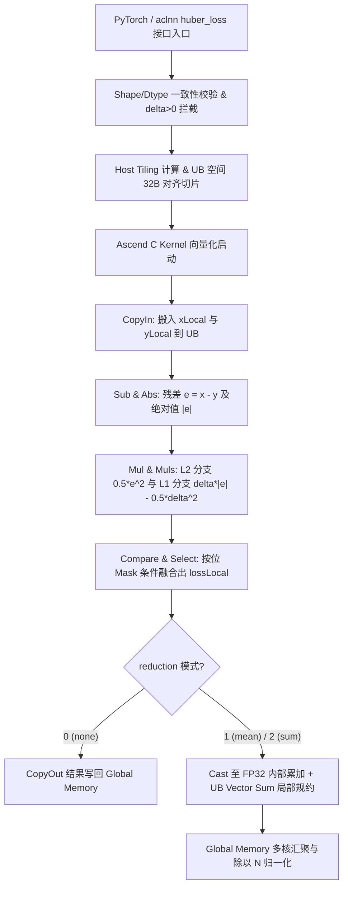

# Huber Loss 算子设计文档

本文档对应 [2026 年 8 月社区任务 huber_loss 算子开发任务书](https://gitcode.com/cann/cann-ops-competitions/blob/master/04_tasks/01_community-task-2026/docs/202608/huber_loss_task_doc.md)，并按照 [算子设计文档模板](https://gitcode.com/cann/cann-ops-competitions/blob/master/04_tasks/01_community-task-2026/resources/design_template.md) 编写。

---

# 需求背景

## 需求来源

`aten::huber_loss` 算子目前未被 NPU 后端支持，自动 fallback 至 CPU 执行，导致训练耗时呈指数级增长，严重阻塞模型迭代周期。

本需求要求参考 PyTorch 官方原生 `aten::huber_loss`（https://pytorch.org/docs/stable/generated/torch.nn.functional.huber_loss.html ），在昇腾 NPU（Atlas A2 训练系列 / Ascend 950PR）上基于 **Ascend C** 编程语言实现功能完全一致的前向算子，完成算子设计、开发、测试全流程工作，验收通过后提交至昇腾算子开源仓 `ops-nn`（https://gitcode.com/cann/ops-nn/tree/master/experimental/loss ）。

**对标参考**：PyTorch 官方源码 `aten::huber_loss`（`aten/src/ATen/native/Loss.cpp` 及 `torch.nn.functional.huber_loss`）。

## 背景介绍

### 功能定义

对于预测输入张量 `input` 与目标张量 `target`，残差为 $e = \text{input} - \text{target}$，阈值为 $\delta > 0$ (默认 $\delta=1.0$)。

单个元素的 Huber Loss 损失 $l$ 计算公式为：
$$
l = \begin{cases} 
0.5 \times e^2, & \text{if } |e| \le \delta \\[8pt]
\delta \times \left( |e| - 0.5 \times \delta \right), & \text{if } |e| > \delta
\end{cases}
$$

### 三种约简模式 (Reduction)

| reduction 取值 (int) | 对应模式说明 | 语义描述 | 输出张量形状 |
|---|---|---|---|
| `0` | `none` | 逐元素输出损失 | 与 `input` 同 shape |
| `1` | `mean` (默认) | 对所有元素求均值 | 标量 (0 维 Tensor) |
| `2` | `sum` | 对所有元素求和 | 标量 (0 维 Tensor) |

### 对标实现现状分析

对标实现位于 PyTorch 官方开源仓库：

| 源码文件 | 内容职责 |
|---|---|
| `torch/nn/functional.py` | `huber_loss` 的 Python 接口入口，处理参数默认值与类型转换 |
| `aten/src/ATen/native/Loss.cpp` | C++ 调度入口：校验 $\delta > 0$，校验 Shape/Dtype 一致性 |
| `aten/src/ATen/native/cpu/LossKernel.cpp` | CPU 计算内核：逐元素计算分段函数并累加 |
| `aten/src/ATen/native/cuda/LossKernels.cu` | CUDA 计算内核：向量化 CUDA Block 规约求和 |

---

# 需求分析

## 需求描述

使用 Ascend C 编程语言实现 `huber_loss` 前向算子的 NPU 原生 Kernel，在 PyTorch 层与 aclnn C++ 层提供与 PyTorch **参数列表、默认值、约束条件、返回值类型完全一致** 的公开 API。

## 核心参数规范明细表（与任务书 1:1 严格对齐）

| 参数名 | 输入/输出/属性 | 描述 | 数据类型 | 数据格式 | 维度 (Shape) | 非连续 Tensor |
|---|---|---|---|---|---|---|
| **input** | 输入 | 预测值张量 | FLOAT32、FLOAT16、BFLOAT16 | ND | 任意维度，各维 ≥ 0 | 支持 |
| **target** | 输入 | 目标值张量 (Shape 和 dtype 须与 input 一致) | FLOAT32、FLOAT16、BFLOAT16 | ND | 与 input 相同 | 支持 |
| **reduction** | 可选属性 | 归约模式：0=none, 1=mean (默认), 2=sum | int | - | - | - |
| **delta** | 可选属性 | Huber loss 阈值参数 (默认 1.0，须 > 0) | float | - | - | - |
| **output** | 输出 | loss 计算结果 | FLOAT32、FLOAT16、BFLOAT16 | ND | reduction=none 时与 input 同 shape；reduction=mean/sum 时为 0 维标量 | - |

## 算子约束限制

1. **Shape 与 Dtype 约束**：`input` 与 `target` **必须具有相同的 shape 和 dtype，不支持 broadcast**；
2. **reduction 取值约束**：仅支持 `0`（none）、`1`（mean）、`2`（sum），其他取值属于非法输入，Host 侧拦截抛错；
3. **delta 取值约束**：`delta` 必须为正数 ($\delta > 0$)；
4. **内部精度提升 (FP32 Accumulation)**：`reduction=mean` 或 `sum` 时，内部累加强制提升至 **FP32 (Float32)** 计算后再转回输出 `dtype`，彻底规避 FP16/BF16 的精度溢出与损失；
5. **图融合说明**：当前作为独立 loss 算子实现，不涉及图融合。

## 算子支持型号与环境

| 支持的硬件与软件环境 | 规格说明 | 勾选 |
| --- | --- | --- |
| 适配硬件 | Atlas A2 训练系列产品 / Ascend 950PR | √ |
| CANN 版本 | CANN 9.0.0 及以上 | √ |

---

# 详细设计

## 算子分析

### 支持数据类型与实现路径

| input/target/output dtype | 实现路径 | 支持 reduction | 性能与精度验收 |
|---|---|---|---|
| FLOAT32, FLOAT16, BFLOAT16 | Ascend C Kernel 向量化流水线 + FP32 内部累加 | 0 (none), 1 (mean), 2 (sum) | **达到 80% compute/memory bound，精度对齐 CPU aten::huber_loss** |

### 支持形状与泛化

- 张量维度：任意维度（1~8 维），各维 ≥ 0；
- 支持非连续 Tensor (Strided Input)；
- 空张量处理：$N=0$ 时，`none` 返回空张量，`mean` 返回 `NaN`，`sum` 返回 `0.0`。

## 算子实现

### 总体方案



### Kernel 侧实现 (Ascend C 指令映射与设计)

在 UB 内部的各 Tile 矢量计算步骤与 Ascend C 官方硬件 API 1:1 严格对齐：

1. **残差计算**：
   $$\text{diffLocal} = \text{Sub}(\text{xLocal}, \text{yLocal})$$
2. **绝对值计算**：
   $$\text{absDiffLocal} = \text{Abs}(\text{diffLocal})$$
3. **L2 路径计算** ($0.5 \times e^2$)：
   $$\text{l2Local} = \text{Muls}(\text{Mul}(\text{diffLocal}, \text{diffLocal}), 0.5f)$$
4. **L1 路径计算** ($\delta \times |e| - 0.5 \times \delta^2$)：
   $$\text{l1Local} = \text{Subs}(\text{Muls}(\text{absDiffLocal}, \delta), 0.5f \times \delta^2)$$
5. **Mask 选择与向量融合**：
   比较生成条件掩码 $\text{Mask} = (\text{absDiffLocal} \le \delta)$，调用按位掩码选择：
   $$\text{lossLocal} = \text{Select}(\text{Mask}, \text{l2Local}, \text{l1Local})$$
6. **FP32 提升规约 (针对 FP16/BF16 的 mean/sum)**：
   调用 `Cast` 指令转换为 FP32 格式：
   $$\text{fp32LossLocal} = \text{Cast}(\text{lossLocal})$$
   使用 `Sum` 指令在 UB 内完成局部高效累加，规避浮点精度损失。

---

# 性能与精度设计

## 精度设计
算子计算精度需满足 [AscendOpTest 精度工具](https://gitcode.com/HIT1920/AscendOpTest/blob/master/compare/compare/accuracy_config.py) 默认阈值，且与 CPU `aten::huber_loss` 计算结果严格对齐：
- **Float32 相对误差**：$\le 1 \times 10^{-5}$
- **Float16 / BFloat16 相对误差**：$\le 1 \times 10^{-3}$（得益于 FP32 内部累加）

## 性能设计
- 目标达到 **80% 的 compute bound 或 memory bound** 性能指标。
- 使用按位无分支选择（`Select`）消除了分支跳转耗时；借助 `TPipe` 双缓冲 (Ping-Pong Queue) 机制异步交错访存与计算，极大提升吞吐率。

---

# 测试与验证

根据官方任务书要求，输出完整的自测报告与测试用例（针对 [测试用例仓库](https://gitcode.com/cann/cann-ops-competitions/tree/master/04_tasks/01_community-task-2026/docs/202608/self_test_case/huber_loss) 对齐）：

```bash
python3 test_huber_loss.py
```
