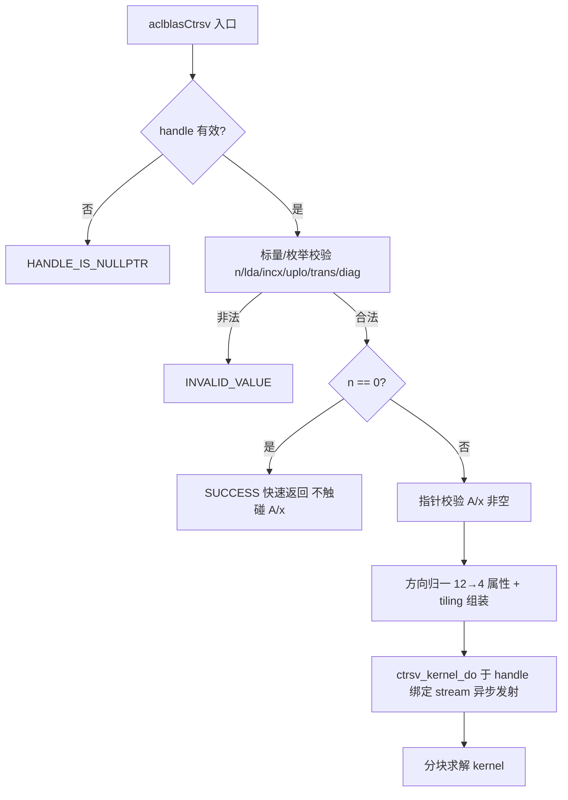

# 【社区任务】aclblasCtrsv 算子设计文档（Ascend 950PR）

> 算子：`aclblasCtrsv`（complex64 三角求解，`op(A)·x = b`，x 原地覆写）
> 目标仓：https://gitcode.com/cann/ops-blas ，实现落位 `blas/trsv/arch35/`，测试落位 `test/trsv/ctrsv/arch35/`
> 目标硬件：Ascend 950PR（arch35，SoC `ascend950`），CANN 9.1.0
> 任务：9月社区任务-aclblasCtrsv算子开发(950)
> 文档性质：**设计评审稿**（设计文档评审通过后进入开发，算子代码与 NPU 实测不在本 PR 范围内）

---

# 一、需求背景（required）

## 1.1 需求来源

来源于 CANN 社区任务《9月社区任务-aclblasCtrsv算子开发(950)》。任务书要求在 Ascend 950PR 上使用 Ascend C 编程语言开发单精度复数（complex64）三角求解算子 `aclblasCtrsv`，以 kernel 直调方式接入 ops-blas 工程框架，完成设计、开发、测试全流程；精度按生态算子开源精度标准（实验标准）判定，性能按 `gpu_baseline.csv` 标杆耗时（GPU H100 实测 ÷ 0.4）判定；验收通过后合入 `blas/trsv/arch35/`。

## 1.2 背景介绍

### 1.2.1 ops-blas 仓 trsv 族现状

- `include/cann_ops_blas.h` 中 trsv 族**仅有实数版 `aclblasStrsv` 声明**，无 `aclblasCtrsv`，头文件需新增该声明（与 `aclblasStrsv` 参数次序保持一致，整数维参数采用 `int`）；
- `blas/trsv/arch35/` 已有实数 Strsv 的 Host/Tiling/SIMT 内核实现，其 handle/stream/workspace 组织、构建注册与测试组织可直接复用为复数版本的工程骨架；
- 实数实现中 T/C 共用一条路径的做法**不适用于复数**（复数域 `OP_C` 需共轭、`OP_T` 不需要），复数运算（乘加、除法、共轭）须独立实现；
- 仓内 `test/trsv/strsv/` 提供同族 CSV 驱动 GTest 框架（`trsv_param.h` ReadMap：uplo/trans/diag/n/A/lda/x/incx）与 golden 惯例（`trsv_golden.h`，非法枚举按 INVALID_VALUE 口径），测试工程按 `ctrsv` 目录复刻。

### 1.2.2 对标接口

语义对齐 cuBLAS `cublasCtrsv` 与 Netlib BLAS `ctrsv`（https://www.netlib.org/blas/ctrsv.f ）：求解单右端三角线性系统，无 alpha/beta/side/batch 参数；参数序列与 cuBLAS 逐参数对应，无需映射。

### 1.2.3 arch35 平台能力（设计前提）

arch35 具备 SIMT/向量融合能力（仓内 arch35 约 50 处 `asc_vf_call` 使用，arch22 无此能力），且已有 strsv 实数版 SIMT 内核先例。三角求解的行间串行递推天然适合 SIMT 线程模型：以"块内小规模直接求解 + 块间向量化/SIMT 更新"的分块结构，把 O(n) 次全局同步降为 O(n/nb) 次块间同步。

## 1.3 算子功能分析

求解 `op(A)·x = b`，右端项 b 初始存放于 x，解原地写回 x。A 为 n×n 三角矩阵，**列主序全存储**（数组维度 lda×n，`lda ≥ max(1, n)`），仅 `uplo` 指定三角被引用，另一部分不访问；`diag = ACLBLAS_UNIT` 时对角元素不读取、按 1 处理。

- `uplo ∈ {UPPER, LOWER}`；`trans ∈ {OP_N, OP_T, OP_C}`（A / Aᵀ / Aᴴ）；`diag ∈ {NON_UNIT, UNIT}`；
- x 逻辑长度 n、物理长度 `1+(n-1)·|incx|`，`incx` 可正可负（负步长 = 逻辑起点位于物理数组末端）；
- `n = 0` 为合法 no-op（依据 Netlib `ctrsv` 的 `IF (N.EQ.0) RETURN`）；算子不做奇异性/近奇异性检测（与 cuBLAS/Netlib 一致），调用方须保证 NON_UNIT 时对角非零。

---

# 二、需求分析（required）

## 2.1 需求描述

```cpp
aclblasStatus_t aclblasCtrsv(aclblasHandle_t handle, aclblasFillMode_t uplo,
                             aclblasOperation_t trans, aclblasDiagType_t diag,
                             int n, const aclblasComplex* A, int lda,
                             aclblasComplex* x, int incx);
```

| 参数 | 输入/输出 | 约束与异常行为 |
| --- | --- | --- |
| handle | 输入 | nullptr → `ACLBLAS_STATUS_HANDLE_IS_NULLPTR` |
| uplo / trans / diag | 输入 | 非法枚举 → `ACLBLAS_STATUS_INVALID_VALUE`（口径对齐 cuBLAS 与仓内 `trsv_golden.h`） |
| n | 输入 | n < 0 → `INVALID_VALUE`；n = 0 合法 no-op（此时 A/x 允许为空） |
| A | 输入（只读） | n > 0 且 nullptr → `INVALID_VALUE`；数组维度 lda×n，仅引用指定三角 |
| lda | 输入 | lda < max(1, n) → `INVALID_VALUE` |
| x | 输入/输出（原地） | n > 0 且 nullptr → `INVALID_VALUE` |
| incx | 输入 | incx = 0 → `INVALID_VALUE`；可为负 |

执行为异步语义，依赖 `aclblasSetStream` 绑定 stream；算子内部不申请 Device 内存、不做用户 Tensor 的 H2D/D2H、不调用 stream 同步。

## 2.2 需求拆解

1. **公共 API**：`include/cann_ops_blas.h` 新增 `aclblasCtrsv` 声明，供其他产品线共用；禁止 950PR 私有平行接口。
2. **语义正确性**：12 组（uplo×trans×diag）组合、列主序寻址（lda 步长）、三角引用边界（不访问非引用三角）、UNIT 对角不读取、正负步长的逻辑/物理映射，全部对齐 Netlib `ctrsv`。
3. **复数算术精度**：复数乘加与除法的舍入行为保持在生态精度标准容差内；回代误差随 n 累积，实部/虚部分别判定；`OP_C` 对操作数取共轭（与 `OP_T` 不等价）。
4. **并行化设计**：三角求解逐未知量递推，须以分块（nb）降低同步频率、以 SIMT/向量化提高块内吞吐，避免 O(n) 次全局同步（§3.2.3）。
5. **测试与自验**：复刻 strsv 框架建立 `test/trsv/ctrsv/`，加载随任务 1200 条 CSV（1000 精度 + 200 性能），golden 取 Netlib `cblas_ctrsv`；性能用 `verify_performance.py` 对比 `gpu_ms ÷ 0.4`，warmup 后有效采样 >50 次。
6. **交付**：算子 README（产品支持表标注 Ascend 950PR：支持）、自验证步骤与精度/性能/内存报告。

## 2.3 设计原则与非目标

**原则**：复用 arch35 strsv 的工程骨架（构建注册、tiling 传递、测试组织），复数运算与 T/C 分离独立实现；所有优化不改变 12 组组合的数学语义；精度关键路径（对角除法、非有限值传播）显式编码。

**非目标**：不做 arch22 实现；不引入新公共接口；不改变 `aclblasStrsv` 既有实现与文档（README 追加一节）；不以牺牲精度换性能。

---

# 三、详细设计（required）

## 3.1 算子分析

### 3.1.1 数学公式

无转置（`OP_N`）下三角求解的前代/回代递推：

```
LOWER: x[i] = ( b[i] − Σ_{j<i} A(i,j)·x[j] ) / A(i,i)     i 自 0 递增（前代）
UPPER: x[i] = ( b[i] − Σ_{j>i} A(i,j)·x[j] ) / A(i,i)     i 自 n−1 递减（回代）
```

`OP_T`/`OP_C` 求解 `Aᵀx = b` / `Aᴴx = b`：有效三角方向翻转，`OP_C` 读取 A 时对虚部取反。12 组组合归一为 4 个正交属性：`forward = (trans ≠ OP_N) ? upper : !upper`、`conjArith = (trans == OP_C)`、`unit = (diag == UNIT)`、`upper`（决定寻址与搬运模板）。

复数运算（A、x 均为 complex64）：

```
乘法:  (a+bi)(c+di) = (ac−bd) + (ad+bc)i
除法:  (a+bi)/(c+di) 采用缩放分量形式（Netlib cdiv 口径），防中间量溢出
共轭:  conj(a+bi) = a−bi（仅 OP_C 施加，作用于 A 的操作数）
```

`diag = UNIT` 时省略除法且不读取 A 对角位置；非有限对角（Inf/NaN）按 IEEE 传播，不额外拦截。

### 3.1.2 支持数据类型

| 项 | 类型 |
| --- | --- |
| A / x | `aclblasComplex`（complex64，实/虚各 FP32，定义以 `include/cann_ops_blas_common.h` 为准） |
| 计算 | FP32 实/虚分离运算，无 FP64 累加 |
| 属性/维度 | Host 标量（枚举 int / int） |

### 3.1.3 支持形状

| 对象 | 布局 / 形状 |
| --- | --- |
| A | Device，列主序物理 `lda × n`，仅 uplo 指定三角被引用 |
| x | Device，逻辑 `[n]`，物理长度 `1 + (n−1)·|incx|` |
| 规模 | n ≥ 0；测试工程按单用例 host 侧 ≤512 MB 预算生成，complex64 全存储方阵单边收敛到 n = 4096 |

**访存特征**：列主序下 A 的每一列在内存中连续（步长 lda 的列间跳转），`OP_N` 的列更新与 `OP_T/OP_C` 的行点积（= A 的连续列）都能以连续段为单位搬运，是向量化/SIMT 化的基础。

## 3.2 算子实现

### 3.2.0 文件落位与总体结构

```
blas/trsv/arch35/
├── ctrsv_tiling_data.h    # Host/Kernel 共享 POD tiling
├── ctrsv_host.cpp         # 参数校验、方向归一、tiling 组装、kernel 发射
└── ctrsv_kernel.cpp       # SIMT 分块求解内核（N 列更新 / T·C 点积两类访存形态）
test/trsv/ctrsv/arch35/    # CSV 驱动 GTest（复刻 strsv 框架 + ctrsv_test.csv）
```



### 3.2.2 Host 侧设计

1. **参数校验顺序**：handle → 标量（n、lda、incx、枚举）→ `n == 0` 快速返回 → 指针（n > 0 时 A/x 非空）。该顺序满足任务书对 n = 0 合法 no-op 与 n > 0 指针非空的要求，并与 cuBLAS 先校验标量、再触碰指针的行为一致。
2. **tiling 组装**：将 `n`、`lda`、`incx` 与归一后的 4 个布尔属性、分块参数（nb、线程/核分工）写入小型 POD `CtrsvTilingData`，按值传入 kernel，kernel 内不做枚举比较。
3. **发射**：以 A/x 的 Device 地址调用 `ctrsv_kernel_do(..., handle->stream)`；算子内部不调用 `aclrtMalloc`、不做 H2D/D2H、不同步 stream；复用 strsv 的构建注册与 stream 组织。

### 3.2.3 Kernel 侧设计（SIMT 分块求解）

核心矛盾是**未知量间的串行依赖**与**并行度**的平衡。采用"分块 + 块内小规模直接求解 + 块间并行更新"结构，nb（默认 64，按 UB 容量与线程数整定）为一组待解列：

```
for 每个列块 k = 0 .. ceil(n/nb)−1（按求解方向推进）:
    1) 对角块（nb×nb）求解：块内 nb 步顺序代入，常驻 UB，严格排除非引用三角；
       diag=UNIT 时不搬运/不读取对角位置，并省略复数除法；
    2) 块间同步：发布本块解（块内同步原语，O(n/nb) 次）；
    3) 尾部更新：已解 x 块对未解右端的全存储三角段做批量更新 —— SIMT 线程按列/行段分工并行。
```

**分核策略**：满核优先；对角块求解阶段单线程串行或少量线程协作（受递推约束），尾部更新阶段全体线程参与，二者以块间同步分隔；Host 侧按 `GetAivCoreCount()`（或 SIMT 线程数）与 n 动态调整 nb 与线程映射，尾块非整除场景单独处理。

**数据分块与内存策略**：x 的实/虚平面入口自 GM 读入一次、求解全程常驻、完成后一次写回（避免逐列更新反复读写 GM）；对角块按列紧凑搬入 UB（`lda` 步长的列段搬运，padding 列不引用）；尾部三角段按列分块双缓冲搬入（CopyIn → Compute → CopyOut 流水，MTE 与向量/SIMT 计算重叠）。

三种 trans 的访存形态分述：

- **OP_N（列更新路径）**：求解第 i 个分量后对剩余分量执行 `x[t] −= x[i]·A(t,i)`；LOWER 自前向后、UPPER 自后向前；更新以 A 的连续列段为单位做复数向量乘减。
- **OP_T / OP_C（连续列点积路径）**：当前方程涉及 A 原存储中的一段连续列，复数点积按"实/虚分离 → 复乘 → 双规约"计算后从当前 b 中减去；`OP_C` 对 A 的虚部分量取负后参与计算。
- **diag = UNIT**：对角位置不搬运（或搬运后掩码排除），省略除法；与 NON_UNIT 以模板参数编译期分离，消除运行时分支。

**步长与对齐处理**：

```
incx > 0:  offset(i) = i · incx
incx < 0:  offset(i) = (n−1−i) · |incx|
```

非单位步长仅在入口 gather、出口 scatter 各一次 O(n)，逻辑求解路径与连续步长完全一致；`incx = 1` 走整段 `DataCopy` 快路径。非逻辑位置的 padding lane 保持原值不改写（测试侧以 NaN 填充该区域以发现越界写入）。`lda` padding 场景（lda = n+4/n+8）通过列基址 `A + j·lda` 寻址，不读取 padding 区域。

**精度处理要点**：复数乘加实/虚分离实现并尽量使用融合乘加对齐 binary32 舍入；对角除法采用缩放分量形式（§3.1.1）；NaN/Inf 输入按任务书"规格允许的 Inf/NaN 场景"处理，规约前置零无效 lane，避免 NaN/Inf 污染有效分量。

### 3.2.4 与标杆实现的差异与原因

| 项 | Netlib `ctrsv` | 本设计 | 原因 |
| --- | --- | --- | --- |
| 扫描方向 | 按 trans/uplo 分支 | `forward = trans?upper:!upper` 归一 | 统一 12 组合，减少分支 |
| 运算顺序 | 标量固定顺序 | 分块 + SIMT/向量规约 | 并行化必然结果；相对误差仍在判据内 |
| 复数 T/C | 参考实现按标志位逐元素共轭 | 计算路径 T/C 分离，共轭仅 OP_C 施加 | 复数域 T/C 不等价 |
| 步长 | 逐元素步长寻址 | 入口 gather / 出口 scatter | 主求解路径全连续，向量化充分 |

## 3.3 支持硬件

| 支持的芯片版本 | 涉及勾选 |
| --- | --- |
| Ascend 950PR（arch35，SoC `ascend950`） | √ |

适配 CANN 9.1.0；实现位于 `blas/trsv/arch35/`，仅在该架构下参与构建。

## 3.4 算子约束限制

1. `n ≥ 0`；`lda ≥ max(1, n)`；`incx ≠ 0`；`n > 0` 时 A、x 非空；合法 n = 0 允许 A/x 为空；
2. 仅访问 uplo 指定三角（含 lda padding 区域不引用）；`diag = UNIT` 不读取 A 对角；
3. 不做奇异性检测；NON_UNIT 时对角非零由调用方保证（测试侧以 `boost = max(5, n)` 符号保持偏移保障，golden 用同一偏移后矩阵回代）；
4. 不支持超出 lda/incx 语义的非连续访问；不涉及 broadcast；不要求 dynamic shape / 确定性计算 / 视图返回；
5. 性能用例均按连续访存（incx = 1、lda 紧凑）生成；非连续组合走语义一致路径，性能不作为验收门槛。

---

# 四、可维可测分析

## 4.1 精度标准

| 验收标准 | 描述 | 标准来源 |
| --- | --- | --- |
| 精度 | 输出 x 逐元素验证，实部/虚部分别按 FLOAT32 判定：`\|actual−golden\| ≤ atol + rtol·\|golden\|`，rtol = 2⁻¹⁰、atol = 2⁻¹⁶；整体 matched_ratio ≥ 0.99 且 max_abs_error ≤ max(1e-2, 32·ULP) | 任务书 §3.2、生态算子开源精度标准（experimental_standard） |
| 测试工程口径 | MERE/MARE 双口径（mere_threshold = 2⁻¹³、mare_multiplier = 10），复数实/虚分别统计，与仓内 frame 惯例一致 | ops-blas 测试框架 |

golden 由 Netlib `cblas_ctrsv` 三角回代生成（单标杆）；diag = NON_UNIT 用例的输入矩阵由测试工程对被引用对角加 `boost = max(5, n)` 偏移保证远离零，避免病态系统误差不可控。

**已知风险（设计阶段识别）**：回代误差随 n 累积、`diag = UNIT` 半区无对角量级压制（对角恒 1），解范数随 n 可能放大；开发阶段将以 fp64 参照评估并与任务方确认口径，不在实现侧修饰数据。

## 4.2 性能标准

判据：每条性能用例 NPU 平均单次耗时 ≤ `gpu_baseline.csv` 的 gpu_ms ÷ 0.4（对标 GPU H100 基线，倍率阈值 0.4）；先 warmup 再有效采样 >50 次取平均；可使用随任务提供的 `verify_performance.py` 自动执行 TC_PF 用例并与基线关联比对。

任务书 5 条典型 case 门槛（与 TC_PF 前 5 条 `pf_doc_*` 用例及 `ctrsv-base-000~004` 逐参数一致）：

| n | uplo | trans | diag | incx | 门槛（µs） |
| --- | --- | --- | --- | --- | --- |
| 512 | UPPER | N | NON_UNIT | 1 | 146.33 |
| 1024 | LOWER | N | NON_UNIT | 1 | 272.53 |
| 2048 | UPPER | T | NON_UNIT | 1 | 526.22 |
| 4096 | LOWER | C | NON_UNIT | 1 | 1177.84 |
| 4096 | UPPER | N | UNIT | 1 | 1030.61 |

## 4.3 内存

任务书 §3.4 未设数值门槛；测试工程按单用例 host 侧 ≤512 MB 预算生成用例（设计选择而非硬件限制，complex64 全存储方阵单边尺寸收敛到 4096）。算子侧：A/x 由调用方申请；kernel 工作区仅 tiling 携带的少量参数与 x 实/虚分离所需的 UB 常驻平面，无额外 GM workspace（如实现阶段引入块间同步 workspace，将控制在 KB 量级并在 README 标明）。

## 4.4 兼容性分析

- 只新增 `aclblasCtrsv` 声明，不修改既有函数签名；`aclblasStrsv` 实现与 README 原内容完全保留（README 追加一节）；
- 复用 arch35 strsv 工程骨架（构建注册、stream 组织、测试框架），复数运算与 T/C 分离独立实现，不影响实数路径；
- 非连续步长、lda padding、小规格均有语义一致路径；
- 面向 arch35；arch22 无 SIMT，移植需另行设计，不在本任务范围。

## 4.5 实现与验证状态

| 项 | 状态 |
| --- | --- |
| 设计文档（本文档） | 本 PR 提交评审 |
| 算子实现（blas/trsv/arch35/） | 待开发（评审通过后启动） |
| 测试工程（test/trsv/ctrsv/arch35/） | 待开发，复刻 strsv 框架加载随任务 1200 条 CSV |
| 精度/性能/内存自验证 | 待实现后按 §4.1/§4.2 执行并出具报告（精度实/虚部分别截图、性能 >50 次平均） |

# 五、参考资料

1. 任务书《aclblasCtrsv 950 算子开发任务书》（随任务发布）及 `test_cases/`（gen_csv.py、ctrsv_test.csv、gpu_baseline.csv、verify_accuracy.py、verify_performance.py、README）；
2. Netlib BLAS `ctrsv`：https://www.netlib.org/blas/ctrsv.f ；
3. cuBLAS `cublasCtrsv`：https://docs.nvidia.com/cuda/cublas/index.html#cublas-t-trsv ；
4. ops-blas 开源仓：https://gitcode.com/cann/ops-blas ；
5. 生态算子开源精度标准：https://gitcode.com/cann/opbase/blob/master/docs/zh/ops_precision_standard/experimental_standard.md 。
