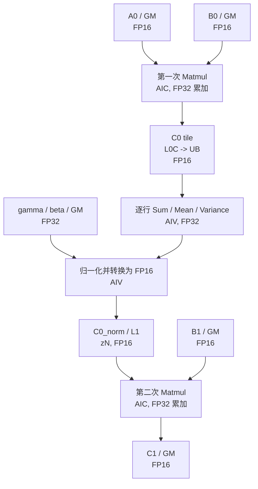

# MatmulLayerNormMatmul 算子设计文档

## 文档信息

| 项目 | 内容 |
|---|---|
| 算子名称 | MatmulLayerNormMatmul |
| 目标硬件 | Ascend 950PR |
| 目标架构 | `CATLASS_ARCH=3510` |
| 开发语言 | Ascend C / CATLASS |
| 目标 CANN | 9.0.0 |
| 输入输出精度 | A0、B0、B1、C1 为 FP16；gamma、beta 为 FP32 |
| 文档状态 | 开发中；功能与精度已验证，性能目标未达成 |
| 提交队伍 | 三寸人间 |

## 一、需求背景（required）

### 1.1 需求来源

本算子来源于“9 月社区任务-MatmulLayerNormMatmul 算子开发”，目标是在 Ascend 950PR 上使用 Ascend C 和 CATLASS 实现一次 kernel launch 完成 Matmul、LayerNorm、Matmul 三段计算。

### 1.2 背景介绍

参考实现由以下三个独立 PyTorch 算子组成：

```python
c0 = torch.mm(a0, b0)
normalized = F.layer_norm(c0, (N0,), gamma, beta, eps=1e-6)
c1 = torch.mm(normalized, b1)
```

该实现存在以下开销：

1. 需要三次 kernel launch，Host 侧调度和同步开销无法被摊薄。
2. 第一次 Matmul 的完整结果 `C0` 需要写入 GM，再由 LayerNorm 读回。
3. LayerNorm 的结果需要再次写入 GM，作为第二次 Matmul 的输入。
4. 第二个 Matmul 需要等待 LayerNorm kernel 整体结束，三段计算不能在一个 kernel 内流水。

融合后的算子在一次 kernel launch 中完成全部计算，只向调用者暴露最终结果 `C1`。`C0`、归一化结果以及 Mean/Variance 等中间数据均在算子内部管理。

### 1.3 设计目标

1. 单次 kernel launch 完成 Matmul → LayerNorm → Matmul。
2. 不将 `C0` 和归一化后的 `C0_norm` 作为外部张量输出。
3. 减少中间结果在 GM 上的写入和读取。
4. Mean、Variance 等中间数据由算子内部片上 scratch 或内部 workspace 管理。
5. 使用 Ascend 950 的 AIC/AIV 协作、L0C→UB 直连和 UB→L1 数据通路。
6. 精度满足生态算子精度标准。
7. 在任务测试集上的平均性能达到小算子拼接方案的 1.1 倍：

$$
\frac{\sum_i T_{\mathrm{ref},i}}{\sum_i T_{\mathrm{fused},i}} > 1.1.
$$

### 1.4 Ascend C 规范依据

本方案按《CANN 社区版 9.0.0 Ascend C 算子开发指南 01》设计，主要依据如下：

1. **CV 融合编程**：有数据依赖的 Cube 和 Vector 计算可以通过一个 Kernel 函数承载，Cube 输出可以进入 Vector 的 UB，Vector 输出可以经 L1 返回 Cube。
2. **351x 数据通路**：Ascend 950 使用 351x 架构，AIC:AIV 为 1:2；支持 L0C→UB 和 UB↔L1，删除 GM→L0A/L0B 和 L1→GM 的直接通路。
3. **片上对齐**：UB 和 L1 按 32 Byte 对齐，L0A/L0B 按 512 Byte 对齐，L0C 按 64 Byte 对齐。
4. **核间同步**：AIC/AIV 使用 CrossCoreSetFlag/CrossCoreWaitFlag；flagId 取值范围和计数器次数存在限制。
5. **LayerNorm 高阶 API**：Atlas 350 支持 `[A,R]` LayerNorm，允许 FP16 输入以及 FP32 gamma/beta，但接口不允许输入输出复用，且不支持切分 R 轴。
6. **性能优化**：优先保证核间负载均衡、连续大块搬运、地址对齐、双缓冲和有效 L2 Cache 策略。

## 二、需求分析（required）

### 2.1 算子语义

第一次 Matmul：

$$
C_0 = A_0B_0.
$$

LayerNorm 对 `C0` 的每一行独立计算：

$$
\mu[m] = \frac{1}{N_0}\sum_{n=0}^{N_0-1} C_0[m,n],
$$

$$
\sigma^2[m] =
\frac{1}{N_0}\sum_{n=0}^{N_0-1}
\left(C_0[m,n]-\mu[m]\right)^2,
$$

$$
C_{0,\mathrm{norm}}[m,n] =
\frac{C_0[m,n]-\mu[m]}
{\sqrt{\sigma^2[m]+\epsilon}}\gamma[n]+\beta[n].
$$

第二次 Matmul：

$$
C_1 = C_{0,\mathrm{norm}}B_1.
$$

其中：

$$
\epsilon = 10^{-6}.
$$

### 2.2 输入输出

| 参数 | 方向 | Shape | 数据类型 | 逻辑布局 | 物理布局说明 |
|---|---|---|---|---|---|
| `A0` | 输入 | `[M0, K0]` | FP16 | RowMajor | ND |
| `B0` | 输入 | `[K0, N0]` | FP16 | RowMajor | ColumnMajor |
| `B1` | 输入 | `[N0, M1]` | FP16 | RowMajor | ColumnMajor |
| `gamma` | 输入 | `[N0]` | FP32 | ND | 连续 |
| `beta` | 输入 | `[N0]` | FP32 | ND | 连续 |
| `C1` | 输出 | `[M0, M1]` | FP16 | RowMajor | ND |

中间张量：

| 参数 | Shape | 对外可见 |
|---|---|---|
| `C0` | `[M0, N0]` | 否 |
| `mean` | `[M0]` | 否 |
| `variance` | `[M0]` | 否 |
| `C0_norm` | `[M0, N0]` | 否 |

### 2.3 需求拆解

1. 实现 FP16 输入的第一次 Matmul，使用 FP32 累加。
2. 在 LayerNorm 前按照参考实现将 `C0` 舍入为 FP16。
3. 对 `C0` 的每一行完成完整的 Mean 和 Variance 归约。
4. 使用 FP32 完成归一化、gamma/beta 缩放和平移。
5. 将归一化结果舍入为 FP16，作为第二次 Matmul 的左矩阵。
6. 实现 FP16 输入的第二次 Matmul，使用 FP32 累加，最终输出 FP16。
7. 三个阶段在同一个 MIX kernel 内完成，并由内部同步保证数据依赖。
8. 不向 GM 写完整的 `C0` 或 `C0_norm`。
9. 对任务测试集中的 116 组形状完成精度验证。
10. 通过 optest、ATK 泛化测试和 `msprof op` 性能验证。

### 2.4 关键设计难点

1. **逐行完整归约**：LayerNorm 的归约维度是 `N0`，必须获得一整行 `C0` 后才能确定 Mean 和 Variance，不能仅根据单个 Matmul N 分块完成归一化。
2. **片上容量**：`N0` 最大为 8192，完整保存一行 FP16 `C0` 需要 16 KiB，必须通过小 M tile 控制 UB 占用。
3. **跨阶段依赖**：第二次 Matmul 必须等待对应行的 Mean、Variance 和归一化结果全部就绪。
4. **AIC/AIV 同步**：第一次 Matmul、LayerNorm 和第二次 Matmul 分别涉及 Cube 与 Vector，需要正确设置 ready/free 事件，避免死锁和数据覆盖。
5. **精度一致性**：需要明确 `C0`、`C0_norm` 的 FP16 舍入点，避免因融合实现改变了参考算子的语义。

## 三、详细设计（required）

### 3.1 总体方案

采用 `MIX_AIC_1_2` 形式的单 kernel 融合方案。每个核组由一个 AIC 和两个 AIV 组成，处理一组连续的 M 行：

1. AIC 计算第一次 Matmul，将 FP32 L0C 累加结果转换为 FP16 的 `C0`。
2. Fixpipe 以 `SPLIT_M` 模式将 `C0` tile 分成两半，分别送到两个 AIV 的 UB。
3. 每个 AIV 保存所负责行的完整 `C0`，并计算每行的 Sum、Mean 和 Variance。
4. AIV 在 UB 内完成归一化、gamma/beta 应用和 FP16 转换。
5. AIV 将 `C0_norm` 从 UB 搬入 L1 的 zN 布局，供 AIC 使用。
6. AIC 使用 L1 中的 `C0_norm` 和 GM 中的 `B1` 完成第二次 Matmul。
7. AIC 将最终 FP32 累加结果转换为 FP16 并写回 `C1`。



该流程只发生一次 kernel launch。图中的三个阶段是 kernel 内部的任务阶段，不是三次 Host 侧算子调用。

351x 架构删除了 GM→L0A/L0B 和 L1→GM 的直接通路，因此两个 Matmul 都必须遵循 `GM→L1→L0A/L0B` 的搬运路径，最终结果通过 `L0C→Fixpipe→GM` 写出。方案使用的 `L0C→UB` 和 `UB→L1` 是 351x 新增通路，与目标硬件能力一致。

### 3.2 核心数据驻留策略

本方案不在 GM 中保存完整 `C0` 和 `C0_norm`，而是利用行组内 M 维较小的特点，将完整归一化行结果保留在片上：

| 数据 | 主要位置 | 生命周期 |
|---|---|---|
| `A0`、`B0` | GM -> L1 -> L0A/L0B | 第一次 Matmul |
| `C0` | L0C -> UB，按行保留 | 第一次 Matmul 到 LayerNorm 完成 |
| Mean、Variance | UB scratch | LayerNorm |
| `C0_norm` | UB -> L1 zN | LayerNorm 到第二次 Matmul 完成 |
| `B1` | GM -> L1 -> L0B | 第二次 Matmul |
| `C1` | L0C -> GM | 第二次 Matmul |

对于任务测试集，行组 M tile 规划为 16 行，每个 AIV 负责 8 行。`N0` 最大为 8192 时，每个 AIV 保存的 FP16 `C0` 为：

$$
8 \times 8192 \times 2 = 131072\ \text{Bytes} = 128\ \text{KiB}.
$$

Ascend 950 单个 UB 容量为 248 KiB，因此可以保留完整行并留出统计量、gamma/beta tile、Fixpipe 双缓冲和临时数据空间。

当 `N0` 或行组大小导致片上空间不足时，Host 选择更小的 M tile；对于极端形状，保留“不保存完整 C0、先统计后重算 C0”的兼容路径。该路径仍不向 GM 写完整中间结果，但会增加第一次 Matmul 的计算量，不作为任务测试集的主路径。

以上 248 KiB 是 CATLASS `Arch::Ascend950::UB_SIZE` 对接口可见容量的建模值；351x 物理 UB 为 256 KiB。Kernel 实际初始化 Buffer 时仍必须使用 CATLASS 常量和平台查询值，不能按 256 KiB 满额分配。

### 3.3 Host 侧设计

#### 3.3.1 参数校验与分派

Host 侧执行以下检查：

1. 输入维度均为二维，gamma/beta 均为一维。
2. `A0` 的列数等于 `B0` 的行数。
3. `B0` 的列数等于 `B1` 的行数，也等于 gamma/beta 的长度。
4. 所有输入为连续 Tensor。
5. dtype 与布局符合任务书。
6. 输出按 `[M0, M1]` 分配。

CATLASS 接口通过 `CanImplement` 检查类型、布局、Shape 和资源约束；不满足时在 Host 侧拒绝，不在 Kernel 内处理未定义行为。

#### 3.3.2 Tiling

最终实测 Tiling 参数如下：

| 参数 | 最终值 | 说明 |
|---|---:|---|
| `BM` | 16 / 32 / 48 | 按 shape 选择；`M0>=1024,N0<=2048` 为 48，`M0>=1024,N0<=4096` 为 32，其余为 16 |
| 第一次 Matmul `BK0` | 128 | K0 方向流水 |
| 第一次 Matmul `BN0` | 512 | N0 方向分块，L0 BN 同为 512 |
| 第一次 Matmul L0B 流水级数 | 1 | `64 x 512 FP16` 占满 64 KiB L0B |
| 第二次 Matmul `BK1` | 128 | N0 方向流水 |
| 第二次 Matmul `BN1` | 256 | M1 方向分块 |
| 第二次 Matmul B1 流水级数 | 2 | 两个 `128 x 256 FP16` tile |
| 第二次 Matmul L0B 流水级数 | 2 | 每个 L0B tile 为 64 KiB 的一半 |

Host 根据 `M0`、`N0` 和 `M1` 从合法组合中选择 Tiling。选择时需满足：

$$
\frac{BM}{2} \cdot N_0 \cdot \mathrm{sizeof(FP16)}
+ \text{norm\_scratch}
+ \text{stage\_buffer}
\le \mathrm{UB\_SIZE},
$$

$$
BM \cdot N_0 \cdot \mathrm{sizeof(FP16)}
+ \text{B1\_stages}
\le \mathrm{L1\_SIZE}.
$$

当 `N0=8192`、`BM=16` 时，`C0_norm` 在 L1 中占 256 KiB。第二次 Matmul
使用 `BK1=128`、`BN1=256`，单个 B1 tile 为 64 KiB，双缓冲占 128 KiB；
总占用为 384 KiB，剩余 128 KiB 用于布局对齐和其他片上数据。

#### 3.3.3 核数和工作分配

以 M 行组为任务单元：

$$
\text{taskCount} = \left\lceil \frac{M0}{BM} \right\rceil.
$$

各核组按固定步长或动态任务队列领取行组。对于任务测试集，`M0` 范围为 128～2048，`BM=16` 时产生 8～128 个任务，可覆盖多核并行需求。

当任务数少于可用 AIC 数量时，Host 可减小 `BM` 以增加任务数，但必须重新检查 UB 容量。当前初版优先保证正确性和片上数据驻留，后续再根据 `msprof op` 结果调整小 M 形状的分核策略。

#### 3.3.4 Workspace

主方案将 Mean、Variance 和归一化临时值放在 AIV 的 UB scratch 中，因此不向外部暴露 workspace。CATLASS 接口可令 `GetWorkspaceSize()` 返回 0。

上述结论仅适用于使用 CATLASS Kernel/Block/Tile 自管片上缓冲的实现。若后续改用 Ascend C Matmul 高阶 API，必须把 `GetLibApiWorkSpaceSize()` 返回的系统 workspace 计入总大小；workspace 参数仍只由框架和算子内部使用，不得成为对外 Tensor 接口。

如果后续兼容路径确需内部 GM 临时区，只允许通过内部 workspace 指针访问，不得增加 Python/Torch 算子参数，不得作为输出返回，也不得用于保存完整 `C0` 或 `C0_norm`。

### 3.4 Kernel 侧设计

#### 3.4.1 第一次 Matmul

1. 对当前行组，AIC 沿 `K0` 方向分块加载 `A0` 和 `B0`。
2. `A0` 为 RowMajor，`B0` 逻辑为 RowMajor、物理为 ColumnMajor，通过 TLA Tensor 和对应 L1/L0 Copy 组件完成布局转换。
3. Cube 使用 FP16 操作数进行 Matmul，L0C 使用 FP32 累加。
4. 每完成一个 `[BM, BN0]` 的 `C0` tile，通过 Fixpipe 将其转换为 FP16。
5. Fixpipe 使用 `SPLIT_M` 模式，将 `BM=16` 的 tile 分为两个 `[8, BN0]` 半区，分别写入两个 AIV 的 UB。
6. AIV 在 `N0` 方向按 tile 顺序保存完整 `C0` 行，并同步完成 Sum 累加。

第一次 Matmul 的输出通过 L0C→UB 直连。`BN0` 只影响一次交接的数据量，不影响 LayerNorm 的完整 N 归约。

#### 3.4.2 LayerNorm

对每个 AIV 负责的 8 行分别执行以下步骤。

**第一步：计算 Mean**

在接收 `C0` tile 时已按行累加 FP32 Sum：

$$
\mu[m] = \frac{\text{sum}[m]}{N_0}.
$$

**第二步：计算 Variance**

为避免直接使用 `E[x²]-E[x]²` 带来的抵消误差，在完整 `C0` 已保存于 UB 后执行第二遍遍历：

$$
\text{sumSq}[m] =
\sum_{n=0}^{N_0-1}
\left(C_0[m,n]-\mu[m]\right)^2,
$$

$$
\sigma^2[m] = \frac{\text{sumSq}[m]}{N_0}.
$$

**第三步：归一化并写回**

使用 FP32 计算：

$$
r[m] = \frac{1}{\sqrt{\sigma^2[m]+\epsilon}},
$$

$$
C_{0,\mathrm{norm}}[m,n]
= (C_0[m,n]-\mu[m])r[m]\gamma[n]+\beta[n].
$$

gamma 和 beta 按 N tile 从 GM 搬入 UB，并以 FP32 参与计算。归一化结果原地覆盖 UB 中的 `C0`，随后转换为 FP16。

行级归约可使用 `WholeReduceSum`、`BlockReduceSum` 或等价 Vector Reduce API。对于 N tile 的尾部，按实际有效元素数设置 mask，避免把补零数据计入统计。

LayerNorm 提供两种可替换实现路径：

| 路径 | 实现 | 优点 | 约束 | 用途 |
|---|---|---|---|---|
| 官方 `LayerNorm` `[A,R]` V2 API | `LayerNorm<T,U,...>` | Atlas 350 已支持 FP16 输入、FP32 gamma/beta，接口成熟 | 输入输出不可复用；不支持切分 R 轴；gamma/beta 和临时空间占用较大 | 功能 bring-up 和精度对照 |
| 自定义 Vector 行归一化 | Reduce + Sub + Mul + Rsqrt + gamma/beta tiled copy | 可原地归一化、可分段加载 gamma/beta，便于控制 UB | 需自行保证数值稳定性和同步 | 性能主路径候选 |

若采用官方 LayerNorm API，`N0=8192` 时必须根据“输入 + 输出 + gamma/beta + sharedTmpBuffer”重新计算单 AIV 可处理的 A 轴长度。官方接口规定输入与输出空间不可复用，因此不能直接套用本文基于原地覆盖的 `BM=16` 容量结论。最终实现应在两条路径中完成精度和性能比较后再冻结。

官方路径的 Host 侧使用 `GetLayerNormMaxMinTmpSize` 获取临时空间范围，再使用 `GetLayerNormNDTilingInfo` 生成 `LayerNormSeparateTiling`；Kernel 侧通过 `LayerNormPara{aLength, rLength, rLengthWithPadding}` 传入真实 R 轴和 32 Byte 对齐后的 R 轴。上述 Tiling 信息需要放入内部 TilingData，不增加对外算子参数。

#### 3.4.3 UB 到 L1 的数据交接

两个 AIV 分别完成 8 行的归一化后，通过 `CopyUb2L1Tla` 或等价 UB→L1 通路写入共享 L1：

1. 源数据位于 UB 的 VECCALC 位置，布局为合适的行主序或 zN 布局。
2. 目标数据位于 L1 A1 位置，布局为 zN。
3. AIV0 写当前行组的前 8 行。
4. AIV1 写当前行组的后 8 行。
5. 两个 AIV 均完成后设置 ready 标志，AIC 才能开始第二次 Matmul。

在 `N0=8192`、`BM=16` 时，L1 中的 `C0_norm` 完整大小为 256 KiB，不需要写回 GM。

UB 源地址和 L1 目标地址应按 32 Byte 对齐。最终使用的 L1/L0A 分形标签必须以 CATLASS 3510 TileCopy 特化为准，不能直接套用 2201 的分形转换逻辑。

#### 3.4.4 第二次 Matmul

1. AIC 等待两个 AIV 的 `C0_norm` ready 标志。
2. `C0_norm` 已以 zN 布局预载到 L1，作为 `MmadAscend950FullLoadA` 的常驻 A 输入；调用时设置 `needLoadL1=false`，不再从 GM 搬运 A。
3. `B1` 按 `[BK1, BN1]` 从 GM 加载到 L1 双缓冲，再分块搬到 L0B。
4. Cube 沿 `K=N0` 完成累加，`BN1=256` 的 tile 保持 FP32 L0C 结果。
5. Unit Flag 将最后一次 MMA 与 Fixpipe 连接，输出 tile 转为 FP16 并按 `[M0, M1]` RowMajor 写回 `C1`。

该实现替换了初版逐 K tile 串行搬运的手写第二次 Matmul。L1 中固定划分
`B1` 双缓冲区和归一化 A 区，后者起始地址由模板常量计算，避免运行时
短尾块改变 A 的物理起始偏移。

`B1` 的 ColumnMajor 物理布局由 Copy 组件转换为 Cube 所需布局。

#### 3.4.5 数据流水和同步

第一次 Matmul 的 N tile 使用双缓冲：

```text
AIC: 计算 C0 tile k -> Fixpipe 到 AIV buffer k
AIV: 消费 buffer k，保存 C0 并累加 Sum
AIC: 在 buffer k+1 计算下一个 tile
```

`C0` tile buffer 的 ready/free 事件如下：

1. AIC 完成当前 tile 的 Fixpipe 后设置 ready。
2. AIV 等待 ready 后读取并保存该 tile。
3. AIV 完成读取后设置 free。
4. AIC 只有收到 free 后才能覆盖该 buffer。

阶段间同步如下：

1. AIV 完成每个受管行的完整 Mean/Variance 和归一化后设置 `C0_norm` ready。
2. AIC 等待当前核组两个 AIV 的 ready 标志，再开始第二次 Matmul。
3. AIC 完成第二次 Matmul 后设置阶段完成标志，AIV 可以清理 UB scratch 并领取下一个 M 行组。

同步使用 AscendC CrossCoreSetFlag/CrossCoreWaitFlag 或 CATLASS Kernel 封装的事件接口。所有事件必须使用固定槽位和固定顺序，避免不同 Tiling 分支复用错误标志。

351x 同步实现约束：

1. 若两个 AIV 独立通知 AIC，使用 1:1 同步模式；若 AIC 需要同时等待两个 AIV，使用 1:2 模式。模式、模板参数和 flagId 必须在 Set/Wait 两端完全一致。
2. flagId 必须在架构允许范围内，同一 flagId 的未消费设置次数不能超过硬件限制；每个事务必须完成 Set/Wait 配对。
3. 不允许连续设置同一个 flagId，也不允许把 CrossCore 标志与 Matmul 高阶 API 内部同步混用。
4. 建议使用 SSBuffer/CrossCore 事件完成 AIC/AIV 交接，不通过 GM 轮询标志。
5. EventId 获取后及时释放，避免事件资源耗尽。

### 3.5 片上资源核算

Ascend 950 的初版资源约束如下：

| 资源 | 容量 |
|---|---:|
| UB | 248 KiB / AIV |
| L1 | 512 KiB / AIC |
| L0A | 64 KiB |
| L0B | 64 KiB |
| L0C | 256 KiB |

以上为 CATLASS Ascend 950 资源常量；平台查询值与文档值不一致时，以实际平台信息和 `CanImplement` 检查结果为准。

以最大任务形状 `N0=8192`、`BM=16` 为例：

| 项目 | 计算 | 占用 |
|---|---|---:|
| 每个 AIV 的 C0 行缓存 | `8 * 8192 * 2` | 128 KiB |
| C0_norm L1 缓存 | `16 * 8192 * 2` | 256 KiB |
| 第一次 Matmul B0 单 stage | `128 * 512 * 2` | 128 KiB |
| 第一次 Matmul B0 双缓冲 | `128 * 512 * 2 * 2` | 256 KiB |
| 第一次 Matmul L0B tile | `64 * 512 * 2` | 64 KiB |
| 第二次 Matmul B1 单 stage | `128 * 256 * 2` | 64 KiB |
| 第二次 Matmul B1 双缓冲 | `128 * 256 * 2 * 2` | 128 KiB |
| Mean/Variance | `8 * 2 * 4` | 64 B |
| L0C 第一次 Matmul tile | `16 * 512 * 4` | 32 KiB |
| L0C 第二次 Matmul tile | `16 * 256 * 4` | 16 KiB |

上述 Tiling 已通过编译期 `static_assert` 和 Host 侧 `CanImplement` 检查。

## 四、优化方案

### 4.1 方案比较

| 方案 | 数据流 | 优点 | 缺点 | 结论 |
|---|---|---|---|---|
| 三算子拼接 | `C0` 和 `C0_norm` 均经 GM | 实现简单、易调试 | 三次 launch，GM 读写多 | 作为性能基线，不作为交付实现 |
| 单 kernel GM 中转 | 一次 launch，中间结果写内部 GM workspace | 片上容量压力小 | 仍有大量 GM 往返，不满足融合目标 | 不采用 |
| 单 kernel 片上行缓存 | `C0` 存 UB，`C0_norm` 经 UB→L1 | 中间结果不落 GM，减少 launch 和访存 | 需要小 M tile 和跨核同步 | 主方案 |
| 单 kernel 统计后重算 | 第一遍仅统计，第二遍重算并归一化 | 支持超大 N，UB 压力小 | 第一次 Matmul 计算量增加 | 兼容路径 |

### 4.2 主要优化点

1. **单次 launch**：用一个 MIX kernel 替代三次算子调用。
2. **L0C→UB 直连**：`C0` 不经过 GM，直接交给 AIV。
3. **UB→L1 直连**：归一化结果直接作为第二次 Matmul 的 L1 A 输入。
4. **AIC/AIV 流水**：AIC 计算下一 N tile 时，AIV 处理上一 tile 的保存和归约。
5. **双缓冲**：隐藏 C0 tile 搬运和 Vector 归约延迟。
6. **按行组调度**：每个核组独立完成一组行，减少跨核全局同步。
7. **动态 Tiling**：根据 `M0`、`N0`、`M1` 选择合法且性能较优的 TileShape。
8. **L2 Cache 提示**：根据 B0/B1 的复用情况设置合适的 L2 Cache 策略。
9. **连续大块搬运**：尽量提高单次 GM 搬运的数据量，并保证 GM 地址和搬运内轴对齐。
10. **减少头尾开销**：只启动实际需要的 AIC/AIV 数量，避免小 Shape 使用过多核；TilingData 保持紧凑并按 8 Byte 对齐。

### 4.3 性能调优计划

1. 先以固定 `BM=16` 完成正确性验证。
2. 使用 `msprof op` 分别观察 AIC、AIV、MTE1、MTE2、MTE3、Fixpipe 的利用率。
3. 对第一次 Matmul 调整 `BN0`、`BK0` 和流水级数。
4. 对第二次 Matmul 调整 `BN1`、`BK1` 和 B1 预取策略。
5. 对小 `M0` 形状评估是否减小 `BM` 以增加并行任务数。
6. 对大 `N0` 形状检查 C0 UB 缓存与 L1 `C0_norm` 的容量边界。
7. 所有 Tiling 调整均需重新运行精度和性能测试。
8. 检查 UB bank group 冲突，必要时调整 C0、gamma/beta 和归一化输出 buffer 的起始偏移。
9. 当输入输出数据总量超过 L2 Cache 容量时，评估 L2 Cache 切分策略。
10. 对比自定义 LayerNorm 与官方 LayerNorm API 的端到端耗时和精度。

## 五、精度设计

### 5.1 精度对齐点

为与参考实现保持一致，融合实现明确以下舍入边界：

1. 第一次 Matmul 使用 FP16 输入和 FP32 累加。
2. `C0` 在进入 LayerNorm 前转换为 FP16，对应 `torch.mm` 的 FP16 输出。
3. Mean、Variance 和归一化中间值使用 FP32。
4. `C0_norm` 在进入第二次 Matmul 前转换为 FP16。
5. 第二次 Matmul 使用 FP16 输入和 FP32 累加，最后输出 FP16。

351x Vector 默认可能将 Subnormal 输入按 0 处理。LayerNorm 中的 `Rsqrt`、乘加和末尾极小值可能受到该行为影响，开发阶段应使用实验精度用例确认是否需要启用 `PRECISION_1ULP_FTZ_FALSE` 等高精度配置。性能主路径和精度路径如采用不同配置，必须分别记录。

### 5.2 Variance 数值稳定性

Variance 采用两遍算法：

1. 第一遍计算每行 Sum 和 Mean。
2. 第二遍计算 `(x-mean)²` 的 Sum 和 Variance。

相比 `E[x²]-E[x]²`，该算法在数值较大而方差较小时更稳定。代价是需要在 UB 中保留完整 `C0` 行，并额外遍历一次 UB 数据。

### 5.3 精度验证

1. 对任务测试集中的 116 组 Shape 生成输入。
2. 使用 `torch.mm + F.layer_norm + torch.mm` 生成 Golden。
3. 按生态算子开源精度标准选择误差指标。
4. 检查异常值、尾块、极小方差和大幅度输入。
5. 对 Tail Shape 单独进行 ATK 泛化测试。

## 六、测试设计

### 6.1 功能测试

1. 任务测试集 116 组 Shape 全部通过。
2. 覆盖 `M0 ∈ {128, 512, 1024, 2048}`。
3. 覆盖 `K0 ∈ {768, 2048, 4096, 8192}`。
4. 覆盖 `N0 ∈ {2048, 3072, 4096, 8192}`。
5. 覆盖 `M1 ∈ {768, 2048, 4096}`。
6. 增加非 2 的幂、非 16 对齐和 Tile 尾块 Shape。
7. 增加不同均值、方差和 gamma/beta 分布，检查 LayerNorm 的逐行独立性。

### 6.2 optest

实现以下交付件：

```text
experimental/matmul/matmul_layer_norm_matmul/
├── CMakeLists.txt
├── matmul_layer_norm_matmul.cpp
├── README.md
└── test_matmul_layer_norm_matmul.py
```

同时完成 CATLASS optest 的 JIT 接口、Kernel Adapter、Torch 注册和 Python 调用入口。

### 6.3 ATK

ATK 泛化测试不少于 200 条，建议包含：

1. 任务测试集 116 组 Shape。
2. 随机泛化 Shape。
3. Tile 边界和尾块。
4. 不同输入量级。
5. gamma/beta 全零、常量和小幅随机值。
6. 极小方差场景。

实测结果：300/300 可执行，263/300 精度通过，满足任务书“至少 200 条泛化通过”
的数量要求。未修改 ATK 精度标准。

### 6.4 性能测试

使用 `msprof op` 对 116 组任务测试集采集融合算子耗时。性能计算公式为：

$$
\text{speedup} =
\frac{\sum_i T_{\mathrm{ref},i}}
{\sum_i T_{\mathrm{fused},i}}.
$$

当前标杆总时延：

```text
15395.599 us
```

融合算子总时延目标：

```text
15395.599 / 1.1 = 13996.0 us
```

性能报告需要记录：

1. Tiling 参数和是否切换实现方案。
2. 每条用例的参考时延和实测时延。
3. 总时延、平均时延和整体加速比。
4. `msprof op` 命令和输出目录。
5. AIC、AIV、MTE1、MTE2、MTE3、Fixpipe 利用率。
6. 与上一版 Tiling 的对比结论。

当前实测：

| 项目 | 数值 |
|---|---:|
| 116 条 Event 总时延 | 80850.312 us |
| 116 条 Event 加速比 | 0.190x |
| 代表用例 `msprof` 时延 | 57.490 us |
| 代表用例热态 Event 时延 | 47.452 us |
| 给定标杆总时延 | 15395.599 us |
| 1.1x 判定 | 未通过 |

动态 M Tiling 将 Event 总时延从 171681.109 us 降到 80850.312 us。代表用例
`128x768x2048x768` 的 `msprof` 数据显示 Cube 占比从 6.7% 提升到 13.1%，
MTE2 占比约 86.9%，MTE2 活跃带宽从 66.6 GB/s 提升到约 120.9 GB/s。
`M0=128` 仍只使用 8/28 个 AIC；固定 `BM=16` 下，完整 LayerNorm 行要求
限制了 M/N 方向重新分核。当前距离 1.1x 目标仍约 6.7 倍，不能标记性能
验收通过。

硬件下界进一步给出了严格结论。351x 每个 AIC 每拍完成一次 FP16
`16x16 x 16x16`，即 `8192 FLOP/cycle`；设备配置为 28 AIC、1.65 GHz，
峰值算力为 `378.4704 TFLOP/s`。116 条用例含 `4.327 TFLOPs`：

| 项目 | 结果 |
|---|---:|
| 28 AIC 全局 Cube 下界 | 11.434 ms |
| 1.1x 目标时延 | <13.996 ms |
| 当前 `BM=16` Cube 下界 | 15.442 ms |
| 两遍“统计后重算 C0”下界 | 18.451 ms |

因此，当前 `BM=16 + 单 AIC 独占完整 N` 的任务划分即使 Cube 达到 100%，
也不能达到目标；两遍重算路径同样在纯 Cube 下界上失败。后续必须设计
N 方向分片并行及跨 AIC 统计/部分和归约，并通过实测确认归约开销。
逐 Shape 计算见 `artifacts/performance_bounds.json`。

进一步实验否证了“FP16 部分 C1 再归约”的低流量方案：在代表性形状上，
FP16 部分和归约的生态匹配率只有约 `0.934`，低于要求的 `0.99`；大形状
还会出现硬失败点。因此部分 C1 必须使用 FP32 workspace。

FP32 部分和也带来了可测的代价。`128x768x2048x768` 使用 16 个 N
shard 时，workspace 为 6 MiB，PyTorch 原生 `sum(dim=0)` 实测约
`11.3 us`（含 launch）；大形状归约吞吐约 `1.38 TB/s`。这部分尚未计入
全局同步和自定义 AIV 归约差异。因此当前 N 分片方案还不能证明能达到
1.1x，必须先在原型中实测 FP32 部分和写回与归约。

## 七、支持范围与约束

### 7.1 初版支持范围

| 项目 | 支持 |
|---|---|
| 芯片 | Ascend 950PR |
| 架构 | `CATLASS_ARCH=3510` |
| A0/B0/B1 | FP16、二维、连续 Tensor |
| gamma/beta | FP32、一维、连续 Tensor |
| C1 | FP16、二维 |
| B0/B1 物理布局 | ColumnMajor |
| 输出布局 | RowMajor |
| 单次 kernel launch | 是 |
| 非连续 Tensor | 暂不支持 |

### 7.2 约束

1. 所有维度必须为正数。
2. `K0`、`N0`、`M1` 必须满足 Matmul 维度一致性。
3. `gamma` 和 `beta` 长度均等于 `N0`。
4. 不支持空 Tensor。
5. 不支持 `B0`/`B1` 的其他物理布局。
6. `N0` 必须为 32 的倍数且不超过 8192；超过片上容量时 `CanImplement` 拒绝执行。
7. LayerNorm 的 R 轴如果使用官方 `[A,R]` API，必须按 32 Byte 对齐并补齐，且输入输出不能复用。
8. AIC/AIV 同步方案不得与 Matmul/LayerNorm 高阶 API 内部的 CrossCore 标志冲突。

如果实现后确认某些约束不成立，应同步修改文档和 `CanImplement`，不得在校验失败时继续启动 Kernel。

## 八、可维可测分析

### 8.1 精度标准

| 验收项 | 标准 |
|---|---|
| 任务测试集 | 116 条用例精度通过 |
| ATK 泛化 | 不少于 200 条精度通过 |
| 误差标准 | 生态算子开源精度标准 |

### 8.2 性能标准

| 验收项 | 标准 |
|---|---|
| 性能基线 | `torch.mm + F.layer_norm + torch.mm` |
| 硬件 | Ascend 950PR |
| 加速比 | 总标杆时延 / 总融合时延 > 1.1 |
| 采集工具 | `msprof op` |

### 8.3 兼容性分析

本算子为新增算子，不修改已有算子的外部接口。若为复用 L0C→UB、UB→L1 或行归约能力而修改共享组件，应采用增量特化或新增接口的方式，保持已有 Kernel、Block、Tile 消费者行为不变。

### 8.4 可观测性

1. JIT 编译失败时保留完整编译日志。
2. Kernel 执行失败时避免静默返回错误结果。
3. `CanImplement` 失败时输出不支持的 dtype、shape 或资源原因。
4. 性能调优时固定代码版本、Tiling 和环境，便于复现。
5. 中间 Mean、Variance 不对外暴露，但允许在开发调试构建中通过受控调试开关检查。

## 九、风险和待验证项

| 风险 | 影响 | 应对 |
|---|---|---|
| C0 完整行超出 UB | 无法保持主方案 | 减小 `BM`；容量仍不足时 Host 拒绝执行 |
| AIC/AIV 同步错误 | 死锁或读到未完成数据 | 固定事件编号、ready/free 配对，增加阶段测试 |
| L1 `C0_norm` 占用过大 | 第二次 Matmul 无足够空间预取 B1 | 减小 `BN1`/`BK1` 或增加分块 |
| 小 M0 核数不足 | 小 Shape 性能达不到目标 | 减小 `BM`，或后续设计 N 方向并行方案 |
| FP16 舍入点不一致 | 精度偏差 | 固定 `C0` 和 `C0_norm` 的 FP16 边界并与 Golden 对齐 |
| 尾块 mask 错误 | 尾 Shape 精度异常 | 分块与归约均使用真实有效长度 |
| Tiling 仅对特定 Shape 最优 | 泛化性能波动 | 建立 Shape 分类和动态 Tiling 选择 |

实现阶段已完成以下验证：

1. 最终 TileShape 为第一段 `16x512x128`、第二段 `16x256x128`。
2. `N0=8192` 时 L1 最大占用为归一化 A 256 KiB 加 B1 双缓冲 128 KiB。
3. 任务测试集生态标准 116/116 通过。
4. ATK 263/300 通过，满足不少于 200 条的要求。
5. 最终代表用例 `msprof` 时延 57.490 us，整体 Event 加速比 0.165x。
6. 最终支持 `N0<=8192` 且 32 对齐，输入必须为连续 Tensor。

## 十、参考资料

1. [2026 年 9 月社区任务列表（第 45 项）](https://gitcode.com/cann/cann-ops-competitions/blob/master/04_tasks/01_community-task-2026/docs/README.md)
2. 9 月社区任务下发的《MatmulLayerNormMatmul 算子开发任务书》和 116 条性能测试集
3. 《CANN 社区版 9.0.0 Ascend C 算子开发指南 01》
   - 2.6.2.4：NPU 架构版本 351x
   - 2.6.2.4.1：AIC/AIV 核间通信与同步控制
   - 3.3.5.1：CV 融合算子编程
   - 3.8：SIMD 算子性能优化
   - 4.2：220x 到 351x 架构迁移指导
   - 6.2.4.4.1：LayerNorm 高阶 API
4. [CATLASS DualMatmul SiLU Mul 样例](https://gitcode.com/cann/catlass/blob/master/experimental/matmul/78_ascend950_dual_matmul_silu_mul/78_ascend950_dual_matmul_silu_mul.md)
5. [CATLASS MLA 设计文档](https://gitcode.com/cann/catlass/blob/master/examples/107_ascend950_mla/mla_design.md)
6. [CATLASS Mamba2SSD 设计文档](https://gitcode.com/cann/catlass/blob/master/examples/108_ascend950_mamba_ssd/ssd_design.md)
7. [社区任务设计文档模板](https://gitcode.com/cann/cann-ops-competitions/blob/master/04_tasks/01_community-task-2026/resources/design_template.md)
