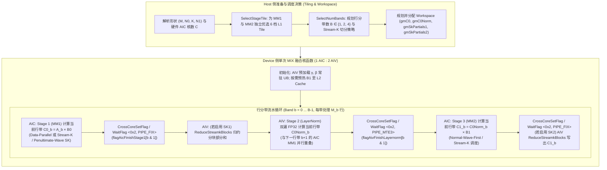

# 需求背景（required）

## 需求来源

开源社区算子开发任务（CANN 社区任务 2026，任务编号：`09-MatmulLayerNormMatmul-950`），基于 `cann/catlass` 模板库开发适配昇腾 Ascend 950（`dav-3510` / `arch35`）架构的 `MatmulLayerNormMatmul` 融合算子，并将其集成至 `torch_catlass` 的 `optest` 与 `ATK` 测试验证体系中。

## 背景介绍

### MatmulLayerNormMatmul算子实现优化

在 Transformer、大语言模型（LLM）及多模态预训练模型的前馈网络（FFN / MLP）与投影模块中，连续矩阵乘夹带层归一化（`Matmul -> LayerNorm -> Matmul`）是高频出现的核心计算子图。例如在两层线性映射层之间引入 `LayerNorm`（如 NormFormer、Sub-LN 结构以及特定视觉/多模态 Adapter 结构）时，其计算过程由第一阶段矩阵乘 $C_0 = A \times B_0$、中间层归一化 $\hat{C}_0 = \text{LayerNorm}(C_0, \gamma, \beta)$ 以及第二阶段矩阵乘 $C_1 = \hat{C}_0 \times B_1$ 串联组成。

在未融合的常规执行模式下，框架需依次下发三次独立算子（`torch.mm` + `torch.nn.functional.layer_norm` + `torch.mm`）：
1. 产生多次 Host-Device 算子下发调度开销与算子间同步气泡；
2. 中间激活张量 $C_0(M \times N_0)$ 与归一化结果 $\hat{C}_0(M \times N_0)$ 需要反复在 Global Memory（GM）与片上缓存之间全量读写搬运，难以充分复用片上 L2 Cache；
3. AIC（Cube 矩阵计算单元）与 AIV（Vector 向量计算单元）在独立算子内各自单一工作，计算资源在时间维度上串行等待，无法发挥昇腾亲和的 Cube-Vector 异构流水并行能力。

通过在 `catlass` 模板库中针对 Ascend 950（`dav-3510`）架构设计并实现 `MatmulLayerNormMatmul` 单算子融合内核，可以将两次 Cube 矩阵乘与中间的 Vector 层归一化收敛至单次 `MIX` 核函数启动中，利用核间硬件同步原语（`CrossCoreSetFlag` / `CrossCoreWaitFlag`）与行分带（Multi-Band Row Pipelining）流水机制，实现 AIV 的 `LayerNorm` 与 AIC 的 `Matmul` 跨阶段重叠执行，并在高 L2 命中率下传递中间张量，从而显著降低访存带宽压力与端到端执行时延。

### MatmulLayerNormMatmul算子现状分析

当前 `catlass` 算子模板库中已包含面向 Atlas A2/A3（`dav-2201`）的 `25_matmul_layernorm_matmul` 基础样例，但在昇腾新一代 Ascend 950（`dav-3510` / `arch35`）架构下尚缺口完整的高性能实现与全链路测试闭环：
1. **架构代际差异**：Ascend 950 采用 `dav-3510` 架构（`CATLASS_ARCH=3510`），AIC 配备 512 KB L1 Buffer（较 A2/A3 翻倍）、64 KB L0A/L0B 与 256 KB L0C，支持 `ScaleGranularity::NO_QUANT` 的 `CopyL0CToGm` 直接量化/类型转换写出；AIV 具备更强的向量吞吐与寄存器基础指令集；
2. **现有基础样例调度局限**：传统实现固定单一分块形状且采用全矩阵屏障式串行等待（即等待整张 $C_0$ 矩阵全部计算完才启动 `LayerNorm`，再等待整张 $\hat{C}_0$ 归一化完成才启动第二阶段矩阵乘），在尾块不均、中小矩阵 Wave 量化损耗大或大矩阵超出 L2 容量时，存在明显的 AIC/AIV 互等空闲与 L2 缓存冲刷问题；
3. **测试与生态集成缺失**：尚未接入 `torch_catlass` 的 C++ 算子绑定（`TORCH_LIBRARY`）、`optest` 116 组基准测试以及 `ATK` 自动化测试框架。

因此，亟需针对 Ascend 950 硬件微架构特性，从多档 Tile 自适应路由、Stream-K 尾波负载均衡、行分带 AIC-AIV 异构叠水以及双遍高精度 Vector `LayerNorm` 四个维度完成算子重构与交付。

### MatmulLayerNormMatmul算子功能分析

`MatmulLayerNormMatmul` 算子在单次算子调用中完成以下三阶段复合计算：
1. **第一阶段矩阵乘法（MM1，AIC 执行）**：输入左矩阵 $A \in \mathbb{R}^{M \times K}$ 与第一权重矩阵 $B_0 \in \mathbb{R}^{K \times N_0}$，在 FP16 输入、FP32 L0C 累加下计算中间特征矩阵 $C_0 = A \times B_0 \in \mathbb{R}^{M \times N_0}$；
2. **中间层归一化（LayerNorm，AIV 执行）**：沿 $C_0$ 的最后一维（即长度 $N_0$ 的行向量维度）逐行计算均值 $\mu_i$ 与方差 $\sigma_i^2$，结合缩放参数 $\gamma \in \mathbb{R}^{N_0}$ 与偏置参数 $\beta \in \mathbb{R}^{N_0}$ 进行仿射归一化，输出 $\hat{C}_0 \in \mathbb{R}^{M \times N_0}$；
3. **第二阶段矩阵乘法（MM2，AIC 执行）**：将归一化后的中间矩阵 $\hat{C}_0 \in \mathbb{R}^{M \times N_0}$ 作为左矩阵，与第二权重矩阵 $B_1 \in \mathbb{R}^{N_0 \times N_1}$ 进行矩阵乘（内部维度 $K_2 = N_0$），经 FP32 累加后转换输出最终结果矩阵 $C_1 = \hat{C}_0 \times B_1 \in \mathbb{R}^{M \times N_1}$。

---

# 需求分析（required）

## 需求描述

在 `cann/catlass` 仓库下针对昇腾 Ascend 950（`dav-3510`）架构完成 `MatmulLayerNormMatmul` 融合算子开发与验证，具体交付要求如下：
1. **算子核心与样例实现**：在 `examples/89_ascend950_matmul_layernorm_matmul/` 下实现面向 `Arch::Ascend950` 的融合算子内核、多档位分块与 Stream-K 调度器、AIV 高性能 `LayerNorm` 子核以及独立可执行验证程序；
2. **PyTorch 扩展绑定**：在 `tests/optest/src/ops/` 与 `tests/optest/torch_catlass/` 下完成 `matmul_layernorm_matmul` 的 C++ 封装、`TORCH_LIBRARY` 注册与 Python 接口导出；
3. **optest 单元测试与性能对标**：新增 `tests/optest/ut/test_89_ascend950_matmul_layernorm_matmul.py`，覆盖官方给定的 116 组典型形状用例，验证计算精度符合生态开源实验标准（FP16），且使用 `msprof op` 实测的算子内核耗时相较 `torch.mm + torch.nn.functional.layer_norm + torch.mm` 组合小算子基线在 116 组用例上均实现 $> 1.1\times$ 的性能提升；
4. **ATK 框架集成**：在 `atk/cases/89_ascend950_matmul_layernorm_matmul/` 与 `atk/runtime/89_ascend950_matmul_layernorm_matmul/` 下提供用例生成脚本、YAML 配置与运行时执行器，支持泛化生成不少于 200 个测试用例并全部通过精度校验。

## 需求拆解

| 序号 | 子任务模块 | 涉及路径 | 核心工作内容 |
| :---: | :--- | :--- | :--- |
| 1 | 算子 Kernel 与 Host Tiling 实现 | `examples/89_ascend950_matmul_layernorm_matmul/` | 实现 Ascend 950 `MIX` 融合 Kernel、6 档 Tile 动态分派、Stream-K 尾波均衡、行分带 AIC-AIV 流水同步及双遍 FP32 `LayerNorm` |
| 2 | CMake 构建接入 | `examples/CMakeLists.txt`、`tests/optest/src/CMakeLists.txt` | 注册 `89_ascend950_matmul_layernorm_matmul` 编译目标（限定 `CATLASS_ARCH=3510`）及 `torch_catlass` 算子编译项 |
| 3 | PyTorch 算子绑定与 Python API | `tests/optest/src/ops/matmul_layernorm_matmul.cpp`、`tests/optest/src/embind.cpp`、`tests/optest/torch_catlass/ops/` | 实现输入合法性校验、Workspace 自动管理（或外部传入复用）、Stream 获取与 `torch.ops.catlass.matmul_layernorm_matmul` 注册 |
| 4 | optest 116 例功能与性能测试 | `tests/optest/ut/test_89_ascend950_matmul_layernorm_matmul.py` | 实现 116 组规定形状（$M, N_0, K, N_1$）的 FP32 Golden 高精度比对及与 PyTorch 小算子拼接基线的对比验证 |
| 5 | ATK 测试套接入 | `atk/cases/89_ascend950_matmul_layernorm_matmul/`、`atk/runtime/89_ascend950_matmul_layernorm_matmul/` | 编写 `89_ascend950_matmul_layernorm_matmul.yaml`、`generator_*.py`（$\ge 200$ 例）、`node.yaml` 与 `execute_*.py` |

---

# 详细设计（required）

## 算子分析

### 数学公式

给定输入矩阵 $A \in \mathbb{R}^{M \times K}$、第一权重矩阵 $B_0 \in \mathbb{R}^{K \times N_0}$、层归一化缩放向量 $\gamma \in \mathbb{R}^{N_0}$、偏置向量 $\beta \in \mathbb{R}^{N_0}$、第二权重矩阵 $B_1 \in \mathbb{R}^{N_0 \times N_1}$ 以及数值稳定常数 $\epsilon > 0$（默认 $\epsilon = 10^{-5}$），算子的完整数学定义如下：

1. **第一阶段矩阵乘法（MM1）**：
   $$C_0 = A \cdot B_0, \quad C_{0}[i, j] = \sum_{k=0}^{K-1} A[i, k] \cdot B_0[k, j], \quad \forall i \in [0, M), \; j \in [0, N_0)$$

2. **行方向层归一化（Row-wise LayerNorm）**：
   对 $C_0$ 的每一行 $i \in [0, M)$，沿维度 $N_0$ 在 FP32 精度下计算均值 $\mu_i$ 与无偏总体方差 $\sigma_i^2$：
   $$\mu_i = \frac{1}{N_0} \sum_{j=0}^{N_0-1} \text{FP32}(C_0[i, j])$$
   $$\sigma_i^2 = \frac{1}{N_0} \sum_{j=0}^{N_0-1} \left(\text{FP32}(C_0[i, j]) - \mu_i\right)^2$$
   再结合参数 $\gamma, \beta$ 进行归一化与仿射变换，并转换回目标精度得到 $\hat{C}_0 \in \mathbb{R}^{M \times N_0}$：
   $$\hat{C}_0[i, j] = \text{Cast}_{\text{FP16}}\left( \frac{\text{FP32}(C_0[i, j]) - \mu_i}{\sqrt{\sigma_i^2 + \epsilon}} \cdot \text{FP32}(\gamma[j]) + \text{FP32}(\beta[j]) \right), \quad \forall j \in [0, N_0)$$

3. **第二阶段矩阵乘法（MM2）**：
   $$C_1 = \hat{C}_0 \cdot B_1, \quad C_{1}[i, l] = \sum_{j=0}^{N_0-1} \hat{C}_0[i, j] \cdot B_1[j, l], \quad \forall i \in [0, M), \; l \in [0, N_1)$$

### 支持数据类型

| 参数名 | 输入/输出 | 含义 | 支持数据类型 | 数据排布格式（Layout） | 备注 |
| :--- | :---: | :--- | :---: | :---: | :--- |
| `a` ($A$) | 输入 | 第一阶段左矩阵 | `float16` (`half`) | `RowMajor` (ND) | 连续二维张量 |
| `b0` ($B_0$) | 输入 | 第一阶段右矩阵 | `float16` (`half`) | `RowMajor` (ND) | 连续二维张量 |
| `gamma` ($\gamma$) | 输入 | LayerNorm 权重向量 | `float16` (`half`) | `Vector` (1D / ND) | 长度为 $N_0$ |
| `beta` ($\beta$) | 输入 | LayerNorm 偏置向量 | `float16` (`half`) | `Vector` (1D / ND) | 长度为 $N_0$ |
| `b1` ($B_1$) | 输入 | 第二阶段右矩阵 | `float16` (`half`) | `RowMajor` (ND) | 连续二维张量 |
| `eps` ($\epsilon$) | 属性 | 方差防除零常数 | `float32` (`float`) | 标量 | 默认值 $1 \times 10^{-5}$ |
| `c1` ($C_1$) | 输出 | 最终输出矩阵 | `float16` (`half`) | `RowMajor` (ND) | 连续二维张量，内部 L0C 与 LayerNorm 均值/方差累加均为 `float32` |

### 支持形状

| 张量名称 | 维度数 | 形状（Shape） | 步长约束（Stride） | 形状约束说明 |
| :--- | :---: | :---: | :---: | :--- |
| `a` ($A$) | 2D | $(M, K)$ | $(K, 1)$ | $M > 0, K > 0$ |
| `b0` ($B_0$) | 2D | $(K, N_0)$ | $(N_0, 1)$ | $K$ 与 $A$ 的列数一致，$N_0 > 0$ |
| `gamma` ($\gamma$) | 1D | $(N_0,)$ | $(1,)$ | 元素个数等于 $N_0$ |
| `beta` ($\beta$) | 1D | $(N_0,)$ | $(1,)$ | 元素个数等于 $N_0$ |
| `b1` ($B_1$) | 2D | $(N_0, N_1)$ | $(N_1, 1)$ | 行数等于 $N_0$，$N_1 > 0$ |
| `c0` ($C_0$, Workspace) | 2D | $(M, N_0)$ | $(N_0, 1)$ | 内部中间矩阵，$A \times B_0$ 输出 |
| `c0_norm` ($\hat{C}_0$, Workspace) | 2D | $(M, N_0)$ | $(N_0, 1)$ | 内部中间矩阵，$\text{LayerNorm}(C_0)$ 输出 |
| `c1` ($C_1$) | 2D | $(M, N_1)$ | $(N_1, 1)$ | 算子最终输出矩阵 |

典型覆盖范围：$M \in [128, 8192]$，$N_0 \in [512, 8192]$，$K \in [512, 8192]$，$N_1 \in [512, 8192]$，同时支持非对齐尾块边界（由 `Catlass::Gemm::Tile::CopyGmToL1` 硬件随路 Padding 处理）。

## 算子实现

### 实现方案

本算子基于 `catlass` 模板库针对 `Arch::Ascend950` 进行深度定制，核心架构如下图所示：

#### 3.2.1 host侧设计：

tiling策略：Host 侧无需生成庞大的序列化 Tiling 结构体，而是通过 `Kernel::Params` 结合 `SelectStageTile`、`SelectNumBands` 与 `StreamkPlan::Init` 在算子入口处完成两阶段矩阵乘的静态+动态混合规划：
1. **两阶段独立分块优选（`SelectStageTile`）**：因第一阶段 $A(M \times K) \times B_0(K \times N_0)$ 与第二阶段 $\hat{C}_0(M \times N_0) \times B_1(N_0 \times N_1)$ 的形状特征往往不同（如 FFN 中 $N_0 = 4d, N_1 = d$ 或反之），Host 侧为 MM1 和 MM2 分别独立评估 6 个候选 L1 Tile 档位（`StageTileKind`），兼顾 AIC 波次（Wave）利用率、算术强度（Arithmetic Intensity）与 L2 缓存局部性。
2. **行分带（Multi-Band Row Pipelining）规划（`SelectNumBands`）**：当 $M$ 较大且中间矩阵 $C_0(M \times N_0)$ 体积超过一定阈值时，若等整张 $C_0$ 算完再做 `LayerNorm`，不仅 AIC 与 AIV 无法重叠，且 $C_0 / \hat{C}_0$ 会冲刷 L2 Cache。Host 侧自适应将 $M$ 维切分为 $B \in \{1, 2, 4\}$ 个行带（Band），每带高度 $M_{\text{band}} = M / B$ 对齐至 MM1 与 MM2 的 $M_{\text{tile}}$ 公倍数（如 128 或 256 的整数倍），使得 Band $b$ 的 AIV `LayerNorm` 与 Band $b+1$ 的 AIC `MM1` 在时间上完全并行，且单带中间数据常驻 L2。
3. **Stream-K 尾波均衡规划（`StreamkPlan`）**：针对输出 Tile 总数 $T = \lceil M / M_{\text{tile}} \rceil \times \lceil N / N_{\text{tile}} \rceil$ 无法被物理 AIC 核数 $C$ 整除的场景，自动规划整波数据并行（DP）Tile 数与尾波跨核沿 $K$ 维协作切分的 Stream-K（SK）Tile 数。

任务均分：
- **AIC 核间任务均分**：通过 `StreamkPlan` 将总计算单元划分为 `dpTiles`（按 Swizzle 顺序每核整块认领）和 `skTiles`（将剩余尾波 Tile 的总 $K$-迭代数 $\text{skTiles} \times k_{\text{Tiles}}$ 均匀摊平到 $C$ 个 AIC 核上，每核分配 `itersPerCore` 次 $K$ 块迭代，余数核多承担 1 次迭代），彻底消除尾波“一核干活、多核空等”的负载失衡。
- **AIV 核间任务均分**：Ascend 950 采用 `1 AIC : 2 AIV` 配比（总 AIV 核数 $V = 2C$）。
  - 在 `LayerNorm` 阶段，当前行带的 $M_{\text{band}}$ 行按连续块均匀划分为 $V$ 份：前 $r = M_{\text{band}} \bmod V$ 个 AIV 核各处理 $\lfloor M_{\text{band}} / V \rfloor + 1$ 行，其余 AIV 核各处理 $\lfloor M_{\text{band}} / V \rfloor$ 行，负载均衡度达 $100\%$；
  - 在 Stream-K 部分和归约阶段（`ReduceStreamkBlocks`），将 `skTiles` 个分块按 64 行子块进一步拆细后，由全部 $V$ 个 AIV 核并行执行向量累加写回。

批量搬运：
- AIC 侧：使用 `Catlass::Gemm::Tile::CopyGmToL1` 将 $A, B_0, \hat{C}_0, B_1$ 的分块批量从 GM/L2 搬运至 512 KB L1 Buffer，再经 `CopyL1ToL0A` / `CopyL1ToL0B` 批量送入 L0A/L0B，累加完成后由 `CopyL0CToGm`（`ScaleGranularity::NO_QUANT`）直接从 FP32 L0C 随路转换为 FP16 批量写回 GM；
- AIV 侧：每次循环以 `rowStep` 行（$\text{rowStep} \times N_0 \le 16384$ 元素，自动适配 $N_0$ 大小）为单位，通过 `AscendC::DataCopy` 批量搬入 $C_0$ 多行数据并批量搬出 $\hat{C}_0$，隐藏 MTE2/MTE3 访存延迟。

##### 1. 分核策略：

算子以单次 `MIX` 核函数启动，设置 `blockDim = coreNum`（即硬件可用 AIC 核数 $C$，在 Ascend 950 上通常为 28 或 32 核），硬件自动拉起 $C$ 个 AIC 核与 $2C$ 个 AIV 核：
1. **AIC 核（`AscendC::GetBlockIdx()` $\in [0, C)$）**：负责执行 Stage 1（MM1）和 Stage 3（MM2）的 Cube 矩阵乘计算。
   - **Data-Parallel 模式**：当输出 Tile 数 $T$ 能被 $C$ 整除，或尾波占比已高于阈值无需拆分时，AIC 按 `GemmSwizzle<3, 0>`（SwizzleOffset = 4，SwizzleDirection = 0/1）交错認领各自负责的 $(m, n)$ 输出块；
   - **Normal-Wave-First Stream-K 模式**：当 $T > C$ 且存在尾波（$0 < T \bmod C < C$）时，前 $\lfloor T / C \rfloor \times C$ 个 Tile 作为整波（Normal Wave）优先按 Swizzle 顺序由各核独立完成，最后 $T \bmod C$ 个尾波 Tile 作为 Stream-K 块由 $C$ 个 AIC 核沿 $K$ 维切片并行计算：负责某 Tile 起始 $K$ 段的 AIC 核（Head Core）直接将部分和写入目标矩阵 `gmC`，其余协作核（Contributor Core）写入 Workspace 中的 `gmSkPartials` 缓冲区；
   - **Penultimate-Wave Stream-K 模式**：当总波次数 $\ge 3$ 且最末尾波 Tile 数极少（导致单个 Tile 被过多 AIC 核切分、归约开销放大）时，将倒数第二波与最末尾波合并为 $(C + (T \bmod C))$ 个 Stream-K Tile 共同均摊给 $C$ 个核，保证每个 Tile 的跨核切片数不超过 2，兼顾满核率与低归约开销。
2. **AIV 核（`AscendC::GetBlockIdx()` $\in [0, 2C)$）**：负责执行 Stage 1/3 的 Stream-K 跨核部分和归约（`ReduceStreamkBlocks`）以及 Stage 2 的行级 `LayerNorm`（`ComputeLayernorm`）。

##### 2. 数据分块和内存优化策略：

1. **6 档 L1 Tile 动态选择与 512 KB L1 深度流水**：
   充分利用 Ascend 950 的 512 KB L1 Buffer 与 256 KB L0C，设计 6 档候选分块配置，并根据单 Stage 的 L1 占用精细化配置流水深度 `(L1A_STAGES, L1B_STAGES, L0AB_STAGES)`，严格保证总 L1 占用 $\le 512\text{ KB}$、L0A $\le 64\text{ KB}$、L0B $\le 64\text{ KB}$、L0C $\le 256\text{ KB}$：

   | 档位枚举 (`StageTileKind`) | `L1TileShape` $(M_1, N_1, K_1)$ | `L0TileShape` $(M_0, N_0, K_0)$ | 流水阶段 `(L1A, L1B, L0)` | L1 内存占用明细 | L0C 占用 (FP32) | 适用场景特征 |
   | :--- | :---: | :---: | :---: | :--- | :---: | :--- |
   | `kTile64x64x256` | $(64, 64, 256)$ | $(64, 64, 256)$ | `(2, 4, 4)` | $2\times 32\text{KB} + 4\times 32\text{KB} = 192\text{KB}$ | $16\text{ KB}$ | 极小 $(M, N)$、高 $K$ 细粒度并行场景 |
   | `kTile128x128x256` | $(128, 128, 256)$ | $(128, 128, 128)$ | `(2, 4, 4)` | $2\times 64\text{KB} + 4\times 64\text{KB} = 384\text{KB}$ | $64\text{ KB}$ | 中小矩阵通用高并发、低 Wave 量化损耗场景 |
   | `kTile128x256x256` | $(128, 256, 256)$ | $(128, 256, 64)$ | `(1, 4, 4)` | $1\times 64\text{KB} + 4\times 128\text{KB}^{*}$ ($\le 512\text{KB}$) | $128\text{ KB}$ | 宽输出维度（$N$ 较大）、高右矩阵复用场景 |
   | `kTile256x128x128` | $(256, 128, 128)$ | $(256, 128, 64)$ | `(2, 4, 4)` | $2\times 64\text{KB} + 4\times 32\text{KB} = 256\text{KB}$ | $128\text{ KB}$ | 长左矩阵（$M$ 较大）、中等 $N$ 场景 |
   | `kTile256x160x128` | $(256, 160, 128)$ | $(256, 160, 64)$ | `(2, 4, 4)` | $2\times 64\text{KB} + 4\times 40\text{KB} = 288\text{KB}$ | $160\text{ KB}$ | 针对 $N$ 为 $3072 / 6144$ 等 160 整除友好的特定对齐形状 |
   | `kTile256x256x128` | $(256, 256, 128)$ | $(256, 256, 64)$ | `(2, 2, 3)` | $2\times 64\text{KB} + 2\times 64\text{KB} = 256\text{KB}$ | $256\text{ KB}$ | 大矩阵算力受限（Compute-Bound）峰值吞吐场景 |

2. **AIV Unified Buffer（UB）内存预算规划**：
   Ascend 950 单 AIV 核配备 256 KB UB，算子在 AIV 侧采用静态常驻与双缓冲（Double Buffer，`BUFFER_NUM = 2`）结合的紧凑布局：
   - $\gamma, \beta$ 常驻区（`gammaQueue` / `betaQueue`）：在 Kernel 初始化时通过 `PreloadGammaBeta` 一次性将长度为 $N_{\text{aligned}} \le 8192$ 的 FP16 $\gamma, \beta$ 搬入 UB 并立即在 `ubGammaFp32`、`ubBetaFp32`（各 $8192 \times 4\text{ B} = 32\text{ KB}$，共 $64\text{ KB}$）中转存为 FP32 常驻，避免后续每行重复从 GM 搬运和 Cast；
   - 输入输出 Ping-Pong 队列（`inQueueC0` / `outQueueC0Norm`）：双缓冲深度为 2，单缓冲容纳 $16384$ 个 `half` 元素（$32\text{ KB}$），合计 $2 \times (32\text{ KB} + 32\text{ KB}) = 128\text{ KB}$；
   - 计算临时缓冲（`tempBuf1`）：容纳 $16384$ 个 `float` 元素（$64\text{ KB}$），复用为当前行块的 FP32 展开缓存、去均值残差缓存与 Stream-K 归约临时缓冲；
   - 归约工作缓冲（`tempBuf2`）：$256$ 个 `float` 元素（$1\text{ KB}$），用于 `ReduceSum` 树状归约。
   以上合计精确控制在 $256\text{ KB}$ UB 硬件预算之内。

3. **Workspace 显存统一规划与安全上限**：
   算子所需设备端临时空间由四部分对齐拼接组成（每段按 512 Bytes 边界向上对齐）：
   - `gmC0`：$M \times N_0 \times \text{sizeof(half)}$；
   - `gmC0Norm`：$M \times N_0 \times \text{sizeof(half)}$；
   - `gmSkPartials1`：Stage 1 Stream-K 协作核部分和缓冲区，最大不超过 $C \times 256 \times 256 \times \text{sizeof(half)}$；
   - `gmSkPartials2`：Stage 3 Stream-K 协作核部分和缓冲区，最大不超过 $C \times 256 \times 256 \times \text{sizeof(half)}$。
   Host 侧显式计算总字节数并设置硬上限校验（$\le 2\text{ GiB}$），支持调用方传入预分配 Workspace Tensor 零拷贝复用，若未传入则自动从 `c10_npu` 缓存分配器安全申请。

##### 3. tilingkey规划策略：

本算子在 `catlass` 框架下采用 **Host 侧二维模板实例分派（Template Dispatch）+ Kernel 内轻量级枚举分支** 的组合机制，替代传统的平面整型 `tilingKey`：
- 第一阶段（MM1）与第二阶段（MM2）的 Tile 档位组合成 `(StageTileKind stage1Tile, StageTileKind stage2Tile)` 路由键：
  - 当 `stage1Tile == stage2Tile` 时，直接分派至同构模板实例 `LaunchSameTile<StageTile>`；
  - 当 `stage1Tile != stage2Tile` 时，分派至异构模板实例，通过编译期确定的 `BlockMmad1` 与 `BlockMmad2` 类型消除运行时动态计算分块偏移的指令开销；
- 行分带数 `numBands` $\in \{1, 2, 4\}$ 与 Stream-K 开关 `sk1.useStreamk`、`sk2.useStreamk` 通过 `Kernel::Params` 传入，在核函数外层 Band 循环级（每算子仅执行 $1 \sim 4$ 次判断）完成零开销路由。

数据检测：
Host 侧入口函数（`matmul_layernorm_matmul`）在启动核函数前执行完备的防御性校验：
1. **维度与非空校验**：检查 `a`, `b0`, `gamma`, `beta`, `b1`, `c1` 均非空且位于 NPU 设备上；检查 `a.dim() == 2`, `b0.dim() == 2`, `b1.dim() == 2`, `c1.dim() == 2`，`gamma.numel() == N0`, `beta.numel() == N0`；检查维度匹配关系 $A.\text{size}(1) == B_0.\text{size}(0)$、$B_0.\text{size}(1) == B_1.\text{size}(0)$、$C_1.\text{ shape} == (M, N_1)$；
2. **数据类型与连续性校验**：检查所有张量数据类型为 `at::kHalf`（`float16`），且内存排布连续（`is_contiguous()`）；
3. **数值稳定性与异常值防御**：校验 $\epsilon > 0$；在 AIV `LayerNorm` 核内使用 `rsqrt(var + eps)` 保证当整行输入为常数（方差 $\sigma_i^2 = 0$）时不发生除零溢出（NaN/Inf）。

#### 3.2.2 kernel侧设计：

Kernel 侧基于 `MatmulLayernormMatmulKernel<BlockMmad1, BlockEpilogue, BlockMmad2, BlockScheduler>` 模板类实现，包含初始化与多阶段流水执行：

1. **初始化阶段（Init）**：
   - 实例化 `Arch::Resource<ArchTag>` 初始化片上 L1/L0A/L0B/L0C/UB 物理管道资源；
   - **AIV 核**：构建 `LayernormContext`，通过 `pipe.InitBuffer` 分配 `inQueueC0`、`outQueueC0Norm`、`gammaQueue`、`betaQueue` 与 FP32 临时 Buffer，并立即调用 `PreloadGammaBeta(ctx, params.ptrGamma, params.ptrBeta, n0)` 将 $\gamma, \beta$ 一次性加载到 UB 并调用 `AscendC::Cast` 转为常驻 FP32 向量；若当前问题规模满足 $B_1$ 预热条件（`prefetchB1 && numBands == 1`），AIV 在等待 Stage 1 期间并发调用 `PreloadB1ToL2` 将 $B_1$ 权重分块预取至 L2 Cache，使得 Stage 3 AIC 读取 $B_1$ 时直接命中 L2。

2. **多带流水处理阶段（Process - Multi-Band Loop）**：
   对每个行带 $b \in [0, \text{numBands})$（当前行带起始行 `bandRowOffset` $= b \times M_{\text{band}}$，行数 `bandM` $= M_{\text{band}}$，支持 Ping-Pong 同步标志位 `flagSlot = b & 1`）：
   - **Step A：AIC 执行当前行带 Stage 1（MM1）**：
     - 若 `b > 0`，AIC 首先等待 `b - 1` 槽位的同步标志回收，然后计算 `gmA_band` $(M_{\text{band}} \times K) \times \text{gmB}_0(K \times N_0) \to \text{gmC0\_band}(M_{\text{band}} \times N_0)$；
     - 在每个 Tile 的 K 循环内部，采用 **K-Loop Prolog/Epilog 预取流水**：计算当前 Tile 的同时，通过 `NextTileCoord` 提前计算下一输出 Tile 的坐标并将下一 Tile 的首块 $A, B_0$ 预取入 L1 Buffer，消除 Tile 切换时的 MTE1/MTE2 断流气泡；
     - 当前行带 MM1 计算完毕后，AIC 调用 `AscendC::CrossCoreSetFlag<0x2, PIPE_FIX>(flagAicFinishStage1[flagSlot])` 通知 AIV。
   - **Step B：AIV 执行当前行带 Stream-K 归约与 Stage 2（LayerNorm）**：
     - AIV 调用 `AscendC::CrossCoreWaitFlag<0x2>(flagAicFinishStage1[flagSlot])` 等待当前行带 $C_0$ 就绪；
     - 若 Stage 1 启用了 Stream-K（`sk1.useStreamk`），56 个 AIV 核首先协同调用 `ReduceStreamkBlocks` 将 `gmSkPartials1` 中的跨核部分和归约累加回 `gmC0_band`，并通过 `flagAivFinishSkReduce` 核间屏障确保全部 Stream-K 列块归约完毕；
     - 随后 AIV 调用 `ComputeLayernorm` 对 `gmC0_band` 中分配给本核的连续行区间执行 **双遍 FP32 高精度层归一化**：
       1. `DataCopy` 搬入 `currentRows` 行 $C_0$（FP16），并通过 `AscendC::Cast` 整体转换为 FP32 存入 `ubC0Fp32`；
       2. **第一遍（均值计算）**：对每行调用 `AscendC::ReduceSum` 求和并乘以 $\frac{1}{N_0}$ 得到高精度均值 $\mu_i$；
       3. **第二遍（中心化与方差计算）**：调用 `AscendC::Adds(ubDiff, ubRow, -mean, n0)` 先做中心化 $x_{ij} - \mu_i$，再调用 `AscendC::Mul(ubSq, ubDiff, ubDiff, n0)` 与 `AscendC::ReduceSum` 计算中心化平方和得到方差 $\sigma_i^2$（坚决摒弃易在大数值下产生灾难性抵消的 $\mathbb{E}[X^2] - (\mathbb{E}[X])^2$ 单遍公式）；
       4. **归一化与仿射变换**：计算缩放因子 $\text{invStd} = \frac{1}{\sqrt{\sigma_i^2 + \epsilon}}$，依次调用 `AscendC::Muls(ubDiff, ubDiff, invStd, n0)`、`AscendC::Mul(ubDiff, ubDiff, ubGammaFp32, n0)`、`AscendC::Add(ubDiff, ubDiff, ubBetaFp32, n0)`，最后经 `AscendC::Cast`（`RoundMode::CAST_RINT`）转回 FP16 并通过 `DataCopy` 写出至 `gmC0Norm_band`；
     - 当前行带 `LayerNorm` 写回完成后，AIV 调用 `AscendC::CrossCoreSetFlag<0x2, PIPE_MTE3>(flagAivFinishLayernorm[flagSlot])` 通知 AIC（此时 AIC 可能正在并行计算下一行带 $b+1$ 的 MM1）。
   - **Step C：AIC 执行当前行带 Stage 3（MM2）**：
     - AIC 调用 `AscendC::CrossCoreWaitFlag<0x2>(flagAivFinishLayernorm[flagSlot])` 等待当前行带 $\hat{C}_0$ 就绪；
     - 执行 `gmC0Norm_band` $(M_{\text{band}} \times N_0) \times \text{gmB}_1(N_0 \times N_1) \to \text{gmC1\_band}(M_{\text{band}} \times N_1)$；
     - 若 Stage 3 启用了 Stream-K（`sk2.useStreamk`），AIC 完成后通过 `CrossCoreSetFlag<0x2, PIPE_FIX>(flagAicFinishStage3[flagSlot])` 唤醒 AIV 执行 `ReduceStreamkBlocks`，将 `gmSkPartials2` 归约合入最终输出 `gmC1_band`。

## 支持硬件

| 硬件型号 / 架构系列 | 芯片 SoC / 编译宏标识 | 是否支持 |
| :--- | :--- | :---: |
| Atlas A2 训练系列 / 推理系列产品 | `Ascend910B` (`dav-2201`) | $\times$（对应独立算子 `25_matmul_layernorm_matmul`） |
| Atlas A3 训练系列 / 推理系列产品 | `Ascend910_93` (`dav-2201`) | $\times$（对应独立算子 `25_matmul_layernorm_matmul`） |
| **Ascend 950 系列产品** | **`Ascend950` / `Ascend950PR` (`arch35` / `dav-3510`, `CATLASS_ARCH=3510`)** | **$\surd$** |

## 算子约束限制

1. **硬件平台约束**：本算子专为 `Arch::Ascend950`（`CATLASS_ARCH=3510`）设计，依赖 512 KB L1 Buffer 与 `dav-3510` 硬件同步及 `CopyL0CToGm` 特性；
2. **数据排布与类型约束**：输入张量 $A, B_0, \gamma, \beta, B_1$ 与输出张量 $C_1$ 均须为连续存储（Contiguous `RowMajor`）的 `float16`（`half`）张量；
3. **形状范围约束**：
   - 归一化维度（即 $B_0$ 的列数 $N_0$）需满足 $1 \le N_0 \le 8192$，以保证单行归一化向量及常驻 FP32 $\gamma, \beta$ 可完整放入 AIV 256 KB UB 中进行高效向量归约；
   - 矩阵维度 $M, K, N_0, N_1 > 0$，当维度非 16 的整数倍时，最内层连续维度地址需满足 32B 对齐或支持硬件 `CopyGmToL1` 边界处理；
4. **Workspace 容量约束**：内部自动分配或外部传入的 Workspace 总大小受 2 GiB 安全硬上限保护。

---

# 可维可测分析

## 精度标准/性能标准

| 验收维度 | 评估基准（Golden / Baseline） | 验收标准与判据 | 测试数据集与覆盖规模 |
| :--- | :--- | :--- | :--- |
| **计算精度标准** | 以 PyTorch FP32 高精度计算结果为 Golden 标杆（先将输入 `half` 转为 `float32`，依次执行 `torch.mm`、`torch.nn.functional.layer_norm`、`torch.mm`） | 遵循**生态开源实验标准（FP16）**： 定义算子输出与 FP32 Golden 的绝对误差 $\Delta_{\text{abs}} = \|Y_{\text{npu}} - Y_{\text{golden}}\|$、相对误差 $\Delta_{\text{rel}} = \frac{\|Y_{\text{npu}} - Y_{\text{golden}}\|}{\|Y_{\text{golden}}\| + \epsilon}$，单元素满足 $\Delta_{\text{abs}} \le 2^{-10} (\approx 9.7656\times 10^{-4})$ 或 $\Delta_{\text{rel}} \le 2^{-7} (\approx 7.8125\times 10^{-3})$，或与原生 FP16 小算子参考结果的误差符合混合容差（`rtol=1e-2, atol=1e-2`），全量用例通过率 **100%** | 1. `optest`：官方指定的 **116 组**典型形状用例（覆盖 $M \in [128, 8192]$，$N_0, K, N_1 \in [512, 8192]$）； 2. `ATK`：泛化生成的 **$\ge 200$ 组**形状用例 |
| **硬件性能标准** | 同一 Ascend 950 硬件环境下，分别执行两个 `torch.mm` 与一个 `torch.nn.functional.layer_norm` 组成的 3 个独立小算子耗时之和：$T_{\text{base}} = T_{\text{mm1}} + T_{\text{ln}} + T_{\text{mm2}}$ | 使用昇腾官方工具 `msprof op` 采集算子底层硬件 `Task Duration(us)`，融合算子耗时 $T_{\text{fused}}$ 相较于小算子基线耗时 $T_{\text{base}}$ 的加速比满足： $$\text{Speedup} = \frac{T_{\text{base}}}{T_{\text{fused}}} > 1.1\times$$ | 官方指定的 **116 组**性能基准测试用例 |

## 兼容性分析

1. **框架与接口兼容性**：
   - 通过 `TORCH_LIBRARY_FRAGMENT(catlass, m)` 注册标准算子接口 `torch.ops.catlass.matmul_layernorm_matmul(Tensor a, Tensor b0, Tensor gamma, Tensor beta, Tensor b1, Tensor! c1, float eps=1e-5)`，并在 `torch_catlass.ops` 下暴露高层 Python 封装，与仓库内现有算子（如 `basic_matmul`、`grouped_matmul` 等）保持完全一致的 ABI 与调用风格；
   - 同时保留 `examples/89_ascend950_matmul_layernorm_matmul` 独立 C++ 二进制入口，支持脱离 Python 环境直接通过命令行参数 `(M, N0, K, N1)` 进行单算子功能验证与 `msprof op` 采集。
2. **构建与多架构隔离兼容性**：
   - 在 `examples/CMakeLists.txt` 中通过 `if(CATLASS_ARCH STREQUAL "3510")` 条件分支隔离注册 `89_ascend950_matmul_layernorm_matmul`，确保在编译 `CATLASS_ARCH=2201`（Atlas A2/A3）目标时互不干扰，保持主仓多架构 CI 编译流水线完全兼容。
