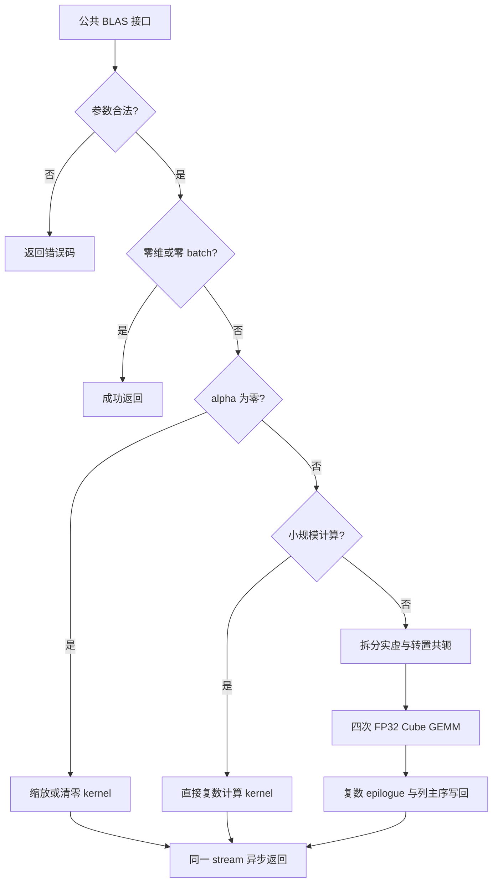

# aclblasCgemmStridedBatched（A2/A3）算子设计文档

| 项目 | 内容 |
| --- | --- |
| 社区任务 | 9 月社区任务第 68 项：aclblasCgemmStridedBatched 算子开发（A2/A3） |
| 代码需求 | [cann/ops-blas Issue #545](https://gitcode.com/cann/ops-blas/issues/545) |
| 提交人 | CenYangtze |
| 文档日期 | 2026-10-15 |
| 文档状态 | 设计评审稿；精度、性能及内存结果以独立自测报告和原始日志为准 |
| 开发环境 | Ascend 910B3（Atlas A2），CANN 9.1.0，Ascend C，arch22 |
| ops-blas 基线 | `11f7a1a2773810368ca35f83e04bf53652320ab4` |
| 社区仓基线 | `54fcf6cbdf988bce0efbe6ebe345cec47e2c8ce7` |

# 需求背景（required）

## 需求来源

任务来源于配套 `aclblasCgemmStridedBatched_A2A3_task_doc.md`，对应[社区任务列表](https://gitcode.com/cann/cann-competitions/blob/master/04_tasks/01_community-task-2026/docs/README.md)中 9 月第 68 项。本设计按照[设计文档模板](https://gitcode.com/cann/cann-competitions/blob/master/04_tasks/01_community-task-2026/resources/design_template.md)组织。

代码目标仓库为 [cann/ops-blas](https://gitcode.com/cann/ops-blas)。任务书第 5 节明确规定实现目录为 `blas/gemm_strided_batched/arch22/`，测试目录为 `test/gemm_strided_batched/cgemm_strided_batched/arch22/`，本设计依此落位。

## 背景介绍

### 算子应用与当前实现

带步长批量复数矩阵乘用于对形状相同、间隔固定的一组矩阵执行复数 GEMM。通过一次 BLAS API 调用下发整批工作，可以减少逐批调用的开销，适用于复数信号处理和成组线性代数计算。

在上述 ops-blas 基线中，`include/cann_ops_blas.h` 已有实数接口 `aclblasSgemmStridedBatched`，`blas/gemm_strided_batched/arch22/` 已有实数矩阵乘实现；尚缺任务要求的 `aclblasCgemmStridedBatched` 公共声明及 arch22 复数实现。本任务复用仓库句柄、stream、设备工作空间、编译和测试框架，新增复数接口与实现。

### 算子功能分析

对 `b = 0, …, batchCount−1` 执行：

```text
A_b = A + b × strideA
B_b = B + b × strideB
C_b = C + b × strideC
C_b ← alpha × op(A_b) × op(B_b) + beta × C_b
```

矩阵使用列主序；每个 `aclblasComplex` 由两个 FP32 分量组成，实部、虚部交错存储。所有批次共享尺寸、转置方式和复数标量。步长和前导维均以复数元素个数计，不以字节或 FP32 分量计。

| 参数 | 含义 | 类型及位置 |
| --- | --- | --- |
| handle | 库句柄，提供 stream 和工作空间 | Host 句柄 |
| transa、transb | N：原矩阵；T：转置；C：共轭转置 | Host 枚举 |
| m、n、k | 输出行数、输出列数、归约长度 | Host int |
| alpha、beta | 各批次共享的复数系数 | Host COMPLEX64 指针 |
| A、B | 输入矩阵集合 | Device COMPLEX64 指针，只读 |
| C | 结果矩阵集合；beta 非零时也是输入 | Device COMPLEX64 指针 |
| lda、ldb、ldc | 相邻列首地址的元素间隔 | Host int |
| strideA、strideB、strideC | 相邻批次首地址的元素间隔 | Host 有符号 64 位整数 |
| batchCount | 批次数量 | Host int |

# 需求分析（required）

## 需求描述

在 Atlas A2/A3 的 arch22 路径上，使用 Ascend C kernel 直调实现 COMPLEX64 带步长批量矩阵乘。公共接口与任务书规定的参数顺序一致：

```cpp
aclblasStatus_t aclblasCgemmStridedBatched(
    aclblasHandle_t handle,
    aclblasOperation_t transa, aclblasOperation_t transb,
    int m, int n, int k,
    const aclblasComplex *alpha,
    const aclblasComplex *A, int lda, long long strideA,
    const aclblasComplex *B, int ldb, long long strideB,
    const aclblasComplex *beta,
    aclblasComplex *C, int ldc, long long strideC,
    int batchCount);
```

## 需求拆解

1. 支持 N/T/C 的全部九种组合、矩形及非对齐尺寸、列主序前导维 padding 和批次间隔。
2. 支持 A/B 零步长复用输入矩阵；使用有符号 64 位寻址，不将步长窄化为 32 位。
3. 保证 `m=0`、`n=0`、`k=0` 或 `batchCount=0` 是任务定义的 no-op，不读写矩阵。
4. `alpha=0` 时不引用 A/B；`beta=0` 时不读取旧 C；两系数同时为零时仅写零。
5. 非法 handle、枚举、维度、前导维和必要指针返回任务规定的状态码。
6. 一般矩阵使用四次 FP32 实数 Cube GEMM；小矩阵和缩放路径减少拆分、工作空间及启动开销。
7. 通过 handle 绑定 stream 异步执行，读取结果由调用方同步。
8. 使用独立 Netlib `cblas_cgemm` golden 覆盖全部 1000 条精度用例、200 条性能用例，并补充必要边界和访问抑制回归。

# 详细设计（required）

## 算子分析

### 数学公式

设 `op(A)=Ar+jAi`、`op(B)=Br+jBi`，使用四实数乘法分解：

```text
Prr = Ar × Br              Pii = Ai × Bi
Pri = Ar × Bi              Pir = Ai × Br
Pr  = Prr − Pii            Pi  = Pri + Pir
Cr' = alpha.real × Pr − alpha.imag × Pi
Ci' = alpha.real × Pi + alpha.imag × Pr
```

当 beta 非零时，再加入：

```text
Cr' += beta.real × C_old.real − beta.imag × C_old.imag
Ci' += beta.real × C_old.imag + beta.imag × C_old.real
```

四个实数 GEMM 的输入与累加均为 FP32，不把输入转换为 FP16/BF16，也不使用 HF32 近似乘法。该路径的浮点累加顺序与 Netlib 可以不同，验收采用任务规定的混合容差。

### 支持数据类型

A/B/C、alpha/beta 均为 COMPLEX64。中间实部、虚部及矩阵乘结果均为 FP32。公共类型沿用 `include/cann_ops_blas_common.h` 的 `aclblasComplex`，不引入第二套对外复数类型。

### 支持形状及地址映射

| 矩阵 | N 模式物理形状 | T/C 模式物理形状 | 前导维最小值 |
| --- | --- | --- | --- |
| A | m×k | k×m | N：max(1,m)；T/C：max(1,k) |
| B | k×n | n×k | N：max(1,k)；T/C：max(1,n) |
| C | m×n | 不涉及 | max(1,m) |

对输出逻辑行 `r`、列 `c` 和归约索引 `q`，输入复数元素地址为：

```text
A，N:   b × strideA + r + q × lda
A，T/C: b × strideA + q + r × lda
B，N:   b × strideB + q + c × ldb
B，T/C: b × strideB + c + q × ldb
C:      b × strideC + r + c × ldc
```

模式 C 在以上转置映射基础上对输入虚部取负。只处理 `0≤r<m`、`0≤c<n` 的输出，列填充和 batch 间隔保持原值。A/B 的 stride 为零时，各批次读取同一矩阵；有效负步长由调用方提供覆盖寻址范围的基址和内存，不能仅因步长为负而拒绝。

### 参数与特殊值语义

Host 按以下顺序校验，命中错误立即返回：

| 阶段 | 检查与处理 | 返回值/行为 |
| --- | --- | --- |
| 1 | handle 为空 | `ACLBLAS_STATUS_HANDLE_IS_NULLPTR` |
| 2 | transa/transb 不在 N/T/C，m/n/k/batchCount 为负 | `ACLBLAS_STATUS_INVALID_VALUE` |
| 3 | lda/ldb/ldc 不满足前导维条件 | `ACLBLAS_STATUS_INVALID_VALUE` |
| 4 | alpha 或 beta 为空 | `ACLBLAS_STATUS_INVALID_VALUE` |
| 5 | m/n/k/batchCount 任一为零 | `ACLBLAS_STATUS_SUCCESS`；不启动 kernel，不检查矩阵指针 |
| 6 | 非空输出 C 为空 | `ACLBLAS_STATUS_INVALID_VALUE` |
| 7 | alpha 非零时 A/B 为空 | `ACLBLAS_STATUS_INVALID_VALUE` |
| 8 | 有效输入 | 根据系数和尺寸选择 kernel |

空计算仍要求合法的枚举、维度、前导维和 Host 标量指针。特别地，任务明确规定 `k=0` 不缩放 C，不能套用其他 GEMM 实现中的 `C←beta×C` 分支。

复数零判断要求实部、虚部均等于零，包含 IEEE 正负零。alpha 为零时，即使 A/B 为 nullptr 或包含 Inf/NaN，也不能读取 A/B。beta 为零时，即使 C 原值含 Inf/NaN，写回结果也不受旧值影响。两者均为零时直接产生零，不通过 `0×C_old` 实现清零。一般 Inf/NaN 输入按设备浮点运算传播；测试按参考结果分类比较非有限值，有限分量继续使用混合容差。

## 算子实现

### 实现方案



#### Host 侧设计

Host 只负责参数校验、路径选择、平台资源查询、tiling、工作空间获取和 kernel 提交，不进行矩阵数值计算，也不拷贝整矩阵回 Host。

tiling 保存 m/n/k、前导维、有符号 stride、批次数、转置/共轭标志、复数系数、内部平面的对齐尺寸及各阶段工作空间偏移。维度乘积及工作空间大小使用宽整数，工作空间规划在各项求和之前检查单项上限，并检查补齐后的前导维能否由 int 表示。无法规划的 workspace 转为无需 workspace 的直接路径。调用方保证实际矩阵跨度在有符号地址运算范围内且内存有效；算子不额外检查 stride 引起的越界或用户分配边界。

一般路径先将 A、B 的物理矩阵拆为连续 FP32 实部/虚部平面，保留原矩阵的列方向，前导维补齐到 8 个 float。共轭在拆分阶段完成，转置标志传入 Cube。使用 `C^T=op(B)^T×op(A)^T` 映射，交换 A/B 的角色，使内部行主序 GEMM 对应外部列主序结果。对齐补齐部分写零，写回阶段仅使用有效输出尺寸。

计算核心数从平台查询。各核以 batch、四种实数乘积及输出 tile 的线性任务编号领取工作，循环处理非整倍数的尾部任务。直接计算路径按输出元素分配任务；没有有效任务的核立即退出。

工作空间通过现有 handle 的设备缓冲管理接口取得，不每次自行创建 stream。拆分平面和四组乘积使用不相交、正确对齐的区间。定义 `round8(x)=ceil(x/8)×8`：

```text
planeA = transa=N ? round8(m)×k : round8(k)×m
planeB = transb=N ? round8(k)×n : round8(n)×k
planeC = round8(m)×n
每 batch 字节数 W = 4 × (2×planeA + 2×planeB + 4×planeC)
G 个 batch 的总字节数 = G × W
```

默认工作空间为 32 MiB，分组数 `G=min(剩余batch数,可用workspace字节数/W)`。单 batch 大于默认空间时，调用 `EnsureDefaultWorkspace` 扩展到至少 W；例如单 batch 的 4096×4096×4096 紧凑矩阵需要 512 MiB。工作空间上限为 2 GiB。超出单 batch 空间规划能力时走无需工作空间的直接计算路径；实际分配失败返回错误，不能继续启动或静默缩小计算范围。每组依次提交 pack、Cube、epilogue 三个 kernel，再在同一 stream 中复用空间处理下一组。工作空间在全部相关任务完成前保持有效。

#### Kernel 侧设计

**1. 拆分与布局整理。** 按原矩阵的物理列读取交错复数，每块最多处理 1024 个复数，使用 Gather 分别提取实部与虚部，模式 C 对虚部取负。输出平面维持物理矩阵方向，使用 8 个 float 对齐的 packed 前导维。外部 padding 和 batch stride 只用于输入读取，后续 GEMM 不再重复处理外部 lda/stride。尾块补齐到 8 个 float 并写零，不读取输入矩阵之外的填充区域。

**2. 四实数矩阵乘。** 使用 Ascend C FP32 Cube 能力完成 Prr/Pii/Pri/Pir，关闭 HF32。四种乘积合并在一次 Cube kernel launch 中，由 `(batch,product,tile)` 共同分配任务。输出 tile 为 128×128，K 按最多 4096 分段，基础归约块为 64；K 超过 4096 时，后续段累加到已有乘积平面。N/T 标志传入 Matmul 模板和 `SetTensorA/B`，列主序输入按照上述转置恒等式映射。边缘 tile 设置实际有效尺寸，写入 packed 输出平面。

**3. 复数 epilogue。** 每个输出元素只有一个任务写入。合并四组乘积、执行复数 alpha 缩放；仅当 beta 非零时读取 C 原值并叠加。通过 `b×strideC+r+c×ldc` 写回外部列主序输出，不覆盖 padding 或矩阵间隔。

**4. 小规模直接计算。** 当 `m×n×k≤32768` 时，直接使用原矩阵地址计算复数乘加，并完成 epilogue，不分配工作空间。每个任务拥有一个输出复数元素，沿 K 顺序累加。超出工作空间可表示范围的合法输入也使用该通用路径，以保留功能覆盖。此分支与一般分支共享 N/T/C、步长和系数语义。阈值可根据实测调整，路径选择仅影响执行方式，不改变精度判据。

**5. alpha 为零。** 使用单独输出遍历路径执行 `C←beta×C`；beta 同时为零时仅写零。此分支不创建 A/B 的设备读取任务。beta 为一时可直接返回，但仍遵循非空调用所需的 C 指针检查。

#### 异步与并发

同一次 API 调用的拆分、GEMM 和 epilogue 全部提交到 `handle->stream`，依靠同一 stream 的顺序保证依赖。常规下发采用异步执行；首次获取或扩容 workspace 时，`EnsureDefaultWorkspace` 按库内既有缓冲管理规则允许同步句柄流，以安全替换旧缓冲。因此不承诺首次资源扩容也完全无同步。kernel 参数在下发时保存必要的 Host 标量值，调用返回后不再异步解引用 alpha/beta 的 Host 指针。

不引入全局共享中间缓冲；不同 handle 使用各自工作空间。与仓库既有规则一致，同一 handle 的并发使用及重新绑定 stream 由调用方协调，不能在前一任务仍使用工作空间时覆盖该缓冲。设备错误由现有运行时错误路径报告，不将失败误报为成功。

### 性能优化方案

1. 通过拆分后的连续平面复用实数矩阵乘能力，避免在 K 内层反复解交织和执行外部 stride 运算。
2. 将 batch 与输出 tile 合并调度，提高中大矩阵的核心利用率；避免仅按 batch 分核导致小 batch 场景空核。
3. 通过一次拆分复用四次 GEMM 的输入平面，减少共轭/转置的重复计算。
4. 小矩阵选择直接计算以减少工作空间搬运与多次 kernel 启动；alpha 为零跳过全部矩阵乘。
5. beta 为零时跳过旧 C 读取，epilogue 合并复数重组、系数乘加和最终写回。
6. profiling 统计完整 API 调用内所有计算阶段的总耗时，检查是否受 pack、Cube、epilogue 或 Host 下发限制，避免只报告四次 GEMM 中某一个 kernel 的耗时。

## 支持硬件

| 产品系列 | 实现目标 | 验证安排 |
| --- | --- | --- |
| Atlas A2 系列（含 Atlas 800I/T A2） | 支持，arch22 | 当前环境为 Ascend 910B3，执行编译、精度、性能和内存自测 |
| Atlas A3 系列（含 Atlas 800I A3） | 支持，arch22 | 复用架构实现，实际验证结果在独立 A3 环境获得后记录 |

任务书第 3.1 节允许自验证覆盖一种款型，第 7.4 节又要求 A2/A3 均完成验收。本次以当前 A2 硬件开展开发和验证，A3 未运行前不宣称已通过 A3 验收。

## 算子约束限制

- 仅支持 COMPLEX64，矩阵布局由列主序、前导维与固定 batch 步长描述；不支持其他任意非连续视图。
- C 不得与 A/B 的有效存储区域重叠。调用方保证设备内存有效，且每个 batch 的全部地址位于可访问分配范围内。
- A/B 支持零步长复用。关于 C 零步长，任务书第 2.4 节表格与配套测试说明存在差异：配套 `test_cases/README.md` 明确 `strideC=0 && batchCount>1` 为未定义行为、不构造用例。本设计依照配套测试说明要求各批次输出互不重叠，不将并发重叠写作为受支持用法。
- 不对 stride 过小导致的内存越界执行运行时分配边界检查；有符号地址运算和工作空间大小仍需避免算术溢出。
- 浮点规约不保证逐位确定。调用异步完成，CPU 读取结果前须同步对应 stream。

# 可维可测分析

## 精度标准/性能标准

| 验收项目 | 标准 | 来源 |
| --- | --- | --- |
| 功能 | COMPLEX64、九种转置组合、padding、A/B 零步长复用、边界与负向行为符合上述定义 | 任务书第 2 节、配套用例说明 |
| 有限数精度 | 实部、虚部分别使用 `abs(actual−golden)≤2^-13+2^-13×abs(golden)`，匹配比例≥0.99，最大绝对误差≤1e-2；ULP 例外仅在报告明确说明时采用 | 任务书第 3.2 节、配套测试说明 |
| 非有限数 | 与独立 golden 比较 NaN/Inf 分类；有限分量继续按同一混合容差判定 | 任务书要求覆盖 Inf/NaN |
| 性能 | warmup 后有效采样不少于 11 次；五条任务典型 case 达到下表阈值，其余 195 条与配套 GPU baseline 对照 | 任务书第 3.3/7.4 节、`gpu_baseline.csv` |
| 内存 | 报告输入输出、workspace 及运行时占用，不伪造未采集数据 | 任务书交付件要求 |

| case | batchCount | m | n | k | transa/transb | 布局 | 达标平均耗时（us） |
| --- | --- | --- | --- | --- | --- | --- | --- |
| 1 | 8 | 256 | 256 | 256 | N/N | 紧凑 | 153.7 |
| 2 | 32 | 512 | 512 | 512 | N/N | 紧凑 | 2757 |
| 3 | 16 | 1024 | 1024 | 1024 | N/T | 紧凑 | 10061 |
| 4 | 8 | 2048 | 2048 | 2048 | T/N | 任务 CSV 指定 padding | 36073 |
| 5 | 4 | 4096 | 4096 | 4096 | N/N | 任务 CSV 指定 padding | 143326 |

### 测试方案

配套 1200 条 CSV 用例原样保留，精度 1000 条、性能 200 条，按 case ID 分别输出结果。测试驱动使用 C++ GTest 调用公共 API，通过独立 CPU Netlib `cblas_cgemm` 逐 batch 生成 golden，不使用待测 kernel 的代码计算 golden。对零维和 k=0 按任务 no-op 规则保留原 C，不能直接调用 Netlib 的不同边界分支。

测试覆盖 3×3 转置组合、小质数和非对齐尺寸、矩形、2 的幂及相邻尺寸、前导维 padding、批次间隔、零步长输入广播、1～1024 的批规模、特殊复数系数、均匀/正态数据以及 Inf/NaN。无效 handle、非法枚举 999、负维度、负 batch 和非法 ld 检查准确状态码。

额外回归包括：alpha=0 配合 A/B=nullptr；beta=0 配合旧 C 全 NaN；双零系数；k=0 且 C 内容不变；合法负 stride 和 batchCount=1 时无效步长不参与寻址；输出 padding 与批次间隔哨兵不变；非默认 stream 顺序执行。必要时使用内存检测工具验证没有越界访问和错误工作空间复用。

性能使用 device event 计时完整设备调用，并用 `msprof op` 保存各阶段 `Task Duration(us)`。每条性能 case 先 warmup，再重复有效采样，记录样本数、均值和波动；多 kernel 实现按一次 API 调用汇总全部阶段，不能以单个 kernel 的最小值替代算子时间。测试日志保留硬件、CANN 版本、提交号、CSV hash、命令和逐条结果，确保验收人可复现。

### 交付与维护

| 交付内容 | 目录/形式 |
| --- | --- |
| 公共接口 | `include/cann_ops_blas.h` |
| Host、tiling、kernel | `blas/gemm_strided_batched/arch22/cgemm_strided_batched_{host.cpp,tiling.h,kernel.cpp}` |
| 算子 README | `blas/gemm_strided_batched/README.md`，补全复数 API、示例和 A2/A3 产品支持说明 |
| 自测代码、CSV、步骤 | `test/gemm_strided_batched/cgemm_strided_batched/arch22/` |
| 设计 PR | `cann/cann-competitions` 的本任务 `CenYangtze/docs/design.md` |
| 验收材料 | 开发者私仓 `task_submission/`，包含步骤、精度/性能/内存 XLSX 与日志 |

代码评审 PR 在开发、自测完成后按 ops-blas 规范提交；自测报告只记录实际运行结果。代码私仓按任务要求邀请 `Ascend-CANN` 为开发者。所有提交排除访问密钥、本地 `.env`、构建缓存和无关输出。

## 兼容性分析

新增接口沿用 ops-blas 的 handle、复数类型、stream 和状态码，不修改 `aclblasSgemmStridedBatched` 的行为。arch22 代码通过现有架构编译分派接入，不将复数接口实现误接入不支持的架构。复数负向行为独立按任务要求处理，例如非法枚举返回 `ACLBLAS_STATUS_INVALID_VALUE`，避免照搬现有实数实现的差异。

无额外运行时数值库依赖；Netlib BLAS 仅用于测试 golden。构建和测试依赖遵循仓库 CANN 9.1.0、C++/Ascend C 和 GTest 配置。后续优化维持同一 API、地址语义和精度标准，修改路径阈值或 tiling 时重跑相关边界及完整验收用例。
