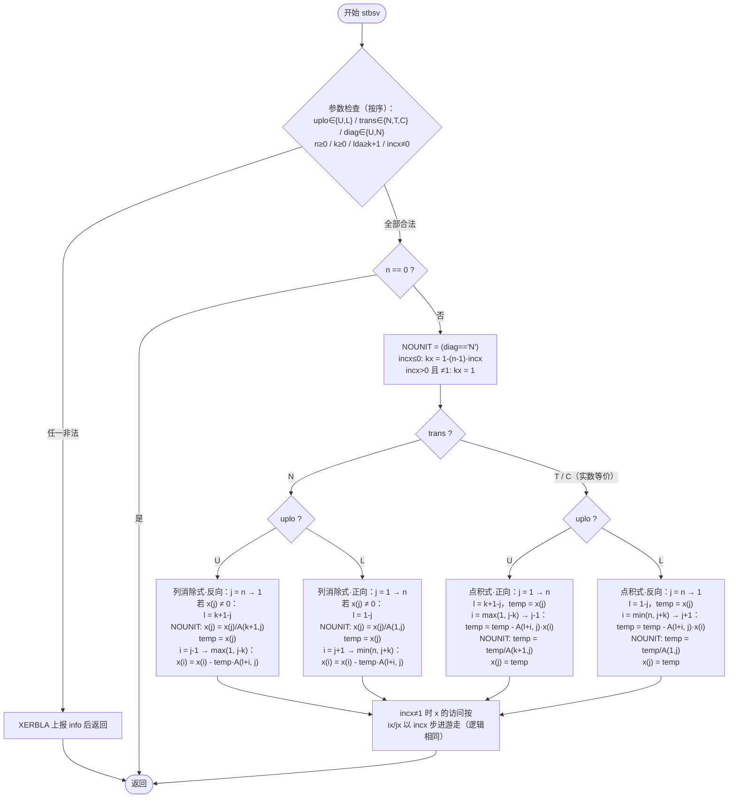
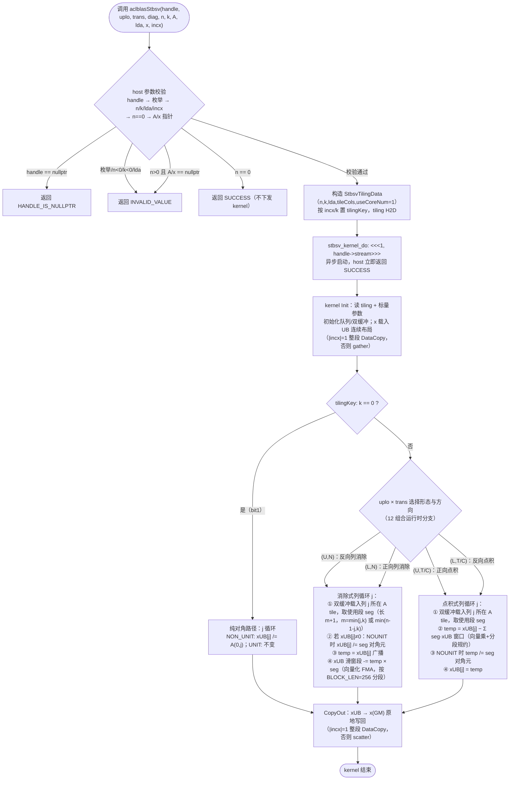

# 【社区任务】aclblasStbsv算子设计文档

## 一、需求背景

### 1.1 需求来源

通过社区任务完成开源仓算子贡献的需求：在昇腾算子开源仓 ops-blas（https://gitcode.com/cann/ops-blas）中，为 Atlas A2/A3 系列产品（对应架构目录 arch22）新增单精度实数三角带状方程组求解算子 `aclblasStbsv` 的 kernel 直调实现，补齐 `blas/tbsv/` 目录下 A2/A3 架构的 FP32 能力（该目录现有 arch35 仅为 Ascend 950 系列的复数版本实现），对齐 cuBLAS `cublasStbsv` 算子能力，验收通过后合入开源仓。

### 1.2 背景介绍

#### 1.2.1 aclblasStbsv算子实现

本任务为 ops-blas 仓 kernel 直调（Ascend C）BLAS Level-2 算子开发任务，非 TBE/aclnn 框架算子，无 TBE 算子源码与算子信息库（无 `*.json` 算子信息库文件、无 aclnn 映射接口），标杆为 cuBLAS 句柄式接口。参考的标杆源码与文档路径如下（均含文件名）：

| 类别 | 路径 |
| --- | --- |
| 标杆接口（对标基线） | cuBLAS `cublasStbsv`，CUDA Math API 文档 `cublas/#cublas-tbsv`（https://docs.nvidia.com/cuda/cublas/index.html） |
| 标杆参考实现源码（golden 同源） | netlib BLAS `stbsv.f`（https://www.netlib.org/blas/stbsv.f ；镜像 https://github.com/Reference-LAPACK/lapack/blob/master/BLAS/SRC/stbsv.f ） |
| 精度 golden 生成 | cblas（Netlib BLAS `stbsv` 实数实现），随任务测试工程提供 |
| 合入仓及目录 | https://gitcode.com/cann/ops-blas ，实现代码 `blas/tbsv/arch22/`，测试代码 `test/tbsv/stbsv/arch22/` |
| 接口声明 | `include/cann_ops_blas.h`（仓内该接口声明已存在，直接复用；README 产品支持表更新 Atlas A2/A3 系列产品为"支持"） |
| 状态码/枚举定义 | `include/cann_ops_blas_common.h` |
| 工程框架参考 | 仓内 `blas/trsv/arch22/`（strsv_host.cpp + strsv_kernel.cpp 的扁平目录模式） |

#### 1.2.2 aclblasStbsv算子现状分析

##### 1.2.2.1 标杆算子支持的数据类型和数据格式

与算子信息库要求（任务书 §2.4 参数说明）保持一致：

| 项目 | 标杆（cublasStbsv / netlib stbsv）支持情况 | 本任务要求 |
| --- | --- | --- |
| 数据类型 | FLOAT32（实数单精度） | 一致，仅 FLOAT32 |
| 矩阵 A 格式 | n×n 三角带状矩阵，列主序束带存储（banded column-major），存于 lda×n 缓冲区，lda ≥ max(1, k+1)，单一半带宽 k（k ∈ [0, n−1]） | 一致，ND 排布 |
| 向量 x 格式 | 逻辑长度 n、步长 incx（incx ≠ 0，可正可负），物理占位 1+(n−1)·\|incx\| | 一致 |
| uplo | UPPER / LOWER | 一致 |
| trans | N / T / C（实数档 OP_C 语义与 OP_T 等价，按转置处理） | 一致 |
| diag | NON_UNIT / UNIT（UNIT 时对角视为 1，不读写 A 对角位置） | 一致 |
| 规模与边界 | n ≥ 0（n=0 合法 no-op）、k ≥ 0 | 一致 |
| 特殊值 | 输入含 Inf/NaN 时按浮点运算自然传播；不做奇异性检查 | 一致 |

##### 1.2.2.2 标杆算子实现描述

标杆参考实现为 netlib BLAS `stbsv.f`（golden 由其生成），求解 `op(A)·x = b`（b 初值存于 x，解原地写回 x）。以下描述与其源码逻辑一致（1-based 索引）：

**（1）参数检查（按源码顺序）**：依次校验 uplo ∈ {U,L}、trans ∈ {N,T,C}、diag ∈ {U,N}、n ≥ 0、k ≥ 0、lda ≥ k+1、incx ≠ 0，任一违反则通过 `XERBLA` 上报对应 info 序号并返回；全部通过且 n = 0 时快速返回（no-op）。记 `NOUNIT = (diag == 'N')`。

**（2）x 起始偏移**：incx ≤ 0 时 `kx = 1−(n−1)·incx`（使 kx 指向 x 的最后一个逻辑元素）；incx > 0 且 ≠ 1 时 `kx = 1`；incx = 1 时直接连续访问。

**（3）四种求解分支**（每种均分 incx=1 与 incx≠1 两套索引游走代码，逻辑等价）：

- **trans=N、uplo=U（上三角，反向列消除式，自后向前回代）**：列 j 从 n 反向到 1；若 x(j) ≠ 0：`l = (k+1)−j`；NOUNIT 时先 `x(j) = x(j)/A(k+1,j)`（对角元位于束带存储第 k+1 行）；`temp = x(j)`，内层 i 从 j−1 反向到 max(1, j−k)：`x(i) = x(i) − temp·A(l+i, j)`（列消除，修改本列左侧的解分量）。
- **trans=N、uplo=L（下三角，正向列消除式，自前向后前代）**：列 j 从 1 正向到 n；若 x(j) ≠ 0：`l = 1−j`；NOUNIT 时先 `x(j) = x(j)/A(1,j)`（对角元位于束带第 1 行）；`temp = x(j)`，内层 i 从 j+1 正向到 min(n, j+k)：`x(i) = x(i) − temp·A(l+i, j)`。
- **trans=T/C、uplo=U（点积式，正向）**：j 从 1 正向到 n：`temp = x(j)`，`l = (k+1)−j`，内层 i 从 max(1, j−k) 正向到 j−1：`temp = temp − A(l+i, j)·x(i)`（点积累减）；NOUNIT 时 `temp = temp/A(k+1,j)`；`x(j) = temp`。
- **trans=T/C、uplo=L（点积式，反向）**：j 从 n 反向到 1：`temp = x(j)`，`l = 1−j`，内层 i 从 min(n, j+k) 反向到 j+1：`temp = temp − A(l+i, j)·x(i)`；NOUNIT 时 `temp = temp/A(1,j)`；`x(j) = temp`。

**（4）共性规律**：求解方向由 uplo 与 trans 共同决定——(U,N) 反向、(L,N) 正向、(U,T) 正向、(L,T) 反向；trans=N 为"列消除式"（axpy 型，修改尚未求解的分量，且跳过 x(j)=0 的列），trans=T/C 为"点积式"（dot 型，不跳过）；NOUNIT 决定是否除以对角元；DIAG=U 时不引用 A 的对角位置；本例程不做奇异性或接近奇异性检验，除零行为未定义。

##### 1.2.2.3 标杆算子实现流程图

与 `stbsv.f` 源码逻辑一致：



## 二、需求分析

### 2.1 外部组件依赖

| 依赖组件 | 版本 | 用途 |
| --- | --- | --- |
| CANN 昇腾异构计算架构 | 9.1.0 | Ascend C 编程模型（Vector 核）、ACL 运行时（`acl/acl.h`：context、stream、Device/Host 内存与拷贝接口）、CCE 编译工具链 |
| cblas（Netlib BLAS `stbsv` 实数实现） | 随任务测试工程提供 | 精度比对 golden 生成（仅测试期依赖，不进入算子交付物） |

除上述外无其他三方外部依赖。

### 2.2 内部适配模块

| 模块 | 路径 | 用途 |
| --- | --- | --- |
| 公共接口声明 | `include/cann_ops_blas.h` | `aclblasStbsv` 接口声明（供其他产品线共用，仓内已声明则复用） |
| 公共状态码与枚举 | `include/cann_ops_blas_common.h` | `aclblasStatus_t`、`aclblasFillMode_t`、`aclblasOperation_t`、`aclblasDiagType_t` 定义 |
| Handle 内部辅助 | `common/helper/aclblas_handle_internal.h` | 从 `aclblasHandle_t` 取绑定的 stream（`aclblasSetStream` 设置） |
| 工程构建框架 | 仓根 `build.sh` / `CMakeLists.txt` / `cmake/` | 将 `blas/tbsv/arch22/` 新增源文件纳入编译，产出算子库与测试二进制 |
| 测试框架 | `test/frame/test_main.cpp` 及算子测试工程模式 | CSV 驱动的 C++ GTest 自验（测试代码放 `test/tbsv/stbsv/arch22/`） |

### 2.3 需求模块设计

#### 2.3.1 Ascend C算子原型

接口签名（与 cuBLAS `cublasStbsv` 参数序列一一对应，kernel 直调，实现代码放 `blas/tbsv/arch22/`）：

```cpp
aclblasStatus_t aclblasStbsv(aclblasHandle_t handle, aclblasFillMode_t uplo,
                             aclblasOperation_t trans, aclblasDiagType_t diag,
                             int n, int k, const float* A, int lda,
                             float* x, int incx);
```

参数与语义（除任务书不要求适配的部分外，与标杆算子对齐）：

| 参数 | 输入/输出 | 描述 | 数据类型/格式 | 约束与异常行为 |
| --- | --- | --- | --- | --- |
| handle | 输入 | ops-blas 库上下文句柄，携带 stream | 指针，Host | 为 nullptr 时返回 `ACLBLAS_STATUS_HANDLE_IS_NULLPTR` |
| uplo | 输入 | 三角带位置：UPPER 取上三角带 / LOWER 取下三角带 | attr（int），Host | 非法枚举返回 `ACLBLAS_STATUS_INVALID_VALUE` |
| trans | 输入 | op(A)：N=A / T=Aᵀ / C=Aᴴ（实数档与 T 等价） | attr（int），Host | 非法枚举返回 `ACLBLAS_STATUS_INVALID_VALUE` |
| diag | 输入 | NON_UNIT 读对角 / UNIT 对角视为 1 不读写 | attr（int），Host | 非法枚举返回 `ACLBLAS_STATUS_INVALID_VALUE` |
| n | 输入 | 矩阵阶数（x 逻辑长度） | scalar（int），Host | n < 0 返回 `INVALID_VALUE`；n=0 合法 no-op 返回 `SUCCESS` |
| k | 输入 | 半带宽（对角带条数） | scalar（int），Host | k < 0 返回 `INVALID_VALUE` |
| A | 输入 | n×n 三角带状矩阵，列主序束带存储于 lda×n，只读 | FLOAT32 / ND，Device | n>0 时为 nullptr 返回 `INVALID_VALUE` |
| lda | 输入 | A 前导维度 | scalar（int），Host | lda < max(1, k+1) 返回 `INVALID_VALUE` |
| x | 输出（原地） | b 初值存于 x，解写回 x；步长 incx | FLOAT32 / ND，Device，物理占位 1+(n−1)·\|incx\| | n>0 时为 nullptr 返回 `INVALID_VALUE` |
| incx | 输入 | x 元素步长，可正可负 | scalar（int），Host | incx = 0 返回 `INVALID_VALUE` |

返回值：`aclblasStatus_t`（`ACLBLAS_STATUS_SUCCESS` / `ACLBLAS_STATUS_INVALID_VALUE` / `ACLBLAS_STATUS_HANDLE_IS_NULLPTR` 等，语义同 `cann_ops_blas_common.h`）。异步语义：算子异步下发到 handle 绑定的 stream（`aclblasSetStream`），读回 Device 结果前由调用方同步 stream。

#### 2.3.2 Ascend C算子相关约束

与标杆算子（cuBLAS/netlib `stbsv`）相比的功能对齐情况——**功能无缺失**：uplo×trans×diag 全部 12 种枚举组合、incx 正/负/非 1 步长、lda 紧凑与 padding、n=0/k=0 边界、Inf/NaN 输入按浮点规则传播等均与标杆一致。与标杆相比存在以下差异（非功能缺失）：

| 差异项 | 标杆行为 | 本算子行为 |
| --- | --- | --- |
| 错误上报方式 | netlib 经 `XERBLA` 打印并返回 info 序号 | 以 `aclblasStatus_t` 状态码返回（对齐 cuBLAS 句柄式接口与 ops-blas 仓规范） |
| 确定性计算 | 标量顺序累加，逐位确定 | 向量化乘加/块规约，浮点累加顺序不同（任务书明确不要求确定性计算，精度按混合容差验收） |
| 数据类型范围 | netlib stbsv 仅 FP32（d/ctbsv 为独立例程） | 仅 FP32（任务书范围；复数/双精度为独立算子任务） |
| 奇异性 | 不检查，除零行为未定义 | 一致：不检查，对角为零时按 IEEE 浮点规则产生 Inf/NaN |

## 三、需求详细设计

### 3.1 调用方式

本算子采用 **kernel 直调（Ascend C）** 方式，适配 ops-blas 仓句柄式 BLAS 接口框架（非 ACLNN、非 Pytorch 框架）。调用链路：

```text
用户侧                            host 侧（blas/tbsv/arch22/stbsv_host.cpp）                device 侧（stbsv_kernel.cpp）
aclblasCreateHandle          ──►
aclblasSetStream(handle, s)  ──►  handle->stream = s
aclblasStbsv(handle, ...)    ──►  ① 参数合法性校验（状态码直接返回）
                                  ② 构造 StbsvTilingData 并 H2D 拷贝
                                  ③ stbsv_kernel_do(...): <<<blockDim=1, s>>>  ──►  Ascend C kernel 异步执行
                                  ④ 立即返回 ACLBLAS_STATUS_SUCCESS
aclrtSynchronizeStream(s)    ──►                                                            kernel 完成，x 已原地更新
```

### 3.2 需求总体设计

#### 3.2.1 host侧设计

host 侧（`stbsv_host.cpp`）负责参数校验、tiling 构造与下发，主要流程：

1. **参数校验（顺序固定）**：`handle == nullptr` → 返回 `ACLBLAS_STATUS_HANDLE_IS_NULLPTR`；uplo/trans/diag 不在合法枚举集 → `ACLBLAS_STATUS_INVALID_VALUE`；`n < 0` 或 `k < 0` → `INVALID_VALUE`；`lda < max(1, k+1)` → `INVALID_VALUE`；`incx == 0` → `INVALID_VALUE`；`n == 0` → 返回 `SUCCESS`（合法 no-op，不下发 kernel）；`n > 0` 且 `A == nullptr || x == nullptr` → `INVALID_VALUE`。
2. **tiling 构造**：按 3.2.1.2 的分块公式计算 `StbsvTilingData`（n、k、lda、tileCols、useCoreNum 等）与 tilingKey，`aclrtMemcpy` H2D 至 Device tiling 缓冲。
3. **kernel 下发**：调用 `stbsv_kernel_do(A, x, tilingGm, uplo, trans, diag, n, k, lda, incx, numBlocks, stream)`，以 `<<<useCoreNum, stream>>>` 方式异步启动（对齐仓内 `blas/trsv/arch22` 的 `<op>_kernel_do` 封装模式），**不做内部同步**，异步语义由 `aclblasSetStream` 绑定的 stream 保证。

**tiling 数据结构**（对齐仓内 strsv 模式）：

```cpp
struct StbsvTilingData {
    uint32_t n;          // 矩阵阶数
    uint32_t k;          // 半带宽
    uint32_t lda;        // 前导维度
    uint32_t tileCols;   // A 单个列块 tile 覆盖的列数
    uint32_t useCoreNum; // 实际使用核数，本算子固定为 1
};
```

uplo/trans/diag、incx 作为 kernel 标量入参传递（运行时分支），不进 tiling。

##### 3.2.1.1 分核策略

三角带状前代/回代存在**逐列数据依赖**：列消除式（trans=N）中列 j 的处理要求 x(j) 已被列 j+1 的更新最终化（列 j+1 直接写 x(j)），点积式（trans=T/C）中 x(j) 依赖 x(j−1)，两者均构成**长度为 n 的串行依赖链**，算法理论并行度为 1（按 mod(k+1) 残差类分层的 wavefront 方案需核间多次同步才能推进一层）。

同时本算子单问题数据量小（最大性能 case n=4096/k=128：A ≈ 2.11 MB、x = 16 KB），多核并行的计算收益无法覆盖核间同步与分派开销，且验收时延为百微秒级的时延敏感场景。

因此分核策略为：**单核串行求解**——`blockDim = 1`（单个 AI Vector 核），`useCoreNum = 1`，其余核空闲；串行链在单 AIV 内以向量化内层计算（3.2.2.1）换取吞吐。多核 wavefront 分层方案保留为后续优化方向，本版本不采用。

##### 3.2.1.2 数据分块和内存优化策略

Device 侧仅一次 kernel 完成，LocalMemory（Unified Buffer，UB）使用策略如下：

**（1）x 向量常驻 UB**：将 x 全量载入 UB 并重排为**连续布局**（消除 incx 步长对计算的干扰）：

- x UB 占用 = `4·n` 字节。性能/精度用例上限 n = 4096 → 16 KB。
- incx = 1（或 −1 时按逆序）：整段 `DataCopy` 一次搬入（尾数按 32 B 块对齐补齐）；求解完成后整段搬回 GM。
- \|incx\| ≠ 1：按步长逐元素 gather 载入 UB、求解后逐元素 scatter 写回（仅正确性用例出现，非性能路径）。
- 求解全程 x 的读写均发生在 UB（列消除式的滑窗更新、点积式的点积累减），x 的 GM 读一次、写一次。

**（2）矩阵 A 按列块分块双缓冲搬运**：A 列主序束带存储天然按列分段连续——列 j 的实际使用段为连续的至多 k+1 个 float（UPPER：存储行 `[max(0, k−j), k]`；LOWER：存储行 `[0, min(n−1−j, k)]`）。分块策略：

- 单个 tile 覆盖连续 `tileCols` 列：`tileCols = max(1, TILE_A_BYTES / (4·lda))`，其中 `TILE_A_BYTES = 32 KB`；
- 双缓冲（ping-pong）交替执行"搬运下一 tile ‖ 计算当前 tile"，掩盖 GM→UB 搬运时延；每个 tile 搬入 `4·lda·tileCols` 字节（按 32 B 对齐向上取整）；
- 列内使用段长度 m+1（m = min(j, k) 或 min(n−1−j, k)）超过单次向量化宽度 BLOCK_LEN（取 256 个 float）时，按 BLOCK_LEN 分段处理。

**（3）UB 占用预算与计算公式**：

```text
UB 占用 = 2 × TILE_A_BYTES          （A 双缓冲）
        + 4 × n                     （x 常驻）
        + 2 × BLOCK_LEN × 4         （段内临时/对齐 padding）
        ≈ 64 KB + 16 KB + 2 KB ≈ 82 KB   （n = 4096 最坏情形）
```

小于 arch22 Vector 核单核 UB 可用上限（约 192 KB），无需分段驻留 x。

**（4）GM 访问总量**：A 每元素至多读一次 ≈ `4·lda·n` 字节；x 读一次写一次 ≈ `8·n` 字节（incx=1 时）；无中间 workspace，无额外 Device 内存分配（除 tiling 小缓冲）。

##### 3.2.1.3 tilingKey规划策略

本算子 n/k 为运行时入参（dynamic shape 由 host tiling 支持），uplo/trans/diag 共 12 种组合为冷路径，作为 kernel 标量参数运行时分支，不占用 tilingKey（避免 kernel 实例膨胀）。tilingKey 仅用于区分**访存/计算形态**的热路径特化，设置条件如下（按位组合）：

| tilingKey 位 | 置位条件 | 走的路径 |
| --- | --- | --- |
| bit0（0x1） | \|incx\| == 1 | x 连续访存路径：整段 DataCopy 载入/写回 + UB 滑窗计算（性能用例全部命中该路径） |
| bit0 = 0 | \|incx\| ≠ 1 | x 步长路径：逐元素 gather/scatter |
| bit1（0x2） | k == 0 | 纯对角快速路径：无内层带状更新循环，仅对角除法（NON_UNIT）或纯拷贝（UNIT），不进入 A 列块双缓冲主流程 |
| bit1 = 0 | k > 0 | 带状主路径（3.2.2.1） |

即 tilingKey ∈ {0, 1, 2, 3}：0=带状+步长（正确性）、1=带状+连续（主性能路径）、2=纯对角+步长、3=纯对角+连续。

#### 3.2.2 kernel侧设计

##### 3.2.2.1 kernel侧实现描述

kernel（`stbsv_kernel.cpp`，`stbsv_kernel` + `stbsv_kernel_do` 启动封装）与标杆源码流程保持一致（0-based 索引，UB 内 x 为连续布局 xUB；A 列 j 使用段记为 seg，段长 m+1，UPPER 段末/LOWER 段首为对角元）：

**（1）Init 阶段**：读 tiling（n、k、lda、tileCols）与标量参数（uplo、trans、diag、incx）；初始化 TPipe/队列与双缓冲 LocalTensor；按 tilingKey 将 x 从 GM 载入 UB（连续或 gather）。

**（2）求解方向选择**（与标杆四分支一致）：

| uplo | trans | 形态 | 方向 |
| --- | --- | --- | --- |
| U | N | 列消除式 | j = n−1 → 0（反向回代） |
| L | N | 列消除式 | j = 0 → n−1（正向前代） |
| U | T/C | 点积式 | j = 0 → n−1（正向） |
| L | T/C | 点积式 | j = n−1 → 0（反向） |

**（3）列消除式（trans=N）**，以 (U, N) 为例（(L, N) 镜像：j 正向、seg 为存储行 [0, min(n−1−j, k)]、更新 x[j+1..j+m]）：

```text
for j = n-1 → 0:                          # 反向列消除
    m = min(j, k)                          # 本列带内更新长度
    (双缓冲取列 j 所在 tile，取使用段 seg)
    if xUB[j] != 0:                        # 与标杆一致：零分量跳过本列更新
        if diag == NON_UNIT:
            xUB[j] = xUB[j] / seg[m]       # 除以对角元（UPPER 位于段末）
        temp = xUB[j]                      # 广播
        xUB[j-m .. j-1] -= temp * seg[0 .. m-1]   # 向量化 FMA，按 BLOCK_LEN 分段
```

**（4）点积式（trans=T/C）**，以 (U, T) 为例（(L, T) 镜像：j 反向、seg 为存储行 [0, min(n−1−j, k)]、对角位于段首）：

```text
for j = 0 → n-1:                          # 正向点积
    m = min(j, k)
    (双缓冲取列 j 所在 tile，取使用段 seg)
    temp = xUB[j] - Σ_{i=0}^{m-1} seg[i] * xUB[j-m+i]   # 向量乘 + 分段规约求和
    if diag == NON_UNIT:
        temp = temp / seg[m]
    xUB[j] = temp                          # 不跳过零分量（与标杆一致）
```

**（5）k == 0 快速路径**：n 次独立对角求解（NON_UNIT：`xUB[j] /= A(0, j)`；UNIT：x 不变），无内层更新，无 A tile 双缓冲循环开销。

**（6）CopyOut 阶段**：按 tilingKey 将 xUB 写回 GM（incx=1 整段 DataCopy，否则逐元素 scatter）。diag=UNIT 时全程不读写 A 对角位置（与标杆一致，对角为 NaN/Inf 也不影响结果）。

**（7）数值精度**：全程 FP32 乘加（FMA），点积分段规约；累加顺序与标杆标量顺序不同，误差在混合容差（rtol=atol=2⁻¹³）之内，任务书不要求确定性计算。

**（8）文件规划**（对齐仓内 `blas/trsv/arch22` 扁平模式，不含冗余文件）：

```text
ops-blas/
├── include/cann_ops_blas.h          # 复用/确认 aclblasStbsv 声明
├── blas/tbsv/
│   ├── README.md                    # 产品支持表标注 Atlas A2/A3 系列（含 800I A2/A3）：支持
│   └── arch22/
│       ├── stbsv_host.cpp           # 接口：校验、tiling 构造/H2D、kernel_do 异步下发
│       ├── stbsv_kernel.cpp         # Ascend C kernel 实现 + stbsv_kernel_do 启动封装
│       ├── stbsv_kernel.h           # kernel 侧声明
│       └── stbsv_tiling.h           # StbsvTilingData 与 tilingKey 常量
└── test/tbsv/stbsv/arch22/          # CSV 用例 + GTest 测试工程（仓内测试框架结构）
```

##### 3.2.2.2 Ascend C实现流程图



##### 3.2.2.3 Ascend C实现流程图与标杆算子流程图存在的差异点和原因

| # | 差异点 | 标杆（netlib stbsv.f） | Ascend C 实现 | 原因 |
| --- | --- | --- | --- | --- |
| 1 | x 的访存组织 | incx=1 与 incx≠1 两套索引游走代码（kx/jx/ix 按 incx 步进），直接在原内存上步长访问 | x 先整体载入 UB 并重排为连续布局统一计算，结束后按原步长写回；消除 4 分支 × 2 套索引的代码重复 | UB 连续布局才能向量化；语义等价（写回保持原步长位置），代码更简洁 |
| 2 | 内层计算方式 | 标量循环逐元素乘减（axpy/dot） | 向量化 FMA / 向量乘+分段规约（BLOCK_LEN 分段） | 利用 Vector 核并行 lane 提升吞吐；浮点累加顺序不同，任务书不要求确定性计算，精度按混合容差验收 |
| 3 | A 的访问方式 | 直接按 (l+i, j) 寻址内存 | A 按列块 tile 双缓冲 GM→UB 搬运后计算 | NPU 为显式搬运编程模型，GM 数据须先进 UB；双缓冲掩盖搬运时延 |
| 4 | k=0 场景 | 与 k>0 走同一套通用循环（内层循环次数为 0） | tilingKey bit1 置位走独立纯对角快速路径 | 小消除分支与搬运开销，纯对角场景无需 tile 主流程（行为等价） |
| 5 | 零分量跳过 | 列消除式跳过 x(j)=0 的列；点积式不跳过 | 保留一致：消除式跳过、点积式不跳过 | 与标杆行为逐位对齐（浮点上 `0·a` 与跳过等价，但 NaN/Inf 输入时跳过可避免向未求解分量写入 NaN，保持与标杆一致的传播行为） |
| 6 | 错误上报 | XERBLA 打印 + info 序号，n=0 前先完成全参数检查 | host 侧校验后以 `aclblasStatus_t` 返回（校验顺序与标杆检查顺序保持一致：枚举→n/k→lda→incx→n=0 快速返回→指针） | 对齐 cuBLAS 句柄式错误码语义与 ops-blas 仓规范；任务书 §2.4 异常行为表 |
| 7 | OP_C 处理 | 实数档与 OP_T 等价 | 相同，按转置处理 | 实数无共轭，语义一致 |
| 8 | 执行模型 | 同步例程（调用返回即完成） | kernel 异步下发到 handle 绑定 stream，调用方读回前同步 | 对齐 cuBLAS/clops-blas 句柄式异步语义与任务书 §2.5 要求 |

### 3.3 支持硬件

与《算子任务书》要求支持的硬件保持一致（架构目录 arch22，同一 kernel 适配 A2/A3）：

| 芯片/产品 | 是否支持 |
| --- | --- |
| Atlas A2 系列产品（含 Atlas 800I A2；性能测试设备 Atlas 800T A2 / 910B3） | 是 |
| Atlas A3 系列产品（含 Atlas 800I A3） | 是 |

- CANN 版本：9.1.0；自验证覆盖一种款型即可（精度建议 910B3 或 A3，性能建议 910B3），验收时 A2 与 A3 均需完成。

### 3.4 算子约束限制

1. 数据类型仅支持 FLOAT32（单精度实数）；复数/双精度为独立算子任务，不在本算子范围。
2. 仅支持 uplo ∈ {UPPER, LOWER}、trans ∈ {N, T, C}（C 按实数转置处理）、diag ∈ {NON_UNIT, UNIT}，非法枚举返回 `ACLBLAS_STATUS_INVALID_VALUE`。
3. 规模约束：n ≥ 0、k ≥ 0、incx ≠ 0、lda ≥ max(1, k+1)；n=0 为合法 no-op 返回成功。
4. A 与 x 不允许内存重叠（原地语义仅限 x 自身 b→解覆写）；不支持超出 lda 与 incx 语义的非连续 Tensor 访问。
5. 不做奇异性检查：对角元为 0 时结果为 Inf/NaN（与标杆一致，行为未定义，调用方须保证矩阵性态）。
6. diag=UNIT 时不读写 A 的对角位置（对角处的 NaN/Inf 不影响结果）。
7. 异步执行：依赖 `aclblasSetStream` 绑定 stream，读回 Device 结果前须同步 stream。
8. 不保证确定性计算（浮点运算顺序与标杆不同，误差在混合容差标准内）。

## 四、特性交叉分析

| 交叉项 | 分析结论 |
| --- | --- |
| 与 `blas/tbsv/` 已有 arch35（Ascend 950 系列复数版）实现 | 无交叉：架构目录隔离，各自独立编译产物；本任务仅新增 arch22 子目录源文件与 README 支持表更新 |
| 与公共头文件 `include/cann_ops_blas.h` | 接口声明与仓内现有声明保持一致（参数序列与 `cublasStbsv` 一一对应），无符号冲突；供其他产品线共用 |
| 与公共状态码/枚举 `cann_ops_blas_common.h` | 只读复用，无修改 |
| 与仓内构建框架（build.sh / CMakeLists / cmake） | 仅将新增源文件纳入既有编译链路，不修改构建行为，不影响其他算子产物 |
| 与其他 Level-2 求解类算子（trsv/tpsv/tbmv 等） | 无共享运行时状态；测试目录按 `test/tbsv/stbsv/arch22/` 独立组织，不影响既有测试工程 |
| 异常行为/精度基线 | 全量对齐 cuBLAS 与 netlib golden，无历史版本兼容包袱（新接口） |

结论：本需求为纯新增算子特性，与仓内已有特性无交叉冲突。

## 五、可维可测分析

### 5.1 精度标准/性能标准

**精度标准**（依据任务书 §3.2 与生态算子开源精度标准 https://gitcode.com/cann/opbase/blob/master/docs/zh/ops_precision_standard/mixed_tolerance_standard.md ，FLOAT32 档）：

| 验收标准 | 描述 | 标准来源 |
| --- | --- | --- |
| golden 基准 | cblas（Netlib BLAS `stbsv` 实数实现）生成，对输出向量 x 全元素验证 | 任务书 §3.2 |
| 逐元素混合容差 | `\|actual − golden\| ≤ atol + rtol·\|golden\|`，rtol = atol = 2⁻¹³ ≈ 1.2207e-4 | 生态算子开源精度标准（FLOAT32） |
| 整体通过条件 | matched_ratio ≥ 0.99 且 max_abs_error ≤ max(1e-2, 32×ULP)；含大数规约误报时 `max_abs_error_limit` 可酌情放宽至 2×ULP | 同上 |
| 自验覆盖 | 随任务提供的 1200 条 CSV 用例（1000 精度 + 200 性能）：12 种枚举全组合、尺寸/带宽扫描（n∈[0,2048]、k∈[0,n−1]）、前导维 padding、正负步长、填充/Inf/NaN、边界与负向（空指针、非法枚举 999、非法 lda、负维度、负带宽、零步长、INT_MIN 步长），不足场景自行补充 | 任务书 §3.5 / 测试指导 |

**性能标准**（依据任务书 §3.3，设备 Atlas 800T A2 / 910B3，FLOAT32，msprof op 采集 kernel 平均单次耗时：5 次 warmup + 有效采样 ≥10 次取平均；NPU 耗时须 ≤ gpu_baseline.csv 中 gpu_ms / 0.8，与下表达标耗时一致）：

| case | n | k | uplo | trans | diag | 达标耗时（Avg time，us） |
| --- | --- | --- | --- | --- | --- | --- |
| 1 | 256 | 8 | UPPER | N | NON_UNIT | 198.0 |
| 2 | 512 | 32 | LOWER | N | NON_UNIT | 379.8 |
| 3 | 1024 | 16 | UPPER | T | UNIT | 659.5 |
| 4 | 2048 | 64 | LOWER | T | NON_UNIT | 1725 |
| 5 | 4096 | 128 | UPPER | N | UNIT | 2365 |

设计裕度分析：最大性能 case（n=4096, k=128）GM 访问总量 ≈ 2.1 MB（A）+ 32 KB（x），A 列块双缓冲下单核有效搬运带宽（GB/s 级）下访问耗时为百微秒量级；计算量 n·k ≈ 5.2×10⁵ MAC，向量化（256 lane/段）后为数千个向量周期（微秒量级），相对 2365 us 达标线裕度充足；小 case（n=256）耗时由 kernel 启动时延主导（数十微秒），亦满足 198 us 达标线。

### 5.2 兼容性分析

| 维度 | 分析 |
| --- | --- |
| 接口兼容 | 新增算子接口，无历史版本兼容问题；签名与参数序列与 cuBLAS `cublasStbsv` 一一对应，无需参数映射 |
| 硬件兼容 | Atlas A2 与 A3 系列共用 arch22 单一实现（kernel 直调，同一 CCE 编译目标），不引入架构相关行为差异 |
| 状态码兼容 | 全部返回值遵循 `include/cann_ops_blas_common.h` 既有定义，不新增状态码 |
| 仓内影响 | 不修改任何既有算子源码与构建行为，仅新增 `blas/tbsv/arch22/`、`test/tbsv/stbsv/arch22/` 及 README 支持表更新、公共头接口声明确认 |
| 语义兼容 | 行为（含边界、负向、特殊值传播、UNIT 对角不读写、零分量跳过）对齐 cuBLAS/netlib 标杆；不保证逐位一致的确定性计算（浮点累加顺序差异，任务书允许） |
