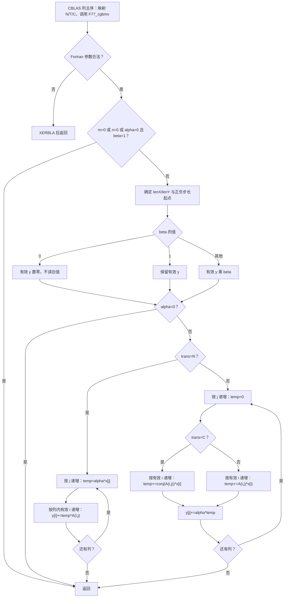
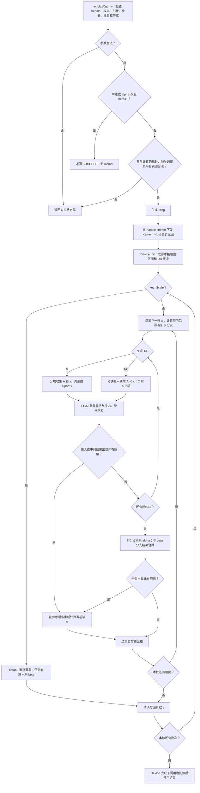

# 一、需求背景

## 1.1 需求来源

本需求来自 [2026 年 CANN 社区任务清单](../../../../docs/README.md)中 9 月第 70 号“aclblasCgbmv 算子开发（A2/A3）”。依据配套《aclblasCgbmv_A2A3 任务书》，在 [ops-blas](https://gitcode.com/cann/ops-blas) 中使用 Ascend C Kernel 直调模式实现单精度复数一般带状矩阵向量乘，适配 Atlas A2/A3，完成接口、算子实现及精度、性能自验证。

本文按[社区提交说明](../../../../README.md)、[设计模板](../../../../resources/design_template.md)及任务配套设计文档审核 Checklist 编写。下述 Kernel、分块参数和优化路径为待开发设计，验收阈值来自任务书；本文不包含已完成上板验证的结论。

## 1.2 背景介绍

### 1.2.1 aclblasCgbmv 算子实现优化

算子计算 `y = alpha * op(A) * x + beta * y`，其中 `A` 为 `m × n` 一般带状矩阵，`op(A)` 支持不转置、转置、共轭转置。直接访问列主序带状压缩存储，将计算量约束在有效带内，避免展开为 `m × n` 稠密矩阵产生的额外存储和搬运。

本任务指定的语义及性能标杆是 cuBLAS `cublasCgbmv`，精度 golden 是 Netlib BLAS `cgbmv`。任务未提供对应 TBE 实现及算子信息库文件，本算子也不走 ACLNN 两段式接口。因此，Checklist 中的 TBE 源码路径、TBE 算子信息库路径均不适用，以下列出本任务实际可核查的文件和接口，不能以其他算子的 TBE 文件替代。

| 资料 | 文件或接口位置 | 使用范围 |
| --- | --- | --- |
| cuBLAS 接口契约 | [cuBLAS Level-2：cublas&lt;t&gt;gbmv](https://docs.nvidia.com/cuda/cublas/index.html#cublas-t-gbmv) | 核对参数、带状存储、N/T/C 和向量语义；cuBLAS GPU Kernel 源码未公开 |
| 可审阅的精度参考算法 | Reference-LAPACK/lapack v3.10.0：[BLAS/SRC/cgbmv.f](https://github.com/Reference-LAPACK/lapack/blob/v3.10.0/BLAS/SRC/cgbmv.f) | 分析带内循环、步长、quick return、alpha/beta 分支 |
| CBLAS 入口 | 同版本 [CBLAS/src/cblas_cgbmv.c](https://github.com/Reference-LAPACK/lapack/blob/v3.10.0/CBLAS/src/cblas_cgbmv.c) | golden 使用 `CblasColMajor`，映射 N/T/C 后调用 Fortran 实现 |
| ops-blas 公共定义 | [include/cann_ops_blas.h](https://gitcode.com/cann/ops-blas/blob/master/include/cann_ops_blas.h)、[include/cann_ops_blas_common.h](https://gitcode.com/cann/ops-blas/blob/master/include/cann_ops_blas_common.h) | 公共签名、句柄、`aclblasComplex`、枚举和状态码 |
| 带状算子工程参考 | [blas/gbmv/arch35/sgbmv_host.cpp](https://gitcode.com/cann/ops-blas/blob/master/blas/gbmv/arch35/sgbmv_host.cpp)、[sgbmv_kernel.cpp](https://gitcode.com/cann/ops-blas/blob/master/blas/gbmv/arch35/sgbmv_kernel.cpp) | 参考工程接入及带状索引；实数和 arch35 实现不能直接作为 A2/A3 复数 Kernel |
| A2/A3 复数工程参考 | [blas/gemv/arch22/cgemv_host.cpp](https://gitcode.com/cann/ops-blas/blob/master/blas/gemv/arch22/cgemv_host.cpp)、`cgemv_no_trans_kernel.cpp`、`cgemv_do_trans_kernel.cpp` | 参考复数实虚部处理及直调组织；其稠密矩阵布局、临时内存和入口同步不能直接照搬 |
| 任务验收输入 | 任务附件 `test_cases/cgbmv_test.csv`、`gpu_baseline.csv`、`verify_accuracy.py`、`README.md` | 1000 条精度用例、200 条性能用例及验收方法 |

本次工程参考基于 ops-blas 提交 `c2ad3bbba97f042486bd4e12dc87dfb6a0bf400f` 核对；该快照的 `blas/gbmv/` 有 arch35 实数实现，需新增本任务的 `blas/gbmv/arch22/` 复数实现。

### 1.2.2 aclblasCgbmv 算子现状分析

#### 1.2.2.1 标杆算子支持的数据类型和数据格式

| 参数 | 本任务对齐的 cublasCgbmv 能力 | 存储与长度 |
| --- | --- | --- |
| A | COMPLEX64，一般带状矩阵 | 列主序，逻辑 `m × n`，物理 `lda × n`；`lda ≥ kl + ku + 1` |
| x | COMPLEX64，非零正负步长 | N 时逻辑长度 n；T/C 时逻辑长度 m |
| y | COMPLEX64，非零正负步长，原地输出 | N 时逻辑长度 m；T/C 时逻辑长度 n |
| alpha、beta | COMPLEX64 标量 | 本任务为 Host 指针；cuBLAS 还支持 Device 标量指针 |
| trans | N、T、C | 仅 C 对 A 取共轭，x、alpha、beta 不取共轭 |

COMPLEX64 按相邻两个 FP32 分量表示，每个复数 8 字节。任务中的 ND 表示普通内存数组，不表示将带状矩阵改成行主序或稠密矩阵。m/n 始终描述原始 A，不随 trans 交换。

后文统一使用零基索引。有效元素满足 `0 ≤ i < m`、`0 ≤ j < n`、`-ku ≤ i-j ≤ kl`，其复数元素偏移为：

```text
offsetA(i,j) = j * lda + ku + i - j
lenX = (trans == N) ? n : m
lenY = (trans == N) ? m : n
start(L,s) = (s < 0) ? (L - 1) * (-int64(s)) : 0
offsetX(t) = start(lenX,incx) + t * int64(incx)
offsetY(t) = start(lenY,incy) + t * int64(incy)
```

对于非空向量，实际分配元素数至少为 `1 + (L-1)*abs(int64(s))`。调用者传入分配区域的基址，负步长的起始偏移由库计算，不能让调用者和库重复移动基址。带外角区、lda padding 和向量 stride 空洞不参与计算。

#### 1.2.2.2 标杆算子实现描述

以下描述对应上述 Netlib `cgbmv.f` 的可见控制流，不推测闭源 cuBLAS Kernel。CBLAS 的列主序包装把转置枚举映射为字符 `N/T/C`，其余矩阵参数和步长原样交给 `F77_cgbmv`；本任务不使用其行主序包装分支。

1. 先检查 trans、m/n、kl/ku 是否非负、lda 是否足够及 incx/incy 是否非零；错误调用 `XERBLA` 后返回。Netlib 不检查本任务新增的带宽上界，也没有 aclblas 句柄或状态码。
2. `m=0`、`n=0` 或 `alpha=0 且 beta=1` 时直接返回。否则按 trans 得到向量长度，按步长正负确定起点。
3. 先处理旧 y：beta=1 保持不变；beta=0 直接赋零，不读取旧 y；其余 beta 对有效 y 元素逐一做复数乘法。随后 alpha=0 则返回。
4. N 分支按列 j 递增，计算 `temp=alpha*x[j]`，再遍历该列的有效行 `i∈[max(0,j-ku), min(m-1,j+kl)]`，更新 `y[i] += temp*A(i,j)`。该源码没有 `x[j]==0` 时跳过列的优化。
5. T/C 分支按输出列 j 递增，在同一有效行区间按 i 递增做点积。T 使用 A，C 使用 `conj(A)`，最后执行 `y[j] += alpha*temp`。源码分别优化单位步长和非单位步长的地址推进，但其逻辑元素相同。

N 的 alpha 在各乘积形成前应用，T/C 在点积后应用；这一区别在 Inf/NaN、溢出或强抵消时可能影响结果。实现应保持特殊值分支语义，有限值的并行归约差异按任务精度阈值验收。

#### 1.2.2.3 标杆算子实现流程图



# 二、需求分析

## 2.1 外部组件依赖

| 组件 | 用途与要求 |
| --- | --- |
| CANN 9.1.0、Ascend C 编译工具链、AscendCL Runtime | 编译 arch22 Kernel，提供 Device 内存、stream 和 Kernel 下发能力 |
| ops-blas 仓构建框架 | 按目标 SoC 选择架构源码，生成库及测试程序；沿用仓库 CMake/build.sh，不另造调用框架 |
| C++ GTest、CSV 测试框架、Python 3 | 加载任务用例，执行接口、错误码和结果检查，汇总报告 |
| Netlib BLAS/CBLAS | CPU 精度 golden；测试报告记录实际链接版本，避免无意替换为其他 BLAS 后端 |
| msprof op | 采集 Device Kernel 耗时，按用例关联 GPU 基线 |

实现选用 Ascend C AIV SIMD 路径，计算保持 FP32，不依赖 CATLASS、CUDA、PyTorch 或 ACLNN。CUDA/cuBLAS 仅用于既有性能基线和有分歧边界的语义核对，不是运行依赖。

## 2.2 内部适配模块

| 模块 | 设计内容 |
| --- | --- |
| `include/cann_ops_blas.h` | 新增任务要求的 `aclblasCgbmv` 公共声明 |
| `include/cann_ops_blas_common.h` | 复用 `aclblasComplex`、`aclblasOperation_t`、`aclblasStatus_t`，不新增重复定义 |
| `blas/common/helper/aclblas_handle_internal.h`、`aclblas_auxiliary.cpp` | 复用句柄和 `aclblasSetStream`/`aclblasGetStream` 的 stream 机制 |
| `blas/common/helper/host_utils.h` | 获取 AIV 核数；通过平台能力查询 UB 容量，不写死某款设备的核数 |
| `blas/gbmv/arch22/cgbmv_host.cpp`（新增） | 参数校验、退化场景分派、地址归一化、分核及 tiling |
| `blas/gbmv/arch22/cgbmv_tiling_data.h`（新增） | Host/Device 共用 POD 参数结构，记录模式、64 位偏移和分块参数 |
| `blas/gbmv/arch22/cgbmv_kernel.cpp`（新增） | Scale、N、T/C 及特殊值有序计算路径 |
| `blas/CMakeLists.txt` | 沿用现有架构源码收集，确保新增 arch22 文件仅在目标产品构建 |
| `test/gbmv/cgbmv/arch22/`（新增） | CSV、GTest 和 Device 调用封装；公共参数、golden 辅助文件放在 `test/gbmv/cgbmv/` |
| `test/gbmv/cgbmv/CMakeLists.txt`、`blas/gbmv/README.md` | 接入 `ops_blas_add_gtest_tests`，补充接口使用及 A2/A3 产品支持说明 |

## 2.3 需求模块设计

### 2.3.1 Ascend C 算子原型

```cpp
aclblasStatus_t aclblasCgbmv(
    aclblasHandle_t handle, aclblasOperation_t trans,
    int m, int n, int kl, int ku,
    const aclblasComplex *alpha, const aclblasComplex *A, int lda,
    const aclblasComplex *x, int incx,
    const aclblasComplex *beta, aclblasComplex *y, int incy);
```

参数顺序与 `cublasCgbmv` 一一对应。alpha/beta 指向 Host 复数标量；A/x/y 为 Device 指针。y 原地更新，A/x 保持不变。除任务明确不要求的能力外，支持 N/T/C、非方阵、上下非对称带宽、lda padding、正负非零步长及运行时合法尺寸。

### 2.3.2 Ascend C 算子相关约束

与完整 cuBLAS 能力相比，本任务仅支持 complex64、Host alpha/beta 和 32 位 int 外部维度/步长参数，不扩展 Device 标量模式、64 位接口、batch 或行主序。内部地址计算使用 64 位整数不表示公开了 64 位 BLAS 接口。

任务要求非空矩阵满足 `kl≤m-1`、`ku≤n-1`，比 cuBLAS 文档及 Netlib 仅检查带宽非负的条件更严格，按任务执行。零维与上述上界同时出现时，采用 `kl≤max(m-1,0)`、`ku≤max(n-1,0)`，使附件 `m=0/kl=0`、`n=0/ku=0` 用例合法；这属于任务零维规则的显式解释。

# 三、需求详细设计

## 3.1 调用方式

调用者初始化 ACL/Device，创建 aclblas 句柄及 stream，通过 `aclblasSetStream` 绑定 stream；准备 A/x/y Device 内存及 alpha/beta Host 数值后调用 `aclblasCgbmv`。接口完成检查和下发即返回，调用者在读回结果或释放相关资源前同步该 stream。

Host 在调用期间复制 alpha/beta 的实部、虚部及 tiling 数值，通过共享 POD 参数按值下发 Kernel，不将栈上结构地址交给异步 Device 使用。算子不新增 GM workspace，不在入口申请/释放临时 Device buffer，不在正常执行路径调用 `aclrtSynchronizeStream`。返回成功表示检查和下发成功，异步执行故障由 Runtime/后续 stream 同步暴露；可立即获知的下发失败映射为库执行失败状态。

## 3.2 需求总体设计

### 3.2.1 host 侧设计

按以下顺序处理，确保 no-op 不掩盖应当报告的基础参数错误：

1. handle 为空返回 `ACLBLAS_STATUS_HANDLE_IS_NULLPTR`。
2. 检查 trans∈{N,T,C}、m/n/kl/ku 非负、incx/incy 非零、alpha/beta 非空，以及 `int64(lda)≥int64(kl)+int64(ku)+1`；不满足返回 `ACLBLAS_STATUS_INVALID_VALUE`，非法枚举也使用该状态码。
3. 按 2.3.2 检查带宽上界；m=0 或 n=0 时返回成功，不读取 A/x/y，不启动 Kernel，也不缩放 y。
4. 读取 Host 标量；alpha=0 且 beta=1 直接返回。其余分支要求可写 y；alpha≠0 还要求 A/x 非空。alpha=0 的 Scale 分支不访问 A/x。beta=0 免除旧 y 的输入读取，不免除输出 y 的有效性。
5. 计算 `lenX/lenY`、负步长起点和内存跨度；所有乘加先提升到 int64/uint64 再计算，`INT_MIN` 步长不能在 int 上取绝对值。对复数偏移转字节、分配跨度及地址加法做溢出检查；无法表示的地址返回非法参数。实际分配大小及 y 与 A/x 不重叠由调用契约保证，Host 不解引用 Device 数据来判断。
6. 查询 AIV 核数和 UB 容量，选择 Kernel 模式、分核与分块参数，在 handle 的 stream 上下发。平台查询失败返回明确错误，不使用固定核数掩盖失败。

#### 3.2.1.1 分核策略

以输出元素为唯一归属划分工作，N 按 A 的行划分，T/C 按 A 的列划分。一个输出的整个规约始终在同一 AIV 完成，不采用 AtomicAdd、跨核规约或分离的 GM 部分和。

连续且 y 基址 32 字节对齐时，以 4 个复数为一组，令 `G=ceil(lenY/4)`、`P=min(可用AIV核数,G)`。第 c 个核领取组区间：

```text
q = G / P                    # 整数除法
r = G % P
groupStart(c) = c*q + min(c,r)
groupCount(c) = q + (c < r ? 1 : 0)
outStart(c) = 4*groupStart(c)
outEnd(c) = min(lenY, 4*(groupStart(c)+groupCount(c)))
```

每核再按最多 R 个输出一批处理，R 取 4 的倍数，初始候选为 32。仅末尾组可能不足 4 个，写回时裁剪到有效字节数。这样常规多核输出边界落在 32 字节边界上。

对于 `incy≠1` 或 y 基址不满足上述对齐条件，首版采用单核处理全部有效输出，逐元素精确搬出，保证任意合法步长、对齐偏移及 stride 空洞正确；这属于执行策略，不缩小输入支持范围。此路径不承担附件中全部 `incx=incy=1` 的性能 case。后续若对其并行化，必须先证明输出物理写区间互不干扰。小规模或纯 Scale 场景可减少核数，阈值由实测确定。

#### 3.2.1.2 数据分块和内存优化策略

输出 t 的带内规约区间和矩阵访问方式如下。若下界大于上界，区间为空，不能构造负长度 DMA。

| 模式 | 输出 | 规约范围（含端点） | 连续规约项的 A 元素步距 |
| --- | --- | --- | --- |
| N | 行 i | `j=max(0,i-kl)…min(n-1,i+ku)` | `lda-1` 个复数 |
| T/C | 列 j | `i=max(0,j-ku)…min(m-1,j+kl)` | 1 个复数 |

令 `W=kl+ku+1`，以 K 个带内复数为一次规约块，初始候选 `K=256`；实际长度 `k≤K`。大带宽循环分块，既不要求完整 x 常驻 UB，也不限制 W 必须小于 K。每核同一时刻计算一个输出，R 只用于聚合输出写回，不申请 `R×K` 矩阵块。

GM/UB 搬运按 FP32 或字节解释复数，不假设 A2/A3 存在原生 complex64 向量乘指令。T/C 的 A 和 `incx=1` 的 x 连续搬入。N 的 A 在 `k>1` 时可用二维 `DataCopyPad` 收集：`blockCount=k`、`blockLen=8`、GM `srcStride=8*(lda-2)` 字节、UB `dstStride=0`；每个 8 字节块在 UB 占一个 32 字节槽。`lda=1` 时带宽只能为 1，走单元素路径，不构造负 stride。

一般 x 按 `abs(incx)` 从低地址向高地址搬入，GM 块间间隔为 `8*(abs(int64(incx))-1)`。incx<0 时在 UB 中反向取槽，恢复逻辑顺序。若间隔超出 DMA 字段范围，则拆成单元素 8 字节搬运，GM 起址使用 64 位计算，不截断大步长。搬运仅覆盖有效逻辑元素，不读取带外角区或向量空洞。

使用 Gather 将交错实虚部拆成 FP32 向量。连续复数的偏移是 `8*t`、`8*t+4`，槽式存储是 `32*t`、`32*t+4`；负步长使用当前块实际长度 k 构造 `k-1-t` 的反向索引。索引单位为字节，源、目的和索引张量的 UB 起址均保持 32 字节对齐，源、目的不重叠。尾块重新生成有效索引，不能通过移动索引张量起点破坏对齐。[Gather API](https://asc.gitcode.com/api/SIMD-API/basic_api/memory_vector_compute/scatter_gather/Gather.html)

UB 按最坏的 A/x 槽式布局保守预留。设 `align32(v)=32*ceil(v/32)`、D 为输入缓冲份数，初始 D=2；工作张量逐个对齐：

| 缓冲 | 字节数 | 用途 |
| --- | --- | --- |
| A 原始搬入区 | `D*align32(32*K)` | 连续或离散 A 输入，双缓冲 |
| x 原始搬入区 | `D*align32(32*K)` | 正负步长 x 输入，双缓冲 |
| 8 个 FP32 工作向量 | `8*align32(4*K)` | A/x 实虚部、复数乘中间项及实虚积；按依赖复用 |
| 4 个 uint32 索引向量 | `4*align32(4*K)` | A/x 实虚部 Gather 偏移 |
| 两级规约工作区 | `2*align32(4*K)` | 实部、虚部块内部分和；有序路径复用 |
| 输出槽 | `align32(32*R)` | 每个输出预留 32 字节槽，支持逐元素精确搬出 |
| 连续输出区 | `align32(8*R)` | 将本批结果压紧到独立区域，避免 Gather 源、目的重叠 |
| 固定预留 | `Ureserve=8192` | 标量、事件相关辅助存储、对齐余量；以编译资源报告复核 |

因此，当 K 为 8 的倍数、R 为 4 的倍数时：

```text
Uneed = (64*D + 56)*K + 40*R + Ureserve
Uneed(D=2,K=256,R=32) = 56,576 bytes
K ≤ floor((Uavailable - 40*R - Ureserve)/(64*D+56))
```

Host 将 K 向下取为 8 的倍数并限制不超过 256；UB 不足时降低 K 或退为 D=1，仍保留分块循环。平台若连最小资源配置也不能满足则报错。两级归约按每组有效元素求和后继续归并，工作区不得超过上述预算；最终以实际 Kernel 编译资源、API 临时空间需求及运行验证确认，不能将预留表当作已测峰值。

输入双缓冲在较长规约或相邻输出间重叠搬运与计算，短规约可使用单缓冲降低事件开销。输出连续路径将 R 个结果压紧后一次写回 `8*实际输出数` 字节；通用路径从对齐槽逐个写 8 字节。采用 [DataCopyPad UB→GM](https://www.hiascend.com/document/detail/en/CANNCommunityEdition/910/API/ascendcopapi/docs/en/api/SIMD-API/basic_api/memory_vector_compute/data_move/DataCopyPad_UBToGM.md) 的有效长度写出，UB 补齐字节不得写入 GM。新增 GM workspace 为 0，输入输出容量分别为 `8*lda*n`、`8*(1+(lenX-1)*abs(incx))`、`8*(1+(lenY-1)*abs(incy))` 字节。

#### 3.2.1.3 tilingKey 规划策略

本任务采用 Kernel 直调，不创建 ACLNN/GE 的 `TilingContext`；以下 key 是共享 POD 中的显式分派字段，由 Host launcher 选择模板实例或 Kernel 分支。

| key | 条件 | 路径 |
| --- | --- | --- |
| 无下发 | 合法零维，或 alpha=0 且 beta=1 | Host 返回成功 |
| 0 | alpha=0 且 beta≠1 | Scale；beta=0 直接置零 |
| 1 | alpha≠0 且 trans=N | N 带内离散读取与复数乘加 |
| 2 | alpha≠0 且 trans=T | T 按列连续读取与点积 |
| 3 | alpha≠0 且 trans=C | C 按列连续读取、共轭与点积 |

POD 包含 `m/n/kl/ku/lda`、`lenX/lenY`、`incx/incy`、`xStart/yStart`、key、block 数、分组参数、K/R/D、标量四个 FP32 分量，以及 `betaZero/betaOne/generalOutput` 标志。形状、步长和地址相关乘加按 64 位解释。布局在 Host/Device 共用一个头文件，通过静态断言检查尺寸及成员偏移，避免两侧各自声明造成 ABI 错配。非有限值检测和有序回退由 Device 数据决定，不作为 Host 按 shape 猜测的 key。

### 3.2.2 kernel 侧设计

#### 3.2.2.1 kernel 侧实现描述

**Init 与地址计算。** 根据 block 编号确定输出范围，初始化 GM 视图、TQue/TBuf 和对齐索引区。所有 A/x/y 偏移均基于 1.2.2.1 的公式，不交换 m/n，不将 T/C 转成另一个物理存储矩阵。每个输出先确定有效带内范围，再构造 CopyIn 参数。

**复数计算。** 对 `a=ar+i*ai`、`b=br+i*bi`，采用 FP32 `real=ar*br-ai*bi`、`imag=ar*bi+ai*br`。C 分支只将 A 的虚部取负。有限值常规路径沿 K 分块求实、虚部分和，再按块递增累加；不使用 FP16/BF16 降精度，也不因某个 x 为零而跳过对应有效 A。

N 路径先得到每项 `alpha*x[j]` 再与 A 相乘；T/C 路径先得到 A（或其共轭）与 x 的点积，再乘 alpha。beta=0 不发起旧 y 的 GM 读取；beta=1 直接使用旧 y 的分量，避免附加复数乘法；其他 beta 先求 `beta*y_old`。常规路径将其与计算项合并，输出只写一次。

**特殊值与有序路径。** alpha/beta、有效输入或中间积/部分和出现 Inf/NaN 时，对当前输出采用有序路径：N 从 `beta*y_old` 的初值开始，按 j 递增执行 `z += (alpha*x[j])*A(i,j)`；T/C 从零按 i 递增形成点积，最后与 `beta*y_old` 合并。若在快速路径中才发现异常，当前输出尚未写回，重新遍历其有效输入即可，不需要 GM workspace。有序路径使用显式 FP32 乘、加、减并控制重结合，验证符号、非有限分类及零值分支，不要求 NaN payload 逐位一致。

带外元素不能通过“读入后乘零”屏蔽，尾块的归约填充也应直接写零到无效乘积槽，不能对填充输入执行 `0*Inf`。N 的空规约行仅保留 beta 结果；T/C 的空规约列仍按参考执行 `alpha*0` 后合并，不能在 alpha 为非有限值时随意省略。非有限行为及强抵消精度是实现验证重点；如有限值误差超限，应调整分块累加或增加补偿累加，并重新核算 UB 和性能。

**流水与同步。** CopyIn 通过 TQue 的入队/出队或对应 MTE2→V 事件保证搬入可见；标量生成的索引在 S→V 同步后使用；读取向量部分和前完成 V→S 同步。CopyOut 在 V/S→MTE3 同步后执行，输出槽复用前等待搬出完成。使用一套一致的事件/队列所有权，不依赖未定义的流水先后关系；核间无数据依赖。

#### 3.2.2.2 Ascend C 实现流程图



图中的指针/跨度检查失败同样返回错误；空规约绕过 CopyIn/乘积归约，并按上节 N 与 T/C 的规则合并。非有限标量或旧 y 在乘积计算前即可直接选择有序路径，图中异常检测汇总表示该选择。

#### 3.2.2.3 Ascend C 实现流程图与标杆算子流程图存在的差异点和原因

| 差异 | 原因及正确性保障 |
| --- | --- |
| Netlib 是同步 CPU 子程序，Ascend C 为 Host 校验和 stream 异步 Kernel | 对齐 aclblas 句柄式接口；Host 标量按值捕获，Device 资源保持至 stream 完成 |
| Netlib N 按列更新多个 y，本设计按输出独立处理 | 每个输出按同一带内索引访问 A/x，避免多核写同一 y 和原子归约 |
| 常规路径使用向量化块内归约 | 增加 AIV 并行度，允许有限浮点舍入次序变化；必须满足任务混合容差 |
| Netlib 先整体缩放 y，本设计将 beta 处理融合进各输出 | 减少独立 Kernel 和 y 重复搬运；beta=0 不读旧值、beta=1 保留分量、有序路径的 beta 初值语义不变 |
| 输入按 UB 大小分块，并对离散元素设置槽和 Gather 索引 | 适配 AIV 搬运及对齐约束；只搬有效数据，不展开稠密 A |
| 增加句柄、空指针、带宽上界和地址溢出检查 | 满足任务专门规定；不把 Netlib 的 XERBLA 错误机制当成库状态码接口 |
| 特殊值输出保留参考顺序，通用输出步长首版单核 | 控制非有限值重结合及非连续写回风险，保证功能覆盖；相应延迟需单独记录 |

## 3.3 支持硬件

| 产品 | 目标支持 | 自验证安排 |
| --- | --- | --- |
| Atlas A2 训练系列，含 Atlas 800T A2（910B3） | 支持，arch22 | 优先完成完整精度、性能及边界验证；五项性能阈值在 910B3 上评估 |
| Atlas A2 推理系列，含 Atlas 800I A2 | 支持，arch22 | 使用同一接口和架构实现，记录实际覆盖型号 |
| Atlas A3 训练/推理系列，含 Atlas 800I A3 | 支持，arch22 | 查询实际核数/UB，完成目标构建及可用设备回归，不以 A2 实测冒充 A3 实测 |

任务书允许自验证覆盖一种款型，配套测试 README 对 A2/A3 均需验收有更广泛表述。交付按 A2/A3 支持目标设计，报告明确列出已测与未测设备；优先以任务指定的 910B3 完成性能自证。

## 3.4 算子约束限制

支持范围为 COMPLEX64、列主序带状存储、N/T/C、合法 m/n/kl/ku/lda 及正负非零 incx/incy。除 lda 和向量步长语义外，不支持任意非连续 Tensor、广播、视图、batch 或框架 dynamic shape；m/n/带宽仍可在每次调用时变化，由 Host tiling 泛化处理。无逐位确定性承诺。

y 必须与 A、x 的存储区域不重叠；A/x 只读。alpha/beta 必须为有效 Host 指针，不通过 Host 直接读取 Device 标量。零维无计算；非零输出且需要写回时，即使 beta=0，y 仍须为有效 Device 地址。设备输入不能在 stream 完成前被释放或被其他未建立依赖的 stream 改写。

公开参数范围不以任务 CSV 最大 shape 为上限；实现通过输出循环、规约分块及 64 位地址计算支持合法尺寸。最终可执行规模受设备内存及可表示地址约束。所有优化都须保留通用路径，不针对 case 名、随机种子或测试数据设特例。

# 四、特性交叉分析

| 交叉特性 | 影响与设计处理 |
| --- | --- |
| N/T/C × 非方阵 × 非对称 kl/ku | m/n 不交换；分别使用行输出和列输出的带内范围；补测没有带内元素的行/列 |
| 共轭 × 纯虚/复数 alpha、beta | 仅 A 共轭；alpha/beta 与 x 保持原值，覆盖 C 与 T 结果必须不同的输入 |
| 负步长 × lda padding × 尾块 | 基址仅归一化一次；以有效长度生成反向 Gather，禁止访问 padding 和 stride 空洞 |
| alpha=0 × A/x 空指针或 Inf/NaN | 不读取 A/x；退化为 Scale 或 Host no-op |
| beta=0 × y 未初始化或 NaN | 不读取旧 y，保证输出不会被旧值污染；输出指针仍有效 |
| beta=1 × 非有限旧 y | 保留分量，避免额外乘法改变特殊值传播 |
| 空维 × 参数错误 | 基础非法参数仍返回错误；带宽上界按零维解释后合法返回，不触碰 Device 数据 |
| 多核 × 原地 y × 非连续地址 | 常规输出划分到独占对齐区间；通用输出首版单核；每个输出写回一次 |
| 长规约 × 抵消 × Inf/NaN | FP32 分块计算及有序回退；特殊值按分类检查，有限误差按任务阈值检查 |
| 多 stream × 重复调用 | 不使用全局可变临时缓冲，不同步入口；调用者负责资源生命周期和跨 stream 依赖 |
| A2/A3 × 编译分支 | 使用 arch22 SIMD 公共能力，不引入 arch35 SIMT/RegBase 专属接口 |

# 五、可维可测分析

## 5.1 精度标准/性能标准

**精度标准。** golden 由 `cblas_cgbmv(CblasColMajor, …)` 生成，输入 A/x/旧 y 与 NPU 一致。每个 case 比对 y 的全部逻辑输出，步长空洞及保护区另做逐字节未修改检查。参数错误用例只验证状态码和无副作用，不将非法参数传给可能终止进程的 BLAS 错误处理程序。

| dtype | rtol | atol | required_matched_ratio | max_abs_error_limit |
| --- | --- | --- | --- | --- |
| COMPLEX64 | `2^-13 = 0.0001220703125` | `2^-13 = 0.0001220703125` | 0.99 | `1e-2 或 32*ULP`，执行口径记录在报告中 |

使用任务书 §3.2 的 COMPLEX64 阈值及[生态混合容差标准](https://gitcode.com/cann/opbase/blob/master/docs/zh/ops_precision_standard/mixed_tolerance_standard.md)，不能直接套用其他 dtype 的通用阈值。对有限复数输出，按任务公式 `abs(actual-golden)≤atol+rtol*abs(golden)` 统计通过率与最大绝对误差；同时按测试指导记录实部、虚部各自指标，仍使用本表阈值。本设计自验采用固定 `1e-2` 绝对误差上限，不因失败自动放宽；若验收采用 ULP 口径，应明确 ULP 定义并保留原始结果。

Inf/NaN 按实部、虚部分类核对，Inf 还检查符号；特殊值不匹配直接判失败，不使用 NaN 比较结果或 99% 比例掩盖失败。有限部分再计算误差指标。强抵消、超大幅值和大规约的阈值解释如与任务说明存在差异，应提交原始误差证据，不能在测试程序内静默修改标准。

**用例覆盖。** 附件 CSV 已核对为 1200 条，精度 1000 条、性能 200 条：

| 类型 | 条数 | 核查重点 |
| --- | --- | --- |
| TC_L0 / TC_SQ | 6 / 69 | N/T/C，小尺寸、幂次及非对齐尺寸 |
| TC_AB / TC_RC | 24 / 36 | 特殊及一般复数标量，非方阵 |
| TC_LD / TC_BW / TC_INC | 9 / 13 / 36 | lda padding、带宽边界、正负步长组合 |
| TC_FL / TC_CV | 12 / 24 | 填充值、Inf/NaN、补充尺寸 |
| TC_ED / TC_EX | 19 / 752 | no-op、空指针、非法枚举及参数、确定性扩展输入 |
| TC_PF | 200 | 前五条任务典型 case，其余尺寸及带宽扫描 |

任务要求尚需补齐的测试包括：`kl>m-1`/`ku>n-1`，A/x/y 基址偏移，lda padding 和带外位置填入 NaN 的不可读验证，stride 空洞保护，alpha=0 时 A/x 为空，beta=0 时旧 y 为 NaN，beta 和 y 的 Inf/NaN，零维与非法参数组合，以及 64 位跨度/`INT_MIN` 步长的 Host 算术检查。无法分配的大跨度测试只验证 Host 计算与错误路径，不假装已经执行对应 Device 访存。输入分布按任务要求补齐实虚部独立的均匀/正态各 50%，保留附件原始 CSV，新增补充用例单独列出。

GTest 增加不同 stream 的调用、异步下发后同步读回、连续两次原地 y 更新、Kernel 多块尾部等测试；报告记录实际发现和执行的用例数，防止过滤表达式错误导致“零用例通过”。配套 `verify_accuracy.py` 仅作为构建及日志汇总入口，核对其 `--ops`、二进制路径和 GTest filter 与实际仓库一致后使用。

**性能标准。** 测试环境为 CANN 9.1.0、Atlas 800T A2（910B3），均为 complex64，`incx=incy=1`、`lda=kl+ku+1`：

| case / CSV | m | n | kl | ku | trans | alpha / beta | 平均单次耗时上限（μs） |
| --- | --- | --- | --- | --- | --- | --- | --- |
| 1 / TC_PF_1001 | 256 | 256 | 16 | 16 | N | 1 / 0 | 10.665 |
| 2 / TC_PF_1002 | 512 | 512 | 32 | 32 | N | 1 / 1 | 17.328 |
| 3 / TC_PF_1003 | 1024 | 1024 | 64 | 64 | T | 1 / 0 | 25.875 |
| 4 / TC_PF_1004 | 2048 | 2048 | 128 | 128 | N | 1 / 0 | 30.640 |
| 5 / TC_PF_1005 | 4096 | 4096 | 64 | 256 | C | 1 / 0 | 52.487 |

使用 msprof op 采集 Device Kernel 时间，排除 Host 准备、数据拷贝、golden 和日志开销。任务书 §3.3 规定有效采样 10 次，交付件 §4 又要求大于 10 次；自验统一至少 5 次 warmup、20 次有效采样取算术平均，并保留完整逐次记录。工具是否自动执行 warmup/重跑以当前版本实际输出确认，不能把一次应用调用当成已获得 20 个有效样本。

覆盖完整 200 条 TC_PF；前五条严格使用上表任务书阈值，其余按测试指导比较 `NPU_us≤gpu_ms*1000/0.8`，注意毫秒到微秒的转换和基线舍入。基线与 case 的关联同时检查 trans、m/n、kl/ku、步长及原始行序，补充保存 alpha/beta、lda 和 case 名，避免同 shape 不同参数混配。beta≠0 的重复测量应在计时窗口外恢复相同旧 y，防止反复原地累加改变输入分布。

常规调用计划只有一次 Kernel 下发；若后续优化引入额外 Kernel，统计一次算子调用涉及的全部 Kernel 耗时，不能只选最快一个。先验证精度，再评估 N 离散搬运、T/C 连续搬运、分核开销、缓冲深度与特殊值回退的成本。K/R/D 和小规模分核阈值均通过实测调优，不将设计值视为已达标参数。

**内存与可维护性。** 任务 §3.4 无额外内存阈值，但交付件仍需内存记录。自验检查输入输出保护区、无越界读写、无 stride 空洞修改，以及新增 GM workspace 为 0 的实现是否成立；记录 UB 编译资源和设备侧内存占用。Host 错误日志带参数名及关键值，调试日志记录 key、K/R/D、block 数和步长，不在性能采样循环输出大量日志。测试步骤、用例、精度/性能/内存报告及原始日志按任务书存入开发仓 `task_submission/`，与本设计文档分开交付。

## 5.2 兼容性分析

本次为公共库新增 `aclblasCgbmv` 能力，复用既有复数结构、枚举值、状态码和 stream 行为，不修改已有接口签名或句柄布局。新增声明放入 `include/cann_ops_blas.h`，实现位于 arch22，不改变 arch35 实数 Sgbmv 的编译与调用路径。构建完成后检查导出符号，并回归既有 gbmv/gemv 相关测试。

版本基准为任务要求的 CANN 9.1.0，A2/A3 均采用平台查询得到的资源参数；低版本 CANN 及 950 产品不在本任务承诺范围。设计阶段已核对任务书、附件用例、公开参考算法和仓库接入方式；目标设备编译、精度、性能、特殊值和异步行为仍需在实现完成后验证，并在最终报告中更新覆盖状态。
