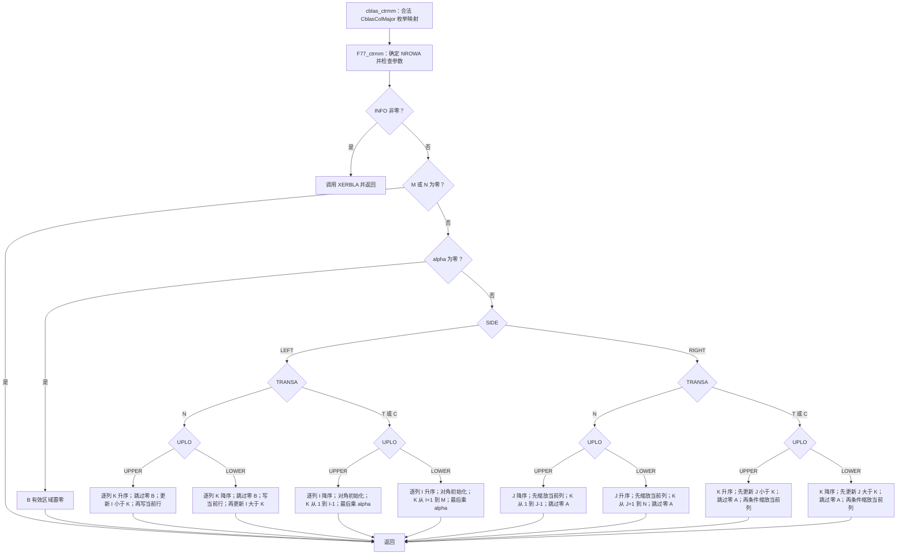
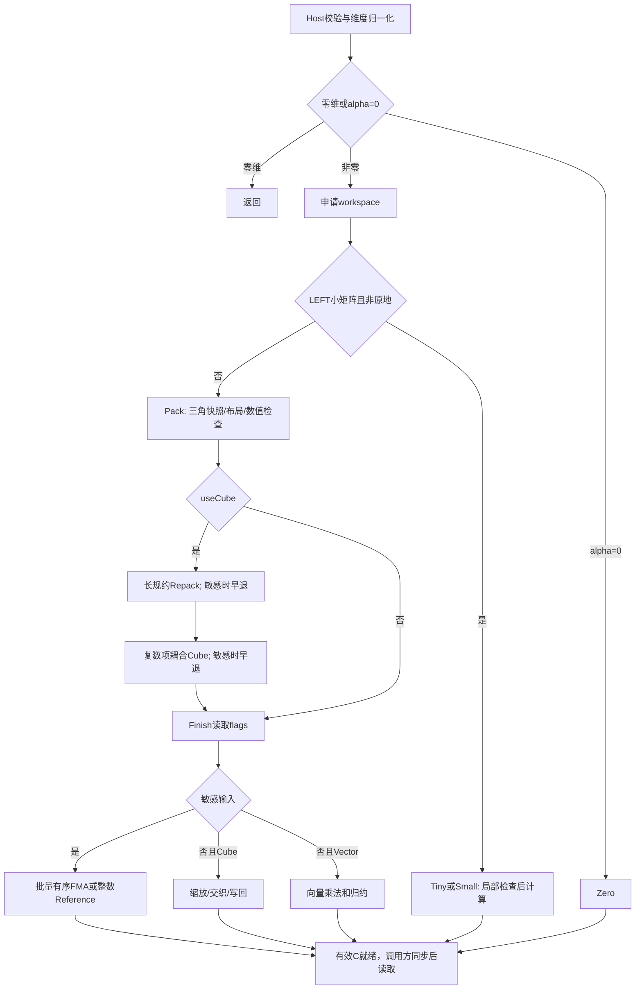

# 一、需求背景

## 1.1 需求来源

本需求对应[社区任务清单](../../../../docs/README.md)中2026年9月第71号“aclblasCtrmm算子开发（A2/A3）”，依据配套任务书：为 [ops-blas](https://gitcode.com/cann/ops-blas) 的 Atlas A2/A3 产品补齐 complex64 三角矩阵乘，完成 Ascend C Kernel 直调接口、实现和自验证，供社区评审。语义及性能标杆是 cuBLAS `cublasCtrmm`，精度 golden 是 Netlib BLAS `ctrmm`。

本设计按[社区提交说明](../../../../README.md)放在本任务 Xztxzt 目录，参考[设计模板](../../../../resources/design_template.md)，并按设计审核 Checklist 组织为五章。本次更新日期为 **2026-10-20**，关联需求 [ops-blas #549](https://gitcode.com/cann/ops-blas/issues/549)、代码 [PR #652](https://gitcode.com/cann/ops-blas/pull/652) 和已合入的初版设计 [PR #2007](https://gitcode.com/cann/cann-ops-competitions/merge_requests/2007)。任务验收通过提交为 [`7730da47`](https://gitcode.com/Xztxzt/ops-blas/commit/7730da47243d2d9bd00d2d2c04d85f5924ba924d)。后续代码整改、上板回归和 CI 冒烟的版本分别记录在 5.1，避免将初版开发快照、验收提交与当前 PR 结果混用。

当前已保存的最新完整上板回归对应 [`16ab319e`](https://gitcode.com/Xztxzt/ops-blas/commit/16ab319e7dc48ca475067bfa910ca8c05b0d9511)，于 **2026-10-20** 在独立目录重新构建并验证：A2 原始精度 1000/1000、补充测试 26/26、完整 4096 精度通过，性能 200/200 达标，内存用例 200/200 执行成功，新增 README 示例实际编译和上板运行通过。本地没有 A3 实机记录。本次文档更新引用该轮已完成的验证，不将任务验收提交、完整回归提交和线上 CI 状态混为一谈。

## 1.2 背景介绍

### 1.2.1 aclblasCtrmm 算子实现优化

这是句柄式 BLAS Kernel 直调任务，不涉及 TBE 算子迁移或 ACLNN 接口。因此模板中的 TBE 源码路径、算子信息库 JSON 路径和 ACLNN 对应文件检查不适用。以下代码路径以 PR #652 已完成本轮回归的提交 [`16ab319e`](https://gitcode.com/Xztxzt/ops-blas/tree/16ab319e7dc48ca475067bfa910ca8c05b0d9511) 为基准，属于 ops-blas 仓库，不表示已经合入上游，也不是本设计仓库内的相对链接。

| 用途 | 精确文件或一手来源 |
| --- | --- |
| 公共接口及参数契约 | include/cann_ops_blas.h（`ops-blas/include/cann_ops_blas.h`） 中 `aclblasCtrmm`；include/cann_ops_blas_common.h（`ops-blas/include/cann_ops_blas_common.h`） 中复数、枚举及状态码定义 |
| Host 校验、归一化与 workspace | blas/trmm/arch22/ctrmm_host.cpp（`ops-blas/blas/trmm/arch22/ctrmm_host.cpp`） |
| Ascend C 入口与分派 | `blas/trmm/arch22/ctrmm_kernel.cpp`；阶段实现拆分到同目录 `ctrmm_pack.h`、`ctrmm_repack.h`、`ctrmm_cube.h`、`ctrmm_finish.h`、`ctrmm_small.h` 和 `ctrmm_small_scalar.h` |
| Host/Device 参数协议、复数运算与软件舍入 | 同目录 `ctrmm_tiling_data.h`、`ctrmm_kernel_common.h`、`ctrmm_ieee.h`、`ctrmm_vector_fma.h` |
| cuBLAS 公开语义 | NVIDIA [cublas&lt;t&gt;trmm 官方文档](https://docs.nvidia.com/cuda/cublas/index.html#cublas-t-trmm)；内部实现闭源，本文不推测其 GPU 调度、布局或舍入实现 |
| 可审阅的精度参考算法 | Reference-LAPACK/lapack **v3.10.0**：[BLAS/SRC/ctrmm.f](https://github.com/Reference-LAPACK/lapack/blob/v3.10.0/BLAS/SRC/ctrmm.f)、[CBLAS/src/cblas_ctrmm.c](https://github.com/Reference-LAPACK/lapack/blob/v3.10.0/CBLAS/src/cblas_ctrmm.c) |
| golden 接入与性能基线 | ctrmm_golden.h（`ops-blas/test/trmm/ctrmm/ctrmm_golden.h`）、任务 gpu_baseline.csv（`task_submission/evidence/gpu_baseline.csv`） |

优化目标是同时满足任务精度和性能：小矩阵用单 kernel，一般矩阵先快照和整理布局，再用 FP32 Cube 耦合复数项累加；数值敏感输入保留参考算法的关键求值顺序。

应用依据包括 Netlib [CLARFB](https://www.netlib.org/lapack/lapack_routine/clarfb.f) 的块 Householder 变换、[CHEGST](https://www.netlib.org/lapack/lapack_routine/chegst.f) 的 Hermitian 广义特征值变换和 [CLAUUM](https://www.netlib.org/lapack/lapack_routine/clauum.f) 的三角因子乘积。它们直接使用复数 CTRMM，但不为矩阵分量统一规定 ±32 的上界。

大模型中也有相应的实数三角乘法结构：FLA 的 [Gated DeltaNet 块内计算](https://github.com/fla-org/flash-linear-attention/blob/40850297f9f977d7d33eb9d87fcf9a460554b553/fla/ops/gated_delta_rule/wy_fast.py) 使用三角矩阵与门控后的 K/V 相乘；[Mamba-2 SSD 最小实现](https://github.com/state-spaces/mamba/blob/e9594ce1c732d97440f0332fdc43170a2294dbfa/mamba_ssm/modules/ssd_minimal.py) 可拆出块内下三角乘法。这为训练和 prefill 的补充输入提供依据，但实际模型通常需要实数 dtype、批量和融合接口。本任务是单矩阵 complex64 接口，应用合成测试仅验证对应数值结构，没有进行模型端到端训练或推理加速测量。

### 1.2.2 aclblasCtrmm 算子现状分析

#### 1.2.2.1 标杆算子支持的数据类型和数据格式

本任务对标的是 `cublasCtrmm`，不是整个 S/D/C/Z TRMM 家族。无 TBE 信息库可核对，以下依据任务书、公有接口及上述 Netlib 源码。

| 项目 | cuBLAS Ctrmm / 本任务契约 | Netlib 精度参考 |
| --- | --- | --- |
| dtype | `cuComplex` / `aclblasComplex`，两个 FP32 分量，即 complex64、每元素 8 字节 | Fortran `COMPLEX`；CBLAS 通过 `void*` 传入同类复数数组 |
| 外部格式 | 列主序、全存储三角 A；B/C 为一般矩阵，无广播 | `ctrmm.f` 为列主序；`cblas_ctrmm.c` 还支持行主序适配，本任务仅调用 `CblasColMajor` |
| 形状 | LEFT：A 为 m×m；RIGHT：A 为 n×n；B/C 均 m×n | 相同数学维度，输出覆盖 B |
| 选择项 | side 两种 × uplo 两种 × trans 三种 × diag 两种，共 24 种 | 全部对应 L/R、U/L、N/T/C、N/U |
| 标量与存储 | 任务 alpha 在 Host，矩阵在 Device；步距以复数元素计 | alpha 和矩阵在 CPU；通过 lda/ldb 访问 |
| 结果 | 独立 C；允许 B 与 C 同地址 | 原地覆盖 B；测试先把 B 的有效元素按 ldc 复制到 golden C，再调用 CBLAS |

#### 1.2.2.2 标杆算子实现描述

TBE 实现描述不适用；本栏描述**可见的 Netlib 精度参考源码**，不将其当作 cuBLAS 内部实现。

`cblas_ctrmm.c` 在列主序分支把 side/uplo/trans/diag 映射成 Fortran 字符，将 M、N、lda、ldb 原样交给 `F77_ctrmm`。行主序分支交换 M/N，同时反转 side 和 uplo，trans 保持对应 N/T/C；这不是本测试的调用路径。枚举错误由 CBLAS 包装分支调用 `cblas_xerbla`；其中列主序非法 Diag 分支没有其他枚举分支那样的显式 `return`，不能把整个包装层描述成统一的状态码校验接口。

`ctrmm.f` 先确定 A 的阶数，再依次检查 side、uplo、trans、diag、M/N、LDA/LDB，失败调用 `XERBLA('CTRMM ',INFO)` 并返回。其前导维检查在零维 quick return **之前**。随后处理 M=0 或 N=0；再处理 alpha=0，直接将 B 的有效区域置零，不读取 A 或旧 B。其余分支如下，索引均为源码的 **1 起始**，所有 `diag=UNIT` 分支跳过对角读取和对角乘法。

| side / trans / uplo | 源码遍历顺序 | 实际求值及跳过规则 |
| --- | --- | --- |
| LEFT / N / UPPER | J=1…N；K=1…M；I=1…K−1 | B(K,J) 非零才令 TEMP=alpha·B(K,J)，先累加 B(I,J)+=TEMP·A(I,K)，再按 NON_UNIT 乘对角并写 B(K,J) |
| LEFT / N / LOWER | J=1…N；K=M…1；I=K+1…M | 同样先判断 B(K,J) 非零；先写当前行的 alpha/对角项，再用未乘对角的 TEMP 更新 I>K |
| LEFT / T 或 C / UPPER | J=1…N；I=M…1；K=1…I−1 | TEMP 从 B(I,J) 开始，按需乘对角，累加 A(K,I)·B(K,J)，最后 B(I,J)=alpha·TEMP；C 对 A 取 CONJG，无零系数跳过 |
| LEFT / T 或 C / LOWER | J=1…N；I=1…M；K=I+1…M | 同上，换为下三角可访问区；C 取 CONJG |
| RIGHT / N / UPPER | J=N…1；K=1…J−1；每次 I=1…M | 先用 TEMP=alpha（NON_UNIT 再乘 A(J,J)）缩放第 J 列；仅 A(K,J) 非零时，以 alpha·A(K,J) 乘第 K 列并累加 |
| RIGHT / N / LOWER | J=1…N；K=J+1…N；每次 I=1…M | 同上，依次处理下三角系数 |
| RIGHT / T 或 C / UPPER | K=1…N；J=1…K−1；每次 I=1…M | 非零 A(J,K) 才以 alpha·A(J,K) 更新第 J 列；C 用共轭系数。随后构造 alpha/对角缩放因子，因子不等于 1 才缩放第 K 列 |
| RIGHT / T 或 C / LOWER | K=N…1；J=K+1…N；每次 I=1…M | 同上，反向遍历 K，更新 J>K，再条件缩放当前列 |

这些循环方向确保覆盖 B 时仍能读取所需旧值。跳过零、UNIT 恒等操作、alpha 的乘法位置影响 Inf/NaN 传播和浮点舍入；数学表达相同不等于任意重排均具有相同数值行为。Fortran 源码本身不规定编译后使用哪条机器 FMA 指令，实际 golden 还由链接的库和编译平台决定。

#### 1.2.2.3 标杆算子实现流程图

下图对应 `ctrmm.f` 的可见控制流；入口选取本任务使用的合法 CBLAS 列主序包装。每个计算叶节点均按上一表处理 UNIT/NON_UNIT，T/C 的区别仅在 A 是否取共轭。TBE 流程图不适用，cuBLAS 闭源内部流程不画。



# 二、需求分析

## 2.1 外部组件依赖

| 组件 | 当前用途及已验证范围 |
| --- | --- |
| CANN 9.1.0 / Ascend C / ACL Runtime | 编译 arch22 kernel；分配 Device 内存；通过 stream 下发和同步；查询 AIV/AIC 数量 |
| ops-tensor 及 tensor_api | 沿用 ops-blas CMake 工程依赖，实际版本见下文；当前实现没有调用 CATLASS 高层模板 |
| Netlib BLAS 3.10.0 发行版目标码 | GTest 的 CPU golden 使用 `lapack-devel-3.10.0-5.oe2203sp4.aarch64` 中 `/usr/lib64/libblas.a`，重建 CBLAS 参数封装，显式指定 `REFBLAS_LIB` 和 `REFBLAS_INCLUDE_DIR` |
| GTest 1.11.0 / CMake 3.22.1 | CSV 驱动和补充测试，仓库正常集成构建 |
| msprof / Python 报告脚本 | 已有性能采样、逐调用 kernel 分组和结果汇总；不是生产调用依赖 |
| cuBLAS 基线 | 使用任务提供的 200 行 GPU 实测 CSV；NPU 执行不依赖 CUDA/cuBLAS 库 |

具体版本以 versions.json（`task_submission/evidence/versions.json`） 和 自验证步骤说明（`task_submission/1 自验证步骤说明.md`） 为准：ops-blas 基础提交 `146a5771f9be8be4bb73609e6cd56a60bf664ab4`，ops-tensor `c1326e7a7fb30536dc3517ac40e06935aba5e88d`，tensor_api `ad3d3bf04dddfb94370c534c39bdd305d8e38d88`。保存的上游 v3.10.0 源码用于审阅算法，不冒充发行版二进制的构建产物或反汇编。

上板容器仍为 **Ubuntu 22.04.5 aarch64**。参考库来自 [openEuler 22.03 LTS SP4 官方发行包](https://repo.openeuler.org/openEuler-22.03-LTS-SP4/OS/aarch64/Packages/lapack-devel-3.10.0-5.oe2203sp4.aarch64.rpm)，包内 Fortran 对象由 GCC 10.3.1 编译。CBLAS 头文件复用 Ubuntu Netlib 3.10.0-2ubuntu1 的兼容声明，数值计算来自发行包目标码；不把容器系统、头文件来源与 golden 实现混为一谈。

本地封装库 `libnetlib_ctrmm_openeuler.so` 的 SHA256 为 `30140ca70adda7eb91ff0eab1343d713119520b8ae4811a4f8c4f876097633f6`，已用动态符号绑定记录确认 `cblas_ctrmm` 实际解析到该库。验收方给出的原封装库哈希为 `f7a40cc860792a6ef512ab3b75fa6a45802736d4baaea84084a459ba99626c40`，本地未取得该原始文件；两者封装二进制不同，不宣称二进制同一。构建来源和绑定证据保存在交付件 `evidence/reference/` 与 `evidence/reference-binding-evidence.txt`。

## 2.2 内部适配模块

| 模块 | 职责与边界 |
| --- | --- |
| `cann_ops_blas.h` / `cann_ops_blas_common.h` | 公开 Ctrmm 签名，复用库内句柄、complex64、枚举、错误码 |
| aclblas_auxiliary.cpp（`ops-blas/blas/common/helper/aclblas_auxiliary.cpp`） | 创建/销毁句柄、绑定 stream、设置用户 workspace |
| aclblas_handle_internal.h（`ops-blas/blas/common/helper/aclblas_handle_internal.h`） | `EnsureDefaultWorkspace`、`GetEffectiveWorkspace`、内存所有权和扩容同步 |
| host_utils.h（`ops-blas/blas/common/helper/host_utils.h`） | `GetAivCoreCount` / `GetAicCoreCount`；Ctrmm 没有调用 `CheckPtrLocation`，alpha 必须按契约传 Host 指针 |
| `ctrmm_host.cpp` / `ctrmm_tiling_data.h` | 校验、归一化、workspace 计算；按值传递 `CtrmmTiling` |
| `ctrmm_kernel.cpp` / `ctrmm_tiling_data.h` | Kernel 入口、阶段调度及 Host/Device 按值参数协议 |
| `ctrmm_pack.h` / `ctrmm_input_check.h` / `ctrmm_repack.h` | 输入快照、三角及 UNIT 处理、数值范围/相关度检查和 Cube 布局转换 |
| `ctrmm_cube.h` | L1/L0 双缓冲、复数项耦合与分支规约顺序 |
| `ctrmm_finish.h` / `ctrmm_finish_layout.h` / `ctrmm_vector_fma.h` | 输出布局、Vector、有序参考路径及批量浮点 FMA |
| `ctrmm_small.h` / `ctrmm_small_scalar.h` | Small/Tiny 单 Kernel 及局部精度风险处理 |
| `ctrmm_kernel_common.h` / `ctrmm_ieee.h` | 公共数据搬运辅助、复数乘法特殊值行为和整数软件 IEEE FMA |
| test/trmm/ctrmm/CMakeLists.txt（`ops-blas/test/trmm/ctrmm/CMakeLists.txt`） | 通过 `ops_blas_add_gtest_tests` 接入仓库测试；参数解析、golden、Device buffer 和 GTest 分文件维护 |
| `ctrmm_arch22_test.h` / `ctrmm_test_inputs.h` / `ctrmm_test.cpp` | 测试夹具及比较器、补充输入构造、CSV 注册与 26 项补充 GTest |

## 2.3 需求模块设计

### 2.3.1 Ascend C 算子原型

公开入口与 《aclblasCtrmm_A2A3 任务书》 一致：

```cpp
aclblasStatus_t aclblasCtrmm(
    aclblasHandle_t handle, aclblasSideMode_t side, aclblasFillMode_t uplo,
    aclblasOperation_t trans, aclblasDiagType_t diag, int m, int n,
    const aclblasComplex* alpha, const aclblasComplex* A, int lda,
    const aclblasComplex* B, int ldb, aclblasComplex* C, int ldc);
```

令 A 为由 uplo/diag 解释后的三角矩阵：

- LEFT：`C = alpha · op(A) · B`，A 阶数 q=m；RIGHT：`C = alpha · B · op(A)`，q=n。
- N：`op(A)=A`；T：`op(A)=Aᵀ`；C：`op(A)=Aᴴ=conj(Aᵀ)`。复共轭只对虚部取负，不能把 C 当作普通转置。
- 列主序元素地址为 `A[i+j*lda]`、`B[i+j*ldb]`、`C[i+j*ldc]`；步距单位是复数元素。非空时 `lda>=q`，`ldb>=m`，`ldc>=m`。
- UPPER 仅引用原始 A 的 i≤j，LOWER 仅引用 i≥j。UNIT 再排除 i=j，对角直接解释为 `1+0i`；NON_UNIT 读取对角且允许为零。本算子是乘法，不做三角求解、除法或奇异性检查。

下面 12 行每行分别包含 NON_UNIT 和 UNIT 两种模式，明确覆盖全部 **24 种组合**。有效三角栏描述 `op(A)`，物理读取仍受原始 uplo 限制。

| side | uplo | trans | op(A) | op(A) 有效三角 | NON_UNIT / UNIT |
| --- | --- | --- | --- | --- | --- |
| LEFT | UPPER | N | A | 上三角 | 读取 A 对角 / 不读并补 1 |
| LEFT | UPPER | T | Aᵀ | 下三角 | 读取 A 对角 / 不读并补 1 |
| LEFT | UPPER | C | Aᴴ | 下三角 | 读取并共轭对角 / 不读并补 1 |
| LEFT | LOWER | N | A | 下三角 | 读取 A 对角 / 不读并补 1 |
| LEFT | LOWER | T | Aᵀ | 上三角 | 读取 A 对角 / 不读并补 1 |
| LEFT | LOWER | C | Aᴴ | 上三角 | 读取并共轭对角 / 不读并补 1 |
| RIGHT | UPPER | N | A | 上三角 | 读取 A 对角 / 不读并补 1 |
| RIGHT | UPPER | T | Aᵀ | 下三角 | 读取 A 对角 / 不读并补 1 |
| RIGHT | UPPER | C | Aᴴ | 下三角 | 读取并共轭对角 / 不读并补 1 |
| RIGHT | LOWER | N | A | 下三角 | 读取 A 对角 / 不读并补 1 |
| RIGHT | LOWER | T | Aᵀ | 上三角 | 读取 A 对角 / 不读并补 1 |
| RIGHT | LOWER | C | Aᴴ | 上三角 | 读取并共轭对角 / 不读并补 1 |

### 2.3.1 Ascend C 算子相关约束

本栏沿用 Checklist 对“相关约束”的编号。任务范围内支持上述 24 种模式、独立 C、B=C、前导维 padding 和合法地址偏移。与 cuBLAS 相比，当前入口仅接收 Host alpha 和 32 位 `int` 维度，不提供 Device pointer mode 或独立的 64 位整数接口；不包含批量/跨批步距接口。与 CBLAS 包装相比，不提供显式 row-major 参数；不支持超出 lda/ldb/ldc 语义的任意 strides、广播或框架 Tensor 视图，这些均非本任务要求。

任务测试 `README.md` 的概要写作“不允许 C 与 A/B 重叠”，而任务书 §2.5 明确允许 B≡C；当前实现及补充测试按后者执行。B=C 时即使 ldb≠ldc 也先快照 B，但调用方必须分配能覆盖两种步距的完整缓冲区。C 与 A 重叠、C 与 B 非同址的部分重叠均拒绝；只读的 A/B 之间没有 Host 重叠检查，不据此推导额外的 cuBLAS 重叠承诺。

`m=0` 或 `n=0` 在基础参数校验后直接成功，允许 ld=0、矩阵指针为空；alpha 指针仍不可为空。非空 `alpha=(0,0)` 仍要求合法 ld 和非空 C，但不读取 A/B、允许 A/B 为 nullptr。异步与错误返回的精确边界见 3.1 和 3.4。

# 三、需求详细设计

## 3.1 调用方式

调用方初始化 ACL/设备，创建 `aclblasHandle_t`，通过 `aclblasSetStream` 绑定 stream，准备 Host alpha 和 Device A/B/C，调用 `aclblasCtrmm`，读回结果或释放相关内存前同步该 stream。生产入口由 Host 直接执行 `ctrmm_kernel_do(..., CtrmmTiling, stream)`，不经过 ACLNN 两阶段 executor、TBE 注册或 PyTorch 调度。

依据 aclblas_auxiliary.cpp（`ops-blas/blas/common/helper/aclblas_auxiliary.cpp`） 与 aclblas_handle_internal.h（`ops-blas/blas/common/helper/aclblas_handle_internal.h`）：`aclblasCreate` 预分配 32 MiB 库 workspace。`EnsureDefaultWorkspace` 在容量足够时直接返回；首次 Ctrmm 调用若超过该容量，或后续调用需要扩容，会先同步句柄 stream，再释放/分配。若库 workspace 尚未分配，申请也经过该同步分支。因此“stream 异步”指容量足够时的正常 kernel 下发，不承诺首次大矩阵调用或扩容完全异步。

库扩容容量为 `min(max(required, old>0 ? 2*old : 32 MiB), 2 GiB)`；用户 workspace 容量不足返回 `ACLBLAS_STATUS_ALLOC_FAILED`，不会替用户扩容。`aclblasSetStream` 会同步旧流并恢复库 workspace；`aclblasSetWorkspace` 生效时、销毁句柄时也有同步。alpha 被 Host 读入按值 tiling；A/B/C 和有效 workspace 必须活到对应 stream 完成。Host 返回 SUCCESS 表示已完成校验/下发，不保证异步设备执行成功，调用方须检查后续 ACL 同步结果。

## 3.2 需求总体设计

### 3.2.1 host侧设计

Host 先校验 handle、枚举、非负维度和非空 alpha 指针，零维直接返回；非零维再校验 ld、C 和输出地址跨度，构造 tiling 并查询 AIV 核数。alpha=0 只清零 C；非零 alpha 继续检查 A/B 指针、地址跨度和重叠，配置并申请 workspace，然后在 handle 的 stream 上顺序下发 kernel。B=C 通过先快照输入支持，部分重叠拒绝。

2026-10-20 的评审整改提交 `16ab319e` 在失败路径补充 8 处 `OP_LOGE`，记录非法参数、矩阵存储、AIV 核数及 workspace 问题，保持返回码和上述判断顺序。该提交已完成正式 CANN 构建、完整 A2 回归及新增 README 示例实机运行，版本与结果列于 5.1。

归一化为 `Y=alpha*T*X`：LEFT 时 q=m、r=n、T=op(A)、X=B；RIGHT 时 q=n、r=m、T=op(A)^T、X=B^T。`transpose=(trans!=N) XOR right`，`upper=(uplo==UPPER) XOR transpose`，共轭单独保留。原始 trans 用于恢复 Netlib 对应分支的求值顺序。外部均为列主序 complex64，ld 按复数元素计。

#### 3.2.1.1 分核策略

核数来自运行时平台信息，不写死 40 AIV/20 AIC。常规任务按 blockIdx、blockNum 轮转；每个 Cube 输出块的 K 规约由一个核完成，没有跨核原子累加。

| 阶段 | 分核和分块 |
| --- | --- |
| Zero | 每任务清零同一列最多1024个复数，启动V个AIV |
| Tiny | LEFT、q/r≤2、B≠C，一个AIV完成 |
| Small | LEFT、q/r≤128、B≠C；Q=8/16/32/64/128；Q=8每块两行，其余四行；独立列块宽8/8/16/32/32 |
| Pack A | q≤256时四行一组；其他按行、每段最多1024项；只读有效三角，UNIT对角直接补1 |
| Pack B | LEFT64×128；RIGHT按形状用16×128、32×256或64×128，尾部补零 |
| Repack | q>256的Cube路径，将A变为逐复数项布局，按连续段分核 |
| Cube | M最大128、N通常128个复数输出；q在129至256且原tile数不超过H/2时采用N=64，以增加同一轮可用核数 |
| Finish | 普通Cube按输出矩形分核；LEFT用原生FP32转置写回复数列主序；短q长r的RIGHT使用8×256写回块，其他32×128 |
| Vector / 整数Reference | 每任务负责一个输出行及最多1024个独立输出列 |
| 批量有序FMA | 每任务负责一个输出行、64个RHS位置，每批16个K项；实/虚FMA合并，最后按K顺序相加 |

Cube的M最多128，尾部按16行对齐裁剪；K范围向128槽批次边界取整。GM输入按qp补齐，超出有效三角与实际维度的系数由Pack置零。具体源文件中的分块条件是通用布局条件，不读取用例编号、seed或测试模式。

#### 3.2.1.2 数据分块和内存优化策略

记 `qp=ceil_64(q)`、`rp=ceil_128(r)`、`AP=qp*qp`、`XP=qp*rp`，下列偏移以float元素计。

| Cube workspace 区域 | 起始偏移 | 长度 |
| --- | ---: | ---: |
| A实部、虚部快照 | 0、AP | 各AP |
| 保留区 | 2AP | 2XP |
| A计算布局 | 2AP+2XP | 预留8AP，q≤256实际用2AP |
| B实部计算布局 `[br,-bi]` | 10AP+2XP | 2XP |
| B虚部计算布局 `[bi,br]` | 10AP+4XP | 2XP |
| 输出实部、虚部 | 10AP+6XP、10AP+7XP | 各XP |
| 分离的对角项 | 10AP+8XP | 1024*qp |
| flags | 10AP+8XP+1024*qp | 预留8V，实际写连续V个uint32 |

因此Cube请求量为 `4*(10AP+8XP+1024*qp+8V)` 字节；非Cube为 `4*(2AP+4XP+8V)`。B的两份计算布局包含原始实、虚分量，Reference复用它们，不再保存第三份B。所有路径申请量均按Host实际值报告；Small/Tiny虽不使用GM workspace，Host仍会先申请。只有零维和alpha=0不提出本次workspace请求。超出库的2GiB workspace上限返回ALLOC_FAILED。

一般矩阵用完整Pack快照隔离B=C的读写依赖。非有限或数值敏感输入仍占同样workspace；不能把Cube早退理解为没有Pack或workspace开销。

Cube使用L1和L0双缓冲，N=128时L1显式地址范围384KiB、L0A最多32KiB、L0B最多64KiB、L0C最多128KiB；N=64时分别为256/32/32/64KiB。每个L1批次128槽、每组L0载入32槽；两份L1批次与两组L0载入交替，保留每个输出的累加顺序。A的GM布局按每个复数2或8槽存放；B只在GM保留有效的两行，在L1填入需要的间隔，避免大矩阵B的八倍展开。

Pack的UB为188KiB。RIGHT短规约按qp=64/128选择编译期固定的打包模板，使向量重复次数和索引范围在编译时确定；仍按实际q裁剪有效三角。范围比较的mask跨所有块按位合并，在结束时统一归约；尾部mask对应的输入先补零，不让未初始化数据影响分流。A的实、虚数据和展开布局通过同一UB快照复用，输出数据不与存活索引重叠。普通短规约RIGHT的专用Finish使用64KiB UB，矩形大小固定为2048个复数位置，宽128或256；其他普通矩形缓冲160KiB，整数Reference约104KiB，批量有序FMA为171KiB。flags直接从GM读取并合并。Small最大Q=128时显式UB小于192KiB。这些是显式缓冲申请量，不把编译器栈或GM空间混入UB。

事件依赖覆盖MTE2→V、V→MTE3、MTE3→V、V→MTE2，以及Cube的MTE2→MTE1、MTE1→M、M→MTE1、MTE1→MTE2、M→FIX、FIX→M。raw UB下一次搬入前显式等待上一轮向量读取；最后一次Fixpipe事件也被消费。kernel之间的同stream顺序是跨核数据及flags可见的边界，没有跨核自旋同步。

#### 3.2.1.3 tilingKey规划策略

本实现是Kernel直调，没有框架TilingKey。分派顺序为Zero→Tiny→Small→一般Pack路径。一般路径仅在q≥64、r≥16且存在AIC时启用Cube；q>256额外下发Repack。最后统一Finish。敏感时Cube/Repack检查flags后返回，Finish按浮点FMA适用域执行批量有序计算或整数Reference。LEFT小矩阵的敏感判断和Reference在同一个Small kernel内完成。

Tiling包含逻辑维度与ld、q/r及padding、side/transpose/conjugate/upper/unit、原始trans、AIV/AIC核数、alpha实虚部、输入范围界限，以及AP/XP/flags偏移。没有用于识别公开测试集的字段。

### 3.2.2 kernel侧设计

#### 3.2.2.1 kernel侧实现描述

**主要数值改变。** 旧四平面算法先完成 `RR=sum(ar*br)`、`II=sum(ai*bi)` 再做RR-II；长规约中，大平面的独立舍入会放大相消误差。当前Cube把A的 `[ar,ai]` 与B的 `[br,-bi]`、`[bi,br]` 配对，在长累加前组合复数项。q≤256每次最多4个复数项，q>256每次1项。关闭HF32，不改为FP16，也不使用三乘法复数重排。

K方向按Netlib分支选择：归一化下三角，且LEFT+N或RIGHT+T/C时反向累加；其他正向。若对角项本来不会最先访问，先用独立对角布局初始化输出，再处理非对角项。对角初始化采用每项两槽的紧凑布局，完成后重新清零L1间隔；自然首先访问对角的分支省略该重复准备。这减少与FP32 golden的顺序差异，不等同于逐位复现所有Netlib指令。

**数值分流。** alpha的实虚绝对值之和超过8、有效输入任一分量超过范围界限、Inf/NaN触发有序分支（Inf/NaN使用整数Reference）；范围界限在129≤q≤256的分组计算路径为16，其他为32；等于界限仍可走普通路径。这些都是实现的路由参数，不是公共输入限制；分组规约使用较低幅度界限以减少舍入误差。另检查A系数块的实虚向量相关程度：

`rho2 = (sum(ar*ai))^2 / (sum(ar^2)*sum(ai^2))`。

两范数非零且rho2≥0.999时，视为近共线系数，使用有序分支。这是未中心化的归一化内积平方，不是减均值后的统计相关系数。它针对乘积相消的数值条件，与输入幅度检查配合；检查块的有效项数和padding单独处理，避免只含一个有效系数的尾块被误判为长规约风险。

这些检查是通用风险指标，**不构成全部FP32输入均满足混合容差的数学证明**。精度结论限定于保存的任务用例和独立专项；后续新增数值分布仍需回归。相消可以由多种结构产生，不能把某个指标未触发解释成相消绝不发生。

有序分支保留原始side/trans分支的alpha乘法位置、UNIT恒等操作、零跳过及正反向规约。通用Pack/Finish路径对域内实alpha输入采用批量浮点软件FMA；域外及非实数alpha保留整数Reference。Small仍采用原有Reference。相同 shape 换成不同分布须单独计时，任务性能结论的适用范围见 5.1。

Small把最多128阶问题放入UB，用向量乘法及归约计算；Q=128跳过三角外的64项半区。alpha=1时归约直接写入最终AoS的UB位置，省掉一次交织。Small也保留范围及相关度检查，敏感输入走分支一致的Reference。

**批量有序 FMA 与短规约。** Pack/Finish 的批量浮点 FMA 仅用于实 alpha 且 `2^-8 <= |alpha| <= 2^8`、有效 A/B 分量为零或 `2^-24 <= |x| <= 2^16` 的输入。每批处理 16 个 K 项、64 个 RHS 位置，用 Dekker 乘积拆分、TwoSum 和中点修正实现关键舍入，随后逐 K 顺序累加；域外输入使用整数软件 FMA。这个范围用于选择实现，不限制公共接口。q<16 的通用路径采用有序计算；Tiny 对 q<=2 的短计算根据绝对乘积和估算误差，检查混合容差及内部 0.009 绝对界限，不能满足时重算。Small 的敏感路径仍使用整数 Reference。

**非有限值传播修复。** `ComplexProduct` 的乘一快捷路径仅在另一操作数的两个分量均有限时生效。遇到 Inf/NaN，保留复数乘法中的 `0*Inf` 等 IEEE 无效运算；出现 NaN 时使用 `ac-bd`、`ad+bc` 的分量结果，不采用将 NaN 恢复为无穷的 `__mulsc3` 风格修正。例如 `(1+0i)*(Inf+Inf*i)` 不能直接返回输入，否则会省略产生 NaN 的乘法。该修复位于已验收提交 `7730da47`，后续拆分到 `ctrmm_kernel_common.h`，用于对齐指定 Netlib 发行版目标码的实测行为，不是改用 FP64。

`TC_FL_119` 为 LEFT/LOWER/N/NON_UNIT、32×32、alpha=1，B 的实虚分量均为 Inf。修复后的实虚输出均与 golden 的 NaN 分类匹配，`specialMismatch=0`。另增加 576 组非有限值回归，覆盖短矩阵与 Pack/Finish 路径，详细计数见 5.1。


**验收口径。** 允许误差而不要求逐位相等。实、虚分别检查混合容差通过比例≥99%，并同时检查最大误差上限。补充相消测试亦使用同一判定，不因相消降低要求。日志同时保留固定0.01超限数量和任务引用的32ULP分支，便于复核。

#### 3.2.2.2 Ascend C实现流程图



#### 3.2.2.3 Ascend C实现流程图与标杆算子流程图存在的差异点和原因

可比较的参考实现是Netlib v3.10.0；cuBLAS内部实现不可见，仅使用其公共契约及任务提供的性能CSV。Netlib原地逐步更新B，当前通过Pack快照把独立输出分配给多个核。普通路径使用Cube或向量归约并通常在规约后缩放；Reference恢复关键分支顺序。布局转换及workspace换取并行性，Tiny/Small则减少启动与搬运。

两者数学定义相同但普通路径的FP32舍入顺序并不完全相同。因此以任务容差实测验收，不声称严格逐位等价；非有限值、UNIT及零跳过另做语义测试。任务CSV规定零维可在ld检查前返回，这也与Netlib的参数检查顺序有明确差异。


## 3.3 支持硬件

| 产品 | 设计/工程适配 | 已有实机证据 |
| --- | --- | --- |
| Atlas A2 系列（含 Atlas 800T / 800I A2） | arch22 Ascend C | **Atlas 800T A2 910B3，CANN 9.1.0**；AIV=40、AIC=20 |
| Atlas A3 系列（含 Atlas 800I A3） | 同一 arch22 实现，目标支持 | **尚未实机验证**，不得由 A2 结果推定 A3 精度或性能通过 |

任务目标为 A2/A3；上述实现采用共同 arch22 路径。本设计将任务方已反馈的提交验收状态与本地硬件覆盖分开记录：`7730da47` 已通过任务验收，但本地自验证材料仅覆盖 A2，未保存 A3 实机数据，不据 A2 自测推导 A3 的具体精度或时延。环境依据为已验收交付件 `task_submission/evidence/versions.json` 及本轮 `validation/pr-review-verify-20261020/results/final/environment.log`。

## 3.4 算子约束限制

| 条件 | 当前实际行为 / 使用要求 |
| --- | --- |
| handle 为空 | `ACLBLAS_STATUS_HANDLE_IS_NULLPTR`；非空但无效的悬空指针不在可校验范围内 |
| 非法枚举、负维度、alpha 为空 | `ACLBLAS_STATUS_INVALID_VALUE`，即使另一维为零也先报错 |
| 零维 | 上述检查后 SUCCESS，不读取 alpha 的值，不检查 ld/矩阵指针，不下发 |
| 非空调用 | ld 必须合法，C 必须非空；有效区域跨度必须可表示 |
| alpha=0 | 只清零 C 的 m×n；不读 A/B，不检查其空指针/重叠；保留 C 的 padding 和 guard |
| alpha 非零 | A/B 必须非空；禁止 C/A 重叠及 B≠C 时 C/B 重叠 |
| 重叠检测 | `MatrixBytes(rows,cols,ld)=8*((cols-1)*ld+rows)`，按连续地址跨度检测，含中间列间 padding，可能保守拒绝“仅空隙重叠”的布局；不是逐个有效三角元素检测 |
| 原地 | 仅 B=C 免除 B/C 重叠拒绝，不要求 ldb=ldc；禁止 Small/Tiny，借 Pack 快照保证输入完整 |
| 格式与地址 | 仅 complex64 列主序、全存储 A；允许 ld padding 和合法元素偏移，已有 8 字节偏移验证；不承诺任意字节错位指针、越界分配或任意 strides |
| 超大 ld | 部分 DMA 跨度字段为 uint32；当前不覆盖 `(ld-span)*8 > UINT32_MAX` 的搬运范围，Host 跨度校验通过不代表该范围已适配 |
| workspace / 核数 | 请求超过 2 GiB、分配失败、用户容量不足均 ALLOC_FAILED；AIV 数为 0 报 INTERNAL_ERROR；AIC 数为 0 回退 Vector |
| 数值与性能 | 重排 FP32 路径不保证与 Netlib 逐位匹配；敏感/非有限参考分支可能显著较慢，性能通过仅针对已测分布和用例 |
| 异步错误 | `ctrmm_kernel_do` 无逐 kernel 返回码透传，SUCCESS 不是设备完成凭据；同步/读回错误由 ACL 调用方观察 |

不对 A/B/C 的实际分配长度、Device 归属或用户 workspace 与矩阵的重叠做完整运行时探测，调用方须满足内存契约。支持维度由正 `int` 范围、Host 溢出防护、workspace 容量及设备可用内存共同限制；已测原始精度尺寸至 2048，另补 4096 完整严格精度；性能尺寸至 4096，不能据此称所有可表示尺寸均经过验证。

# 四、特性交叉分析

该实现的主要交叉点是公共句柄资源、复数三角语义、异步执行和精度/吞吐取舍。没有接入 ACLNN、GE 图算子注册、广播或自动求导，不能借用这些框架的内存规划、别名检查或调度保证。

| 交叉特性 | 相互影响与实现处理 | 验证证据 / 剩余边界 |
| --- | --- | --- |
| side × trans × uplo × diag | RIGHT 改变内部转置标志；C 独立保留共轭标志；三角在归一化后翻转；UNIT 禁读原始对角 | 原始 24 组基础用例及 `SensitiveBranchCombinations`；不能仅用 LEFT+N 代表全组合 |
| UNIT / 三角禁读 × NaN/Inf | 无效区和 UNIT 对角可以存放 NaN；先裁剪再搬入。按 Netlib 分支跳过 UNIT 对角乘法；其他实际复数乘法不能因某个系数为 1 就删除非有限操作数的 0×Inf | 无效 A 区域填 NaN，特殊分量必须全部匹配；TC_FL_119 和 576 组非有限值回归验证该区别 |
| alpha=0 × 空指针 × padding | 允许 A/B=null；只写 C 有效区域，仍检查 ld/C；原 workspace 保留但不使用 | 原始 alpha0 用例和 `AlphaZeroPreservesPadding`；不得通过读取 A/B 决定 Zero 分派 |
| 原地 × 多核 × 不同前导维 | Small 不快照整个 B，故 B=C 强制 Pack；一般路径在写 C 前完成所有读 B；ldc 可以不同于 ldb | `InPlaceOffsetAndPadding` 覆盖 24 组及两种 ldc；调用方保证底层容量覆盖最大步距 |
| offset / 尾块 × 写出所有权 | Small 每块连续两行或四行，其他路径按输出 tile 独占；DataCopyPad 按有效跨度写出，不能覆写 padding/guard | `SmallTileOffsetAndPadding` 含 7×8 的双行尾块、31×33 的 Q 跨档、普通/单位 alpha 及 8 字节偏移；测试不等于任意错位地址保证 |
| stream × handle workspace 复用 | 同一流Pack→可选Repack→Cube→Finish有序；每次 Pack 的所有 AIV 都重新写 flags，敏感调用不会污染下一次普通调用；tiling 按值传递 | `QueuedCallsShareWorkspace` 中两次调用间无 Host 同步；仅覆盖同句柄同流顺序调用，不证明共享 workspace 的跨流并发安全 |
| workspace × 其他 BLAS 调用 | 同句柄使用一个 active workspace，历史大容量可能保留；切换流/设置 workspace/销毁有同步及所有权规则 | 复用公共 helper，不修改其 ABI；多线程并发修改同一句柄、多个句柄共享同一用户 workspace 需由调用方隔离 |
| Cube × 精度 × 数值分流 | FP32 复数项耦合、关闭 HF32；由 alpha 范数、分量范围与系数相关度触发参考分支 | 完整 4096、独立相消及阈值专项已在 16ab319e 对应回归中通过；风险指标不构成所有输入的精度证明 |
| kernel 生命周期 × 连续调用 | CO1 在 M→FIX 完成后复用，并等待末次 FIX_M；Finish 复用 UB 前有明确事件 | 连续调用补充测试和完整 profiler 采样支持现有场景；改动事件顺序需回归，不视为纯性能重构 |
| A2/A3 × 分块资源 | 核数从平台获取，但 UB/L1/L0 分块是固定设计；特别是 N=128 使用更大的 L0B/L0C | A2 有实机证据，A3 的资源约束、编译及运行结果仍需独立确认 |

# 五、可维可测分析

## 5.1 精度标准/性能标准

任务书 §3.1、§3.2 指定 Netlib 单精度 `cblas_ctrmm` 为精度 golden，允许容差，不要求所有有限输出逐位相等。按任务方对 TC_FL_119 的答复，任务包用例含特殊值均使用这个单标杆；§3.5 的 cuBLAS 行为要求面向自行补充用例。若特殊值行为冲突，任务判分仍以 Netlib 为准。本地补充特殊值测试验证的是 Netlib 行为，没有另行完成 cuBLAS 特殊值对照。

| 项目 | 判定与采集口径 |
| --- | --- |
| golden | 2.1 所列 openEuler 发行包目标码重建的 CBLAS 封装，逐元素检查完整有效 C，并核对动态符号绑定 |
| 混合容差 | 实部、虚部分别检查 `abs(actual-golden) <= 2^-13*(1+abs(golden))`，各自匹配比例至少 99% |
| 最大误差 | 同时满足 `max_abs <= max(0.01,32*ULP(g_low))`；g_low 为该分量最大绝对误差位置的 FP32 golden，同误差点取较小 ULP |
| 标准来源 | 任务引用的 [opbase 混合容差标准](https://gitcode.com/cann/opbase/blob/dcdd10634671a961b6aee09776d1aa20091e6386/docs/zh/ops_precision_standard/mixed_tolerance_standard.md)，冻结提交 dcdd10634671a961b6aee09776d1aa20091e6386 |
| 特殊值 | NaN 对 NaN、Inf 对同号 Inf；`specialMismatch` 必须为 0，不能用 99% 比例豁免特殊分量不匹配 |
| 存储正确性 | 精度测试检查 C padding 和前后 guard，禁止读取的 A 区域及 UNIT 对角填 NaN |
| 性能 | 200 条逐项对应任务 GPU 基线；`kernel_mean_us <= gpu_ms*1000/0.8`，不增加额外性能门槛 |
| 采样 | 普通 msprof task-based，5 次预热、11 次有效调用；每次调用的全部 Kernel 时长求和，再取 11 次均值；同一完整轮次，不拼接最优样本 |
| 内存 | 原 200 条性能尺寸独立执行，记录矩阵、保护区和 workspace 分配及设备空闲量；任务不设独立内存限额 |

32 ULP 分支来自任务引用标准；日志另外保留每个分量超过固定 0.01 的数量。原始精度集和完整 4096 均满足固定 0.01，补充大幅值测试可能按 ULP 上限通过，不能把全部补充测试解释为误差都小于 0.01。`CTRMM_CHECK_EXACT` 是额外诊断选项，不改变默认任务判定。

**代码版本与验证范围。**

| 版本 / 日期 | 变更范围 | 可引用的证据与边界 |
| --- | --- | --- |
| [7730da47](https://gitcode.com/Xztxzt/ops-blas/commit/7730da47243d2d9bd00d2d2c04d85f5924ba924d)，2026-10-14 | Inf/NaN 传播修复及 576 组补充回归 | 已通过社区任务验收的提交；交付件 task_submission 保存对应源码及自测记录 |
| [8c2e4f18](https://gitcode.com/Xztxzt/ops-blas/commit/8c2e4f18216dcfbfb0c8dfdc17a1d8ae0a26f1e8)，2026-10-16 | CI 整改：Kernel/Host/IEEE 辅助函数拆分、显式除数检查、比较器及输入构造整理 | 历史完整 A2 回归：精度 1000/1000、补充 26/26、4096 精度通过、性能 200/200、内存执行 200/200；原始记录独立保留 |
| [a4eb355c](https://gitcode.com/Xztxzt/ops-blas/commit/a4eb355c153d0241e068154e5cfb9ce5efe1f84c)，2026-10-16 | 测试计时的 `repeats<=0` 等价改为 `repeats==0` 或 `repeats<0` | 增量构建、Event 计时 3/3 和 TC_FL_119 通过；库二进制哈希不变；未另跑 1000/200 全量 |
| [70529925](https://gitcode.com/Xztxzt/ops-blas/commit/705299258f6badedac73fe1d953b701abceda43d)，2026-10-17 | 后续 CI 算子选择、工作区 Git 读取和浅克隆基线处理；补充测试 README | 历史 CI 通过提交；14 个算子实现文件与 8c2e4f18 相同；[流水线](https://gitcode.com/cann/ops-blas/actions/runs/7372f0fe2cf247968ee3ffc1da145a01)通过，CTRMM 冒烟 137 项；不将冒烟计为新的完整回归 |
| [16ab319e](https://gitcode.com/Xztxzt/ops-blas/commit/16ab319e7dc48ca475067bfa910ca8c05b0d9511)，2026-10-20 | Host 失败分支加 OP_LOGE、README 模板及示例、版权声明 | 正式 CANN 构建、原始精度 1000/1000、补充 26/26、TC_FL_119、4096 完整精度、性能 200/200、内存执行 200/200 和 README 示例均通过；以下最新实测数值取自该轮 |

本轮由 `git archive 16ab319e7dc48ca475067bfa910ca8c05b0d9511` 导出源码，在独立目录重新配置和构建；散列清单中的 1363 个文件均通过 SHA256 校验。`libops_blas.so` SHA256 为 `9ddca02218b12dbb745ab7d1f77586981593821ed99cc752efff9e99bde3581a`，`ctrmm_test` 为 `7b9e7f4421db6debd8df430dab8a6cfe0f673ca0bb0af5b0c03e0dff63ca2192`，测试前后保持不变。参考库 SHA256 仍为 2.1 所列 `30140ca7…633f6`，通过动态绑定记录确认 golden 和算子调用分别来自指定参考库和新构建的 `libops_blas.so`。

以下归档路径均相对开发工作区，供与任务交付材料核对，不是设计仓库中的下载链接。`task_submission/` 及原 ZIP 保留已验收版本；历史 CI 整改记录在 `validation/ci-fix2-20261016/`、`validation/ci-fix3-20261016/`，本轮记录在 `validation/pr-review-verify-20261020/`，没有覆盖旧日志。10 月 16 日留存的 19 个核心实现及测试文件已核对与 `8c2e4f18` Git 内容一致。新提交若再次改变实现、编译环境或 golden，应在完成相应回归后追加新的 commit 与结果。

**最新完整上板回归：16ab319e 对应结果。** 环境为 A2 910B3、CANN 9.1.0、Ubuntu 22.04.5 aarch64、Release 构建。下表记录相对 `validation/pr-review-verify-20261020/`。

| 项目 | 结果 | 记录 |
| --- | --- | --- |
| 原始精度 | 1000/1000；其中 982 条有数值输出，18 条为负向/零维检查；最大绝对误差 0.0087890625，最低分量匹配率 99.755859375% | results/final/accuracy1000.log、xml |
| 补充测试 | 26/26 个 GTest，内部 3528 次矩阵比较；特殊值不匹配总数为 0 | results/final/supplementary.log、xml |
| TC_FL_119 | 实部、虚部匹配比例均为 100%，specialMismatch=0 | results/final/smoke119.log、xml |
| 完整 4096：TC_PF_1005 | 实/虚最大绝对误差 0.0018310546875 / 0.002197265625；匹配比例约 99.9766% / 99.9773%；特殊值不匹配为 0 | results/final/accuracy4096.log、xml |
| 性能 | 200/200 达标；最紧 TC_PF_1195 均值 33.396364 μs，上限 35.443750 μs | results/final/performance.json、perf-final/ |
| 内存 | 200/200 执行成功，完成分配、执行及保护区检查；矩阵和 workspace 字节数与 10 月 16 日回归一致 | results/final/memory200.log、xml |
| README 示例 | 原样提取新示例，使用真实 CANN 头文件与新构建库编译；四个复数输出均符合预期 | tools/readme_example.cpp、results/final/readme-build.log、readme-run.log |
| Event 计时路径 | 3/3，通过 TC_PF_1006、TC_PF_1010、TC_PF_1011 的计时检查；不替代 msprof 性能结论 | results/final/event-timing.log、xml |

原始精度、补充测试、TC_FL_119 和完整 4096 的精度统计行与 `8c2e4f18` 对应回归逐行一致；比较规则未调整。测试列表保持一致，任务 CSV 仍为原始 1200 行；原始 1000 条、额外 4096 和补充 26 项分别计数，内部组合次数不并入原始任务数量。源码、二进制和参考库校验见 `source.sha256`、`results/final/artifacts.sha256`、`reference-binding-evidence.txt` 和 `summary.json`。

**补充用例与输入范围。** 26 项涵盖全部 24 模式、原地及不同 ld、偏移/padding/guard、alpha=0、同流连续调用、幅度及 alpha 阈值两侧、规约长度、独立 seed 和相消。具体包括：

- `NonFiniteReferencePropagation`：576 次完整对照，q=1/32/65/129 × 24 模式 × alpha=(1,0)/(0,1)/(1,1) × 特殊值来自 A/B；混合 Inf、NaN 和有限分量。
- `HeterogeneousCancellation`、`SmallHeterogeneousCancellation`、`ShortPackedCancellation`：分别 180、72、72 次，覆盖不同长度、相位关系和短规约宽输出。
- `MediumRoutingBoundaries`：180 次，q=128/129/192/256/257，检查幅度 16 的前一值、相等和后一值。
- `CubeShortReductionBranches`：576 次，覆盖六个长度、24 模式以及随机幅度/恒定相消。
- `PairedUniformGaussianDistributions`：392 次，均匀 [-5,5] 与真正态 `N(0,5/sqrt(3))` 各 196 次；覆盖短/中规约及 1024/4096。任务填充器 `RANDOM_NORM_5_5` 实际为均匀分布，不能由名称推断已覆盖正态。
- 短规约检查包含 1×129 指定输入、60 次 alpha 变体、144 次相邻小尺寸和 216 次批量 FMA 域界检查。
- 应用合成输入含 Gated DeltaNet 形式 36 组、Mamba-2 SSD 形式 6 组、复数因子 36 组。GDN 使用 q=16/32/64、r=64/128/256、门控 [0,1] 或 [0,2]；SSD 使用 q=32/64/128、r=64/128；复数因子使用 q=32/128/256、r=129/512 和 0.01/1/100 尺度。这些是自选覆盖范围，不是实际模型张量统计或公共输入限制。

补充集中有 18 条实/虚分量统计的最大误差超过固定 0.01，最大绝对误差为 0.0703125，发生在大幅值输出，按该点的 ULP 上限通过；整体最低分量匹配比例约 99.798943%。所有专项仍使用相同比较器，不因相消或大幅值取消精度要求。保存的逐分量 golden、ULP、任务上限与固定 0.01 超限数量用于复核。这些样本通过不构成对所有 FP32 输入的数学精度证明。

**性能数据。** 下表来自 2026-10-20 同一完整轮次的 `validation/pr-review-verify-20261020/results/final/performance.json`，时长为每次调用全部 Kernel 的总和均值，余量仅用于描述测量结果，不作为额外目标。

| 用例 | m×n | Kernel 均值 / μs | 任务上限 / μs | 实测余量 |
| --- | --- | ---: | ---: | ---: |
| TC_PF_1001 | 256×256 | 42.638182 | 104.583750 | 59.23% |
| TC_PF_1002 | 512×512 | 115.100000 | 235.151250 | 51.05% |
| TC_PF_1003 | 1024×1024 | 416.734545 | 803.792500 | 48.15% |
| TC_PF_1004 | 2048×2048 | 1866.552727 | 3240.562500 | 42.40% |
| TC_PF_1005 | 4096×4096 | 12863.560000 | 19930.750000 | 35.46% |
| TC_PF_1195 | 2251×100 | 33.396364 | 35.443750 | 5.78% |
| TC_PF_1092 | 4096×512 | 4029.292727 | 4525.925000 | 10.97% |
| TC_PF_1010 | 16×16 | 4.103636 | 4.472500 | 8.25% |
| TC_PF_1013 | 128×128 | 29.474545 | 33.823750 | 12.86% |
| TC_PF_1011 | 32×32 | 5.530909 | 6.405000 | 13.65% |

本轮最紧用例 TC_PF_1195 的实测余量为 5.78%；原始 profiler 数据下载后在本地重新汇总，200 项指标与远端一致。10 月 16 日的历史完整轮次测得该用例 34.118182 μs，历史“修改前→修改后→修改前”子集对照为 34.183636、33.527273、33.221818 μs，这些旧值仅保留作历史记录，没有替换本轮数据。不同运行条件下时延可能变化，不将单轮余量表述为稳定性保证。

200 条正式性能输入均使用 alpha=1、A/B 分量均匀分布于 [-5,5]。相同 shape 换成较大幅度、非实 alpha 或高度相消的输入，可能进入更慢的有序路径，不能沿用该性能结论。旧版数值分布探针和应用合成输入的额外计时未在本轮完整复测，本设计不将其旧时延或加速倍数列作当前版本结果，也不新增应用场景性能验收门槛。

**测试运行方式与 CI。** 默认 `Run` 路径会生成 Netlib golden 并比较，包含被选中的 TC_PF 用例。专门计时才设置 `CTRMM_PERF_ONLY`，内存统计才设置 `CTRMM_MEMORY_ONLY`，这两种模式跳过数值 golden；其结果不能作为精度通过证据。精度或 CI 冒烟运行须清除这些变量：

```bash
unset CTRMM_PERF_ONLY CTRMM_MEMORY_ONLY CTRMM_EVENT_TIMING
bash build.sh --ops=ctrmm --run --smoke
# 完整 CSV 和补充测试：
bash build.sh --ops=ctrmm --run
```

`run_example.sh` 按改动文件选择算子，兼容嵌套测试目录；浅克隆缺少基线时补取对应提交，修复差异读取失败后回退全仓导致的超时。该处理属于公共 CI 选择逻辑，没有关闭精度检查。`scripts/ci/tests/test_run_example.py` 是本地脚本回归，不由当前流水线自动运行。`70529925` 对应流水线显示 `Need run all: false`，CTRMM 137 个冒烟用例通过，PreSmoke 用时约 22 分 52 秒；该历史流水线验证 CI 集成，不能替代本轮 1000/200 全量回归。`16ab319e` 的本地完整回归已完成，但线上 CI 须按对应提交的实际状态单独确认，不用历史流水线或设计文档 PR 的 CI 状态标记代码 PR 已通过。

**历史结果和内存边界。** 初版 10 月 9 日的 `1/200` 与 `release_ready=false` 属于保守 Reference 候选；其前身四平面算法还曾在 4096 上出现 0.0133056640625 / 0.0107421875 的最大误差。这些是已替代的开发阶段结果，不表示当前提交退化或当前验收状态。当前算法采用复数项耦合、K 顺序及对角初始化对齐，并保留敏感输入有序分流。

q=r=4096、V=40 时请求 workspace 为 1,224,738,048 字节，A/B/C 为 402,653,184 字节，guard 为 384 字节，总计 1,627,391,616 字节。handle 可能保留此前更大用例的容量，device free 是全设备读数；200 项执行成功不代表任意尺寸的内存保证。

## 5.2 兼容性分析

| 兼容维度 | 当前结论与维护要求 |
| --- | --- |
| 公共 ABI | 新增 `aclblasCtrmm` 声明，复用已有 complex64、枚举和句柄；本实现不要求改变 Strmm 等现有入口。tiling 是内部按值协议，改字段须同步编译 Host/Device，不能混用版本 |
| cuBLAS 语义 | 对齐任务内 24 模式、列主序、有效三角、UNIT、alpha=0、独立输出及 B=C；Host alpha、int 维度与本任务一致。未声称实现 cuBLAS Device 标量模式、64 位扩展或内部算法 |
| Netlib golden | 对齐指定单标杆及可见分支行为；`CtrmmGolden` 负责独立 C 与 Netlib 原地 B 的适配。更换 OpenBLAS、其他版本或其他 CPU 构建不能直接沿用当前误差报告 |
| 零维与别名 | 零维允许 ld=0 是本任务 CSV/当前 Host 的明确约定，区别于 Netlib 先校验 ld；重叠判断按地址跨度较保守。B=C、ldb≠ldc 是当前实现和补充测试支持的行为，不推导 cuBLAS 对所有步距组合的额外承诺 |
| 同流异步 | 容量足够时按同流顺序复用 workspace；换流、设置内存、扩容、销毁会同步。没有针对图捕获、跨流共享 workspace、同句柄并发修改的验证，不将其列为已适配能力 |
| 软硬件 | 本地验证为 A2 910B3、CANN 9.1.0、Ubuntu 22.04.5 aarch64；golden 使用 openEuler 发行版 Netlib 对象封装。A3 和其他编译器/运行库组合没有本地实机结论 |
| 可观测性 | 状态码保持不变，16ab319e 补充 Host 失败分支 OP_LOGE，并完成上板回归；运行时错误由 stream 同步暴露；精度日志区分实/虚误差和特殊值，性能区分 Kernel 总耗时与 span，内存区分请求量与实际保留量 |
| 回归范围 | 最新完整回归和 README 示例运行对应 16ab319e；历史完整回归对应 8c2e4f18，增量验证对应 a4eb355c，CI 冒烟对应 70529925。更换实现、编译环境或 golden 后按实际改动重新回归并追加版本，不用历史结果标记新 head 已实测 |
