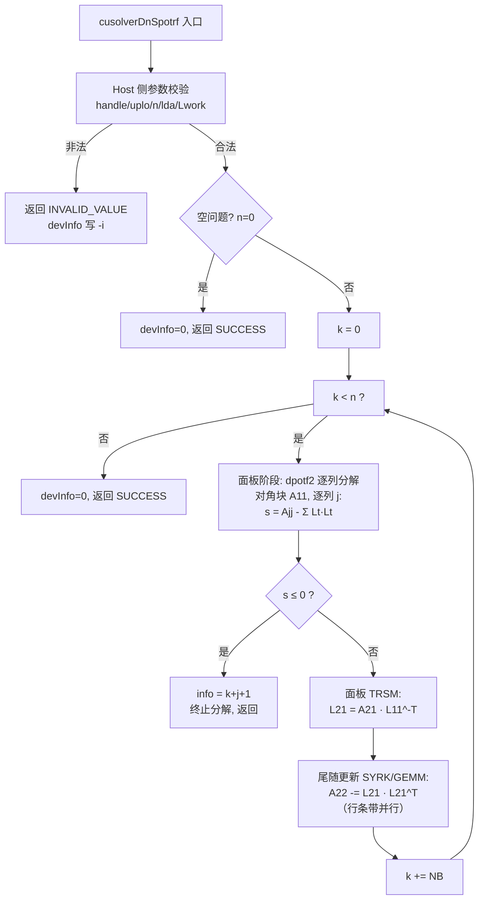
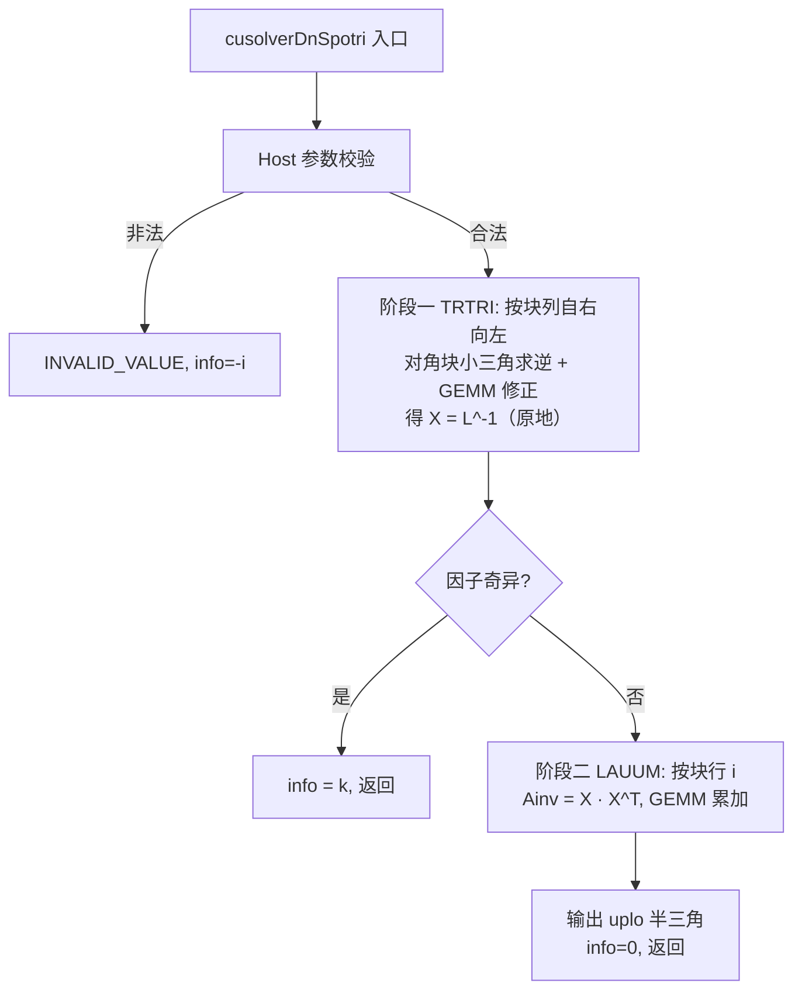
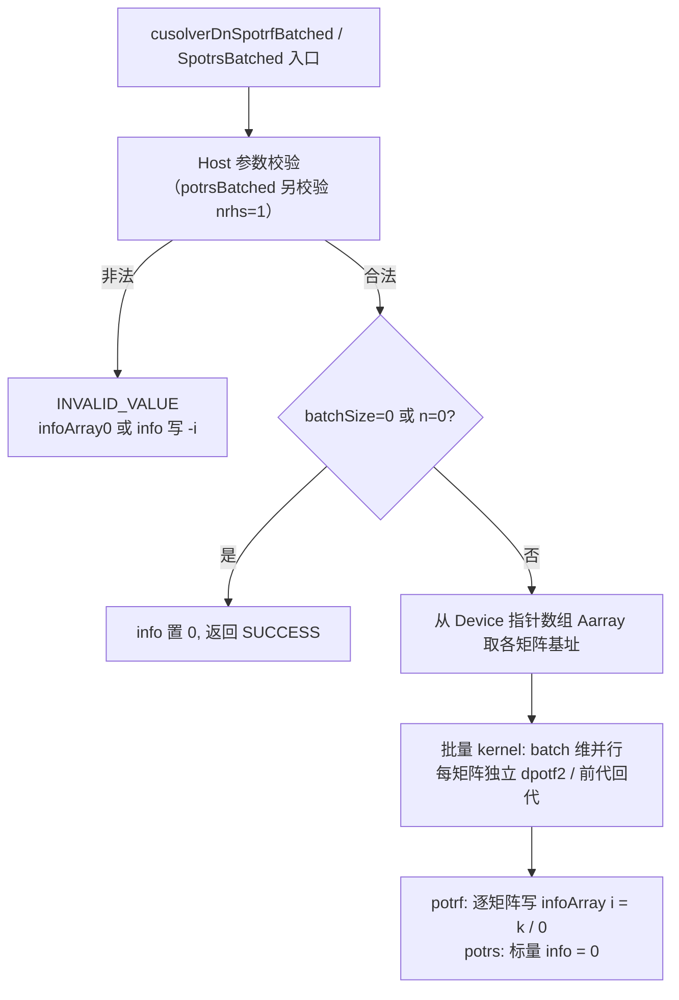
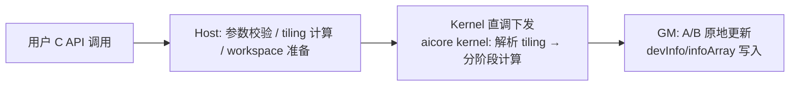
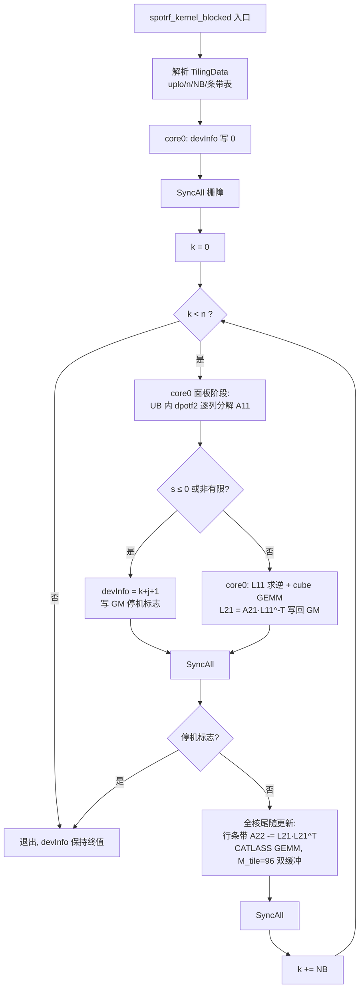
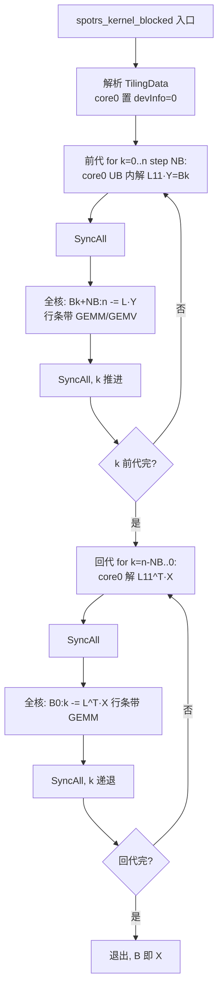
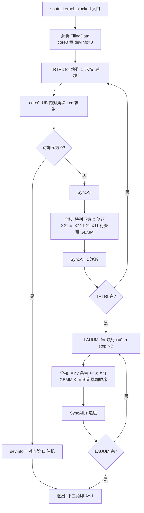
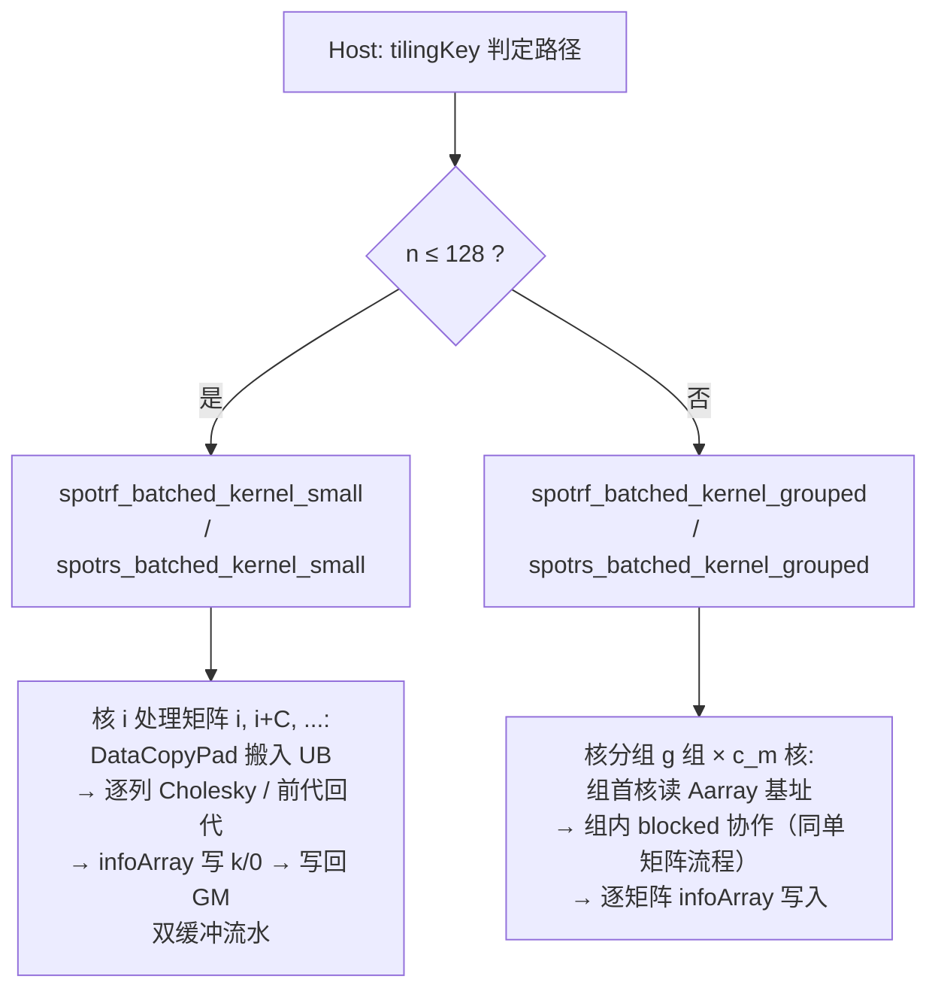

# 【社区任务】Spotrf/Spotrs/Spotri/SpotrfBatched/SpotrsBatched算子设计文档

## 一、需求背景

### 1.1 需求来源

通过社区任务完成开源仓算子贡献的需求：在昇腾 NPU 上为 ops-solver 开源仓（https://gitcode.com/cann/ops-solver）全新实现单精度实数 Cholesky 分解（`aclsolverSpotrf`）、基于因子的线性求解（`aclsolverSpotrs`）、基于因子的矩阵求逆（`aclsolverSpotri`）以及批量分解/求解接口（`aclsolverSpotrfBatched`、`aclsolverSpotrsBatched`）共 5 组 Host C API，接口、功能、参数、约束对标 NVIDIA cuSolverDN legacy 同名接口，适配硬件为 Ascend 950PR（Atlas 950）。五个接口作为同一社区任务一并交付，不允许拆分验收。

### 1.2 背景介绍

#### 1.2.1 单精度实数Cholesky分解、求解、求逆及批量算子实现

本任务为 ops-solver 仓全新算子开发，采用 **ops-solver Host C API + AscendC/CATLASS Kernel 直调**工程模式（非 aclnn 两段式、非 PyTorch 接口、非 TBE 算子），因此不存在 TBE 算子源码与 aclnn 算子信息库（`*.json`）适配项；标杆（对标）实现为 NVIDIA cuSolverDN dense legacy 接口，标杆源码与参考路径如下：

| 类别 | 获取路径（含文件名） | 说明 |
|---|---|---|
| 标杆接口声明 | `${CUDA_PATH}/include/cusolverDn.h` | `cusolverDnSpotrf` / `cusolverDnSpotrf_bufferSize` / `cusolverDnSpotrs` / `cusolverDnSpotri` / `cusolverDnSpotri_bufferSize` / `cusolverDnSpotrfBatched` / `cusolverDnSpotrsBatched` 函数原型；`cublasFillMode_t` 定义于 `${CUDA_PATH}/include/cublas_v2.h` |
| 标杆接口文档 | https://docs.nvidia.com/cuda/cusolver/index.html#cuSolverDN-legacy-api 、https://docs.nvidia.com/cuda/cusolver/index.html#cusolverdn-potrfbatched | 参数语义、info 约定、Remark（含 potrsBatched 仅 nrhs=1、info 标量语义） |
| 标杆算法参考 | netlib LAPACK 源码：`dpotrf.f`、`dpotf2.f`、`dtrsm.f`（BLAS）、`dtrtri.f`、`dlauum.f` | cuSolverDN dense 内部实现遵循的 LAPACK 分块算法范式，是"标杆实现逻辑"的算法级源码依据 |
| NPU 落地仓 | https://gitcode.com/cann/ops-solver | 公开头文件 `include/cann_ops_solver.h`、`include/cann_ops_solver_common.h`；本任务新增 `src/spotrf/`、`src/spotrs/`、`src/spotri/`、`src/spotrf_batched/`、`src/spotrs_batched/` 及配套 `test/`、`docs/zh/` 目录 |
| 仓内工程范式参考 | `src/cmatinv_batched/cmatinv_batched_host.cpp`、`src/cmatinv_batched/cmatinv_batched_kernel.cpp` | Kernel 直调、TilingData 结构、批量任务按核均分的既有范式 |
| Kernel 模板库 | https://gitcode.com/cann/catlass | 950 上 cube GEMM（MatMul）模板，用于尾随矩阵更新等密集乘法 |

#### 1.2.2 标杆算子现状分析

##### 1.2.2.1 标杆算子支持的数据类型和数据格式

cuSolverDN legacy 系列每个接口提供 S/D/C/Z 四种数据类型分支，本任务对齐其中 **S（FLOAT32，实数）** 分支，数据类型与格式要求如下（与《算子任务书》2.4 节参数表一致）：

| 标杆接口 | 数据类型 | 数据格式/排布 | 维度（shape） | 关键约束 |
|---|---|---|---|---|
| `cusolverDnSpotrf(+_bufferSize)` | A/Workspace：FLOAT32；devInfo：INT32 | 列主序（column-major）ND，A 为 Device 指针，lda×n | A：[lda, n] | uplo ∈ {LOWER, UPPER}；n ≥ 0；lda ≥ max(1, n)；Lwork ≥ 0；A 原地覆盖为 Cholesky 因子；未使用的另一半三角可作 workspace 被破坏；devInfo：0 成功 / −i 第 i 参数非法 / i>0 第 i 阶顺序主子式不正定 |
| `cusolverDnSpotrs` | A/B：FLOAT32；devInfo：INT32 | 列主序，A 只读（lda×n），B 原地（ldb×nrhs），均 Device 指针 | B：[ldb, nrhs] | uplo 须与 potrf 一致；n, nrhs ≥ 0；ldb ≥ max(1, n)；devInfo 仅 0 / −i（输入是已分解因子，无正定性检查） |
| `cusolverDnSpotri(+_bufferSize)` | A/Workspace：FLOAT32；devInfo：INT32 | 列主序，A 原地（lda×n） | A：[lda, n] | uplo 须与 potrf 一致；lda ≥ max(1, n)；devInfo：0 / −i / i>0（因子第 i 阶顺序主子式为零即奇异） |
| `cusolverDnSpotrfBatched` | Aarray 元素：FLOAT32；infoArray：INT32 | 列主序；`Aarray` 为 **Device 上的指针数组**（长度 batchSize），每个 A[i] 为 lda×n，原地 | infoArray：[batchSize] | n ≥ 0；batchSize ≥ 0；lda ≥ max(1, n)；infoArray[i] = k 表示第 i 个矩阵第 k 阶顺序主子式不正定，其余矩阵照常分解；参数错误写 infoArray[0] = −i |
| `cusolverDnSpotrsBatched` | Aarray/Barray 元素：FLOAT32；info：INT32 | 列主序；`Aarray`/`Barray` 为 Device 指针数组；B[i] 原地（ldb×nrhs） | info：[1]（标量） | **仅支持 nrhs = 1**；info 仅 0 / −i，正定性检查属 potrfBatched 职责；ldb ≥ max(1, n) |

数值与调用约定（与算子信息要求一致的部分）：矩阵、info、workspace、指针数组均在 Device 侧，Host 侧仅传标量维数（int，32-bit）、枚举（`cublasFillMode_t`，0=LOWER / 1=UPPER）与 handle；空问题（n=0 / nrhs=0 / batchSize=0）成功返回；计算走调用方 stream，无必要的 Host 同步被禁止；相同输入串行多次执行输出（含 info）bit-wise 一致。

##### 1.2.2.2 标杆算子实现描述

cuSolverDN dense legacy 接口在算法层面遵循 LAPACK 分块范式（面板小计算 + 大粒度 GEMM），GPU 上由面板 kernel 与 cuBLAS GEMM 组合完成。以 `uplo = LOWER` 为例（UPPER 为镜像）：

1. **potrf（分块右视 Cholesky，参考 dpotrf/dpotf2）**
   - 取块大小 NB，将 A 按块划分。对每个块步 k（步长 NB）：
     - **面板阶段**：对对角块 A11 = A[k:k+NB, k:k+NB] 执行非分块 Cholesky（dpotf2 逐列算法）：对第 j 列，先计算 `s = A[j,j] − Σ_{t<j} L[j,t]·L[j,t]`；若 `s ≤ 0` 则 `info = k+j+1` 并终止分解（前 j−1 列因子保留）；否则 `L[j,j] = √s`，再 `L[i,j] = (A[i,j] − Σ_{t<j} L[i,t]·L[j,t]) / L[j,j]`（i > j）。随后对面板下部 A21 = A[k+NB:n, k:k+NB] 执行三角求解 TRSM：`L21 = A21 · L11^{-T}`；
     - **尾随更新阶段**：`A22 −= L21 · L21^T`（SYRK/GEMM 形式），对尾随子矩阵按行条带拆分到全部 SM 并行执行；
   - 循环至 k 达到 n。非正定检测发生在面板逐列过程中，info 取最小失败阶；devInfo 在 Device 侧写入，Host 不同步。
2. **potrs（两次分块三角求解 TRSM，参考 dtrsm）**
   - 前代：解 `L·Y = B`。按块行 k 递推：`Y[k:k+NB] = L11^{-1}·(B[k:k+NB] − Σ_{j<k} L[k:k+NB, j:j+NB]·Y[j:j+NB])`，非对角更新为 GEMM，按 B 的行方向条带并行（nrhs 列作为 GEMM 的 N 维）；
   - 回代：解 `L^T·X = Y`，按块行 k 反向递推：`X[k:k+NB] = L11^{-T}·(B[k:k+NB] − Σ_{j>k} L[j:j+NB, k:k+NB]^T·X[j:j+NB])`；
   - X 原地覆盖 B；info 仅报告参数错误。
3. **potri（TRTRI + LAUUM 两阶段，参考 dtrtri/dlauum）**
   - 阶段一 TRTRI：对下三角因子 L 按块列（自右向左）分块求逆，原地得到 X = L^{-1}（仍为下三角）：对角块在缓存内做小三角求逆，非对角块通过 `X21 = −X22·L21·X11` 型 GEMM 修正；
   - 阶段二 LAUUM：计算 `A^{-1} = X·X^T`，按块行 i 递推 `Ainv[i:n, i:n] += X[i:n, :]·X[i:n, :]^T`，块内 GEMM 累加，条带并行；
   - 输出仅 uplo 指定半三角有效；因子奇异时 info = k。
4. **potrfBatched（批量小矩阵独立分解）**
   - legacy 实现面向小矩阵（文档口径 n ≤ 32）：单个 kernel 内批量并行，每个线程块负责一个（或多个）矩阵的完整非分块 Cholesky（dpotf2 逐列算法），batch 维提供并行度；每个矩阵独立检测正定性并写 `infoArray[i]`；矩阵地址来自 Device 指针数组 `Aarray`。
5. **potrsBatched（批量单右端求解）**
   - 仅支持 nrhs = 1。每个矩阵独立执行前代/回代（`Ly = b`、`L^T x = y`），批量 kernel 并行，B[i] 原地覆盖；info 为标量，仅报告参数错误（正定性由 potrfBatched 的 infoArray 反映，对齐 cuSolver 手册 Remark）。

##### 1.2.2.3 标杆算子实现流程图

标杆 potrf（分块右视）流程：



标杆 potrs（前代 + 回代）流程：

```mermaid
flowchart TD
    A[cusolverDnSpotrs 入口] --> B[Host 参数校验]
    B -->|非法| B1[INVALID_VALUE, info=-i]
    B -->|合法| C{n=0 或 nrhs=0?}
    C -->|是| C1[info=0, SUCCESS]
    C -->|否| D[前代: 按块行 k 正向<br>Yk = Lkk^-1·(Bk - Σ Lkj·Yj)<br>GEMM 更新条带并行]
    D --> E[回代: 按块行 k 反向<br>Xk = Lkk^-T·(Bk - Σ Ljk^T·Xj)]
    E --> F[X 原地覆盖 B<br>info=0, 返回]
```

标杆 potri（TRTRI + LAUUM）流程：



标杆批量接口流程：



## 二、需求分析

### 2.1 外部组件依赖

| 组件 | 版本/来源 | 用途 | 状态 |
|---|---|---|---|
| CANN（ACL runtime `libascendcl`、AscendC kernel 编译工具链、`platform_ascendc` 平台信息接口） | CANN 9.0.0 及以上，与 ops-solver 仓 README 已验证配套版本一致 | Device 内存/流管理、kernel 编译与下发、核数/UB 容量查询 | 已适配（仓内既有算子同链路） |
| CATLASS | https://gitcode.com/cann/catlass ，与 CANN 版本配套 | 950 cube 单元 GEMM 模板（尾随更新、TRSM 等价 GEMM、LAUUM 累加） | 已适配 |
| NumPy / SciPy（含 LAPACK） | golden 用 float64 `cholesky`/`cho_solve`/`inv` 或 `dpotrf/dpotrs/dpotri` | 精度参考（仅测试期使用，不进入交付库） | 测试依赖 |
| msprof | CANN 自带 | kernel 耗时采集（性能验收口径） | 测试依赖 |
| AscendOpTest | https://gitcode.com/HIT1920/AscendOpTest | 自测测试工程 | 测试依赖 |

无 CUDA 运行时依赖：cuSolver 仅作为接口/功能/约束/性能标杆。

### 2.2 内部适配模块

| 模块 | 位置 | 适配内容 |
|---|---|---|
| 公共头文件 | `include/cann_ops_solver.h`、`include/cann_ops_solver_common.h` | 新增 5 组接口声明与 `aclsolverFillMode_t` 枚举；`aclsolverStatus_t` 状态码复用/补充 |
| Handle/Stream 管理 | 仓内既有 `aclsolverCreate` / `aclsolverDestroy` / `aclsolverSetStream` / `aclsolverGetStream` | 直接复用；计算走 handle 绑定 stream；handle 内新增内部 workspace 池字段（批量接口无 Workspace 入参，中间数据由 handle 池按需扩容提供，stream 有序、不做 Host 同步） |
| 通用工具 | `src/utils/assert.h` 等（`SOLVER_ECHECK`、`LOG_PRINT`、`CHECK_ACLRT`） | 直接复用做 Host 侧校验与错误处理 |
| 编译框架 | 仓根 `build.sh` | 按 `--soc=ascend950 --ops=spotrf,spotrs,spotri,spotrf_batched,spotrs_batched` 接入，产出 run 包与测试二进制 |
| 测试工程 | `test/<算子名>/`（`*_test.cpp`、`data/gen_data.py`、`data/verify_result.py`、`CMakeLists.txt`、`README.md`） | 遵循仓内 cmatinv_batched 既有测试目录范式 |

### 2.3 需求模块设计

#### 2.3.1 Ascend C算子原型

除《算子任务书》不要求适配的部分外，其余与标杆算子（cuSolverDN legacy）完全对齐：参数名、顺序、含义、Device/Host 归属、维数类型（int，32-bit）均与 2.3 节任务书签名一致，不增删、不调换。需在 `cann_ops_solver_common.h` 中补充枚举：

```c
typedef enum {
    ACLSOLVER_FILL_MODE_LOWER = 0,  /* 下三角，对齐 CUBLAS_FILL_MODE_LOWER */
    ACLSOLVER_FILL_MODE_UPPER = 1   /* 上三角，对齐 CUBLAS_FILL_MODE_UPPER */
} aclsolverFillMode_t;
```

| NPU 接口 | 对标 CUDA 接口 | 功能 |
|---|---|---|
| `aclsolverSpotrf_bufferSize` | `cusolverDnSpotrf_bufferSize` | 查询 workspace 元素个数 Lwork |
| `aclsolverSpotrf` | `cusolverDnSpotrf` | A = L·L^T（LOWER）/ A = U^T·U（UPPER），原地覆盖 uplo 半三角 |
| `aclsolverSpotrs` | `cusolverDnSpotrs` | 基于因子解 A·X = B，X 原地覆盖 B |
| `aclsolverSpotri_bufferSize` | `cusolverDnSpotri_bufferSize` | 查询 workspace 元素个数 Lwork |
| `aclsolverSpotri` | `cusolverDnSpotri` | 基于因子求 A^{-1}，原地覆盖 uplo 半三角 |
| `aclsolverSpotrfBatched` | `cusolverDnSpotrfBatched` | 批量 Cholesky 分解，infoArray 逐矩阵 |
| `aclsolverSpotrsBatched` | `cusolverDnSpotrsBatched` | 批量求解（仅 nrhs=1），标量 info |

```c
aclsolverStatus_t aclsolverSpotrf_bufferSize(aclsolverHandle_t handle,
    aclsolverFillMode_t uplo, int n, float *A, int lda, int *Lwork);
aclsolverStatus_t aclsolverSpotrf(aclsolverHandle_t handle,
    aclsolverFillMode_t uplo, int n, float *A, int lda,
    float *Workspace, int Lwork, int *devInfo);
aclsolverStatus_t aclsolverSpotrs(aclsolverHandle_t handle,
    aclsolverFillMode_t uplo, int n, int nrhs,
    const float *A, int lda, float *B, int ldb, int *devInfo);
aclsolverStatus_t aclsolverSpotri_bufferSize(aclsolverHandle_t handle,
    aclsolverFillMode_t uplo, int n, float *A, int lda, int *Lwork);
aclsolverStatus_t aclsolverSpotri(aclsolverHandle_t handle,
    aclsolverFillMode_t uplo, int n, float *A, int lda,
    float *Workspace, int Lwork, int *devInfo);
aclsolverStatus_t aclsolverSpotrfBatched(aclsolverHandle_t handle,
    aclsolverFillMode_t uplo, int n, float *Aarray[], int lda,
    int *infoArray, int batchSize);
aclsolverStatus_t aclsolverSpotrsBatched(aclsolverHandle_t handle,
    aclsolverFillMode_t uplo, int n, int nrhs,
    float *Aarray[], int lda, float *Barray[], int ldb,
    int *info, int batchSize);
```

Host 侧统一行为（对齐 cuSolver 语义）：

- 计算接口统一返回 `aclsolverStatus_t`；
- `devInfo` / `infoArray` / `info` 真实写入：0 成功、−i 参数非法（不计 handle）、i>0 正定性/奇异性下标；
- 矩阵、info、workspace、`Aarray`/`Barray` 均为 Device 指针；
- 复用 `aclsolverCreate/Destroy/SetStream/GetStream`，计算走调用方 stream；
- 空问题（n=0 / nrhs=0 / batchSize=0）成功返回。

#### 2.3.2 Ascend C算子相关约束

与标杆算子相比，本实现的功能覆盖差异（缺失项与增强项）：

| 项 | 标杆（cuSolverDN legacy） | 本实现（aclsolver） | 说明 |
|---|---|---|---|
| 数据类型 | S/D/C/Z 四分支 | 仅 S（FLOAT32 实数） | 任务书限定单精度实数；D/C/Z 为范围外缺失项，接口命名留有扩展惯例（D→aclsolverDpotrf 等） |
| potrfBatched 规模 | legacy 文档口径 n ≤ 32 | n ∈ [1, 4096]，batchSize ∈ [1, 30000]（验收下限；实现按动态 shape 设计，自测用例覆盖至 batchSize = 10^6） | 属增强项；大 n 批量走分组分块算法（见 3.2.1.1） |
| potrs 规模 | nrhs 无上限 | nrhs ∈ [1, 128]（验收下限，可更大） | 对齐任务书验收下限 |
| Host 侧启发式 | 内部按 n 启发式选块大小/内核 | Host 按本次 n/nrhs/batchSize 与平台核数生成 tiling，块大小 NB 固定 128（预留扩展） | 实现策略差异，不影响接口语义 |
| 图融合 / broadcast | 不涉及 | 不支持（对齐任务书） | 一致 |

无接口级缺失：`_bufferSize`、Lwork、info 语义、uplo、lda/ldb padding、空问题行为均与标杆一致。

## 三、需求详细设计

### 3.1 调用方式

采用 **ops-solver Host C API + AscendC/CATLASS Kernel 直调**：

- 用户经 `libops_solver` 动态库调用 `aclsolver*` C 接口；Host 侧完成参数校验、tiling 计算、workspace 准备，直接以 `<<<blockNum, workspace, stream>>>` 形式下发 AscendC kernel（无 aclnn 两段式适配、无 PyTorch 适配）；
- 核心计算全部在 NPU AI Core（cube + vector）完成，无 CPU fallback；
- 典型调用序列（potrf + potrs 求解）：

```c
aclsolverHandle_t handle;
aclsolverCreate(&handle);
aclsolverSetStream(handle, stream);            /* 计算走调用方 stream */
int Lwork = 0;
aclsolverSpotrf_bufferSize(handle, ACLSOLVER_FILL_MODE_LOWER,
                           n, dA, lda, &Lwork);
float *dWork;  int *dInfo;
/* aclrtMalloc dWork(Lwork*4B), dInfo(4B) ... */
aclsolverSpotrf(handle, ACLSOLVER_FILL_MODE_LOWER,
                n, dA, lda, dWork, Lwork, dInfo);
aclsolverSpotrs(handle, ACLSOLVER_FILL_MODE_LOWER,
                n, nrhs, dA, lda, dB, ldb, dInfo);
```

- 代码组织（遵循任务书第 5 节建议目录）：`src/spotrf/{spotrf_host.cpp, spotrf_kernel.cpp}`，`src/spotrs/`、`src/spotri/`、`src/spotrf_batched/`、`src/spotrs_batched/` 同构；公共小函数（对角块逐列分解、三角块求逆等）放各算子目录内独立实现，避免跨算子耦合冗余。

### 3.2 需求总体设计

总体链路（五个接口一致）：



Host 侧校验顺序固定为：handle 非空 → uplo 合法 → n/nrhs/batchSize 值域 → 指针非空（按空问题规则放宽）→ lda/ldb 下界 → Lwork/Workspace 规则 → potrsBatched 的 nrhs==1。任一失败：返回 `ACLSOLVER_STATUS_INVALID_VALUE`，并在 `devInfo`/`info`（或 `infoArray[0]`）可写时向 stream 异步 `aclrtMemcpy` 一个 −i 值（stream 有序、不引入 Host 同步）。空问题：不下发 kernel，异步写 info=0，返回成功。

#### 3.2.1 host侧设计

Host 侧公共流程：读取 handle 的 stream 与内部 workspace 池 → `platform_ascendc::PlatformAscendCManager` 查询 AIC/AIV 核数与 UB 容量 → 依据 3.2.1.1 的分核策略与 3.2.1.2 的分块策略计算 `TilingData` → 拷贝 tiling 至 Device → 下发 kernel。

##### 3.2.1.1 分核策略

设可用 AI Core 核数 C（运行时 `GetCoreNumAic()` 查询，950PR 以实际查询为准，仓内既有 950 算子按 40 核上限设计）。

**（a）单矩阵接口 potrf / potrs / potri（blocked 协作分核）**

采用"面板串行 + 尾随并行"的满核协作策略，kernel 内以核间栅栏（SyncAll）切换阶段：

- 面板阶段：仅 core 0 执行对角块分解与面板 TRSM（计算量 O(NB²·n)，串行核的向量/cube 单元可独占使用）；其余核在该栅栏等待；
- 尾随更新/块更新阶段：全部 C 个核按行条带均分任务。设该步待更新行数 M（如 potrf 尾随 M = n − k − NB），核 i 负责行区间 `[i·⌈M/C⌉, min(M, (i+1)·⌈M/C⌉))`，各核条带互不重叠，输出直接写各自 GM 区段，无需归约；
- potrs 的每步非对角更新 GEMM（M × NB × nrhs）与 potri 的 LAUUM 块行累加同样按行条带均分（potri 中块行 i 的累加只写 Ainv[i:n, i] 区段，块行间无写冲突，条带内串行保证累加顺序固定）。

**（b）批量接口 potrfBatched / potrsBatched（两级分核）**

- **小 n 路径（n ≤ T_s，T_s = 128）**：batch 维均分，核 i 处理矩阵集合 `{i, i+C, i+2C, …}`（round-robin，与连续分段相比对异构耗时更均衡），核内串行完成整矩阵计算（unblocked 算法，全程 UB）。每核矩阵数 `⌈batchSize / C⌉`；
- **大 n 路径（n > T_s）**：核分组策略。单矩阵参考核数 `c_m = clamp(4·⌈n/512⌉, 4, C)`，组数 `g = clamp(⌊C / c_m⌋, 1, batchSize)`，每组 `c_m` 个核按（a）的 blocked 协作方式处理 `⌈batchSize/g⌉` 个矩阵（round-robin 分配）。例：n=4096、batch=30000、C=40 时 c_m=32、g=1，逐矩阵满核串行处理；n=128 大批量时走小 n 路径满 40 核并行；
- 批量接口 kernel 启动 block 数 = 小 n 路径取 C；大 n 路径取 `g·c_m ≤ C`。

**（c）potrs 多右端**：非对角更新 GEMM 的 N 维为 nrhs（≤128），并行度仍来自 M 维行条带；nrhs=1（potrsBatched）时 GEMM 退化为 GEMV，按 M 条带均分。

##### 3.2.1.2 数据分块和内存优化策略

**块大小**：外层分块 NB = 128。依据：①对角块 128×128×4B = 64KB，可与三角逆暂存一同驻留 UB；②NB=128 与 CATLASS GEMM 的 M/N/K 对齐要求一致，cube 利用率高；③面板计算量与尾随 GEMM 量的比例合理（面板 O(NB²n)，尾随 O(n³/2) 总量主导）。

**LocalMemory（UB）预算**（950PR 单核 UB 以运行时查询为准，本文按仓内既有算子一致口径 192KB 可用推导）：

| 路径 | UB 布局 | 大小公式（float 元素） |
|---|---|---|
| 面板核（potrf/potri 对角处理） | L11 块 + L11^{-1}（或 W 暂存） + 点积/广播标量区 | 2·NB² + 4·NB = 2·128² + 512 = 33 280 elem ≈ 130KB ≤ 192KB |
| 更新核（尾随 GEMM） | 源/目的条带双缓冲（GM↔UB 中转，实际乘加经 L0） | 2·M_tile·NB ≤ 24576 elem，取 M_tile = 96；L0A/L0B/L0C 由 AscendC Matmul/CATLASS 管理 |
| 批量小 n 路径（n ≤ 128） | 单矩阵整块 A（按存储半三角紧凑或整块） + B 列 | n·n + n ≤ 128² + 128 = 16 512 elem ≈ 64.5KB（双缓冲两矩阵流水 ≈ 129KB ≤ 192KB） |

**GM Workspace 规划**（单矩阵接口，元素个数）：

- `Lwork_potrf = n·NB + NB² + 1024`：①L21 面板结果/look-ahead 暂存（n·NB 上界）；②对角块三角逆中转（NB²）；③核间同步标志与 tiling 区（1024，int/float 混用按 4B 对齐）；
- `Lwork_potri = 2·n·NB + NB² + 1024`：TRTRI 阶段块列暂存 + LAUUM 阶段行块 X[i:, :] 外存暂存（n·NB）各一份；
- 依据任务书对齐条款"未使用的另一半三角可作为 workspace 被破坏"，uplo=LOWER 时上三角（UPPER 时下三角）优先用作②③类内部暂存，Workspace 作为容量兜底，`_bufferSize` 返回上述保守上界；验收比较仅看 uplo 半三角，不破坏接口语义；
- potrs 及两个批量接口签名无 Workspace 入参（对齐 cuSolver）：中间数据优先驻留 UB 与对侧三角；不足部分使用 handle 内部 workspace 池（首次按需 `aclrtMalloc`，之后复用、按 `n·NB + NB² + 4096` 上界扩容），分配/复用均在调用方 stream 上有序执行，无 Host 同步。

**搬运优化**：GM→UB 按列块整块搬运（列主序，源步长 = lda，目的紧凑排列，用 `DataCopyPad` 处理 n 非 8 对齐与 lda padding）；更新核条带读取采用双缓冲隐藏搬运延迟；写入 GM 直接覆盖 A 的对应半三角，避免整矩阵重排。

##### 3.2.1.3 tilingKey规划策略

Kernel 直调模式下 tilingKey 由 Host 计算并写入 `TilingData` 首字段，同时用于 Host 侧选择 kernel 入口符号（不同路径编译为独立 kernel 入口，kernel 内不再做模式分支）：

| bit | 字段 | 取值与设置条件 |
|---|---|---|
| 0 | uplo | 0 = LOWER；1 = UPPER（uplo 入参） |
| 2~1 | 算法路径 | 00 = 单矩阵 blocked（potrf/potrs/potri）；01 = 批量小 n（n ≤ 128，UB 直解）；10 = 批量大 n（n > 128，核分组 blocked）；11 = 预留 |
| 4~3 | 数值规格 | 0 = FP32；其余预留（half/double 扩展） |
| 7~5 | 预留 | look-ahead 开关等 |

设置条件汇总：`tilingKey = uplo | (path << 1) | (dtype << 3)`。例如 potrfBatched、n=32、LOWER → path=01、tilingKey=0b0010；potrf、n=4096、UPPER → path=00、tilingKey=0b0001。msprof 采集时不同路径为不同 kernel 符号，便于按 kernel 名归因（对齐任务书 3.3 的 `OpBasicInfo.csv` 按 kernel 名统计口径）。

#### 3.2.2 kernel侧设计

##### 3.2.2.1 kernel侧实现描述

kernel 入口清单（均为 AIC 上执行，vector 指令用于标量/逐列计算，cube 指令用于 GEMM）：

| kernel 入口 | 触发条件 | 并行形态 |
|---|---|---|
| `spotrf_kernel_blocked` | potrf，任意 n | 单矩阵 blocked，C 核协作 |
| `spotrs_kernel_blocked` | potrs，任意 n/nrhs | 单矩阵 blocked，C 核协作 |
| `spotri_kernel_blocked` | potri，任意 n | 单矩阵 blocked（TRTRI+LAUUM），C 核协作 |
| `spotrf_batched_kernel_small` | potrfBatched，n ≤ 128 | batch 维均分，核内 UB 直解 |
| `spotrf_batched_kernel_grouped` | potrfBatched，n > 128 | 核分组，组内 blocked |
| `spotrs_batched_kernel_small` / `_grouped` | potrsBatched，n 阈值同上 | 同上（nrhs=1） |

**（1）spotrf_kernel_blocked（uplo=LOWER）**

1. 各核解析 TilingData；core 0 将 devInfo 置 0 写回 GM，核间栅栏；
2. for k = 0; k < n; k += NB：
   - **面板（core 0）**：搬入对角块 A11 至 UB，执行逐列非分块 Cholesky（对齐 dpotf2）：第 j 列先 `s = A[j,j] − Σ_{t<j} L[j,t]²`（UB 内向量乘累加，固定归约顺序），若 `s ≤ 0` 或非有限值：写 `devInfo = k+j+1`，置 GM 停机标志，跳出；否则 `L[j,j]=√s`，`L[i,j]=(A[i,j] − Σ_{t<j} L[i,t]·L[j,t])/L[j,j]`（整列向量除）。随后在 UB 内对 L11 做同型小三角求逆得 L11^{-1}，经 cube GEMM 完成 TRSM 等价计算 `L21 = A21·(L11^{-1})^T`，结果连同 L11 写回 GM 原位（A 的下三角）；L11^{-1} 暂存于对侧三角/Workspace；
   - 栅障（SyncAll）；各核读停机标志，非 0 则退出；
   - **尾随更新（全部核）**：按行条带执行 `A[i1:i2, k+NB:n] −= L21[i1:i2, :]·L21[:, :]^T`，CATLASS GEMM（M=条带行数, K=NB, N=n−k−NB，K 维固定步进、累加顺序确定），条带内按 M_tile=96 双缓冲分批；
   - 栅障；
3. 循环结束，info 保持 0。UPPER 分支：索引角色镜像（按行存储 U，逐行分解），复用同一套子程序（tilingKey bit0 区分索引映射）。

**（2）spotrs_kernel_blocked（uplo=LOWER）**

1. 前代：for k = 0..n−1 step NB：core 0 在 UB 内对 `B[k:k+NB, 0:nrhs]` 解 `L11·Y = (B_k − 已累加部分)`（小三角逐列解，多右端向量化）；栅障后全部核对 `B[k+NB:n, :]` 做行条带 GEMM 更新 `−= L[k+NB:n, k:k+NB]·Y`；栅障；
2. 回代：for k = n−NB..0 step −NB：core 0 解 `L11^T·X = …`（反向小三角解）；栅障后全核更新 `B[0:k, :] −= L[k:k+NB, k+NB:n]^T·X`（行条带 GEMM）；栅障；
3. B 原地即为 X；info 仅在入口由 core 0 置 0。UPPER 镜像（先回代后前代，转置因子索引）。

**（3）spotri_kernel_blocked（uplo=LOWER）**

1. **TRTRI**：for 块列 c = 末块..首块（自右向左）：core 0 在 UB 内对对角块 Lcc 求逆（小三角逐列求逆，奇异检测：对角元为 0 → `devInfo = c_idx + j + 1`，停机）；栅障后全核按行条带 GEMM 修正该块列下方：`X[c+NB:n, c:c+NB] = −X[c+NB:n, c+NB:n_已得]·L[c+NB:n, c:c+NB]·Xcc`（分块三角逆递推 `X21 = −X22·L21·X11` 的条带化展开，累加顺序固定）；栅障；
2. **LAUUM**：for 块行 r = 0..n−1 step NB：全核按 r 下方行条带计算 `Ainv[i1:i2, r:r+NB] += X[i1:i2, :]·X[r:r+NB, :]^T`（GEMM，K = n），条带互不重叠、无需归约；
3. 输出下三角即 A^{-1} 对应半三角。

**（4）spotrf_batched_kernel_small（n ≤ 128）**

核 i 处理矩阵集合 {i, i+C, …}；对每个矩阵：按列块 DataCopyPad 搬入 UB（处理 lda padding 与非对齐尾列）→ 执行与面板相同的逐列非分块 Cholesky（j 循环至 n）→ 正定检测写 `infoArray[slot]`（s ≤ 0 时 = k+j+1，且当前矩阵停止、继续下一矩阵）→ 结果半三角写回 GM 原位。核内双缓冲（两矩阵交替搬运/计算）。

**（5）spotrf_batched_kernel_grouped（n > 128）**

组首核从 `Aarray`（Device 指针数组）读出本组当前矩阵基址写入组共享 GM 区 → 组内按（1）的 blocked 流程协作（栅障改为组内栅栏，组间无同步）→ 逐矩阵写 infoArray → 处理本组下一矩阵。

**（6）spotrs_batched_kernel_small / _grouped**

nrhs=1。小 n：整矩阵与 B 列驻留 UB，前代 + 回代逐列完成（`y_i = (b_i − Σ_{j<i} L_ij·y_j)/L_ii`，点积固定顺序）；大 n：分组后按（2）的 blocked 前代/回代，更新步为 GEMV 行条带。info 仅 core 0（或组首核）置 0；参数错误由 Host 侧异步写入。

**公共约束**：

- **核间同步**：AscendC 核间同步原语（SyncAll/组内栅栏）划分阶段；批量组间独立；
- **确定性**：全程不使用浮点 Atomic 归约；GEMM 的 K 维切分与累加顺序、向量点积归约顺序在 tiling 确定后固定；相同输入 + 相同核数 → 逐 bit 一致（满足任务书 2.1 条 7）；
- **info 写入**：均由 kernel 内真实写 GM（成功 0 / 失败 k），Host 参数错误路径经 stream 异步拷贝写 −i；
- **对侧三角**：仅作为内部暂存使用（任务书允许条款），不读其原始内容。

##### 3.2.2.2 Ascend C实现流程图

spotrf（单矩阵 blocked）kernel 流程：



potrs（前代 + 回代）kernel 流程：



potri（TRTRI + LAUUM）kernel 流程：



批量接口分派流程：



##### 3.2.2.3 Ascend C实现流程图与标杆算子流程图存在的差异点和原因

| # | 差异点 | 标杆（cuSolverDN） | 本设计（Ascend C） | 原因 |
|---|---|---|---|---|
| 1 | 调度粒度 | 面板 kernel 与 cuBLAS GEMM 多次 launch，由库内部调度 | 单 kernel 内以核间栅栏切换面板/更新阶段（批量大 n 为组内栅栏） | 减少 kernel launch 开销（n=4096 约 32 个块步，多 launch 累积开销影响 0.35× 性能门限）；NPU kernel 直调框架下单 kernel 协作是既有成熟范式 |
| 2 | TRSM 实现方式 | 直接分块三角代换（dtrsm 范式） | 面板内"小三角求逆 + cube GEMM"等价实现；potrs 保留直接分块代换 | AI Core cube 吞吐远高于向量串行代换；求逆仅作用于 NB=128 小块，数值误差量级与代换相当（满足 3.2 精度判据）；potrs 对角块直接小三角解保持标杆路径 |
| 3 | potrfBatched 规模 | legacy 口径 n ≤ 32，单 kernel 批量直解 | n ≤ 128 走 UB 直解；n > 128 增加核分组 blocked 路径 | 任务书要求 n ∈ [1, 4096]、batchSize ∈ [1, 30000]，超出标杆 legacy 能力，必须扩展算法分层 |
| 4 | 块大小策略 | 内部启发式（按 n/架构选择） | Host 侧固定 NB=128 + 动态条带 tiling | 简化首版实现与确定性要求；tilingKey 预留扩展位，后续可按 n 分档 |
| 5 | workspace 语义 | 未使用三角可能被破坏（未承诺用于暂存） | 显式将对侧三角作为内部暂存区使用，Workspace 仅兜底 | 任务书明确允许；减少 Device 内存占用与搬运 |
| 6 | 确定性承诺 | 未承诺 bit-wise 一致 | 固定归约顺序、禁用浮点 Atomic，承诺 bit-wise 一致 | 任务书 2.1 条 7 明确要求 |
| 7 | 参数错误 info 写入 | Host 侧同步写入 | stream 上异步 memcpy 写 −i | 遵守"禁止无必要的 Host 同步"要求 |

### 3.3 支持硬件

| 支持的芯片版本 | 涉及勾选 |
|---|---|
| Ascend 950PR（Atlas 950） | √ |

与《算子任务书》要求一致：功能、精度、性能均须在 950PR 上提交测试结果；CANN 9.0.0 及以上（与 ops-solver 仓 README 已验证配套版本一致）。

### 3.4 算子约束限制

1. 数据类型：仅支持 FLOAT32 实数（不支持 FP16/BF16/FP64/复数）；
2. 数据布局：仅列主序；`Aarray`/`Barray` 为 Device 指针数组（非连续 `[batch, n, n]` 张量）；矩阵/info/workspace 均须 Device 指针，Host 侧仅标量与句柄；
3. 规模（验收下限，实现按动态 shape 设计）：potrf/spotri n ∈ [1, 4096]；potrs n ∈ [1, 4096]、nrhs ∈ [1, 128]；potrfBatched n ∈ [1, 4096]、batchSize ∈ [1, 30000]；potrsBatched n ∈ [1, 4096]、batchSize ∈ [1, 30000]、nrhs = 1（nrhs ≠ 1 且 n > 0 报 `INVALID_VALUE`）；自测用例集覆盖至 batchSize = 10^6（实现按指针数组/infoArray Device 内存上限自然扩展，无固定核内上限）；
4. uplo 仅支持 LOWER / UPPER 两个合法枚举值；`aclsolverSpotrs`/`Spotri`/`SpotrsBatched` 的输入须为已由 potrf（或 potrfBatched）分解的因子；
5. lda ≥ max(1, n)、ldb ≥ max(1, n)（允许任意合法 padding，不要求 lda == n）；
6. 未使用的另一半三角不保证保留（可作内部 workspace 被破坏），验收只比较 uplo 指定半三角；
7. 不支持 broadcast，不要求图融合；不支持非默认对齐的 Device 指针异常场景外的隐式容错（非法指针/枚举/维数一律 `ACLSOLVER_STATUS_INVALID_VALUE` 并按 2.4 节规则写 info）；
8. 输入含 INF/NAN 时行为对齐精度标准文档对应规则验收（不承诺提前检测终止，正定性检测仅针对 s ≤ 0 与非有限值）。

## 四、特性交叉分析

| 交叉项 | 分析结论 |
|---|---|
| 与仓内既有算子（cgetrf/cgetri/sgetrf/sgetri/cmatinv_batched/cgetri_batched） | 目录、符号、kernel 入口均独立新增，无共享可变状态；LU 系（getrf/getri）与本 Cholesky 系功能不重叠，无调用路径冲突 |
| 公共头文件 | `cann_ops_solver.h` 仅追加 7 个函数声明；`cann_ops_solver_common.h` 追加 `aclsolverFillMode_t` 枚举与（如缺失）`aclsolverStatus_t` 状态码，均为纯新增符号，不修改既有声明，ABI 向后兼容 |
| Handle/Stream 模块 | 复用 `aclsolverCreate/Destroy/SetStream/GetStream`；handle 结构体新增内部 workspace 池字段，仅本任务接口访问，对既有算子不可见 |
| 编译体系 | `build.sh --ops=spotrf,spotrs,spotri,spotrf_batched,spotrs_batched` 新增五个编译单元；与既有 `--soc=ascend950` 链路无交叉影响 |
| CATLASS 版本依赖 | GEMM 模板与 CANN 9.0.0+ 配套版本绑定，README 中声明已验证组合 |
| 精度/性能交叉 | 五接口共用"对角块逐列分解/小三角求逆/行条带 GEMM"三类子模块，精度行为一致，均按 opbase experimental_standard 与任务书 3.2/3.3 验收 |
| 任务间交叉 | 无与其他社区任务的依赖或交付冲突；五个接口必须同 PR/关联 PR 一并合入（任务书要求） |

## 五、可维可测分析

### 5.1 精度标准/性能标准

| 验收标准 | 描述（不涉及说明原因） | 标准来源 |
|---|---|---|
| 精度标准（逐元素） | golden 用 CPU float64（NumPy/SciPy `cholesky`/`cho_solve`/`inv` 或 LAPACK dpotrf/dpotrs/dpotri）；FLOAT32 混合容差：rtol = 2^-10 (9.77e-4)、atol = 2^-16 (1.53e-5)、required_matched_ratio = 0.99、max_abs_error_limit = 1e-2 或 32 ULP；逐元素判定 `\|actual − golden\| ≤ atol + rtol×\|golden\|`，matched_ratio 与 max_abs_error 同时达标才通过 | 任务书 3.2.1 |
| 精度标准（LAPACK 残差复核） | potrf/Batched：`ratio = ‖F·Fᵀ − A‖₁ / (n·‖A‖₁·ε)` ≤ max(5·ratio_cpu, 3·ratio_cpu_mean)；potrs/Batched：`ratio = max_j ‖B_j − A·X_j‖₁ / (‖A‖₁·‖X_j‖₁·ε)` 同阈值；potri：`ratio = ‖I − A·C‖₁ / (n·‖A‖₁·‖C‖₁·ε)` ≤ max(5·ratio_cpu, 0.1)；ε = 2^-23；批量逐矩阵判定 | 任务书 3.2.2 |
| info 契约 | potrf/potri：非正定/奇异 info = k（最小失败阶，分解止于第 k 行）；potrfBatched：逐矩阵 infoArray[i]，参数错误写 infoArray[0] = −i；potrs/potrsBatched：info 仅 0 / −i | 任务书 2.4/3.2.1 |
| 确定性 | 合法用例同 stream 串行重复执行，输出（含 info）bit-wise 一致 | 任务书 2.1 条 7 |
| 性能标准 | 同 shape/dtype/列主序/同预热与计时口径下，NPU 平均单次 kernel 耗时 T_NPU ≤ T_GPU / 0.35（性能倍率 ≥ 0.35×GPU），在 950PR 上达标；GPU 基准取自 `bench_result.json`（cuSolver 实测 perf.avg_ms），NPU 耗时用 `msprof op` 采集 `OpBasicInfo.csv` 按 kernel 名统计 Task Duration 平均值 | 任务书 3.3 |
| 生态精度标准 | 满足 CANN 生态算子开源精度标准（experimental_standard） | https://gitcode.com/cann/opbase/blob/master/docs/zh/ops_precision_standard/experimental_standard.md |

性能验收代表 case（任务书 3.3 全量表子集，门限均为 ≥ 0.35×GPU）：

| 编号 | 接口 | 规格 | GPU 性能 | NPU 目标 |
|---|---|---|---|---|
| P-01 | aclsolverSpotrf | n=1024, LOWER, lda=n | 0.3927 ms | ≤ 1.1220 ms |
| P-02 | aclsolverSpotrf | n=4096, UPPER, lda=n | 4.3341 ms | ≤ 12.3831 ms |
| P-04 | aclsolverSpotrs | n=1024, nrhs=1, UPPER | 0.1324 ms | ≤ 0.3783 ms |
| P-05 | aclsolverSpotrs | n=4096, nrhs=32, LOWER | 3.0109 ms | ≤ 8.6026 ms |
| P-07 | aclsolverSpotri | n=1024, LOWER | 1.049 ms | ≤ 2.9971 ms |
| P-08 | aclsolverSpotri | n=4096, UPPER | 12.3802 ms | ≤ 35.3720 ms |
| P-09 | aclsolverSpotrfBatched | n=32, batch=102774, LOWER | 2.1221 ms | ≤ 6.0631 ms |
| P-10 | aclsolverSpotrfBatched | n=128, batch=46256, LOWER | 10.6212 ms | ≤ 30.3463 ms |
| P-11 | aclsolverSpotrsBatched | n=32, batch=99659, nrhs=1, LOWER | 1.4823 ms | ≤ 4.2351 ms |
| P-12 | aclsolverSpotrsBatched | n=128, batch=45897, nrhs=1, LOWER | 4.7759 ms | ≤ 13.6454 ms |

自测用例规模（源自任务包 `canonical_cases.json`，另各含 3 例 info 契约用例；数据由包内 `gen_data.py` 按 seed 现场生成，`verify_accuracy.py` 三层判定）：

| 算子 | 精度用例数 | 规模覆盖 |
|---|---|---|
| spotrf | 145 | n ∈ [2, 4096]（含 2 的幂与 2 的幂−1 等），uplo L/U 全覆盖，lda padding |
| spotrs | 176 | n ∈ [2, 4096]，nrhs ∈ {1, 8, 16, 32, 64}，uplo 全覆盖 |
| spotri | 145 | n ∈ [2, 4096]，uplo 全覆盖 |
| spotrfBatched | 151 | n ∈ [2, 4096]，batchSize ∈ [32, 10^6] |
| spotrsBatched | 151 | n ∈ [2, 4096]，batchSize ∈ [32, 10^6]，nrhs=1 |

用例入参生成规则对齐任务书 3.5：A 以 50% 均匀 / 50% 正态 `BᵀB + nI` 构造 SPD，另 10% 构造非正定（对角减大数）验证 info；B 均匀/正态各半；n 覆盖 2 的幂与 2 的幂−1；lda/ldb 覆盖最小值及 +8/+32 padding；batchSize 覆盖 1/8/128/1024/3000/0 等边界；必测场景含空问题、确定性重复执行、非默认 stream。

### 5.2 兼容性分析

- 全新算子，ops-solver 仓内无 Cholesky 原型，不存在存量调用方，无前向兼容负担；
- 头文件仅新增符号（7 个函数声明 + 1 个枚举 + 状态码补齐），不触碰既有声明，动态库 ABI 向后兼容；
- 返回值为 `aclsolverStatus_t`，数值语义对齐 cuSolver（0 = SUCCESS，INVALID_VALUE 等）；若编译期需临时兼容仓内现存 `aclError` 原型，在 `cann_ops_solver_common.h` 与 docs 中提供 `aclsolverStatus_t ↔ aclError` 对照表（如 `ACLSOLVER_STATUS_SUCCESS(0) ↔ ACL_SUCCESS(0)`、`ACLSOLVER_STATUS_INVALID_VALUE ↔ ACL_ERROR_INVALID_PARAM`），最终验收以 `aclsolverStatus_t` 公开接口为准（任务书 2.2）；
- 与既有算子共用 handle/stream/build 体系，无全局状态与特性开关；升级 CANN 小版本时仅依赖公开 AscendC/CATLASS 接口，无私有接口耦合；
- 批量接口隐式 workspace 池挂接在 handle 生命周期上，`aclsolverDestroy` 时释放，不影响其他算子对 handle 的使用。
