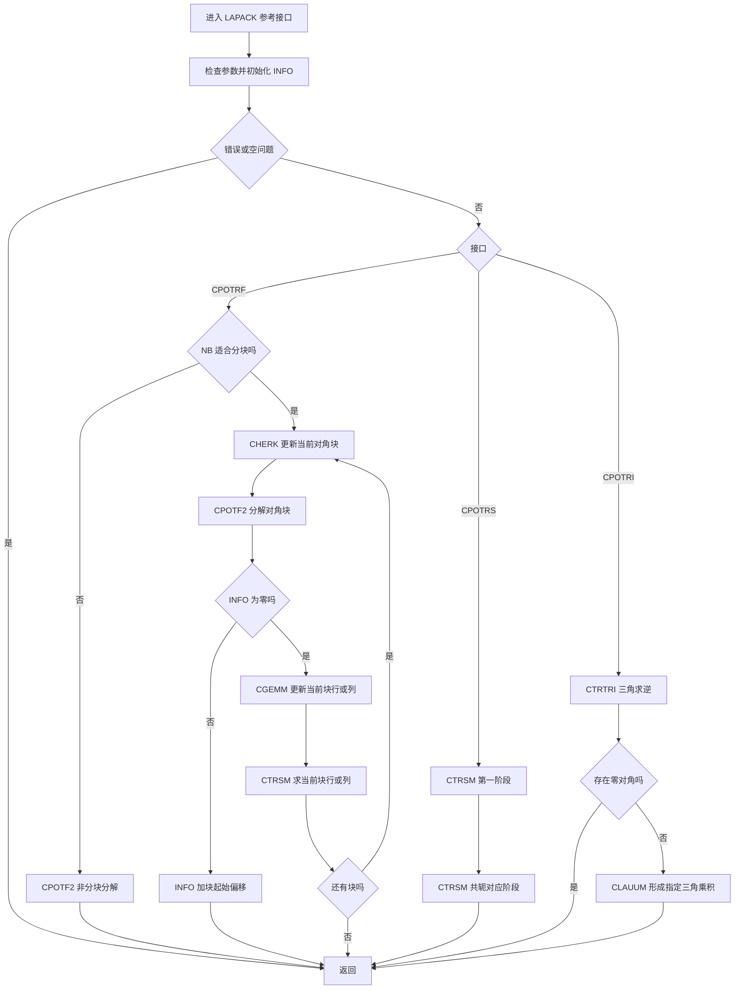
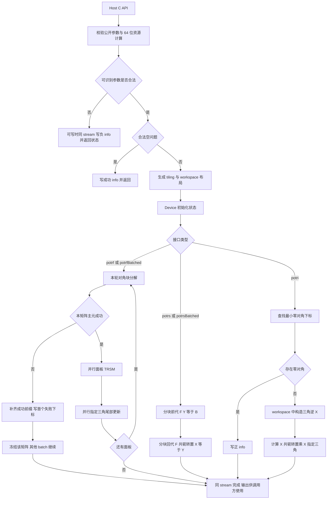

# 一、需求背景

## 1.1 需求来源

本设计对应昇腾社区任务[单精度复数Cholesky分解、求解和批量接口(950)](https://www.hiascend.com/activities/task-center/details/748e4aeaeb6c4f299c0bab51f1560f76)，在 Ascend 950PR 上实现 `aclsolverCpotrf`、`aclsolverCpotrs`、`aclsolverCpotri`、`aclsolverCpotrfBatched`、`aclsolverCpotrsBatched`，并提供 `Cpotrf_bufferSize`、`Cpotri_bufferSize`。五个计算接口作为一个任务完整交付。

需求依据为[官方任务包 ZIP](https://www.hiascend.com/p/resource/202609/a3c754a14f4340d0b8d7e9e07957f19e.zip)内的 `Atlas950_Cpotrf_Cpotrs_Cpotri_CpotrfBatched_CpotrsBatched_task_doc.md`（下称“任务书”）、五个算子目录内 `cases.json`、`bench_result.json`、`package/` 自验辅助件，以及 [ops-solver 任务讨论区第 5 号讨论](https://gitcode.com/cann/ops-solver/discussions/5)。本设计核验日期为 2026-10-10。讨论区最新答复明确“最终精度验收以 3.2.2 的 LAPACK 残差判据为准”，逐元素误差仍保留用于诊断；任务书与辅助脚本尚未统一的常数、统计口径及数据缺件在 5.1 中逐项列明。

设计文档按指定 Checklist 的章节组织。拟提交位置为 [cann-competitions/tasklist](https://gitcode.com/cann/cann-competitions/tree/master/04_tasks/01_community-task-2026/tasklist) 对应任务目录，依本次指定模板拟用 PR 标题 `【社区任务】单精度复数Cholesky分解、求解和批量接口(950)算子设计文档`。按模板要求，后续正式提交时需签署 CLA、在 PR 评论执行 `/compile`，commit 信息如实注明 AI 工具使用情况。当前活动页面另使用 `cann-ops-competitions` 仓名及 `【CANN社区任务】` 标题前缀，正式提交前需按当时活动指引核实；本设计遵循本次指定模板，不擅自提交到任一仓库。本文件仅为设计交付，不表示已发起 PR、签署 CLA、执行编译或完成硬件验收。

## 1.2 背景介绍

### 1.2.1 单精度复数Cholesky分解、求解和批量接口实现优化

Hermitian 正定矩阵的 Cholesky 分解将一次分解复用于多个右端项求解及求逆，可用于复数线性系统、协方差计算等场景。记原始矩阵为 `A0`，分解因子为 `L` 或 `U`，则 LOWER 对应 `A0=L·Lᴴ`，UPPER 对应 `A0=Uᴴ·U`。求解及求逆接口的输入为已分解的因子，不是原始 `A0`。

**TBE 源码和算子信息库适用性。** 本任务不是已有 aclnn/TBE 算子的迁移。任务书 §1 明确 ops-solver 当前无对应复数 Cholesky 原型，§2.2 指定“Host C API + AscendC/CATLASS Kernel 直调”。因此不存在可据以复述本算子逻辑的 TBE Python 文件或 TBE 算子信息库条目；该 Checklist 项在本任务中不适用，不填造假的 `impl/*.py`、`op_info_cfg/*.ini` 或 aclnn 入口。实际工程依据如下。

| 资料 | 文件或入口 | 在本设计中的用途 |
|---|---|---|
| ops-solver 公开接口 | [`include/cann_ops_solver.h`](https://gitcode.com/cann/ops-solver/blob/master/include/cann_ops_solver.h)、[`include/cann_ops_solver_common.h`](https://gitcode.com/cann/ops-solver/blob/master/include/cann_ops_solver_common.h) | 任务书指定的集成路径；本次未完整取得头文件正文，新增接口以任务书 §2.3 为准，状态枚举落码前再核对 |
| ops-solver 工程 | [`CMakeLists.txt`](https://gitcode.com/cann/ops-solver/blob/master/CMakeLists.txt)、[`docs/zh/install/dir_structure.md`](https://gitcode.com/cann/ops-solver/blob/master/docs/zh/install/dir_structure.md)、[`docs/api_list.md`](https://gitcode.com/cann/ops-solver/blob/master/docs/api_list.md) | ASC 构建、Host/Kernel 组织及接口目录；当前接口目录不等于本任务已有实现 |
| CUDA 功能及性能标杆 | [cuSolver DN legacy API](https://docs.nvidia.com/cuda/cusolver/index.html#cuSolverDN-legacy-api) | 五个接口及两个 workspace 查询接口的公开语义；cuSolver 内核闭源，不把其文档当作可审阅的内核源码 |
| 可审阅算法参考 | Netlib [`cpotrf.f`](https://www.netlib.org/lapack/complex/cpotrf.f)、[`cpotf2.f`](https://www.netlib.org/lapack/complex/cpotf2.f)、[`cpotrs.f`](https://www.netlib.org/lapack/complex/cpotrs.f)、[`cpotri.f`](https://www.netlib.org/lapack/complex/cpotri.f)、[`ctrtri.f`](https://www.netlib.org/lapack/complex/ctrtri.f)、[`clauum.f`](https://www.netlib.org/lapack/complex/clauum.f) | 解释 Cholesky、两次三角求解及“三角求逆再乘积”算法；不是性能金标或 TBE 实现 |

优化方向是降低小矩阵批量任务的调度开销、把大矩阵计算集中到分块复数矩阵乘法、避免反复搬运完整矩阵，并在上/下三角、padding、非默认 stream 和确定性要求下保持语义一致。文中的块大小、调度阈值及流水方案均为待 950PR 实测确定的设计参数，不是已验证的性能结论。

### 1.2.2 单精度复数Cholesky分解、求解和批量接口现状分析

#### 1.2.2.1 标杆算子支持的数据类型和数据格式

本任务对齐 cuSolver 的单精度复数 legacy 接口子集，公开矩阵元素为 `aclFloatComplex`，对应 `cuComplex` 的两个连续 FLOAT32，即 COMPLEX64，每元素 8 字节。维数、leading dimension、`Lwork`、`info` 为 32 位 `int`。输入为列主序稠密矩阵，`A(i,j)=A_base[i+j·lda]`，`B(i,j)=B_base[i+j·ldb]`，下标从 0 开始。

| 接口 | 逻辑输入及输出 | 数据布局 | 状态输出 |
|---|---|---|---|
| Cpotrf | HPD 矩阵 → 指定三角因子，原地 | A 物理跨度 `lda×n`，有效 `n×n` | Device 标量 `devInfo` |
| Cpotrs | 因子只读；B → X，原地 | A 为 `lda×n`；B 为 `ldb×nrhs` | Device 标量 `devInfo`，仅 0/负参数下标 |
| Cpotri | 因子 → 逆矩阵指定三角，原地 | A 物理跨度 `lda×n` | Device 标量 `devInfo` |
| CpotrfBatched | 每个独立 HPD 矩阵 → 因子 | Device 指针数组，每项指向列主序矩阵 | Device `infoArray[batchSize]` |
| CpotrsBatched | 每个因子和单列 RHS → 单列 X | 两个 Device 指针数组，`nrhs=1` | Device **标量** `info` |

`lda`、`ldb` 必须允许大于 `n`，不得写死为连续 `n×n`。矩阵间不要求连续或等间距，批量接口不具有 strided-batch 参数。只读取指定三角；非存储侧不作为输入依据。potrf/potri 的可写 A 按任务书约定允许非存储侧被破坏；这不扩展到 potrs 的只读因子，两个求解实现均保持因子不变。padding 不属于有效矩阵，设计不读写其无效行。Cholesky 因子及 Hermitian 逆矩阵的对角采用实数语义，合法输出对角虚部写为 `+0.0f`；求解输出 X 没有实对角限制。

#### 1.2.2.2 标杆算子实现描述

cuSolver 作为接口和性能标杆，其内部算法未公开，不能承诺 NPU 流程与其闭源源码逐行一致。以下流程严格对应上述已读取的 Netlib LAPACK 源文件，用作可审阅的数学实现参考；其与 NPU 分块更新顺序的差异在 3.2.2.3 说明。

**CPOTRF/CPOTF2。** `cpotrf.f` 先检查 UPLO、N、LDA，空矩阵直接返回；通过 `ILAENV` 选择 NB，当 NB≤1 或 NB≥N 时调用 `CPOTF2`。分块路径按块序推进：先用 CHERK 对当前对角块减去已完成因子的贡献，调用 CPOTF2 分解该对角块；若失败，将局部 INFO 加上块起始偏移后返回。成功后用 CGEMM 更新当前块行/列，再用 CTRSM 求出该块行/列。LOWER 使用 `CHERK(Lower, No transpose)`、`CGEMM(No transpose, Conjugate transpose)`、`CTRSM(Right, Lower, Conjugate transpose, Non-unit)`；UPPER 使用共轭转置对应变换。该参考版本为当前块的左看式更新，不是每轮立即刷新整个尾矩阵的右看式实现。

`cpotf2.f` 按标量主元递进，计算对角 `real(a_jj)−Σ|f_jp|²`；非正或 NaN 时置 INFO=j 并终止，成功时开平方、写实对角，再用共轭内积更新下方列或右侧行并除以该对角。其局部复数运算包括 CDOTC、CGEMV、CLACGV、CSSCAL。

**CPOTRS。** `cpotrs.f` 不重新分解、不显式求逆。LOWER 依次执行 `L·Y=B` 和 `Lᴴ·X=Y`；UPPER 依次执行 `Uᴴ·Y=B` 和 `U·X=Y`。源码对应两次 `CTRSM(Left, …, Non-unit)`：LOWER 为 No-transpose→Conjugate-transpose，UPPER 为 Conjugate-transpose→No-transpose，最终 X 覆盖 B。

**CPOTRI。** `cpotri.f` 在参数检查及空问题返回后执行 `CTRTRI(UPLO, Non-unit)` 得到三角因子的逆；若对角零，返回正 INFO，不继续乘积。然后执行 CLAUUM：LOWER 为 `inv(L)ᴴ·inv(L)`，UPPER 为 `inv(U)·inv(U)ᴴ`，只输出指定三角。参考算法源码见本节列出的 `ctrtri.f` 和 `clauum.f`。

**批量接口。** 数学上对每个矩阵应用相同分解或两次三角求解；这不代表 cuSolver 批量内核内部逐个调用单矩阵接口。NPU 设计需要跨矩阵并行，正确区分 `potrfBatched` 的逐矩阵状态与 `potrsBatched` 的标量参数状态。

#### 1.2.2.3 标杆算子实现流程图

以下为 Netlib 可公开审阅流程，图中“参数错误”遵循 Netlib 自身参数编号；NPU 公开 C 参数编号见 2.3.1。



# 二、需求分析

## 2.1 外部组件依赖

运行和构建依赖为 CANN 9.0.0 及以上、950PR 配套驱动、ACL Runtime、Ascend C 编译工具链及 ops-solver 所选配套 CATLASS。具体版本需与目标仓 README 已验证组合一致，在自测报告记录精确版本和提交号，不以“最新版”代替可复现版本。

已核验的 ops-solver `CMakeLists.txt` 使用 `find_package(ASC REQUIRED)`，将 `ascend950*` 映射至 `dav-3510`/`arch35`，并链接 `tiling_api`、`platform` 等工程依赖。构建时复用该机制，不把早期 910 示例编译参数照搬到 950PR。CUDA/cuSolver 只用于独立 GPU 性能参考，不得成为 NPU 运行依赖。

测试侧使用 NumPy/SciPy LAPACK 生成 complex128 golden、complex64 参考残差及输入数据，使用 msprof 采集设备 kernel 时间。Python 自验包不能替代真正的 NPU 执行器，`sim_dut.py` 仅用于文件契约接入验证。

## 2.2 内部适配模块

复用 `aclsolverCreate`、`aclsolverDestroy`、`aclsolverSetStream`、`aclsolverGetStream`，所有计算使用 handle 关联 stream。新增模块分为公开 ABI、Host 校验与 tiling、复数存取/计算公共件、五个 kernel 调度入口和五类测试。

任务书 §5 建议的 `src/cpotrf/`、`src/cpotrs/`、`src/cpotri/`、`src/cpotrf_batched/`、`src/cpotrs_batched/` 及对应 `test/`、`docs/zh/*.md` 是**拟新增位置**，并非已存在的 Cholesky 源文件。落码前对照目标提交的真实目录规范再确定层级，不为了模仿其他仓而创建重复的 op_host/op_kernel 包装。

公共实现集中维护列主序地址计算、复数共轭/拆合、三角 tile 读取、参数下标表、workspace 布局、确定性归约和边界 mask。`potrs` 与 `potrsBatched` 共用三角求解模板，`potrf` 与 `potrfBatched` 共用面板分解模板；批量入口只改变任务调度和指针获取方式。公开类型在 `cann_ops_solver_common.h` 定义一次，避免各接口重复定义或 ABI 冲突。

## 2.3 需求模块设计

### 2.3.1 Ascend C算子原型

以下为任务书 §2.3 要求的公开 C 原型。内部 Ascend C kernel 可增加 tiling 和状态等内部参数，但不能改变公开参数名称、顺序、Host/Device 归属和维数类型。

```c
typedef struct {
    float real;
    float imag;
} aclFloatComplex;

typedef enum {
    ACLSOLVER_FILL_MODE_LOWER = 0,
    ACLSOLVER_FILL_MODE_UPPER = 1
} aclsolverFillMode_t;

aclsolverStatus_t aclsolverCpotrf_bufferSize(
    aclsolverHandle_t handle, aclsolverFillMode_t uplo, int n,
    aclFloatComplex *A, int lda, int *Lwork);

aclsolverStatus_t aclsolverCpotrf(
    aclsolverHandle_t handle, aclsolverFillMode_t uplo, int n,
    aclFloatComplex *A, int lda, aclFloatComplex *Workspace,
    int Lwork, int *devInfo);

aclsolverStatus_t aclsolverCpotrs(
    aclsolverHandle_t handle, aclsolverFillMode_t uplo, int n, int nrhs,
    const aclFloatComplex *A, int lda, aclFloatComplex *B, int ldb,
    int *devInfo);

aclsolverStatus_t aclsolverCpotri_bufferSize(
    aclsolverHandle_t handle, aclsolverFillMode_t uplo, int n,
    aclFloatComplex *A, int lda, int *Lwork);

aclsolverStatus_t aclsolverCpotri(
    aclsolverHandle_t handle, aclsolverFillMode_t uplo, int n,
    aclFloatComplex *A, int lda, aclFloatComplex *Workspace,
    int Lwork, int *devInfo);

aclsolverStatus_t aclsolverCpotrfBatched(
    aclsolverHandle_t handle, aclsolverFillMode_t uplo, int n,
    aclFloatComplex *Aarray[], int lda, int *infoArray, int batchSize);

aclsolverStatus_t aclsolverCpotrsBatched(
    aclsolverHandle_t handle, aclsolverFillMode_t uplo, int n, int nrhs,
    aclFloatComplex *Aarray[], int lda, aclFloatComplex *Barray[], int ldb,
    int *info, int batchSize);
```

公开头文件使用 C 可见定义，C++ 实现用 `extern "C"` 导出。编译测试同时覆盖 C 与 C++，验证 `sizeof(aclFloatComplex)==8`、实部偏移 0、虚部偏移 4；不直接假设 `std::complex<float>` 跨编译器 ABI 等价。`_bufferSize` 的 `Lwork` 为 Host 输出指针，返回 COMPLEX64 **元素数**；计算接口的 workspace 和 info 为 Device 指针。不能将元素数误当字节数，分配字节数为 `8×Lwork`。

**参数与状态契约。** 参数下标不计 handle，表内负号表示写入 info 的值。Host 能识别的非法枚举、负维数、不合法 leading dimension、空必需指针、负或不足的 Lwork 返回 `ACLSOLVER_STATUS_INVALID_VALUE`；当有效 stream 和可写 info 存在时，向该 stream 下发小 kernel 写入负下标。无效 handle 或运行时/资源错误应映射至目标仓 `aclsolverStatus_t` 对应状态；不臆造尚未核对的数值编码，不直接将任意 `aclError` 强转为该枚举。

| 入口 | 不计 handle 的参数编号 | 代表性异常 |
|---|---|---|
| potrf / potri | uplo=1，n=2，A=3，lda=4，Workspace=5，Lwork=6，devInfo=7 | 非法 lda→−4；workspace 空且需要非零空间→−5；空间不足→−6 |
| potrf / potri bufferSize | uplo=1，n=2，A=3，lda=4，Lwork=5 | Host Lwork 指针为空→返回非法参数，无 Device info 可写 |
| potrs | uplo=1，n=2，nrhs=3，A=4，lda=5，B=6，ldb=7，devInfo=8 | nrhs<0→−3；非法 ldb→−7 |
| potrfBatched | uplo=1，n=2，Aarray=3，lda=4，infoArray=5，batchSize=6 | batchSize<0→−6；全局参数错仅写 `infoArray[0]`，前提是该槽可写 |
| potrsBatched | uplo=1，n=2，nrhs=3，Aarray=4，lda=5，Barray=6，ldb=7，info=8，batchSize=9 | 非空问题 nrhs=2→−3；info 始终是标量 |

`potrf` 成功写 0，首个非正主元位于零基下标 j 时写 `j+1`；`potrfBatched` 每个矩阵独立写该值，其他矩阵继续。`potri` 因子第 k 个对角为零时写 k；这不是重新检查原始 HPD 矩阵。两个 `potrs` 接口不报告正定性正 INFO，只报告 0 或参数错误。计算完成前，调用方不得读取 info 或复用输入/输出缓冲区。

检查顺序拟采用“有效 handle/stream→按公开顺序检查标量及可识别的指针条件→合法空问题→workspace→调度”。多参数同时非法时报告首个非法参数；空问题不读取矩阵。空问题与指针豁免细节按任务方最终契约固化，不能让 `n=0` 掩盖非法 uplo 或负 batchSize。

**待统一的接口边界。** 任务书一处规定 `nrhs=0` 为空问题成功返回，另一处规定 `potrsBatched` 在 n>0 且 nrhs≠1 时必须报错，参数表又允许 n=0 或 batchSize=0 放宽。设计将非空批量求解严格限制为 nrhs=1；`n>0、batchSize>0、nrhs=0` 的最终返回值须由评审明确，测试同时保留两个文义来源，不擅自宣称已对齐。raw-pointer C ABI 也无法从地址推断 dtype、真实分配长度或列主序；这些属于调用方内存契约，Host 只能检查可观察条件。Device 指针数组中某个成员失效的同步 status 与异步 info 语义尚需统一，不能通过常态 D2H 同步假装已支持所有地址有效性检查。

### 2.3.1 Ascend C算子相关约束

本节沿用 Checklist 中重复的 2.3.1 编号。与完整 cuSolver 产品相比，本任务仅实现上述 COMPLEX64 接口，不扩展到实数、COMPLEX128、generic X API、strided-batch 或多 GPU；这些不属于任务书要求。当前设计不引入 aclnn 两段式、PyTorch、broadcast 或图融合接口。

验收下限为单矩阵 n∈[1,4096]，potrs 的 nrhs∈[1,128]，批量 n∈[1,4096]、batchSize∈[1,1000000]，potrsBatched 非空问题 nrhs=1；同时处理合法空问题。上/下三角、非紧凑 lda/ldb、非默认 stream 均为必需能力。维数范围独立，不表示 n=4096 且 batchSize=1000000 的组合必须在一台设备内存中可装入；资源上限不能被误写为按 n 固定拒绝小批量合法用例。

# 三、需求详细设计

## 3.1 调用方式

采用 ops-solver Host C API 直接调度 Ascend C/CATLASS kernel。典型单矩阵调用链为：初始化 ACL 和 Device→创建 handle、设置调用方 stream→分配列主序 Device A→查询 potrf 的 Lwork→分配 `8×Lwork` 字节 workspace 与 Device info→调用 potrf→在依赖该结果前通过 stream/event 确认完成并检查 info→按需要调用 potrs 或查询 workspace 后调用 potri。potrs/potri 的准备性 potrf 不计入其独立性能测试。

批量调用时，调用方分别分配各矩阵，再将这些 Device 地址组成指针表并复制到 Device，传入 Device 指针表地址。不能传 Host `std::vector<aclFloatComplex*>.data()`，也不能把连续三维张量首地址当作指针数组。各矩阵物理位置可离散；测试专门打乱指针顺序验证这一点。

Host 不读取矩阵内容、不执行 CPU 数值回退、不每个面板同步读 info。相邻阶段在同一 stream 顺序执行，后续 kernel 在 Device 上检查 info 决定继续或跳过。不同调用之间的依赖由调用方 stream/event 管理。workspace 在操作完成前保持有效；库内部缓存以设备和调用生命周期管理，跨流复用必须先完成事件依赖或租用独立区域，不能用全局静态 scratch 引入竞态。

## 3.2 需求总体设计

### 3.2.1 host侧设计

#### 3.2.1.1 分核策略

定义可用 AI Core 数为 C，矩阵块边长 b，块数 q=ceil(n/b)。C 以及可用本地存储容量由目标平台查询，不写死 950PR 的核数或 UB/L1/L0 容量。公开维数虽然为 int，Host 的乘法、字节数、任务总数和 Device 地址偏移均使用经溢出检查的 64 位类型。

| 路径 | 分核方式 | 顺序依赖与负载均衡 |
|---|---|---|
| 小矩阵 potrf/potrs/potri | 单矩阵单核，完整或局部三角驻留 UB；小批量一个核连续处理多个矩阵 | 每个矩阵内部主元顺序固定；矩阵编号 `t=coreId+s×C`，不以浮点原子合并结果 |
| 大矩阵 potrf | 对角面板由单个任务分解；面板下方 tile 并行 TRSM；尾部指定三角 tile 并行 HERK/GEMM | 面板 k 的三阶段依次下发；尾部每个输出 tile 唯一归属一个任务 |
| potrs 多 RHS | 以 RHS 列块和当前受更新行块二维划分 | 前代块序升序、回代块序降序；每个输出 tile 内归约顺序固定 |
| potri | 三角逆阶段以单位矩阵 RHS 列块并行；最终 Gram 乘积按输出半三角 tile 并行 | 因子只读直到完整三角逆写入 workspace；最终阶段才覆盖 A |
| 大矩阵 batched | `batchId×当前阶段tileId` 展平，grid-stride 遍历 | 同一轮处理完整原始 batch；每个矩阵独立读取 info 并选择跳过，失败不阻塞其他矩阵 |

尾矩阵含 r 个块时，下三角 tile 数为 `r(r+1)/2`。用 `t=i(i+1)/2+j` 编号（0≤j≤i<r），经整数边界校正求反映射，不因浮点开方误差访问越界。当任务数小于 C 时仅启动需要的核；小 n 大 batch 将多个矩阵组成一组提高单次 launch 的有效工作量，但不能在性能测试中把公开 batchSize 缩小后替换原始金标。

跨核同步通过同 stream 的阶段 kernel 边界完成。初版不使用自行构造的全局自旋栅栏，以免未驻留核参与导致死锁。若后续采用融合或流水事件，只能在明确平台同步保证、残差和确定性通过后启用。

#### 3.2.1.2 数据分块和内存优化策略

**存储与打包。** 外部为 interleaved complex AoS，内部 tile 可拆成实部/虚部 SoA。LOWER 直接读取选定下三角；UPPER 按共轭转置映射为逻辑下三角 `F(i,j)=conj(U(j,i))`。该映射只影响装载/回写，外部仍保持上三角格式，不能先读取不可信的另一半来“补全”。每次拷贝使用实际 lda/ldb，尾块按 `min(tileSize, remaining)` mask，padding 不参与归约。

**本地存储预算。** 设实数矩阵乘 tile 为 m×k 与 k×v，复数结果为 m×v。以四实乘复合乘法、输入双缓冲、复数结果累加及回写各一份为保守向量路径预算：

```text
U_vector = 16(mk + kv) + 16mv + 8b² + U_reduce + U_meta
U_vector ≤ U_available − U_runtime
```

其中 `16(mk+kv)` 为两组复数 FP32 输入 ping/pong（每元素 8 字节），`16mv` 为复数累加与 interleaved 回写缓冲，`8b²` 为必要时保留的对角因子 tile。各 kernel 按实际生存期复用互斥区域，不把此总和强行分配给所有阶段。若小矩阵完整驻留，另按 `8n² + 16n·r + U_reduce + U_meta` 检查，其中 r 为单核处理的 RHS 列数；超预算切至 tiled 路径，不用经验 n 阈值替代容量验证。

Cube 优化路径只有在所选 CANN/CATLASS 组合验证相应 FP32 输入和累加语义后启用。按顺序执行四个实乘、复用 L0 的设计分别约束：

```text
L1_need = 16(mk + kv) + L1_meta
L0A_need ≥ 4mk；L0B_need ≥ 4kv；L0C_need ≥ 4mv
```

这里的 L0 预算针对一次实乘，不代表已存在原生 COMPLEX64 Cube 指令。具体对齐、矩阵片段格式、内部 scratch 及事件槽另计入平台实际需求；不能把 UB、L1、L0 合并为一块可任意替代的内存。FP32 向量路径为正确性基线，不默认以 TF32/BF16/FP16 截断输入换取性能。

首轮调优候选为 b∈{16,32,64}，输出 tile 边长∈{32,64,128}，k tile∈{16,32,64}，随后按平台容量与性能曲线筛选。它们只是候选；一个可行组合必须同时满足每层预算、编译支持、全量残差和 bit-wise 确定性。

**GM workspace。** 令 `align(x,a)=ceil(x/a)×a`，a 为选定 ABI/数据搬运要求的对齐字节数，`S_tile` 为单个并行任务所需 GM 临时打包字节，`S_state` 为内部状态字节。直接从 GM 装载且只用本地缓冲的配置可令 `S_tile=0`。计划的查询上界为：

```text
W_rf_bytes = align(C·S_tile + S_state, a)
Npad = align(n, element_alignment)
W_ri_bytes = align(8·Npad·n, a) + align(C·S_tile + S_state, a)
Lwork = ceil(W_bytes / 8)
```

potri 的第一项用于完整存放三角逆 X（逻辑未使用侧置零），不是存储原始 A0；n=4096、不含额外对齐时该项为 134,217,728 字节，即 128 MiB。workspace 查询和执行共享同一 layout 计算函数，查询不读取 A、不下发数值计算；结果超 INT_MAX 个元素或字节乘法溢出时返回非法值，不能截断。空问题返回 Lwork=0；计算检查调用方 Lwork 不小于选定配置所需元素数。

无公开 workspace 参数的 potrs/batched 优先采用 GM 输入输出加本地 tile，不额外分配与 `batchSize×n²` 成比例的暂存。若某个优化配置确需内部 GM scratch，按活跃核数/活跃 tile 有界分配并进行 stream 安全的生命周期管理；分配失败返回库对应资源错误，不能静默退到 CPU。potrf 非存储三角虽允许破坏，初版不依赖它容纳越过有效矩阵边界的 scratch。

**搬运优化。** 对列主序连续行片段合并 DMA，UPPER 共轭映射在 tile 内转置；采用输入双缓冲覆盖搬运延迟，避免每轮拆合整个 n×n 矩阵。所有写回由唯一 owner 发出，完整保存有效范围内的输出，地址计算使用 `uint64_t(i)+uint64_t(j)×ld`，禁止先在 int 中相乘。

#### 3.2.1.3 tilingKey规划策略

tilingKey 是内部编译分派标识，不是公开参数。规划字段如下，数值属于本设计内部约定，需和最终 kernel 注册保持一致：

```text
key = op | (uplo << 3) | (path << 4) | (rhsClass << 7) | (tail << 9)
op：0=potrf，1=potrs，2=potri，3=potrfBatched，4=potrsBatched
uplo：0=LOWER，1=UPPER
path：0=small_vector，1=tiled_vector，2=validated_cube
rhsClass：0=不适用或单列，1=多列
尾块 tail：0=整块，1=存在尾块
```

小矩阵路径须同时满足本地容量、指令合法性和调优阈值；有剩余行/列/RHS 时设置 tail。是否紧凑 lda/ldb 作为 tiling 数据中的运行时 stride，不为每个 padding 值产生 key；n、nrhs、batchSize、块大小、stage、panelIndex、任务数、workspace 偏移写入固定版本的 tiling 结构。结构只存可移植定宽字段，不嵌入 Host 容器。

配置选择只依赖本次输入维数、平台能力和冻结的调优表，不根据运行时竞争情况随机选择归约路径。同输入、同设备配置、同 stream 的重复调用选同 key 和块尺寸。未知 key 或不支持的能力组合在 Host 拒绝或选择已验证的向量路径，禁止落入错误 kernel。

### 3.2.2 kernel侧设计

#### 3.2.2.1 kernel侧实现描述

**复数公共原语。** 令 X=Xr+iXi、Y=Yr+iYi，普通乘积使用 `Re(XY)=XrYr−XiYi`、`Im(XY)=XrYi+XiYr`；共轭乘积使用 `Re(XYᴴ)=XrYrᵀ+XiYiᵀ`、`Im(XYᴴ)=XiYrᵀ−XrYiᵀ`。所有实乘、加减、归约和除法采用固定 FP32 路径，不能漏掉虚部交叉项或用转置替代共轭转置。主元平方和以实数非负项计算。固定每个输出 tile 的 owner、K tile 顺序和 tile 内归约树，不用无序浮点 atomicAdd。

**POTRF 右看式分块。** 以下以逻辑 LOWER 描述。第 k 轮开始时尾矩阵已由之前面板更新为当前 Schur 补：

```text
1. 对角块 Akk 做逐主元 Cholesky：Akk = Lkk·Lkkᴴ
2. 面板求解：Lik = Aik·Lkk⁻ᴴ，i > k
3. 尾部更新：Aij ← Aij − Lik·Ljkᴴ，i ≥ j > k
```

对角 tile 内的第 j 个主元为 `d=real(a_jj)−Σp<j |l_jp|²`。若 d>0 且有限，令 `l_jj=sqrt(d)` 并写虚部 0；各 `l_ij=(a_ij−Σp<j l_ip·conj(l_jp))/l_jj`。若 d≤0，记录全局最小失败下标 `k·b+j+1`，禁止对其开方或继续除法。非法非有限输入如何与生态标准一致归类另由边界测试确认，不能把 NaN 比较为 false 后误写成功。

任务书要求失败前 k−1 列因子有效，因此当失败发生于面板内部时，需先补齐该面板中已经成功的前缀列在面板下方的 TRSM，再停止；不能只分解对角小块后立刻跳过而留下前缀列下半段未完成。后续未成功列及非存储侧不承诺有效。UPPER 通过逻辑 `F=Uᴴ` 的共轭映射共用计算，写回 U；其重建必须是 `Uᴴ·U`，不能使用 `U·Uᴴ`。

各轮采用 diagonal→panel→trailing 的 stream 顺序，失败标志由 Device 保存。Host 可预先下发所有轮次；失败后的 kernel 先检查标志，除“成功前缀补齐”外不再修改该矩阵。单矩阵无需跨核竞争更新 info；batch 每个矩阵对应一个状态槽。

**POTRS 两次分块三角求解。** 将 LOWER 的 L 或 UPPER 的 `Uᴴ` 统一记为下三角 F，执行 `F·Y=B`、`Fᴴ·X=Y`。前代块 k：先求 `Yk=Fkk⁻¹Bk`，再并行更新 `Bi←Bi−FikYk`；回代逆序求 `Xk=Fkk⁻ᴴYk`，更新 `Yi←Yi−FkiᴴXk`。块对角解仍用逐行前代/后代，不显式形成 F 的逆。单 RHS 使用向量更新减少矩阵乘 setup，多 RHS 按列块复用因子 tile。A 全程只读，B 原地覆盖。

**POTRI 三角逆与 Hermitian 乘积。** 先按确定顺序检查因子对角，最小零对角位置写正 INFO 并终止；不能用“非常小”阈值替代精确零检测而把可逆因子报奇异。以逻辑下三角 F 为输入，在 workspace 构造 X=F⁻¹。按列块初始化单位 RHS，逐块解 `F·X=I`，只计算三角结构内的元素；X 的其他元素置零。此阶段 A 保持只读，避免原地覆盖影响后续列块。完成后并行计算 `C=XᴴX` 的指定三角并写回 A，对角实部为平方和、虚部写零。LOWER 即 `L⁻ᴴL⁻¹`；UPPER 因 F=Uᴴ，得到 `U⁻¹U⁻ᴴ`，与 LAPACK CPOTRI 一致。整个过程不重新执行 potrf，不把输入因子直接当原始矩阵求逆。

**Batched。** kernel 从 Device 指针表读取 `Aarray[t]`/`Barray[t]`，随后使用真实 lda/ldb。小矩阵每核复用本地缓冲处理多个独立实例；大矩阵把单矩阵各阶段扩展至全部 batch。`potrfBatched` 开始时初始化所有 infoArray 项；某项失败仅冻结该项。`potrsBatched` 成功时由一个指定任务写标量 info=0，其他任务只计算，不重复争写这个标量。不把 info 当长度 batchSize 的数组写越界，也不根据输入里未提供的 potrf infoArray 擅自跳过矩阵。

**错误及空问题 kernel。** Host 检出的错误在可写 info 上异步写负参数编号；空问题在有有效标量 info 时写 0；potrfBatched 在 n=0 且 batchSize>0 时将所有有效 infoArray 项置 0，batchSize=0 不写不存在的 infoArray[0]。公开空指针豁免及 Device 成员指针校验的争议点按 2.3.1 评审结论补齐，不在 Device 任意探测陌生地址。正常完成仅表明下发成功，数值 info 和异步设备异常须由调用方按 ACL stream 语义获取。

#### 3.2.2.2 Ascend C实现流程图



每个 batch 在同一调度轮独立走成功或失败分支，图中的冻结不是终止其他 batch。内部不同阶段可由多个 kernel 组成；性能统计必须归并到一次完整 API 调用，不能只统计其中最快的一个阶段。

#### 3.2.2.3 Ascend C实现流程图与标杆算子流程图存在的差异点和原因

| 差异 | Netlib 可审阅参考 | 本设计及原因 |
|---|---|---|
| POTRF 更新顺序 | CHERK/CGEMM 对当前块左看更新 | 右看式及时更新尾矩阵，提供更多独立 tile 并行；不改变数学结果，但舍入路径不同，必须按残差验证 |
| UPPER 实现 | 独立上三角 BLAS 参数分支 | 以共轭视图统一为 LOWER，减少两套算法偏差；只在存取层映射，必须测试共轭符号 |
| POTRI 暂存 | CTRTRI、CLAUUM 原地复用 | 三角逆先存 workspace，再计算 Gram 写回；更清晰地消除覆盖依赖，代价为约 8n² 字节暂存 |
| 批量并行 | 单矩阵 LAPACK 例程 | 跨矩阵/跨 tile 并行，Device 指针表寻址和独立 info；不推断 cuSolver 内部实现 |
| 同步和错误 | 同步 CPU 调用直接返回 INFO | Host 状态与 Device 数值 info 分层，stream 阶段边界保证依赖，减少 Host 同步 |
| 复数基础计算 | 复数 BLAS | 拆实/虚并固定四实乘及归约顺序，按 950PR 平台能力选择向量或已验证 Cube 路径 |

本任务不具备可比较的 TBE 源流程，故不声称与 TBE 完全一致；一致性对象是公开 ABI、数学语义、指定三角读写、失败下标、stream 和验收标准。

## 3.3 支持硬件

目标硬件仅声明任务书要求的 **Ascend 950PR（Atlas 950）**。功能、精度和性能验收均须在该型号上完成，记录实际 SoC 型号、CANN、驱动、编译器、ops-solver/CATLASS 提交版本及编译参数。其他 Ascend 型号即使能编译，也不作为本任务已适配结论。

## 3.4 算子约束限制

- 仅支持本任务定义的 COMPLEX64、列主序和两种 uplo；无 dtype/shape 描述符的 raw-pointer API 由调用方保证实际缓冲区正确
- potrf 输入须符合指定三角的 Hermitian 正定语义；只在该三角上计算，不能依赖对侧数据；potrs/potri 输入须为对应 uplo 的合法因子
- `lda/ldb≥max(1,n)`；不要求等于 n；所有有效地址跨度和 workspace 大小必须可表示且在实际设备分配范围内
- 不支持输入矩阵、B、workspace、info 之间未声明的重叠；批量中参与原地写入的矩阵或 RHS 也应互不重叠。将别名支持列为调用方契约需在 API 文档明确，不能暗中接受后产生竞态
- 非空 potrsBatched 仅支持 nrhs=1；空问题、非法参数的优先级按 2.3.1 待统一项完成后冻结
- 不提供 CPU fallback，不依赖 CUDA，不提供 broadcast、strided-batch、图融合、多设备分片或自动伪逆
- 正定性接近边界时 FP32 可能出现与高精度不同的主元符号，需用正式非正定用例和残差证据分析，不能任意加对角正则项“修复”输入
- 目前无 950PR 实测结果；块阈值、Cube 优化和性能是否达标均待实现与全量自验，不将本设计视为完成证明

# 四、特性交叉分析

| 交叉特性 | 风险 | 设计控制与检查 |
|---|---|---|
| 原地更新 × 上/下三角 | 错读非存储侧或共轭方向错误 | 统一三角视图；对侧填毒值；LOWER/UPPER 分别重建并比较 |
| padding × 分块尾部 | DMA 越界、覆盖 padding | leading dimension 寻址、尾块 mask、padding 哨兵、n=2ᵏ−1/2ᵏ/2ᵏ+1 |
| 非正定 × 大面板 | 失败下标偏移错误、已成功列不完整 | 检查首个失败位置；面板中失败补齐前缀；其他 batch 不受影响 |
| 多 RHS × 同步 | 前/回代数据尚未就绪即被消费 | 阶段在同 stream 排序；RHS tile 唯一 owner；覆盖 nrhs=1/8/32/128 和尾列 |
| batch × 指针数组 | 将 Device 指针表误解为连续张量 | 离散分配、随机重排指针、相同内容不同地址测试；不按 batchStride 寻址 |
| 确定性 × 并行归约 | 原子累加及非固定分块导致 bit-wise 漂移 | 固定 key、tile、归约树；无浮点原子；反复恢复相同输入后执行 |
| 多 stream × scratch 复用 | 生命周期冲突和跨流数据竞争 | 事件或独立租用 scratch；不同 handle/stream 并发测试；无全局静态暂存 |
| 正式验收 × 自验辅助包 | 用脚本 PASS 代替正式验收，或误用缺失索引 | 保留正式残差与包诊断两套记录；脚本 formal=PENDING_RULING 不改为 PASS |
| 显存 × 极大 batch | 分配溢出或误将规模截小 | 64 位计算、资源错误明确返回；原规格性能测量，缺资源时报告限制，不伪造等效金标 |
| 工程 ABI × 旧示例 | aclError/新状态类型混用、旧 cmatinv 文档语义移植 | 以七个任务接口原型为准；C/C++ 编译和符号检查；QUICKSTART 示例仅借鉴工程流程 |

# 五、可维可测分析

## 5.1 精度标准/性能标准

**正式精度依据与文档勘误。** [任务讨论区第 5 号讨论](https://gitcode.com/cann/ops-solver/discussions/5) 最新答复说明最终以任务书 §3.2.2 LAPACK 残差判据验收。因此残差作为正式主验证，逐元素误差保留用于快速定位问题。数学记号统一为 A0=原始 HPD 矩阵、F=输入/输出三角因子、C=完整 Hermitian 逆矩阵。只从存储侧共轭镜像重建 A0 或 C；本设计的实际输入残差将送入实现的 complex64 输入及输出升为 complex128 后计算；potrs 必须如此。POTRF 辅助脚本实际仍引用量化前 A64，下面单列差异，不将该脚本报告与实际输入残差混为同一结果。

| 接口 | 残差比 R | 任务书阈值 |
|---|---|---|
| potrf / potrfBatched LOWER | `‖L·Lᴴ−A0‖₁ / (n·‖A0‖₁·ε)` | `R≤max(5R_cpu,3R_cpu_mean)` |
| potrf / potrfBatched UPPER | `‖Uᴴ·U−A0‖₁ / (n·‖A0‖₁·ε)` | 同上 |
| potrs / potrsBatched | `max_j ‖B0_j−A0·X_j‖₁ / (‖A0‖₁·‖X_j‖₁·ε)` | `R≤max(5R_cpu,3R_cpu_mean)` |
| potri | `‖I−A0·C‖₁ / (n·‖A0‖₁·‖C‖₁·ε)` | `R≤max(5R_cpu,0.1)` |

矩阵 1-范数为最大列绝对和，向量 1-范数为元素复模之和。R_cpu 使用同 case 的 complex64 CPU 参考链路计算；数值残差计算使用 complex128。每一条残差口径的 R、R_cpu 和 R_cpu_mean 必须使用相同参考矩阵、ε 和样本集合；不能把 A32/2⁻²³ 的被测残差与 A64/2⁻²⁴ 下的固化均值交叉比较。并列诊断需要分别重算或依据明确可证明的同源比例转换参考值，正式版本由维护方确认。任务书规定非批量 R_cpu_mean 为本算子测试集均值，批量按当前 case 的各矩阵均值，且每个矩阵均须通过。非正定/参数错误契约用例独立判 info，不进入 HPD 残差统计。零范数等退化情形须显式处理，不把 NaN 比较结果或除零当成通过。

任务书对 potrf 泛写 `F·Fᴴ`，UPPER 实际必须用 `Uᴴ·U`；附件 `cpotrf/package/verify_accuracy.py` 的 `reconstruct` 分支已采用该区别。任务书 potri 残差段落将 A 文字解释为因子，但乘积残差应使用原始 A0；附件 `cpotri/package/verify_accuracy.py` 使用 A32 原始 HPD 矩阵计算 `I−A0·C`。本设计按正确数学含义及脚本实现区分这两个对象。

**附件与任务书尚未统一的判据。** 不私自修改官方脚本或挑选更宽松的一套宣称通过。正式验收前保留版本、原始报告和评审确认结果。

| 项目 | 任务书文本 | 已读取附件脚本/补充说明 | 设计处理 |
|---|---|---|---|
| 逐元素 rtol/atol | rtol=2⁻¹⁰，atol=2⁻¹⁶ | 五份 `verify_accuracy.py` 均为 rtol=atol=2⁻¹³ | 按各自参数输出诊断；最终以维护方明确的残差规则为主 |
| POTRF 残差的 A | 原始输入 Hermitian 矩阵，设计记录实际 A32 升精度结果 | potrf/potrfBatched 的 `fallback_kwargs` 实际传入量化前 A64；A32 由 A64 窄化，二者可能不同 | 原样保留辅助脚本结果，另报实际 A32 残差，并请求维护方确认最终输入口径；potrs/potri 脚本使用 A32/B32 |
| 残差 ε | 2⁻²³ | 脚本 EPS32=2⁻²⁴ | 同时保留两种归一化结果，正式常数待刷新任务书/评审确认；特别关注 potri 固定 0.1 分支 |
| 逐元素最大误差 | `1e-2 or 32×ULP` | `max(1e-2,32×ULP(g_low))`，g_low 为最大误差点 golden 的 FP32 窄化值 | 记录脚本实际公式，不解释为双条件同时成立 |
| 均值来源 | 单矩阵测试集均值；批量当前 case 均值 | 单矩阵直接读 `cases/index.json` 固化均值，当前 R_cpu 现场重算；批量完整索引尚缺 | 记录均值来源与版本，不在缺件时自造均值或 sample_map |
| 自验结果含义 | 正式任务验收 | 辅助脚本 `formal` 恒为 `PENDING_RULING` | 数值通过不等同正式通过 |

脚本对复数实部、虚部分别计算容差和最大误差，两部分均需满足，不能合成 2N 元素稀释一侧失配率；只比较 potrf/potri 指定三角。任务书与脚本逐元素 matched_ratio 均为 0.99。不得用 `sim_dut.py` 生成的模拟输出作为 NPU 精度证据。

**用例清单和缺件。** 下表为附件逐文件核对结果。原始性能用例数与标准化精度用例数不完全相同，关联必须使用 case_id、bench_key 和全部规格，不能只按行号或 n 配对。

| 接口目录 | 原始 cases / bench 条目 | canonical 精度条目 | 已核验 info 契约用例 |
|---|---:|---:|---|
| cpotrf | 143 / 143 | 145 | 3 个，首个非正定主元 k=1/4/9 |
| cpotrs | 174 / 174 | 176 | 3 个，非法 uplo，info=−1 |
| cpotri | 143 / 143 | 145 | 3 个，奇异因子对角 k=1/4/9 |
| cpotrfbatched | 154 / 154 | 去重后 151 | 完整 index 缺件，不能核验其全部 info/sample_map |
| cpotrsbatched | 154 / 154 | 去重后 151 | 完整 index 缺件，不能核验其全部 info/sample_map |

前三个 canonical 各有 2 个无 GPU 金标的补充精度用例，其性能列标为 N/A，不能算作已通过性能门禁。前三份完整 index 的总条目分别为 148、179、148，包含各自 3 个 info 用例。

批量辅助脚本采用 A0 代表内容机制：每 case 至多 `min(5,batchSize)` 个不同内容，按 sample_map 展开；先验证同内容各槽位输出 bit-wise 相同（potrfBatched 的 infoArray 逐槽核对，potrsBatched 的 info 为标量），再对代表内容验精度。脚本从完整 index 读取按槽位数加权的 `R_cpu_mean=Σ(count_j×R_cpu_j)/batchSize`，当前代表内容 R_cpu 现场重算。该机制是辅助包覆盖方式，不能等同于对任意独立随机矩阵的全量逐矩阵验收；另补每槽不同内容的批量功能测试。实际完整 index 未取得时不能还原全部样本或核验其统计值。

原始 ZIP 中两个 `package/cases/index.json.gz` 实为 Git LFS 指针文本，并不是真正 gzip 数据。讨论区已为 potrfBatched 提供两份分片及按序拼接指引：[分片一](https://gitcode.com/user-attachments/files/8916867/419883cc306e40038651aecd7e3f5c5c.gz)、[分片二](https://gitcode.com/user-attachments/files/8916867/9a63c94b95e24761b708eba8ac666cd0.gz)；尚需下载、拼接、解压和哈希验证后才能声明恢复完成。potrsBatched 的完整 index 仍待取得。因此目前不能声称原 ZIP 解压后即可完整运行全部批量精度验证。缺件不妨碍自建功能测试，但自建 sample_map 不能冒充发布件。

任务书还写明构造用例输入占用在 4G 范围内，而两份批量 canonical 各有 111/151 条仅 A 的 COMPLEX64 存储就超过 4 GiB，例如 n=4096、batchSize=63，A 需 `8×4096²×63=8,455,716,864` 字节，尚未计 B、指针表和 workspace。该资源口径须与验收方确认；性能测试不得静默缩小 batch 后与原金标比较。

**功能、自验与确定性补充矩阵。** 附件用例之外补充以下覆盖，结果进入自测报告，不把“有测试设计”写成“已通过”。

- 接口链路：potrf；potrf→potrs；potrf→potri；batched 分解→batched 求解；七个公开符号和 workspace 查询
- 形状：n=0/1、2 的幂及其相邻数、最大 4096；nrhs=0/1/8/32/128 及尾块；batchSize=0/1/8/128/1024/3000 及官方大批量
- 布局：LOWER/UPPER；lda/ldb=n、n+8、n+32；padding 哨兵；非存储侧填与真实矩阵不一致的有限毒值
- 错误：非法 uplo、负维数、过小 leading dimension、空必需指针、Lwork 少一个元素、零和不足 workspace、维数乘法溢出；nrhs=2 的 potrsBatched 必须报错
- 数值：均匀/正态复随机 HPD、对角占优、任务书非正定及零对角因子；主元失败位置跨面板边界；批中成功和失败混合
- 确定性：每次恢复完全相同的 A/B，串行重复执行并逐字节比较有效输出和 info；不能比较连续覆盖后的不同输入
- 并发和生命周期：非默认 stream；多 handle/多 stream 独立输入；workspace 异步有效期；批量指针离散分配与乱序
- 逐层检查：地址/越界检查、padding 哨兵、C/C++ ABI 编译、参数状态检查、输出三角有效性、残差和 bit-wise 对比

造数采用各包 `gen_data.py --canonical canonical_cases.json --out data --select all`。执行器把任务包的打包矩阵转换成实际列主序 Device 存储，正确构造 Device 指针数组；将 NPU 输出按脚本约定导出 `.npz`，包含 out32、info、status。普通 potrs/potri 精度用例提供原始 A32，需要按用例协议准备因子后再调用被测接口，并保留原始 A0/B0 供残差使用。potri 的 `case_purpose=info`、`info_probe=singular_factor` 用例已将三角因子存于 A32，应直接传入，不能再次 potrf 破坏预设零对角探针。导出时去除 padding、按包约定恢复二维或 batch 维形态，这种文件布局不改变公开 C API 的指针语义。

**性能标准和测量。** 正式目标为每个有金标 case 的 `T_NPU≤T_GPU/0.35`，等价于 `T_GPU/T_NPU≥0.35`。T_GPU 取对应 `bench_result.json` 的 `perf.avg_ms`，不把 GFLOPS 或 API 墙钟误当 kernel 时间。下面为任务书示例和据其公式算出的预算，不是 NPU 测量值。

| 接口及示例规格 | 发布 GPU 平均耗时 ms | NPU 耗时上限 ms | NPU 实测 |
|---|---:|---:|---|
| potrf，n=1024，LOWER | 0.7900 | 2.2571 | 待测 |
| potrf，n=4096，UPPER | 6.7918 | 19.4051 | 待测 |
| potrs，n=4096，nrhs=32，LOWER | 2.9488 | 8.4251 | 待测 |
| potri，n=4096，UPPER | 17.8843 | 51.0980 | 待测 |
| potrfBatched，n=32，batchSize=102774，LOWER | 2.9648 | 8.4709 | 待测 |
| potrsBatched，n=128，batchSize=45897，LOWER | 6.0311 | 17.2317 | 待测 |

精确门禁使用未四舍五入的金标和公式；该示例表不能替代全量性能用例。现有金标未给出可核实的 GPU 型号及 CUDA/cuSolver 完整版本，不补写猜测型号；自测报告注明该发布数据的来源限制，并记录自行复测时的实际配置。计时不包含编译、造数、H2D/D2H、workspace 查询与分配，也不包含 potrs/potri 所需的准备性 potrf；正式采样前完成这些准备并复用 workspace/指针数组。由于接口原地修改输入，每轮恢复输入应位于计时区间外，并在被测执行前满足 stream 依赖。

用目标环境的 `msprof op --help` 核对命令语法与版本，单 case 采集，读取 OPPROF 下 `OpBasicInfo.csv` 的 `Task Duration(us)`。一次公开 API 若发出多阶段 kernel，先按该次调用合计全部目标 kernel 时间再做样本统计；不得只测对角 kernel 或每阶段各自平均后遗漏调用次数。保留完整明细以支持验收方复核，正式统计归因口径需与维护方确认。

任务书要求平均单次 kernel 耗时；`PERF_COLLECTION_SUPPLEMENT.md` 另规定每 case 30 次、以中位数填入 avg_ms 字段，二者尚不一致。设计采集同一批 30 次原始样本，同时报告均值、中位数、最小/最大值，正式门禁暂按任务书均值列核对，提交前确认最终口径；不能用中位数覆盖平均数而不注明。`verify_perf.py` 仅输出 DUT/GPU 比值，不实施 0.35 门禁，也不产出正式 PASS/FAIL。需在自测报告另列 `T_GPU/T_NPU`、目标上限及每 case 判定，缺金标或缺样本明确记为未判定。

目前交付内容是设计与证据核对，尚无 950PR 编译、运行或性能数据。正式自验应归档任务书/脚本版本、数据和输出哈希、精度日志、msprof 原始明细及测试命令，再提交任务书要求的自验证说明、精度/性能报告与日志；“内存不做要求”不等于可以越界或泄漏，内存交付模板项按任务方要求填明是否有独立门禁。以复数乘加约 8 个实 FLOP 的主项估算，potrf 约 `4n³/3`，两次三角求解约 `8n²·nrhs`，三角求逆加 Hermitian 乘积约 `8n³/3`；这些仅用于检查规模趋势、识别调度/带宽瓶颈，不作为实测性能或验收依据。

## 5.2 兼容性分析

**接口兼容。** 七个原型、枚举值、32 位维数、COMPLEX64 布局和 Lwork 元素单位与任务书对齐；只替换 CUDA 的名称和类型体系，不引入 CUDA 依赖。`aclsolverStatus_t` 与 Device info 分层，若目标仓尚有 `aclError` 历史原型，需给出明确转换表和兼容期，最终以任务书公开状态类型验收。现有 LU/求逆接口不得因新增同名类型或状态定义而改变 ABI。

**工程兼容。** 跟随 ops-solver 选定提交的 CMake/ASC 构建、导出与安装机制，更新公开头文件、README、docs/api_list.md、五接口文档、测试构建和例程。不把任务附件 QUICKSTART 的旧 `cmatinv_batched` 示例指针语义或旧硬件说明迁移到本任务。新增代码路径以实际仓规范为准，保持公共复数原语复用和文件数量克制。

**结果兼容。** 仅承诺指定三角和有效 B 的语义，非存储侧允许变化；测试不得要求它维持输入。对角实数语义、首个失败下标、因子只读、非默认 stream 和同配置 bit-wise 确定性作为回归门禁。并行块顺序与 cuSolver/LAPACK 的浮点舍入不同，不能要求跨设备或跨库位相同；正式数值兼容按维护方确认后的 LAPACK 残差执行。

**维护与评审收敛。** 统一保存参数下标表、workspace 布局版本和 tiling 配置，在小矩阵、尾块、上三角、padding、批量混合失败等维度做回归。合入前需闭合：空问题 nrhs=0 的批量语义、ε 与均值统计口径、平均/中位数和多 kernel 归因、两份批量索引完整性、超过 4G 的官方用例资源口径，以及目标提交真实状态枚举与构建适配。未闭合项不得被“脚本通过”或预计性能替代。
