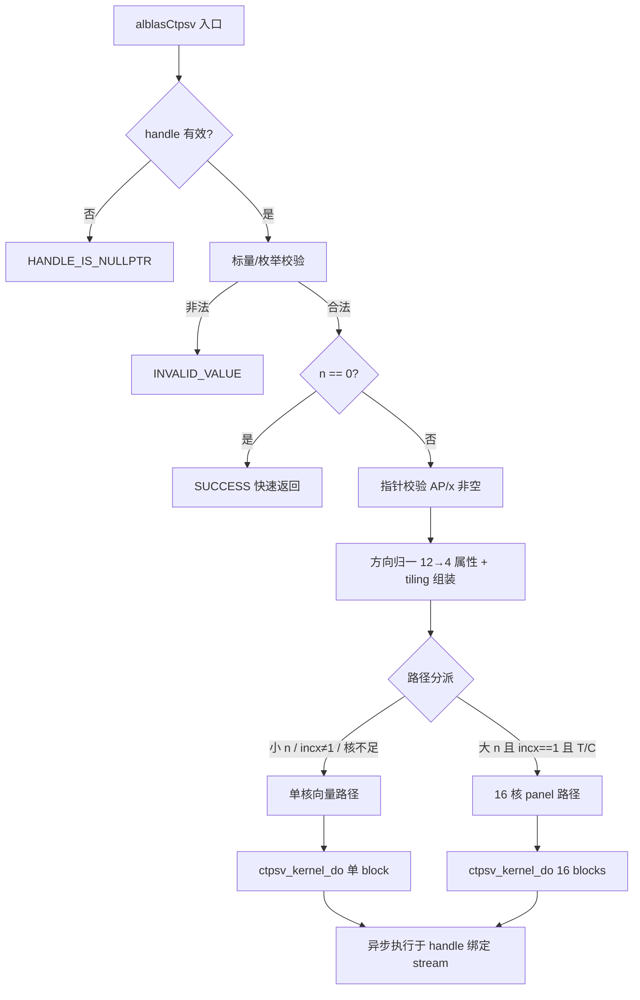

# 【社区任务】aclblasCtpsv 算子设计文档（A2/A3）

> 算子：`aclblasCtpsv`（complex64 三角 packed 求解，`op(A)·x = b`，x 原地覆写）
> 目标仓：https://gitcode.com/cann/ops-blas ，实现落位 `blas/tpsv/arch22/`，测试落位 `test/tpsv/ctpsv/arch22/`
> 目标硬件：Atlas A2 系列产品（性能测试设备 Atlas 800T A2 / 910B3）与 Atlas A3 系列产品（同为 arch22）
> 任务：9月社区任务-aclblasCtpsv算子开发(A2A3)
> 文档性质：**设计评审稿**（设计文档评审通过后进入开发，算子代码与 NPU 实测不在本 PR 范围内）

---

# 一、需求背景（required）

## 1.1 需求来源

来源于 CANN 社区任务《9月社区任务-aclblasCtpsv算子开发(A2A3)》。任务书要求在昇腾 Atlas A2/A3（arch22）上，基于 ops-blas 开源仓工程框架，以 Ascend C kernel 直调方式实现单精度复数（complex64）三角打包求解算子 `aclblasCtpsv`，完成算子设计、开发、测试全流程；精度按生态算子开源精度标准（混合容差）判定，性能按 `gpu_baseline.csv` 标杆耗时（GPU 实测 ÷ 0.8）判定；验收通过后合入 `blas/tpsv/arch22/`。

## 1.2 背景介绍

### 1.2.1 ops-blas 仓 tpsv 族现状

- `blas/tpsv/` 目前仅有单精度实数版本 `aclblasStpsv`（FP32），**复数 packed 求解能力在 A2/A3（arch22）上缺失**；
- `include/cann_ops_blas.h` 中尚无 `aclblasCtpsv` 声明，需新增，供各产品线共用；
- 仓内 `test/tpsv/stpsv/` 提供了同族 CSV 驱动 GTest 框架与 ReadMap 惯例（`case_name/uplo/trans/diag/n/incx/...`），测试工程可按 `ctpsv` 目录复刻并扩展 `ap_fill`/`x_fill` 可选列。

### 1.2.2 对标接口

语义对齐 cuBLAS `cublasCtpsv` 与 Netlib BLAS `ctpsv`（https://www.netlib.org/blas/ctpsv.f ）：参数序列一一对应，无 alpha/beta；与实数版的差别在于复数乘加与共轭转置（`OP_C` 与 `OP_T` 在复数域不等价，须独立处理）。

### 1.2.3 arch22 平台能力边界（设计前提）

| 能力 | arch22 现状 | 对本设计的影响 |
| --- | --- | --- |
| SIMT / 向量融合（`asc_vf_call`） | 无（arch35 专属） | 只能使用标准 Ascend C 向量指令 + 多 AIV 分核 |
| FP32 向量乘加 | 无单条融合 FMA（乘、加两条指令、两次舍入） | 复数乘减精度需按两次舍入评估，满足混合容差即可 |
| AIV 核数 | 约 20（以 `GetAivCoreCount()` 运行时读取为准） | 多核 panel 路径按 16 核规划，动态适配 |
| UB 容量 | 数百 KiB 量级（以平台信息接口读取为准，按 192 KiB 保守规划） | x 实/虚平面常驻 + AP 列段双缓冲，n 大时分段搬运 |
| 核间同步 | 支持 `SyncAll()` | 多核 panel 阶段同步可用 |

## 1.3 算子功能分析

求解 `op(A)·x = b`，右端项 b 初始存放于 x，解原地写回 x。A 为 n×n 三角矩阵，以 packed 形式存于一维数组 AP（列主序、逐列无间隙，共 `n(n+1)/2` 个 complex64）：

```
UPPER: A(i,j)（j ≥ i）位于 AP[i + j(j+1)/2]          （0 基下标）
LOWER: A(i,j)（j ≤ i）位于 AP[i + (2n-j-1)·j/2]
```

- `uplo ∈ {UPPER, LOWER}` 选择被引用三角；`trans ∈ {OP_N, OP_T, OP_C}` 决定 op(A)；`diag ∈ {NON_UNIT, UNIT}` 决定对角处理（UNIT 时对角视为 1 且**不读取** AP 对角位置）；
- x 逻辑长度 n、物理长度 `1+(n-1)·|incx|`，`incx` 可正可负（负步长 = 逻辑起点位于物理数组末端）；
- `n = 0` 为合法 no-op；算子不做奇异性检测（与 cuBLAS/Netlib 一致）。

---

# 二、需求分析（required）

## 2.1 需求描述

```cpp
aclblasStatus_t aclblasCtpsv(aclblasHandle_t handle, aclblasFillMode_t uplo,
                             aclblasOperation_t trans, aclblasDiagType_t diag,
                             int n, const aclblasComplex *AP,
                             aclblasComplex *x, int incx);
```

| 参数 | 输入/输出 | 约束与异常行为 |
| --- | --- | --- |
| handle | 输入 | nullptr → `ACLBLAS_STATUS_HANDLE_IS_NULLPTR` |
| uplo / trans / diag | 输入 | 非法枚举 → `ACLBLAS_STATUS_INVALID_VALUE` |
| n | 输入 | n < 0 → `INVALID_VALUE`；n = 0 合法 no-op（此时 AP/x 允许为空） |
| AP | 输入（只读） | n > 0 且 nullptr → `INVALID_VALUE`；长度 n(n+1)/2 |
| x | 输入/输出（原地） | n > 0 且 nullptr → `INVALID_VALUE` |
| incx | 输入 | incx = 0 → `INVALID_VALUE`；可为负 |

执行为异步语义，依赖 `aclblasSetStream` 绑定 stream；算子内部不做 stream 同步。

## 2.2 需求拆解

1. **公共 API**：`include/cann_ops_blas.h` 新增 `aclblasCtpsv` 声明；禁止 A2/A3 私有平行接口。
2. **参数校验**：校验顺序对齐 cuBLAS（handle → 标量/枚举 → n=0 快速返回 → 指针），返回码矩阵见 §3.2.1。
3. **语义正确性**：12 组（uplo×trans×diag）组合的代入方向、packed 索引换算、UNIT 对角不读取、负步长映射，全部对齐 Netlib `ctpsv`。
4. **串行依赖的并行化**：三角求解逐未知量递推，设计须以"向量化的步内更新 + 分块 panel 降低同步频率"换取并行度（§3.3）。
5. **复数算术**：乘加无 FMA、除法采用缩放形式（Smith/Netlib cdiv 口径）防中间量溢出；`OP_C` 对操作数取共轭。
6. **测试工程**：复刻 `test/tpsv/stpsv/` 框架，加载随任务 1200 条 CSV（1000 精度 + 200 性能），golden 取 Netlib `cblas_ctpsv`，实部/虚部分别判定；性能用 msprof 采集 kernel 耗时对比 `gpu_ms / 0.8`。

## 2.3 设计原则与非目标

**原则**：只在 arch22 可验证能力内实现（不依赖 SIMT/VF）；任何优化不得改变 12 组组合的数学语义；精度关键路径（对角除法形式、非有限值传播）显式编码，不依赖编译器行为。

**非目标**：不做 arch35 实现（SIMT 路径另行移植）；不改变 packed 布局与既有 `aclblasStpsv`；不以牺牲精度换性能。

---

# 三、详细设计（required）

## 3.1 算子分析

### 3.1.1 数学公式

对 `OP_N`，按三角方向代入：

```
LOWER: x[i] = ( b[i] − Σ_{j<i} A(i,j)·x[j] ) / A(i,i)    i 自 0 递增（前代）
UPPER: x[i] = ( b[i] − Σ_{j>i} A(i,j)·x[j] ) / A(i,i)    i 自 n−1 递减（回代）
```

`OP_T`/`OP_C` 求解 `Aᵀx=b`/`Aᴴx=b`，有效三角方向翻转、`OP_C` 操作数取共轭。12 组组合归一为 4 个正交属性：

```
forward   = (trans ≠ OP_N) ? upper : !upper     // 求解扫描方向
conjArith = (trans == OP_C)                      // 运算中共轭
unit      = (diag  == UNIT)                      // 对角处理
```

`diag = UNIT` 时省略除法且不读对角；非有限对角（Inf/NaN）按 IEEE 传播，不额外拦截。

### 3.1.2 支持数据类型

| 项 | 类型 |
| --- | --- |
| 输入/输出 | `aclblasComplex`（complex64，实/虚两个连续 FP32） |
| 计算 | FP32 实/虚分离向量运算，无 FP64 累加 |
| 属性 | Host 枚举（int） |

### 3.1.3 支持形状与关键访存洞察

- AP：一维 packed，长度 `n(n+1)/2`；x：物理长度 `(n−1)·|incx|+1`；AP 与 x 不得重叠。
- **关键洞察：packed 列段与 x 区间一一对应且各自连续。** 列主序 packed 存储中，列 s 的三角内元素在 AP 中下标连续，其对应 x 分量亦连续：

| 三角 | 列 s 的 packed 连续段 | 对应 x 连续段 |
| --- | --- | --- |
| UPPER | `AP[PU(0,s) .. PU(0,s)+s)` | `x[0 .. s)` |
| LOWER | 自对角起至列尾 | `x[s+1 .. n)` |

  由此每个求解步归结为"一段连续 AP × 一段连续 x"的复数向量运算，无需 block accumulator 与额外 GM workspace（单核路径），这是性能与实现的根基。

## 3.2 算子实现

### 3.2.0 文件落位与总体结构

```
blas/tpsv/arch22/
├── ctpsv_tiling_data.h    # Host/Kernel 共享 POD tiling
├── ctpsv_host.cpp         # 参数校验、方向归一、路径分派、发射
└── ctpsv_kernel.cpp       # 向量单核路径 + 多核 panel 路径
test/tpsv/ctpsv/arch22/    # CSV 驱动 GTest（复刻 stpsv 框架 + ap_fill/x_fill 列）
```



### 3.2.1 Host 侧设计：参数校验

校验顺序锚定任务书 §2.4 并与 cuBLAS 失败顺序一致：

```
1. handle == nullptr           → ACLBLAS_STATUS_HANDLE_IS_NULLPTR
2. n < 0                       → ACLBLAS_STATUS_INVALID_VALUE（n==0 合法 no-op）
3. uplo  ∉ {UPPER, LOWER}      → INVALID_VALUE
4. trans ∉ {N, T, C}           → INVALID_VALUE
5. diag  ∉ {NON_UNIT, UNIT}    → INVALID_VALUE
6. incx == 0                   → INVALID_VALUE
7. n > 0 且 AP 或 x == nullptr → INVALID_VALUE
```

`n == 0` 在标量校验通过后立即返回 SUCCESS，不发射 kernel（不触碰 Device 指针）。

### 3.2.2 Host 侧设计：tiling 与路径分派

`CtpsvTilingData`（POD，按值传入 kernel）在 Host 一次性解析布尔属性，kernel 内不做枚举比较：

```cpp
struct CtpsvTilingData {
    uint32_t n;              // 阶数
    int32_t  incx;           // 步长（含符号）
    uint8_t  forward;        // 求解方向（§3.1.1 归一）
    uint8_t  conjArith;      // OP_C 共轭
    uint8_t  unit;           // UNIT 对角
    uint8_t  upper;          // 原始 uplo（决定 packed 列段公式）
    uint32_t useCoreNum;     // 1 或 16
};
```

**分派策略**（四条同时满足才启用多核 panel：`n ≥ 128`、`incx == 1`、`trans ≠ OP_N`、`GetAivCoreCount() ≥ 16`），其余一律单核路径；多核路径 workspace 需求 `16 行 × 160 B = 2560 B`，Host 启动前校验 workspace 足量，单核路径零 workspace。

### 3.2.3 Kernel 侧设计：单核向量路径

`OP_N` 右视 scatter（先解 `x[s]`，再用列 s 更新未解分量）：

1. **入口 gather**：`incx ≠ 1` 时按 `offset(i) = (incx>0) ? i·incx : (n−1−i)·|incx|` 将 b 收聚为稠密工作向量；`incx == 1` 直接整段 `DataCopy`；
2. x 的实/虚平面常驻 UB（`cap = ceil(n/64)·64` 对齐预留）；AP 列段按步双缓冲 `DataCopyPad` 搬入（列段起点不保证 32 B 对齐，前缀零填充且**不跨出列段边界**，防止带入相邻三角数据）；
3. 每步：`x[s] = (b[s] − 0) / d_ss`（NON_UNIT，复数除法见 §3.2.5）或直接取 `b[s]`（UNIT）；随后对连续 x 段执行复数 `x -= x[s]·A(·,s)`（实/虚四个向量乘 + 两个向量加减）；
4. 全部步完成后出口 scatter 写回原步长位置；非逻辑位置的 padding lane 不改写。

`OP_T/OP_C` 左视 gather（先聚合已解项，再解 `x[s]`）：第 s 步读取一段**连续 packed 列**与已解 x 段做复数点积（实/虚分离的向量乘 + 双规约求和，`OP_C` 对 A 虚部取负），`x[s] = (b[s] − dot)/d_ss`。整段 x 入口搬入、求解后一次写回，中间不复访 GM。

流水组织：CopyIn（MTE2）→ Compute（Vector/Scalar）双缓冲交替，显式 `SetFlag/WaitFlag` 管理三条流水依赖，不使用隐式同步。

### 3.2.4 Kernel 侧设计：多核 panel 路径（T/C 大 n）

16 列为一个 panel，各核固定分工：

```
1. 每核计算自己负责列的"外部点积"（该列与已解 x 的贡献），写入本核独占的
   160 B workspace 行 —— 无跨核原子竞争；
2. SyncAll() 发布外部和；
3. 单核顺序解出 panel 内 16 个未知量（小三角回代）；
4. SyncAll() 发布本 panel 解，进入下一 panel。
```

同步次数为 `O(n/16)`，每核独立 workspace 行避免原子操作；共轭仅在 `OP_C` 施加。该路径限定 `incx == 1`（性能用例均为纯连续访存），其余组合回退单核路径，语义一致。

### 3.2.5 复数运算与特殊值

- **乘法**：`(a+bi)(c+di) = (ac−bd) + (ad+bc)i`，实/虚分离向量实现；arch22 无 FP32 融合 FMA，乘、加两次舍入，误差量级按混合容差评估（见 §4.1）；
- **除法**：采用 Netlib `cdiv` 缩放分量形式（以分量绝对值较大者归一），而非直接式 `(ac+bd)/(c²+d²)`——直接式在分子接近 FP32 上界时先溢出再相除产生 Inf/NaN，缩放形式与 cblas 参考在溢出边界行为一致；
- **UNIT**：不搬运对角位置（搬运掩码排除），省略除法；与 NON_UNIT 以模板参数编译期分离，消除运行时分支；
- **非有限 pivot**：`0 × Inf/NaN` 会污染本应为零的更新项，非有限 pivot 走掩码路径跳过该步更新；解中 Inf/NaN 按 IEEE 传播（与 golden 行为一致）；
- **负步长**：按 §3.2.3 的 offset 映射归一，kernel 主路径不感知符号。

### 3.2.6 与标杆实现的差异与原因

| 项 | Netlib `ctpsv` | 本设计 | 原因 |
| --- | --- | --- | --- |
| 扫描方向 | 按 trans/uplo 分支 | `forward = trans?upper:!upper` 归一 | 统一 12 组合，减少分支 |
| 运算顺序 | 标量固定顺序 | 向量规约，顺序不同 | 并行化必然结果；相对误差仍在判据内 |
| 复数乘减 | 编译器可能融合 | 乘、加两步 | arch22 无向量 FMA |
| 对角除法 | `cdiv` 缩放形式 | 同 | 溢出边界行为一致 |

## 3.3 支持硬件

| 支持的芯片版本 | 涉及勾选 |
| --- | --- |
| Atlas A2 训练系列产品（Atlas 800T A2 / 910B3，arch22） | √ |
| Atlas A2 推理系列产品（Atlas 800I A2，arch22） | √ |
| Atlas A3 系列产品（Atlas 800I A3，arch22） | √ |
| Ascend 950PR / 950DT（arch35） | 不支持（SIMT 路径另行移植） |

## 3.4 算子约束限制

1. AP 与 x 不得内存重叠；
2. `incx ≠ 0`，可正可负；超出 incx 语义的非连续访问不支持；
3. `diag = UNIT` 不读取 AP 对角位置；
4. 不做奇异性检测，NON_UNIT 时调用方保证对角非零（测试侧以 `boost = max(5, n)` 偏移保障）；
5. 多核 panel 路径限定 `incx==1 且 128 ≤ n ≤ 向量上限 且核数 ≥ 16`，其余回退单核，语义一致；
6. `n = 0` 允许 AP/x 为空；`n > 0` 时必须非空；
7. `OP_C` 与 `OP_T` 在复数域不等价，独立处理。

---

# 四、可维可测分析

## 4.1 精度标准

| 项 | 内容 |
| --- | --- |
| golden | Netlib `cblas_ctpsv` 单标杆（随测试工程提供） |
| 判定粒度 | complex64 实部/虚部分别按 FLOAT32 分量判定 |
| 逐元素 | `|actual − golden| ≤ atol + rtol·|golden|`，rtol = atol = 2⁻¹³ |
| 整体 | matched_ratio ≥ 0.99 且 max_abs_error ≤ max(1e-2, 32·ULP) |

依据生态算子开源精度标准（mixed_tolerance_standard）。规约类误差（大数求和）导致误报时，`max_abs_error_limit` 可按标准放宽至 2 ULP。

**已知风险（设计阶段识别，提请评审关注）**：`diag = UNIT` 半区测试用例对角恒为 1、无对角量级压制，非对角取自 U(−5,5) 时解的范数随 n 可能超出 FP32 可表示范围（数学性质，非实现缺陷）；开发阶段将以 fp64 参照复现该现象并与任务方确认用例口径，不在实现侧做任何修饰。

## 4.2 性能标准

| 项 | 内容 |
| --- | --- |
| 判据 | 每条性能用例 NPU 平均单次 kernel 耗时 ≤ `gpu_baseline.csv` 的 gpu_ms ÷ 0.8 |
| 采集 | msprof 采集 kernel 耗时（`--gtest_filter` 收敛到 TC_PF），不用 GTest 宿主耗时 |
| 采样 | 先 warmup 再有效采样 10 次取平均（msprof op 自带 5 次 warmup） |

任务书 5 条典型 case 门槛（与 TC_PF 前 5 条 `pf_doc_*` 用例逐参数一致）：

| n | uplo | trans | diag | 门槛（µs） |
| --- | --- | --- | --- | --- |
| 256 | UPPER | N | NON_UNIT | 252.2 |
| 512 | LOWER | T | NON_UNIT | 573.9 |
| 1024 | UPPER | C | NON_UNIT | 1228 |
| 2048 | LOWER | N | UNIT | 1211 |
| 4096 | UPPER | T | NON_UNIT | 7327 |

性能验收须覆盖 Atlas 800I A2 与 Atlas 800I A3 双机型；自验证先在 910B3 完成。

## 4.3 兼容性分析

- 只新增 `aclblasCtpsv` 声明，不修改既有签名；`aclblasStpsv` 实现与 README 原内容完全保留（README 追加一节，与仓内 gemm 族同时收录实/复数版本的惯例一致）；
- 小规格、非连续步长、核数不足、超大 n 均有语义一致的回退路径；
- 本实现面向 arch22；arch35 具 SIMT/VF 能力，需另行移植，不在本任务范围。

## 4.4 实现与验证状态

| 项 | 状态 |
| --- | --- |
| 设计文档（本文档） | 本 PR 提交评审 |
| 算子实现（blas/tpsv/arch22/） | 待开发（评审通过后启动） |
| 测试工程（test/tpsv/ctpsv/arch22/） | 待开发，复刻 stpsv 框架加载随任务 1200 条 CSV |
| 精度/性能/内存自验证 | 待实现后按 §4.1/§4.2 执行并出具报告 |

# 五、参考资料

1. 任务书《aclblasCtpsv_A2A3 任务书》（随任务发布）及 `test_cases/`（gen_csv.py、tpsv_test.csv、gpu_baseline.csv、verify_accuracy.py、README）；
2. Netlib BLAS `ctpsv`：https://www.netlib.org/blas/ctpsv.f ；
3. cuBLAS `cublasCtpsv`：https://docs.nvidia.com/cuda/cublas/index.html#cublas-t-psv ；
4. ops-blas 开源仓：https://gitcode.com/cann/ops-blas ；
5. 生态算子开源精度标准：https://gitcode.com/cann/opbase/blob/master/docs/zh/ops_precision_standard/mixed_tolerance_standard.md 。
