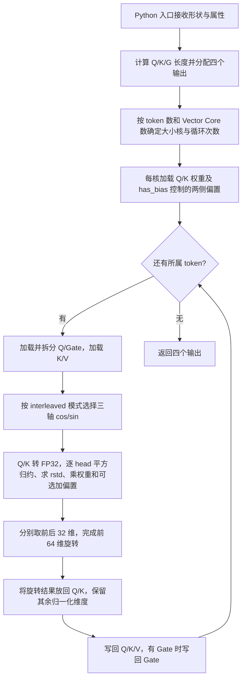
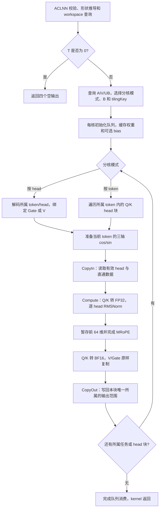

# 一、需求背景

## 1.1 需求来源

本需求来自 CANN 2026 年 9 月社区任务第 76 号“split_qkv_rmsnorm_mrope 算子开发”。依据任务附件 `9月社区任务-split_qkv_rmsnorm_mrope算子开发.zip` 中的任务书、`op.json`、`golden.py`、`case.json` 和 `generate_data.py`，使用 Ascend C 实现融合算子，通过 ACLNN 接口提供调用能力，适配 Atlas 800T A2、CANN 9.1.0 及以上版本。

设计文档按照社区[设计模板](../../../../resources/design_template.md)组织，提交至 `09-76-split_qkv_rmsnorm_mrope/Xztxzt/docs/design.md`。算子实现拟提交至 `ops-transformer/experimental/posembedding/split_qkv_rmsnorm_mrope/`，交付流程遵循[社区任务说明](../../../../README.md)。本文描述拟实现方案和验证方法，不代表算子代码已实现或精度、性能已验收。

## 1.2 背景介绍

### 1.2.1 split_qkv_rmsnorm_mrope 算子实现优化

该算子用于 Qwen3-VL 系列模型，将线性层输出拆分为 Q、K、V 和可选 Gate，对 Q/K 逐 head 执行 RMSNorm，再对前 64 维执行 temporal、height、width 三轴 MRoPE。融合实现避免拆分、归一化和旋转之间的中间张量回写和多次 kernel 启动。

本任务的标杆是 Triton 实现，任务书未提供 TBE 实现，因此模板中的“TBE 算子源码、信息库路径”在本任务中对应以下实际文件，不套用其他算子的 TBE 路径。

| 类型 | 文件及核对内容 |
| --- | --- |
| 标杆实现 | `vllm-ascend/vllm_ascend/ops/triton/linearnorm/split_qkv_rmsnorm_mrope.py`；入口 `triton_split_qkv_rmsnorm_mrope`，kernel `split_qkv_rmsnorm_mrope_kernel` |
| 标杆版本 | 设计时核对的[源码快照](https://github.com/vllm-project/vllm-ascend/blob/33a8b92bdc00dc83c6088d51a397f0cab2f98761/vllm_ascend/ops/triton/linearnorm/split_qkv_rmsnorm_mrope.py)，commit 为 `33a8b92bdc00dc83c6088d51a397f0cab2f98761`；任务书未指定标杆 commit，验收时记录实际采用的版本 |
| 算子信息定义 | 任务附件 `op.json`：算子名 `SplitQkvRmsnormMrope`、六个输入、四个输出、五个属性及其默认值 |
| 数值参考 | 任务附件 `golden.py`：`calc_expect_func`、`calc_expect_func_no_bias`、`_rms_norm`、`_axis_indices`、`_mrope` |
| 验收用例 | 任务附件 `case.json`：七组 BF16/ND 用例；`generate_data.py`：确定性输入生成、数据清单和 SHA256 |
| 拟实现文件 | `experimental/posembedding/split_qkv_rmsnorm_mrope/op_host/split_qkv_rmsnorm_mrope_def.cpp`、`split_qkv_rmsnorm_mrope_infershape.cpp`、`split_qkv_rmsnorm_mrope_tiling.cpp`，以及 `op_kernel/split_qkv_rmsnorm_mrope.cpp` 等必要文件 |

优化重点是：小 token 数时利用 head 间并行；大 token 数时复用权重和位置编码；在 UB 内完成 FP32 归一化、旋转和最终 BF16 转换；通过搬入、计算、搬出流水减少等待。

### 1.2.2 split_qkv_rmsnorm_mrope 算子现状分析

#### 1.2.2.1 标杆算子支持的数据类型和数据格式

定义 `T=num_tokens`、`Hq=num_q_heads`、`Hk=num_kv_heads`、`D=256`、`R=64`、`Q=Hq*D`、`K=Hk*D`、`G=has_gate ? Q : 0`、`W=Q+G+2*K`。本任务的输入输出均为 BF16、ND；计算中间量为 FP32。

| 参数 | 必选性 | 形状 | 语义 |
| --- | --- | --- | --- |
| `qkv` | 必选输入 | `[T,W]` | 有 Gate 时为逐 head 交错的 Q/Gate，随后为全部 K、全部 V |
| `q_weight` | 必选输入 | `[256]` | 所有 Q head 共用的 RMSNorm 权重 |
| `k_weight` | 必选输入 | `[256]` | 所有 K head 共用的 RMSNorm 权重 |
| `cos_sin` | 必选输入 | `[3,T,64]` | 轴顺序为 temporal、height、width；末维前 32 个为 cos，后 32 个为 sin |
| `q_bias` | 可选输入 | `[256]` | Q 的归一化结果乘权重后加偏置 |
| `k_bias` | 可选输入 | `[256]` | K 的归一化结果乘权重后加偏置 |
| `q_output` | 必选输出 | `[T,Q]` | Q 的 RMSNorm 和部分维度 MRoPE 结果 |
| `k_output` | 必选输出 | `[T,K]` | K 的 RMSNorm 和部分维度 MRoPE 结果 |
| `v_output` | 必选输出 | `[T,K]` | V 直通结果 |
| `gate_output` | 必选输出 | `[T,G]` | Gate 直通结果；关闭 Gate 时仍保留形状为 `[T,0]` 的输出 |

任务书主场景固定 `has_gate=True`、`eps=1e-6`。附件 `op.json` 和 `golden.py` 同时定义 `has_gate=False`、可配置 `eps`、两个独立可选 bias，因此设计一并覆盖。`head_size=256`、`rope_dim=64` 和 `mrope_section=[11,11,10]` 固定，不新增对应属性。

Triton Python 入口还接受 `head_size`、`rope_dim`、`mrope_section` 等参数，但入口存在参数不等于本任务要求支持所有组合；本设计以任务附件的 BF16、固定 head/rope 规格为适配边界。

#### 1.2.2.2 标杆算子实现描述

标杆 host 获取可用 Vector Core 数量，按 token 连续分配给各核。设核数为 `C`，每核处理 `floor(T/C)` 或 `ceil(T/C)` 个 token，`T<C` 时实际只有 `T` 个核处理数据。因此 decode 的 `T=1` 场景只有一个 token 任务。

每核先加载 Q/K 权重及启用的偏置，再循环处理所属 token：读取并拆分 Q/Gate，读取 K/V，按模式选取三轴 cos/sin；计算 Q/K RMSNorm；旋转前 64 维；写出四个张量。Q/K 和 Gate 在源码的拆分路径转为 FP32，V 直接读取原类型；输出存储时转换到输出类型。

输入索引必须符合逐 head 交错规则。下列偏移单位均为 BF16 元素，`0<=d<256`：

```text
q(t,h,d)    = qkv[t*W + h*(has_gate ? 512 : 256) + d]
gate(t,h,d) = qkv[t*W + h*512 + 256 + d]                 // 仅 has_gate=True
k(t,h,d)    = qkv[t*W + Q + G + h*256 + d]
v(t,h,d)    = qkv[t*W + Q + G + K + h*256 + d]
```

对每个 Q/K head，令输入为 `x[d]`、对应权重为 `w[d]`、可选偏置为 `b[d]`，数学语义为：

```text
variance = sum(x[d]*x[d], d=0..255) / 256
rstd     = 1 / sqrt(variance + eps)
z[d]     = (x[d] * rstd) * w[d] + (bias存在 ? b[d] : 0)
```

标杆源码采用 FP32 平方、`tl.sum`、`1/tl.sqrt`，附件 golden 采用 FP32 `square().mean()` 和 `torch.rsqrt`。两者数学语义一致，但浮点归约次序、倒平方根实现和编译器融合可能导致舍入差异；测试时分别保留 Triton 对照结果与 golden 对照结果。

MRoPE 对每个 `j=0..31` 选定轴 `a(j)`：

| 模式 | 轴选择规则 | 每轴坐标数量 |
| --- | --- | --- |
| `interleaved=True` | 源码 height 条件为 `j%3==1 && j<=33`，width 条件为 `j%3==2 && j<=30`，其余选 temporal；在固定的 32 个坐标上等价于 `a(j)=j%3` | temporal 11、height 11、width 10 |
| `interleaved=False` | `j=0..10` 选 temporal，`11..21` 选 height，`22..31` 选 width | temporal 11、height 11、width 10 |

```text
c[j] = FP32(cos_sin[a(j), t, j])
s[j] = FP32(cos_sin[a(j), t, j+32])
y[j]    = z[j]*c[j] - z[j+32]*s[j]
y[j+32] = z[j+32]*c[j] + z[j]*s[j]
y[64:256] = z[64:256]
```

两种模式均配对第 `j` 与第 `j+32` 维，不能把 `interleaved=True` 理解为偶数维/奇数维旋转。第 64～255 维仍须经过完整 RMSNorm、权重和可选偏置计算，只是不执行旋转。

核对版本的 Triton wrapper 使用 `q_bias is not None` 统一控制 Q/K 两个 bias，不能直接表示“仅 k_bias”，且“仅 q_bias”会使 kernel 尝试读取缺失的 K 偏置。本设计依据 `op.json` 和 `golden.py` 独立判断两个可选输入；单侧 bias 补充用例以 golden 验证，并可为 Triton 缺失的一侧显式传入全零 bias 进行数学等价对照，记录该适配。

#### 1.2.2.3 标杆算子实现流程图



# 二、需求分析

## 2.1 外部组件依赖

| 组件 | 用途与约束 |
| --- | --- |
| Atlas 800T A2 | 任务要求的精度和性能验收硬件，使用 AIV 完成融合计算 |
| CANN 9.1.0+ | Ascend C 编译、ACL/ACLNN 运行时、算子注册与部署；记录实际 Toolkit、驱动和固件版本 |
| ops-transformer | 采用其 experimental 算子目录、CMake、OpDef、推导、tiling 和测试接入方式 |
| PyTorch、torch_npu、NumPy、ml_dtypes | 执行附件 golden、生成和读取 BF16 输入、比较输出；属于验证依赖，不成为 kernel 运行依赖 |
| vllm-ascend 及其匹配的 Triton 环境 | 执行标杆；固定源码版本、编译配置和输入数据，避免升级后基线漂移 |
| CANN 性能采集工具 | 获取完整融合算子的 Device 时延、核利用率和流水等待信息，另行记录 ACLNN 调用耗时 |

## 2.2 内部适配模块

工程结构参考 `ops-transformer` 的 `experimental/posembedding/rotary_position_embedding3d/`，仅复用注册、构建和调用组织方式，不复用其不同的旋转语义。设计时核对的仓库 commit 为 `65ce8c3b9fba8d2e9dcd314d96ed8ca05acf43d3`；实际开发时按目标分支接口适配。

| 模块 | 拟增加的内容 |
| --- | --- |
| 构建与注册 | 算子目录及 `op_host/CMakeLists.txt`，接入父目录构建；在 `split_qkv_rmsnorm_mrope_def.cpp` 注册六个输入、四个输出、五个属性和 A2 配置 |
| Shape/Dtype 推导 | `split_qkv_rmsnorm_mrope_infershape.cpp` 推导 `[T,Q]`、`[T,K]`、`[T,K]`、`[T,G]`，输出类型为 BF16；未知 T 在图推导阶段保留，执行前完成具体形状校验 |
| Host tiling | `split_qkv_rmsnorm_mrope_tiling.cpp` 校验参数、查询 AIV 核数和 UB 大小、选择分核及 head 分块策略；tiling 结构统一定义 |
| AIV kernel | `op_kernel/split_qkv_rmsnorm_mrope.cpp` 及必要头文件，实现按 head/按 token 两条调度路径，共用数值计算主体 |
| ACLNN 接口 | 按仓库工程机制生成并导出 `aclnnSplitQkvRmsnormMropeGetWorkspaceSize` 与 `aclnnSplitQkvRmsnormMrope`，提供 C++ 调用示例 |
| 测试与说明 | 按仓库约定接入 host/kernel UT、七组 ST、补充语义用例和性能脚本，README 记录安装、调用及复现步骤 |

## 2.3 需求模块设计

### 2.3.1 Ascend C 算子原型

OpDef 名称为 `SplitQkvRmsnormMrope`。输入顺序严格使用附件 `op.json` 的 `qkv, q_weight, k_weight, cos_sin, q_bias, k_bias`，输出顺序为 `q_output, k_output, v_output, gate_output`。

| 属性 | 类型 | 默认值 | 校验 |
| --- | --- | --- | --- |
| `num_q_heads` | int | 16 | 正整数 |
| `num_kv_heads` | int | 4 | 正整数；本算子无需 head 数整除关系 |
| `eps` | float | `1e-6` | 转换到 FP32 后仍为有限正数 |
| `interleaved` | bool | true | 决定三轴映射规则 |
| `has_gate` | bool | true | 决定输入 Q/Gate 布局和 Gate 输出形状 |

拟生成的 ACLNN 接口形式如下，最终 C 类型和声明以目标工程生成的头文件为准；FP32 属性在公开接口中通常通过 `double` 传入，kernel 使用经过校验的 FP32 值。

```cpp
aclnnStatus aclnnSplitQkvRmsnormMropeGetWorkspaceSize(
    const aclTensor *qkv, const aclTensor *qWeight,
    const aclTensor *kWeight, const aclTensor *cosSin,
    const aclTensor *qBias, const aclTensor *kBias,
    int64_t numQHeads, int64_t numKvHeads, double eps,
    bool interleaved, bool hasGate,
    const aclTensor *qOutput, const aclTensor *kOutput,
    const aclTensor *vOutput, const aclTensor *gateOutput,
    uint64_t *workspaceSize, aclOpExecutor **executor);

aclnnStatus aclnnSplitQkvRmsnormMrope(
    void *workspace, uint64_t workspaceSize,
    aclOpExecutor *executor, aclrtStream stream);
```

### 2.3.2 Ascend C 算子相关约束

完整覆盖附件定义的两种轴映射、两种 Gate 状态和四种 bias 有无组合。相对 Triton 通用入口，不提供可变 `head_size`、`rope_dim`、`mrope_section`，不扩展 FP16/FP32 外部数据类型。

kernel 接收连续 ND 张量，不执行任意 stride 的索引计算。公开接口如通过目标工程的 `AutoContiguous` 支持非连续输入，应由框架先完成连续化，并将其时间和 workspace 单独计入接口测试；任务性能对照使用连续输入。输出要求连续且不与输入或其他输出重叠，不提供原地更新。

对于 `T=0`，在参数和输出形状校验成功后直接返回空输出，不启动计算 kernel，不读取可为空的零元素张量数据地址。head 数、形状乘积和地址范围在 host 侧使用带溢出检查的 64 位整数处理。

# 三、需求详细设计

## 3.1 调用方式

采用 ACLNN 两阶段调用：调用者按属性创建四个 BF16 输出，调用 `GetWorkspaceSize` 完成校验、执行计划和 workspace 查询，再通过执行接口在指定 stream 异步下发。读取输出或统计完整调用时间之前同步 stream，并检查各阶段返回码。

有 Gate 时，Q/Gate 输出均为 `[T,Hq*256]`；无 Gate 时仍传入合法的 `[T,0]` Gate tensor 描述。没有的 bias 使用可选空输入，不用未初始化地址代替。

kernel 的归一化统计量、旋转中间结果均保留在 UB，不需要额外的算法 GM workspace。接口实际申请量以 `GetWorkspaceSize` 为准，包括框架可能需要的 workspace 或连续化缓冲，不能据此将总返回值硬编码为零。

## 3.2 需求总体设计

将一个 `(token, head)` 的全部 256 维作为不可拆分的归一化单元；Q head 同时负责对应 Gate 的复制，K head 同时负责对应 V 的复制。所有输出都有唯一写入者，不需要跨核归约、原子操作或全核同步。

计算过程为 `GM → BF16 UB → FP32 RMSNorm/MRoPE → BF16 UB → GM`。V/Gate 采用 BF16 原始数据复制，不参与转换和算术；Q/K 只在最终结果处转换一次 BF16。每次处理一个 head 或同一 token、同一类型的若干连续 head，避免把不同 head 混入同一次归约。

### 3.2.1 host 侧设计

host 顺序校验 rank、dtype、format、属性、qkv 宽度、权重/bias 长度、cos_sin 的三轴及 T/64 维度、输出形状和地址计算范围。默认属性由 OpDef 提供；不以属性缺省推断输入包含 Gate。

通过平台能力接口获取可用 AIV 核数 `C` 与单核 UB 容量 `U`，不写死 Atlas 型号对应的核数。记录的 tiling 信息至少包括 `T,Hq,Hk,Q,K,G,W,eps,blockDim,mode,headTile`、大小核任务分配参数和两个 bias 存在标志。

#### 3.2.1.1 分核策略

初始调度规则为 `0<T<C` 时采用按 head 并行，`T>=C` 时采用按 token 并行；后续只依据同一精度实现的实测调整切换阈值。

| 路径 | 任务定义 | 核内处理 |
| --- | --- | --- |
| 按 head 并行 | 展平 `N=T*(Hq+Hk)` 个任务，`token=i/(Hq+Hk)`，`head=i%(Hq+Hk)`；前 Hq 个为 Q，后 Hk 个为 K | `headTile=1`；Q 任务计算一个 Q head 并复制 Gate，K 任务计算一个 K head 并复制 V；同 token 的相邻任务可复用本核已加载的 cos/sin |
| 按 token 并行 | `N=T` 个任务，每个任务为一个完整 token | 顺序处理该 token 的 Q head 块和 K head 块，块大小为 `headTile`，复用权重与选出的 cos/sin；Gate/V 随所属 head 块完成复制 |

两条路径统一采用连续大小核分配：`A=min(C,N)`、`base=N/A`、`extra=N%A`。第 `c` 个核处理 `count=base+(c<extra)` 个任务，起点为 `start=c*base+min(c,extra)`。所有除法取整数商，`T=0` 提前退出。

例如 `T=1,Hq=16,Hk=4` 时共有 20 个 head 任务，最多使用 `min(C,20)` 个核；`Hk=2` 时为 18 个。大 T 时连续 token 分配避免不同核重复加载同一 token 的位置编码。单个 head 不跨核拆分，以控制同步和归约成本。

#### 3.2.1.2 数据分块和内存优化策略

设 head 块大小为 `B`，`D=256`、`R=64`，输入/输出队列均使用双缓冲。每个输入槽按“B 个归一化 head 加 B 个直通 head”最坏情况预留；有 Gate 的 Q 块可连续搬入交错的 `B*512` 个 BF16，K/V 分别搬入两个连续区间。输出槽按归一化结果和直通结果分别排列，按实际有效 head 数写出。

| UB 缓冲 | 字节数 | 生命周期和用途 |
| --- | ---: | --- |
| BF16 输入双缓冲 | `2 * (2*B*D*2) = 8*B*D` | 两个槽，每槽含归一化输入及 Gate/V；无 Gate 的 Q 块只使用必要区域 |
| BF16 输出双缓冲 | `8*B*D` | 两个槽，保存最终 Q/K 及直通 Gate/V |
| FP32 工作向量 X | `4*B*D` | BF16 转换结果、原地归一化结果；同一时刻仅计算一个块 |
| FP32 平方/乘法工作区 | `4*B*D` | 平方归约后可复用于乘法中间值 |
| FP32 旋转原值暂存 | `4*B*R` | 保存前 64 维，避免更新前半段后污染后半段计算 |
| 归约与统计量 | `64*B` | 每 head 预留两个 32 B 对齐区，用于分段和及 variance/rstd 等 |
| Q/K 权重、可选 Q/K bias 的 FP32 缓存 | `4*256*4 = 4096` | 每核加载一次，跨 head/token 复用；按两个 bias 都存在计算上界 |
| 上述参数的 BF16 搬入区 | `4*256*2 = 2048` | 初始化转换使用，可进一步复用，预算先保留 |
| 三轴位置编码 BF16/FP32 | `3*64*2 + 3*64*4 = 1152` | 每 token 搬入三个轴，等待上一个 token 的向量读取完成后更新 |
| 选定的 cos/sin 与 Gather 索引 | `64*4 + 64*4 = 512` | 32 个 cos、32 个 sin；索引按模式预生成，使用字节偏移 |
| 预留空间 | `4096` | 对齐、实现所需的额外小缓冲；开发时按真实分配量复核 |

上述各项均按 32 B 对齐，预算为：

```text
U_need(B) = 24*B*256 + 4*B*64 + 64*B + 4096 + 2048 + 1152 + 512 + 4096
          = 6464*B + 11904 bytes
U_need(1) = 18368 bytes
U_need(4) = 37760 bytes
U_need(8) = 63616 bytes
```

按 head 路径使用 `B=1`；按 token 路径从 `{8,4,2,1}` 中选取满足 UB 预算且适合 head 数的块大小，Q/K 块尾部按实际个数处理。初始选择不代表最优值，B=4/8 的效果通过性能采集确认。即使 Hq/Hk 增大，UB 占用仍由 B 决定，不要求整个 token 的 Q/K 同时驻留。

所有 `InitBuffer`、临时区和队列槽均须纳入实际占用检查；新增 API scratch 后重新计算预算，不能仅凭上述估算忽略额外申请。队列管理搬入到计算、计算到搬出的依赖；缓冲区在消费者完成后才能释放或复用。采用本机型支持的 DataCopy/DataCopyPad，校验长度、stride 单位、对齐和单次搬运上限，超过 API 字段上限时拆分调用。

每 head 长度为 512 B，位置编码每轴为 128 B，权重每条为 512 B，本任务没有 head 内不足 32 B 的数据尾部。head 块尾部只搬有效 head，不能按 B 盲目越界。GM tensor 基址和连续化行为仍按实际接口校验，不因长度对齐而假定所有外部指针对齐。

按 token 路径中，每 token 的 qkv 读入和全部输出写出合计为 `4*W` 字节，另需读取三轴 cos/sin 的 384 B，权重/bias 每核初始化加载。按 head 路径会增加跨核重复的位置编码和参数读取，用于换取小 T 时的并行度。两条路径均不把 RMSNorm 或旋转中间结果写回 GM。

#### 3.2.1.3 tilingKey 规划策略

采用五个布尔特征组成 tilingKey，固定 BF16、D/R/section 不进入额外分支：

```text
tilingKey = interleaved
          + 2*has_gate
          + 4*has_q_bias
          + 8*has_k_bias
          + 16*head_parallel
```

各特征取 0 或 1，key 范围为 0～31；例如按 token、interleaved、有 Gate、无 bias 对应 key=3，同语义的按 head 路径对应 key=19。`B`、任务范围和尾块数量通过 tiling 数据传入，不为每个 T 单独编译变体。host 与 kernel 共用 key 定义并测试所有布尔组合，拒绝无法识别的 key；空 tensor 在上层退出。

### 3.2.2 kernel 侧设计

#### 3.2.2.1 kernel 侧实现描述

1. **初始化与参数缓存。** 根据 tilingKey 选择调度和属性分支，初始化 GM 地址与队列。加载本核需要的权重和存在的偏置，转换为 FP32。缺失 bias 不解引用地址；无 Gate 时不读取 Gate 区，也不写空 Gate 输出。
2. **位置编码选取。** 对当前 token，分别从 `cos_sin + (axis*T+t)*64` 搬入三轴数据，在 UB 排列为 `[3,64]` 并转为 FP32。预生成 `offset_cos[j]=4*(a(j)*64+j)`、`offset_sin[j]=4*(a(j)*64+j+32)`，Gather 成 32 个 cos 和 32 个 sin。索引、源和目标缓冲独立并按接口要求对齐；轴索引只依赖模式，可跨 token 复用。
3. **加载 head 块及直通数据。** Q 路径按交错布局加载 Q/Gate 并将各 Q head 转入连续 FP32 工作区；Gate 按 BF16 复制至输出区。K 路径读取 K 和对应 V，K 转 FP32，V 按 BF16 复制。输出 head 的起点分别为 `t*Q+h*256` 或 `t*K+h*256`。
4. **FP32 RMSNorm。** 对每 head 的 256 个元素计算平方，采用 A2 支持的 FP32 归约指令。例如将四段各 64 个平方值分别归约为四个部分和，再归约为总和；统计量区域对齐，非有效 lane 置零或使用正确 mask。乘 `1/256` 并加 eps，通过 FP32 Sqrt 和 Div 求 `1/sqrt`，随后按 `x*rstd`、乘 weight、可选加 bias 的次序计算。每个 head 的 mask 和 repeat 独立，不能把不同 head 的部分和混加。
5. **前 64 维 MRoPE。** 先保存全部前 64 维归一化值，再分别计算 `z1*cos-z2*sin` 和 `z2*cos+z1*sin`；其余 192 维保持归一化结果。乘法与加减的融合策略通过精度测试决定，不预先假定不同 FMA 配置与 Triton 位级一致。
6. **转换及写出。** Q/K 使用 FP32→BF16 的最近偶数舍入转换，再与直通数据一同写回各自输出。写回只覆盖本核、本块的有效 head；按队列事件完成 CopyIn/Compute/CopyOut 流水，不在每个块后加入全流水屏障。

使用基础 API 时核对目标 Toolkit 的具体重载和 A2 产品支持范围：[Cast](https://www.hiascend.com/doc_center/source/en/CANNCommunityEdition/900/API/ascendcopapi/atlasascendc_api_07_0073.html) 的 BF16→FP32 使用 `CAST_NONE`，FP32→BF16 使用 `CAST_RINT`；[WholeReduceSum](https://www.hiascend.com/doc_center/source/zh/CANNCommunityEdition/910beta2/API/ascendcopapi/atlasascendc_api_07_0081.html) 用于 FP32 分段归约；[Gather](https://asc.gitcode.com/api/SIMD-API/basic_api/memory_vector_compute/scatter_gather/Gather.html) 按字节偏移选取位置编码。链接作为 API 约束参考，最终以实际 CANN 9.1.0+ 头文件和编译结果确认，不能把其他架构的重载直接移植到 A2。

初始实现选用 Sqrt+Div，以对应标杆的求值形式。官方 [Rsqrt 说明](https://www.hiascend.com/doc_center/source/zh/canncommercial/800/apiref/ascendcopapi/atlasascendc_api_07_0030.html) 提示高精度场景应考虑 Sqrt/Div；直接替换成更快的 Rsqrt 必须重新完成全部精度验证。归约树不同仍可能造成差异，Sqrt+Div 本身不构成误差达标保证。

#### 3.2.2.2 Ascend C 实现流程图



图中 CopyIn、Compute、CopyOut 表示数据依赖关系；不同 head 块之间利用双缓冲重叠。cos/sin 缓存只有一个 token 的容量，跨 token 更新前须确保旧编码不再被向量计算读取。

#### 3.2.2.3 Ascend C 实现流程图与标杆算子流程图存在的差异点和原因

| 差异 | 原因与语义保证 |
| --- | --- |
| 小 T 从按 token 改为按 head 分核 | 提高 decode 的可用并行度；每个 head 的归约完整保留在一个核上 |
| 大 T 在 token 内增加 head 分块 | UB 占用不随 Hq/Hk 线性扩展到整个 token，方便构建搬运和计算流水 |
| V/Gate 直接复制 BF16 | 直通输出无需 FP32 计算，减少转换并保持原始数据 |
| 三轴编码先搬入 UB，再按固定索引 Gather | 替代 Triton 的多组 masked load，在 token 内为多个 head 复用；选取的 cos/sin 元素不变 |
| 两个 bias 独立控制 | 与附件 `op.json`、golden 的可选输入语义一致，避免沿用 wrapper 的单一 has_bias 限制 |
| 显式 UB 管理及同步 | Triton 自动完成的资源安排改为 Ascend C 队列和局部事件管理，防止覆盖尚在使用的缓冲 |
| FP32 归约次序、转换与指令实现不同 | 保持公式与求值阶段，逐项分析误差，达到任务阈值后才接受优化 |

## 3.3 支持硬件

| 硬件 | 适配范围 |
| --- | --- |
| Atlas 800T A2 | 本任务要求的开发及验收平台，使用 AIV Vector 流水 |

不将 A3、Atlas 950 或其他平台列为已支持。AIV 数量、UB 大小通过平台查询获得，构建和运行结果记录具体产品配置。

## 3.4 算子约束限制

- 外部输入输出仅 BF16、ND；D=256、R=64、section=[11,11,10]，不提供变长 head、其他轴数量或不同旋转比例。
- Q/K 在完整 256 维上分别进行 RMSNorm；不做跨 head 归一化，不对 V/Gate 做归一化或旋转。
- 权重和存在的 bias 长度必须为 256，按 head 共用，不支持 token/head 独立权重或隐式广播扩展形状。
- `qkv` 宽度必须与 Hq/Hk/has_gate 完全匹配；`cos_sin` 的 T 必须一致，不做位置索引查表，输入本身就是当前 token 的三轴 cos/sin。
- `T>=0`、Hq/Hk 为正整数、eps 为有限正数。任一形状乘积、字节数或地址计算溢出时在 host 返回错误。
- kernel 不支持任意 stride 或输入输出别名。大规模输入受设备可用内存与地址范围限制，不以七组验收 shape 作为唯一合法 shape。
- 任务附件的数值验收数据为有限值。NaN、Inf 和导致 FP32 平方溢出的极端值另行检查传播行为，不对其宣称满足有限绝对误差指标。

# 四、特性交叉分析

| 关联特性 | 影响与处理 |
| --- | --- |
| Gate 布局与 head 分核 | has_gate 同时决定 Q 输入步长、K/V 起点和 Gate 输出宽度；四处索引统一从 Q/K/G/W 派生，补充无 Gate 用例 |
| RMSNorm 与部分维度旋转 | 旋转仅作用于前 64 维，统计量依赖全部 256 维；用尾部大值、前部小值用例检测错误的局部归一化 |
| bias 与轴映射 | bias 在权重乘法后、MRoPE 前加入；覆盖每种独立 bias 状态及两种轴选择，不能在旋转后再加 bias |
| GQA/MQA head 数差异 | Q/K 共享 D，但分别使用 Hq/Hk 和独立权重；不依据 Q/K head 的整除关系复制或合并 K |
| BF16 输出与 FP32 精度 | 输出量化阈值会放大极小的 FP32 差异；同时保存最终 BF16 误差、出错坐标及调试中间量 |
| 双缓冲与 token 编码复用 | 输入输出可跨块流水，但位置编码、X 和归约区的复用须遵守计算依赖；并发 stream 不共享可写全局缓存 |
| 连续化与性能统计 | 若接口适配非连续输入，其额外拷贝不计作融合 kernel 性能提升；单独报告接口总耗时和额外空间 |
| 构建及图推导 | 类型、属性顺序、输出数目保持与 op.json 一致；动态 T 在执行时 tiling，不为每个 T 修改 ABI |
| 资源占用与其他算子 | kernel 不改变全局 stream、设备或内存池配置；不依赖后续算子读取 UB，也不在设备侧持久保存用户数据 |

# 五、可维可测分析

## 5.1 精度标准/性能标准

| 项目 | 验收判定 | 来源 |
| --- | --- | --- |
| Q/K 精度 | 将最终 BF16 输出提升为 FP32 后逐元素比较；Q 和 K 分别满足 `max(abs(actual-triton)) < 1e-3`，严格小于 | 任务书 3.2 节 |
| V/Gate 精度 | 与输入对应切片完全一致，对有限 BF16 数据做逐元素及原始字节比较；无 Gate 验证 `[T,0]` 形状 | 任务书 3.2 节及附件 golden |
| 性能 | 七组逐一满足完整算子 NPU 时延 `< baseline/2`，加速比 `>2`，不以平均加速比替代单 case 判定 | 任务书 3.3、3.5 节 |
| 内存 | 任务未设置内存阈值；仍检查越界、泄漏、workspace/UB 占用，并提供交付清单要求的内存报告和日志 | 任务书 3.4、4 节 |

不能使用通用 BF16 相对容差替代该任务的 `1e-3` 绝对误差。在数值约为 1 的区间，BF16 相邻数间隔可达到 `0.0078125`，一次输出舍入差异就可能超标。因此 FP32 中间计算、归约顺序、rstd 和 FMA 均须实测。对异常点记录 token/head/dim、期望值、实际值和最大差异；必要时逐步比对归约、rstd、归一化及旋转中间量，不能放宽阈值掩盖错误。

七组附件用例均为 `Hq=16, D=256, R=64, eps=1e-6, interleaved=True, has_gate=True`，无 bias，Q/K 权重全 1。每组同时进行精度和性能验证：

| case | T | Hk | qkv 形状 | Q/Gate 形状 | K/V 形状 | 任务 Triton 基线/μs | Ascend C 必须满足/μs |
| --- | ---: | ---: | --- | --- | --- | ---: | ---: |
| decode_t1_q16_kv4 | 1 | 4 | `[1,10240]` | `[1,4096]` | `[1,1024]` | 636.240 | `<318.120` |
| small_t16_q16_kv4 | 16 | 4 | `[16,10240]` | `[16,4096]` | `[16,1024]` | 643.246 | `<321.623` |
| medium_t128_q16_kv4 | 128 | 4 | `[128,10240]` | `[128,4096]` | `[128,1024]` | 678.923 | `<339.4615` |
| prefill_t2048_q16_kv4 | 2048 | 4 | `[2048,10240]` | `[2048,4096]` | `[2048,1024]` | 641.700 | `<320.850` |
| prefill_t8192_q16_kv4 | 8192 | 4 | `[8192,10240]` | `[8192,4096]` | `[8192,1024]` | 669.499 | `<334.7495` |
| decode_t1_q16_kv2 | 1 | 2 | `[1,9216]` | `[1,4096]` | `[1,512]` | 640.793 | `<320.3965` |
| prefill_t2048_q16_kv2 | 2048 | 2 | `[2048,9216]` | `[2048,4096]` | `[2048,512]` | 669.931 | `<334.9655` |

复现数据使用附件生成器，主种子固定为 `20260928`。生成器依据 operator/case/field 派生 PCG64 种子，qkv 在 `[-1,1]` 范围采样，位置编码从三轴随机角度生成 cos/sin 后转为 BF16。保存 `manifest.json` 的数据类型、形状、种子和 SHA256，Triton、golden、Ascend C 必须读取同一批量化后的输入。

```bash
# 在任务附件解压目录执行；生成全部七组输入。
python3 generate_data.py --master-seed 20260928 --output-dir generated_data/v1
```

附件 ZIP 未携带 `case.json` 引用的 data 二进制文件，应先生成并使用 `generated_data/v1/case.generated.json`。生成器会更新数据路径，但原有 `case_path`、`expect_func` 仍包含发布者机器上的绝对路径；接入自测工程时须替换为实际路径，保留原始 case 参数及生成数据摘要，避免将路径问题误判为算子错误。

补充测试覆盖如下，七组官方 case 不能代替这些语义和边界验证：

| 类别 | 测试设计与预期 |
| --- | --- |
| 三轴映射 | 分别覆盖两种模式，使用三个轴明显不同的 cos/sin 检查 j=0、10、11、21、22、30、31 等边界；同时检查 j 与 j+32 的配对 |
| 部分旋转 | 令 cos=1、sin=0 验证纯 RMSNorm；令 cos=0、sin=1 验证符号和交换；检查 64～255 维仍等于归一化结果 |
| 权重与 bias | 使用非恒定权重；覆盖无 bias、仅 Q、仅 K、双 bias，检测误用权重、偏置加法顺序及缺失指针读取 |
| Gate | 覆盖有/无 Gate；使用每个 Q/Gate head 都不同的标记数据验证交错输入解码，逐字节检查 Gate/V |
| 分核与块尾 | T 取 1、C-1、C、C+1 及不能均分的值；Hq/Hk 取 1、2、3、5、16 等，覆盖 B 尾块、核任务余数和模式切换 |
| 数值边界 | 全零、接近零、正负交替、不同尺度的有限输入、BF16 舍入边界；检查 eps 防止零向量除零及最大误差 |
| 空和非法输入 | T=0 成功返回；非法 rank、dtype、宽度、cos_sin 形状、bias 长度、head 数、eps 或地址溢出在 host 报错，不启动计算 |
| 稳定性与资源 | 两个 stream 使用独立输入输出并发，多轮重复执行检查结果和泄漏；检查最末 head、最末 token 的读写范围 |

测试层次包括 host UT（推导、属性和 tiling 校验）、kernel/仿真验证（索引、尾块及同步）、A2 ST（真实接口、精度和性能）。当前设计文档阶段没有执行算子上板测试，不填写“通过”或预测实测时延。

性能验证采用相同硬件、输入、stream 和频率环境，排除首次编译、设备内存分配与数据上传对 kernel 计时的影响；两侧均先预热至少 20 次，稳定后测量至少 100 次，报告中位数、P95 和完整采样配置。采集范围包含该算子的 Q/K/V/Gate 全部工作，不能只统计 RMSNorm 或 MRoPE 子阶段；ACLNN 接口总耗时单独报告。

任务书未说明表中基线的详细计时脚本和统计口径，验收时保留原表阈值，并同时报告固定源码版本在当前环境的实测 Triton 对照、Ascend C 时延及其加速比。发现口径差异时在报告中说明并核对验收口径，不自行用较宽松的基线替换任务要求。

调优顺序为：先完成所有精度用例，再比较小 T 分核策略、大 T 的 B=4/8 与流水效果；通过性能数据定位核闲置、搬运等待或归约瓶颈，逐项修改并回归。以达到任务阈值为验收条件，不把理论核数提升或访存字节减少直接当作实测加速比。

最终自测交付在个人实现仓创建 `task_submission/`，保存 `1 自验证步骤说明.md`、`2.1 精度自验证报告.xlsx`、`2.2 精度自验证日志.log`、`3.1 性能自验证报告.xlsx`、`3.2 性能自验证日志.log`、`4.1 内存自验证报告.xlsx`、`4.2 内存自验证日志.log`。报告记录环境、源码 commit、case/数据摘要、每组误差、时延、截图及复现命令；任务未设内存指标的项目明确说明其验证内容。

## 5.2 兼容性分析

接口与附件 `op.json` 的输入输出顺序、必选性、属性名称和默认值保持一致；有 Gate 的七组 case 可直接按定义调用。无 Gate 和独立 bias 分支以附件 golden 的行为为准，并显式记录与所核对 Triton wrapper 的差别。固定 D/R/section 属于任务规格，不宣称等价替换 Triton 通用入口的所有参数组合。

Triton 和 PyTorch NPU golden 仅用于验证，新算子运行依赖 CANN/ACLNN。验证脚本固定 torch/torch_npu、Triton、vllm-ascend 和数据生成依赖版本，升级时重跑全部七组及补充用例。CANN 9.1.0+ 中不同小版本的 API、生成接口和编译器行为以实际安装版本检查，不能由版本下界推断后续版本已经通过兼容性测试。

新增算子使用独立目录、注册名和 tiling 定义，不修改现有 rotary_position_embedding3d 等算子的语义。遵循目标 `ops-transformer` 分支构建与测试规则，并验证新目录接入不会影响既有算子编译。设计文档提交与后续实现、自测报告分别交付，按社区流程完成文档评审后推进实现验收。
