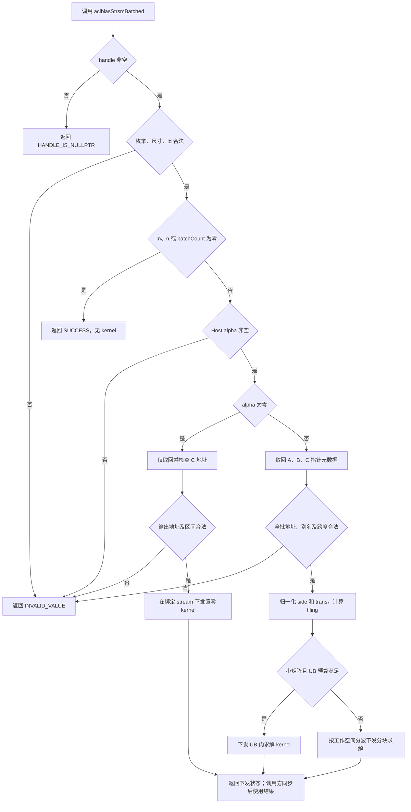
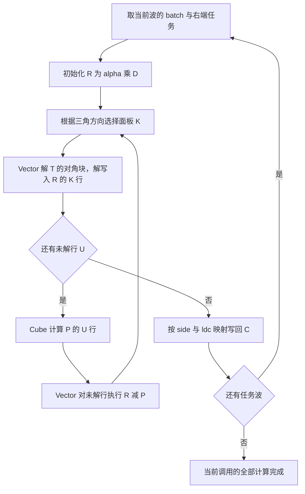

# aclblasStrsmBatched 算子设计

# 需求背景（required）

## 需求来源

本设计对应 CANN 社区任务 9 月第 78 项“aclblasStrsmBatched 算子开发（A2/A3）”，依据任务书 `aclblasStrsmBatched_A2A3_task_doc.md` 及配套测试说明制定。目标为 Atlas A2/A3 系列产品上的单精度实数批量三角求解，采用 ops-blas 句柄式接口和 Ascend C kernel 直调方式。

设计文档提交位置为：

```text
04_tasks/01_community-task-2026/tasklist/
└── 09-78-aclblasStrsmBatched-A2A3/
    └── ZSYunDuo/
        └── docs/
            └── design.md
```

本交付件描述接口、数学语义、Host 与 Device 方案及后续验证方法，不包含算子实现、实验结果或自测报告。

## 背景介绍

批量三角求解用于分解后的线性系统求解和多个独立小系统处理。系统之间可并行，但同一系统的求解方向存在递推依赖：某行的解必须使用此前已求出的行，不能把三角维度当作普通矩阵乘维度随意切分。

任务参考 `cublasStrsmBatched` 的参数和数学语义，同时要求 B 只读、C 独立输出，仅接受 Host 标量 `alpha`，且实数算子只支持 N/T。实现需要把这些差异落实到公共接口、访存和负向校验，不能直接套用原地覆写 B 的调用方式。

核对 ops-blas 工程可见，批量实数三角求解已有 `blas/trsmbatched/arch35/` 目录及同名原地接口声明。本任务补充 `arch22` 能力，并按任务书设计独立输出接口。任务书前部出现 `blas/trsm/`，交付章节明确给出 `blas/trsmbatched/arch22/`；本设计采用后者，与现有批量算子族目录一致。

# 需求分析（required）

## 需求描述

对每个 `i ∈ [0, batchCount)` 独立计算：

| side | 方程 | A 的阶数 | B、C 的形状 |
| --- | --- | --- | --- |
| LEFT | `op(A[i]) · X[i] = alpha · B[i]` | m | m × n |
| RIGHT | `X[i] · op(A[i]) = alpha · B[i]` | n | m × n |

结果写入 `C[i] = X[i]`。A、B、C 均为列主序 FP32 矩阵，前导维分别为 lda、ldb、ldc。各 batch 共享尺寸和枚举参数，但地址独立，无广播。

## 需求拆解

| 需求 | 设计落点 |
| --- | --- |
| LEFT/RIGHT、UPPER/LOWER、N/T、UNIT/NON_UNIT 全覆盖 | 统一成左侧三角求解，显式计算实际三角方向，覆盖 16 个合法枚举组合 |
| 独立输出，A/B 只读 | 工作空间保存缩放后的右端及中间解，最终按 ldc 写入 C；检查输出与输入的重叠 |
| UNIT 对角和未选三角不引用 | 对角块按有效元素搬运；单位对角在片上构造 1，不读取对应 A 地址 |
| 任一尺寸为零 | 完成基础参数检查后快速返回，不读取指针数组、不启动 kernel |
| alpha 为零 | 只校验输出地址并启动置零路径，不读取 A/B 的数组或矩阵 |
| 非对齐尺寸与前导维 padding | 使用真实行列边界及独立 ld 寻址，尾块仅写逻辑元素 |
| Device 指针数组的元素级负向校验 | 在绑定 stream 上取回少量地址元数据，校验后再启动数值计算 |
| 批量与大尺寸性能 | 小矩阵 UB 内求解；大矩阵对角块 Vector 求解、剩余右端 Cube 更新 |
| A2/A3 适配 | 使用 arch22 路径，运行时查询核数和片上存储容量 |

# 详细设计（required）

## 算子分析

### 算子原型

```cpp
aclblasStatus_t aclblasStrsmBatched(
    aclblasHandle_t handle,
    aclblasSideMode_t side,
    aclblasFillMode_t uplo,
    aclblasOperation_t trans,
    aclblasDiagType_t diag,
    int m,
    int n,
    const float* alpha,
    const float* const* Aarray,
    int lda,
    const float* const* Barray,
    int ldb,
    float* const* Carray,
    int ldc,
    int batchCount);
```

公共声明位于 `include/cann_ops_blas.h`。状态码复用 `include/cann_ops_blas_common.h`，非法枚举按本任务返回 `ACLBLAS_STATUS_INVALID_VALUE`，不改用仓库中另有定义的 `ACLBLAS_STATUS_INVALID_ENUM`。

任务书使用长枚举名称，而当前公共头文件使用以下短名称。实现比较仓库已有枚举值，文档中的 UPPER/LOWER、UNIT/NON_UNIT 均指相应语义；不在 kernel 中硬编码枚举整数，也不重复定义公共类型。

| 任务书名称 | 当前公共头文件名称 |
| --- | --- |
| ACLBLAS_FILL_MODE_UPPER | ACLBLAS_UPPER |
| ACLBLAS_FILL_MODE_LOWER | ACLBLAS_LOWER |
| ACLBLAS_DIAG_UNIT | ACLBLAS_UNIT |
| ACLBLAS_DIAG_NON_UNIT | ACLBLAS_NON_UNIT |

### 参数、存储和调用约束

| 参数 | 位置与类型 | 约束 |
| --- | --- | --- |
| handle | Host 句柄 | 已创建且有效，携带当前设备上下文和绑定 stream |
| side | Host 枚举 | LEFT 或 RIGHT |
| uplo | Host 枚举 | UPPER 或 LOWER，指原始 A 的有效三角 |
| trans | Host 枚举 | OP_N 或 OP_T；OP_C 返回 INVALID_VALUE |
| diag | Host 枚举 | UNIT 或 NON_UNIT |
| m、n、batchCount | Host int | 均不小于 0 |
| alpha | Host FP32 指针 | 非空；调用时读取标量值并按值传给 kernel |
| Aarray | Device 地址数组 | 有 batchCount 个指针；各 A[i] 为 Device FP32 矩阵，只读 |
| Barray | Device 地址数组 | 有 batchCount 个指针；各 B[i] 为 Device FP32 矩阵，只读 |
| Carray | Device 地址数组 | 有 batchCount 个指针；各 C[i] 为 Device FP32 矩阵，可写 |
| lda | Host int | LEFT 时 ≥ max(1,m)，RIGHT 时 ≥ max(1,n) |
| ldb、ldc | Host int | 分别 ≥ max(1,m)，两者可以不同 |

这里明确按 Device 指针数组设计，不将 Aarray/Barray/Carray 当作可由 Host 直接解引用的数组。仅 `alpha` 为 Host 指针。指针数组和矩阵必须属于句柄关联设备，并在异步工作完成前保持有效。

列主序矩阵 M 的元素地址为 `M[row + col * ld]`，ld 的单位是元素。列间 padding 不参与计算，不写入 C 的 padding。输入只支持上述 ld 能表达的布局，不支持额外步长、视图和广播。

正常计算时，任一 C[i] 与任一 A[j]/B[j] 不得重叠，C[i] 与 C[j] 也不得重叠。别名检查使用包含列间 padding 的最小覆盖区间；不支持通过交错共享 padding 构造视图。alpha=0 时不引用 A/B，仍保证各输出区间互不重叠。

### 数学归一化

设 `d` 为三角矩阵阶数，`s` 为独立右端数。为共用求解逻辑，定义：

| side | d、s | T | Y | D |
| --- | --- | --- | --- | --- |
| LEFT | d=m，s=n | op(A) | X | B |
| RIGHT | d=n，s=m | op(A) 的转置 | X 的转置 | B 的转置 |

RIGHT 方程两侧转置后得到 `op(A)ᵀ · Xᵀ = alpha · Bᵀ`。两种情况统一为：

```text
T · Y = alpha · D
```

令 `right = (side == RIGHT)`，`tau = (trans == OP_T) XOR right`，`lower = (uplo == LOWER) XOR tau`。实际访问 T 的映射为：

```text
tau 为 false：T(r,k) = A[r + k * lda]
tau 为 true ：T(r,k) = A[k + r * lda]

LEFT ：D(r,j) = B[r + j * ldb]，Y(r,j) 写入 C[r + j * ldc]
RIGHT：D(r,j) = B[j + r * ldb]，Y(r,j) 写入 C[j + r * ldc]
```

T 是逻辑矩阵，不必完整复制或转置 A。独立右端分块只改变 j 的范围，不改变三角递推次序。

| side | uplo | trans | T 的三角 | r 的求解次序 |
| --- | --- | --- | --- | --- |
| LEFT | LOWER | N | 下三角 | 0 → d-1 |
| LEFT | LOWER | T | 上三角 | d-1 → 0 |
| LEFT | UPPER | N | 上三角 | d-1 → 0 |
| LEFT | UPPER | T | 下三角 | 0 → d-1 |
| RIGHT | LOWER | N | 上三角 | d-1 → 0 |
| RIGHT | LOWER | T | 下三角 | 0 → d-1 |
| RIGHT | UPPER | N | 下三角 | 0 → d-1 |
| RIGHT | UPPER | T | 上三角 | d-1 → 0 |

上表每行均包含两种 diag，组成全部 16 个合法组合。非单位对角按实际值除法，单位对角跳过除法及对角读取。前代入公式为：

```text
Y(r,j) = [alpha * D(r,j) - Σ(k=0..r-1) T(r,k) * Y(k,j)] / T(r,r)
```

回代公式将求和范围换成 `k=r+1..d-1`。UNIT 时分母为 1。直接代入与后述分块求解均采用这一依赖关系，不显式求 A 的逆。

## 算子实现

### 实现方案

采用 Ascend C 直调实现。对角求解使用 FP32 Vector 运算，块更新使用 A2/A3 支持的 Ascend C Matmul 高阶 API。此方案不依赖 CATLASS 组件实例化，也不套用 arch35 的 SIMT 或寄存器编程接口。

#### Host 侧设计

**参数检查与特殊路径**

检查顺序固定如下，以保证错误状态、无操作及零标量路径可复现：

1. handle 为空时返回 `ACLBLAS_STATUS_HANDLE_IS_NULLPTR`。
2. 检查 side/uplo/trans/diag、非负尺寸及前导维；不合法返回 `ACLBLAS_STATUS_INVALID_VALUE`。
3. 任一 m、n、batchCount 为 0 时返回 SUCCESS。此时跳过 alpha 和数组检查，不启动计算。无操作不豁免已检查的非法枚举、负尺寸或非法 ld。
4. 非空计算检查 Host alpha 非空并读取一次。若 alpha 为 ±0，只检查 Carray 及其元素，不要求 Aarray/Barray 有效。
5. alpha 非零时检查三个数组的外层指针，取回地址元数据，校验所有必需元素非空、设备归属及输出重叠；先检查全批，再启动计算，避免元素级错误产生部分输出。
6. 以检查过的 64 位算术计算矩阵跨度、地址区间、任务数量和工作空间；发生乘加溢出时返回 INVALID_VALUE。
7. 选择分支、建立工作空间布局，按句柄绑定 stream 下发 kernel。资源分配失败返回 ALLOC_FAILED；后端下发失败按仓库状态映射返回 EXECUTION_FAILED 等状态。

不能验证任意非空 Host 地址一定是有效句柄或有效标量地址；它们的生命周期由调用方保证。设备分配信息以 Runtime 查询结果为依据，查询或拷贝失败按后端错误映射处理，不伪装成成功。



图中省略的 Runtime 查询、拷贝和分配失败均进入相应错误返回，不继续下发数值计算。

**Device 指针数组与异步语义**

外层空指针和标量参数可立即检查，Device 数组内的地址不能在 Host 直接读取。为满足任务书“数组元素为 nullptr 时由接口返回 INVALID_VALUE”，在 handle 的 stream 上执行地址数组 D2H 拷贝，并同步该 stream 的元数据阶段；不读取矩阵值，不做全设备同步。正常路径取回约 `3 × batchCount × sizeof(void*)` 字节，置零路径只取回 C 地址。

这一步会等待该 stream 中先前任务，因此接口不承诺 Host 全程无阻塞。地址校验后的数值 kernel 仍异步执行，接口返回 SUCCESS 表示已成功下发，结果就绪需由调用方同步确认。如果同时要求“Host 完全不等待”和“Device 数组元素错误即时返回”，这两个要求无法仅凭此函数返回值同时满足；本设计优先落实任务书的即时负向状态，并明确同步开销。

kernel 使用校验后的地址描述表。该表与 tiling 元数据由库管理生命周期，Host staging 在异步 H2D 完成前不释放；Device 描述表、残差及临时乘积在最后一个使用它们的 kernel 完成前不释放或覆盖。相同 handle 的调用应由调用方串行提交，不并发切换 stream 或 workspace；不同 handle 的工作空间相互独立。

**分支与 tiling 规划**

| 分支标识 | 决策条件 | 计算方式 |
| --- | --- | --- |
| ZERO | 非空计算且 alpha 为零 | 按 C 的逻辑元素分核置零 |
| RESIDENT | 初始候选 d≤64，且整块预算满足 | 一个核处理一个 batch 的一段独立右端，在 UB 内完成递推 |
| BLOCKED | 其余可容纳最小工作集的合法形状 | 按面板推进，对角块求解、矩阵乘更新、残差相减 |

这些标识用于直调入口的内部调度，不要求 GE 注册式算子的 TilingKey。d≤64 是初始候选分界，具体块大小由资源预算约束；没有实测结论支持固定的最优阈值。

令右端块宽为 `r`，则 `rhsTiles=ceil(s/r)`，总求解任务 `Q=batchCount × rhsTiles`。任务编号 t 映射为 `batch=t/rhsTiles`、`rhsTile=t%rhsTiles`。同一任务只写自己的一段 Y，所有求解阶段保持该映射。

Vector 阶段使用 `Pv=min(Qactive, vectorCoreCount)` 个核，核 v 处理 `v, v+Pv, ...`；Cube 更新阶段把活动任务与未解行块的笛卡尔积展开，按实际 Cube 核数分发。Qactive 为当前波中的任务数。核数、UB、L1、L0A/B/C 容量由平台接口获取，不固定某一设备的核数。

Host tiling 保存以下信息，不把全部指针嵌入固定长度 tiling 结构：

| 字段组 | 内容 |
| --- | --- |
| 原始参数 | m、n、lda、ldb、ldc、batchCount、alpha 的值 |
| 归一化标志 | d、s、right、tau、lower、unitDiag |
| 分块参数 | rhsTiles、r、对角面板 b、更新行块 q、实际尾块长度 |
| 波次与分核 | waveStart、Qactive、Vector/Cube 核数、各阶段任务数量 |
| 地址与空间 | 描述表、残差 R、乘积 P、API 系统工作空间的偏移和字节数 |
| Cube 参数 | Matmul API 生成的 TCubeTiling、FP32 精度及真实 stride/transpose 信息 |

#### Kernel 侧设计

**置零路径**

把 `batchCount × n` 个输出列进一步分成行块，按 `Carray[i] + col*ldc + rowStart` 写入 FP32 正零。只写 m 个逻辑行，不访问 A/B，不读取 C 的初值，不把 padding 纳入 memset 范围。

**小矩阵 UB 内求解**

一个任务搬入有效三角系数和 d×r 个右端元素，先做 FP32 标量缩放，再按 lower 决定递推次序。每次将当前方程的系数广播到一段右端，在 r 方向执行乘减及除法。A 的对角块只读取实际参与计算的元素；UNIT 的对角 1 在 UB 中构造。所有依赖在同一核内完成，任务结束时按 LEFT/RIGHT 地址映射写回 C。

复用系数块处理多个右端，避免每个右端重复加载 A；不在三角递推维度上切分给互不通信的核。

**大矩阵分块求解**

每个活动任务在工作空间建立行主序残差 `R[d,rPad]`，真实右端宽为 rCur，rPad 为对齐宽度。初始化 `R=alpha·D`，缩放只执行一次。A 保持原始列主序，不分配整矩阵转置副本。

按三角方向选择当前对角面板 K，未解行集合记为 U：

```text
1. 对角求解：T[K,K] · Y[K,:] = R[K,:]
2. 写回当前面板：R[K,:] = Y[K,:]
3. Cube 乘积：P[U,:] = T[U,K] · Y[K,:]
4. Vector 更新：R[U,:] = R[U,:] - P[U,:]
5. 推进到下一个面板
```

下三角面板从前向后，上三角面板从后向前；最后一个不完整面板使用实际 bCur。已解行保存在 R 中，后续只更新 U。最终 R 即 Y，再映射写回原列主序 C。

对角块由 Vector 逐行求解，读取三角区域，UNIT 时不访问对角。块外的 `T[U,K]` 完全位于原始选定三角内，通过原始 A 的 stride 与转置标志交给 Matmul API；只有对角块需要三角元素筛选。先按实际 U、K 范围截取，再做 API 要求的内部格式转换。

Matmul 的 ND 输入按行主序描述时，原始列主序 A 是一个物理行主序的 A 转置视图，因此 Cube 的输入转置标志是 `transA = NOT tau`，不能直接使用 tau。设未解行块从 u0 开始、当前面板从 k0 开始：

| tau | 原始 A 子块起址 | 物理行 stride | Cube transA |
| --- | --- | --- | --- |
| false | `A + u0 + k0*lda` | lda | true |
| true | `A + k0 + u0*lda` | lda | false |

第二操作数是 R 中已求解的 `Y[K,:]`，使用行主序、stride=rPad、transB=false；P 的写出 stride 也为 rPad。组织形状与真实尾形状分别配置，不能把物理 lda/rPad 改成当前子块的逻辑宽度。

Cube 输入、乘积和累加结果使用 FP32。Host 选择 NORMAL 计算模式，纯 Cube kernel 显式调用 `SetHF32(false)`，不降为 FP16/BF16 或默认 HF32。公式中的 P 与 R 相减在独立 Vector 阶段执行。



Host 将初始化、对角求解、Cube 更新、Vector 相减和最终写出依次提交到同一 stream。每个阶段处理全波活动任务，阶段间以 kernel 完成为全局依赖边界。Cube kernel 在退出前完成 Matmul 的结果写出和资源结束；下一阶段才能消费 P。此方案不在常驻核间使用全局自旋屏障，避免未调度消费者等待生产者造成死锁。

核内搬运和计算使用 TPipe/TQue 或成对事件管理，必须满足：

```text
搬入完成 → 消费 UB/L1 数据 → 计算完成 → 搬出 → buffer 可复用
```

不同核写入不重叠的 P/R 分块，不使用浮点原子累加。面板之间不可流水越过依赖；双缓冲仅用于当前阶段内的下一数据块预取。

### 内存与分块预算

**UB 预算**

以下按 FP32、忽略小量元数据前先计算数据 buffer，再统一加上 API 临时区和对齐开销：

| 阶段 | buffer 及数量 | 数据区字节上界 |
| --- | --- | --- |
| RESIDENT | 三角系数按 d×d 分配一块，右端/解与暂存最多三块 d×r，行临时向量一块 | `4d² + 12dr + 4r` |
| BLOCKED 对角求解 | 系数双缓冲两块 b×b，右端双缓冲两块 b×r，乘减暂存一块 b×r，行临时向量一块 | `8b² + 12br + 4r` |
| BLOCKED 相减 | 残差和乘积各双缓冲两块 q×r，输出一块 q×r | `20qr` |

每个阶段都需满足 `Udata + Uapi + Ualign ≤ UBcapacity`。生命周期不重叠的暂存区共用 TBuf；不把不同 kernel 的 UB 相加。RESIDENT 实际可在右端 buffer 内覆写解，表中按保守上界规划。

初始候选 `b=32、q=64、r=64` 时，对角阶段数据区为 33,024 字节，相减阶段为 81,920 字节；若为 API、对齐及控制暂存保留 32 KiB，对应约 64.3 KiB 和 112 KiB。该算例仅说明预算可行性。最终由实际平台容量、API 临时区和对齐长度校验，优先在容量允许时增大 r/q 并复用 buffer。

**Cube 预算**

更新块的形状为 `q × b` 乘 `b × r`。双缓冲时核算 `L0A ≥ 8qb`、`L0B ≥ 8br`，单结果块要求 `L0C ≥ 4qr`；如 API 启用 L0C 双缓冲，还需乘对应份数。L1 预算另外计入 ND/NZ 对齐及缓冲深度。通过 `MatmulApiTiling` 生成 TCubeTiling，并重新核对真实形状、转置、尾块和平台容量，不能仅凭这些简化公式启动 kernel。

**GM 工作空间与分波**

BLOCKED 的一个任务需要两块 d×rPad FP32 空间，分别存 R 和 P。设当前波任务数为 W，描述表、tiling 及对齐开销为 H，Matmul API 系统工作空间为 S，则：

```text
workspaceBytes = H + 8 * W * d * rPad + S
W ≤ floor((availableWorkspaceBytes - H - S) / (8 * d * rPad))
```

P 只在当前面板的未解行被消费，已解行的 P 不需要初始化。R/P 随波次循环复用，不按全部 batch 的 A 尺寸分配副本，也不为每个面板积累一份乘积。

例如 d=4096、rPad=64、W=16 时，R/P 数据区合计 32 MiB，仍须另计 H/S，不能声称恰好放入默认 32 MiB 工作空间。可减少 W、调整右端块宽，或按库规范扩展库管理的 workspace。若一个任务也无法容纳，先减小 r；库管理空间可用 `EnsureDefaultWorkspace` 申请最小所需空间，用户管理空间不足则返回 ALLOC_FAILED。

空间扩展可能同步 handle 的 stream，需计入 Host 开销。固定空间上的波次复用通过同一 stream 的前一波写出完成保证；不在 kernel 尚未结束时释放、缩小或切换该空间。

### 访存、尾块和精度处理

1. 三角外和 UNIT 对角在地址生成阶段排除，不先搬入完整块再掩码。对角块可按有效列段搬运或精确标量收集，之后在片上重排。
2. 面板外更新矩阵为完全有效的矩形，沿物理连续方向搬运，并根据 tau 设置 Matmul 转置关系。真实 lda 作为物理跨度，不用 d 替代。
3. 右端在工作空间规范成行主序，使一行的独立右端适合 Vector 运算。LEFT 的初始搬入和最终写出按列段聚合；RIGHT 依据转置后的逻辑坐标映射，不交换 m/n 后沿用旧 stride。
4. m/n、rCur、bCur、qCur 都使用实际尾长。DMA 的对齐填充只发生在片上或库工作空间；禁止为了对齐读取调用方未分配的尾部，禁止写出覆盖 C 的 padding。
5. FP32 中间结果不进行低精度压缩。不同分块累加次序可能改变舍入，不承诺逐位确定性。
6. NON_UNIT 对角为零时不通过 Host 扫描 A 改成参数错误，也不人为替换为 epsilon；算子没有逐 batch 的奇异性 info 输出。奇异或病态系统的数值结果依赖浮点计算，有限值精度验收输入按任务配套方法构造非奇异矩阵。
7. alpha=0 时直接写正零，即使 A/B 含 NaN/Inf 也不加载它们。正常路径非有限值按实际 FP32 运算传播；测试单独比较 NaN/Inf 分类及 Inf 符号，不将非有限值套入普通误差公式，不默认任何包含 NaN 的结果都合格。

### 性能优化方案

性能优化围绕依赖长度、独立右端并行度和搬运复用进行：

- d 小且 batch 大时采用 RESIDENT，合并缩放、求解、写出，减少多次 kernel 下发。
- batch 小但右端多时沿 s 分块，让同一 batch 的独立右端并行；Cube 更新再沿未解行切分，避免仅按 batch 分核导致大量空闲核。
- 一个对角块服务多个右端，对角除法只在 NON_UNIT 执行；alpha=1 可跳过乘法，但仍保持 B→工作空间→C 的独立输出语义。
- 依据 UB/L1 预算选择面板和右端宽度，扩大块以减少面板轮数，同时避免过宽右端块降低任务并行度。
- 对同一 batch 的更新块按局部性调度，尽可能复用 T 的面板和已解右端；只在生命周期允许的阶段内使用双缓冲。
- 当前方案的大矩阵下发次数约为每波 `2 + 3*ceil(d/b) - 2`：初始化和写出各一次，每面板一次求解，除最后面板外各一次 Cube 更新与 Vector 相减。实际性能分析必须计算整个调用的所有阶段。

阈值、面板宽度和工作空间波数均需在后续实现阶段按精度与性能数据确认。本设计不把理论并行收益当作达到任务耗时的证明。

## 支持硬件

| 产品 | 支持规划 | 工程目录 |
| --- | --- | --- |
| Atlas A2 训练系列产品，含 Atlas 800T A2 | 支持 | arch22 |
| Atlas A2 推理系列产品，含 Atlas 800I A2 | 支持 | arch22 |
| Atlas A3 训练/推理系列产品，含 Atlas 800I A3 | 支持 | arch22 |

使用 A2/A3 的 Ascend C Vector、Cube 和 Matmul 能力，具体设备核数和缓冲区容量通过平台接口查询。硬件支持表表达实现目标，不代表已完成产品实测。

## 算子约束限制

仅支持 FP32、列主序及 N/T，不支持 OP_C、其他数据类型、额外 tensor stride、broadcast 或原地输出。A/B 保持只读，C 是独立存储。无操作不访问数据；alpha=0 不访问 A/B。输入矩阵与所有异步资源必须在调用完成前保持有效。

不对矩阵做主元选择、正则化、显式求逆或条件数估计。普通非空参数检查不等同于数值可解性判断，不能宣称任意病态 FP32 三角系统都能满足固定绝对误差界。

Device 指针数组元素的即时错误检查和 workspace 扩展存在前述 Host 同步点；数值执行在绑定 stream 上异步进行。

# 可维可测分析

## 精度标准/性能标准

| 验收项 | 标准 | 来源及使用方式 |
| --- | --- | --- |
| Golden | Netlib cblas 的 strsm，逐 batch 生成 | 任务书及配套测试说明；先复制 B 到独立 Host golden，再按原始 side/uplo/trans/diag 求解 |
| FP32 元素误差 | `abs(actual-golden) ≤ 2^-13 + 2^-13*abs(golden)` | 采用本任务明确给出的 atol、rtol |
| 通过率 | matched_ratio ≥ 0.99 | 对各 batch 的逻辑 m×n 输出全量检查 |
| 最大误差 | max_abs_error ≤ 1e-2 或 32×ULP 所确定的限值 | 以任务验收脚本定义为准；不得自行放宽 |
| 特殊语义 | 状态码、只读输入、被忽略区域不引用、输出 padding 不修改 | 单独检查，不能仅用数值通过率代替 |
| 性能 | 指定设备上的整次调用数值 kernel 平均耗时满足下表 | 使用 msprof 关联一次调用内全部阶段，排除 warmup |

CANNBot 当前通用浮点标准的 FP32 atol/rtol 与任务书不完全相同。本设计按任务书的 `2^-13/2^-13` 执行，不因通用技能表格改换阈值。若后续验收脚本另有更新，应由任务方统一口径，不能将偏差解释为既已通过。

| case | batchCount | m | n | side/uplo/trans/diag | 目标平均耗时（μs） |
| --- | --- | --- | --- | --- | --- |
| 1 | 64 | 256 | 256 | LEFT/LOWER/N/NON_UNIT | ≤630.7 |
| 2 | 128 | 384 | 512 | LEFT/UPPER/T/NON_UNIT | ≤3062 |
| 3 | 32 | 1024 | 1024 | RIGHT/LOWER/N/UNIT | ≤5134 |
| 4 | 8 | 2048 | 2048 | LEFT/UPPER/T/NON_UNIT | ≤8680 |
| 5 | 2 | 4096 | 4096 | RIGHT/UPPER/N/UNIT | ≤14361 |

后续性能验证按任务要求先 warmup，再采集至少 11 次有效调用取平均，以兼容任务书“10 次”和“>10 次”的描述。分块方案含多个 kernel，统计每次调用所有数值阶段耗时之和，不能只取 Cube kernel 的平均耗时；另记录 Host 指针校验及端到端耗时，说明同步和下发成本。

### 后续验证覆盖

本节为实现后的验证计划，本交付不执行实验。

| 类别 | 需要覆盖的场景与判定 |
| --- | --- |
| 功能组合 | 16 个 side/uplo/trans/diag 组合；与按原参数调用的 cblas golden 对照 |
| 形状 | d/s=1、小质数、非方阵、2 的幂及其相邻值、32/64/128 分块边界及大尺寸 |
| 批量 | 0、1、中小批量、大批量；不同 batch 使用易区分数据以检查地址映射 |
| 前导维 | lda/ldb/ldc 各自取最小值及不同 padding；检查 B、C 前导维不相等的情况 |
| 快速路径 | m/n/batchCount 任一为零；alpha=±0 且 A/B 数组及元素无效；alpha 为 1、-1 |
| 忽略区域 | 未选三角填 NaN；UNIT 存储对角填 NaN；输出应只受有效三角和逻辑单位对角影响 |
| 非有限值 | 被引用 A/B、alpha 含 NaN/Inf；按 golden 逐位置分类判定，记录不同计算顺序影响 |
| 负向 | handle、alpha、外层数组及元素为空；负尺寸、非法 ld、非法枚举及 OP_C |
| 别名与地址 | C 与 A/B 跨 batch 重叠，C 之间重叠，64 位跨度溢出，设备归属不符 |
| 内存行为 | A/B 前后不变，C 的 padding 哨兵不变，尾块不越界，错误调用不产生部分输出 |
| 分块调度 | 强制 RESIDENT/BLOCKED、W=1/多波、正反面板顺序、非整面板及非整右端块 |
| 异步资源 | 先在绑定 stream 产生地址数组，再调用；返回后同步读结果；重复调用与 workspace 复用 |
| 产品与性能 | 按验收安排覆盖 A2/A3；五个目标 case 及配套性能 CSV |

配套 CSV 的部分 Carray/ldc 负向依赖 description 触发，实施时必须确认驱动实际构造了对应参数，并补充独立 ldc padding、跨 batch 别名、UNIT 对角不引用及完整多阶段耗时检查。

## 兼容性分析

### cuBLAS 语义差异

| 项目 | 本任务接口 | cuBLAS 参考接口 |
| --- | --- | --- |
| 方程、side/uplo/diag | 对齐批量三角求解 | 同类方程 |
| 输出 | 新增 Carray/ldc，B 只读 | 解原地覆写 B |
| 标量位置 | 仅 Host alpha | 标量位置随其指针模式而定 |
| 实数共轭转置 | OP_C 非法 | 实数 OP_C 可按转置处理 |
| 结果确定性 | 不要求逐位一致 | 不据此要求跨平台逐位一致 |

### ops-blas 公共接口兼容性

当前公共头文件的同名声明为原地形式：在 ldb 后直接接 batchCount，B 元素可写；本任务要求在 ldb 后新增 Carray/ldc，并将 B 元素限定为只读。这是公共 C 接口参数列表变更，不能仅在 arch22 中增加一个同名定义而保留旧声明，也不能依赖 C++ 重载解决同一 C 导出符号冲突。

后续实现须统一更新公共声明、arch22 实现、同名已有架构入口及测试调用点。既有原地调用需迁移到独立 C 存储；如库要求继续提供旧调用能力，须另设不同导出符号的兼容入口，不允许把旧参数布局解释为新接口。该接口变更需在实现 PR 中明确评审，旧调用方需要重新编译，不能宣称二进制兼容。

设计文档提交仓与实现仓分开：

| 内容 | 目标 |
| --- | --- |
| 本次设计文档 | cann/cann-ops-competitions，任务 09-78 的 ZSYunDuo/docs/design.md |
| 后续接口声明 | ops-blas/include/cann_ops_blas.h |
| 后续实现 | ops-blas/blas/trsmbatched/arch22/ |
| 后续测试 | ops-blas/test/trsmbatched/strsmbatched/arch22/ |

### 维护与诊断

Host 检查、归一化、分块调度与 kernel 数据通路分别承担清晰职责。日志记录出错参数、batch 索引、所需/可用 workspace 和下发状态，不记录矩阵内容。调试信息可定位哪一面板、任务波或尾块异常，正常调用不逐元素打印。

### 参考依据

- [社区任务索引](https://gitcode.com/cann/cann-ops-competitions/blob/master/04_tasks/01_community-task-2026/docs/README.md)：9 月第 78 项。
- [社区任务提交流程](https://gitcode.com/cann/cann-ops-competitions/blob/master/04_tasks/01_community-task-2026/README.md)及[设计模板](https://gitcode.com/cann/cann-ops-competitions/blob/master/04_tasks/01_community-task-2026/resources/design_template.md)。
- [ops-blas 公共接口](https://gitcode.com/cann/ops-blas/blob/master/include/cann_ops_blas.h)、[公共类型及状态码](https://gitcode.com/cann/ops-blas/blob/master/include/cann_ops_blas_common.h)和[句柄工作空间](https://gitcode.com/cann/ops-blas/blob/master/blas/common/helper/aclblas_handle_internal.h)。
- [CANNBot Tiling 设计指南](https://gitcode.com/cann/cannbot-skills/blob/master/ops/ascendc-tiling-design/SKILL.md)及其 A2/A3 Matmul 路由、[架构技能](https://gitcode.com/cann/cannbot-skills/blob/master/ops/npu-arch/SKILL.md)、[精度技能](https://gitcode.com/cann/cannbot-skills/blob/master/ops/ops-precision-standard/SKILL.md)。
- [Ascend C SetHF32 接口说明](https://www.hiascend.com/document/detail/zh/CANNCommunityEdition/850/API/ascendcopapi/atlasascendc_api_07_0649.html)：开启 HF32 会降低 FP32 输入精度，本设计关闭该模式。

算法和布局映射由本任务方程推导；仅使用任务书、模板结构、公共工程接口及上述技术资料，不复用其他贡献者的设计正文。
