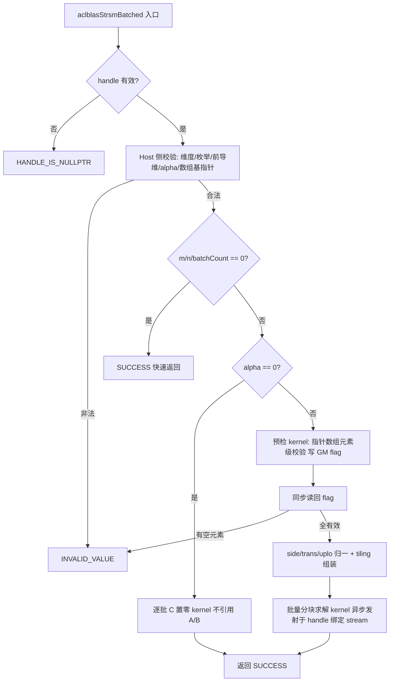

# 【社区任务】aclblasStrsmBatched 算子设计文档（A2/A3）

> 算子：`aclblasStrsmBatched`（FLOAT32 批量三角求解，逐 batch 独立求解 `op(A[i])·X[i] = alpha·B[i]`（LEFT）或 `X[i]·op(A[i]) = alpha·B[i]`（RIGHT），解离席写入 C[i]）
> 目标仓：https://gitcode.com/cann/ops-blas ，实现落位 `blas/trsmbatched/arch22/`，测试落位 `test/trsmbatched/strsmbatched/arch22/`
> 目标硬件：Atlas A2 系列产品（性能测试设备 Atlas 800T A2 / 910B3）与 Atlas A3 系列产品（同为 arch22）
> 任务：9月社区任务-aclblasStrsmBatched算子开发(A2A3)（tasklist 目录 `09-78-aclblasStrsmBatched-A2A3`）
> 文档性质：**设计评审稿**（设计文档评审通过后进入开发，算子代码与 NPU 实测不在本 PR 范围内）

---

# 一、需求背景（required）

## 1.1 需求来源

来源于 CANN 社区任务《9月社区任务-aclblasStrsmBatched算子开发(A2A3)》。任务书要求在昇腾 Atlas A2/A3（arch22）上，基于 ops-blas 开源仓工程框架，以 Ascend C kernel 直调方式实现单精度实数批量三角求解算子 `aclblasStrsmBatched`，完成算子设计、开发、测试全流程；精度按生态算子开源精度标准（混合容差）判定，性能按 `gpu_baseline.csv` 标杆耗时（GPU 实测 ÷ 0.8）判定；验收通过后合入 `blas/trsmbatched/arch22/`。

## 1.2 背景介绍

### 1.2.1 对标接口与差异化语义

对标 cuBLAS `cublasStrsmBatched`（批量、指针数组组织、batch 间共享维度与前导维），本任务在其基础上有三点收紧/扩展：

| 项 | cuBLAS | 本算子 | 说明 |
| --- | --- | --- | --- |
| 输出语义 | 解 X 原地覆写 B | 新增 `Carray/ldc`，B 只读、解离席写 C | C 与 A/B 不允许内存重叠 |
| alpha | Host/Device 指针均可 | 仅 Host 指针 | 收紧；nullptr 返回 INVALID_VALUE |
| trans | 字面接受 OP_C（实数下等价 T） | OP_C 判非法枚举 | 收紧；返回 INVALID_VALUE |

`include/cann_ops_blas.h` 中尚无 `aclblasStrsmBatched` 声明，需新增，供各产品线共用。

### 1.2.2 arch22 平台能力边界（设计前提）

| 能力 | arch22 现状 | 对本设计的影响 |
| --- | --- | --- |
| SIMT / 向量融合（`asc_vf_call`） | 无（arch35 专属） | 仅标准 Ascend C 向量指令 + 多 AIV 分核 |
| FP32 向量乘加 | 无单条融合 FMA（乘、加两条指令、两次舍入） | 规约类误差按混合容差评估 |
| AIV 核数 | 约 20（`GetAivCoreCount()` 运行时读取） | 批量维度天然可并行，满核分派 |
| UB 容量 | 数百 KiB 量级（按 192 KiB 保守规划） | B/C 以列面板常驻，A 以三角段流式双缓冲 |
| 核间同步 | `SyncAll()` 可用 | 批内分块求解的阶段性同步可选 |

## 1.3 算子功能分析

对每个 batch i（`i = 0..batchCount-1`）独立求解规模一致的三角系统：

- `side=LEFT`：`op(A[i])·X[i] = alpha·B[i]`，A[i] 为 m×m；`side=RIGHT`：`X[i]·op(A[i]) = alpha·B[i]`，A[i] 为 n×n；
- `op(A)` 由 trans 决定（OP_N / OP_T，实数无共轭）；`uplo` 指定引用三角；`diag=UNIT` 时对角视为 1 且**不读取** A 对角位置；
- 所有矩阵列主序；A[i]/B[i]/C[i] 分别以指针数组 `Aarray/Barray/Carray`（Device 内存）组织，batch 间地址独立、维度与前导维共享；
- `m=0`、`n=0` 或 `batchCount=0` 为合法 no-op；`alpha=0` 时 A[i]/B[i] 不被引用，C[i] 逐批置零后直接返回成功。

---

# 二、需求分析（required）

## 2.1 需求描述

```cpp
aclblasStatus_t aclblasStrsmBatched(aclblasHandle_t handle, aclblasSideMode_t side,
                                    aclblasFillMode_t uplo, aclblasOperation_t trans,
                                    aclblasDiagType_t diag, int m, int n,
                                    const float* alpha, const float* const* Aarray, int lda,
                                    const float* const* Barray, int ldb,
                                    float* const* Carray, int ldc, int batchCount);
```

关键校验（返回码口径对齐任务书 §2.4 / cuBLAS）：

| 校验项 | 返回 |
| --- | --- |
| handle == nullptr | `ACLBLAS_STATUS_HANDLE_IS_NULLPTR` |
| m < 0 / n < 0 / batchCount < 0 | `ACLBLAS_STATUS_INVALID_VALUE`（=0 为合法 no-op） |
| side/uplo/trans/diag 非法枚举（含实数档 OP_C） | `ACLBLAS_STATUS_INVALID_VALUE` |
| lda/ldb/ldc 不满足前导维约束 | `ACLBLAS_STATUS_INVALID_VALUE` |
| alpha / Aarray / Barray / Carray 为 nullptr | `ACLBLAS_STATUS_INVALID_VALUE` |
| 指针数组中某元素地址为 nullptr | `ACLBLAS_STATUS_INVALID_VALUE`（Device 侧校验，见 §3.2.1） |

## 2.2 需求拆解

1. **公共 API**：`include/cann_ops_blas.h` 新增声明；禁止 A2/A3 私有平行接口。
2. **Device 指针数组的元素级校验**：Aarray/Barray/Carray 为 Device 内存，Host 无法直接解引用，须设计 Device 侧校验策略并同步返回（§3.2.1）。
3. **16 组合数学归一**：side×uplo×trans×diag 归一为少量规范求解形态，统一 kernel 分派（§3.1.1）。
4. **批量并行分派**：batch 维度天然并行 + 批内多 RHS 列并行，两级分核策略（§3.2.2）。
5. **分块求解 kernel**：对角块回代 + 尾部三角段批量更新，B/C 列面板常驻 UB、A 流式搬运（§3.2.3）。
6. **快路径**：alpha=0 置零路径不引用 A/B；m/n/batchCount=0 快速返回。
7. **测试工程**：复刻仓内 CSV 驱动 GTest 框架，加载随任务 1200 条用例（1000 精度 + 200 性能），golden 由 cblas（Netlib `strsm`）逐 batch 生成；性能用 msprof 采集 kernel 耗时对比 `gpu_ms / 0.8`。

## 2.3 设计原则与非目标

**原则**：只在 arch22 可验证能力内实现；所有优化不改变 16 组合的数学语义与离席写出语义；Device 侧校验与计算路径解耦，保证错误返回确定。

**非目标**：不做 arch35 实现；不支持超出 lda/ldb/ldc 语义的非连续访问；不做原地覆写变体；不以牺牲精度换性能。

---

# 三、详细设计（required）

## 3.1 算子分析

### 3.1.1 数学公式与组合归一

LEFT 侧求解按三角方向做列代入（以 LOWER/OP_N 前代为例，逐列 j）：

```
X[j,j+1..m-1, :] 的每个 RHS 列独立：
  X[j] = alpha·B[j] / A(j,j)（UNIT 时除法省略）
  B[j+1..m-1, :] −= A(j+1..m-1, j) · X[j]        （列更新，向量/矩阵减乘）
```

UPPER 反向回代；OP_T 交换三角访问键（A(i,j) 以 (j,i) 取得）。**RIGHT 侧归一为 LEFT**：`X·op(A) = alpha·B ⇔ op(A)ᵀ·Xᵀ = alpha·Bᵀ`，通过逻辑转置视图复用 LEFT 路径（A 的访问键交换、B/C 按转置面板组织）。由此 16 组组合归一为：

```
forward = f(side, trans, uplo)   // 代入扫描方向（归一后仅 UPPER/LOWER 两种）
unit    = (diag == UNIT)
```

kernel 内不做枚举比较，仅按归一属性分派；`alpha` 在 RHS 面板搬入后统一乘入（避免对全量 B 的额外一轮 GM 读写）。

### 3.1.2 支持数据类型

| 项 | 类型 |
| --- | --- |
| A/B/C、alpha | FLOAT32 |
| 计算 | FP32 向量运算，无 FP64 累加 |
| 指针数组 | Device 内存中的 Device 指针数组（`float* const*`） |

### 3.1.3 支持形状

- A[i]：side=LEFT 时 m×m（lda ≥ max(1,m)），RIGHT 时 n×n（lda ≥ max(1,n)）；仅 uplo 指定三角被引用；
- B[i]/C[i]：m×n，ldb/ldc ≥ max(1,m)；支持非方阵（fat：m≪n，thin：m≫n）与前导维 padding；
- batchCount ≥ 0，batch 间共享维度/前导维/枚举、地址独立。

## 3.2 算子实现

### 3.2.0 文件落位与总体结构

```
blas/trsmbatched/arch22/
├── strsmbatched_tiling_data.h   # Host/Kernel 共享 POD tiling
├── strsmbatched_host.cpp        # Host 校验、归一、批量分派、发射
└── strsmbatched_kernel.cpp      # 预检 kernel + 批量分块求解 kernel
test/trsmbatched/strsmbatched/arch22/   # CSV 驱动 GTest（含 strsmbatched_test.csv）
```



### 3.2.2 Host 侧设计：tiling 与批量分派

**Device 指针数组元素级校验**：Host 只能校验数组基指针；元素级校验由轻量**预检 kernel**完成——各核分摊 batch 段，逐元素判空并原子置位 GM flag；Host 发射后同步读回 flag，含空元素即返回 `ACLBLAS_STATUS_INVALID_VALUE`（与任务书口径一致；代价为一次小 kernel + 一次同步，仅在校验阶段发生，不污染计算路径）。

**两级并行分派**（写入 `StrsmBatchedTilingData`）：

- **batch 维**：batchCount 大时按 batch 均分到可用核（每核独立处理若干完整 batch，天然无跨核依赖）；
- **批内维**：单 batch 规模大（m·n 大）而 batchCount 小时，批内再按 RHS 列面板切分多核协同（对角块阶段单核回代 + `SyncAll` 发布 + 全核列更新，同步次数 O(m/nb)）；
- 两种模式由 Host 按 `batchCount / (m·n)` 权衡自动选择；小规模（m、n ≤ 阈值且 batchCount ≤ 阈值）走单核路径。

### 3.2.3 Kernel 侧设计：分块求解

以 LEFT/LOWER/OP_N 为规范路径（其余组合经 §3.1.1 归一进入）：

1. **B/C 列面板常驻**：以 nb 列（默认 64，按 UB 预算整定）为面板，B 面板搬入 UB 并乘 alpha；解出后面板直写 C（离席），不再回写 B；
2. **对角块回代**：A 的 nb×nb 对角块按列紧凑搬入（`lda` 步长列段、双缓冲 `DataCopyPad`，起点不对齐以零前缀填充且不跨出列段），块内 nb 步顺序代入；`diag=UNIT` 时不搬运对角位置并省略除法（编译期模板分离）；
3. **尾部三角段更新**：已解面板 X 对下方三角段执行 `B_sub −= A_sub · X` 的矩阵-面板减乘（向量乘加，实数无共轭分支），以 A 列段流式分块进行；
4. **流水组织**：CopyIn（MTE2）→ Compute（Vector）→ CopyOut（MTE3）双缓冲交替，显式 `SetFlag/WaitFlag` 管理流水依赖；
5. **非方阵/尾块**：fat/thin 场景 A 阶数为较小维，RHS 面板按另一维切分；尾块非整除场景单独处理，不改写 B 与 C 的 padding 区；
6. **特殊值**：非有限对角（Inf/NaN）按 IEEE 传播不拦截；B 含 Inf/NaN 时解按浮点规则传播（与 golden 行为一致）。

### 3.2.4 与标杆实现的差异与原因

| 项 | cuBLAS / cblas `strsm` | 本设计 | 原因 |
| --- | --- | --- | --- |
| 输出位置 | 原地覆写 B | 离席写 C | 接口扩展（任务书 §2.3） |
| OP_C | 字面接受 | 判非法 | 实数无共轭语义，收紧口径 |
| 运算顺序 | 标量/参考顺序 | 面板向量规约 | 并行化必然结果；误差在混合容差内 |
| 批量组织 | cuBLAS runtime 自适应 | 两级分派显式策略 | arch22 无 SIMT，以 AIV 分核弥补 |

## 3.3 支持硬件

| 支持的芯片版本 | 涉及勾选 |
| --- | --- |
| Atlas A2 训练系列产品（Atlas 800T A2 / 910B3，arch22） | √ |
| Atlas A2 推理系列产品（Atlas 800I A2，arch22） | √ |
| Atlas A3 系列产品（Atlas 800I A3，arch22） | √ |
| Ascend 950PR / 950DT（arch35） | 不支持（另行移植） |

## 3.4 算子约束限制

1. C 与 A/B 不允许内存重叠（离席写出）；batch 间地址独立，不得跨 batch 混淆尺寸与地址；
2. lda/ldb/ldc 满足前导维约束；不支持超出其语义的非连续访问；
3. `diag=UNIT` 不读取 A 对角位置；不做奇异性检测，NON_UNIT 对角非零由调用方保证（测试侧 `boost = max(5, 阶数)` 偏移保障）；
4. `trans` 仅支持 OP_N/OP_T，OP_C 返回 INVALID_VALUE；
5. `m=0`/`n=0`/`batchCount=0` 合法 no-op；alpha=0 置零路径不引用 A/B；
6. 指针数组元素含空指针返回 INVALID_VALUE（Device 侧预检）。

---

# 四、可维可测分析

## 4.1 精度标准

| 项 | 内容 |
| --- | --- |
| golden | Netlib `cblas_strsm` 逐 batch 生成（单标杆） |
| 判定 | FLOAT32 混合容差：`\|actual−golden\| ≤ atol + rtol·\|golden\|`，rtol = atol = 2⁻¹³ |
| 整体 | matched_ratio ≥ 0.99 且 max_abs_error ≤ max(1e-2, 32·ULP)；规约误报可放宽至 2 ULP |

标准来源：生态算子开源精度标准（mixed_tolerance_standard）。测试侧对被引用对角加符号保持偏移 `boost = max(5, 阶数)` 保证远离零，golden 用同一偏移后矩阵求解。

## 4.2 性能标准

判据：每条性能用例 NPU 平均单次 kernel 耗时 ≤ `gpu_baseline.csv` 的 gpu_ms ÷ 0.8；msprof 采集 kernel 耗时（`--gtest_filter` 收敛到 TC_PF），先 warmup 再有效采样 10 次取平均。

任务书 5 条典型 case 门槛（与 TC_PF 前 5 条 `strsmBatched-base-000~004` 逐参数一致）：

| case | batchCount | m | n | side | uplo | trans | diag | 门槛（µs） |
|---|---|---|---|---|---|---|---|---|
| 1 | 64 | 256 | 256 | LEFT | LOWER | N | NON_UNIT | 630.7 |
| 2 | 128 | 384 | 512 | LEFT | UPPER | T | NON_UNIT | 3062 |
| 3 | 32 | 1024 | 1024 | RIGHT | LOWER | N | UNIT | 5134 |
| 4 | 8 | 2048 | 2048 | LEFT | UPPER | T | NON_UNIT | 8680 |
| 5 | 2 | 4096 | 4096 | RIGHT | UPPER | N | UNIT | 14361 |

性能验收须覆盖 Atlas 800I A2 与 Atlas 800I A3 双机型；自验证先在 910B3 完成。

## 4.3 兼容性分析

- 只新增 `aclblasStrsmBatched` 声明，不修改既有函数签名与既有算子；README 以追加方式收录（与仓内惯例一致）；
- 小规模、单 batch 大规模、非方阵、前导维 padding 均有语义一致路径；错误路径（含 Device 侧元素校验）确定、可复现；
- 面向 arch22；arch35 具 SIMT/VF 能力，移植需另行设计。

## 4.4 实现与验证状态

| 项 | 状态 |
| --- | --- |
| 设计文档（本文档） | 本 PR 提交评审 |
| 算子实现（blas/trsmbatched/arch22/） | 待开发（评审通过后启动） |
| 测试工程（test/trsmbatched/strsmbatched/arch22/） | 待开发，复刻仓内框架加载随任务 1200 条 CSV |
| 精度/性能/内存自验证 | 待实现后按 §4.1/§4.2 执行并出具报告 |

# 五、参考资料

1. 任务书《aclblasStrsmBatched_A2A3 任务书》（随任务发布）及 `test_cases/`（gen_csv.py、strsmbatched_test.csv、gpu_baseline.csv、verify_accuracy.py、README）；
2. cuBLAS `cublas<t>trsmBatched`：https://docs.nvidia.com/cuda/cublas/index.html#cublas-lt-t-gt-trsmbatched ；
3. Netlib BLAS `strsm`：https://www.netlib.org/blas/strsm.f ；
4. ops-blas 开源仓：https://gitcode.com/cann/ops-blas ；
5. 生态算子开源精度标准：https://gitcode.com/cann/opbase/blob/master/docs/zh/ops_precision_standard/mixed_tolerance_standard.md 。
