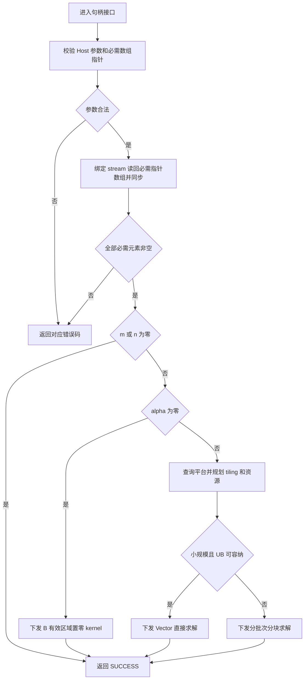
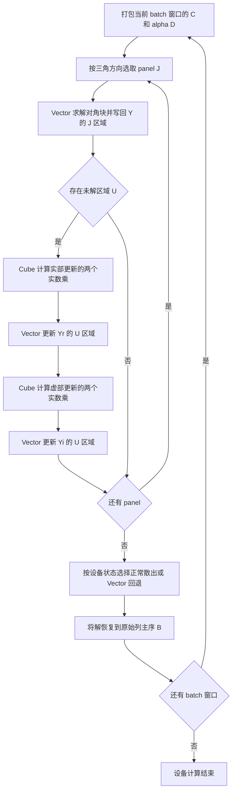

# aclblasCtrsmBatched 算子设计

# 需求背景（required）

## 需求来源

本设计对应“9月社区任务-aclblasCtrsmBatched算子开发(A2/A3)”，面向 Atlas A2/A3 系列产品，在 `ops-blas` 的句柄式 BLAS 框架内实现单精度复数批量三角求解。数学语义对齐 `cublasCtrsmBatched`，开发方式为 Ascend C kernel 直调。

## 背景介绍

三角求解用于分解后的线性系统求解。一个系统沿三角矩阵阶数存在前后依赖，但不同 batch、不同右端项相互独立。实现需要同时利用批次并行和右端项并行，并将大矩阵的非对角更新转化为矩阵乘。

仓内已有 `blas/trsmbatched/arch35/strsmbatched_host.cpp` 等单精度实数实现，可参考句柄、状态码和 workspace 管理方式。该实现面向另一架构，不能直接迁移其中的 SIMT 路径；复数共轭、复数除法和 A2/A3 的片上存储也需要独立设计。

本设计采用“小规模 Vector 直接求解 + 大规模 Vector 对角块求解、Cube 非对角更新”的方案。复数拆成两个 FP32 分量计算，保留公共接口的复数交错布局。

# 需求分析（required）

## 需求描述

对每个批次 `b ∈ [0, batchCount)`，设 `B₀[b]` 为调用前的右端矩阵，求解：

```text
LEFT : op(A[b]) · X[b] = alpha · B₀[b]
RIGHT: X[b] · op(A[b]) = alpha · B₀[b]
```

输出 `X[b]` 原地覆写 `B[b]`。各批次共用 `m、n、lda、ldb、side、uplo、trans、diag`，矩阵地址从 Device 指针数组逐批取得。矩阵均为列主序；仅引用 `uplo` 指定三角，`diag=UNIT` 时不读取实际对角。

## 需求拆解

| 项目 | 设计要求 |
| --- | --- |
| 数据类型 | 输入、输出为 COMPLEX64；实部、虚部及累加使用 FP32 |
| 枚举组合 | LEFT/RIGHT × UPPER/LOWER × N/T/C × NON_UNIT/UNIT，共 24 组 |
| 形状 | `m,n ≥ 0`，`batchCount ≥ 1`；覆盖非方阵、小尺寸、大尺寸和尾块 |
| 前导维 | `lda ≥ max(1,Q)`，`ldb ≥ max(1,m)`，其中 LEFT 的 `Q=m`，RIGHT 的 `Q=n` |
| 地址 | A、B 均为设备侧指针数组；矩阵不要求相邻分配；B 的有效存储区域互不重叠 |
| 特殊路径 | 零维 no-op；`alpha=(0,0)` 时不读取 A 和 B 的旧值，只写 B 的有效元素为零 |
| 校验 | 非法枚举、维度、前导维、必需指针返回 INVALID_VALUE；空 handle 单独返回 HANDLE_IS_NULLPTR |
| 调度 | 在 handle 绑定的 stream 上下发；调用方读取结果前同步该 stream |
| 泛化 | 分块依据形状及平台资源决定，不将验收形状写成专用计算分支 |

# 详细设计（required）

## 算子分析

### 算子原型

公共声明加入 `include/cann_ops_blas.h`，沿用 `include/cann_ops_blas_common.h` 的类型：

```cpp
aclblasStatus_t aclblasCtrsmBatched(
    aclblasHandle_t handle,
    aclblasSideMode_t side,
    aclblasFillMode_t uplo,
    aclblasOperation_t trans,
    aclblasDiagType_t diag,
    int m,
    int n,
    const aclblasComplex* alpha,
    const aclblasComplex* const A[],
    int lda,
    aclblasComplex* const B[],
    int ldb,
    int batchCount);
```

`aclblasComplex` 由 `float real` 和 `float imag` 组成，每个复数占 8 字节。`alpha` 仅接受 Host 指针，进入接口时读取并复制其两个分量，不把 Host 指针传入 kernel。

| 参数 | 位置与方向 | 语义及校验 |
| --- | --- | --- |
| handle | Host，输入 | 已创建的库句柄；读取其 stream 和 workspace；nullptr 返回 `ACLBLAS_STATUS_HANDLE_IS_NULLPTR` |
| side | Host，属性 | `ACLBLAS_SIDE_LEFT` 或 `ACLBLAS_SIDE_RIGHT` |
| uplo | Host，属性 | `ACLBLAS_UPPER` 或 `ACLBLAS_LOWER`，描述原始 A 的存储三角 |
| trans | Host，属性 | `ACLBLAS_OP_N`、`ACLBLAS_OP_T` 或 `ACLBLAS_OP_C` |
| diag | Host，属性 | `ACLBLAS_NON_UNIT` 或 `ACLBLAS_UNIT` |
| m、n | Host，输入 | B 的行数、列数，均不小于零 |
| alpha | Host，输入 | 非空复数标量指针；两个分量均等于零时进入置零路径，包含正负零 |
| A | Device，输入 | 长度为 batchCount 的只读指针数组；每项指向 `lda × Q` 存储；alpha 非零时数组及各项必须非空 |
| lda | Host，输入 | 不小于 `max(1,Q)`；alpha 为零也校验该数值约束 |
| B | Device，输入/输出 | 长度为 batchCount 的指针数组；每项指向 `ldb × n` 存储，数组及各项必须非空 |
| ldb | Host，输入 | 不小于 `max(1,m)`；只更新每列前 m 个复数 |
| batchCount | Host，输入 | 不小于 1；0 和负值均返回 INVALID_VALUE |

非法枚举统一返回 `ACLBLAS_STATUS_INVALID_VALUE`，不使用仓内另有定义的 INVALID_ENUM。分配失败返回 ALLOC_FAILED；元数据搬运或平台查询失败返回 INTERNAL_ERROR；下发与 stream 执行错误按仓内 Runtime 错误映射处理。SUCCESS 表示参数校验成功且计算已下发，或完成合法 no-op，不代表设备求解已经结束。

### 数学公式与方向

记 `T=op(A)`：N 为 A，T 为普通转置，C 为共轭转置。有效三角由原始 `uplo` 和转置共同决定，普通转置与共轭转置均翻转三角方向。

| 原始 uplo | trans | T 的有效三角 | LEFT 求解顺序 | RIGHT 求解顺序 |
| --- | --- | --- | --- | --- |
| LOWER | N | 下三角 | 行号递增 | 列号递减 |
| UPPER | N | 上三角 | 行号递减 | 列号递增 |
| LOWER | T/C | 上三角 | 行号递减 | 列号递增 |
| UPPER | T/C | 下三角 | 行号递增 | 列号递减 |

LEFT 的递推关系为：

```text
x[k,j] = (alpha·B₀[k,j] − Σ T[k,p]·x[p,j]) / T[k,k]
下三角：p<k；上三角：p>k。
```

RIGHT 的递推关系为：

```text
x[i,k] = (alpha·B₀[i,k] − Σ x[i,p]·T[p,k]) / T[k,k]
上三角：p<k；下三角：p>k。
```

UNIT 对角省略除法，且不生成对角地址的读请求。NON_UNIT 要求实际对角非零，不增加奇异性检查、正则项或对角偏移。

### 左右求解归一化

大规模路径统一为左侧求解 `C·Y=alpha·D`：

| side | Q（系数阶数） | R（右端项数） | C | D | 恢复输出 |
| --- | --- | --- | --- | --- | --- |
| LEFT | m | n | op(A) | B₀ | X=Y |
| RIGHT | n | m | op(A)ᵀ | B₀ᵀ | X=Yᵀ |

RIGHT 的系数读取必须遵循以下映射，普通转置不共轭 alpha：

| side | trans | `C[k,p]` 来源 | C 三角相对原始 A |
| --- | --- | --- | --- |
| LEFT | N | `A[k,p]` | 不变 |
| LEFT | T | `A[p,k]` | 翻转 |
| LEFT | C | `conj(A[p,k])` | 翻转 |
| RIGHT | N | `A[p,k]` | 翻转 |
| RIGHT | T | `A[k,p]` | 不变 |
| RIGHT | C | `conj(A[k,p])` | 不变 |

因此 RIGHT+C 对应 `C=conj(A)`，不能将它简化成不共轭的 N。归一化后的 C 为下三角时正向遍历，为上三角时反向遍历。

### 存储、地址与读写范围

列主序复数地址使用 64 位计算：

```text
addrA(row,col) = A[b] + row + uint64(col)·lda
addrB(row,col) = B[b] + row + uint64(col)·ldb
LEFT : D[k,j] = B₀[k,j]
RIGHT: D[k,j] = B₀[j,k]
```

GM 中的复数交错存储；大规模工作区中 C、D/Y 分别存为实部和虚部两个行主序 FP32 平面。对原始 A 按列搬运指定三角的连续有效片段，再完成分量拆分、转置和可选共轭。UNIT 对角由 UB/工作区直接写 1+0i，原始对角、另一半三角及 lda padding 均不搬入。B 的 ldb padding 不进入计算，也不被回写。

各 B 的有效区域及正在读取的 A 不得与写入区域产生破坏性别名；输入指针须属于当前设备且覆盖对应存储范围。地址有效性和跨矩阵别名属于调用方内存契约，不能仅凭非空指针证明；接口不承诺探测所有悬空地址或任意重叠。

## 算子实现

### 实现方案

#### Host 侧设计

Host 依次完成参数校验、指针数组校验、路径选择、资源规划和直调下发。

1. 优先检查 handle，再校验枚举、非负维度、batchCount、前导维和 alpha。读取 alpha 后检查 B 数组整体指针；仅 alpha 非零时检查 A 数组整体指针。
2. 对全部必需数组进行一次批量 D2H 读回并遍历判空，全部通过后才允许任何 B 写入。使用页锁定 Host 缓冲和绑定 stream 上的 `aclrtMemcpyAsync`，等待该 stream 的元数据拷贝完成。alpha 为零时不复制、不访问 A 数组。
3. 零维输入在完成上述必需参数校验后返回 SUCCESS，不下发计算 kernel。该路径仍要求合法的 Host 参数和必需指针，零维不掩盖非法枚举、负维度或 batchCount=0。
4. 非零形状、alpha 为零时下发纯写入置零 kernel，只写各 B 的 m×n 有效区域。
5. 其余输入读取平台的 AIV/AIC 数量及 UB/L1/L0 容量，生成 Vector 或分块路径的 tiling；预先完成所有必要资源申请和 tiling 可用性检查后再下发。

必须即时返回元素级 nullptr 错误与完全无等待的 Host 接口不能同时满足。本设计选择任务书要求的即时校验，显式接受前置元数据同步；不读回矩阵数据，不在正常求解下发后增加结果同步。workspace 扩容也沿用句柄助手的同步规则。性能分析需要分别记录这些 Host 开销和设备 kernel 耗时。



流程中资源、拷贝或下发失败均立即按状态码规则返回；已下发任务的完成或故障仍通过 stream 同步获知。

#### 分核与 tiling

小规模路径按 `(batch, RHS 分片)` 分核，每个核完整拥有其右端项从开始到结束的求解，不把同一依赖链拆给多个核。优先考虑 `Q≤128`，但必须同时满足 UB 预算；该数值是初始候选，不是支持形状上限。

若每个核处理 S 个右端项，则任务数为 `batchCount·ceil(R/S)`，实际 AIV 数为平台核数和任务数的较小值。任务 t 由 `t % blockDim` 对应的核承担，核内以 blockDim 为步长遍历任务。S 从 1、2、4、8、16、32、64 中选取：先满足容量，再保证足够并行度；UB 宽裕且任务充分时增大 S 以复用系数。

大规模路径采用对角 panel 宽度 P，初始候选为 32、64。Host 按 Q、R、UB 预算及并行任务量选择，最后一个 panel 使用真实宽度。对角求解任务数为 `waveCount·ceil(R/S)`；非对角更新按 `(batch, 未解行块, RHS 列块)` 分给 AIC，Vector 写回使用同一输出分块，输出块不重叠。Cube 基础块的 M/N 初始候选为 64、128，K 按 panel 宽度和 Matmul tiling 决定。

平台资源通过 `PlatformAscendC` 的 `GetCoreNumAiv()`、`GetCoreNumAic()` 和 `GetCoreMemSize()` 查询，禁止将某一机型的核数或 UB 容量作为所有 A2/A3 的常量。`MatmulApiTiling` 使用 FP32 输入、输出及 NORMAL 计算类型；核侧配对 `SetHF32(false, 0)`。不启用 FP16/BF16 转换或 HF32 降精度。

tiling 至少包含以下字段；结构按 kernel 直调惯例以 POD 参数传递，Cube tiling 在核侧使用可访问的局部副本：

| 字段 | 用途 |
| --- | --- |
| m、n、Q、R、lda、ldb | 原始尺寸、归一化尺寸和寻址 |
| side、uplo、trans、diag、effectiveLower | 原始属性、系数映射和遍历方向 |
| alphaReal、alphaImag | Host 标量快照 |
| path、rhsTile、panelWidth | 路径选择及 Vector 分块 |
| batchStart、waveCount | 当前批次窗口及全局批次映射 |
| panelStart、panelSize、trailingStart、trailingRows | 本轮对角块及未解区域 |
| paddedQ、paddedR、workspaceOffsets | 各平面的布局与偏移 |
| totalTasks、blockDim、TCubeTiling | 多核调度、尾块与 Cube 参数 |

数组字节数、地址乘加、对齐、任务总数及 workspace 计算均做带溢出检查的 64 位运算，再在确认可表示后转换为 API 字段类型。分配规模不可满足时返回 ALLOC_FAILED；字段或地址规模不可表示时返回 INVALID_VALUE，不能静默截断成小数组。DMA 的 blockCount、blockLen、stride 超限时继续拆分，向量 repeat 超限时分段处理。

#### Kernel 侧：小规模与通用 Vector 路径

小规模 kernel 批量读出当前设备指针表项，搬入其拥有的右端项和有效三角片段，在 UB 构造归一化 C 的两个平面。将 alpha 作用于右端项一次，按三角方向逐行代入；一个对角位置的依赖完成后再开始下一个位置。沿 RHS 维使用 FP32 向量复数乘减，结果交织后按原 side 的映射写回 B。

通用 Vector 路径还承担窄 RHS、workspace 不足或 Cube tiling 不可用时的计算。若 Q×S 不能完整驻留 UB，则分段搬运已解元素与所需系数，计算当前求解位置的复数点积，只在该位置完成全部依赖后写回。该实现使用受预算限制的工作块，支持超过单核 UB 的 Q；它是完整算法分支，性能不作未经测量的承诺。

RIGHT 的原始行访问沿列主序为跨列访问，利用多块 `DataCopyPad` 读取每列中连续的 RHS 行片段，再在 UB 重排，避免循环内逐元素 GM 标量读取。UNIT 对角和无效三角始终从本地构造，不能以“整矩阵搬入后屏蔽”替代不读取约束。

#### Kernel 侧：分块求解与 Cube 更新

每个批次窗口先将 C 打包为两个行主序平面，并将 `alpha·D` 打包到两个残差平面 Yr、Yi。原始 B 在最终恢复输出前保持其输入值，便于特殊值回退。

设 J 为当前 panel，U 为尚未求解的行集合：

```text
1. 对角块求解：C[J,J] · Y[J,:] = 当前残差 Y[J,:]
2. 未解区域更新：Y[U,:] -= C[U,J] · Y[J,:]
```

下三角从首个 panel 开始，U 在 J 后方；上三角从最后一个 panel 开始，U 在 J 前方。Vector 在 UB 完成 panel 内递推，panel 间依赖通过同一 stream 上不同 kernel 的执行顺序建立。

复数更新使用四次 FP32 实数矩阵乘，避免三乘法引入的额外消减误差：

```text
G0 = Cr[U,J] · Yr[J,:]
G1 = Ci[U,J] · Yi[J,:]
Yr[U,:] -= G0 − G1

G0 = Cr[U,J] · Yi[J,:]
G1 = Ci[U,J] · Yr[J,:]
Yi[U,:] -= G0 + G1
```

每轮下发“Vector panel → Cube 两次实数乘 → Vector 实部更新 → Cube 两次实数乘 → Vector 虚部更新”。G0、G1 在实部更新完成后复用。实部更新仅改变 U，不改变已经求解的 J，因此虚部乘法仍读到正确的 panel 实部。

各实数乘的输出按 tile 独占；K 维由同一输出 tile 的负责核完成，不使用跨核原子浮点累加。C 的子矩阵仍具有 Qp 行跨度，Y 和 G 的子矩阵具有 Rp 行跨度，不能把 panel 宽度误当成原矩阵 stride。Matmul 配置用 `SetOrgShape` 表达原始存储跨度，以子块起点设置 Tensor，再用 `SetSingleShape` 表达本 tile 的真实 M/N/K；尾块的 K 为实际 panelSize，对齐补零只用于合法存储与搬运。

AIC 只承担 Matmul 及其片上缓冲，不申请 Vector UB；Vector 搬运、复数拆分和更新由 AIV 承担。Cube 结果确实写回 GM 后当前 kernel 才结束，再由下一 Vector kernel 读取。



最后的散出对 LEFT 使用 `B[k,j]=Y[k,j]`，对 RIGHT 使用 `B[j,k]=Y[k,j]`。batch 窗口起点只用于表项索引，不把不同矩阵假定为固定 stride 的连续数组。

#### 内存预算与生命周期

定义 `Qp=align_up(Q,16)`、`Rp=align_up(R,16)`。工作区子缓冲起点对齐到 512 字节，逻辑有效尺寸仍为 Q、R。完整的大规模单批次预算为：

| 缓冲 | 字节数（对齐前） | 用途及生命周期 |
| --- | --- | --- |
| Cr、Ci | `8·Qp²` | 归一化系数；整个 batch 窗口复用 |
| Yr、Yi | `8·Qp·Rp` | 初始残差、当前残差和最终解共享位置 |
| G0、G1 | `8·Qp·Rp` | 两个 FP32 乘法输出；实部/虚部两阶段复用 |
| 状态与 Matmul 辅助区 | 按实际 tiling 单独计入 | 特殊值标志及 API 必需临时区 |

因此主要数据预算为 `8·Qp² + 16·Qp·Rp` 字节，不能只按 B 的大小估算。waveCount 由可用 workspace 与单批次总预算决定，且不大于 batchCount；每个窗口完成散出后，同 stream 的下个窗口才复用该区域。例如 Q=R=4096 时，主要数据区为每批次 384 MiB，并额外计入对齐、状态和 API 辅助区；无需同时为全部 batch 分配同等空间。

工作区使用 `GetEffectiveWorkspace`、`GetEffectiveWorkspaceSize`、`EnsureDefaultWorkspace` 等现有句柄助手。库管理工作区按需增长，用户提供的工作区不被自动释放或替换。若一个完整批次仍不能容纳，预先选择分段 Vector 路径，不向不存在的容量下发 Cube；资源准备发生在任何 B 更新前。工作区与设备输入在异步 kernel 完成前必须存活，不在接口返回时释放。

小规模 UB 的保守估算为 `8·Qp² + 24·Qp·Sp + Uaux`：系数实虚平面、右端项实虚平面、交错搬运区和临时运算区全部计入，Sp 为 RHS 片宽对齐值。对角 panel 的估算为 `8·Pp² + 24·Pp·Sp + Uaux`。`Uaux` 包括队列深度、指针块、重排索引及每段 32 字节对齐开销，按实际 buffer 清单计算。生命周期不重叠的搬运区和临时区复用同一 arena。

采用双缓冲时，相应输入/输出队列的两份容量必须另行加计；只有仍满足实际 UB 上限才启用。预算不足时依次缩小 S、缩小 P 或选择流式 Vector 分支。Cube 的 L1/L0A/L0B/L0C 由 FP32 Matmul tiling 单独核算，与 UB 预算分开。

#### 搬运、尾块与同步

GM/UB 双向搬运优先使用 `DataCopyPad`，blockLen 使用有效字节数，UB pitch 使用对齐后的长度；GM stride 按字节，UB stride 按 API 规定的 32 字节块计算。只有地址、长度和 stride 均满足对齐条件时才走普通 DataCopy。B 尾列、尾行及 lda/ldb padding 不因向上对齐而额外读写。

复数实虚拆分采用 UB 中的 GatherMask 或等价向量重排；转置在 UB tile 内完成，交织回写使用 UB Gather/重排。打包 padded C、Y 时，所有可能被 Cube 读到的 padding 显式置零。真实 UNIT 对角与为边界补齐的工作区对角分别处理，尾块求解只遍历真实 panelSize。

MTE2→Vector、Vector→MTE3 及 buffer 重用依赖通过队列 EnQue/DeQue 或成对事件建立。一个 panel 的前后依赖不与同一残差位置的搬运重叠。初始实现用独立 kernel 和 stream 顺序跨 AIC/AIV 交接，不引入所有核共同忙等的屏障；可并行流水的范围仅限当前无依赖的搬运块或输出 tile。

#### 数值与特殊值处理

复数乘法按 `(ar·br−ai·bi, ar·bi+ai·br)` 计算，所有分量和残差保持 FP32。复数除法使用带尺度控制的算法：对有限非零分子、分母分别提取二进制指数并归一化，使各自最大分量处于有界范围，再按分母实部/虚部较大项分支求商，最后用两个指数之差恢复尺度。这同时避免直接计算 `br²+bi²` 和先对未缩放的大分子相加造成的中间溢出。零分子和非有限值使用独立分支，不能用加 epsilon、裁剪输入或把分母置 1 的方式改变求解语义。

Inf/NaN 需要考虑 BLAS 三角代入中的跳零分支和运算顺序。打包时仅扫描实际引用的 A 和 B，UNIT 对角及另一半三角不参与扫描；为每批次设置设备状态标志。对含非有限值的批次使用按 Netlib CTRSM 分支语义实现的 Vector 路径，包括相应的零 RHS 跳过更新，避免密集 GEMM 的 `0·Inf` 扩散改变特殊值结果。

该特殊值分支保留原始 side/uplo/trans，逐一实现 Netlib 的 LEFT/RIGHT、N/T/C 和三角方向分支，不仅依赖归一化后的代数公式；各分支的 alpha 作用位置和跳零条件也随之保留。`alpha=(1,0)` 直接保留输入，避免额外的复数乘法以 `0·Inf` 产生 NaN。小规模和流式 Vector 分支也采用这些规则，不能只让 Cube 回退路径处理特殊值。

分块路径的 panel 结果及乘法/更新结果出现非有限值时，也标记该批次回退。因为此时原始 B 尚未散出，回退可以从 B₀ 重新开始，alpha 只应用一次。后续阶段按同 stream 上已完成的状态决定是否处理该批次，最终只允许正常散出或 Vector 回退中的一条路径写 B。标志由整数原子置位合并，初始清零在打包前完成，不为选择路径增加 Host 结果同步。

特殊值判定和极端有限值行为以任务配套 golden 为准，后续必须针对相应用例验证，不能仅由分块代数等价推断已达标。病态三角系统会放大误差；不检测奇异性不等于保证所有病态输入拥有有限输出。

#### 性能优化方案

| 场景 | 优化方向 | 设计理由 |
| --- | --- | --- |
| 小 Q、大 batch | 单次下发合并 batch/RHS 任务，系数驻 UB | 避免逐 batch 的 Host kernel 调用和反复读 A |
| 中大 Q、宽 RHS | Vector panel 与四实数 GEMM 更新 | 将大部分三角求解工作移到矩阵乘 |
| 大 Q、小 batch | 沿未解行块和 RHS 列块展开 AIC 任务 | batch 少时仍能利用多核 |
| 转置/共轭及 RIGHT | 每窗口一次归一化打包 | 不在每一轮 GEMM 中重复散乱寻址和复数拆分 |
| 窄 RHS 或尾部很小 | 基于工作量选择 Vector 更新 | 避免小矩阵乘的固定开销 |
| 大 batch、工作区有限 | 批次窗口 | 控制峰值空间，窗口内并行，窗口间顺序复用 |

路径阈值由 Q、R、batchCount、平台资源及预计下发次数共同决定。P 越小，对角串行工作越少，但轮数和下发次数越多；P 越大，矩阵更新更集中，但 panel 工作和 UB 占用增加。应在后续实现中分别采集打包、panel、Cube、更新、散出的耗时后调整，不为五个性能 case 编写硬编码捷径。

### 工程组织

实现阶段预计使用以下最小组织，复用仓内公共助手和已有构建发现规则：

```text
ops-blas/
├── include/cann_ops_blas.h
├── blas/trsmbatched/arch22/
│   ├── ctrsmbatched_host.cpp
│   ├── ctrsmbatched_kernel.cpp
│   ├── ctrsmbatched_kernel.h
│   └── ctrsmbatched_tiling_data.h
└── test/trsmbatched/ctrsmbatched/arch22/
    └── 后续精度、边界、负向和性能测试文件
```

实现放在 `blas/trsmbatched/arch22/`，测试放在 `test/trsmbatched/ctrsmbatched/arch22/`，不因仓内实数算子的旧目录说明另建嵌套路径。本次只交付本设计文档，上述实现与测试文件是后续规划。

## 支持硬件

| 产品系列 | 设计适配 | 路径 |
| --- | --- | --- |
| Atlas A2，含 Atlas 800I A2、Atlas 800T A2 | 支持 | arch22，Ascend C Vector / FP32 Matmul |
| Atlas A3，含 Atlas 800I A3 | 支持 | arch22，同一算法，运行时查询具体资源 |

## 算子约束限制

只支持 COMPLEX64、列主序、uniform batch 和 Host alpha。支持 lda/ldb padding，不支持其语义以外的任意非连续视图、广播或不同批次使用不同维度。B 各批次不得重叠，A 与 B 不支持破坏性重叠。NON_UNIT 对角须非零，本接口无 info 数组，也不进行奇异性检测。确定性不作逐位一致保证。

输入矩阵、Device 指针数组和 workspace 在绑定 stream 的任务完成前不能释放或改写。准备数组的前序任务应在同一 stream，或由调用方用事件建立依赖。一个 handle 的共享 workspace 不用于多个 stream 或线程并发写入；并发调用使用独立 handle/workspace。调用方应在改变 stream、workspace 或销毁句柄前遵循库的生命周期规则。

# 可维可测分析

## 精度标准/性能标准

本节为后续验收计划，本设计交付阶段不执行实验，不提供实测精度、耗时或通过率。

| 验收项 | 标准 | 来源 |
| --- | --- | --- |
| Golden | Netlib CBLAS `ctrsm` 逐 batch 生成原地求解结果 | 任务书及配套测试工程 |
| 混合容差 | `rtol=atol=2^-13`；逐点满足 `abs(actual−golden) ≤ atol + rtol·abs(golden)` | 任务书 §3.2 |
| 整体精度 | `matched_ratio ≥ 0.99`，并满足 `max_abs_error ≤ 1e-2` 或验收采用的 `32·ULP` 分支 | 任务书及生态混合容差标准 |
| 特殊值 | NaN、同号 Inf 及规定的收窄规则单独判定；最大绝对误差只统计双方有限的比较点 | 任务书 §3.2 |
| 性能 | 下表五个典型 case 的平均设备算子耗时不超过任务阈值 | 任务书 §3.3 |

任务书以复数绝对差描述逐元素指标，配套指导另提到按实部/虚部分别使用 FLOAT32 指标。后续报告保留复数模长指标和分量指标，最终验收采用配套测试工程确认的统一口径；不在没有说明的情况下选择更宽松的口径。ULP 分支也须说明计算方法和来源，不将 ULP 与固定绝对阈值任意替换。

| case | batchCount | m | n | side | uplo | trans | diag | 目标平均耗时（μs） |
| --- | --- | --- | --- | --- | --- | --- | --- | --- |
| 1 | 64 | 256 | 256 | LEFT | LOWER | N | NON_UNIT | 895.1 |
| 2 | 128 | 384 | 512 | LEFT | UPPER | C | NON_UNIT | 5551 |
| 3 | 32 | 1024 | 1024 | RIGHT | LOWER | T | UNIT | 13884 |
| 4 | 8 | 2048 | 2048 | LEFT | UPPER | N | NON_UNIT | 21816 |
| 5 | 2 | 4096 | 4096 | RIGHT | UPPER | C | UNIT | 40969 |

一个逻辑调用含多个 kernel 时，以该调用全部打包、求解、更新、散出及必要回退 kernel 的设备执行耗时之和统计，再对有效调用取平均；单独展示阶段耗时仅用于定位瓶颈，不能将其中某个最快 kernel 当成完整算子耗时。Host 元数据校验及资源准备的端到端开销另行报告。后续使用 msprof 预热后采集至少 11 次有效调用，满足任务书对采样次数的两处要求。

## 测试覆盖设计

使用任务提供的 CSV 及 ops-blas GTest 框架规划以下覆盖：

| 类别 | 关键覆盖与预期 |
| --- | --- |
| 语义基础 | 全部 24 组枚举；含非零虚部 A、B、alpha，区分 T 与 C；LEFT/RIGHT 非方阵 |
| 方向与块边界 | Q=1、奇数、2 的幂及其±1，P 的边界及±1，RHS 分片与 Cube tile 尾块 |
| 批次与地址 | batchCount 从 1 到 1024；非相邻矩阵分配；不同 batch 填充不同数据，检查 batchStart 映射 |
| 前导维与对齐 | 紧凑、padding、合法地址偏移；A 未引用三角、UNIT 对角和 B padding 放置哨兵并检查读写范围 |
| 标量路径 | 0、1、−1、纯虚、一般复数；alpha=0 且 A 整体/元素为空；B₀ 为 NaN/Inf 时仍输出零 |
| 零维 | m=0 或 n=0，在合法必需参数下 SUCCESS；不启动计算；与非法参数组合检查约定优先级 |
| 负向 | handle/alpha/必需数组为空，非法枚举、负维度、非法 lda/ldb、batchCount≤0；保证计算前拒绝 |
| 元素级负向 | 在测试工程加钩子将数组某项置空，包含最后一项为空，确认任一 B 写入前全表校验；CSV 不能直接表达时单列用例 |
| 特殊值与稳定性 | 被引用数据的 Inf/NaN、未引用三角的 Inf/NaN、UNIT 对角 NaN、极大/极小有限复数除法及回退选择 |
| 资源与调度 | workspace 足够/不足、缩小 batch 窗口、Vector 流式分支、stream 前序数组准备及同步后结果可见性 |
| 性能 | 五个任务 case 和配套性能 CSV；按完整逻辑调用关联多 kernel 数据 |

原始 B₀ 需由测试工程保存供 golden 使用；精度对比覆盖全部有效 m×n 元素，padding 单独检查未改变。残差 `C·Y−alpha·D` 可作辅助定位，不能代替与 CBLAS golden 的验收比较。异常地址契约和不支持的别名不作为必须返回 INVALID_VALUE 的可探测条件。

## 可维护性分析

side/trans 的映射集中在系数访问与打包逻辑，求解模块仅处理归一化三角；小规模、流式和分块路径共享复数乘除与边界辅助逻辑。日志记录形状、路径、分块、窗口和资源错误，避免在正常执行中逐元素打印。性能阈值及 UB 预算保持集中定义，测试通过分支边界验证实际路由，避免实现与测试只覆盖典型大矩阵。

## 兼容性分析

新增 `aclblasCtrsmBatched` 声明及 arch22 实现，沿用既有 handle、stream、状态码、复数结构与工作区接口，不改变其他 BLAS API 的语义。相较 cuBLAS，本任务明确只支持 Host alpha，且 batchCount=0 返回 INVALID_VALUE；文档与后续测试均按本任务约定执行。

## 参考资料

- [社区任务目录及提交规范](https://gitcode.com/cann/cann-ops-competitions/blob/master/04_tasks/01_community-task-2026/README.md)。
- [设计文档模板](https://gitcode.com/cann/cann-ops-competitions/blob/master/04_tasks/01_community-task-2026/resources/design_template.md)，只采用章节组织，算子方案独立编写。
- [ops-blas 公共类型定义](https://gitcode.com/cann/ops-blas/blob/master/include/cann_ops_blas_common.h)、[实数批量三角求解 Host 实现](https://gitcode.com/cann/ops-blas/blob/master/blas/trsmbatched/arch35/strsmbatched_host.cpp)及[句柄工作区助手](https://gitcode.com/cann/ops-blas/blob/master/blas/common/helper/aclblas_handle_internal.h)，用于工程接口核对。
- [cuBLAS trsmBatched 接口说明](https://docs.nvidia.com/cuda/cublas/index.html#cublas-t-trsmbatched)、[Netlib CTRSM 源码](https://www.netlib.org/blas/ctrsm.f)，用于数学语义和特殊分支参考。
- [生态混合容差标准](https://gitcode.com/cann/opbase/blob/master/docs/zh/ops_precision_standard/mixed_tolerance_standard.md)。
- [CANNBot tiling 设计指引](https://gitcode.com/cann/cannbot-skills/blob/master/ops/ascendc-tiling-design/SKILL.md)、[A2/A3 Matmul API 指引](https://gitcode.com/cann/cannbot-skills/blob/master/ops/ascendc-api-best-practices/references/api-matmul.md)，用于资源预算与 API 静态审查；具体接口以目标环境的 CANN 头文件为准。
