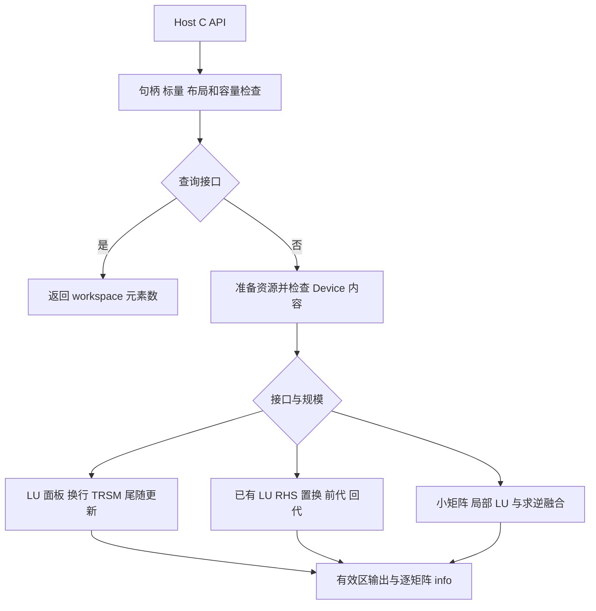

# Atlas 950PR 单精度实数 LU 分解与批量求逆设计

| 项目 | 内容 |
| --- | --- |
| 社区任务 | 10月社区任务—单精度实数LU分解、求解和批量求逆(950) |
| 任务目录 | `10-1-aclsolverSgetrf-batch-950` |
| 贡献者 | ST2Horse |
| 版本 | v0.2，2026-10-16，设计评审稿 |
| 代码仓库 | [cann/ops-solver](https://gitcode.com/cann/ops-solver) |
| 目标产品 | Ascend 950PR；`ascend950 / dav-3510 / arch35` |

本方案采用确定性分块 LU、基于已有 LU 的分块三角求解，以及小矩阵融合批量求逆。先建立完整 FP32 语义路径，再根据 950PR 真机结果选择 SIMT、Cube 和流水优化。块宽、内存预算和优化方案均为设计值；当前已核对资料与服务器环境，尚无本算子的真机精度或性能结果。

# 1. 需求背景（required）

## 1.1 需求来源

依据[官方任务](https://www.hiascend.com/activities/task-center/details/cd66edbecb8840b3bbcd39035146a970?menu=trends)及附件 `Atlas950_Sgetrf_Sgetri_SgetriBatched_SmatinvBatched_task_doc.md`。接口、精度、交付分别对应任务书 §2.3–2.4、§3.2–3.5、§4–5。

本文按[官方设计模板](https://gitcode.com/cann/cann-competitions/blob/master/04_tasks/01_community-task-2026/resources/design_template.md)组织，采用 ops-solver Host C API 与 Ascend C/CATLASS Kernel 直调。复用 handle 和 stream，数值计算在 NPU AI Core 上执行；CPU LAPACK 用于测试参考，CUDA 库用于接口及性能对标。

## 1.2 背景与现状

LU 分解通过行置换得到三角因子，求逆复用这些因子进行三角求解。本任务四个计算接口共享布局、主元与数值语义，应作为一组能力实现。

源码基线为 [ops-solver@b0a2247317f7](https://gitcode.com/cann/ops-solver/tree/b0a2247317f7a1f01341b247c8fa5d7d9d9d7e2e)。当前原型需要以下升级：

| 位置 | 当前行为 | 目标 |
| --- | --- | --- |
| 公共 Sgetrf/Sgetri 声明 | 旧参数、`aclError`、`int64_t` | 任务书六个签名、`aclsolverStatus_t`、32 位 `int` |
| Sgetrf Host | 内部 H2D/D2H、`lda==n`、同步 | Device 列主序、合法 padding、调用方 workspace |
| Sgetri Host/Kernel | 输入原始矩阵并再次 LU | 消费已有 LU 与主元，原地输出逆矩阵 |
| 实数批量接口 | 缺少本任务两个入口 | Device 指针数组、逐矩阵 info |
| LU 组件 | 固定分核、旧架构条件分支 | 950PR 平台查询、分块和同步复核 |
| 私有 handle | 仅保存 stream | 增加必要 scratch 的资源所有权和完成事件 |

可借鉴旧面板、TRSM 和 GEMM 的算法组织，但其数据契约、资源常量及历史性能不作为本项目结论。

# 2. 需求分析（required）

## 2.1 功能范围

| 接口 | 输入与输出 | 关键要求 |
| --- | --- | --- |
| Sgetrf_bufferSize | 规格 → workspace 长度 | Host 返回 float 元素数 |
| Sgetrf | 原始矩阵 → 原地 LU、主元、info | 方阵/矩形，部分主元/无主元 |
| Sgetri_bufferSize | 规格 → workspace 长度 | 与执行共用规划函数 |
| Sgetri | LU+主元 → 原地逆矩阵 | 所有 LU 读取完成前不得覆盖 |
| SgetriBatched | 多个 LU+主元 → 独立逆矩阵数组 | 非连续 Device 地址、逐矩阵状态 |
| SmatinvBatched | 多个原始矩阵 → 独立逆矩阵数组 | n≤32；n=33 报错 |

范围为四个计算接口、两个查询接口和任务要求的 operation 枚举。正文“五个接口”及 B/nrhs/trans 条目与 §2.3 不一致；Sgetrs 没有明确原型，列入评审问题，不自行补造接口。

## 2.2 规模与清单

| 算子 | 附件数 | 附件最大规格（各字段独立最大值） | 拟覆盖范围 |
| --- | ---: | --- | --- |
| Sgetrf | 148 | m=4096，n=8168 | 至少 m≤4096、n≤8192，含矩形/padding |
| Sgetri | 200 | n=4096 | 至少 n≤4096 |
| SgetriBatched | 149 | n=3691，batch=1000000 | 至少 n≤4096、batch≤1000000 |
| SmatinvBatched | 215 | n=32，batch=10000000 | n≤32、batch≤10000000 |

保留全部 712 条附件。49 条 Sgetrf 的 n 超过 4096，不能按正文最低覆盖范围删除。维数上限不承诺其笛卡尔积可同时驻留设备内存。

任务书 P-01～P-09 中五个场景没有相同规格的附件记录，因此基础清单为 **712 条附件 + 5 条典型场景 = 717 条**，再加入接口、边界和有效反例。性能基线缺口见 §4.4。

## 2.3 要求、实现与验证对应

| 要求及原文位置 | 计划实现位置 | 测试方式 | 完成证据/状态 |
| --- | --- | --- | --- |
| 六签名与枚举，§2.2–2.3 | include、对应 Host | 编译/链接/符号和参数核对 | 待实现 |
| Device、列主序、padding，§2.4 | 寻址与搬运组件 | 非连续地址、LD+8/+32、哨兵 | 待实现 |
| LU/主元/已有 LU 求逆，§2.1、§7 | 四组 kernel | 小输入、CPU FP32、逐矩阵残差 | 待实现 |
| info、空问题与错误，§2.4、§3.5 | Host/预检查 kernel | 正负 info、奇异、错误注入 | 待实现 |
| 确定性与非默认流，§3.5 | 归约、调度、scratch 管理 | 重复逐位比较、延迟同步、切流 | 待实现 |
| 950PR 精度/性能，§3.1–3.3 | 测试与 profiling | 完整清单、全输出、全调用计时 | 资料已核对；未运行 |
| 文档、测试、报告、代码，§4–5 | 文档与交付索引 | 同源版本、复现、评审记录 | 本地设计已更新；未提交外部评审 |

# 3. 详细设计（required）

## 3.1 算子分析

### 3.1.1 数学定义与主元方向

令 r=min(m,n)，第 k 步交换矩阵为 S_k：

$$
P=S_{r-1}\cdots S_1S_0,\qquad PA_0=LU.
$$

L 为 m×r 单位下三角/下梯形，U 为 r×n 上三角/上梯形。A 的严格下三角保存 L 的非对角项，主对角及以上保存 U。

第 k 步从当前 k…m−1 行选择绝对值最大主元，相等选当前行号最小者。写 ipiv[k]=p+1，表示逐步交换序列；空主元指针表示无主元模式，P=I。

求逆按 RHS 列块从单位阵出发，正序应用主元行交换，再求解：

$$
LY=P,\qquad UX=Y,\qquad X=A_0^{-1}.
$$

重构原矩阵时则先乘 LU，再逆序重放行交换。至少使用两次不可交换次序的置换验证方向：

```text
A0 = [[0,1,0], [0,0,2], [3,0,1]]
ipiv = [3,3,3]
L = I
U = [[3,0,1], [0,1,0], [0,0,2]]
inv(A0) = [[0,-1/6,1/3], [1,0,0], [0,1/2,0]]
```

SmatinvBatched 先局部分解原始矩阵，再求逆；Sgetri/SgetriBatched 直接消费 LU，不能再次分解输入。

### 3.1.2 公开接口

在公共头文件的 C linkage 区域声明：

```cpp
aclsolverStatus_t aclsolverSgetrf_bufferSize(
    aclsolverHandle_t handle, int m, int n, float *A, int lda, int *Lwork);
aclsolverStatus_t aclsolverSgetrf(
    aclsolverHandle_t handle, int m, int n, float *A, int lda,
    float *Workspace, int *devIpiv, int *devInfo);
aclsolverStatus_t aclsolverSgetri_bufferSize(
    aclsolverHandle_t handle, int n, float *A, int lda, int *Lwork);
aclsolverStatus_t aclsolverSgetri(
    aclsolverHandle_t handle, int n, float *A, int lda, int *devIpiv,
    float *Workspace, int Lwork, int *devInfo);
aclsolverStatus_t aclsolverSgetriBatched(
    aclsolverHandle_t handle, int n, const float *const Aarray[], int lda,
    const int *PivotArray, float *const Carray[], int ldc,
    int *infoArray, int batchSize);
aclsolverStatus_t aclsolverSmatinvBatched(
    aclsolverHandle_t handle, int n, const float *const A[], int lda,
    float *const Ainv[], int lda_inv, int *info, int batchSize);
```

公共 common 头增加 `aclsolverOperation_t`：`ACLSOLVER_OP_N=0`、`ACLSOLVER_OP_T=1`、`ACLSOLVER_OP_C=2`。本组计算函数没有 trans 入参。

### 3.1.3 内存与布局

| 对象 | 位置与类型 | 约束 |
| --- | --- | --- |
| handle、维数/LD | Host，维数为 int | 维数非负，LD 满足布局 |
| 矩阵 | Device，FLOAT32 | `A[row+col*lda]`；`lda≥max(1,有效行数)` |
| 主元、info | Device，INT32 | 1-based；批量主元起点 `PivotArray+q*n` |
| 批量指针数组 | Device，数组元素为 Device 地址 | 不假定矩阵连续 |
| Workspace | Device，float* | 长度为 float 元素数 |
| 查询 Lwork 输出 | Host，int* | 查询函数写回 |

padding 不作为用户临时区。尺寸乘加、batch 偏移及字节数使用受检 64 位计算，转换为 int Lwork 前检查范围。调用方保证真实有效的存储、足够容量、匹配 LU 的主元及异步使用期；裸指针不携带 dtype、shape、allocation 长度或因子来源证明。

批量输出之间不得重叠，也不得覆盖仍需读取的输入；workspace 与矩阵、主元、info 不别名。

## 3.2 整体执行方案



Host 负责参数、规划、资源寿命和 stream 下发；Tiling 描述尺寸与切分；Kernel 负责 Device 检查、搬运、计算及写回。数值计算下发后不等待结束；需要立即报告 Device 参数错误的预检查单独处理必要同步。

## 3.3 Host 与 Tiling 设计

### 3.3.1 检查、空问题和 info

检查顺序拟定为 handle/context → 标量/LD → 空问题规则 → 非空问题必需指针/workspace → Device 内容预检查 → 数值计算。

| 情况 | 处理 |
| --- | --- |
| 空 handle | HANDLE_IS_NULLPTR，不访问数据 |
| 负维数、非法 LD、matinv n>32 | INVALID_VALUE；可写 info 按流写 −i |
| 缺失必需指针、短 Lwork、整数溢出 | 参数错误，不启动数值计算 |
| 单矩阵 m=0 或 n=0 | 合法 info 写 0，查询 Lwork=0，不访问矩阵/workspace |
| batch=0 | 不访问批量数组；info 可空规则请评审确认 |
| n=0 且 batch>0 | 要求可写 info 并逐项清零 |
| 精确零主元 | 写首个 1-based 位置，不用经验近零阈值判断奇异 |
| 分配/下发失败 | 映射相应 solver 状态并保留运行时错误原因 |

参数编号不计 handle：

| 接口 | 编号 |
| --- | --- |
| Sgetrf | m=1，n=2，A=3，lda=4，Workspace=5，devIpiv=6，devInfo=7 |
| Sgetri | n=1，A=2，lda=3，devIpiv=4，Workspace=5，Lwork=6，devInfo=7 |
| SgetriBatched | n=1，Aarray=2，lda=3，PivotArray=4，Carray=5，ldc=6，infoArray=7，batchSize=8 |
| SmatinvBatched | n=1，A=2，lda=3，Ainv=4，lda_inv=5，info=6，batchSize=7 |

查询接口没有 info，通过返回值报告错误。无主元 nullptr 合法。数值奇异不等于 API 下发失败；getrf 遇零主元跳过除法并继续后续列，getri 停止失败矩阵的三角除法，其他合法 batch 独立处理。

### 3.3.2 Device 内容检查与同步

任务书限定有限浮点，并要求非法值域返回错误。预检查在绑定 stream 上验证有限输入、主元范围、嵌套空指针、地址溢出和同矩阵输入输出重叠，必须先于可能覆盖输入的写入。主元第 k 步满足 `k+1≤ipiv[k]≤m`，求逆时 m=n。

严格返回 Host INVALID_VALUE 需要将紧凑错误摘要传回 Host 并等待其完成。这是获知 Device 状态所必需的同步；数值阶段仍异步。预检查 kernel 计入接口耗时，并另报端到端延迟。若维护方接受仅异步 info 报告 Device 内容错误，再减少等待并重新验证。

同下标检查不能证明任意跨 batch 无别名。跨 batch 输出独立作为调用契约，运行时检测范围请评审明确；如要求全局检测，采用地址描述排序/扫描，复杂度 O(B log B)，避免 O(B²)，并计入描述空间及耗时。不承诺识别所有非空悬空指针或证明 LU 来源。

### 3.3.3 Workspace 与 UB

查询和计算共用规划函数。设 Align_a(x) 为按后端要求对齐的字节数，m′/n′ 为内部补齐维数，b 为 panel 宽，r 为 RHS 宽，G 为同时在途的工作单元数。

| 接口 | 主要分区 | 生命周期 |
| --- | --- | --- |
| Sgetrf | 工作矩阵 4m′n′；双面板 8m′b；右面板 4n′b；归约/校验/库 scratch | 最终 LU 写回后结束 |
| Sgetri | 完整结果 4n′²；最多 G 份 RHS 暂存 4Gn′r；三角/校验/库 scratch | 结果提交 A 后结束 |
| SgetriBatched | 有界 batch chunk 的 RHS/tile 与校验暂存 | 最后消费者完成后回收 |
| SmatinvBatched | 计算优先局部驻留；预检查/边界提交所需有界暂存 | 不保存整批 LU/逆矩阵副本 |

```text
requiredBytes = startAlignmentSlack + Σ Align_a(partitionBytes)
Lwork = ceil(requiredBytes / sizeof(float))
```

分区分别对齐，非对齐 workspace 基址需起始余量；若选择 256 字节对齐，余量上界为 255 字节，最终向上取整到 float 元素。库 API 实际 scratch 另加。G 随资源变化，并行临时区不能遗漏。查询覆盖同规格的主元/无主元路径，不依赖矩阵内容。

n=4096 一份 FP32 方阵为 64 MiB；4096×8192 工作矩阵为 128 MiB，另外还有 panel 和库空间。Sgetrf 没有 Lwork 输入，只能由调用方保证查询容量；Sgetri 显式检查长度。

UB 必须满足“输入/输出队列 + panel/RHS + 归约 + API scratch + 控制区 ≤ 平台可用 UB”。两份 32 阶矩阵为 8 KiB，512×16 面板为 32 KiB，4096×4 RHS 为 64 KiB；这些只计数组，双缓冲和 API 临时区另计。预算不足则减小 group/tile/r。

### 3.3.4 内部资源与 stream

批量内部 scratch 归私有 handle 管理，记录 device/context、stream、容量和最后使用事件。下发前准备主要资源；同流 chunk 按顺序复用；最后消费者后记录事件。切流时只用已完成槽或独立槽，跨流复用需明确事件依赖。

扩容和失败清理不得提前释放在途缓冲。Destroy 只等待自身资源必要的完成条件，不销毁调用方 stream 或重置设备。池元数据加锁；同 handle 的调用与 SetStream 需串行约束，独立 handle 可并行。异步 tiling/control 数据按值传入或保存在与事件同寿命的槽中，不能引用已失效 Host 栈。

### 3.3.5 分核与分派

| 路径 | 工作单元 | 初始候选（待测） |
| --- | --- | --- |
| 小矩阵局部求逆 | 单矩阵或矩阵组 | n≤32；group=1/2/4/8 |
| 分块 LU | panel 行段；TRSM/GEMM 输出 tile | b=16/32；更新 tile=64/128 |
| 已有 LU 求逆 | (matrixIndex,RHS列块) | r=4/8/16；三角块=16/32 |

有效核数取可用核数和工作数的较小值，grid-stride 分配，尾块只处理有效长度。千万 batch 增加循环次数，不直接等同硬件 block 数。

Tiling 包含 opKind、m/n、LD、batchStart/count、主元开关、块宽、核数、尾长、路径键和 64 位 workspace 偏移。只依赖公开规格与资源，不按 case ID、seed、GPU 时间或答案特化。

## 3.4 Kernel 设计

### 3.4.1 分块右看 LU

有效输入搬入对齐工作矩阵，内部布局服从计算后端，公开布局保持列主序。

```text
for s = 0 .. min(m,n)-1 step b:
    w = min(b, min(m,n)-s)
    factor_panel(A[s:m, s:s+w])
    apply_pivots_to_left_L_and_right_columns()
    solve L11 * U12 = A12
    update A22 = A22 - L21 * U12
commit_logical_LU_and_pivots()
```

panel 逐列固定次序搜索、换行、除法和消元。大 panel 按行段归约 (abs(value),row)，固定合并次序并选最小行号，padding 不参与搜索。

panel 内已交换列不重复交换；历史 L 列与右侧待更新列执行同一主元序列。长矩形保留完整 L，宽矩形最后仍计算右侧 U，不能将 min(m,n) 当列尾界。

初版通过同 stream kernel 边界建立 panel、换行、TRSM、更新的全局依赖。确认启动/等待为热点后再考虑融合，不使用要求所有 block 同时驻留的全局自旋屏障。

### 3.4.2 已有 LU 求逆

先检查主元和 U 对角；按 RHS 列块 J 构造 P·I[:,J]，前代从上到下，回代从下到上：

$$
Y_i=L_{ii}^{-1}(R_i-\sum_{k<i}L_{ik}Y_k),\qquad
X_i=U_{ii}^{-1}(Y_i-\sum_{k>i}U_{ik}X_k).
$$

对角块用 AIV FP32 求解，块间贡献使用合格的矩阵更新组件；L 对角按 1 处理，不能误读 packed LU 的 U 对角。

Sgetri 完整结果写 workspace，全部 LU 读者结束后才提交 A。SgetriBatched 输入只读，输出写 Carray，每个 RHS 块具有唯一输出范围。主元交换覆盖当前 RHS 块全部 n 行，不局限于与列块同编号的行。

### 3.4.3 小矩阵融合

SmatinvBatched 一次搬入矩阵，在局部完成部分主元 LU、单位 RHS 置换及前/回代，再写出结果。SgetriBatched 复用求解部分，跳过 LU。奇异矩阵独立写 info，不伪造逆矩阵，不影响其他矩阵。

Vector 路径作为完整语义基线；950PR SIMT 作为重点候选。一个协作组处理一个矩阵，lane 分担 RHS 列或矩阵行；主元广播与依赖更新明确同步。先核对组宽、寄存器溢出、共享空间与访存事务，再选择映射，不从其他平台假定 warp 或寄存器容量。

### 3.4.4 搬运、物理写入和确定性

内部按对齐且不相交 tile 分工，一个工作单元负责完整 K 次序累加。用户非对齐输出还需核对实际 store/DMA 粒度：逻辑元素不重叠不自动证明写事务独立。可能共享事务的边界统一交给一个写者，必要时先写对齐暂存再提交。API 粒度以 950PR 文档/实现核实，不猜测 cache line 大小。

所有搬运、计算与写回间建立配对事件；初版跨核依赖使用 kernel 边界。padding、前后 guard、相邻矩阵和输入只读区分别检查。主元平局、归约、K 分块固定，不使用无序浮点原子累加；控制区每次初始化。

### 3.4.5 数值方案

panel、除法与三角求解采用完整 FP32。小非零主元优先直接除法，避免先求倒数额外溢出。Cube 更新只有在工具链支持所需 FP32 输入、乘法、累加和舍入语义且全量精度通过后启用；核对实际精度选项，不静默使用 FP16/BF16/低有效尾数模式。

分块改变运算顺序，由任务残差判定；固定实现重复调用则要求逐位一致。次正规数、极端有限值与相消单列反例。Cube 路径不满足要求时保留 AIV FP32，并如实报告性能缺口。

## 3.5 性能优化方案

| 瓶颈假设 | 候选措施 | 采用条件 |
| --- | --- | --- |
| 小矩阵启动/地址读取占比高 | 融合、每组多矩阵、SIMT | 全接口收益，寄存器和尾 batch 不回退 |
| LU 搜索/阶段等待占比高 | 固定树归约、panel 宽度、局部融合 | 包含换行/TRSM/更新的总耗时下降 |
| 大矩阵尾随更新占主导 | 950 FP32 Cube/CATLASS、输入复用 | 全量精度/确定性通过且更新实际提速 |
| 求逆重复读取 LU | 多 RHS 复用、调整 r | 搬运与暂存成本计入后仍有收益 |
| 搬运与计算串行 | 有预算的双缓冲/流水 | profiler 等待减少，事件与生命周期正确 |
| 检查和最终提交占比高 | 合并必要读取、紧凑错误归约 | 保留全部错误语义和物理边界要求 |

大矩阵另可评估 U 的分块求逆、右侧解 ZL=U⁻¹、逆序主元列交换路线，以减少通用 RHS 工作。其覆盖依赖与浮点次序不同，须单独证明依赖安全并重新全量精度后采用。

每轮围绕一个主要假设记录版本与对照。连续两轮无可靠收益、同类失败重复或 profiler 与假设冲突时，回查 learning 的 Tiling、Matmul、精度和性能章节，把机制转成可证伪实验。教程示例性能不能作为本算子成绩。

## 3.6 工程与硬件

```text
include/cann_ops_solver.h
include/cann_ops_solver_common.h
src/sgetrf/                 # Host、950PR LU
src/sgetri/                 # Host、已有 LU 求逆
src/sgetri_batched/         # LU 指针数组求逆
src/smatinv_batched/        # 小矩阵融合
src/utils/                  # 实际共享的校验、布局与资源组件
test/{sgetrf,sgetri,sgetri_batched,smatinv_batched}/
docs/zh/{sgetrf,sgetri,sgetri_batched,smatinv_batched}.md
docs/api_list.md
```

沿用上游构建与测试，普通目录和 arch35 源码收集避免重复入口；不复制整套无关旧 kernel。README、示例和测试更新为 Device 调用流程。

已确认设备 Ascend950PR、驱动 25.7.rc1.10、CANN9.1.0，并发现 dav_3510 SIMT、bisheng/ccec 与 msprof。仓库 README 列有已验证 CANN9.0.0 包；现用9.1.0的兼容仍须验证。核数及 UB/L1/L0 从平台查询，不用其他 SKU 标称值作验收预算。

# 4. 可维可测分析

## 4.1 精度标准

矩形 1-范数为 `max_j Σ_(i=1..m)|A_ij|`；分母 n 按任务书取列数。单位舍入 ε=2^-24，不能误用 NumPy float32 eps=2^-23。

$$
r_{LU}=\frac{\|P^{-1}LU-A_0\|_1}{n\|A_0\|_1\varepsilon},\qquad
r_{inv}=\frac{\|I-CA_*\|_1}{n\|A_*\|_1\|C\|_1\varepsilon}.
$$

| 接口 | 逐矩阵判据 | 参考 |
| --- | --- | --- |
| Sgetrf | r≤max(5r_cpu,0.3) | 同原始输入的 CPU FLOAT32 LU |
| Sgetri | r≤max(5r_cpu,0.05) | 同一输入 LU/主元；A* 由其还原 |
| SgetriBatched | r_i≤max(5r_cpu_i,0.05) | 各矩阵独立还原、比较 |
| SmatinvBatched | r_i≤max(5r_cpu_i,0.5) | A* 为原始矩阵；CPU FLOAT32 分解/求逆 |

核对 CPU 实际库、符号与 dtype。无主元参考不能调用会选主元的分解过程；需经小输入和残差验证的无主元实现。CPU/NPU 使用同一评价器。残差的乘法、范数、缩放精度待评审冻结，拟采用单精度 LAPACK SGET01/SGET03 风格；FP64 结果单列诊断，不混用改变门槛。

每个非空有效输出全部比较，批量逐矩阵判定，可分块但不能抽样或汇总掩盖失败。空问题、奇异、零范数和非有限结果单列规则，NaN 或缺失阈值不得自动通过。另记录原始 A0 的端到端逆残差，用于定位 LU/求逆误差。

## 4.2 完整测试计划

| 类别 | 覆盖与验证重点 |
| --- | --- |
| 形状 | 717 条基础记录；1、2 的幂与幂减一；长/宽矩形；全部输出比较 |
| 布局 | LD 最小值/+8/+32，合法非对齐偏移，非连续地址数组；padding/guard/只读区 |
| 主元 | 有/无主元，多次交换，相等最大值，非法主元；1-based 与方向 |
| info | 首/中/末零主元，混合健康/奇异 batch；逐矩阵状态 |
| 错误/空问题 | 负维数、非法 LD、缺指针、短 workspace，n=0、batch=0、matinv n=33 |
| 数值压力 | 极端有限值、次正规数、相消、近奇异；不放宽门槛 |
| 值域负向 | NaN/Inf 输入按有限浮点契约报告错误 |
| 流与资源 | 非默认流、延迟同步、切流、独立 handle 并行、失败清理 |
| 确定性 | 每次恢复相同输入，A/C、ipiv、info 逐位比较 |
| 评价器自检 | 故意改坏输出、padding、info 必须被拒绝；不计入算子通过数 |

随机主路径按任务均匀/正态各50%，对角加n；另加约10%不增强矩阵与显式奇异反例。对角加n并不保证所有样本可逆，保存 seed、不满足主路径前提的样本和重采样记录；不得因 NPU 失败筛选输入。

正式顺序：冻结完整清单、源码及构建输入 → 从头全量精度 → 全部应测项通过 → 同版本正式性能。任何真实失败、遗漏、跳过、超时或未比较均阻止进入正式性能。实现、构建、测试或依赖变化后重新从头验证，不能拼接旧子集。

## 4.3 性能标准与计时

逐 case 使用附件 perf.avg_ms：

```text
NPU平均耗时(us) ≤ GPU avg_ms × 1000 / 0.35
```

msprof 保留完整 OpBasicInfo.csv。多 kernel 接口先求每次调用全部必要 kernel 的时间和，再跨调用取平均；包括校验、初始化、转换、换行、三角求解、更新、提交。另报端到端延迟，复合接口计时口径请评审确认。

附件 iters=25，先按此对齐，预热数量待统一。每次 getrf 恢复原矩阵、getri 恢复 LU，外部输入恢复与 CPU golden 不计入；getri 不包含前置 getrf，matinv 包含内部 LU。保留全部样本，不挑最好一次或只报 GEMM。

内部 chunk 属于一次 API，全 batch 工作全部计时，不减小公开 batch 外推。日志绑定源码/未提交差异、构建产物、编译与依赖、设备、用例和范围。任务 §3.4 无独立内存门槛，仍记录 workspace、内部峰值、释放与分配失败情况。

## 4.4 性能基线缺口

712 条附件有710条有效均值，以下七项目前无可判定GPU耗时：

| 来源 | 规格 | 缺口 |
| --- | --- | --- |
| smatinvbatched 第7条 | n=2，batch=10000000，lda=lda_inv=2 | perf=null，error=2 |
| smatinvbatched 第21条 | n=4，batch=10000000，lda=lda_inv=4 | perf=null，error=2 |
| P-03 | Sgetrf m=2048，n=1024，lda=2048 | 附件无同规格 |
| P-06 | SgetriBatched n=32，batch=1024，lda=ldc=32 | 附件无同规格 |
| P-07 | SgetriBatched n=128，batch=128，lda=ldc=128 | 附件无同规格 |
| P-08 | SmatinvBatched n=16，batch=1024，lda=lda_inv=16 | 附件无同规格 |
| P-09 | SmatinvBatched n=32，batch=256，lda=lda_inv=32 | 附件无同规格 |

全部执行功能/精度；性能保留 NO_REF，请补基线或明确处理。不给缺失值填零，不按邻近规格外推，不自行解释 error=2。P-01/P-02/P-04/P-05 分别匹配附件 sgetrf 第75/50条、sgetri 第60/200条。

## 4.5 实施与交付

| 阶段 | 完成条件 |
| --- | --- |
| M0 | 六接口、配套编译、平台能力、参考与比较器可信性确认 |
| M1 | 通用FP32、小矩阵、矩形和边界诊断通过 |
| M2 | 完整清单冻结，从头全量精度通过 |
| M3 | 热点优化；每个新候选重新过M2后测正式性能 |
| M4 | 同版本文档、测试、报告、原始日志、代码身份和干净目录复现齐备 |

设计在 cann-competitions 评审，实现与测试在 ops-solver，之后按任务流程办理代码 PR 和社区系统验收。设计评审、代码 PR、系统验收、官方通过及合入分别记录，不用一个阶段替代其他阶段。

# 5. 兼容性分析

Sgetrf/Sgetri 参数、类型和指针归属改变，属于源码/API/ABI升级。声明、实现、样例、测试和文档同步迁移，不让两套原型共用同一 C 符号。是否需要独立命名的旧入口过渡层由维护者确认。

公共头有C++复数声明，需核对新接口C linkage；若要求纯C包含，则隔离C++专用声明并加编译检查。已有复数接口语义不变，公共handle改动回归其生命周期/stream。当前目标为950PR，不以其他平台结果替代验证。

# 6. 评审需确认事项

| 编号 | 问题 | 拟采用方式 / 请求确认 |
| --- | --- | --- |
| Q1 | 六个明确签名与“五接口”、B/nrhs/trans不一致 | 四计算+两查询+枚举；是否另有Sgetrs规格 |
| Q2 | Device内容错误同步返回与异步执行 | 必要预检查同步；是否允许异步info，跨batch别名检测范围 |
| Q3 | 七项没有有效GPU基线 | 全部保留；补数据或正式处理意见 |
| Q4 | float64 golden与FLOAT32 CPU ratio | FLOAT32参考；确认残差累加/缩放及库版本 |
| Q5 | 多kernel调用、预热缺明确口径 | 每调用总和再平均，另报端到端；确认预热/样本 |
| Q6 | 空问题与info/非法标量优先级 | handle/标量优先，batch=0不访问数组，n=0且batch>0写info |
| Q7 | 实机CANN9.1.0与README已验证9.0.0 | 先验证编译和ABI；确认正式验收配套 |

以上不改写任务书，也不构成测试豁免。独立可验证部分继续推进，受影响契约与正式验收结论在确认后冻结。
