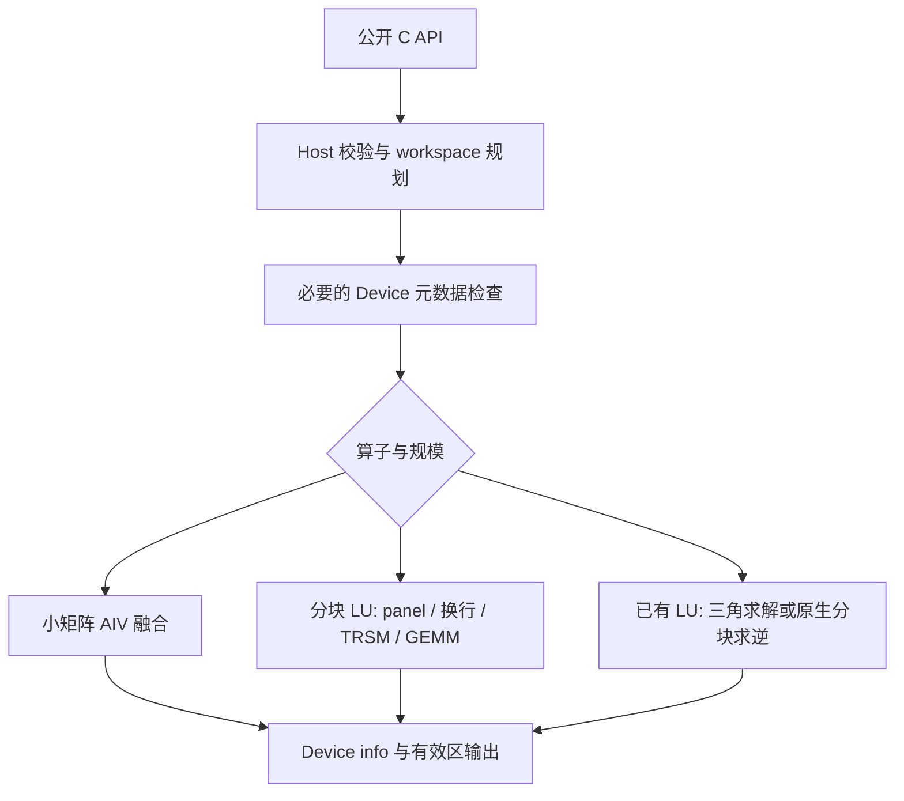

# Atlas 950PR 单精度实数 LU 分解与求逆算子设计

任务编号：`10-1-aclsolverSgetrf-batch-950`。提交人：`shi-xiangyang225`。版本：v1.2，2026-10-14。状态：**设计评审稿；本 PR 仅提交设计文档，评审通过后开始算子开发。尚无本任务的 950PR 实机精度或性能结果。**

需求依据：社区任务《10月社区任务-单精度实数LU分解、求解和批量求逆(950)》，任务书文件名 `Atlas950_Sgetrf_Sgetri_SgetriBatched_SmatinvBatched_task_doc.md`。[官方任务目录](https://gitcode.com/cann/cann-ops-competitions/tree/master/04_tasks/01_community-task-2026/tasklist/10-1-aclsolverSgetrf-batch-950)，[设计模板](https://gitcode.com/cann/cann-ops-competitions/blob/master/04_tasks/01_community-task-2026/resources/design_template.md)。源码分析基线：[cann/ops-solver@0bf7eebb6a40](https://gitcode.com/cann/ops-solver/tree/0bf7eebb6a400ca33c135867eae5ce080ff1b13d)。输入材料的 SHA-256 列于文末，本文可独立阅读。

本稿规定实现方式、验证方法与决策门槛，不把候选分块参数、纸面性能预算或前一个任务的成绩表述为本任务的实测结论。任务书内部不一致项统一登记在本文末的“评审需确认事项”。

# 需求背景（required）

## 需求来源

CANN 2026 年 10 月社区任务，适配 **Ascend 950PR（Atlas 950）**，采用 `ops-solver Host C API + AscendC/CATLASS Kernel 直调`。核心运算全部在 NPU AI Core 上完成。CUDA/cuBLAS/cuSolver 仅用于接口与性能对标；CPU LAPACK 仅用于测试参考。

架构依据为华为《昇腾 950 NPU 架构白皮书》（2026，§3/§4.1/§4.3/§4.4）。本文按 **950 原生架构**设计，并在 950PR 验收；A2/A3 归档只提供工程经验，950DT 的核数、带宽和算力不作为 PR 的验收预算。白皮书的规格与机制已映射到本文“950 原生数据路径与资源约束”和“支持硬件”；实际 SKU 可用资源仍须查询。

明确交付四个计算入口：`aclsolverSgetrf`、`aclsolverSgetri`、`aclsolverSgetriBatched`、`aclsolverSmatinvBatched`；另交付两个 `_bufferSize` 查询入口及 `aclsolverOperation_t` 枚举。任务书的“五个接口”和 `B/nrhs/trans` 测试条目与 §2.3 不一致，不能据此自行增加公开 `Sgetrs`。所有明确接口一并交付；完整验收范围须关闭歧义 D01。

## 背景介绍

LU 分解将一般实矩阵化为三角因子；求逆在已有因子上进行三角求解。两者的主元顺序、数据布局及误差控制强相关，不能按四个独立的矩阵算子分别拼装。

上一个 A2/A3 `aclblasSgemmStridedBatched` 任务可复用：列主序地址分析、FP32 精度控制、按规模分路、workspace 分组复用的思想，以及源码—二进制—用例—结果的证据绑定方法。其 128×128 分块、固定 workspace 容量、0.8 倍性能门槛、GEMM 混合容差和 A2/A3 已测成绩均不直接移植。本稿只复用相关工程方法，所有算子路径与参数按 950 重新验证。

### 当前实现现状

对上述固定提交进行静态核对，结果如下。

| 项目 | 当前源码 | 本次目标 |
|---|---|---|
| 公共接口 | `aclError`、`int64_t`、旧参数列表 | 任务书六个签名，`aclsolverStatus_t`、32 位 `int` |
| 矩阵与 info | Host 指针；内部 H2D/D2H；Host 写 `*info` | Device 指针；调用者管理矩阵数据；Device 写 info |
| 布局 | 行主序连续存储，要求 `lda == n` | 列主序，合法 leading dimension padding |
| Sgetri | kernel 调用 `custom_lu`，重新分解输入；无输入主元参数 | 直接消费 LU 与主元，不再分解 |
| workspace | 每次内部申请；无查询接口 | 单矩阵使用调用者查询并分配的 workspace |
| 同步与平台 | Host 同步；固定 20 blocks；部分代码受 `__DAV_C220_*` 宏保护 | 950PR 能力查询、正确编译分支、必要同步有明确原因 |
| handle | 仅有 stream 字段 | 保留公开 ABI；如需验证暂存池，仅增加私有资源管理 |
| 构建 | 已映射 `ascend950 -> dav-3510` | 仍须验证选中的 kernel 实际参与 950 编译和执行 |

源码依据：[Sgetrf Host](https://gitcode.com/cann/ops-solver/blob/0bf7eebb6a400ca33c135867eae5ce080ff1b13d/src/sgetrf/sgetrf_host.cpp)、[Sgetri Kernel](https://gitcode.com/cann/ops-solver/blob/0bf7eebb6a400ca33c135867eae5ce080ff1b13d/src/sgetri/sgetri_kernel.cpp)、[私有 handle](https://gitcode.com/cann/ops-solver/blob/0bf7eebb6a400ca33c135867eae5ce080ff1b13d/src/utils/aclsolver_handle_internal.h)。编译脚本接受 950 不能证明旧 LU 核已经兼容 950。

# 需求分析（required）

## 需求描述

矩阵为 FLOAT32 列主序，主元及 info 为 INT32。矩阵、主元、info、workspace 和批量指针数组均位于 Device；handle、维数及查询输出 `Lwork` 位于 Host。`Lwork` 是 **float 元素数**，不是字节数。

| 接口 | 输入与输出 | 必须满足的行为 |
|---|---|---|
| Sgetrf | 原始 m×n 矩阵，原地输出打包 LU | 矩形、部分主元或 nullptr 无主元；输出 1-based 主元 |
| Sgetri | LU 与主元，原地输出逆矩阵 | 保持输入因子可读直至最后一次使用；不得重新 getrf |
| SgetriBatched | LU 指针数组与线性主元数组，输出独立 C 指针数组 | 每个矩阵独立求逆；支持 nullptr 无主元；A 与 C 不重叠 |
| SmatinvBatched | 原始矩阵指针数组，输出独立逆矩阵数组 | 小矩阵内部 LU+求逆；n>32 返回非法参数，不转调 |

不提供 broadcast、图融合或 PyTorch/aclnn 封装。主元、info 和有效输出在相同输入、同一 stream 串行重跑时逐位一致。

## 需求拆解

1. 完成六个公开签名、状态码、空问题与参数序号的统一。
2. 实现确定性部分主元、矩形分块 LU、已有 LU 求逆、小矩阵融合批量求逆。
3. 为合法 padding、非连续指针数组、异常参数、奇异矩阵和非默认流建立独立测试。
4. 保留全部 712 条原始用例，逐条关联 GPU 基线；不得通过删除困难用例或调低精度换取性能。
5. 在 950PR 上按 LAPACK 残差标准及 `T_NPU <= T_GPU/0.35` 验收，并提供四类交付件。

### 由用例审计确定的设计范围

| 算子 | 用例数 / 有耗时数 | 实际规格 | 设计响应 |
|---|---:|---|---|
| Sgetrf | 148 / 148 | m=2…4096，n=2…8168；136 条矩形 | 声明支持 m≤4096、n≤8192，覆盖任务下限与全部原始规格 |
| Sgetri | 200 / 200 | n=2…4096 | 支持 n≤4096，并补 n=0/1 |
| SgetriBatched | 149 / 149 | n=2…3691，batch=26…1,000,000 | 支持 n≤4096、batch≤1,000,000，并补空问题及小 batch |
| SmatinvBatched | 215 / 213 | n=2…32，batch=128…10,000,000 | batch 扩展至 10,000,000；始终保持 n≤32 |

这些是拟实现范围，不是现有代码已支持范围。49 条 Sgetrf 用例 n>4096；44 条 SmatinvBatched 用例 batch>1,000,000。两条 `perf=null,error=2` 原始记录为 `NO_REF`，不能计算通过倍率。统计依据为任务随附四组 cases/bench_result，摘要与缺口明细列于本文。

另核对任务书 P-01…P-09：P-03、P-06、P-07、P-08、P-09 在随附基线中没有相同规格，须作为五条新增必测性能场景补齐 GPU 数据。因此，原始与典型场景的并集为 717 条，当前共七处性能基线缺口；不能从邻近 shape 插值或按 batch 比例外推。对应规格见本文末“性能基线缺口”。

任务“输入数据 4G”不等于设备总内存上限。给定批量用例中，80 条仅输入、输出、指针、主元/info 的估算合计已超过 4 GiB，最大约 7.76 GiB，尚未计 workspace。保留原规格，按真实设备容量排程，禁止拆成多个对外调用后把平均时间冒充原 batch 的性能。

# 详细设计（required）

## 算子分析

### 数学公式与主元约定

令 `r=min(m,n)`，第 j 次行交换矩阵为 S_j。本文固定

$$
P=S_{r-1}\cdots S_1S_0,\quad PA=LU,\quad A=P^TLU.
$$

L 的形状为 m×r，单位下三角/梯形；U 为 r×n 上三角/梯形。主元选择为 `argmax(abs(A[j:m,j]))`，相等取最小全局行号；对外写 `ipiv[j]=p+1`。无主元时 P=I。

对于方阵，`A^{-1}=U^{-1}L^{-1}P`。实现分两条等价路线：

- 基准求解：RHS 从 I 开始正序执行主元行交换得到 P，先解 LY=P，再解 UX=Y。
- 优化求逆：先构造 U 的逆，再右侧求解 ZL=U⁻¹，最后对 Z **逆序执行主元列交换**，得到 ZP。

两条路线不重复排列。单独核验矩形重构时，先计算 LU，再逆序重放主元行交换。由于右乘 P 时最右侧的 S₀ 最后执行，列交换顺序与构造 P 时的行交换顺序相反；必须以多次不可交换顺序的主元序列验证，单次交换不足以检出方向错误。

### 类型、形状与寻址

`A(i,j)=A_base[i+j*lda]`，`0<=i<m,0<=j<n`；`lda>=max(1,m)`。求逆中 m=n；输出分别使用 ldc 或 lda_inv。仅读写有效矩阵区域，padding 与相邻缓冲区哨兵保持原位。

批量数据按 `Aarray[b]`、`Carray[b]` 获取真实 Device 地址，不能改解释为 `base+b*n*n`。主元地址为 `PivotArray+b*n`。Host 与 Device 的地址乘加均使用检查过的 64 位无符号偏移；检查 `lda*n*sizeof(float)`、`n*batch`、指针数组字节数和 workspace 总量溢出，最终确认查询值可表示为 `int`。

### 公开接口

下列声明严格保留任务书的参数名、顺序和 const 限定；在公共头文件中置于 C linkage 区域。

```cpp
typedef enum {
    ACLSOLVER_OP_N = 0,
    ACLSOLVER_OP_T = 1,
    ACLSOLVER_OP_C = 2
} aclsolverOperation_t;

aclsolverStatus_t aclsolverSgetrf_bufferSize(
    aclsolverHandle_t handle, int m, int n, float *A, int lda, int *Lwork);
aclsolverStatus_t aclsolverSgetrf(
    aclsolverHandle_t handle, int m, int n, float *A, int lda,
    float *Workspace, int *devIpiv, int *devInfo);
aclsolverStatus_t aclsolverSgetri_bufferSize(
    aclsolverHandle_t handle, int n, float *A, int lda, int *Lwork);
aclsolverStatus_t aclsolverSgetri(
    aclsolverHandle_t handle, int n, float *A, int lda, int *devIpiv,
    float *Workspace, int Lwork, int *devInfo);
aclsolverStatus_t aclsolverSgetriBatched(
    aclsolverHandle_t handle, int n, const float *const Aarray[], int lda,
    const int *PivotArray, float *const Carray[], int ldc,
    int *infoArray, int batchSize);
aclsolverStatus_t aclsolverSmatinvBatched(
    aclsolverHandle_t handle, int n, const float *const A[], int lda,
    float *const Ainv[], int lda_inv, int *info, int batchSize);
```

### 状态码与 info

状态码描述调用/资源/下发是否有效；info 描述参数错误或数值结果。正常下发后遇到奇异矩阵，返回 SUCCESS，Device info 写首个精确零主元位置。不得用 `abs(pivot)<1e-6` 等经验阈值制造奇异，近奇异问题通过残差与诊断报告处理。

| 函数 | 不计 handle 的参数序号 |
|---|---|
| Sgetrf | m=1，n=2，A=3，lda=4，Workspace=5，devIpiv=6，devInfo=7 |
| Sgetri | n=1，A=2，lda=3，devIpiv=4，Workspace=5，Lwork=6，devInfo=7 |
| SgetriBatched | n=1，Aarray=2，lda=3，PivotArray=4，Carray=5，ldc=6，infoArray=7，batchSize=8 |
| SmatinvBatched | n=1，A=2，lda=3，Ainv=4，lda_inv=5，info=6，batchSize=7 |

- 空 handle 返回 HANDLE_IS_NULLPTR；无可用 stream 时不承诺写 info。
- 标量、顶层空指针、范围及溢出错误返回 INVALID_VALUE；可安全写入 info 时，在绑定流上写 `-i`。info 自身无效时仅返回错误，禁止解引用。
- 内存申请失败返回 ALLOC_FAILED；不匹配架构返回 ARCH_MISMATCH；运行时异常按已有状态枚举明确映射，不能把 `aclError` 数值直接强转为 solver 状态。
- 无主元 nullptr 是合法模式；非空主元必须在合法行范围，按 getrf 生成约定第 j 个主元不得小于 j+1。
- getrf 奇异时记录第一个零主元并按 LAPACK 式规则继续处理可处理列；getri 检出 U 对角零后不执行除零。不同 batch 独立处理，健康矩阵仍可获得结果。

## 算子实现

### 3.2.1 Host 侧设计

#### 校验与空问题

顺序固定为 handle/context → 标量与 leading dimension → info 可写性 → 空问题 → 必需矩阵/workspace 指针 → Device 元数据校验 → 计算。标量非法优先于 quick return，例如 matinv n=33、batch=0 仍为非法。

单矩阵 m=0 或 n=0 时，合法 info 写 0，查询 Lwork=0，A/Workspace 不参与访问。batch=0 时不访问数组及 info；n=0 且 batch>0 时逐项 info=0，不访问矩阵。batch=0 是否允许 info=nullptr 按“空问题不访问空数组”处理，并在 D06 中明确这是待确认的冲突消解规则。

#### Device 元数据与必要同步

Host 不能读取 Device 主元或指针数组，也不能从裸指针推断真实 allocation 长度、dtype、或 LU 的来源。安全分层如下：

1. Host 完成可见标量、顶层 nullptr 和整数溢出检查。
2. 验证 kernel 检查主元范围、嵌套 nullptr、同一 batch 输入/输出地址区间重叠，先完成检查再允许矩阵写入；不以“已经在 Device 上”为由跳过必测异常。
3. 若要按任务书返回同步 INVALID_VALUE，必须把验证状态传回 Host。设计采用单独验证阶段、固定顺序归约、少量状态 D2H 与绑定 stream 同步；这是检查 Device 内容所必需的同步。计算阶段完成后保持异步，不同步整个设备。
4. 验证 kernel 的耗时纳入接口总 kernel 时间，必要同步的实际延迟另列端到端时间。优化不得通过关闭验证来改善验收数字。

任意悬空地址、真实缓冲长度、来自何次 getrf 的主元一致性无法由现有签名完备验证；调用者须满足有效存储前提。跨 batch 任意别名的完整检测范围，以及是否接受仅异步 info 报错，列为 D07/D08，不能声称已自动解决。若验收要求全面检测跨 batch 重叠，则需增加确定性区间排序/扫描并重新评估性能。

#### workspace 查询与生命周期

定义 `Align(x,a)=ceil(x/a)*a`，按后端实际对齐量 a 分段布局。查询与执行共用同一规划函数 `PlanWorkspace`，输出总字节数除以 4 得到 Lwork；每段分别对齐后相加。a、核数、UB/L1/L0 容量来自所选平台与 API 约束，禁止硬编码为 A2 常量。

初版采用保守、可验证的容量上界：

| 接口 | workspace 区域与上界思路 |
|---|---|
| getrf | 必要时使用的紧凑工作矩阵 M×N；尾块 GEMM 临时积上界 M×N；双缓冲 panel 2M×b；主元归约与控制区 |
| getri | RHS/结果暂存 N×N；GEMM 临时积上界 N×N；panel/三角暂存 O(Nb+b²)；验证与控制区 |
| batched | 输出 C 本身作为三角求解 RHS；每个在途任务只有有界 tile 暂存；验证归约缓冲按核数分配，避免 batch×n² 的额外全量副本 |

M/N 是内部按布局要求补齐的维数。getri 在 n=4096 时两块 FP32 方阵约 128 MiB，另加对齐和 panel；这只是容量估算，最终返回值由实现规划函数决定。任务没有额外 workspace 性能或大小门槛，不应为节省少量空间冒险覆盖尚未读取的 LU。

查询不访问矩阵内容、不启动计算；返回值覆盖同规格全部候选路径，包括有/无主元。getrf 没有 Lwork 入参，无法验证调用者实际容量，必须明确调用责任。getri 比较传入 Lwork 与查询值，不沿用 LAPACK `Lwork=-1` 查询约定。

批量接口没有公开 workspace 参数。必要的内部暂存通过私有 handle/context/stream 资源管理实现；原 handle 只有 stream，必须显式增加资源所有权与析构逻辑。只用于预检查的缓冲在预检查同步后即可复用；被计算 kernel 使用的缓冲须有完成 event，跨 stream 不可直接复用。扩容失败不得回收仍在使用的旧缓冲。同一 handle 的 SetStream 与并发调用采用约定的串行访问；跨流并行推荐独立 handle。

#### 分核、分块与路径键



路径键按语义、可用资源与形状选择，不按 case ID、输入内容或 GPU 参考时间选择。建议 `TINY_FUSED`、`BLOCKED_LU`、`LU_SOLVE_INVERSE`、`NATIVE_INVERSE` 四类内部键。block width 候选 16/32/64；输出 tile 候选 32/64/128；小矩阵 group 候选 1/2/4/8/16。均为待测集合，不作为最终性能参数。

批量任务使用 `task=logical_core_id+k*active_cores` 的静态轮转。逻辑 AIV/AIC 编号须按 950 纯核/混合核编程模型取得，不能直接沿用旧 block 编号；AIC/AIV 可用数量分别查询。矩阵内 RHS 列块可独立分配；每个有效输出元素仅一个写者，每个 info 仅一个确定性写者。活跃核数依可并行任务数选择，小任务不强求满核。

### 3.2.2 Kernel 侧设计

#### A. Sgetrf：带部分主元的分块右看 LU

每个 panel 宽 b，j 从 0 到 r−1：

1. 对 `A[j:m,j:j+b]` 做带确定性部分主元的 panel LU。主元搜索覆盖全部有效剩余行，不含 padding；保存全局 1-based 主元。
2. panel 内行交换由 panel 处理；对 panel 外的左侧已计算 L 与右侧未处理矩阵执行相同交换，避免重复交换 panel。
3. 求 `U12 = L11^{-1} A12`，L11 为单位下三角。
4. 更新 `A22 <- A22 - L21*U12`。长宽比不同仍按真实 m/n 处理，不能把 r 作为列尾界。
5. 继续下一 panel；最后输出打包 LU、全部主元及首个奇异位置。

数学基准先用同一 stream 的阶段 kernel 建立全局依赖，避免跨核自旋等待未调度 block。再对热点尝试 panel 内融合与一层 look-ahead；必须证明后续 pivot 对前缀 L、尾块更新以及缓存可见性的依赖，且实测有收益才启用。

panel 超出 UB 时分片读列，局部保存 `(abs(value),global_row)` 候选，再按固定树归约。相等按最小行号裁决，不依赖 ReduceMax 未明确的索引顺序。小非零主元优先直接除法，避免先计算倒数溢出；次正规数行为列为专门实测项。

#### B. Sgetri：严格消费已有 LU

基准路径在 workspace 初始化 I，重放主元形成 P，执行 FP32 前代与回代，最终只将结果有效区复制回 A。输入 LU 在求解期间只读；不能边覆盖一列 A 边让其他 RHS 继续读取同一 LU。

前代按块进行 `Y_i = L_ii^{-1}(P_i - sum_{k<i}L_ik Y_k)`；回代按逆块序进行 `X_i = U_ii^{-1}(Y_i - sum_{k>i}U_ik X_k)`。每次 GEMM 累加顺序固定，禁止浮点 atomicAdd 或不固定归约顺序的 split-K。

对大矩阵，以 LAPACK `STRTRI + 右侧单位下三角求解 + 逆序列交换` 路线作为优化候选。其主要计算量约 4n³/3，双三角求解 I 路线约 2n³；实际切换需证明残差、info、确定性及总 kernel 时间均符合要求，不能凭 FLOPs 直接宣布更快。[LAPACK SGETRI](https://www.netlib.org/lapack/single/sgetri.f)

#### C. SgetriBatched：从指针数组调度 LU 求逆

保持输入 LU 与 PivotArray 不变。小 n 每个 AIV group 承载若干独立矩阵；大 n 按 `(batch,RHS列块)` 调度，C 从单位矩阵/置换矩阵初始化后就地作为 RHS。逐阶段确保输入块已经完成，再允许依赖块读取。需要 Cube 临时积时使用有界任务波次缓冲，不额外复制整个 batch。

每个 batch 先检查 U 对角，记录首个零对角位置；出错矩阵不做除零、不污染其他矩阵。输入指针数组可非连续、无规律排列；任何连续布局优化必须有可证明的前提并保留通用路径。GPU 基线的 batched JSON 未记录 pivot 模式，应补采集来源信息，不推断其一定为无主元。

#### D. SmatinvBatched：n≤32 融合路径

在一个计算 kernel 内完成搬入、部分主元 LU、构造置换 RHS、前代、回代和写回。默认采用 LU+TRSM，以保持 `info` 的零 U 对角语义；不以无主元 Gauss–Jordan 或行列式公式替代通用路径。

GM 使用真实指针数组，UB 可重排为 `[row][col][group_lane]`，在 batch 维向量化。设并行矩阵数 g，两个矩阵的基本存储约 `8*g*n²` 字节，还必须加主元、向量临时区、搬运队列、对齐及双缓冲；据实际 UB 预算选 g，不把全 UB 都用于矩阵。n=1/2/4 等固定尺寸可模板展开，但保持相同主元与异常规则。

#### E. FP32 与 950 适配

panel、归约、三角求解和更新均以 FP32 为基线；使用 FP32 Matmul 时显式关闭 HF32，不用 FP16/BF16/HF32 静默替换输入。950 的列主序 Matmul 支持可减少转置适配，但官方在线文档为 CANN 9.1.X，应先对选定 9.0.0 配套包做编译与非对齐 lda 冒烟。失败时使用显式 pack/scatter 与有精度依据的 FP32 路径，包含其全部开销。[Matmul 布局与类型](https://www.hiascend.com/document/detail/en/CANNCommunityEdition/910/API/ascendcopapi/docs/en/api/SIMD-API/advanced_api/matrix_compute/Matmul-Kernel/matmul_usage.md)、[SetHF32](https://www.hiascend.com/document/detail/en/CANNCommunityEdition/910/API/ascendcopapi/docs/en/api/SIMD-API/advanced_api/matrix_compute/Matmul-Kernel/SetHF32.md)

白皮书的 Cube TF32 216/189 TFLOPS 不能当作完整 FP32 峰值。开发预览文档提供 dav-3510 的关闭 HF32 示例，但其 master 版本不保证与当前 CANN 安装一致。M0 必须以低尾数敏感输入分别验证关闭/开启模式，记录最终实际使用的配置；不从 float 输入/输出类型推断中间计算精度。[950 HF32 官方开发预览](https://asc.gitcode.com/api/SIMD-API/c_api/cube_compute/asc_enable_hf32.html)

#### F. 950 原生数据路径与资源约束

- **Vector**：利用寄存器参与的 SIMD 路径完成 panel、主元归约、小块三角求解及 batch 维向量化；SIMT 只作为不规则寻址/交换的候选，需证明收益和确定性。
- **存储**：按白皮书 L1 512 KB、L0A/B 各64 KB、L0C 256 KB、UB 512 KB 建立初始预算，最终采用平台返回字节数及编译报告。每个层级分别统计所有同时活跃的队列、矩阵、对齐与 API 暂存，不合并 L1 与 UB 容量。
- **小矩阵组**：n=32、g=16 的两份矩阵为128 KiB，双组驻留为256 KiB，尚不含主元和临时区；512 KB标称UB并非全部可用于矩阵，g需由资源检查及profile决定。
- **NDDMA**：评估带 padding 的列主序 tile 到 UB 的规则重排，减少软件寻址；任意 Device 指针数组仍逐项寻址，不能解释为一个规则连续张量。
- **CV通道与BufferID**：在安装版 API 支持且验证后，用于 L1/UB 中间数据复用和缓冲生命周期。BufferID 不代替全芯片阶段屏障；初版跨panel依赖仍用同流阶段kernel。
- **L2与双Die**：因子/中间块按短期复用设计，cache hint及亲和性作为后续优化；使用受支持接口，不根据猜测的core编号分Die。硬件一致性不能代替生产者完成同步。

纯 FP32 Cube 路径未通过 M0 时，保留 AIV FP32 功能基准并重新评估性能；不得降低任务精度或把 TF32 结果作为已达标结果。主路线是单 950 设备，不引入跨卡通信或 AI CPU 数值 fallback。

CATLASS 作为 GEMM/流水组件候选，优先 C++ 路线，固定版本与依赖；不因 DSL 最新而增加 CANN 9.1 的强依赖。不得把旧 `__DAV_C220_*` 条件分支原样当成 dav-3510 实现。

### 工程组织

```text
include/cann_ops_solver.h                 # 六个签名与 C linkage
include/cann_ops_solver_common.h          # 新增 operation 枚举，复用状态码
src/sgetrf/                              # Host + 950 LU kernel
src/sgetri/                              # Host + 已有 LU 求逆 kernel
src/sgetri_batched/                      # 指针数组求逆
src/smatinv_batched/                     # 小矩阵融合
src/utils/                              # 经实际共享确认的校验、规划、tile 组件
test/{sgetrf,sgetri,sgetri_batched,smatinv_batched}/
docs/zh/{sgetrf,sgetri,sgetri_batched,smatinv_batched}.md
docs/api_list.md
```

沿用上游 CMake 与测试工程。当前递归收集普通 `.cpp` 与 arch35 `.cpp`，新增实现时必须排除旧入口，避免重复符号。只有实际共享的部件才下沉 utils，不额外建立一套构建系统。错误返回写明函数、参数及原因；常量具名并说明来源；新增文件保留仓库许可证要求。

## 支持硬件

| 项目 | 设计要求 / 当前状态 |
|---|---|
| 验收硬件 | Ascend 950PR，必须有型号、驱动、固件记录；本次未上机 |
| 编译目标 | 上游基线 `--soc=ascend950` 映射 `dav-3510` |
| PR 标称资源 | 白皮书表3-1：32/28 AIC、64/56 AIV，主存128/112 GB、1.6/1.4 TB/s，L2 128/112 MB；实际 SKU 与可用资源待查询 |
| CANN | ≥9.0.0 且匹配所固定 ops-solver README；当前 README 列出两套 9.0.0 已验证时间戳 |
| CATLASS | 可选 C++ 组件；选定版本后验证依赖兼容和 FP32 能力 |
| A2/A3/950DT | 本次不宣称支持或已测；上个任务结果不构成本任务证据 |

## 算子约束限制

维数范围见前表，空问题按既定规则处理。所有矩阵与状态缓冲必须是有效 Device allocation，长度满足布局要求；输出矩阵相互独立且不覆盖仍在使用的输入。Workspace 与 A/pivot/info 不别名，调用者需保持资源有效直到对应 stream 完成。返回 SUCCESS 不代表异步计算已经结束。

`info>0` 以浮点执行过程中首个精确零 U 对角定义；无主元法在一般矩阵上不保证稳定。核心计算没有 CPU fallback。内部 tiled 执行属于一次 API 调用，不能在验收时缩减公开 batch。

# 可维可测分析

## 精度标准/性能标准

### 精度门槛

矩阵 1-范数统一为 `max_j sum_{i=1}^{m}|M_ij|`，矩形必须遍历 m 行。`eps=2^-24`，不能直接使用 `numpy.finfo(float32).eps=2^-23`。

$$
r_{LU}=\frac{\|P^TLU-A_0\|_1}{n\|A_0\|_1\epsilon},\qquad
r_{inv}=\frac{\|I-CA_*\|_1}{n\|A_*\|_1\|C\|_1\epsilon}.
$$

| 算子 | 判定 | 参考数据 |
|---|---|---|
| Sgetrf | r≤max(5r_cpu,0.3) | CPU FP32 LU 与 NPU 使用相同原始矩阵 |
| Sgetri | r≤max(5r_cpu,0.05) | 相同输入 LU/主元；A* 为按主元还原的矩阵 |
| SgetriBatched | 每个矩阵 r_i≤max(5r_cpu_i,0.05) | 同一 batch 的同一输入因子；任一失败则整条失败 |
| SmatinvBatched | 每个矩阵 r_i≤max(5r_cpu_i,0.5) | A* 是原始矩阵，CPU FP32 getrf+getri |

最终验收实现复用/移植 LAPACK SGET01/SGET03 单精度运算顺序与缩放方式，并固定 BLAS/LAPACK 版本；CPU 与 NPU 使用同一评价器。FP64 重构与残差只作为辅助诊断，不替代 FP32 参考链路，也不把 FP64 结果当作 `ratio_cpu`。空问题 residual=0；零范数、非有限结果、奇异输入单独按 LAPACK 边界及 info 验证，不以 NaN 比较绕过失败。

对 getri 同时保留原始矩阵 A0 的端到端残差，防止“因子重构自洽”掩盖 getrf 错误；主判据仍按任务书的 A*。误差超限须明确 FAIL 与分析，举证/豁免必须获得验收方认可，不能由测试脚本自动豁免。

### 测试矩阵

| 类别 | 必测内容 |
|---|---|
| 原始与典型用例 | 712 条原始记录全部保留；另补 P-03/P-06/P-07/P-08/P-09；710 个可用时间基线、共 7 处缺口 |
| 维数 | 方阵、m>n、m<n；1、2 的幂与幂−1；4096；扩展 n=8168/8192 |
| 布局 | 最小 ld、+8、+32；非连续 Device 指针数组；padding 与邻接哨兵逐位比较 |
| 主元 | 有/无主元；多次不可交换顺序的行置换；绝对值相等取最小下标；非法主元 |
| info | 成功 0；第 1/中间/末尾精确零主元；非法 lda；短 workspace；嵌套空指针与同 batch 别名 |
| 批量 | 0、1、8、128、1024、3000；原始最大 batch；混合健康/奇异矩阵 |
| matinv | n=0/1/8/16/32；n=33 必须返回错误 |
| 数值 | 均匀与正态各半的主路径；额外约 10% 非对角增强、奇异/近奇异；次正规主元 |
| 流与生命周期 | 非默认流；独立 handle 多流；切流与暂存池复用；失败清理 |
| 确定性 | 每次恢复同一输入，连续重复，A/C/ipiv/info 逐位一致 |

生成规则保存 seed、分布、μ/σ、矩阵哈希和重试次数。按原文执行“对角 += n”，但该操作不保证严格对角占优或可逆；主路径检测可逆性并记录重采样，另保留可构造的精确奇异用例。B/nrhs/trans 条目保留为 D01 待确认，不能伪报覆盖。

### 性能采集与关联

每条基线使用 `perf.avg_ms`，转换 `budget_us=avg_ms*1000/0.35`。最紧预算为 matinv 23.14 μs、getrf 56.29 μs、getri 72.86 μs、getriBatched 93.14 μs；这些是阈值，不是 NPU 预测时间。

对由多个 kernel 构成的接口，第 t 次调用的计算时间定义为 `T_t=sum_k duration(t,k)`，含必要验证、布局转换、初始化、求解、更新与最终写回；取有效重复调用的算术平均。不得把不同阶段 kernel 的平均值当成整个接口耗时，也不得只报 GEMM。另记录 stream event 的整次调用时间，以暴露 Host 同步与下发间隙。计时归属及复合接口口径需要关闭 D05。

执行 getrf/getri 这类破坏输入的算子前，预热和每次采样都恢复原始 A 或 LU，恢复动作放在接口测量区间外；求逆的前置 LU 不计入 getri 时间，但结果所需的 RHS 初始化计入。不得反复分解已分解矩阵，或反复对逆矩阵求逆。

原始 JSON 的 iters=25，但没有预热与 GPU 设备/版本信息。初次对齐采样 25 次并保存全部样本；建议增加独立重复轮次观察方差，不删除慢样本，不套用上个任务“至少 51 次”的专用门槛。最终预热数量和 GPU 采样边界需补齐来源。

匹配键包括算子、全部维数、batch、全部 ld、pivot 模式、布局、dtype、输入生成信息及采样设置；保留原文件行号与 SHA-256。当前 batched 基线缺 pivot 元数据、全部基线缺 seed/hardware/版本，记录 provenance 缺口，不能捏造补齐。

### 开发与复现命令

以下是上游已存在的构建入口；需要 Linux 950PR 配套环境，当前 Windows 调研未执行：

```bash
source /usr/local/Ascend/ascend-toolkit/latest/set_env.sh
bash build.sh --pkg --soc=ascend950 --ops=sgetrf
bash build.sh --soc=ascend950 --ops=sgetrf --run
```

其余算子分别替换 `--ops`；新增 batched 目录与测试完成后才可运行。按生成的实际 run 包路径使用 `--install` 安装。当前 `--run` 会生成、校验并清理测试数据，直接运行测试二进制前必须重新准备输入。

完整验收测试程序拟新增 `--case-id`、`--cases`、`--warmup`、`--iters`、`--output` 参数；它们是本设计要求的待实现接口。Profiling 命令示意如下，先以所装版本的 `msprof op --help` 确认参数：

```bash
msprof op --output=./prof_sgetrf \
  ./build/test/sgetrf/sgetrf_test --case-id sgetrf-0119 --iters 25
```

此形式修正了任务书示例缺少闭合引号的问题。输出保留完整 OPPROF 目录、OpBasicInfo.csv、用例到 kernel 序列映射、退出码及环境信息；缺失计时、进程失败、零用例、重复记录或 NO_REF 均不形成 PASS。

### 分阶段验证

设计评审通过后按以下阶段实施：M0 环境/ABI/评价器 → M1 最小正确实现 → M2 四接口与全规格 → M3 分块/融合优化 → M4 全量验收与交付。每次只改变一个主要因素，先过精度、info、确定性，再比较性能。保留最慢 case、最大残差 case 和热点阶段，不用平均倍率掩盖逐例失败。

本次已运行 30 组 CPU LU 重构、18 组两条求逆恒等式、4 组无主元重构、2 组奇异 info 核验，以及主元 tie-break、ε、错误结果拒绝检查。本地核验采用 NumPy 1.26.4、SciPy 1.13.1、seed=20261014；其中 FP64 评价仅用于诊断，完整 FP32 验收评价器将在开发阶段建立。这些核验仅支持设计数学关系，**不证明 NPU 算子精度或性能达标**。

## 兼容性分析

公开 Sgetrf/Sgetri 的类型、参数和指针归属均改变，属于源代码与 ABI 变化；不能只保留旧同名入口并依靠 C++ 重载宣称兼容。最终入口按任务签名替换，更新所有仓内调用与文档。若保留临时兼容层，使用不同且明确标为 legacy 的名字并列出状态码映射；验收只使用新接口。

现有公共头文件含 C++ 专用头及 `std::complex` 声明。新增六个入口必须有正确 C linkage；若要求纯 C translation unit 可包含头文件，则用 `__cplusplus` 隔离复数旧声明、选择对应 C 类型头，增加 C/C++ 编译与符号检查。其他复数接口不擅自改语义。

## 风险与完成判据

优先解决 D01 接口范围、D05 复合计时、D07/D08 Device 校验与同步、D02/D03 基线缺口，以及 950 FP32/编译路径实测。设计中的块宽、group、融合深度只在对应实验通过后冻结。

完成判据是六个明确入口、全部规定语义和最终确认范围有对应实现与测试；712 条原始用例全部有记录，另补五条典型场景，710 个现有有效基线逐例比对，七处基线缺口获得补测或正式处理决定；950PR 功能/精度/性能、内存使用说明、复现日志与代码哈希完整。

## 验收交付

| 交付件 | 内容 |
|---|---|
| 算子设计文档 | 本文及歧义闭环结果，按认领任务与团队目录提交 cann-ops-competitions 评审 |
| 自测用例及代码 | 原始 JSON、补充用例、CPU FP32 golden、残差判定、性能归并工具与 README |
| 自测报告 | 950PR 环境、逐例精度与性能、截图、内存说明、失败项、原始日志和 manifests |
| 待验收代码地址 | 私人仓库的实际分支、commit、目录及算子 README，按流程配置验收账号权限 |

任务书没有内存通过阈值，仍记录峰值测量方法、workspace 字节数和分配失败行为，不将 Host RSS 当作 Device 峰值。设计仓与代码仓分别评审；上游代码用同一 PR 或关联 PR 完整交付，并同步 README/API 列表。当前处于设计评审阶段，尚未提交算子实现或发布验收结果；评审通过后再按本方案开发。

## 设计评审后的实施里程碑

| 阶段 | 主要工作 | 进入下一阶段的门槛 |
|---|---|---|
| M0 | 950PR SKU/可用核资源、dav-3510 编译、完整 FP32、C ABI、最终残差评价器探针 | 环境与评价器正确；接口/计时高影响歧义完成评审确认 |
| M1 | 六入口、分阶段 LU、双三角求解、小矩阵融合基准；异常/空问题/padding/主元/流 | 小规模语义、残差、info 和逐位确定性全部通过 |
| M2 | 712 原始规格、5 个补充典型规格及声明范围边界 | 全域精度和内存行为可复现，逐例无静默遗漏 |
| M3 | 单因素分块/group/原生求逆对照；按热点选择 NDDMA、SIMT 或 CV 候选 | 所有候选先通过精度，再证明完整接口耗时收益；无收益则保留简单路径 |
| M4 | 最终源码/二进制/用例冻结；全量 950 验收与干净环境复现 | 七处参考缺口正式关闭，四类交付完整且逐例达标 |

任何选用的 950 优化都需补对应的资源、同步及确定性回归。CPU 数学核验、理论预算、上个任务结果均不能代替上述里程碑的实机结果。

## 性能基线缺口

下表仅列现有资料缺口；全部原始用例仍执行精度/功能检查，不以缺参考为由删例或报告性能通过。

| 标识 | 算子与规格 | 当前资料 |
|---|---|---|
| smatinvbatched-0007 | n=2，batch=10,000,000，lda=lda_inv=2 | perf=null，error=2 |
| smatinvbatched-0021 | n=4，batch=10,000,000，lda=lda_inv=4 | perf=null，error=2 |
| P-03 | Sgetrf：m=2048、n=1024、lda=2048 | 随附JSON无同规格 |
| P-06 | SgetriBatched：n=32、batch=1024、lda=ldc=32 | 随附JSON无同规格 |
| P-07 | SgetriBatched：n=128、batch=128、lda=ldc=128 | 随附JSON无同规格 |
| P-08 | SmatinvBatched：n=16、batch=1024、lda=lda_inv=16 | 随附JSON无同规格 |
| P-09 | SmatinvBatched：n=32、batch=256、lda=lda_inv=32 | 随附JSON无同规格 |

## 评审需确认事项

以下按任务原文与给定数据定位，给出可执行的拟采用规则。涉及公开语义或验收口径的条目需评审确认；本稿未擅自改变任务书，也不将待确认项视为已获豁免。行号指文末哈希对应的任务书版本。

### D01：四个计算接口、六个函数声明与“五个接口”

原文 L7/L461/L484 写五个接口，但名称只有四个；§2.3 明确提供四个计算函数及两个 query。§2.4/§3.5 又出现 `B、ldb、nrhs、trans`。这些很像线性求解条目的遗留内容，但没有证据证明必须补一个特定 `Sgetrs` 签名。

**拟采用规则**：实现明确的六个声明及枚举，不改任务原文、不编造第七个声明。保留内部 TRSM 以便最终明确求解需求后复用。正式验收前必须由任务维护方确认是否遗漏公开求解接口；如增加，补签名、参数表、基线和验收条目。当前设计不能宣称已经覆盖不存在定义的 B/nrhs/trans。

### D02：给定用例超过文字最低范围

Sgetrf 49 项 n>4096，最高8168；matinv 44项 batch>1e6，最高1e7。任务书允许声明更大范围，并要求全量 case。

**拟采用规则**：m≤4096、n≤8192 的 getrf；matinv batch≤1e7，n上限仍为32。扩展数值范围不扩展 dtype/布局语义。不能以“超最低范围”为由静默剔除这些已有数据。

### D03：两项 GPU 失败与五个典型场景缺失

原始 `smatinvbatched-0007`（n=2,batch=1e7）和 `-0021`（n=4,batch=1e7）含 `perf:null,error:2`。没有采集程序，不能把 error=2 擅自解释为某个 CUDA 状态或 OOM。

任务典型场景缺少：P-03 getrf(2048,1024)、P-06 getriBatched(32,1024)、P-07 getriBatched(128,128)、P-08 matinv(16,1024)、P-09 matinv(32,256)，各 ld 为矩阵最小合法值。

**拟采用规则**：原始与典型并集717项；已有710项有效耗时，七处 NO_REF。补采或取得正式处理意见后才能关闭性能验收；不得以零耗时、插值、缩放 batch 或改成“通过”补空。

### D04：基线来源元数据不完整

Sgetri 文件标签为 `cusolverDnSgetri`，但任务书及 cuSolver API 均没有该独立接口；应理解为采集程序标签，需确认真实实现是否为先 getrf 后 getrs(I) 且排除 getrf 时间。所有 JSON 缺少 GPU 型号、CUDA/库版本、预热、seed 和计时程序源码；batched JSON 没有 pivot 字段。matinv source 写 `cases.json + cases_brief2.json`，但后者不在材料中，现有 cases.json 已与215项基线逐条相同。

**拟采用规则**：保留现值与标签并注明不确定性；性能关联使用 `avg_ms`，不能用 GFLOPS 推导缺失时间；正式复现需补 provenance。未提供字段不得凭文档通用默认值伪填。

### D05：单 kernel 平均与复合接口时间

任务 L370 按 kernel 名取平均的描述只在单 kernel 对应一次调用时直接成立。分块 LU 与三角求解可能包含很多不同 kernel；只平均一类或全体记录会少算接口工作。

**拟采用规则**：单次调用先求全部必要 kernel duration 的和，再跨调用取平均；另报逐 kernel 平均和 stream event 总时间供复核。必须排除预热、外部输入恢复、CPU golden，并包含接口内部初始化/布局转换。最终与验收方确认这一保守口径，不通过挑选最快 kernel 获得达标数字。

### D06：空问题、空指针和 info 的优先级

“空问题成功”与参数表“info 指针为空报错”在 batch=0 时存在冲突；非法标量与空问题并存时也缺少顺序。

**拟采用规则**：handle与标量合法性优先；单矩阵保留合法info并写0；batch=0不访问空数组，可接受空info；n=0且batch>0需有效info并逐项清零。n=33的matinv即使batch=0也报错。所有边界写入测试，正式接口文档冻结后保持一致。

### D07：裸指针无法完备验证所有契约

C指针不携带dtype、分配长度或LU来源。仅凭ipiv内容不能判断它是否来自对应矩阵，也不能检测所有非nullptr悬空地址。批量参数表重点写 `Carray[i]` 不覆盖 `Aarray[i]`，是否要求运行时检测任意跨batch别名未明确。

**拟采用规则**：标量、空指针、整数溢出、可读Device主元范围、同batch输入输出区间重叠明确检测；真实存储有效性与输入因子来源由调用者负责，测试中构造合法allocation。跨batch输出独立是调用前提；若要求全面检测，另做确定性区间检查及成本验证。禁止用无法实现的“全面参数校验”笼统承诺覆盖。

### D08：Device 内容错误同步返回与异步调用

非法主元值或嵌套指针内容必须在Device读取。要让本次Host返回值就是INVALID_VALUE，至少存在一次状态回传等待；无条件纯异步返回与该要求不能同时实现。

**拟采用规则**：采用必要的预检查同步；数值计算仍异步，流上状态写回；计入验证kernel开销并报告端到端延迟。若任务维护方允许Device内容错误仅由异步info报告，可再减少同步，但不能在未明确时擅自弱化错误语义。

### D09：随机数据“加n即对角占优”不成立

对角加n不能保证严格对角占优，更不能保证所有输入可逆。例如 `[[0,2],[2,0]]+2I` 奇异，且原元素仍在均匀分布允许区间。50%+50%再“另用10%”也不宜解释成归一化的110%占比。

**拟采用规则**：基础主路径N条按均匀/正态各半生成，加对角后检查可逆性，记录重采样；额外ceil(0.1N)条不做该增强，并显式构造零行/重复行/指定零对角三角因子。随机不加增强只是压力测试，不自动意味着奇异。真正严格对角占优矩阵只作为另列的控制组，不能替换规定分布。

### D10：矩形范数及epsilon

L236写行求和到n，但矩形getrf必须到m；L253已明确归一化分母仍用列数n。FP32单位舍入是2^-24，NumPy eps是2^-23。

**拟采用规则**：矩形范数按m行求和，分母用n；固定SLAMCH('E')值，评价器中写明常量含义。本次CPU已核验两点。

### D11：FP64 golden与FP32 ratio_cpu

§3.1允许FP64辅助golden，但各精度判据明确要求同精度FLOAT32参考。getri的A又定义为LU重构矩阵，与端到端原始A存在舍入差异。

**拟采用规则**：主参考链路用FP32；getri参考消费同一输入LU/主元；评价器按SGET01/SGET03模式冻结。FP64只作误差定位，另报原始A0端到端残差，不改变任务主门槛。最终评价器的具体累加/缩放实现与库版本一起存档。

### D12：教程和旧原型与任务书冲突

QUICKSTART是复数cmatinv示例，允许大n转调、Host数据拷贝及简化info，不能作为实数matinv契约。最新固定源码的getri仍会重新LU。

**拟采用规则**：任务书§2.3/§2.4优先。只借用构建、目录和API调用方法，重写不兼容的语义路径。

### D13：4G内存口径及内存报告

4G是输入数据生成限制，不是任务§3.4的通过阈值；4GB十进制与4GiB二进制又不同。原始最大输入约3.80GiB，已可能高于十进制4GB；某些完整Device数据集约7.76GiB。

**拟采用规则**：自构造用例保守按输入≤4,000,000,000字节筛选，报告同时给出bytes/GiB；不改原始case。设备容量规划计入输入、输出、主元/指针、workspace及运行时余量，分配失败如实记录。资源不足不能假装完成原规格。

### D14：模板和社区通用目录

官方模板以Addcdiv为示例，且自身广播条目有示例矛盾；社区README还有aclnn目录模板，任务明确要求solver直调。

**拟采用规则**：遵循“需求背景→需求分析→详细设计→可维可测分析”的章节要求，内容按solver工程与任务指定目录组织，不复制Addcdiv/TBE/PyTorch路线。本次使用上游现有任务目录 `10-1-aclsolverSgetrf-batch-950`，个人目录为 `shi-xiangyang225`，与此前个人提交约定一致。

## 输入材料版本

任务书与基线均来自本次任务包，未改写原始数据。以下哈希用于评审双方核对资料版本；不在设计 PR 中重复上传整套任务包或白皮书。

| 文件（相对任务包） | SHA-256 |
|---|---|
| Atlas950_Sgetrf_Sgetri_SgetriBatched_SmatinvBatched_task_doc.md | `feda331c4c5bd670a0ca5da8bb5c3a9719d46ba8e9eb2dc179d8747eded2213d` |
| sgetrf/cases.json | `cde09936d87f35f1497518b20c2e477f64a4299bc2f24b17c235659226c10159` |
| sgetrf/bench_result.json | `a16f97000fe7db6a5530e1c3277faf000009a9fcd9bee9cac9f355f4aac3f93e` |
| sgetri/cases_brief.json | `c6c3ca09a08c081d672ed7934ee4883175406d752b97fe508708488c7f9dd1e2` |
| sgetri/bench_result.json | `9aa1a78d40f77c9fa75cf1dfcb07dfb640f814dff3bb733394eead04c82bf292` |
| sgetribatched/cases.json | `ea4134b6b985edcfd6da97c83b0fde321b06b1a8269e31ded557043f4cff08b2` |
| sgetribatched/bench_result.json | `e5cec516f1a23b578d83b1f9eb82e203aa102d8793db61adb784efb96b48f372` |
| smatinvbatched/cases.json | `b7f410120588c65296aabb9c7d8e752acc6c02d22e38adf075f352ecec513185` |
| smatinvbatched/bench_result.json | `c9f9a9c19f3dd89a88179a1b6f2a80b9b5d1c5f8b881b5cbed86371e8026dafe` |

## 参考资料

- [cuSolver 官方接口](https://docs.nvidia.com/cuda/cusolver/index.html)。
- [cuBLAS getriBatched](https://docs.nvidia.com/cuda/cublas/index.html#cublas-t-getribatched)、[matinvBatched](https://docs.nvidia.com/cuda/cublas/index.html#cublas-t-matinvbatched)。
- [LAPACK SGET01](https://github.com/Reference-LAPACK/lapack/blob/master/TESTING/LIN/sget01.f)、[SGET03](https://github.com/Reference-LAPACK/lapack/blob/master/TESTING/LIN/sget03.f)、[SGETRI](https://www.netlib.org/lapack/single/sgetri.f)。
- [CATLASS 官方仓库](https://gitcode.com/cann/catlass)。C++ 路线及依赖版本按选定 CANN 包冻结。
- 华为《昇腾 950 NPU 架构白皮书》，2026，§3、§4.1、§4.3、§4.4；只采用文本可核对的标称规格，安装环境能力以实机为准。

当前文档是设计评审材料，性能表中的预算与硬件标称值均不是本次算子的实测成绩。
