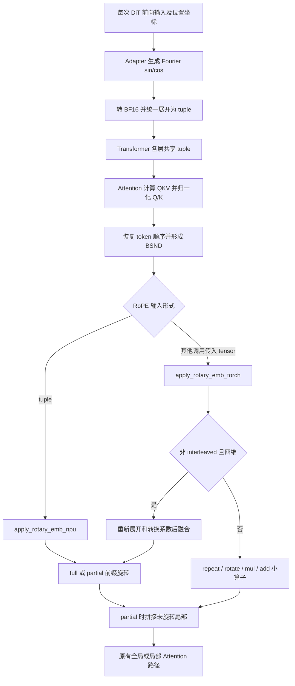
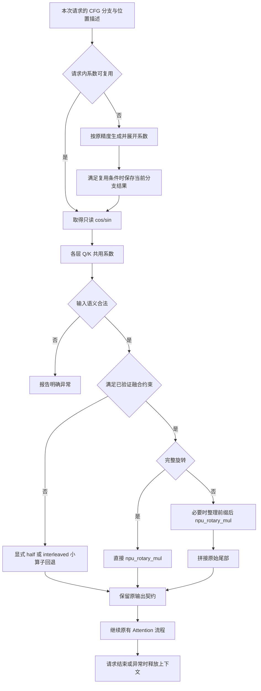

# 一、需求背景

## 1.1 需求来源

本设计对应 CANN 2026 年 10 月社区第 10 号任务“daVinci-MagiHuman RoPE 优化（A3）”，依据任务附件《daVinci-MagiHuman RoPE 优化任务书(A3).md》及 `test_cases/README.md` 编写。任务列表见[社区任务书索引](../../../../docs/README.md)，文档章节遵循[设计模板](../../../../resources/design_template.md)和社区设计文档审核要求。

任务属于 L1 模型融合算子使能优化：在 Atlas A3 上确定目标生成模式的 RoPE 执行路径，复用 `torch_npu.npu_rotary_mul`，减少重复的位置编码准备，并保留不满足融合约束时的正确回退。设计文档提交到 `cann-competitions`；后续实现提交到 `cann-recipes-infer`，实现、测试及配套说明的修改范围限定为 `models/davinci-magihuman/`。

本文为实现前设计，尚未执行 Atlas A3 精度、视频质量、性能或内存测试，不将预期收益写为实测结果。开发前须通过 RFC/Issue 固定版本、输入、算子约束和验收口径，代码 PR 关联该 RFC/Issue；本设计不虚构 Issue 编号。

## 1.2 背景介绍

### 1.2.1 daVinci-MagiHuman RoPE 算子实现优化

daVinci-MagiHuman 将文本、视频和音频 token 组成统一序列进行联合去噪。RoPE 在 Attention 的 Q/K 归一化与注意力计算之间引入位置关系；同一次模型前向的各 Transformer 层使用相同位置编码。任务要求在现有模型结构内优化这一边界，不重写 FlashAttention、线性层、并行策略或权重格式。

本次调研固定 `cann-recipes-infer` 提交为 `7ae56d452a0c4eb23580d410ac45e46946b048ab`，它是源码分析参考点，不代表已完成性能基线采集。主要依据如下：

| 资料 | 用途 |
| --- | --- |
| [dit_module.py](https://gitcode.com/cann/cann-recipes-infer/blob/7ae56d452a0c4eb23580d410ac45e46946b048ab/models/davinci-magihuman/inference/model/dit/dit_module.py) | 核对 `rotate_half`、两种 RoPE helper、`ElementWiseFourierEmbed`、`Attention.forward`、`DiTModel.forward`、`_BF16ComputeLinear` 和 `flash_attn_func` |
| [video_generate.py](https://gitcode.com/cann/cann-recipes-infer/blob/7ae56d452a0c4eb23580d410ac45e46946b048ab/models/davinci-magihuman/inference/pipeline/video_generate.py) | 核对 CFG 两路调用、去噪循环和已有 profiler |
| [模型 README](https://gitcode.com/cann/cann-recipes-infer/blob/7ae56d452a0c4eb23580d410ac45e46946b048ab/models/davinci-magihuman/README.md) | 环境、上游代码合并、依赖、权重与启动方法 |
| [base.yaml](https://gitcode.com/cann/cann-recipes-infer/blob/7ae56d452a0c4eb23580d410ac45e46946b048ab/models/davinci-magihuman/config/base.yaml)、[base_config.json](https://gitcode.com/cann/cann-recipes-infer/blob/7ae56d452a0c4eb23580d410ac45e46946b048ab/models/davinci-magihuman/config/base_config.json) | 单卡 base 生成配置、NoCache、CFG 与采样步数 |
| [模型优化说明](https://gitcode.com/cann/cann-recipes-infer/blob/7ae56d452a0c4eb23580d410ac45e46946b048ab/docs/models/davinci-magihuman/davinci-magihuman_optimization.md) | 已有 NPU 融合适配背景，只作为参考，不修改此目录 |
| [固定上游 RoPE 实现](https://github.com/GAIR-NLP/daVinci-MagiHuman/blob/209209b7086eba2020c5439265221495a8357322/inference/model/dit/dit_module.py) | 小算子数学参考；上游 commit 固定为任务要求的 `209209b7086eba2020c5439265221495a8357322` |
| [固定上游 data_proxy.py](https://github.com/GAIR-NLP/daVinci-MagiHuman/blob/209209b7086eba2020c5439265221495a8357322/inference/pipeline/data_proxy.py) | 核对 token 顺序、位置坐标及其对长度和配置的依赖 |

任务书使用 SandAI-org 上游地址，当前模型 README 使用 GAIR-NLP 地址；复现以固定提交及文件内容为准，并记录实际获取来源。上游 `inference/` 以非覆盖方式合并，保留 infer 仓已有 NPU 适配文件。

本任务没有独立 TBE 源文件、算子信息库条目或待新增 ACLNN 接口，模板中的相应要求由上述 Python 文件、实际调用接口和版本约束说明替代。融合算子的 tiling、核内计算和底层实现由现有 CANN/torch_npu 提供。

### 1.2.2 daVinci-MagiHuman RoPE 算子现状分析

#### 1.2.2.1 标杆算子支持的数据类型和数据格式

记 `B` 为 batch，`S` 为实际合并后的序列长度，`Hq/Hk` 为 Q/K 头数，`D` 为 head dimension，`R` 为参与旋转的前缀长度。序列包括视频、音频、文本 token；不能仅由视频分辨率推导 `S`，CFG 条件路与无条件路的文本长度也可能不同。

| 对象 | 形状/布局 | 类型及约束 |
| --- | --- | --- |
| Q、K | `[B,S,Hq,D]`、`[B,S,Hk,D]`，逻辑 BSND | 目标 base 为 BF16 路径；实测记录归一化后的 dtype、stride、device，不能用权重 dtype 代替 |
| 原始 `cos/sin` | `[S,R/2]` 或 `[B,S,R/2]` | 小算子参考支持这两种形式；两者 shape 相同，按序列和 batch 对齐 |
| 展开的 `cos/sin` | `[1,S,1,R]` 或 `[B,S,1,R]` | 目标融合路径采用与 Q/K 匹配的 BF16；不沿 head 维实体复制 |
| 原始位置坐标 | `[S,9]` | 顺序为 `(t,h,w,T,H,W,ref_T,ref_H,ref_W)`，保留现有生成精度和顺序 |
| 输出 | 目标路径与输入 Q/K 同 shape、dtype | `R<D` 时保留 `[R:D]`；一般小算子回退遵循原有 dtype promotion，不能无条件额外降精度 |

数学上要求 `0<R<=D` 且 `R` 为偶数；是否可融合还受锁定版本的设备、layout、stride、dtype 和维度约束限制。FP16、FP32 用于接口兼容性与数值验证，不将本任务扩展为其他整网精度模式验收。

特别注意，参考实现 `ElementWiseFourierEmbed.get_default_bands()` 的频率数量为 `F=floor(D/8)`，三个坐标轴的 sin/cos 拼接得到 `6F` 个元素。因此当前生成的旋转长度为 `R=6F`，不能把构造参数 `dim` 直接当成输出长度，也不能默认 `R=D`。实际 `D/R/S/H` 从固定权重配置和运行记录获取，完整旋转另用构造用例覆盖。

#### 1.2.2.2 标杆算子实现描述

半分旋转将前缀 `x_r=x[..., :R]` 分为两半，令 `rot(x_r)=concat(-x_r[..., R/2:], x_r[..., :R/2])`。对原始系数沿最后一维重复整段，得到 `c=[cos,cos]`、`s=[sin,sin]`，计算：

$$
y_r=x_r\odot c+\operatorname{rot}(x_r)\odot s,\qquad
y=\operatorname{concat}(y_r,x[...,R:D]).
$$

`interleaved=True` 则按相邻偶/奇元素配对，系数逐元素重复，不能直接套用 half 模式的展开规则。固定上游的小算子实现作为独立数学参考，验证脚本不能把已包含融合分支的 `apply_rotary_emb_torch` 当成纯小算子标杆。

对 infer 仓参考提交的静态检查发现：

1. `DiTModel.forward` 已执行一次 `rope.to(torch.bfloat16)`，拆出 sin/cos，分别 `cat`、`unsqueeze`、`contiguous`，把 tuple 传给所有层。目标 tuple 路径已经消除了每层重复展开，不能把这项已有优化算作本任务新增收益。
2. `Attention.forward` 在 Q/K 归一化及 `inv_permute` 后，tuple 分支调用 `apply_rotary_emb_npu`；tensor 分支拆系数，调用 `apply_rotary_emb_torch`。后者在非 interleaved、4 维情况下也会调用融合算子，并非函数名带 `torch` 就一定未融合。
3. 两个 helper 的 partial rotary 分支均先旋转 `x[..., :R]`，再拼接尾部。切片可能非连续；其真实搬运代价须结合 trace 统计，不能只计算融合 kernel 时间。
4. `apply_rotary_emb_torch` 的融合分支对系数固定执行两次 `unsqueeze`，只与二维系数匹配；直接传入三维 batch 系数会生成五维张量。统一准备逻辑必须区分二维和三维输入，覆盖这一边界。
5. 每次 DiT 前向仍重新生成 Fourier 编码和展开系数。CFG=2、32 步下，正常单请求 base 循环会执行条件与无条件共 64 次模型前向；是否全部经过相同 RoPE 路径、是否存在可融合的剩余小算子，仍须以实机调用栈为准。

因此，源码只能证明存在可复用的数据准备和多个入口，不能证明目标模式仍有多少未融合开销。先冻结基线并采集；若目标路径已全部融合，RFC 应如实说明，收益重点转向重复准备的消除，不能人为关闭已有融合制造基线。

#### 1.2.2.3 标杆算子实现流程图



图中的 tensor 分支表示现存兼容入口，不表示已证明 base 模式会命中它。实际 Attention 后端及各分支占比列入基线记录。

# 二、需求分析

## 2.1 外部组件依赖

| 依赖 | 设计要求 |
| --- | --- |
| 硬件 | Atlas A3 单卡；记录实际芯片、整机、可用 HBM、Host 内存、OS、驱动和固件 |
| 软件 | 参考 Python 3.12、CANN 9.0.0、PyTorch 2.10.0、torch_npu v26.0.0；A/B 两档保持一致 |
| 模型依赖 | 按模型 README 安装 MagiCompiler、requirements、音视频依赖，记录版本与安装来源 |
| 上游文件 | 固定 commit，非覆盖合并 `inference/`，按 README 准备 assets/prompts，保留适配代码 |
| 权重 | daVinci-MagiHuman、T5Gemma、Stable Audio、Wan2.2 VAE，以及实际启用的 Turbo VAE 配置/权重均记录 revision/hash |
| 验收工具 | 复用模型内置 torch_npu profiler；数值脚本、耗时统计和内存记录放在模型目录内 |

RFC 同时保存 infer 仓提交、上游提交、合并方法、完整运行配置、prompt hash、seed 与测量命令。不能以本机目录或权重路径写死到提交代码中。

## 2.2 内部适配模块

以下路径均相对于 `models/davinci-magihuman/`，列出的是拟实现范围，不表示本次设计 PR 已修改模型源码。

| 模块 | 拟处理内容 | 保持的边界 |
| --- | --- | --- |
| `inference/model/dit/dit_module.py`：RoPE helpers | 统一系数准备、融合能力判断、full/partial 路径和纯小算子回退 | 保留现有调用语义，不新增对外算子接口 |
| 同文件：`Adapter`、`DiTModel.forward` | 接收可选的请求内 RoPE 上下文；命中时复用系数，未命中时按现有算术顺序生成 | 不缓存依赖 latent 的视频/音频 embedding，不改变 token 顺序 |
| 同文件：`Attention.forward` | Q/K 共用已准备系数，收敛两个入口到一致的校验和分发逻辑 | 不重写 QKV、RMSNorm、Attention 后端或输出投影 |
| `inference/pipeline/video_generate.py` | 在单次 base 去噪调用内管理上下文，区分 CFG 两路；复用现有 profiler | 不改变 scheduler、CFG 公式、步数或模型 offload 策略 |
| `inference/pipeline/data_proxy.py`（合并的上游文件） | 只核对坐标依赖，原则上无需修改 | 不改变 packed token、位置坐标与并行切分定义 |
| 模型内验证脚本与 `README.md` | 补充数值、回退、性能、内存自验方法和已验证约束 | 大体积 trace、视频及权重只记录获取位置与校验值 |

`_BF16ComputeLinear` 的计算/输出类型及 `flash_attn_func` 入口中的 BF16 转换用于核对 RoPE 边界。不得把独立的 MatMul 量化、整网冗余 Cast 消除或 FlashAttention 重写并入本任务。

## 2.3 需求模块设计

### 2.3.1 Ascend C 算子原型

本任务不新增 Ascend C kernel、ACLNN 接口或算子工程。沿用现有 PyTorch 调用，核心为：

```python
y_rot = torch_npu.npu_rotary_mul(x_rot, cos_expanded, sin_expanded,
                                rotary_mode="half")
```

保留 `apply_rotary_emb_torch(x, cos, sin, interleaved=False)` 与 `apply_rotary_emb_npu(x, cos, sin)` 的调用入口。内部拟增加系数准备与能力检查函数；已展开 tuple 不再次展开，原始二维系数转换为 `[1,S,1,R]`，三维系数转换为 `[B,S,1,R]`。Q/K 共享只读系数。

请求内上下文是模型私有数据结构，包含已准备的系数、旋转长度、布局/dtype/device 元数据和位置描述，不保存 Q/K、latent 或输出。`DiTModel.forward` 的可选参数默认 `None`，现有调用不传上下文时仍能按原路径执行。

### 2.3.2 Ascend C 算子相关约束

模型快速路径限定为单卡推理的 half 旋转，目标为实际 BF16 BSND 输入；完整和部分旋转均需验证。interleaved、未验证布局或不满足当前版本融合约束的合法输入走显式小算子回退。sequence-parallel 不作为本任务新增覆盖范围，不能因本地缓存改变其既有行为。

核对[官方 npu_rotary_mul 文档](https://gitcode.com/Ascend/op-plugin/blob/master/docs/zh/custom_APIs/torch_npu/torch_npu-npu_rotary_mul.md)时必须区分产品和执行模式，并记录与实机安装版本一致的约束。当前官方文档中 A3 非 JIT half 路径支持 BSND、偶数旋转维度且小于 896、B/H 小于 1000；这些是能力核验依据，不能直接把动态 master 文档当作 v26.0.0 已验证结论。能力表应以锁定版本文档及实际 shape 测试确认，尤其核对 partial 切片 stride 和系数广播。

非法形状、奇数旋转长度、`R>D`、不可广播的系数、跨设备输入给出包含 shape/dtype/layout 的明确异常。合法但不支持融合的输入回退；不以宽泛捕获 `RuntimeError` 吞掉 OOM、设备错误或其他执行故障。

# 三、需求详细设计

## 3.1 调用方式

沿用任务指定入口，基线与优化版使用相同命令，各自在固定代码版本上执行：

```bash
cd models/davinci-magihuman
export ENABLE_PROFILER=1
bash infer.sh base
```

正式端到端计时另行关闭 profiler：

```bash
export ENABLE_PROFILER=0
bash infer.sh base
```

两档均固定单卡、BF16 base 文生视频、448×256、5 秒、32 steps、CFG=2、seed=42、`dit_cache.method: NoCache`，固定全部权重与 prompt。保留 `base.yaml` 中现有的编译设置；不通过启用编译、修改 offload 或切换 VAE 获取本任务收益。

最终代码默认使能满足条件的融合路径，不新增 RoPE 配置开关。任务测试表中的 baseline“关闭”解释为未应用本任务改动的固定基线代码；基线已有的融合保持原样。纯小算子参考只用于数值测试，不用来人为放大整网性能差值。

## 3.2 需求总体设计

先采集当前目标路径，再实施两项互补改动：一是将各入口收敛到同一份系数准备、能力判断和显式回退逻辑；二是在位置确定且不变的单请求内复用已生成的 cos/sin。只有 profiling 确认仍运行的小算子路径才计入新增融合覆盖，实际无命中的分支作为兼容性改进记录。

### 3.2.1 host 侧设计

本节的 host 侧指 Python 模型调用、元数据校验和张量生命周期管理，实际 cos/sin 计算仍在原设备执行，不把位置编码搬到 CPU 计算。

**系数准备。** 从实际坐标和频率生成位置编码，保持原有 FP32 计算与 BF16 舍入位置；对已有编码按 `sin, cos` 顺序拆分，再执行 half 展开。不能交换 sin/cos，也不能提前将坐标或频率降为 BF16。对已经匹配 dtype/device/布局的张量直接复用，只有必要时整理内存。

**请求内复用。** 在 `evaluate_with_latent` 一次 base 调用中创建上下文，通过模型内调用链传递给 `DiTModel.forward`/`Adapter`。第一次进入条件路或无条件路时按原始算法准备系数，后续步复用；模型内部仍把同一份 tuple 传给所有层和 Q/K。该方案只复用与 latent 数值无关的位置编码。

复用需同时满足下列条件：

- 单卡、推理模式、同一模型及固定频率 buffer；不启用学习频率或在请求内更新权重。
- 同一 CFG 分支、相同 token 排列和各模态有效长度；记录 latent 的 T/H/W、patch/t-patch 大小、音频/文本长度。
- 相同 `coords_style`、空间插值方式、位置 offset、reference size，以及 dtype/device、R、layout。位置描述来自生成坐标所用的确定性元数据，而非仅使用总序列长度。
- 调用方能够证明这些元数据完整决定坐标；传入任意外部坐标、未知布局或未知位置变换时，不复用跨步结果。

每次请求的上下文最多保留条件路和无条件路各一份结果。两路即使总长度相同也独立管理；任一路描述变化即替换该路条目，不能累积无限字典。未命中时重新准备，不在每层执行 GPU/NPU 张量到 Host 的哈希、`.item()` 或全量相等检查。

上下文只由本次调用持有，结束和异常退出都释放引用；不挂到全局缓存或长期 model 属性。并发请求拥有独立上下文。其他模式、并行或不具备稳定位置描述的调用使用每前向准备一次的现有方式，保留共享层间 tuple 的能力。

**分支判定。** 在准备阶段检查原始系数的 rank、shape、batch/sequence 对齐，缓存融合能力元数据；在调用处核对实际 Q/K 的 dtype、device、维度和 stride。对于不支持融合的合法输入进入纯小算子 helper，不能回调一个内部仍会自动选择融合的函数造成递归或重复失败。回退原因在诊断日志中按原因去重记录，不在每层刷屏。

#### 3.2.1.1 分核策略

不新增分核逻辑。Q 和 K 分别调用现有融合算子，由 CANN 根据真实输入完成调度；不把二者强行拼接增加复制，也不按 head 在 Python 中循环调用。`Hq` 和 `Hk` 可以不同，系数只在 head 维广播。

完整旋转直接传入 Q/K；部分旋转仅对 `[0:R]` 调用算子。若锁定版本对该切片 stride 支持良好，则沿用；需要连续输入时仅整理前缀，并将复制成本纳入性能比较。不能为了满足接口把整个 Q/K 无条件复制。

#### 3.2.1.2 数据分块和内存优化策略

设单元素字节数为 `e`，系数 batch 大小为 `Bc`（共享系数时为 1），每路展开 cos/sin 常驻占用为：

$$
M_{rope}=2B_cSR e.
$$

BF16 时 `e=2`；条件与无条件两路总量为两份实际大小之和。不得将系数实体扩展为 `[B,S,H,R]`，否则会引入不必要的 head 倍数存储。准备结束后释放不再需要的中间展开结果，回退所需的原始半宽系数可以由展开张量的对应切片只读获得。

partial 路径输出仍需完整 `[B,S,H,D]`，若需要前缀连续化，其额外临时量约为 `BSHR e`；融合前缀输出同阶，最终拼接输出为 `BSHD e`。这些量必须计入峰值分析，不宣称融合自动消除所有临时内存。UB、L1 和 double buffer 由现有 kernel 管理，本任务不配置片上 Buffer。

设去噪步数为 `T`、实际条件分支数为 `G`，当前路径的位置编码准备次数通常为 `T×G`，请求内复用后在描述不变时为 `G`；32 步、CFG=2 时预计由 64 次降为 2 次。此为基于调用结构的预期计数，最终以 trace 为准；RoPE 在各层对 Q/K 的必要调用不因此消失。

#### 3.2.1.3 tilingKey 规划策略

不新增或手工指定 CANN `tilingKey`。模型侧区分“合法且可融合”“合法需回退”“非法输入”，并对可融合场景区分 `R=D` 与 `R<D`；这些是 Python 分支，不是自定义 tiling key。设备算子的核数、分块和具体 key 由已安装实现选择。

### 3.2.2 kernel 侧设计

#### 3.2.2.1 kernel 侧实现描述

执行侧复用 `npu_rotary_mul(..., rotary_mode="half")`，不新增 kernel 文件。处理顺序为：

1. 校验输入语义与当前版本能力，取得已经准备好的 cos/sin。
2. 完整旋转直接调用融合算子，不执行无意义的空尾部拼接。
3. 部分旋转保留原始尾部，对前缀调用融合算子，再拼接输出；禁止原地改写 Q/K 或共享系数。未旋转尾部在目标同 dtype 路径上逐位保持不变。
4. 不支持融合但数学语义合法时，按原有 half 或 interleaved 配对规则执行小算子参考，保留原有 dtype promotion 与输出契约。
5. 输出继续进入原 `flash_attn_with_cp` 或局部注意力分支。验收时记录实际分支，不能仅因源码含 `flash_attn_func` 就认定所有层均走全局注意力。

不能用“把 cos 尾部补 1、sin 尾部补 0 后对整个 D 旋转”代替 partial 路径，因为 half 的配对分界会由 `R/2` 变为 `D/2`，改变旋转结果。也不引入旋转矩阵形式、新算子或额外量化。

#### 3.2.2.2 Ascend C 实现流程图

本任务没有新增 Ascend C 实现，下图表示现有融合 kernel 与模型准备逻辑的组合流程。



#### 3.2.2.3 Ascend C 实现流程图与标杆算子流程图存在的差异点和原因

| 差异 | 原因与验证方法 |
| --- | --- |
| 从每前向准备扩展为有条件的请求内复用 | 去噪过程中固定位置不依赖 latent 数值；通过两路不同长度、描述变化、连续请求和异常恢复测试防止误用 |
| 两个入口统一能力检查与系数布局处理 | 避免重复展开、三维系数错误增加 batch 轴及不满足约束仍强行融合 |
| 只对运行中确实存在的剩余小算子路径融合 | 当前基线已经部分或全部融合，新增覆盖量由目标 trace 确定 |
| full 直接返回、partial 保留尾部 | 保持数学配对及输出语义，不能把 partial 当成 full |
| 不支持时显式回退，非法时异常 | 保留兼容性和可诊断性，不以删除回退代码作为完成标准 |

## 3.3 支持硬件

| 平台 | 本任务定位 |
| --- | --- |
| Atlas A3 单卡 | 必须完成目标模式的功能、数值、质量、性能和内存实机验收 |
| Atlas A2 等模型已有平台 | 保持代码兼容性；本任务不宣称已实测或保证同等收益 |
| 多卡/sequence-parallel | 不新增优化覆盖，保留既有调用，禁用依赖单卡坐标不变性的跨步复用 |

具体芯片、HBM 和 Host 内存采用实机记录，不用产品系列的典型规格代替验收配置。

## 3.4 算子约束限制

- 只优化 RoPE 数据准备与调用边界；不得修改模型目录以外的公共代码，不新增独立 kernel/ACLNN 工程。
- 融合分支必须符合锁定版本的真实约束；不将新版本支持的布局、混合 dtype 或模式自动视为目标环境可用。
- 只读共享系数，不缓存带数据依赖的 Q/K、latent、Attention 结果；`NoCache` 仍表示不复用去噪预测结果，请求内位置编码复用不改变其语义。
- 不改变坐标、频率、模态顺序、分辨率、时长、采样步数、CFG、seed 或权重精度；必要转换只发生在经验证的 RoPE 边界。
- 空序列/空 batch 等边界按基线接口语义验证，合法空输入保留空输出，模型不允许的输入明确报错；不得为通过异常测试静默改形状。
- 不支持训练反向优化；存在梯度、频率更新或外部动态坐标时不采用请求内复用，保留原语义路径。

# 四、特性交叉分析

| 交叉特性 | 风险 | 设计与验证 |
| --- | --- | --- |
| CFG 条件/无条件两路 | 文本有效长度和位置描述可能不同 | 分路管理，不能仅按总 shape 命中；覆盖同长度不同输入和不同长度 |
| 模态排列及 packed 序列 | 系数与 `inv_permute` 后 Q/K 顺序不一致 | 复用原始坐标生成与排序；捕获代表层的坐标、Q/K、系数共同验证 |
| partial rotary | 前缀 stride、错误配对、尾部误写 | 覆盖真实 R、完整旋转、非连续切片；逐位检查尾部 |
| `_BF16ComputeLinear`、Q/K RMSNorm | 边界 dtype 与配置名称不一致 | 记录真实张量类型与转换顺序，不重写线性层或归一化 |
| 全局/局部 Attention | 误把不同后端的差异计为 RoPE 收益 | 固定后端、mask、shape，分别归因 RoPE 与 Attention 耗时 |
| NoCache、编译和 offload | 其他优化污染 A/B，或长期缓存阻止内存释放 | 保持配置不变，仅保存请求级位置编码；用相同执行模式比较 |
| 连续及异常请求 | 陈旧系数跨请求污染、引用泄漏 | 请求作用域持有；连续 5 次、输入变化及异常中断后重新生成测试 |
| 其他生成模式 | SR、图文输入的位置或模型不同 | 未验证场景保留原准备方式；逐模式功能回归，不能依赖单一 base 缓存 |
| profiler 与计时 | 采集窗口遗漏准备阶段或开销扭曲端到端收益 | profiler 用于归因，关闭 profiler 测完整生成；记录两个口径 |

# 五、可维可测分析

## 5.1 精度标准/性能标准

**基线冻结与自验材料。** 开发前 RFC 记录参考版本、实机环境、全部权重 hash、配置、prompt、随机种子、真实 RoPE shape/layout/dtype/stride、partial 范围、算子约束与判定阈值。附件仅提供测试说明，具体可复现脚本需要在实现阶段补充；任何失败须返回非零状态并保留命令和原始日志。

**算子与中间张量精度。** 分别建立纯小算子参考和固定模型基线：前者核对旋转数学语义，后者核对本任务改动前后同一 Q/K、同一系数及同一舍入顺序。高精度参考使用同一组已经确定的输入值，不重新以不同精度生成另一组位置角。捕获代表层的 RoPE 输出，并抽查后续 Attention 输出和去噪中间结果，避免只验证脱离模型的随机张量。

逐元素采用 `abs(actual-golden) <= atol + rtol*abs(golden)`。下面是待 RFC 确认的初始阈值提案，参考浮点算子混合容差，并将逐元素通过率要求收紧为 100%；它们不是任务书给定的固定阈值。RFC 须在实现和正式测试前锁定，可根据实际数值范围采取更严格要求，不能在失败后自动放宽。

| dtype | rtol | atol | 最大绝对误差上限 |
| --- | --- | --- | --- |
| BF16 | `2^-6` | `2^-6` | `1.0` |
| FP16 | `2^-9` | `2^-9` | `0.1` |
| FP32 | `2^-10` | `2^-16` | `0.01` |

每个合法用例需同时满足混合容差、绝对误差上限、shape/dtype 契约及无 NaN/Inf；报告最大绝对误差、相对误差统计和不匹配数量。目标 BF16 partial 尾部逐位相等；纯数据复用在输入不变时系数逐位一致。合法回退与原小算子行为一致；非法输入测试以异常类别和信息作为判据，不把预期异常计作数值通过。

| 测试组 | 必须覆盖的内容 |
| --- | --- |
| 实际模型输入 | 条件/无条件两路真实 S、Hq/Hk、D、R、dtype、stride，代表层输入及近零/正负值 |
| 旋转边界 | `R=D`、实际 `R<D`、较小合法偶数 R、未旋转尾部；sin=0/cos=1 的恒等用例 |
| 系数布局 | 二维共享系数、三维 batch 系数、已展开 tuple；不得重复 expand 或增加错误维度 |
| 融合/回退 | half 融合、interleaved 回退、非连续输入、版本不支持但数学合法的维度/layout |
| 非法输入 | 奇数 R、R>D、cos/sin shape 不同、batch/sequence 不匹配、跨设备及非法类型 |
| 状态隔离 | CFG 两路交替、不同 prompt/长度、同 shape 不同位置描述、连续请求、异常中断后恢复 |

**最终生成质量。** 至少固定 3 组 prompt，分别覆盖单人动作、多人交互、复杂背景；每组 A/B 使用相同 seed 和生成参数。用随机匿名标签交给至少 2 名指定验收人双盲检查主体、语义、构图、动作、时序、色彩、音画一致性和伪影。两人均未发现可稳定辨识退化方可通过；保存样本索引、匿名映射、视频 hash、意见和结论。数值通过不替代人工质量验收，也不以通用文本 Benchmark 代替视频盲测。

**profiling 归因。** 复用 `video_generate.py` 内置 profiler，参考提交已有 `Level1 + PipeUtilization`。其默认 schedule 为 `wait=0,warmup=2,active=1,repeat=1`，每个去噪 step 调用一次 `prof.step()`，默认只采一个稳态 step，不能把它当成 32 步总耗时。

先用默认窗口定位调用栈、融合命中及额外整理，再用模型内的同一 profiler 设置完整 32 步 active 窗口进行累计统计；在独立完整生成预热之后开始正式采集，A/B 窗口一致。完整窗口从第一次条件路准备开始覆盖两个 CFG 分支，避免只看到缓存命中而漏计首次生成成本。需要形状/栈诊断时单独开启记录，两档设置相同，诊断结果不作为无采集开销的端到端计时。

按调用关联分别统计 Fourier/cos/sin 准备、融合 RoPE、未融合 rotate/mul/add、Cast、前缀连续化和输出拼接的次数与累计设备时间，另记 CPU 调用耗时及相关区间 wall time。`unsqueeze` 等视图操作可能仅有 Host 开销，不能虚构对应 NPU kernel。只统计 RoPE 关联操作，不把全网同名 Cast 或 Cat 全部归入 RoPE；并发 kernel 累计时长不等同于 wall time。

输出默认位于 `prof/<mode>_prof/`，通过已有 `PROF_DIR` 区分 A/B 和轮次。检查 profiler 正常停止、原始 trace 可解析、`kernel_details.csv`、`op_statistic.csv`、`api_statistic.csv` 有有效内容及所需字段；CSV 列数取决于版本，不把固定列数当作通用标准。缺失或截断须重新采集，不能从源码中的调用语句推断融合已生效。

**端到端性能。** 两档各至少完整预热 1 次、正式生成 3 次，每次都生成完整 5 秒视频。使用同机同配置，计时前后完成 NPU 同步；每次记录 Base、Decode、Total，保存逐次原始值并计算平均数、中位数、极差。

Base 对应 base 去噪阶段，Decode 对应视频/音频解码；Total 建议统一定义为已加载模型的一次 `run_offline` 调用起止，包括输入准备、生成、解码和音视频落盘，不含一次性权重加载。RFC 明确时间边界及输出存储条件，若复用原日志的阶段计时，必须核对其覆盖范围；不能只相加 Base 和 Decode 充当 Total，也不能把此处 Decode 当成自回归 token 解码。

令 `m0/m1` 为基线/优化版 Total 中位数，`r0=max(Total0)-min(Total0)` 为基线极差。本设计建议在 RFC 固定通过条件 `m0-m1>r0`，同时完整同窗口内的 RoPE 相关累计时间低于基线，并提供实际融合调用证据。若波动过大，应增加两档同等重复次数并报告所有数据；不能挑选最快轮次，也不能把 32 个去噪 step 当成 32 次独立完整生成。任务未要求固定加速倍数，不预先承诺 2 倍或某个百分比。

**内存。** 不设置权重存储下降指标。两档分别记录模型加载后、生成峰值、同进程连续 5 次生成后的 NPU allocated/reserved/峰值与 Host RSS；进程重启后的五次独立运行不能替代连续测试。记录请求内系数大小和释放情况，区分 allocator 缓存保留与活跃张量泄漏。不得出现 RFC 未解释的增长，并覆盖异常中断后的上下文释放及下一次生成。

**交付与检查。** 实现提交执行 `pre-commit run --all-files`、仓库 CI、Atlas A3 目标模式和兼容性自验。开发者私仓 `task_submission/` 交付：

- `1 自验证步骤说明.md`
- `2.1 精度自验证报告.xlsx`、`2.2 精度自验证日志.log`
- `3.1 性能自验证报告.xlsx`、`3.2 性能自验证日志.log`
- `4.1 内存自验证报告.xlsx`、`4.2 内存自验证日志.log`

报告包含命令、版本、完整配置、输入 hash、数值指标、两档原始耗时及统计、融合/回退证据、盲测结论和内存记录。不涉及的项目说明原因；权重、视频、数据集、大体积 profiling 产物不上 Git，仅附访问位置与校验信息。

## 5.2 兼容性分析

本设计复用现有入口、默认配置和融合 API，不添加用户必须设置的开关。模型私有上下文为可选参数；未传入或不满足稳定位置条件时仍按每前向准备方式运行。合法不支持的场景保持回退，非法输入给出明确异常；目标优化不能改变旧调用的参数含义、sin/cos 顺序或 dtype promotion。

在锁定环境上验证 base，并对 README 列出的其他既有模式逐项做功能回归，记录模式、命令、权重和结果；若某模式缺少权重或硬件条件，应标记未验证，不能写“全部通过”。不将本任务扩展为多卡或训练支持，但需要确认改动没有破坏其原有调用形式。

遵循[贡献指南](https://gitcode.com/cann/cann-recipes-infer/blob/7ae56d452a0c4eb23580d410ac45e46946b048ab/CONTRIBUTION.md)和[合入 Checklist](https://gitcode.com/cann/cann-recipes-infer/blob/7ae56d452a0c4eb23580d410ac45e46946b048ab/docs/common/new_model_checklist.md)中适用于本模型的要求，保留原 License 及来源声明。任务书限定的模型目录范围优先，不能为优化文档或采集工具顺带修改公共目录。设计 PR 只包含本文；实现 PR 在实际完成各项验收后填写结论，并如实披露 AI 参与情况。
