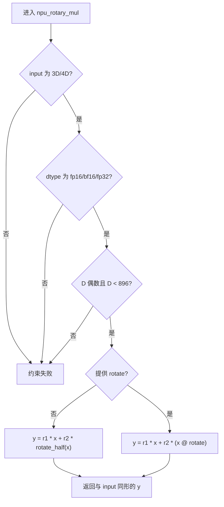
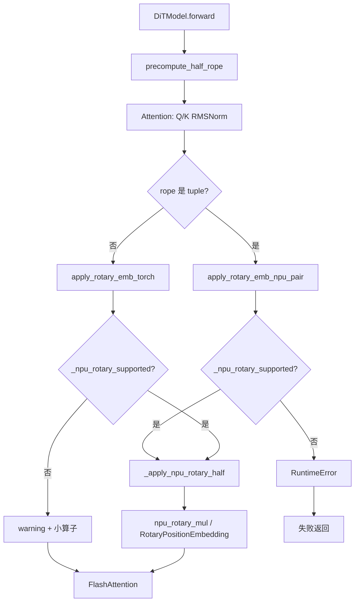

# daVinci-MagiHuman RoPE 优化算子设计文档

> 任务：10月社区任务-daVinci-MagiHuman RoPE 优化任务书（A3）  
> 目标仓：https://gitcode.com/cann/cann-recipes-infer  
> 实现目录：`models/davinci-magihuman/inference/model/dit/`  
> 适配硬件：Atlas A3（Ascend910_9382 / DAV_2201）  
> CANN 版本：9.1.0；PyTorch 2.10.0；torch_npu 2.10.0  
> 代码：`99049f3`（`feat/davinci-magihuman-rope-fusion`）  
> 模板：https://gitcode.com/cann/cann-ops-competitions/blob/master/04_tasks/01_community-task-2026/resources/design_template.md  
> CheckList：https://docs.qq.com/sheet/DUHVGUFdmSFRjVFFU?tab=000001

| 项 | 内容 |
|----|------|
| 算子 / 融合接口 | `torch_npu.npu_rotary_mul`（底层 `RotaryPositionEmbedding` / aclnnRotaryPositionEmbeddingV2） |
| 任务难度 | L1，模型侧融合使能，不开发独立 AscendC kernel / aclnn 工程 |
| 硬件 / CANN | Atlas A3 / 9.1.0 |
| 文档日期 | 2026-10-18 |
| 个人仓 | https://gitcode.com/zyt201323/cann-recipes-infer |
| 实现分支 | `feat/davinci-magihuman-rope-fusion` |
| 文档路径 | `04_tasks/01_community-task-2026/tasklist/10-10-daVinci-MagiHuman-RoPE/zyt201323/docs/design.md` |

---

# 需求背景（required）

## 需求来源

本需求来自 2026 年 10 月 CANN 社区任务「daVinci-MagiHuman RoPE 优化任务书（A3）」。

任务要求在 Atlas A3 上，基于目标 base 模式的 profiling，把 daVinci-MagiHuman DiT Attention 中仍执行的非融合 RoPE 收敛到可复用的 `torch_npu.npu_rotary_mul` 路径，并保留不满足算子约束时的安全回退。改动集中在 RoPE 数据准备和调用边界，不扩展到 Attention、线性层或整网重构。

- 目标代码仓：https://gitcode.com/cann/cann-recipes-infer
- 个人 fork：https://gitcode.com/zyt201323/cann-recipes-infer
- 实现文件：`models/davinci-magihuman/inference/model/dit/dit_module.py`
- 工程模式：模型侧融合使能。任务书 §2.2 明确不涉及独立 kernel 或 aclnn 算子工程开发，不新增对外算子接口。

## 背景介绍

### daVinci-MagiHuman RoPE 算子实现优化

daVinci-MagiHuman 将文本、参考图像、视频和音频 token 放入统一序列联合去噪。RoPE 作用在 DiT Attention 的 Q/K 上，位于 Q/K RMSNorm 之后、FlashAttention 之前。

本任务不以 TBE 历史实现或新建 Ascend C kernel 作为优化对象，而以仓内已有融合接口和官方 `npu_rotary_mul` 作为标杆。参考来源如下。

| 角色 | 路径 / 链接 | 说明 |
|------|-------------|------|
| 任务书 | `daVinci-MagiHuman RoPE 优化任务书(A3)` | 范围、验收口径、禁止项 |
| 仓内实现 | `models/davinci-magihuman/inference/model/dit/dit_module.py` | `apply_rotary_emb_torch` / `apply_rotary_emb_npu`、Fourier rope |
| 仓内优化说明 | `docs/models/davinci-magihuman/davinci-magihuman_optimization.md` | 已有 NPU 适配经验 |
| 融合接口 | `torch_npu.npu_rotary_mul` | PyTorch 侧 RoPE 融合入口 |
| 底层 kernel | `RotaryPositionEmbedding` / aclnnRotaryPositionEmbeddingV2 | msprof 命中证据，不在本任务重写 |
| 上游模型 | SandAI-org/daVinci-MagiHuman | half-mode Fourier rope 语义 |

相对仓内早期路径的主要差异：每个 forward 只展开一次 half-mode cis；完整 rotary 与 partial rotary 都走一次融合调用；Q/K layout 一致时拼到 head 维一次调用；interleaved / 非法 last-dim 显式回退或抛异常。

### daVinci-MagiHuman RoPE 算子现状分析

#### 标杆算子支持的数据类型和数据格式

`torch_npu.npu_rotary_mul(input, r1, r2, rotary_mode="half", rotate=None)` 在 Atlas A3 / torch_npu 2.10.0 上可用。与官方文档及本模型实际调用契约对齐：

| 参数 | 含义 | 数据类型 | 支持 dtype | 内存 | 排布 / 形状 | 约束 |
|------|------|----------|------------|------|-------------|------|
| input | 待旋转的 Q 或 K | tensor | fp16 / bf16 / fp32 | Device | 4D BSND；3D SND 由模型侧补 batch | D < 896 且为偶数；B,N < 1000 |
| r1 | 展开后的 cos | 与 input 同 dtype | fp16 / bf16 / fp32 | Device | 1S1D / BS1D / BSND | 末维等于旋转宽度或 pad 后的 D |
| r2 | 展开后的 sin | 与 input 同 dtype | fp16 / bf16 / fp32 | Device | 与 r1 同形 | 末维与 r1 一致 |
| rotary_mode | 旋转排列 | attr | `half` / `interleave` | Host | scalar | 本任务生产路径只用 `half` |
| rotate | 可选线性变换 | 2D 方阵 | 与 input 同 dtype | Device | `[D, D]` | `y = r1 * x + r2 * (x @ rotate)` |
| output | 旋转后的 Q/K | 与 input 同 dtype | fp16 / bf16 / fp32 | Device | 与 input 同形 | 原地语义不要求，返回新张量 |

不支持广播到任意维、不要求 dynamic shape 框架、不覆盖 sequence-parallel、BNSD/SBND 转布局，也不接 `npu_apply_rotary_pos_emb`。

#### 标杆算子实现描述

half 模式与 `rotate_half` 一致：

```text
x1, x2 = chunk(x, 2, dim=-1)
x_rot = cat((-x2, x1), dim=-1)
y = x * r1 + x_rot * r2
```

MagiHuman Fourier rope 的实际宽度不是整头。`ElementWiseFourierEmbed(dim=head_dim)` 对 3 个坐标轴各生成 `dim//8` 个频带，再 `cat(sin, cos)` 后 flatten，得到：

```text
rope.shape[-1] = 3 * (head_dim // 8) * 2 = 0.75 * head_dim
```

典型配置 `head_dim = D = 128` 时，`tensor_split` 后 half-dim cis 各 48，展开 `cat([d, d], dim=-1)` 得到 `R = 96`。这是 partial rotary：只旋转前 R 维，尾部 `D-R` 维保持原值。

若只把 r1/r2 尾部 pad 成 1/0，再对整头做 half，`rotate_half` 会把尾部卷进旋转，数值错误。官方推荐把 partial 收成一次融合：

```text
rotate = diag(R_half, I_tail)
y = r1 * x + r2 * (x @ rotate)
```

其中 `R_half` 实现 `(-x2, x1)`，尾部为单位阵；r1/r2 在尾部 pad 成 cos=1、sin=0。

仓内改造前的主要问题：

1. `apply_rotary_emb_torch` 每次调用现场 `cat/unsqueeze/to`，未复用已展开 cis。
2. partial rotary 用 Slice + `npu_rotary_mul` + Concat，profiling 中 Slice/Concat 占比高。
3. `apply_rotary_emb_torch` 与 `apply_rotary_emb_npu` 双路径并存，按 `isinstance(rope, tuple)` 分叉。
4. interleaved / 非法 last-dim 缺少明确失败或回退，存在静默错结果风险。

#### 标杆算子实现流程图



# 需求分析（required）

## 需求描述

在 `models/davinci-magihuman/` 内把目标 base 模式的 RoPE 收敛到可复用的 `npu_rotary_mul` 路径：预计算 cis、完整/partial rotary 都走融合、不支持路径显式回退，默认使能且不新增开关。不重写 Attention、线性层、并行策略或公共模块。不开发独立 kernel，不新增对外算子接口。

## 需求拆解

1. 支持 float16、bfloat16、float32；生产主路径为 bfloat16。
2. 每个 forward 只展开一次 half-mode cos/sin，各层复用。
3. 完整 rotary 直接 `npu_rotary_mul(..., rotary_mode="half")`。
4. partial rotary 构造 `diag(R_half, I_tail)` 的 rotate，一次融合调用，消灭热路径 Slice+Concat。
5. Q/K layout 一致时拼到 head 维一次调用，否则回退两次调用。
6. interleaved 显式 warning 并走小算子；非法 last-dim / rotary_dim 打错误日志后抛异常。
7. 精度对齐小算子；profiling 证明热路径命中 `RotaryPositionEmbedding`，不能只看源码出现 API 名。
8. 不新增融合开关，默认使能；不删除回退代码。

## 外部组件依赖

| 依赖 | 是否适配 | 说明 |
|------|----------|------|
| CANN Runtime / ACL | 是 | 由 torch_npu 间接使用 |
| torch_npu | 是 | `npu_rotary_mul` 融合入口 |
| PyTorch | 是 | 模型侧预计算、缓存、Q/K pair |
| RotaryPositionEmbedding | 是 | 官方 kernel，本任务不改 |
| Ascend C / 自研 kernel | 否 | 任务书 §2.2 不开发独立 kernel |
| ACLNN 新注册 | 否 | 不新增对外算子接口 |
| TBE / tbe.dsl | 否 | 不以 TBE 为实现对象 |
| FlashAttention / 线性层 | 否 | 任务书明确不重写 |

## 内部适配模块

| 模块 | 路径 | 作用 |
|------|------|------|
| Fourier rope | `dit_module.py` / `ElementWiseFourierEmbed` | 由 coords 生成 `[L, 0.75*D]` 的 sin/cos 打包 |
| 预计算 | `precompute_half_rope` | 每个 forward 展开一次 r1/r2，partial 时附带 rotate |
| cis 展开 | `_expand_half_cis` / `_expand_half_cis_cached` | half-dim cis → `(1,S,1,R)`，torch API 复用最近一次结果 |
| rotate 矩阵 | `_half_rotate_matrix` | 模块级缓存 `diag(R_half, I_tail)` |
| 融合调用 | `_apply_npu_rotary_half` / `apply_rotary_emb_npu` | 3D 补 batch，完整/partial 共用融合算子 |
| Q/K pair | `apply_rotary_emb_npu_pair` | head 维拼接一次调用 |
| 回退 | `apply_rotary_emb_torch` | interleaved / 不支持布局走小算子 |
| Attention 接入 | `Attention.forward` | `rope` 为 tuple 时走 pair；否则走 torch API（内部仍默认融合） |
| 模型入口 | `DiTModel.forward` | 计算 `head_dim` 后调用 `precompute_half_rope` |
| 自测 | `rope_selftest.py` | 精度 / 回退 / 60 点性能 |
| profiling | `rope_msprof_app.py` | fused-only msprof 证据 |

不修改 `models/davinci-magihuman` 以外的模型代码和公共模块。

## 需求模块设计

### 融合调用原型

任务书 §2.3 / §2.4：不新增对外算子接口，不涉及独立算子参数。模型内复用：

```python
torch_npu.npu_rotary_mul(input, r1, r2, rotary_mode="half", rotate=rotate_or_none)
```

模型侧封装：

```python
precompute_half_rope(rope, dtype, head_dim) -> (r1, r2) | (r1, r2, rotate)
apply_rotary_emb_npu(x, cos, sin, rotate=None) -> y
apply_rotary_emb_npu_pair(q, k, cos, sin, rotate=None) -> (q, k)
apply_rotary_emb_torch(x, cos, sin, interleaved=False) -> y
```

计算公式：

```text
完整 rotary（R == D）: y = r1 * x + r2 * rotate_half(x)
partial rotary（R < D）: y = r1 * x + r2 * (x @ diag(R_half, I_tail))
```

### 相对标杆收窄的功能

| 标杆能力 | 本实现 | 说明 |
|----------|--------|------|
| `rotary_mode=interleave` | 不走融合 | warning + 小算子，数值与 golden 一致 |
| BNSD / SBND | 不转布局 | 模型为 BSND / SND |
| `npu_apply_rotary_pos_emb` | 不接 | 任务要求复用 `npu_rotary_mul` |
| sequence-parallel | 不覆盖 | 任务书明确不要求 |
| 独立 Ascend C kernel | 不开发 | L1 模型侧融合 |
| 配置开关 | 不提供 | 默认使能 |
| 端到端 5 组主观质量 | 本机缺权重时不伪造 | 以算子级精度和 msprof 为证据 |

# 详细设计（required）

## 算子分析

### 数学公式

half 模式（与 `npu_rotary_mul` 文档一致）：

```text
x1, x2 = chunk(x, 2, dim=-1)
x_rot = cat((-x2, x1), dim=-1)
y = x * cos + x_rot * sin
```

partial rotary（R < D）不能对整头做 half。官方推荐：

```text
rotate = diag(R_half, I_tail)
y = r1 * x + r2 * (x @ rotate)
```

`R_half` 的非零元：

```text
rotate[i + R/2, i] = -1
rotate[i, i + R/2] =  1    i = 0 .. R/2-1
rotate[j, j]       =  1    j = R .. D-1
```

r1/r2 在尾部 pad 成 cos=1、sin=0，保证尾部 `y[..., R:] = x[..., R:]`。

### 支持数据类型

float16、bfloat16、float32。生产主路径为 bfloat16。

### 支持形状

- 布局：模型为 BSND 或 SND（3D 补 batch 成 4D）。
- 典型 shape：`[1, 2048, 16, 128]`，partial `R=96`。
- 完整 rotary 与 partial rotary 都走融合。
- Fourier 输出 `[L, 96]`，预计算后 r1/r2 为 `(1, S, 1, 128)`，rotate 为 `[128, 128]`。
- 不覆盖 sequence-parallel、BNSD/SBND 转布局、`npu_apply_rotary_pos_emb`。

## 算子实现

### 实现方案

本任务不写 Host tiling / 自研 Kernel。调用边界如下。

```text
应用 / infer.sh base
  → DiTModel.forward
  → Adapter 生成 Fourier rope  [L, 0.75*D]
  → precompute_half_rope        每 step 一次
  → Attention.forward
  → apply_rotary_emb_npu_pair   Q/K 一次融合
  → npu_rotary_mul / RotaryPositionEmbedding
  → FlashAttention（不在本任务范围）
```

#### 3.2.1 host侧设计：

此处 Host 指模型侧 Python 数据准备，不是 ACLNN TilingData。任务书禁止新建 kernel，因此不计算 `tileBlockNum` / `finalSmallTileNum`，也不把 UB 大小写入自研 tiling 结构。

每个 `DiTModel.forward`：

1. 由 `hidden_size / num_attention_heads` 得到 `head_dim`；非法时 error 日志 + `ValueError`。
2. `precompute_half_rope(rope, bfloat16, head_dim)`：
   - `tensor_split` 得到 sin/cos；
   - `cat([d, d], dim=-1)` 展开成 `(1, S, 1, R)`；
   - 若 `R < head_dim`，pad 到 D，并缓存 `rotate`；
   - 返回 `(r1, r2)` 或 `(r1, r2, rotate)`，所有 Attention 层复用。
3. Attention 若收到 tuple，走 `apply_rotary_emb_npu_pair`；否则走 `apply_rotary_emb_torch`（half 路径内部仍调用融合，并缓存最近一次展开的 cis）。

##### 1. 分核策略：

不由本任务划分 AiCore。分核、满核、大小核均分由官方 `RotaryPositionEmbedding` 在 CANN 内完成。模型侧只保证：

- 每次融合调用的 input 为连续 3D/4D；
- Q/K 可拼时合并为一次 launch，减少调度；
- 不人为拆成多核私有 tiling。

扫参后保持 head 维 Q/K pair；batch 维拼接、fp32 rotate、BNSD 转布局均更慢，已否决。

##### 2. 数据分块和内存优化策略：

不申请自研 UB tile。优化点在减少重复张量整理：

| 对象 | 策略 | 效果 |
|------|------|------|
| cis 展开 | 每 step 一次，层间复用 | 去掉每层 `cat/unsqueeze/to` |
| torch API cis | `_EXPAND_CACHE` 按 data_ptr 命中 | 同一组 cos/sin 不再重复 pad |
| rotate 矩阵 | `_ROT_MAT_CACHE` 按 `(R,D,dtype,device)` | 每生成构造一次 |
| Q/K | head 维 `cat` 后一次 `npu_rotary_mul` | 少一次融合 launch |
| 连续内存 | 非 contiguous 才 `contiguous()` | 避免多余拷贝 |
| 任务书内存 | 不设下降指标 | 记录峰值用于回归；rotate 为 `D×D`，D=128 时增量可忽略 |

不把 r1/r2/rotate 做成无界进程级缓存跨请求共享，避免污染后续 step。

##### 3. tilingkey规划策略：

不使用 tilingKey / `SetTilingKey` / BLOCK_SIZE。需要感知 Host 信息走不同分支时，用 Python 条件代替：

| 条件 | 路径 |
|------|------|
| `R == D` | `npu_rotary_mul(..., rotary_mode="half")`，无 rotate |
| `R < D` | pad cis + `rotate=diag(R_half, I_tail)`，一次融合 |
| Q/K 的 batch/seq/D 一致 | `apply_rotary_emb_npu_pair` 拼 head 维 |
| Q/K layout 不一致 | 两次 `apply_rotary_emb_npu` |
| interleaved=True | warning + 小算子 |
| last-dim / rotary_dim 非法 | error 日志 + `ValueError` |
| 非 3D/4D 或非法 dtype | npu API 抛 `RuntimeError`；torch API 回退 |

不把 12 路编译期特化、SIMT 门槛或 UB tile 写入本设计，避免虚构未实现的 kernel 分支。

#### 3.2.2 kernel侧设计：

本任务不实现 Init / CopyIn / Compute / CopyOut 的自研 kernel。Kernel 侧复用官方 `RotaryPositionEmbedding`：

1. 模型侧完成 3D→4D、dtype 对齐、cis pad、rotate 构造。
2. `npu_rotary_mul` 下发融合 kernel。
3. msprof 以 `RotaryPositionEmbedding` MIX_AIC 作为融合命中证据。
4. interleaved 不进入该 kernel，走 `rotate_half` + mul/add/cat。

##### Kernel 侧实现描述

`_apply_npu_rotary_half`：

1. 3D 输入 `unsqueeze(0)`，结束后 `squeeze(0)`。
2. `rotary_dim > head_dim` 时 error + `ValueError`。
3. 有 rotate：直接 `npu_rotary_mul(..., rotate=rotate)`。
4. `R == D`：`npu_rotary_mul(..., rotary_mode="half")`。
5. 其余：现场 pad + 取缓存 rotate，再一次融合。

`apply_rotary_emb_npu_pair`：

```text
if q.shape[:-2] != k.shape[:-2] or q.shape[-1] != k.shape[-1]:
    两次 apply_rotary_emb_npu
else:
    y = apply_rotary_emb_npu(cat(q, k, dim=-2), ...)
    split 回 (q, k)
```

##### Ascend C 实现流程图



##### 与标杆流程图的差异

| 差异点 | 标杆（npu_rotary_mul / 小算子） | 本实现 | 原因 |
|--------|--------------------------------|--------|------|
| 执行后端 | 官方融合 kernel / 一堆 slice-mul-cat | 官方融合 kernel，模型侧准备数据 | 任务书要求复用，不重写 kernel |
| partial rotary | 文档给 rotate 方案；仓内早期 Slice+Cat | `diag(R_half, I_tail)` 一次调用 | 去掉热路径 Slice/Concat |
| cis 准备 | 每次调用现场展开 | 每 step 预计算 + 层内缓存 | 任务书要求避免每层 `cat/unsqueeze/to` |
| Q/K | 两次调用 | layout 一致时 head 维 pair | 减少 launch |
| interleaved | 融合支持 interleave | 显式回退小算子 | 本模型生产路径为 half，避免静默错结果 |
| 失败行为 | 约束失败行为未统一 | 日志 + 异常或回退 | 任务书禁止静默错结果 |
| tilingKey | 官方内部 | 不暴露、不自研 | L1 不开发算子工程 |

数学上 half 旋转、partial 尾部保真、cos/sin 展开规则与小算子 golden 对齐。

## 支持硬件

| 支持的芯片版本 | 涉及勾选 |
| --- | --- |
| Atlas A3（Ascend910_9382 / DAV_2201） | √ |
| Atlas 800I/T A2 | 不在本次验收范围 |
| Ascend 950PR / 950DT | 不支持 |

实机：Python 3.12.13、CANN 9.1.0、PyTorch 2.10.0、torch_npu 2.10.0。任务书参考环境为 CANN 9.0.0 / torch_npu v26.0.0；本机按实际安装版本记录，不伪造已接受记录。

## 算子约束限制

- 不开发独立 kernel，不设 tilingKey / BLOCK_SIZE / UB 扫参。
- 不接 `npu_apply_rotary_pos_emb`、BNSD/SBND、sequence-parallel。
- interleaved 不走融合。
- 仅 3D/4D，dtype 仅 fp16/bf16/fp32。
- `D` 必须偶数且小于 896；`rotary_dim` 必须为正且不超过 `head_dim`。
- cos/sin 形状必须一致；last-dim 不一致抛 `ValueError`。
- 不新增融合开关，默认使能；不删除回退代码。
- 不提交权重、数据集、生成视频或大体积 profiling 产物。
- 端到端 5 组主观质量依赖 MagiHuman / T5 / audio 权重；本机缺权重时以算子级精度和 msprof 为验收证据，并在自验材料中说明。

# 特性交叉分析

| 交叉项 | 结论 |
|--------|------|
| 与 FlashAttention / 线性层 | 只改 Q/K 进入 Attention 前的 RoPE；不改 `flash_attn_func`、`_BF16ComputeLinear` |
| 与 Fourier rope | 仍由 `ElementWiseFourierEmbed` 生成打包 sin/cos；本设计只改展开与调用 |
| 与其它模型 | 不修改 `models/davinci-magihuman` 以外代码 |
| 与 ACLNN / 图编译 | 不注册新 Op，无 workspace 与其它算子复用 |
| 与 magi_compile | 不把 RoPE 路径改成必须入图 |
| 内存别名 | 融合返回新张量；rotate / cis 缓存不暴露为可写公共返回值 |
| 线程安全 | 单请求单 stream；`_EXPAND_CACHE` / `_ROT_MAT_CACHE` 仅服务当前进程推理 |

与卷积、归一化等 NN 算子无精度或格式交叉。RMSNorm 仍走 `npu_rms_norm` / `npu_add_rms_norm`，不纳入本任务收益。

# 可维可测分析

## 精度标准/性能标准

精度采用 ops-precision-standard 混合容差：`|a-g| <= atol + rtol*|g|`，matched_ratio≥0.99，禁止 NaN/Inf。golden 为 half-mode 小算子：`x[..., :R] * cos + rotate_half(x[..., :R]) * sin`，再拼回尾部。

| dtype | rtol | atol | max_abs 上限 |
|---|---|---|---|
| fp16 | 1.95e-3 | 1.95e-3 | 1e-1 |
| bf16 | 1.56e-2 | 1.56e-2 | 1.0 |
| fp32 | 9.77e-4 | 1.53e-5 | 1e-2 |

| 验收标准 | 描述（不涉及说明原因） | 标准来源 |
|---|---|---|
| 精度标准 | 融合与小算子对齐，无 NaN/Inf | 任务书 3.2；[生态算子开源精度标准](https://gitcode.com/cann/opbase/blob/master/docs/zh/ops_precision_standard/experimental_standard.md) |
| 功能 | profiling 命中 `RotaryPositionEmbedding`，不能只看源码出现 API 名 | 任务书 3.5 |
| 性能标准 | RoPE 路径耗时低于小算子基线；端到端中位耗时本机缺权重未测 | 任务书 3.3 |
| 内存 | 不设下降指标；记录峰值检查回归 | 任务书 3.4 |
| 兼容 | 不支持路径显式回退，行为与基线一致 | 任务书 3.5 |
| 工程质量 | 只改模型目录；无硬编码路径、调试开关或大文件 | 任务书 3.5 / 4 |

## 实测结果

自测：预热 10 / 采样 60 / 去 10 最大值取平均。shape `[1,2048,16,128]` bf16，partial R=96。`all_pass=True`。

| 用例 | 结果 | max_abs |
|---|---|---|
| full_4d_bf16 torch/npu | PASS | 0.03125（1 ulp） |
| partial_4d_bf16 torch/npu | PASS | 0.03125 |
| full_3d_fp16 torch/npu | PASS | 0.003906 |
| full_4d_fp32 torch/npu | PASS | 0 |
| interleaved 回退 | PASS | 0（与小算子 bitexact） |
| cos/sin last-dim 不一致 | PASS（ValueError） | - |

| 路径 | wall-clock |
|---|---|
| 小算子标杆 | 0.1885 ms |
| fused npu | 0.0977 ms（1.93x） |
| torch API（cis 缓存后） | 0.1011 ms |

fused-only msprof：`RotaryPositionEmbedding` MIX_AIC count=50，avg 41.97 us，占比 77.4%。残留 Concat/Slice 来自一次 precompute，不再出现在每层热路径。

调用边界扫参后保持 head 维 Q/K pair；batch 维拼接、fp32 rotate、BNSD 转布局均更慢，已否决。

端到端 `bash infer.sh base`、5 组主观质量和峰值显存对比依赖 MagiHuman / T5 / audio 权重。本机缺权重，不编造端到端秒数或质量结论。

## 兼容性分析

- **接口兼容**：复用官方 `npu_rotary_mul`，不改对外算子原型，不新增配置开关。
- **行为兼容**：不支持路径回退到原小算子公式，interleaved 与基线 bitexact。不删除回退代码。
- **模型兼容**：只改 `dit_module.py` 的 RoPE 准备与调用；Attention / MLP / Adapter 结构不变。
- **版本**：针对 Atlas A3、CANN 9.1.0、PyTorch 2.10.0、torch_npu 2.10.0；不承诺更低 CANN 或其它芯片。
- **ABI / 图模式**：不注册新 aclnn Op，不要求 magi_compile 编译 RoPE。
