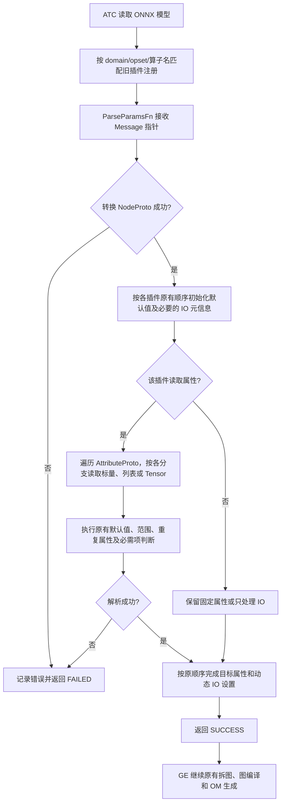
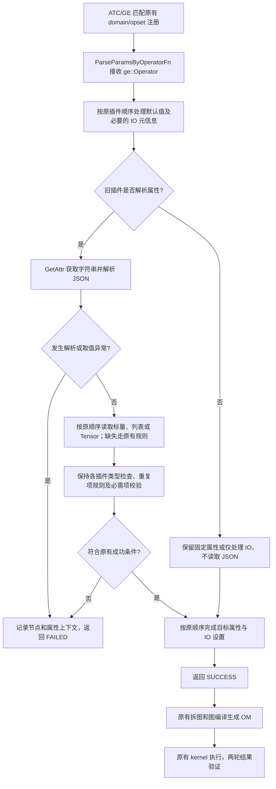

# 一、需求背景

## 1.1 需求来源

本需求来自“10月社区任务-ops-nn算子onnx适配”，对应附件 `ops-nn_onnx_task_doc.md` 中的“ops-nn 算子 ONNX 插件 protobuf 解耦任务”。迁移范围为任务清单中的 **75 个插件条目、74 个插件文件**，通过 C++ Host 侧改造，将参数解析入口从 `ParseParamsFn` 迁移至 `ParseParamsByOperatorFn`，以 `ge::Operator` 和 JSON 属性替代插件直接访问 protobuf 对象。

设计文档沿用社区[设计模板](../../../../resources/design_template.md)及[任务目录规范](../../../../README.md)。根据更新后的[社区任务列表](../../../../docs/README.md)，本任务为 2026 年 10 月第 13 号任务，设计文档提交到正式目录 `tasklist/10-13-ops-nn-onnx/Xztxzt/docs/design.md`。

本任务是保持行为一致的框架适配，不开发 Ascend C kernel、ACLNN 接口或 tiling。模板中相关章节保留并说明适用边界。本文为设计方案，未声明插件迁移、编译、UT 或 OM 上板验证已经完成。

## 1.2 背景介绍

### 1.2.1 ops-nn ONNX 插件实现优化

旧插件的参数解析回调接收 `const google::protobuf::Message*`，转换为 `ge::onnx::NodeProto` 后，遍历 `attribute()` 并通过 `i()`、`f()`、`s()`、`ints()` 等接口读取属性。许多文件经 `onnx_common.h` 间接包含 `onnx/proto/ge_onnx.pb.h`，导致插件和 protobuf 生成代码、头文件及构建依赖耦合，UT 也需要构造 protobuf 对象。

迁移后，GE 框架负责模型解析与属性传递，插件只通过 `ge::Operator` 读取属性 JSON，复用仓内 nlohmann/json 解析。插件的注册信息、算子属性、输入输出注册及拆图行为保持原有契约。

本任务的对标对象是迁移前 Host 插件，没有新增 TBE 算子或 ACLNN 原型。模板要求的实现路径与信息定义路径对应如下实际文件，不套用其他算子的 kernel/TBE 路径。

| 依据 | 文件与用途 |
| --- | --- |
| 基准源码 | `cann/ops-nn` commit [`6e5b1844d08baee8c2bc9523bf87a05ec2bd9539`](https://gitcode.com/cann/ops-nn/commit/6e5b1844d08baee8c2bc9523bf87a05ec2bd9539)，为任务书指明的快照；本文已按该版本核对清单文件与重点解析逻辑 |
| 旧解析示例 | `activation/hard_sigmoid/framework/hard_sigmoid_onnx_plugin.cpp`、`common/src/framework/gemm_onnx_plugin.cpp`、`common/src/framework/conv_onnx_plugin.cpp` |
| 算子映射信息 | 每个 `*_onnx_plugin.cpp` 中的 `REGISTER_CUSTOM_OP`、`OriginOpType`、`FrameworkType`、`ImplyType` 及各回调注册 |
| 已迁移参考 | `activation/elu/framework/elu_onnx_plugin.cpp`、`activation/leaky_relu/framework/leaky_relu_onnx_plugin.cpp`，参考新接口和 JSON 读取方式，不照搬与目标插件不同的属性校验 |
| 公共工具 | `common/inc/framework/plugin_util.h` 提供 `StrToFloat`、`GetOpName`；`common/inc/framework/onnx_common.h` 包含旧 protobuf 依赖及被插件复用的工具 |
| 构建与 UT | `cmake/func.cmake`、`cmake/variables.cmake`、`cmake/symbol.cmake`、`cmake/ut.cmake`、`build.sh` |
| 任务附件 | `test_cases/README.md`、`test_cases/ops-nn/ut/test_*_onnx_plugin.cpp`、`test_cases/ops-nn/om/gen_model_*.py` 及 `test_cases/verify_om/` 下验证工具 |

该快照的 ONNX 对象目标仍生成 `ge_onnx.pb.h`，并在 `cmake/func.cmake` 中引用 `ascend_protobuf_static`。因此，删除插件源文件中的 protobuf include 只是第一步，还需要在全部目标源码迁移后检查 ONNX 目标的生成依赖、包含路径及链接依赖。其他模块仍需要的 protobuf 依赖不能一并删除。

### 1.2.2 ops-nn ONNX 插件现状分析

#### 1.2.2.1 标杆算子支持的数据类型和数据格式

本次接口变化发生于 Host 属性解析层，不改变任何算子的 Tensor dtype、shape、format 支持范围。卷积、量化、索引、归一化和循环网络等算子的输入输出约束继续由原插件、内部算子定义及目标 SOC 支持决定，不能统一收窄为 FP16/FP32 或统一改写为 ND。

参数承载方式变化如下：

| 信息 | 旧接口 | 新接口及保留要求 |
| --- | --- | --- |
| 参数源 | `Message*` → `ge::onnx::NodeProto*` | `const ge::Operator& op_src` |
| 参数目标 | `ge::Operator& op_dest` | 不变；属性的名称、类型、值及是否存在均属于等价性要求 |
| 属性列表 | `node->attribute()` | `op_src.GetAttr("attribute", ge::AscendString)`，字符串内容为 `{"attribute":[...]}` |
| 节点名称 | `node->name()` | 仅在原实现写 name 的位置改为 `GetOpName(op_src)` |
| 输入输出数量 | `node->input_size()`、`output_size()` | `op_src.GetInputsSize()`、`GetOutputsSize()`；保留固定数量、偏移和可选输入逻辑 |
| TensorDesc/子图 | 原有格式、数据类型、动态 IO 和图映射 | 保留原实现，不因解析方式变化改写 |

按任务附件定义，常用 JSON 属性表示为：

| 类型 | type 值 | 取值载体 | 属性存在但取值键缺省时 |
| --- | ---: | --- | --- |
| FLOAT | 1 | `"f":"0.25"`，标量浮点使用字符串 | 相当于 protobuf 的零值，取 `0.0`，不能回退算子默认值 |
| INT | 2 | `"i":1`，数值型整数 | `0`；使用与旧变量相同的整数宽度和转换规则 |
| STRING | 3 | `"s":"NCHW"` | 空字符串；保留原字符串处理及大小写语义 |
| TENSOR | 4 | `"t":{...}` | 按对应插件的空 TensorProto 语义处理 |
| FLOATS | 6 | `"floats":[0.1,0.2]` | 空列表 |
| INTS | 7 | `"ints":[1,2]` | 空列表 |

以上为任务附件和参考插件采用的表示，不能直接假定等同于任意通用 protobuf JSON 序列化器的格式。嵌套 Tensor 的二进制载荷等字段须用实际 GE 序列化结果核对。

#### 1.2.2.2 标杆算子实现描述

GE 在 ATC 的 ONNX 转换过程中，根据 domain/opset/算子名匹配注册条目，调用旧参数解析函数。解析函数初始化默认值、按原顺序处理属性、进行原有合法性检查并写出内部属性；部分插件同时注册动态输入输出、记录节点名和 `original_type`。注册为 `PartitionedCall` 的插件随后由原 `ParseOpToGraphFn` 完成拆图。

迁移不能把所有插件套入同一默认值或校验模板。重点行为如下：

| 插件 | 必须保留的行为 |
| --- | --- |
| HardSigmoid | alpha/beta 缺失时为 0.2/0.5；只有匹配 FLOAT 类型的属性生效；属性存在但缺 f 时取 0 |
| Softmax | 同一文件有两个版本回调：opset 8～12 默认轴为 1，并写 `need_fusion=1`；opset 13～18 默认轴为 -1，不新增 need_fusion；全部注册分支迁移 |
| Gemm | transA/transB 独立，旧源码按属性名与 `i()!=0` 查找并在命中后结束各自搜索，没有 type 检查；alpha/beta 默认 1.0 且检查 FLOAT；fixed_shift_value 初值 42，合法区间 [34,43]，越界告警且不覆盖当前值；enable_uncache 取第一个匹配 INT 的值 |
| Conv | pads 偶数长度并按 begin/end 重排，奇数长度失败；1D 扩展、dim_size/trans_2d 推导保持；kernel_shape/pads/strides/dilations 全部无法提供形状信息时失败；原来未写出的 groups、auto_pad 等属性不统一补写 |
| AscendQuant | scale/offset 与 round_mode 有类型检查，sqrt_mode/dst_type 原先没有；sqrt_mode 是遇非零置 true 的累计行为；dst_type 只裁剪尾部空格；不能使用统一“最后值覆盖”改变这些规则 |
| ConstantOfShape | 默认标量 FLOAT、size=4；TENSOR value 的 dtype、单元素字节数和载荷取值逻辑保持；`t` 缺失或无效 dtype 导致的 DT_UNDEFINED/size=0 行为按旧实现保留，不统一改成失败 |
| NPUDropoutWithAddSoftmax | alpha 必须恰好出现一次且为 FLOAT；缺失、类型不符或重复都失败；dim 默认 -1；失败前是否已写属性须与原顺序一致 |
| If | 只处理输入输出数量，不解析 attribute；输入数减一后小于零失败；保留子图 IO 映射回调及 `ImplyType::GELOCAL` |
| NPUDynamicQuant / NPUDynamicQuantV2 | 共用一个文件和无属性解析回调；不读取 JSON、不写属性，不能因附带非法 JSON 新增失败分支 |
| NPURmsNorm / NPUAddRmsNorm / NPUGeglu | 保留原先固定的 epsilon、dim、approximate 等设置，不借迁移增加模型属性覆盖能力 |
| LayerNormalization | 保留 axis/epsilon 的属性映射，以及根据输入数决定 no_beta 的逻辑，验证两输入与三输入模型 |

任务书对“类型不符按缺失处理”“属性缺失返回 SUCCESS”等描述是常见规则，实际迁移以逐文件源码和附件用例为准。例如 Conv 有必需形状信息检查，If/DynamicQuant 不解析属性，Gemm 的转置标志没有类型检查。这些例外在设计中显式保留。

任务书另要求纠正永远不会触发的失败判据，例如工具实际返回 `ge::DT_UNDEFINED`，调用方却用 `-1` 判断失败。此类修正必须先核对真实工具和调用点，单独列出行为差异并补充失败用例；不能把所有 DT_UNDEFINED 都判失败，也不把任务书示例说成全部插件共有的代码。

#### 1.2.2.3 标杆算子实现流程图



# 二、需求分析

## 2.1 外部组件依赖

| 组件 | 用途与约束 |
| --- | --- |
| CANN | 任务要求版本大于 9.0.0；优先采用附件参考的 9.1.0 环境，提供 GE、注册接口、ATC、pyACL；记录实际版本 |
| C++ 工具链与 CMake | 沿用 ops-nn 编译配置；基准 ONNX 目标使用 C++14，不为迁移整体升级语言标准或 ABI |
| nlohmann/json | 使用仓内 third_party 已集成版本及 JSON_INCLUDE，不引入另一套版本 |
| GoogleTest | framework UT，直接构造 ge::Operator，不构造 protobuf 对象 |
| Python、onnx、onnxruntime、NumPy | 生成 ONNX、输入及辅助 golden；按附件依赖要求准备并记录版本，使用各脚本定义的 opset 和 IR version |
| Atlas A2 或 Ascend 950 | 任一硬件验证通过即可，任务推荐 A2；两轮 OM 验证必须使用同一硬件和软件环境 |

模型仍以 ONNX 格式输入，GE 自身读取 ONNX 所需的 protobuf 能力不在删除范围内。目标是插件不再直接依赖 protobuf 生成类型及解析接口，并清理插件目标不再需要的直接构建依赖。

## 2.2 内部适配模块

下表逐条保留任务书的迁移清单。统计单位是“文件 × ONNX 算子”，不是回调注册语句数，也不是互不重复的算子名称。

| 序号 | ONNX 算子 | ops-nn 内相对路径 |
| --- | --- | --- |
| 1 | Celu | `activation/celu/framework/celu_onnx_plugin.cpp` |
| 2 | Celu | `activation/celu_v2/framework/celu_onnx_plugin.cpp` |
| 3 | NPUGeglu | `activation/ge_glu_v2/framework/npu_geglu_onnx_plugin.cpp` |
| 4 | HardSigmoid | `activation/hard_sigmoid/framework/hard_sigmoid_onnx_plugin.cpp` |
| 5 | LogSoftmax | `activation/log_softmax_v2/framework/logsoftmax_onnx_plugin.cpp` |
| 6 | Selu | `activation/selu/framework/selu_onnx_plugin.cpp` |
| 7 | Shrink | `activation/shrink/framework/shrink_onnx_plugin.cpp` |
| 8 | NPUSoftmaxCrossEntropyWithLogits | `activation/softmax_cross_entropy_with_logits/framework/npu_softmax_cross_entropy_with_logits_onnx_plugin.cpp` |
| 9 | Softmax | `activation/softmax_v2/framework/softmax_onnx_plugin.cpp` |
| 10 | ThresholdedRelu | `activation/threshold/framework/threshold_relu_onnx_plugin.cpp` |
| 11 | Int8Transpose | `common/src/framework/Int8Transpose_onnx_plugin.cpp` |
| 12 | AscendDequantS16 | `common/src/framework/ascend_dequant_s16_onnx_plugin.cpp` |
| 13 | AscendRequant | `common/src/framework/ascend_requant_onnx_plugin.cpp` |
| 14 | AscendRequantS16 | `common/src/framework/ascend_requant_s16_onnx_plugin.cpp` |
| 15 | AveragePool | `common/src/framework/average_pool_onnx_plugin.cpp` |
| 16 | BasicGRUInplaceFillWindowCache | `common/src/framework/basic_gru_inplace_fill_window_cache_onnx_plugin.cpp` |
| 17 | BasicLSTMInplaceFillWindowCache | `common/src/framework/basic_lstm_inplace_fill_window_cache_onnx_plugin.cpp` |
| 18 | NPUBoundingBoxEncode | `common/src/framework/bounding_box_encode_onnx_plugin.cpp` |
| 19 | ConstantOfShape | `common/src/framework/constantofshape_onnx_plugin.cpp` |
| 20 | Conv | `common/src/framework/conv_onnx_plugin.cpp` |
| 21 | ConvTranspose | `common/src/framework/conv_transpose_onnx_plugin.cpp` |
| 22 | DeformableConv2D | `common/src/framework/deformable_conv2d_onnx_plugin.cpp` |
| 23 | DynSeqOuter | `common/src/framework/dyn_seq_outer_onnx_plugin.cpp` |
| 24 | Gemm | `common/src/framework/gemm_onnx_plugin.cpp` |
| 25 | GlobalLpPool | `common/src/framework/global_lppool_onnx_plugin.cpp` |
| 26 | GlobalMaxPool | `common/src/framework/global_max_pool_onnx_plugin.cpp` |
| 27 | GRU | `common/src/framework/gru_onnx_plugin.cpp` |
| 28 | If | `common/src/framework/if_onnx_plugin.cpp` |
| 29 | Int8Conv | `common/src/framework/int8_conv_onnx_plugin.cpp` |
| 30 | Int8ConvRelu | `common/src/framework/int8_conv_relu_onnx_plugin.cpp` |
| 31 | Int8Dequantize | `common/src/framework/int8_dequantize_onnx_plugin.cpp` |
| 32 | Int8FC | `common/src/framework/int8_fc_onnx_plugin.cpp` |
| 33 | Int8GivenIntTensorFill | `common/src/framework/int8_giveint_tensorfill_onnx_plugin.cpp` |
| 34 | LayerNormalization | `common/src/framework/layer_normalization_onnx_plugin.cpp` |
| 35 | LpPool | `common/src/framework/lppool_onnx_plugin.cpp` |
| 36 | LRN | `common/src/framework/lrn_onnx_plugin.cpp` |
| 37 | LSTM | `common/src/framework/lstm_onnx_plugin.cpp` |
| 38 | MaxPool | `common/src/framework/max_pool_onnx_plugin.cpp` |
| 39 | MaxUnpool | `common/src/framework/maxunpool_onnx_plugin.cpp` |
| 40 | MeanVarianceNormalization | `common/src/framework/mean_variance_normalization_onnx_plugin.cpp` |
| 41 | MovingSumWithSigmoid | `common/src/framework/moving_sum_with_sigmoid_onnx_plugin.cpp` |
| 42 | NPUDropoutWithAddSoftmax | `common/src/framework/npu_dropout_with_add_softmax_onnx_plugin.cpp` |
| 43 | NPUGru | `common/src/framework/npu_gru_onnx_plugin.cpp` |
| 44 | ScatterND | `common/src/framework/scatter_nd_onnx_plugin.cpp` |
| 45 | SoftmaxCrossEntropyLoss | `common/src/framework/softmax_cross_entropy_loss_onnx_plugin.cpp` |
| 46 | SparseToDense | `common/src/framework/sparse_to_dense_onnx_plugin.cpp` |
| 47 | NPUDeformableConv2d | `conv/deformable_conv2d/framework/deformable_conv2d_onnx_plugin.cpp` |
| 48 | NPUFusedAddRmsNorm | `experimental/norm/fused_add_rms_norm/framework/npu_fused_add_rms_norm_onnx_plugin.cpp` |
| 49 | GatherElements | `index/gather_elements/framework/gather_elements_onnx_plugin.cpp` |
| 50 | GatherND | `index/gather_nd/framework/gather_nd_onnx_plugin.cpp` |
| 51 | Compress | `index/gather_v2/framework/compress_onnx_plugin.cpp` |
| 52 | Gather | `index/gather_v2/framework/gather_onnx_plugin.cpp` |
| 53 | NonZero | `index/non_zero/framework/non_zero_onnx_plugin.cpp` |
| 54 | NPUScatter | `index/scatter/framework/npu_scatter_onnx_plugin.cpp` |
| 55 | ScatterElements | `index/scatter_elements/framework/scatter_elements_onnx_plugin.cpp` |
| 56 | Unique | `index/unique_with_counts_and_sorting/framework/unique_onnx_plugin.cpp` |
| 57 | NPUAddRmsNorm | `norm/add_rms_norm/framework/npu_add_rms_norm_onnx_plugin.cpp` |
| 58 | BatchNormalization | `norm/batch_norm/framework/batch_normalization_onnx_plugin.cpp` |
| 59 | NPUGroupNormSilu | `norm/group_norm_silu/framework/npu_group_norm_silu_onnx_plugin.cpp` |
| 60 | InstanceNormalization | `norm/instance_norm_v3/framework/instance_norm_v3_onnx_plugin.cpp` |
| 61 | LpNormalization | `norm/lp_norm_v2/framework/lp_norm_v2_onnx_plugin.cpp` |
| 62 | NPURmsNorm | `norm/rms_norm/framework/npu_rms_norm_onnx_plugin.cpp` |
| 63 | AdaptiveAvgPool2d | `pooling/adaptive_avg_pool2d/framework/adaptive_average_pool2d_onnx_plugin.cpp` |
| 64 | AdaptiveMaxPool2d | `pooling/adaptive_max_pool2d/framework/adaptive_max_pool2d_onnx_plugin.cpp` |
| 65 | AscendAntiQuant | `quant/ascend_anti_quant/framework/ascend_anti_quant_onnx_plugin.cpp` |
| 66 | AscendDequant | `quant/ascend_dequant/framework/ascend_dequant_onnx_plugin.cpp` |
| 67 | AscendQuant | `quant/ascend_quant/framework/ascend_quant_onnx_plugin.cpp` |
| 68 | Int8Quantize | `quant/ascend_quant/framework/int8_quantize_onnx_plugin.cpp` |
| 69 | NPUAscendQuantV2 | `quant/ascend_quant_v2/framework/ascend_quant_v2_onnx_plugin.cpp` |
| 70 | NPUDynamicQuant | `quant/dynamic_quant/framework/npu_dynamic_quant_onnx_plugin.cpp` |
| 71 | NPUDynamicQuantV2 | `quant/dynamic_quant/framework/npu_dynamic_quant_onnx_plugin.cpp` |
| 72 | NPUGroupQuant | `quant/group_quant/framework/group_quant_onnx_plugin.cpp` |
| 73 | NPUQuantize | `quant/quantize/framework/npu_quantize_onnx_plugin.cpp` |
| 74 | NPULstm | `rnn/dynamic_rnn/framework/npu_lstm_onnx_plugin.cpp` |
| 75 | NPULstmCell | `rnn/dynamic_rnnv2/framework/npu_lstm_cell_onnx_plugin.cpp` |

按目录汇总为 activation 10 条、common 36 条、conv 1 条、experimental 1 条、index 8 条、norm 6 条、pooling 2 条、quant 9 条、rnn 2 条。quant/dynamic_quant 中两个算子共用文件，因此总计 75 条、74 个文件。

在任务指定快照中，上述文件共包含 **76 处 `.ParseParamsFn(...)`**：Softmax 一个条目分两个版本注册，DynamicQuant 一个文件注册两个算子。迁移自查必须覆盖全部 76 处，不能只按 75 次字符串替换验收。同名 Celu 的两条路径以及两个 DeformableConv2D 文件也须分别核对编译和测试。

除清单内插件和对应 UT 外，必要的工程适配包括：复用 `plugin_util.h`；为摆脱 `onnx_common.h` 的传递依赖处理少量公共工具；清理 ONNX 构建目标的 protobuf 依赖；确认 `common/tests/ut/framework/` 与 experimental 用例进入构建和 CI。只调整完成解耦所必需的文件，不扩展到 kernel、tiling 或无关图优化。

## 2.3 需求模块设计

### 2.3.1 Ascend C 算子原型

本任务不新增 Ascend C 算子原型。实际迁移的是已有 Host 参数解析函数，保持每个函数的原名称：

```cpp
// 迁移前；Message 是 protobuf Message 类型。
domi::Status ParseParamsOp(const Message *op_src, ge::Operator &op_dest);

// 迁移后。
domi::Status ParseParamsOp(const ge::Operator &op_src, ge::Operator &op_dest);
```

注册仅替换参数解析回调入口：

```cpp
// 在各插件原有注册链中进行此项替换。
.ParseParamsByOperatorFn(ParseParamsOp)
```

`REGISTER_CUSTOM_OP` 的内部算子名、全部 `OriginOpType` 字符串、`FrameworkType(ONNX)`、`ImplyType`、`ParseOpToGraphFn` 和 `ParseSubgraphPostFn` 保持不变。不能统一改成 `.ImplyType(ImplyType::TVM)`，也不能把所有 `PartitionedCall` 注册改为 ONNX 节点名。

### 2.3.2 Ascend C 算子相关约束

函数返回类型仍为 `domi::Status`，SUCCESS/FAILED 的原有判断和目标属性写入顺序保持。旧接口的空指针或 NodeProto 强转失败分支因引用接口替换而消失；对实际参与解析的 JSON，语法、取值转换或未知异常须记录上下文并返回 FAILED。

只迁移参数读取方式。原有不读取属性的插件继续忽略 attribute，即使其包含非法 JSON；原有读取属性但要求必需项的插件，属性缺失仍可返回 FAILED。不得以“统一校验”或“统一默认值提交”改变这些差异。

JSON 容器、字符串和列表采用局部 RAII 对象，回调结束后不保留其内部指针；写入 ge::Tensor 的数据必须在构造/复制完成前有效。旧常量张量、输入数量、输出数量和属性类型的语义分别验证。

# 三、需求详细设计

## 3.1 调用方式

用户仍通过 ATC 转换 ONNX 模型，不新增 ACLNN 或 Python 运行时接口。目标插件库由 ops-nn 构建为 `liboponnx_plugin_nn.so`，部署到单独的自定义 OPP 目录下，通过当前进程的 `ASCEND_CUSTOM_OPP_PATH` 指定加载。

```text
自定义 OPP 根目录/
└── framework/
    └── liboponnx_plugin_nn.so
```

在任务参考环境中执行 `atc --framework=5`，GE 加载插件并调用 `ParseParamsByOperatorFn`，插件完成属性映射后继续原有图编译流程。通过 debug 日志中的 `LoadCustomOpLib` 路径和目标算子的注册信息，确认实际生效的是本轮库；只有 ATC 返回成功不能证明自定义插件已经生效。

迁移前、迁移后分别保存独立插件产物及摘要，用相同模型与输入进行两轮转换和推理。新插件不得加载用于补齐旧 protobuf 符号的兼容库。

## 3.2 需求总体设计

以每个插件的旧行为为迁移单元，按“固定基线 → 记录属性契约 → 替换参数入口与读取方式 → framework UT → 构建与依赖检查 → 两轮 OM 比对”推进。每项自查记录文件、回调、注册版本、属性与默认值、失败分支、UT、模型脚本及验证状态。

工程上分为属性解析层、插件语义层和验证层。属性解析层只提供类型转换等必要能力；默认值、是否检查 type、重复属性、必需项及副作用顺序由各插件保留。验证层同时检查 Host 解析结果和 ATC/OM 行为，避免只比较最终数值而漏掉注册或属性差异。

### 3.2.1 host 侧设计

**属性获取与转换。** 对原来访问属性的插件，使用 `ge::AscendString attrs_string` 接收 `GetAttr("attribute", attrs_string)`，再解析其字符串内容。GetAttr 未取得属性、对象不含 attribute 或 attribute 为空时，按无属性路径继续执行各插件原有检查；对非数组结构，按附件对该插件的约定处理，不在公共工具中一律返回 SUCCESS。解析库抛出的异常在回调边界转为 FAILED。

属性数组按原始顺序遍历，不先转换成属性名到值的 map。这样才能保留覆盖、追加、首次命中即结束、置位累计和重复属性计数等不同语义。未知属性按旧实现忽略，不对其无关载荷进行多余类型转换。

**标量和列表。** FLOAT 的 f 字段存在时按字符串读取并调用已有 `StrToFloat`，空串、非法字符串或超出转换范围时失败；f 键缺省时取 0。INT 使用显式宽度的整数类型读取，避免 `json.value("i", 0)` 意外推导成 int 而截断原 int64 值。STRING、INTS、FLOATS 分别保留空值和列表次序，不排序、不去重，不额外扩展数值接受范围。

type 值仅在旧代码检查的分支参与判断；检查失败时按该属性缺失处理。旧代码未检查 type 的分支继续使用实际取值字段，不能依据任务书的概括性表格额外收紧。例如 Gemm transA/transB 的 `i()!=0` 判定与 alpha/beta 的 FLOAT 校验采用不同逻辑。

**默认值和副作用。** 区分“属性对象不存在”和“属性对象存在但取值字段省略”：前者沿用算子默认值，后者沿用 protobuf 的字段零值。保留原来的 SetAttr 存在性、写入类型和位置；Conv 在解析失败前已经写入的 input_num/name/original_type 等元信息，与 NPUDropoutWithAddSoftmax 在必需项校验后才写属性的流程不能合并为一个通用提交阶段。

**公共工具与传递依赖。** `plugin_util.h` 已提供 StrToFloat/GetOpName，直接复用。`onnx_common.h` 中的 `Vec2Tensor`、`CreateScalar`、`ChangeFormatFromOnnx` 不依赖 protobuf，可按原行为迁出到一个仓前缀命名的 `common/inc/framework/ops_nn_onnx_plugin_util.h`，并为必要的 JSON 访问工具提供窄接口；保留旧头对仍需要旧接口的其他调用者的兼容性。`GetEnableUncacheFromNode` 的替代实现读取已解析的属性数组，保留首次命中 INT 即返回、缺失返回 0 的规则，不再次解析同一字符串。公共工具不承担各算子的默认值、属性别名或重复项策略。

**输入输出与名称。** 以 op_src 的输入输出数量替代 NodeProto 计数，并保持原动态端口名称、数量计算、固定输出数和可选输入标记。If 在做输入数减一之前采用有符号且足够宽的中间值，避免无符号下溢；模型侧可选空输入槽与 GetInputsSize 的对应关系须经 ATC 与带可选输入的 UT 核对，不能仅凭两个 API 名称就认定等价。节点名只在原来使用 node->name() 的位置写入，不给无属性插件新增 name。

**Tensor 属性。** ConstantOfShape 单独适配 `type=4` 的 t 对象，保留 data_type→GE dtype 映射及标量 TensorDesc，输出字节数按旧 `GetSizeByDataType` 计算，不能改为 dims 乘积。优先处理原有 raw_data 分支，否则按对应 float_data/int32_data/int64_data/double_data 读取并保存局部存储。raw_data 的 JSON 表示用真实 GE 输出确认：若承载 Base64，应先解码，不能把编码字符串的 ASCII 当成 Tensor 数据。确认载荷长度足够，保证 Tensor 持有有效数据；默认值、t 缺失、DT_UNDEFINED/size=0 和 raw/typed 载荷各设用例。附件 raw_data UT 仅检查 dtype/size，须补充已知字节的数值往返测试。

**构建解耦。** 在全部目标插件不再使用旧头后，检查 ONNX 对象目标不再依赖 `ge_onnx.pb.h` 生成项、`${CMAKE_BINARY_DIR}/proto` 等旧专用路径及 `ascend_protobuf_static` 直接链接项；保留 JSON、GE、register、日志和图原型所需依赖。先检查依赖实际使用者再做最小修改，不删除根 CMake 中仍被其他目标使用的 protobuf 配置。使用编译依赖和最终库符号检查确认无插件自身的 ge::onnx protobuf 类型引用，动态链接到 GE 并不意味着插件仍直接依赖 protobuf。

**UT 与 CI 接入。** 普通算子 UT 放在对应 `tests/ut/framework/`，common 插件放在 `common/tests/ut/framework/`。核对 `cmake/ut.cmake` 中的 `test_*_onnx_plugin.cpp` 收集及 `--ops` 文件名过滤，确认 common 路径修改能触发相关 UT，experimental 文件也被显式纳入验证。若目标分支已有相应构建或 CI 支持则复用，避免重复增加规则。

#### 3.2.1.1 分核策略

不涉及 AICore/AIV 分核。本次处理发生在模型转换阶段的 Host 回调，运行时沿用已有算子 kernel 的调度。以插件文件分批开发和测试属于工程组织方式，不作为设备分核策略。

建议按无属性插件、标量属性、列表/形状属性、量化与 RNN、Tensor/控制流等组推进，每组保持相同的基准和验证标准。分组不能替代全量 74 文件及 76 个注册调用的最终检查。

#### 3.2.1.2 数据分块和内存优化策略

不涉及 UB、L1、GM 数据分块或 workspace 规划。单次回调将属性 JSON 解析一次，以只读引用遍历 DOM；嵌套列表或 Tensor 仅在消费时构造必要的局部容器，避免重复 parse 和整棵 DOM 复制。

设属性字符串长度为 L，属性个数为 A，实际拷贝的列表/张量载荷为 V。Host 临时空间为 `O(L+V)`；固定次数的属性扫描为 `O(L+A+V)`。保留 Gemm 的多遍查找时，其扫描次数为固定常数，不为减少遍历改变首次命中等规则。所有临时数据在回调结束时释放，不使用跨节点共享的可写 JSON 缓存。本任务不设内存优化验收数值。

#### 3.2.1.3 tilingKey 规划策略

不新增或修改 tilingKey。这里的分支来自原有 domain/opset 注册和属性语义，应保留 Softmax 等多版本回调，不用 tilingKey 替代 GE 插件注册，不修改原 kernel 的 tiling 路径。

### 3.2.2 kernel 侧设计

#### 3.2.2.1 kernel 侧实现描述

本任务不修改设备 kernel。参数解析成功后，原 `ParseOpToGraphFn`、`ParseSubgraphPostFn`、内部算子及其 kernel 按原流程运行。Conv/Gemm/ConstantOfShape 等拆图函数的函数体、输入顺序、属性连接与返回条件不作逻辑改造，仅在移除旧公共头时补齐其实际使用的非 protobuf 声明。

对于源码中有 `node->input()`、`node->output()` 或 TensorProto 辅助访问的调用点，必须确认其属于参数解析依赖并给出 Operator/JSON 的等价访问，不把残留 protobuf 辅助函数隐藏到另一个头文件中。通过逐文件源码与依赖检查确认解耦完成。

#### 3.2.2.2 Ascend C 实现流程图

此处按模板保留标题，展示的是本任务的 Host 适配流程，设备侧 Ascend C 路径保持原实现。



#### 3.2.2.3 Ascend C 实现流程图与标杆算子流程图存在的差异点和原因

| 差异 | 原因和保持项 |
| --- | --- |
| 回调从 Message 指针改为 Operator 引用 | 插件不再依赖生成的 protobuf 节点类型；函数名、返回类型及注册范围保持 |
| AttributeProto 访问改为 JSON 读取 | 隔离 protobuf 生成代码；按原类型与字段缺省语义转换 |
| 新增 JSON 异常处理 | 新表示可能发生语法、类型或转换异常；只在真正解析属性的插件中执行 |
| 节点名称和 IO 数量从 Operator 获取 | 保持原属性值及动态注册效果，核对可选输入槽数量 |
| 清理 ONNX 目标的直接 protobuf 依赖 | 降低插件编译耦合，不移除 GE 和其他模块所需依赖 |
| framework UT 不构造 protobuf | 用 JSON 和 Operator 直接表达输入，仍断言原输出属性与失败行为 |
| 拆图、tiling 和 kernel 不变 | 任务范围是参数解析等价迁移，不改变计算逻辑和设备调度 |

## 3.3 支持硬件

| 平台 | 验证要求 |
| --- | --- |
| Atlas A2 | 任务推荐平台，可完成 Host 插件构建及 OM 验证 |
| Ascend 950 | 可选验收平台，任务允许与 A2 二选一 |

Host 适配代码不引入设备专用计算分支，但某个模型能否转 OM 仍受该 SOC 的内部算子支持影响。迁移前后使用同一 SOC、CANN、驱动、固件和编译配置；对基线已不支持的模型，记录同一平台上的两轮失败原因，不能声称两种硬件均已验证。

## 3.4 算子约束限制

- 范围固定为任务清单的 75 条/74 文件，保留每个条目全部原注册版本；实现时目标仓发生范围漂移应按任务要求反馈并记录，不静默漏掉或扩大迁移范围。
- 不新增算子 Tensor dtype/format/shape 支持，不调整 ONNX opset 映射、动态 IO、拆图或 kernel 行为，不统一套用 TVM 注册。
- 不因 protobuf 解耦给原无属性插件增加属性支持或 JSON 失败分支，不因新解析库方便而统一校验原未检查的 type。
- 标量 f 使用任务规定的字符串表示，f/i/s 等字段省略与整个属性缺失分开处理；重复属性顺序保持，不改成 map 覆盖。
- protobuf 指针相关的不可能分支可随签名替换移除；任务要求修正的失效失败判据须有明确调用点、真实返回约定和专项 UT，其他异常行为遵循原实现。
- 本文仅提交设计；代码迁移、构建、自测、问题反馈和实现 PR 在后续开发阶段执行。

# 四、特性交叉分析

| 关联特性 | 风险及设计措施 |
| --- | --- |
| protobuf 零值省略与算子默认值 | FLOAT 属性存在但无 f 必须取 0；HardSigmoid/Gemm 等用两类独立用例区分“无属性”和“无取值键” |
| JSON 类型与历史解析 | 按旧条件选择是否检查 type，补充 Gemm 转置标志、AscendQuant sqrt_mode/dst_type 等例外，避免语义被公共工具收紧 |
| 重复属性与别名 | 顺序遍历；保留最后覆盖、累计、追加和首次匹配等规则；group/num_groups 别名按原分支处理 |
| 多 opset 注册 | Softmax 8～12/13～18 默认值不同；对比完整 OriginOpType 集合与注册回调，不只数文件 |
| 同文件多条目 | DynamicQuant/V2 分别核对注册和模型覆盖；同一回调 UT 通过不能代替两条注册链验证 |
| 同名不同目录 | 两个 Celu 和两个 DeformableConv2D 文件独立检查，核对构建条件与 ATC 实际命中的注册 |
| 控制流、动态和可选 IO | If 条件输入偏移、RNN 可选输入、LayerNormalization no_beta 用含真实输入的模型验证；子图回调不改动 |
| ConstantOfShape Tensor 载荷 | 确认 raw_data 编码、typed data 数值、dtype 和字节数；避免悬空指针或把 dims 乘积误作原标量 size |
| 共用头与构建 | 从旧头分离所需非 protobuf 工具，检查传递 include；清理 ONNX 目标依赖，不破坏其他模块的 protobuf 使用 |
| UT 收集与 CI | 全量名单、`--ops` 文件名过滤、common 和 experimental 路径均须验证，避免编译成功但未执行新用例 |
| 插件加载与假通过 | 固定并归档两轮 .so 摘要，检查实际加载路径及目标注册证据；不能仅比较内置插件产生的两组结果 |
| 平台缺算子与迁移错误 | 基线先跑，区分平台不支持、预期失败、解析失败和加载失败；新插件新增失败不能按平台限制豁免 |

# 五、可维可测分析

## 5.1 精度标准/性能标准

| 项目 | 验收要求 |
| --- | --- |
| 迁移覆盖 | 全部 75 条/74 文件、基准中的 76 处旧回调注册均迁移，原注册版本和图回调保持 |
| Host 语义 | framework UT 对 SUCCESS/FAILED、属性值/类型/存在性、输入输出注册进行断言；不使用 protobuf 对象构造新 UT |
| 主精度判据 | 同一 ONNX 模型和输入，在同一环境分别用迁移前、迁移后插件转换并推理，输出数量、dtype、shape 一致且逐数值完全相等，不使用 rtol/atol 放宽 |
| 辅助精度判据 | 对照 onnxruntime 或脚本 NumPy golden，采用任务混合容差标准，不能替代两轮主判据 |
| 性能 | 不涉及，任务不设性能指标，不承诺模型转换或 kernel 加速比 |
| 内存 | 不涉及定量验收；仍保持正常的容器生命周期与数据访问安全，不生成虚构内存优化结果 |

附件统计经静态核对为 **74 个 UT 文件、731 个 TEST 用例声明、74 个模型生成脚本**。任务书 3.5 节仍写 726，而附件 README 和实际源文件为 731；以实际文件与运行时枚举结果为准，报告记录数量差异，不删减用例凑数。当前仅完成该统计和设计核对，未运行这些 UT 或 OM 验证。

framework UT 至少覆盖下列行为，附件已有用例直接接入，缺口补充必要测试：

| 类别 | 覆盖要求 |
| --- | --- |
| 正常解析 | 属性齐全、非默认值、单侧属性、属性别名、目标键名与 C++ 存储类型 |
| 缺失与零值 | 不存在 attribute、空数组、单属性缺失、f/i/s/list 取值键省略；与原必需项失败区分 |
| 异常 | 真正解析 JSON 的插件对语法、已消费字段类型和数值转换异常返回 FAILED；原不解析属性的插件继续忽略 JSON |
| 类型与范围 | type 不符按原分支处理；Gemm fixed_shift_value 33/34/43/44 等边界；Conv pads 奇数长度；实际 dtype 映射失败约定 |
| 重复与顺序 | 覆盖/累计/追加/首个有效值；Gemm 转置标志的非零首次命中；NPUDropoutWithAddSoftmax alpha 唯一性 |
| 多版本与多注册 | Softmax V11/V13 回调默认轴和 need_fusion；DynamicQuant/V2 两条注册均存在 |
| Tensor 与 IO | ConstantOfShape 默认、typed/raw 载荷与缺失 t；If 零输入失败和端口计数；可选输入数量映射 |
| 失败副作用 | 比较 FAILED 时已有或缺失的属性、动态 IO，避免公共异常路径改变写入时机 |

必要时对高风险分支做变异验证，例如故意交换 Gemm 转置标志、把 f 缺省改成默认 alpha、取消 pads 奇数检查、误用 dtype 失败哨兵，确认相应用例能判错。变异仅用于验证测试有效性，不进入交付代码。

在实际实现仓中执行构建与自查，以下为核对基准脚本后拟采用的命令，产物路径以实际构建为准：

```bash
bash build.sh --onnxplugin -j8
bash build.sh -u --ophost --noexec -O0 -j8
# 对构建日志给出的 op_host_ut 可执行文件执行：
"${OPS_NN_HOST_UT_BIN}" --gtest_filter='Onnx*PluginTest.*'
git diff --check
```

执行前设置 `OPS_NN_HOST_UT_BIN` 为实际文件路径。用 `--gtest_list_tests` 与 74 文件清单对账，不能仅凭退出码为 0 认定测试齐全；已有仓内 ONNX UT 也须回归。experimental 算子按目标构建脚本要求启用并核对产物覆盖。源码扫描应排除清单内残留 `.ParseParamsFn`、NodeProto/AttributeProto/TensorProto 和 protobuf include，结合编译依赖、链接命令及库符号检查确认不存在改名隐藏的依赖。

OM 验证先构建并封存基线插件，再构建迁移后插件。使用附件 `test_cases/verify_om/two_round_compare.sh`，遍历全部 74 个模型生成脚本，而非只跑示例中的三个算子：

```bash
# 在任务附件的 test_cases 目录执行。
# PRE_PLUGIN_SO、POST_PLUGIN_SO、SOC_VERSION 指向已确认的两轮库与实际 SOC。
generators=()
for generator in ops-nn/om/gen_model_*.py; do
    generators+=(--gen "$generator")
done
bash verify_om/two_round_compare.sh \
    --pre "$PRE_PLUGIN_SO" --post "$POST_PLUGIN_SO" \
    "${generators[@]}" --out two_round --soc "$SOC_VERSION" --device 0
```

模型和输入使用同一生成脚本、参数和随机种子，核对两轮 model.onnx 与输入文件摘要一致。测试完整包含各脚本产生的变体子目录，并登记模型数、输出数、缺失结果和跳过原因。附件 `gen_model_npu_dynamic_quant.py` 主要生成 NPUDynamicQuant 模型，需额外补齐 NPUDynamicQuantV2 的注册命中及合法输入输出模型；不能以“74 个脚本”推断 75 个条目全部已获端到端覆盖。

两轮结果分类处理：

| 用例类别 | 通过条件 |
| --- | --- |
| 正常且基线支持 | 两轮 ATC 均成功、输出完整，数量/dtype/shape 与逐数值相等检查全部通过 |
| 明确预期转换失败 | 两轮均在预期阶段失败，满足声明的关键错误信息；一轮成功、一轮失败为不通过 |
| 目标 SOC 原本不支持 | 记录 SOC、算子、原始 ATC 错误及两轮一致的根因；加载失败不能冒充算子不支持 |
| golden=false | 只表示没有辅助 golden；两轮行为仍须一致，成功时依然比较完整输出 |

附件 `compare_rounds.py` 对确定性输出使用字节摘要，判据比一般逐数值相等更严格；出现有符号零、NaN 表示等差异时记录并定位，不自行放宽。脚本还包含通用非确定性容差分支，但本任务主判据仍是迁移等价，不能通过修改 metadata 为“非确定性”绕过比较。若遇真实随机行为，应先固定输入、随机状态并反馈验收口径。

一键脚本是验证入口，不替代完整性复核。必须补查目标算子的加载证据、两轮失败的实际日志根因、输出文件名集合及模型/输入摘要；仅看到同为失败记录、相同输出数量或整体 PASS 不足以判定迁移正确。

辅助 golden 采用附件 `verify_om/precision_standard.py` 的混合容差判据：

```text
逐元素匹配：abs(actual - golden) <= atol + rtol * abs(golden)
逐元素硬上限：abs(actual - golden) <= max(fixed_limit, 32 * ULP(abs(golden)))
整体通过：匹配率 >= 0.99，且无硬上限违规或不匹配特殊值
```

| 输出 dtype | rtol | atol | fixed_limit |
| --- | --- | --- | --- |
| FP32 | `2^-10` | `2^-16` | `1e-2` |
| FP16 | `2^-9` | `2^-9` | `1e-1` |
| BF16 | `2^-6` | `2^-6` | `1` |
| 整数/布尔 | 0 | 0 | 0，精确比较 |

特殊值与 ULP 计算沿用附件实现，同时独立校验输出 dtype/shape；不使用关闭硬上限或放宽阈值的参数代替验收。附件说明 39 个脚本的模型不适合 onnxruntime，使用脚本内 NumPy 参考；记录每个模型 `golden_source` 及假设，golden 缺失不算作数值精度通过。

归档内容包括插件源码 commit/二进制摘要、构建命令和日志、测试枚举及执行结果、模型与输入摘要、ATC/推理日志、加载证据、两轮输出、逐项自查表与异常说明。最终在个人实现仓 `task_submission/` 按任务要求提供 `1 自验证步骤说明.md`、`2.1 精度自验证报告.xlsx`、`2.2 精度自验证日志.log`，性能与内存报告及日志按指定文件名保留并明确标注“不涉及”，不填虚构数据。

## 5.2 兼容性分析

注册兼容性以原 domain/opset/算子名集合、内部算子名、回调和 ImplyType 为基准；属性兼容性比较键、值、类型、存在性及失败前副作用；图兼容性通过保持拆图代码和两轮 OM 行为验证。新回调不会自动扩大原算子对模型和硬件的支持范围。

迁移前旧库若在任务环境中缺少 `ge::onnx::AttributeProto` 符号，按附件 `test_cases/verify_om/compat/README.md` 仅为基线轮处理兼容依赖，并归档原库与兼容配置。迁移后的 ONNX 插件不挂该兼容库，不能靠补 protobuf 符号来掩盖未完成的解耦。

nlohmann/json、GE、register 和 C++ ABI 沿用目标仓配置。CANN 版本大于 9.0.0 是任务环境下界，不代表所有后续版本均已验证；不同版本的 JSON 表示、插件加载机制和 Operator IO 计数需通过实际模型确认。若任务书、附件测试与目标源码存在未覆盖的差异，按任务要求登记并反馈，设计和验收记录写明采用的基准，不把未确认差异静默当作新规范。

本次 competition PR 仅包含设计文档。后续代码与 framework UT 提交至 ops-nn 各原插件目录，按其贡献流程评审；本设计中的模型验证、构建解耦和测试计划均为后续实现的完成条件。
