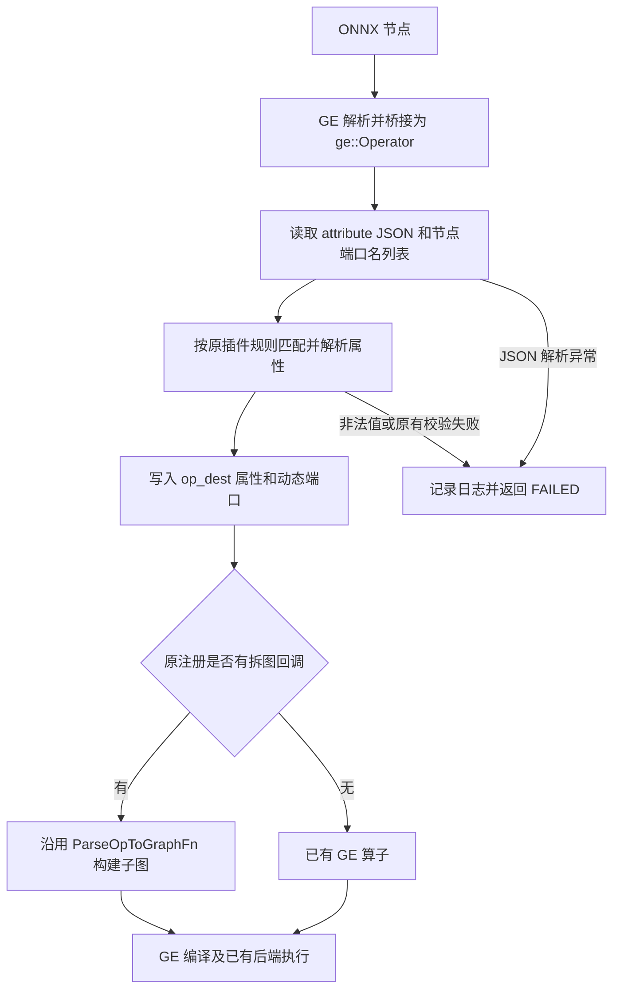

# ops-nn 算子 ONNX 插件 protobuf 解耦设计

| 项目 | 内容 |
| --- | --- |
| 社区任务 | 2026 年 10 月社区任务 13：ops-nn 算子 onnx 适配 |
| 提交团队 / GitCode ID | m0_52603995 |
| 文档版本 | v1.0，2026-10-19，提交设计评审 |
| 工程类型 | C++ Host 侧 ONNX 框架适配 |
| 迁移范围 | 任务书列出的 75 个算子插件条目，涉及 74 个插件文件 |
| 实现 PR | [cann/ops-nn !12076][code-pr] |
| 迁移前基线 | `6e5b1844d08baee8c2bc9523bf87a05ec2bd9539` |
| 本文对应实现 | `0beed44a8a7c0840009692a208c50377f39533f8` |

本文按照社区[设计模板][template]的“需求背景、需求分析、详细设计、可维可测分析”组织，描述上述固定提交的实现。第 4 节给出 2026-10-17 的归档自验证结果及适用条件；设计评审、代码合入和活动平台验收状态分别由对应审核流程确认。

## 1. 需求背景

### 1.1 需求来源

需求来自《ops-nn 算子 onnx 插件 protobuf 解耦任务书》，对应[官方任务列表][task-list]中 10 月第 13 项。设计文档依照[社区任务提交说明][task-guide]提交至 `cann/cann-ops-competitions`；实现和 framework UT 通过 [ops-nn !12076][code-pr]提交。接口迁移参考 [ops-nn #5115][migration-reference]。

任务目标是消除指定插件参数解析代码对 protobuf 对象和生成头文件的直接依赖，保持既有 ONNX 属性解释、GE 算子映射及拆图行为。

### 1.2 背景介绍与现状分析

迁移前，GE 经 `.ParseParamsFn(...)` 调用以 `const Message*` 为源入参的解析函数。插件将其转换为 `ge::onnx::NodeProto`，遍历 `attribute()`，读取 `i/f/s/ints/floats` 等字段，并从节点对象取得名称及输入输出数量。

这种方式把插件与 `ge_onnx.pb.h`、protobuf 类型及 ABI 绑定。生成代码变化会影响插件编译和加载，UT 也需要构造 protobuf 对象。部分插件通过 `onnx_common.h` 同时取得 protobuf 类型与通用张量工具，使只需要通用工具的代码也引入生成头文件。

GE 已提供 `ParseParamsByOperatorFn` 接口：框架将节点信息放入 `ge::Operator`，以 `attribute` 字符串属性承载 JSON。插件可通过公开的 Operator 接口完成同样的参数解析。

### 1.3 插件功能与迁移边界

插件完成 ONNX 节点到 GE 属性、动态端口或 `PartitionedCall` 子图入口的映射。实际计算继续由已有 GE 算子和后端实现承担。

本设计涉及：

- 各迁移文件中的参数解析函数、相关属性读取辅助函数及注册回调。
- `common/inc/framework/plugin_util.h` 中不依赖 protobuf 的通用工具，以及 `onnx_common.h` 对迁出工具的复用。
- 与迁移文件对应的 framework UT、必要的测试构建配置和迁移自查材料。

算子计算公式、已有 `ParseOpToGraphFn` 拆图算法、Kernel、Tiling 和算子原型不属于本次功能改造范围。验证中使用的 SDK 解析桥接或后端候选库另行披露于第 4.4 节，不作为本迁移 PR 的实现内容。

## 2. 需求分析

### 2.1 需求描述

对任务范围内的插件，将源参数接口统一迁移为 `const ge::Operator&`，注册方式改为 `.ParseParamsByOperatorFn(...)`，通过 `GetAttr` 和仓内已有版本的 `nlohmann/json` 解析属性。迁移必须保留基线中的缺省值、属性匹配条件、重复属性处理顺序、边界检查、动态端口数量及返回状态。

解耦目标限定在任务插件及其新解析路径。GE 框架本身、仓库中其他组件以及供旧接口保留的 `onnx_common.h` 仍可能使用 protobuf；不据此声明整个 CANN 或 ops-nn 仓库不再依赖 protobuf。

### 2.2 范围分解

按固定实现的 74 个插件文件统计如下。75 是任务书的“文件 × 算子”条目数；同一算子不同版本的注册块可能分开，不能将条目数直接等同于注册宏数量。

| 所在目录 | 插件文件数 | 主要关注点 |
| --- | ---: | --- |
| `activation` | 10 | 浮点属性、默认值、Softmax 版本差异 |
| `common/src/framework` | 36 | Conv/Gemm 拆图入口、Tensor 属性、循环与控制流、量化属性 |
| `conv` | 1 | NPUDeformableConv2D 属性及格式处理 |
| `experimental` | 1 | NpuFusedAddRmsNorm 的 epsilon 解析与独立构建覆盖 |
| `index` | 8 | axis、重复属性、Unique 动态输出 |
| `norm` | 6 | epsilon、归一化轴与默认值 |
| `pooling` | 2 | AdaptivePool 属性解析 |
| `quant` | 8 | dtype 映射、scale/offset、多个算子入口 |
| `rnn` | 2 | LSTM 属性、方向和必需参数检查 |
| 合计 | 74 | 逐文件对应 framework UT 和模型生成脚本 |

完整文件映射及逐项检查见固定证据版本中的[迁移自查清单][migration-checklist]。

### 2.3 需求与验证对应关系

| 编号 | 设计要求 | 验证方式 |
| --- | --- | --- |
| R1 | 迁移签名及注册入口，消除目标插件中的 protobuf 类型引用 | 静态扫描、插件构建、真实注册回调加载 |
| R2 | 保留属性缺省、零值、类型匹配和重复属性语义 | 每个插件的 framework UT，典型节点回调前后比较 |
| R3 | 保留原有校验和失败分支，正确处理非法 JSON | 畸形 JSON、非法取值、必需属性缺失等用例 |
| R4 | 保留节点名称、输入输出数量及子图入口属性 | 动态端口 UT、Conv/Gemm/Unique 等模型转换与推理 |
| R5 | 保留 Tensor 属性的字节和数据类型语义 | ConstantOfShape typed data / raw_data 用例 |
| R6 | 对同一冻结模型和输入验证迁移等价性 | 同一硬件与共同依赖下的迁移前后两轮转换和推理 |
| R7 | 明确平台不支持和 SDK 候选修复的验证边界 | 原始失败日志、op-info、回调探针及依赖哈希记录 |

## 3. 详细设计

### 3.1 算子分析

#### 3.1.1 数学与行为等价目标

本任务改变参数的载体和读取接口，不重新定义算子数学公式。令 `P_old` 为基线插件解析过程，`B` 为 GE 的 Operator/JSON 桥接，`P_new` 为新解析过程，则对有效节点 `N`，目标为：

```text
P_new(B(N)) 与 P_old(N) 产生一致的有效目标属性、端口和拆图输入。
同一模型 M、输入 X、共同后端环境 E 下：
Infer(Convert(M, P_new), X, E) = Infer(Convert(M, P_old), X, E)。
```

对不可转换、非法属性或必需属性缺失的用例，比较失败阶段与原因，不能只比较进程退出码。任务书第 2.1.7 条明确要求修正的失效判据，如 dtype 映射失败的错误哨兵值，需单独说明并由负向 UT 验证。

典型计算语义如下：

- HardSigmoid：`y = max(0, min(1, alpha * x + beta))`。缺少 alpha/beta 属性时保持 `0.2/0.5`；显式零值属性仍必须传递为零。
- Gemm：`Y = alpha * A' * B' + beta * C`，其中 `A'`、`B'` 分别由 transA、transB 决定。两项转置标志独立解析；是否存在第三输入及其后续处理沿用原子图实现。
- Conv：继续采用已有卷积实现。插件保留 padding 顺序映射、stride/dilation 扩展、维数判定和一维卷积适配标志。

#### 3.1.2 支持数据类型与形状

每个算子的 Tensor dtype、shape、format、广播及动态 shape 能力，以基线插件、GE 原型和目标平台的已有实现为准。本迁移不新增统一的 dtype/shape 支持集合，不以 Host 解析成功代表后端能够执行。

属性载体的类型如下：

| GE 节点信息 / JSON 字段 | 读取类型 | 设计约定 |
| --- | --- | --- |
| Operator 的 `attribute` | `ge::AscendString` | 内容为含 `attribute` 数组的 JSON 对象 |
| 属性对象 `name` | string | 按原属性名匹配，未识别属性沿用原处理 |
| `type` | 整数枚举 | FLOAT=1、INT=2、STRING=3、TENSOR=4、FLOATS=6、INTS=7、STRINGS=8；按插件实际需要使用 |
| `i` | 整型，按原字段宽度读取 | 属性已匹配但字段省略时按 protobuf 零值处理 |
| `f` | string，再由 `StrToFloat` 转 float | 字段省略时为 `0.0f`；字符串转换失败返回 FAILED |
| `s` | string | 保持对应插件原来的字符串处理与缺省语义 |
| `ints` / `floats` / `strings` | 对应元素类型的数组 | 保留顺序、空列表、追加或覆盖行为 |
| Tensor 属性的 `t` | JSON object | 读取 `data_type`、typed data 或转义的 `raw_data` |
| Operator 的 `input` / `output` | `vector<ge::AscendString>` | 元素是原节点端口名；列表长度包含原有空占位项 |

### 3.2 算子实现

#### 3.2.1 总体方案与数据流



接口如下，函数名、静态属性和所属命名空间沿用对应文件：

```cpp
domi::Status ParseParamsOp(const ge::Operator& op_src,
                          ge::Operator& op_dest);
```

`op_src` 为只读节点信息；`op_dest` 接收目标属性、动态端口和原有拆图入口参数。返回值继续使用 `domi::SUCCESS` / `domi::FAILED`，调用者只在成功时使用有效解析结果。

注册时将 `.ParseParamsFn(...)` 替换为 `.ParseParamsByOperatorFn(...)`；`REGISTER_CUSTOM_OP` 的目标类型、`FrameworkType`、`OriginOpType`、版本区间、`ImplyType` 及已有 `.ParseOpToGraphFn(...)` 保留原约定。

#### 3.2.2 Host 侧属性解析

每个回调先按基线初始化默认值，再读取 `attribute`。对实际需要处理的属性数组按原顺序遍历，不先转换为以属性名为键的 map，避免丢失重复属性及其顺序语义。JSON 语法、类型转换等异常记录节点/算子相关日志后返回 FAILED。

以下五类情况必须区分：

1. **属性对象不存在**：保留原默认值；对于原实现要求的必需属性，仍执行原失败检查。
2. **属性对象存在、值字段省略**：这是 protobuf 零值省略的合法情况。例如 `{"name":"alpha","type":1}` 应得到 alpha=0，而不是 HardSigmoid 的默认值 0.2。
3. **属性 type 不匹配**：原实现检查 type 的位置继续检查；原实现不检查的位置保留既有条件。例如 Gemm 的 transA/transB 按名称及整数值判断，不额外加入新的类型限制。
4. **重复属性**：保留原来的首个命中、后值覆盖、列表累积或单向标志更新规则。例如 Gemm 的 enable_uncache 取首个匹配项；Unique 的 sorted 在遇到匹配零值后置 false，不因后续非零项恢复为 true。
5. **结构缺项与解析异常**：合法 JSON 缺少属性数组时，沿用该插件的空属性路径及后续检查；语法错误、实际读取时的类型异常和浮点字符串转换失败返回 FAILED。不能把所有缺项都统一判为成功，也不能为本次迁移统一扩大结构校验范围。

HardSigmoid 的区分示例：

| 输入 JSON | alpha 结果 | 原因 |
| --- | ---: | --- |
| `{"attribute":[]}` | 0.2 | 未提供 alpha 属性 |
| `{"attribute":[{"name":"alpha","type":1}]}` | 0.0 | 已提供属性，省略零值字段 |
| `{"attribute":[{"name":"alpha","type":1,"f":"0.25"}]}` | 0.25 | FLOAT 标量使用字符串载体 |
| `{"attribute":[{"name":"alpha","type":2,"i":3}]}` | 0.2 | 原匹配规则要求 FLOAT |
| `{"attribute":[{"name":"alpha","type":1,"f":"bad"}]}` | FAILED | 浮点转换失败 |

实现依据见固定版本的 [HardSigmoid][hard-sigmoid]、[Gemm][gemm] 和 [Unique][unique]。

#### 3.2.3 Host 侧节点元数据和动态端口

原 `node->name()` 在需要透传名称的位置改用 `GetOpName(op_src)`。节点输入输出数量分别通过 `GetOnnxNodeInputSize`、`GetOnnxNodeOutputSize` 读取 `input` / `output` 名称列表；读取不到列表时工具返回 0，由调用方保持原有后续行为。

在参数解析阶段，源 Operator 的数据端口尚未完整挂载，直接使用 `GetInputsSize()` 可能得到 0，造成动态输入注册错误。以原名称列表计数可保留可选输入的空占位和输入顺序。Unique 对输出列表得到 0 的情况保留 `GetOutputsSize()` 回退，以兼容使用已注册输出端口的 UT 构造方式；实际框架路径优先使用名称列表。

Conv、Gemm、ConstantOfShape 等仍将 `name`、`original_type`、输入数量和必要属性写入目标 Operator，供原拆图回调使用。解析层不重排动态端口，不改写已有子图计算链。

#### 3.2.4 公共工具与依赖拆分

在现有 [plugin_util.h][plugin-util] 中复用 `StrToFloat`、`GetOpName`，增加输入输出名称列表计数工具，并迁入 `Vec2Tensor`、`CreateScalar`、`ChangeFormatFromOnnx`。后三者沿用原函数语义。

迁移插件按需包含 `graph/operator.h`、`register/register.h`、`nlohmann/json.hpp`、`plugin_util.h`；需要 GE 算子 stub 或原型声明时显式包含相应头文件。旧 `onnx_common.h` 通过包含公共工具头继续提供迁出的工具，删除重复定义，保留仍需要 protobuf 的旧工具。

选择复用已有工具头，可以保持仓内调用方式并避免新增重复头文件。JSON 库使用仓内 third_party 版本，不引入新的依赖版本。本设计不统一重写所有算子的解析框架，以便逐文件审查原有分支和属性语义。

#### 3.2.5 关键算子的特殊处理

| 场景 | 当前设计 | 关键验证点 |
| --- | --- | --- |
| Gemm | 独立解析 transA/transB；alpha/beta 默认 1.0；fixed_shift_value 有效范围为 [34,43]，缺省 42，越界沿用原告警和不更新行为；保留原拆图 | 单侧转置、重复属性、边界值和非整数浮点系数 |
| Conv / Pool 系列 | 属性列表按原顺序追加、扩展或重排；Conv 的四元 pads 从 begin/end 分组映射为成对次序；保留 dim_size/trans_2d 推导 | 奇数 pads 失败，一维/二维/三维配置，缺失必要空间属性 |
| DeformableConv2D | 二元 pads 延续基线展开方式；格式更新失败时仍返回 FAILED | 注册合法目标描述的成功路径与缺少描述的失败路径 |
| Unique | sorted 保留单向置 false 的规则；输出数量来自节点输出名列表并保留既有 UT 回退 | 重复 sorted、1～4 个输出、num_output 与动态端口一致 |
| ConstantOfShape | 保留默认 float 零标量；从 `t` 读取 dtype 和原数据载体；raw_data 按 GE 的转义约定还原字节 | typed data、转义字节、默认值、dtype 与数据大小 |
| 量化插件的 dtype 校验 | 按映射工具真实失败值判断，如 `ge::DT_UNDEFINED`；不继续使用失效的 `-1` 比较 | 非法映射必须触发相应 FAILED 分支，合法映射保持 |
| GRU/LSTM 与 Basic cache | 维持 hidden_size、direction、clip、激活和量化属性的原解析条件及列表顺序 | 重复属性、必需属性缺失、原始节点与完整 IR 对照回调 |
| experimental NpuFusedAddRmsNorm | 保留 epsilon 的首项/类型相关行为并单独纳入构建与验证 | 默认值、重复项、缺失 f、类型不匹配 |

[ConstantOfShape][constant-of-shape] 的 `raw_data` 是 GE Pb2Json 生成的转义文本，需在 JSON 解码后继续还原其命名转义、三位八进制转义和反斜杠等字节。直接把这段文本当作 Tensor 字节会改变常量数值。解析时使用局部字符串/数组持有数据直到 `ge::Tensor` 构造完成；typed data 按原支持路径处理 `int64_data`、`int32_data`、`float_data` 和 `double_data`。不将这一处理外推为支持任意 ONNX Tensor 编码。

#### 3.2.6 分核、内存分块和 TilingKey

| 模板设计项 | 本任务的适用性 |
| --- | --- |
| 分核策略 | 参数解析在 Host 执行，不分配 AI Core；已有计算算子的分核策略由原实现负责 |
| UB 分块与 Double Buffer | 本迁移不访问设备 UB，也不增加设备搬运；原算子的策略保持 |
| TilingKey 规划 | 不增加 TilingKey 或 Tiling 数据结构，继续使用已有算子实现 |
| Host 临时内存 | JSON 对象、属性列表和必要的 Tensor 数据存储为回调局部对象，随解析调用结束释放；不添加全局属性缓存 |

#### 3.2.7 Kernel 侧设计与性能考虑

本任务按任务书第 2.2 节采用 ONNX 框架适配工程，不新增 Ascend C Kernel，不改写 CopyIn/Compute/CopyOut，也不新增 aclnn 或 torch 接口。

性能方面不改变设备计算路径。依赖拆分减少目标插件对 protobuf 生成类型的直接耦合，复用通用工具和已有 JSON 版本可控制维护成本。按当前解析结构处理属性，保留为兼容重复属性而存在的多次遍历，不以优化遍历为由合并或改变语义。编译时间、ATC 时延和内存收益尚未作为性能指标测量，不作定量提升声明；任务书第 3.3、3.4 节未设置性能或内存验收指标。

### 3.3 支持硬件与依赖

| 项目 | 要求 / 当前验证范围 |
| --- | --- |
| Host 接口 | C++、GE Operator 与插件注册接口、仓内 nlohmann/json |
| 任务硬件要求 | Atlas A2 或 Ascend 950，任一硬件满足任务验证要求即可 |
| 本次实际环境 | Atlas A2 系列 Ascend910B3，CANN 9.1.0 |
| 其他硬件 | 本文未给出 Ascend 950 的实测结果；后端能力按其安装包确认 |
| 模型与参考输出 | Python、onnx、onnxruntime、numpy；使用任务包的模型及独立参考生成规则 |
| OM 执行 | ATC 转换与 pyACL 推理；共同依赖及其哈希见第 4.4 节 |

### 3.4 约束、兼容性和风险处理

1. **框架桥接约定**：新插件依赖 Operator 属性和 GE JSON 表示。FLOAT 字符串、Tensor 字节转义或节点名称列表的表示变化，需要重新核对桥接及插件契约。
2. **注册覆盖**：保留原 domain/opset 范围与多入口注册，逐文件检查是否仍有旧回调残留。仅改函数签名而未更换注册方式不能视为完成迁移。
3. **失败判据**：dtype 映射哨兵等任务明确要求修正的情况单独用负向用例验证；其他错误路径依照原逻辑处理。成功路径所需的目标 Tensor 描述必须真实构造。
4. **平台实现缺失**：解析成功不代表平台具备对应算子引擎。平台项采用任务书第 3.2.5 条的证据要求，记录原错误和两轮对照，不计作数值推理通过。
5. **旧接口 ABI**：基线插件在部分 SDK 上需要任务包提供的旧 protobuf 符号兼容库。该库只服务迁移前轮的加载；新插件不应通过加载该兼容库获得“解耦通过”。
6. **回退方式**：出现迁移相关回归时，可重新构建固定基线并切换回基线插件路径复现；保留新旧插件哈希和完整失败记录。切换插件时应避免同一 ONNX 类型的多份插件同时注册。

## 4. 可维可测分析

### 4.1 精度标准、性能标准和观测项

| 验收项 | 判据 | 标准来源 |
| --- | --- | --- |
| 参数与返回值 | 有效输入的目标属性、动态端口及原有返回分支一致；明确修正的失败判据有负向 UT | 任务书 2.1、3.5 |
| 迁移前后主判据 | 同一冻结模型及输入分别转换和推理，输出 dtype、shape 及数值严格一致，不以浮点容差替代 | 任务书 3.2.1～3.2.2 |
| 独立 golden 辅助判据 | 按任务包混合容差标准校验；整数/布尔精确比较，同时检查 dtype/shape | 任务书 3.2.3、[混合容差标准][precision-standard] |
| 不产出 golden 的原用例 | 验证其既定行为契约和两轮一致性，单列不适用原因 | 任务书 3.2.3 |
| 平台容错项 | 同一 SOC/SDK 的两轮行为与原因一致，保留 ATC 错误及平台注册证据 | 任务书 3.2.5 |
| 性能 / 内存 | 不设本次验收指标，Host 侧等价重构不改变设备计算逻辑 | 任务书 3.3、3.4 |

对于任务包中的 FP32 golden 比较，使用 `rtol=2^-10`、`atol=2^-16`，并遵守逐元素 `max(fixed_limit, 32*ULP)` 硬上限和整体匹配率至少 0.99 的规则；具体 fixed_limit、dtype 和例外契约按任务包元数据与比较器执行。迁移前后严格比较与 golden 辅助比较分别记录。

### 4.2 framework UT 设计

UT 使用 `ge::Operator` 构造节点，设置 `attribute` JSON 和必要的输入输出名称列表，不构造 protobuf 对象。测试文件按原插件归属进入 `common/tests/ut/framework` 或各算子的 `tests/ut/framework`，experimental 单独覆盖。

| 用例类别 | 典型输入 | 观测内容 |
| --- | --- | --- |
| 正常属性 | 可区分的 alpha/beta、axis、pads、量化参数 | 返回 SUCCESS，属性值及属性类型正确 |
| 缺省与零值 | 无属性、属性存在但无 i/f、空列表 | 原默认值与显式零值不混淆 |
| 类型与异常 | type 不匹配、畸形 JSON、非法浮点字符串 | 原忽略条件或 FAILED 分支正确 |
| 顺序与重复 | 相同属性重复、非零后跟零、列表重复 | 首项/末项/累积/单向标志符合原实现 |
| 边界校验 | shift 范围端点及越界、奇数 pads、非法 dtype | 告警、回退或失败行为符合原契约 |
| 动态端口 | 可选输入占位、Unique 不同输出数量 | 动态注册数量、顺序和目标元数据一致 |
| 特殊载体 | ConstantOfShape typed data、转义 raw_data | Tensor dtype、大小和内容正确 |
| 目标描述 | DeformableConv2D 合法/缺失 TensorDesc | 格式更新成功与失败均可观测 |

归档测试包含有依据的断言和构造修正：AscendQuant 的 `ge::DT_INT16` 枚举、MVN 的整数列表 getter、DeformableConv2D 的基线 pads 展开和目标描述、MaxPool 的 SOC 测试 stub。相关修改及格式差异保存在[测试差异][test-diff]与[UT 来源对照][ut-comparison]中；不能将这批结果描述为任务包原 UT 完全未经修改。

### 4.3 两轮集成验证流程

1. 固定基线和迁移提交，分别构建默认与 experimental 插件。记录提交、构建命令、退出码及 `.so` SHA256，并通过真实回调探针确认加载的是本轮插件。
2. 以任务包 74 个模型生成脚本为覆盖依据，生成并冻结模型、输入、golden、外部权重、meta 和 ATC 配置。材料适配、测试断言修正和历史失败记录保留出处；两轮使用同一份冻结材料。
3. 在同一 Ascend910B3、相同 SDK 及相同共同依赖下分别执行迁移前后 ATC 转换与推理；旧接口加载兼容库按第 3.4 节单独处理。
4. 对产出输出的用例检查输出集合、dtype、shape、严格一致性和独立 golden。对失败用例核对错误阶段及原始日志，禁止仅因两轮均非零退出就归为通过。
5. 对平台项记录算子、SOC、SDK、op-info 和具体原因。Basic cache 两项还保留完整 IR 输入对照与新旧回调比较，避免将原模型输入错误直接当作缺引擎证据。
6. 汇总覆盖完整性与逐例判定，将数值输出、行为一致、预期失败、平台条款和 golden 不适用分别计数；发布版本绑定固定实现与证据提交。

仓内基础构建和默认 framework UT 入口如下；experimental 及独立语义测试另行执行。下列命令不替代带依赖锁定的完整两轮验证记录。

```bash
bash build.sh --onnxplugin -j8
bash build.sh --ophost -u --noexec -j16 --ccache=off
# 对本次构建生成的 nn_op_host_ut 执行：
./nn_op_host_ut --gtest_filter='Onnx*PluginTest.*'
```

实际归档命令、逐例 ATC 配置及执行结果见[构建记录][build-manifest]、[逐例清单][case-manifest]和[精度自验证日志][validation-log]。标准 GRU 的 5 个用例按记录的精度标志及融合开关作覆盖运行，Gemm 的 3 个额外控制用于检查属性桥接精度，不重复计入任务原用例数。

### 4.4 共同依赖与复现条件

归档运行使用 CANN 9.1.0，并包含以下隔离依赖。它们均为已公开问题对应的本地候选或基线注册组件，尚不能作为官方 SDK 发布版本能力的证明；完整文件哈希位于[结果汇总][validation-summary]的 `isolated_dependency_disclosure`。

| 组件 | 用途 | 问题 / 记录 |
| --- | --- | --- |
| GE `libparser_common.so` 桥接候选 | FLOAT/DOUBLE 属性桥接，避免序列化精度问题干扰等价比较 | [GE #656][ge-issue]；SHA256 前缀 `2ca50e18` |
| Unique 基线 Host 注册库 | 补齐该验证环境下的既有 shape 注册，经 OPP 方式加载 | 汇总清单；SHA256 前缀 `2cd4dc0a` |
| `gru_reset_before_candidate_v5` | GRU 后端 reset 语义对照 | [ops-nn #6748][gru-issue] |
| `sce_ignore_candidate_v3` | SoftmaxCrossEntropyLoss 的 ignore_index 处理 | [ops-nn #6693][sce-issue] |
| `dynamic_quant_precision_candidate_v2`、`dequant_math_candidate_v4`、`required_attrs_candidate_v4` | 量化精度、反量化及必需属性相关后端问题 | [ops-nn #6686][task-issue] |
| `int8_dequant_math_candidate_v1`、`int8_output_layout_candidate_v1`、`int8_offset_read_candidate_v2` | Int8 反量化、输出布局和 offset 读取 | [ops-nn #6774][int8-issue] |

上述桥接库、注册库和 8 个后端候选库，在每个用例的两轮中使用一致的版本和哈希。固定共同依赖有助于观测插件迁移差异，但不证明未加补丁的原装 SDK 已消除这些问题。候选组件在正式环境中的接纳和集成由对应项目评审决定；更换 SDK 或共同依赖后，应重新执行相同的验证流程。

### 4.5 当前实现的归档自验证结果

以下结果对应 2026-10-17、实现提交 `0beed44a8a7c0840009692a208c50377f39533f8`，适用环境和共同依赖如上。数据来自[固定证据提交][evidence-root]，不是本次设计文档编写期间重新执行的结果。

| 验证项 | 归档结果 | 解释 |
| --- | --- | --- |
| 静态迁移覆盖 | 74 个插件文件 | 目标插件中旧 protobuf 类型/头引用和 ParseParamsFn 注册残留为 0 |
| 默认 framework UT | 751/751 | 固定提交构建并执行 |
| experimental UT | 10/10 | 单独执行 |
| 独立语义 UT | 6/6 | 补充关键语义验证 |
| 原任务模型覆盖 | 74 个脚本、189 个用例 | 加 3 个 Gemm 桥接控制，总计 192 项 |
| 两轮产生输出且严格一致 | 162 项 | 迁移前后均完成转换和推理 |
| 行为一致 | 5 项 | 按逐例契约单独判定 |
| 预期失败契约 | 5 项 | 预期失败阶段及条件符合记录 |
| 平台条款项 | 20 项 | 按任务书 3.2.5 记录，不属于数值推理通过 |
| Golden | 160 项通过、32 项不适用、0 项失败 | 不适用原因分别留证 |
| 自验证汇总 | 192 项满足记录中的相应判据 | 包含平台及行为契约项，不代表 192 项均完成数值推理 |

32 项 golden 不适用由 11 项原 `golden=false` 用例、1 项有参考但按预期转换失败的用例、20 项平台条款项组成。162 项产生输出的用例中，160 项完成 golden 比较，另外 2 项沿用原 golden 不适用契约。

BasicGRU/BasicLSTM InplaceFillWindowCache 两项原任务模型存在输入槽位、dtype 或维数契约问题；完整 IR 对照在前置检查后仍遇到目标平台缺失引擎，且安装包 15 份 op-info 检查无对应注册。归档还记录了新旧真实回调的属性等价证据。这两项被自验证报告按 3.2.5 计入平台项，具体事实及原错误见 [ops-nn #6789][basic-issue]；不能写成它们已完成量化或窗口缓存功能的数值验收。

### 4.6 维护与评审关注点

维护者可沿 R1～R7 核对回调接口、属性契约、动态端口和验证范围，结合固定提交直接定位代码。后续对 JSON 桥接、SDK、任务模型或属性语义的变更，需要更新对应 UT、模型/输入哈希和两轮结果。

本设计的主要评审点为：protobuf 解耦边界是否清晰；零值、重复属性及 Tensor 字节处理是否忠于既有契约；平台条款项的证据是否充分；共同依赖条件是否满足后续复验要求。设计文档、代码 PR 及自验证材料分别保留版本，评审通过后再按活动平台流程申请验收。

## 5. 参考资料与固定版本索引

- [社区任务提交说明][task-guide]、[设计模板][template]及[官方任务列表][task-list]。
- [实现 PR][code-pr]、[迁移参考 issue][migration-reference]。
- 固定源码示例：[公共工具][plugin-util]、[HardSigmoid][hard-sigmoid]、[Gemm][gemm]、[Conv][conv]、[ConstantOfShape][constant-of-shape]、[Unique][unique]。
- 固定证据：[结果汇总][validation-summary]、[逐例清单][case-manifest]、[构建记录][build-manifest]、[精度日志][validation-log]、[迁移自查清单][migration-checklist]、[测试差异][test-diff]和[UT 来源对照][ut-comparison]。

[template]: https://gitcode.com/cann/cann-ops-competitions/blob/master/04_tasks/01_community-task-2026/resources/design_template.md
[task-guide]: https://gitcode.com/cann/cann-ops-competitions/blob/master/04_tasks/01_community-task-2026/README.md
[task-list]: https://gitcode.com/cann/cann-ops-competitions/blob/master/04_tasks/01_community-task-2026/docs/README.md
[code-pr]: https://gitcode.com/cann/ops-nn/merge_requests/12076
[migration-reference]: https://gitcode.com/cann/ops-nn/issues/5115
[plugin-util]: https://gitcode.com/m0_52603995/ops-nn/blob/0beed44a8a7c0840009692a208c50377f39533f8/common/inc/framework/plugin_util.h
[hard-sigmoid]: https://gitcode.com/m0_52603995/ops-nn/blob/0beed44a8a7c0840009692a208c50377f39533f8/activation/hard_sigmoid/framework/hard_sigmoid_onnx_plugin.cpp
[gemm]: https://gitcode.com/m0_52603995/ops-nn/blob/0beed44a8a7c0840009692a208c50377f39533f8/common/src/framework/gemm_onnx_plugin.cpp
[conv]: https://gitcode.com/m0_52603995/ops-nn/blob/0beed44a8a7c0840009692a208c50377f39533f8/common/src/framework/conv_onnx_plugin.cpp
[constant-of-shape]: https://gitcode.com/m0_52603995/ops-nn/blob/0beed44a8a7c0840009692a208c50377f39533f8/common/src/framework/constantofshape_onnx_plugin.cpp
[unique]: https://gitcode.com/m0_52603995/ops-nn/blob/0beed44a8a7c0840009692a208c50377f39533f8/index/unique_with_counts_and_sorting/framework/unique_onnx_plugin.cpp
[precision-standard]: https://gitcode.com/cann/opbase/blob/master/docs/zh/ops_precision_standard/mixed_tolerance_standard.md
[evidence-root]: https://gitcode.com/m0_52603995/ops-nn/tree/652f8f14d82b253d03edc8b3d261444808c92d0c/task_submission
[validation-summary]: https://gitcode.com/m0_52603995/ops-nn/blob/652f8f14d82b253d03edc8b3d261444808c92d0c/task_submission/delivery_summary.json
[case-manifest]: https://gitcode.com/m0_52603995/ops-nn/blob/652f8f14d82b253d03edc8b3d261444808c92d0c/task_submission/current_cases.json
[build-manifest]: https://gitcode.com/m0_52603995/ops-nn/blob/652f8f14d82b253d03edc8b3d261444808c92d0c/task_submission/build_manifest.json
[validation-log]: https://gitcode.com/m0_52603995/ops-nn/blob/652f8f14d82b253d03edc8b3d261444808c92d0c/task_submission/2.2%20%E7%B2%BE%E5%BA%A6%E8%87%AA%E9%AA%8C%E8%AF%81%E6%97%A5%E5%BF%97.log
[migration-checklist]: https://gitcode.com/m0_52603995/ops-nn/blob/652f8f14d82b253d03edc8b3d261444808c92d0c/task_submission/migration_checklist.json
[test-diff]: https://gitcode.com/m0_52603995/ops-nn/blob/652f8f14d82b253d03edc8b3d261444808c92d0c/task_submission/test_assertion_changes.diff
[ut-comparison]: https://gitcode.com/m0_52603995/ops-nn/blob/652f8f14d82b253d03edc8b3d261444808c92d0c/task_submission/ut_source_comparison.json
[ge-issue]: https://gitcode.com/cann/ge/issues/656
[task-issue]: https://gitcode.com/cann/ops-nn/issues/6686
[sce-issue]: https://gitcode.com/cann/ops-nn/issues/6693
[gru-issue]: https://gitcode.com/cann/ops-nn/issues/6748
[int8-issue]: https://gitcode.com/cann/ops-nn/issues/6774
[basic-issue]: https://gitcode.com/cann/ops-nn/issues/6789
