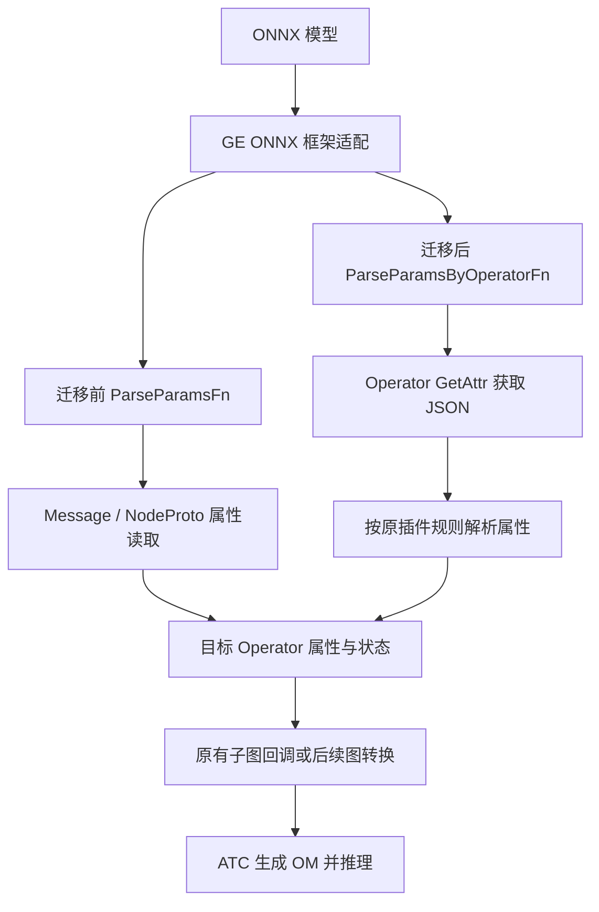
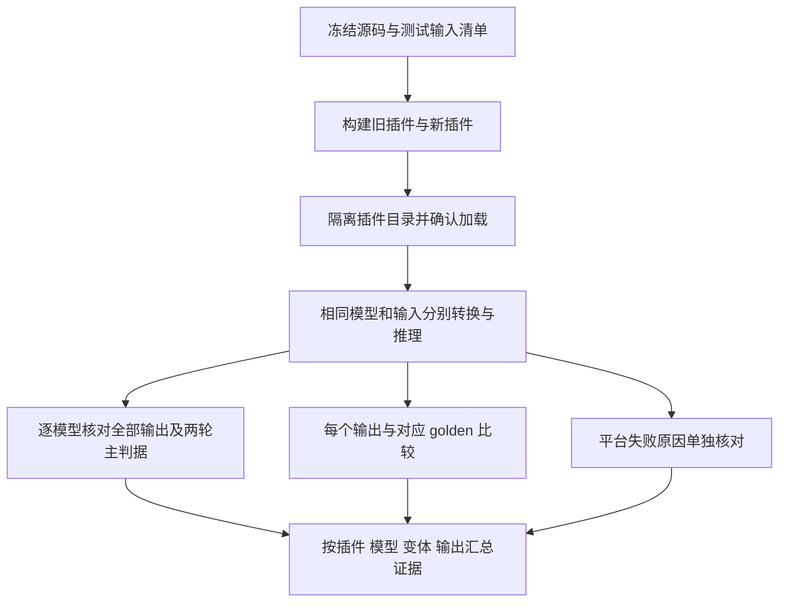

**ops-nn 算子 ONNX 插件 protobuf 解耦设计文档**

版本：1.1　日期：2026-10-14　目标仓库：`cann/ops-nn`

本文描述拟实施的设计、约束与验证方法。文中的通过条件属于验收目标，不表示代码已实现、测试已执行或官方评审已通过。

# 需求背景（required）

## 1.1 需求来源

本设计对应“10月社区任务—ops-nn 算子 ONNX 适配”，以任务附件《ops-nn算子onnx插件protobuf解耦任务书》及配套 `test_cases/README.md`、UT、OM 验证脚本为直接依据。

主要官方来源：

1. [本题任务页面](https://www.hiascend.com/activities/task-center/details/de397754b8b7410790780df572bd62ae?menu=tasks)：本设计已读取其下载附件，技术要求以附件为准。
2. [ops-nn 仓库](https://gitcode.com/cann/ops-nn)及[迁移适配 issue #5115](https://gitcode.com/cann/ops-nn/issues/5115)。
3. [社区任务流程及注意事项](https://gitcode.com/org/cann/discussions/39)。
4. [2026 社区任务设计模板](https://gitcode.com/cann/cann-ops-competitions/blob/master/04_tasks/01_community-task-2026/resources/design_template.md)。
5. [ops-nn 贡献指南](https://gitcode.com/cann/ops-nn/blob/master/CONTRIBUTING.md)。
6. [混合容差标准](https://gitcode.com/cann/opbase/blob/master/docs/zh/ops_precision_standard/mixed_tolerance_standard.md)：本题辅助精度判据在附件中已有明确说明和实现。
7. [设计文档 checklist](https://docs.qq.com/sheet/DUHVGUFdmSFRjVFFU?tab=000001)：依本题 Host 解耦范围核对，Kernel/Tiling 等条目标注不涉及。

本题专用任务书规定的改动范围与验收标准优先于通用算子模板中的示例。模板中的 Addcdiv、Tiling、Kernel 和性能优化内容不作为本任务新增需求。

## 1.2 背景介绍

### 1.2.1 ONNX 插件解耦目标

任务书列出的插件使用 `.ParseParamsFn(...)` 注册参数解析回调，回调接收 `google::protobuf::Message`，实际解析 `ge::onnx::NodeProto`。插件需要包含 `ge_onnx.pb.h`，并直接读取 protobuf 属性。

这种实现将 Host 参数解析代码与 protobuf 生成类型及其运行库绑定。proto 或相关符号变化会影响插件构建与加载；单元测试也依赖 protobuf 对象构造。

本次迁移使用 `.ParseParamsByOperatorFn(...)` 接口，由 `ge::Operator` 承载源节点信息，通过 `GetAttr("attribute", ...)` 获取 JSON 字符串，再由仓内 `nlohmann/json` 解析。目标是在移除插件对 protobuf 生成代码依赖的同时，保持原有节点映射、属性值、缺省行为、失败分支与后续图构造行为。

### 1.2.2 现状与范围

迁移范围为任务书明细表中的 **75 个“文件 × 算子”条目、74 个唯一插件文件**。其中 `NPUDynamicQuant` 与 `NPUDynamicQuantV2` 共用同一插件文件。相同名称位于不同目录的条目分别保留，不按算子名去重。完整清单见附录 A。

| 目录 | 唯一插件文件数 | 主要设计关注点 |
| --- | ---: | --- |
| `common` | 36 | 卷积、池化、RNN、量化、子图参数与公共目录 UT |
| `activation` | 10 | FLOAT 字符串、缺省值、轴与 opset 差异 |
| `index` | 8 | axis、列表、重复属性、动态输出及 dtype |
| `quant` | 8 | dtype 映射、scale/offset、失败哨兵及多注册名 |
| `norm` | 6 | epsilon、属性改名及输入数量相关行为 |
| `pooling` | 2 | 输出尺寸与 INTS 属性长度 |
| `rnn` | 2 | 方向、门顺序及多输入输出参数 |
| `conv` | 1 | NPUDeformableConv2d 参数 |
| `experimental` | 1 | FusedAddRmsNorm 参数及平台支持 |
| **合计** | **74** | 覆盖全部 75 个条目 |

模型输入输出的数据类型、格式、形状及广播能力沿用各原算子和原插件约束。本任务不新增统一 dtype/shape 支持范围，也不调整计算公式。

本题对标实现是 ops-nn 原 `framework/*_onnx_plugin.cpp`，完整文件路径见附录 A，源码版本固定方法见 3.1.3 节。通用 checklist 中的 TBE 计算源码、算子信息库及 ACLNN 原型不属于本次迁移对象；相应原型和计算能力保持不变，不以另一个计算实现替换 Host 插件行为基线。

### 1.2.3 迁移前后调用关系



图中两条路径用于说明迁移差异。实际验证时，迁移前、迁移后插件在隔离的加载目录中分别运行。

# 需求分析（required）

## 2.1 外部组件依赖

| 组件 | 使用方式及约束 |
| --- | --- |
| GE Operator 与注册接口 | 使用 `ge::Operator`、`ge::AscendString`、`REGISTER_CUSTOM_OP` 和 `ParseParamsByOperatorFn` |
| JSON | 复用 ops-nn 仓内 `third_party` 提供的 `nlohmann/json`，不引入另一版本 |
| 仓内工具 | 优先复用 `common/inc/framework/plugin_util.h` 中的 `GetOpName`、`StrToFloat` 及既有 dtype 映射工具 |
| CANN / ATC | CANN **大于 9.0.0**，ATC 使用 ONNX 框架参数 `--framework=5` |
| framework UT | 使用仓内 OP_HOST_UT 构建机制和 gtest |
| 模型及 golden 生成 | Python ≥3.8，onnx、onnxruntime、numpy；按各生成脚本保留 opset 11/13/17 与 `ir_version=8` |
| OM 推理 | 采用附件配套 pyACL 脚本；使用其他允许推理工具时，模型、输入、输出及判据不变 |

迁移后目标插件不直接使用 `google::protobuf::Message`、`ge::onnx::NodeProto`、`AttributeProto` 或 `ge_onnx.pb.h`，也不得依靠旧接口兼容库工作。本设计不要求删除 GE/CANN 其他模块内部合法存在的 protobuf 实现。

## 2.2 内部适配模块

| 模块 | 变更 | 保持不变 |
| --- | --- | --- |
| 参数回调 | 改为 Operator 到 Operator 的签名 | 原函数命名、状态类型、对外语义 |
| 注册链 | `.ParseParamsFn(...)` 改为 `.ParseParamsByOperatorFn(...)` | 注册名、FrameworkType、OriginOpType 的 domain/opset、ImplyType |
| 属性读取 | protobuf 遍历改为 JSON 属性读取 | 各属性默认值、处理顺序、重复项规则、条件写入及异常结果 |
| 名称获取 | 原 `node->name()` 路径改用 `GetOpName(op_src)` | 原来是否写 `name`、写入时机及使用目的 |
| 子图与动态输入 | 无功能变更 | `ParseOpToGraphFn`、`DynamicInputRegister` 及其连接关系 |
| framework UT | 使用 `ge::Operator` 构造源输入并检查输出 | 迁移前语义的预期结果；必要缺陷修正另加回归用例 |

## 2.3 需求描述与拆解

1. 覆盖附录 A 全部 75 个条目对应的 74 个插件文件及其 framework UT。
2. 替换参数回调签名和注册接口，移除目标插件的 protobuf 类型与依赖。
3. 使用 JSON 读取属性，保持值、类型、缺省、列表顺序、轴变换、opset 分支和重复属性行为。
4. 区分“属性不存在”和“属性存在但 proto3 省略零值字段”，不能用算子默认值代替后者。
5. 在参与解析的分支中捕获 JSON 异常及未知异常，记录错误并返回 `FAILED`；不为原本不读取属性的插件增加额外解析逻辑。
6. 核对工具函数的真实失败返回约定。任务明确允许修正永不成立的失败判断，并为该类修正补充 UT。
7. 不修改 Kernel、Tiling、算子原型、子图拆分函数或与解耦无关的逻辑。
8. 完成 framework UT、完整插件构建、实际插件加载取证，以及迁移前后 OM 转换与推理对比。
9. 两轮使用相同 ONNX 模型、相同输入、同一硬件和固定的软件环境，主判据为输出逐数值相等，不设 rtol/atol。
10. 有 golden 的输出另做混合容差、dtype/shape 校验；平台限制及任务固有无 golden 场景单独记录。
11. 提供代码与 UT、验证模型、真实日志与报告、逐插件迁移自查表，并按社区流程评审与验收。
12. 性能和内存不涉及，不增加性能倍率、显存占用或多机型全部验证的门槛。

# 详细设计（required）

## 3.1 算子分析

### 3.1.1 语义等价目标

将某插件迁移前对源节点的行为记为 `P_old`，迁移后对同源节点 Operator 表示的行为记为 `P_new`。在该插件原有适用条件下，应满足：

- 返回状态一致；
- 写入目标 Operator 的属性名称、类型、值、列表顺序及有无该属性一致；
- 不新增或减少原注册匹配范围、子图/动态输入行为；
- 对同一模型和输入，在同一硬件执行两轮转换及推理时，满足任务规定的行为一致性。

任务书明确要求修正的失效失败判据是例外：按被调用工具的真实返回约定拒绝非法值，以新增 UT 说明修正目的，不扩大到其他历史逻辑重构。

### 3.1.2 数据与接口

调用方式为 GE ONNX 框架解析器通过插件注册表触发参数解析回调，ATC 转换 ONNX 时使用该链路。UT 直接调用对应解析函数；本次不新增 ACLNN、Kernel 直调或 PyTorch 调用接口。迁移前后流程见 1.2.3 节，差异仅在参数承载与读取方式及任务明确要求修正的失败判断。

各解析函数保留原名称，签名统一为：

```cpp
domi::Status ParseParamsOp(const ge::Operator& op_src, ge::Operator& op_dest);
```

这里的 `ParseParamsOp` 仅示意签名，实际实现使用各文件已有函数名。源节点属性字符串通过以下 API 获取：

```cpp
ge::AscendString attrs_string;
auto status = op_src.GetAttr("attribute", attrs_string);
```

成功取得字符串后再解析 JSON。外层 Operator 属性名为 `attribute`，字符串内部是包含 `attribute` 数组的 JSON 对象，例如：

```json
{"attribute":[{"name":"alpha","type":1,"f":"0.25"},{"name":"axis","type":2,"i":1}]}
```

| JSON 字段 | 表示 | 设计处理 |
| --- | --- | --- |
| `name` | 属性名字符串 | 按原插件匹配；未知属性遵循原忽略/处理行为 |
| `type` | ONNX 属性类型枚举 | 仅保留原插件实际进行的检查，不给所有插件统一增加限制 |
| `f` | FLOAT 标量的字符串 | 使用 `StrToFloat` 转换；符合属性匹配条件但没有 `f` 时取 0.0 |
| `i` | 整型标量 | 保留原目标类型、范围与零值缺省语义 |
| `s` | 字符串标量 | 按原属性用途读取，不增加无依据的编码转换 |
| `ints` / `floats` | 数值列表 | 保留元素顺序、长度规则与原有变换；不把 `floats` 当字符串列表 |

`FLOAT=1`、`INT=2`、`STRING=3`、`FLOATS=6`、`INTS=7` 为任务书列出的类型值。ConstantOfShape 等含特殊属性载体的插件依据对应原实现和专用 UT 单独迁移，不能将上述通用标量表视作全部算子的完整属性集合。

### 3.1.3 逐插件语义清单

实现前为每个唯一文件建立语义记录，并保留其所有算子注册条目。记录内容如下：

| 记录项 | 核对内容 |
| --- | --- |
| 版本与注册 | 完整源码版本、文件路径、回调名、注册名、domain/opset、目标 GE 类型 |
| 属性 | 属性名、原类型检查、取值字段、转换函数、值域、默认值及是否必填 |
| 缺省分支 | 未设置 Operator 属性、缺少 JSON 键、空数组、单个属性缺失、零值字段缺省分别处理 |
| 顺序 | 重复属性取首项/末项/累加、列表顺序、轴/布局变换、属性写入顺序 |
| 输出与状态 | 目标属性改名、条件写入、name 设置、SUCCESS/FAILED/告警回退分支 |
| 关联行为 | 子图、动态输入输出、输入数量与 opset 相关路径 |
| 验证 | 对应 UT、OM 生成器、变体、每个输出、golden 来源、平台例外与证据 |

基线以任务发布时同仓迁移前版本为准，任务书引用的短提交为 `6e5b184`。实施前解析并记录完整 commit，核对各范围文件实际状态。若当前仓库范围或行为已变化，按任务书登记差异并通过对应 issue 反馈；不静默删减范围、不逆向改回已迁移文件，也不把当前 master 未经核实地当作迁移前基线。

## 3.2 算子实现

### 3.2.1 Host 侧设计

每个插件在原函数内保留原控制流程，按以下步骤替换数据读取方式：

1. 在原来的位置初始化各属性默认值，保留原来“缺失时不写属性”的标记。
2. 只在原实现需要解析属性时调用 `GetAttr`。取得失败后按该插件原有缺失行为处理，不能统一返回成功或失败。
3. 对取得的字符串解析 JSON；按该插件原规则处理外层 `attribute` 的缺失、非数组和空数组情况。
4. 依原循环顺序匹配属性名，并保留该属性原有的 type 检查。通过匹配后读取对应载体，完成与原实现一致的转换。
5. 列表重排、维度推导、默认补全、范围校验、告警回退等复用原逻辑，不在此次迁移中重写算法。
6. 按原条件向 `op_dest` 写属性。原来从 `node->name()` 写入名称的路径，替换为 `op_dest.SetAttr("name", GetOpName(op_src))`。
7. 参与 JSON 解析的异常分支记录插件/节点及原因并返回 `FAILED`。保留无属性解析插件的原返回行为。
8. 仅替换对应注册链中的参数解析注册方法，复核所有 OriginOpType 条目及其他回调不变。

不设计一个强制统一默认值、type 检查和错误策略的通用解析器，以免抹平插件差异。优先使用现有 `plugin_util.h`；确有重复逻辑需要新增公共工具时，先证明不同调用点的语义一致，并使用仓前缀命名。默认方案不新增公共头文件。

#### FLOAT 属性三态

| 情况 | 处理 | 示例 |
| --- | --- | --- |
| 属性整体不存在 | 保留原算子初始默认值/原有条件写入行为 | HardSigmoid 无 alpha，使用 0.2 |
| 某项因原有 type 检查不匹配而被忽略 | 不改变当前值与写入标记，保留此前合法重复项的结果 | 不能把已读到的 alpha 重置为默认值；原本不检查 type 的插件仍继续解析 |
| 属性匹配且应按 FLOAT 解析，但 `f` 未出现 | 取 0.0，不回落算子默认值 | alpha 存在、type=1、无 f，写 0 |
| `f` 存在 | 读取字符串并调用 `StrToFloat` | `"0.25"` 转为 0.25；空串、不能转换、尾部残留、ERANGE 转换失败返回 FAILED |

不在未有任务依据时新增“所有 NaN/Inf 均拒绝”等限制；值域要求按具体原插件执行。`i`、`s` 和重复字段的缺省值同样根据原 protobuf 读取语义与具体 UT 核对，不能与“属性整体缺失”合并。

#### 典型插件方案

| 插件/属性 | 迁移后保留的行为 | 验证重点 |
| --- | --- | --- |
| HardSigmoid alpha / beta | 缺失时 0.2 / 0.5；按原 FLOAT 检查；匹配属性缺 f 时取 0 | 默认、零值、非法字符串、type 不匹配 |
| Gemm transA / transB | 分别映射 `transpose_x1` / `transpose_x2`；各自默认 false，互不影响 | 仅一侧出现、两侧同时出现及零值 |
| Gemm alpha / beta | 缺失时 1.0；匹配 FLOAT 属性缺 f 时取 0 | 正常值、默认值与字段省略 |
| Gemm fixed_shift_value | 合法闭区间 [34,43]；越界告警并回退 42 | 34、43、33、44；不能改为统一 FAILED |
| Gemm enable_uncache | 缺失时 0 | 未提供、零值和原合法取值 |
| Conv strides / dilations | 保留 NCHW 扩展与原维度推导；常规扩展缺省为 {1,1,1,1} | 一维、二维及原支持高维路径 |
| Conv pads | 保留到 [h_begin,h_end,w_begin,w_end] 的对应重排及其他原维度分支；奇数长度 FAILED | 非对称 pads、奇数长度及维度组合 |
| Conv kernel_shape | 不直接写该属性；长度影响 dim_size/trans_2d；无该字段时按 strides/pads/dilations 推导 | 四类字段全部缺失仍 FAILED；始终保留 dim_size/trans_2d 写入 |
| Conv group / auto_pad / fixed_shift_value | 按原条件写入；缺失时不新增对应属性 | group 映射 groups；属性存在性断言 |
| 原有拒绝非法 dtype 的分支 | 依据工具真实返回值修正失效判断，例如检查 `ge::DT_UNDEFINED` | 不沿用永不触发的 `om == -1`；新增失败 UT；不将此规则扩大到原本允许未定义 dtype 的插件 |
| ThresholdedRelu、ScatterElements 等 | 保留原实现是否检查 type | 不能因通用表述额外加强 type 校验 |
| NPUDynamicQuant / V2 | 共享解析函数且保留两条注册；原函数不解析属性时不新增解析 | 附件非法 JSON UT 仍期待 SUCCESS；V2 注册匹配另行核对 |

Conv 的高维转换、子图参数及 RNN 属性不由上述示例推导实现，均按各自原源码与专用 UT 建立对照。

#### ConstantOfShape 张量属性

此插件按附件 `test_constantofshape_onnx_plugin.cpp` 的独立契约处理，不能套用标量属性解析或“未定义 dtype 一律失败”的规则：

- `value` 只在 `type=TENSOR(4)` 时读取嵌套 `t` 对象。没有匹配的 value 时，保留初始 `DT_FLOAT`、4 字节张量；被 type 检查忽略的重复项不覆盖已有合法结果。
- 匹配 value 但缺少 `t` 时，按空 TensorProto 的零值语义处理：`data_type=0`，目标 dtype 为 `DT_UNDEFINED`、size 为 0，回调仍返回 `SUCCESS`。附件对 `data_type=99` 也明确断言这一结果，不能改成失败或默认 float。
- `data_type` 决定 TensorDesc 的 dtype 和单个标量的字节数，不能用 `dims` 的乘积替换该大小；顺序遍历匹配属性，后一个匹配的 value 覆盖前一个。
- 对 `float_data`、`int64_data`、`int32_data`、`double_data` 等载荷，保留原 dtype 对应的取值和张量写入规则。`raw_data` 的解码以冻结版本框架实际 JSON 序列化形态为准；现有 UT 只验证这一分支的 dtype/size，不能据此声称载荷值也已验证。实施时增加已知数值的载荷回归检查，并由实际 OM 场景核对，作为工程补充记录。
- 保留 `original_type="ai.onnx::11::ConstantOfShape"` 及原写入时序；`args` 动态输入数 1、`output` 动态输出数 1 的注册先于属性解析。非法 JSON 返回 `FAILED` 时，这两项注册仍已生效；按原成功路径写入 `name=GetOpName(op_src)`。

该例外只描述 ConstantOfShape 的既有语义，不改变其他插件应拒绝非法 dtype 的失败分支。

### 3.2.2 Kernel、Tiling 与计算性能

本任务不改变算子计算逻辑，Kernel、Tiling、分核策略、UB 分块、double buffer、TilingKey 与 ACLNN 接口均不涉及。保持现有实现，不增加对应代码或性能承诺。

### 3.2.3 代码与 UT 落点

插件原路径保持不变。算子目录中的 UT 放在该目录 `tests/ut/framework/`；`common/src/framework/` 的对应 UT 放在 `common/tests/ut/framework/`。保持附件与仓内既有 UT 的相对 include 约定，例如：

```text
activation/hard_sigmoid/framework/hard_sigmoid_onnx_plugin.cpp
activation/hard_sigmoid/tests/ut/framework/test_hard_sigmoid_onnx_plugin.cpp
common/src/framework/conv_onnx_plugin.cpp
common/tests/ut/framework/test_conv_onnx_plugin.cpp
```

UT 使用 `ge::Operator` 和 JSON 构造输入，不构造 protobuf 对象。优先沿用现有构建收集规则；若 common 目录变更未触发 framework UT，先核对 issue #5115 对应方案与当前仓配置，不能以本地过滤测试退出码为零代替测试已经被收集。

## 3.3 支持硬件与软件约束

任务书第 3.1 节原文：

> 硬件：Atlas A2 与 Ascend 950，任一硬件验证通过即可，推荐 A2（本任务为 Host 侧改造，插件代码与硬件无关；om 精度比对的迁移前后基线需在同一硬件上获取）。

| 设备 | 本设计的使用约束 |
| --- | --- |
| Atlas A2 | 优先选择；单一该硬件完成规定验证即可 |
| Ascend 950 | 允许的替代选择；无需再同时测 A2 |

不将申请模板中的“A2/A3”扩展为本题验收集合，也不增加 A2、A3、A5 三种全部验证的要求。实际使用设备和版本在测试记录中填写；算力获批不等于已完成配置核验或验证。

CANN 必须严格大于 9.0.0。两轮固定同一设备、CANN/ATC、驱动、固件、编译选项、Python 依赖及推理工具，记录版本和产物哈希。任务附件中的已测软件组合仅作环境参考，不伪装成本次已使用环境。

## 3.4 实施与回退

1. 固定任务范围、完整旧版源码身份和参考实现，形成逐插件语义清单。
2. 先以 HardSigmoid、Gemm、Conv 完成试点，分别验证 FLOAT 缺省、独立属性与子图参数、列表重排与缺失失败路径。
3. 在试点阶段同时打通 UT 收集、完整插件构建、实际加载取证、模型/输入身份核对和两轮结果比较，再按目录与语义分组扩展到全部 74 文件。
4. 每个文件完成迁移后更新其语义记录与自查状态；75 个条目分别核对，不以同文件覆盖替代全部注册名覆盖。
5. 全量验证后冻结同一受测版本，生成报告和交付材料。实现变动重跑受影响测试；来源、环境或判据变动重新评估证据有效性。

旧版与新版源码、插件及测试输出目录隔离。需要回退时切换到已留存的旧源码/旧插件及匹配的加载配置；不得用旧产物混入新版目录来获得通过结果。

## 3.5 算子约束限制

保持每个原插件的 domain/opset、属性类型与取值范围、输入数量、shape/dtype 和平台支持约束，不扩大或缩小支持集合。JSON 只承担原属性表示转换；各属性的默认、缺省、失败和忽略规则按 3.2.1 节及对应原实现处理。CANN 版本、硬件范围按 3.3 节执行；Host 插件完成解析不等于目标平台一定具备后续计算算子的 op-info 或 Kernel，相关平台限制单独留证。

# 特性交叉分析

| 交叉特性 | 影响与处理 |
| --- | --- |
| 参数解析与注册匹配 | 同时保持回调签名、domain/opset、目标 GE 类型及共享文件的各注册入口，避免只改函数而遗漏注册 |
| 属性解析与子图构造 | 原有子图回调继续读取相同属性名称、类型、取值和条件写入结果；图连接关系保持不变 |
| 动态输入输出与异常路径 | 保留原注册时序；例如 ConstantOfShape 非法 JSON 失败时，已完成的动态输入/输出注册仍保留 |
| 默认值、重复属性与类型检查 | 缺属性、字段零值省略、被 type 检查忽略及合法重复覆盖分别处理，避免相互重置 |
| protobuf 解耦与基线兼容 | 旧接口兼容库仅供必要的 pre 基线使用；post 独立构建和加载，不能继承旧目录依赖 |
| 测试工具与验收判据 | 工具的无 golden、随机分支、统一容差或平台错误归并不能放宽任务书要求；每项结果独立留证 |

# 可维可测分析

## 5.1 精度标准/性能标准

| 验收标准 | 描述 | 标准来源 |
| --- | --- | --- |
| 回调语义 | 返回状态及目标属性序列保持一致；任务明确的失效失败判据修正有独立 UT | 任务书 2.1、2.4、3.5 |
| 两轮主判据 | 同一模型、同一输入、同一硬件，输出逐数值相等，不设浮点容差 | 任务书 3.2.1、3.2.2 |
| golden 辅助判据 | 每个输出 dtype/shape 相符；匹配率≥0.99，且无硬上限或特殊值违规 | 任务书 3.2.3、测试 README 4.1 |
| 平台例外 | 有明确平台限制依据；两轮均失败且报错一致，或均成功且输出一致 | 任务书 3.2.5 |
| 性能 | 不涉及，Host 等价改造未改变计算逻辑，不设置速度指标 | 任务书 3.3 |
| 内存 | 不涉及 | 任务书 3.4 |

辅助判据对每个输出独立判断，不能跨输出或跨模型平均通过率。令误差 `d = abs(actual - golden)`：

- 常规匹配：`d <= atol + rtol * abs(golden)`。
- 所有有限值还须满足：`d <= max(fixed_limit, 32 * ULP(abs(golden)))`。
- 整个输出匹配率至少 0.99，硬上限违规数为 0，特殊值不匹配数为 0。

| 输出 dtype | rtol | atol | fixed_limit | ULP 尾数位 / 最小指数 |
| --- | --- | --- | --- | --- |
| float32 | 2^-10 | 2^-16 | 1e-2 | 23 / -126 |
| float16 | 2^-9 | 2^-9 | 1e-1 | 10 / -14 |
| bfloat16 | 2^-6 | 2^-6 | 1 | 7 / -126 |
| 整数 / 布尔 | 0 | 0 | 0 | 不适用，精确比较 |

`ULP(x)` 按附件实现使用 `2^(max(floor(log2(abs(x))), emin) - mantissa_bits)`，零值取最小指数区间。NaN 与 NaN、同号无穷大配对视为匹配，其余特殊值配对失败；这仅描述 golden 辅助标准，不能据此放宽主判据。其他实际输出类型按附件 `precision_standard.py` 的对应 profile 登记，不自行套用宽松阈值。

## 5.2 分层验证设计

### 5.2.1 静态检查与构建

核对目标插件的接口、注册、include、protobuf 残留及改动范围；检查 `ParseOpToGraphFn`、动态输入注册和非迁移文件未被无关修改。执行：

```bash
git diff --check
bash build.sh --onnxplugin -j8
```

记录命令、退出码、完整日志及插件 `.so` 身份。构建通过后仍需检查新版插件的直接依赖、相关未定义符号及实际加载行为，确认不依赖旧 protobuf 兼容库。

### 5.2.2 framework UT

通过仓内当前构建入口开启 OP_HOST_UT；具体选项以冻结版本的 `build.sh --help` 为准，不编造尚未核实的参数或二进制路径。运行测试前列出并核对 gtest 实际收集清单，执行过滤器：

```text
--gtest_filter='Onnx*PluginTest.*'
```

附件共有 74 个 UT 文件、**731 个静态 TEST 定义**；任务书正文写 726，与附件 README 和实际源码不一致。本设计按附件实际清单保留全部用例，运行后再次对账。静态定义数、实际发现数、执行数、通过数、跳过数和新增用例数分别记录，零用例执行或漏收集均不能判定通过。

每个插件覆盖以下适用场景，并同时断言状态、属性存在性与具体值：

| 场景 | 检查内容 |
| --- | --- |
| 正常解析 | 可区分的属性值、属性改名、列表与轴处理、节点名 |
| 缺省 | 属性不存在、外层键缺失、空数组、f/i 字段零值省略，及条件不写属性 |
| 错误与异常 | 非法 JSON、载体类型错误、FLOAT 转换失败、工具真实失败哨兵 |
| 边界 | Gemm 34/43 端点、Conv 奇数 pads、维度推导、dtype 非法值、重复属性 |
| 分支保护 | domain/opset、输入数量相关逻辑、动态输入与子图回调不变 |

具体例外遵循原实现和专用 UT：Conv 所需维度来源全部缺失仍失败；Gemm fixed_shift_value 越界告警回退；原本不读属性的 DynamicQuant 不因非法 JSON 新增失败分支。

### 5.2.3 两轮 OM 验证



1. 使用全部 74 个官方模型生成器及其自动变体，保留脚本指定 opset、IR 版本、属性取值和合法输入约束。一般输入按任务要求采用正态分布 μ=0、σ=1；索引、类型等特殊输入按生成器构造合法值。
2. 优先生成一次模型、输入和 golden 后给两轮复用。若沿用附件两轮分别生成的入口，必须逐模型/输入比较 SHA256；相同随机种子本身不构成身份相同证据。不一致时先修正生成/复用流程，再重新开始该批次。
3. 对每一轮保存自定义插件路径、`.so` 哈希、ATC 加载信息和目标算子注册证据。缺少证据不得把工具打印的 PASS 当作插件迁移验证通过。必要时使用可撤销的辅助探针核实命中，正式结果仍绑定无探针的受测产物。
4. ATC 使用该轮插件转换同一 ONNX，再以相同输入推理。核对模型集合、输出个数、dtype、shape 及每个输出的数据。
5. 主判据保持逐数值相等。附件比较器使用字节摘要作更严格检查时，保留原结果；若只有正负零或 NaN 位模式差异，单独记录并核实，不直接放宽为 allclose。
6. 对存在 golden 的每个输出执行辅助标准。多输出模型按各输出 dtype 独立取 profile，例如 DynamicQuant 的整数结果和浮点 scale 不得共用 0/0 容差。
7. 无 golden 场景明确原因。任务固有、生成器明确说明无法提供 golden 的场景仍须通过两轮行为比较；因缺少 onnxruntime、导入失败或依赖错误而产生 `golden=false` 的常规模型，属于验证未完成，修复依赖后重做，不计作辅助验证通过。
8. 如元数据会触发工具的非确定性/随机输出宽松分支，先识别触发原因。该工具能力不改变本题主判据；不能通过改标 `deterministic=false` 放宽验收。实际出现无法满足主判据的随机行为时，保留原始结果并取得本题适用解释后再作结论。
9. 平台缺少 op-info 等导致转换失败时，保存平台、模型、算子、两轮 ATC 原始报错，核对失败阶段和根因一致。两次都失败或存在同名失败文件不等于报错一致；golden 缺失也不是任意转换失败的豁免。
10. 每批使用新的输出目录，避免旧模型、输出或失败记录混入。对同文件双注册名的 DynamicQuant/V2，保留两项注册检查，并为 V2 安排定向覆盖；额外覆盖与官方生成器结果分别统计。

成功推理、预期失败、平台例外、固有无 golden、依赖问题、未执行分别列项。全部场景均为预期转换失败的小批次若被工具因“没有输出文件”报失败，应独立按失败日志判据检查，不修改原始结果掩盖工具差异。

### 5.2.4 旧插件兼容库隔离

只有迁移前插件确实遇到任务书描述的 `ge::onnx::AttributeProto` 等未定义符号时，才按附件 `verify_om/compat/README.md` 使用旧接口兼容方案。记录原旧插件、重链接后旧插件、兼容库、构建输入及加载日志的各自身份。

迁移后的插件不得链接、复制、预加载或依赖该兼容库。pre/post 产物和注入目录分开；检查两轮脚本会自动复制的同目录依赖，防止旧兼容库被带入 post。不能仅以新版 ATC 成功推断已完成 protobuf 解耦。

### 5.2.5 证据与模型交付

以“插件文件—注册条目—UT—生成器—模型变体—输出”为索引组织结果。每个批次记录源码、测试文件、插件、环境、模型、输入、golden、输出、命令与日志，并保存 SHA256 清单。

验证模型是任务要求的实际交付对象。本设计的工程安排是在开发者私仓的 `task_submission/validation_models/` 目录保存本次实际使用的 ONNX、输入、meta、适用 golden 及生成命令；按生成器和变体分层，与受测版本绑定。在正式步骤说明中给出验收者可访问的版本和相对位置，并列出复现与校验方式。不能只交日志、哈希或无法访问的链接。

本设计的暂定组包方案是：七个命名报告文件直接放在 `task_submission/` 根，按已取得的官方模板将这七个文件平铺打入 ZIP；模型子目录作为验收者可取得的配套实体材料提供。这是保持模板结构的工程安排，并不表示官方已禁止 ZIP 增加模型文件。正式提交时核对上传界面的模型交付通道和权限；如有不同规则，调整组包方式并同步同一批实体材料。

自验证材料按官方模板保留七文件：

| 材料 | 本题内容 |
| --- | --- |
| `1 自验证步骤说明.md` | 版本、环境、编译、UT、两轮验证命令、模型取得方法、异常说明；末尾嵌入逐插件迁移自查表 |
| `2.1 精度自验证报告.xlsx` | 实际 UT 数量、模型/变体/输出结果、主判据、辅助判据、平台例外及证据位置 |
| `2.2 精度自验证日志.log` | UT、ATC、插件加载、推理和比较的原始日志及分段索引 |
| `3.1 性能自验证报告.xlsx` / `3.2 性能自验证日志.log` | 说明任务书 3.3 节规定不涉及，清除模板示例结果 |
| `4.1 内存自验证报告.xlsx` / `4.2 内存自验证日志.log` | 说明任务书 3.4 节规定不涉及，清除模板示例结果 |

私仓材料位于 `task_submission/`。官方模板 ZIP 的根直接包含七个文件，组包按该结构保留原名；不新增内部审计或 KG 文件。报告只填写真实结果，模板示例截图和 PASS 均须替换。正式交付前检查文件、表格、截图、日志、模型与受测版本一致性。

## 5.3 兼容性分析

| 维度 | 兼容性设计 |
| --- | --- |
| 模型语义 | 不修改 ONNX 算子定义、输入输出格式、shape、dtype 与计算公式 |
| 属性语义 | 保留默认/零值/缺省区别、重复项、条件写入、返回状态及原变换规则 |
| 注册匹配 | 保留全部 domain/opset、目标 GE 类型与多注册名，避免扩大或缩小匹配集合 |
| 子图与动态输入 | 原回调及连接关系保持；解析结果继续供原图构造逻辑使用 |
| protobuf ABI | 目标插件迁移到 Operator 接口；旧版兼容措施仅供取旧基线使用，新版不依赖 |
| CANN 版本 | 仅按本题 CANN >9.0.0 验证，不承诺未测试的更低版本 |
| 硬件 | Host 逻辑不新增设备分支；在允许的一种硬件上完成同机前后验证 |
| 历史缺陷 | 仅修正任务明确指出的失效失败判据，独立记录并补 UT，避免无关行为变更 |

## 5.4 可维护性与风险控制

| 风险 | 处理措施 | 通过条件 |
| --- | --- | --- |
| 全量机械替换遗漏插件差异 | 逐文件语义清单，先试点再分组 | 75 条目逐项对账，特殊分支有 UT |
| FLOAT 缺 f 被误当默认值 | 保留三态设计并加定向用例 | 缺属性与缺 f 的结果分别正确 |
| 测试未被构建或零用例通过 | gtest 实际收集清单与附件逐项对照 | 全部基准用例实际运行，新用例单列 |
| 使用了内置插件而非受测插件 | 每轮保存加载路径、哈希与目标注册证据 | 能证明指定插件生效 |
| 两轮输入或旧输出混用 | 独立批次目录、模型/输入集合及哈希对账 | 两轮模型/输入完全相同，无旧文件污染 |
| 多输出阈值或无 golden 被误判 | 逐输出 profile、区分依赖失败和固有缺省 | 主/辅助结果各自可追溯 |
| 两次不同 ATC 错误被当平台例外 | 比较错误原文、阶段和根因 | 符合任务书平台容错条件 |
| 新插件被兼容库掩盖残留依赖 | post 隔离并检查依赖/加载链 | 无目标旧 protobuf 类型/兼容库依赖 |

代码按插件/算子分组供评审，不为复用强行抽象相异控制流程。日志与错误信息保持可定位性；提交材料不包含凭据或无关个人信息。

## 5.5 设计与验收流程

设计文档通过 competitions 仓对应任务目录的 `docs/design.md` 提交 PR，按官方模板和设计 checklist 检视。处理设计评论并分别记录人工“审核通过”与设计 PR 合入状态。社区 README 的参与顺序为设计评审合入后开发；本地资料核对与设计准备可先完成。

提交验收材料的明确前置是设计审核通过、规定自验完成和材料齐全。之后依次为材料初审、排队与官方测试；收到测试通过通知后向 ops-nn 提交代码 PR，完成构建和评审。代码合入后仍须最终审核，不能提前宣称最终验收通过。

本设计的完成条件是技术方案、范围、异常行为、验证判据及交付去向明确可审阅。实现、实验与官方审批状态独立记录，不在设计阶段预填测试结论。

# 附录 A：完整迁移范围

以下按任务书原顺序列出，表中 75 行对应 74 个唯一插件文件。第 70、71 行共享文件但保留两个注册条目；其余同名算子按文件路径区分。

| 条目 | ONNX 算子 | ops-nn 仓内插件路径 |
| --- | --- | --- |
| 1 | Celu | activation/celu/framework/celu_onnx_plugin.cpp |
| 2 | Celu | activation/celu_v2/framework/celu_onnx_plugin.cpp |
| 3 | NPUGeglu | activation/ge_glu_v2/framework/npu_geglu_onnx_plugin.cpp |
| 4 | HardSigmoid | activation/hard_sigmoid/framework/hard_sigmoid_onnx_plugin.cpp |
| 5 | LogSoftmax | activation/log_softmax_v2/framework/logsoftmax_onnx_plugin.cpp |
| 6 | Selu | activation/selu/framework/selu_onnx_plugin.cpp |
| 7 | Shrink | activation/shrink/framework/shrink_onnx_plugin.cpp |
| 8 | NPUSoftmaxCrossEntropyWithLogits | activation/softmax_cross_entropy_with_logits/framework/npu_softmax_cross_entropy_with_logits_onnx_plugin.cpp |
| 9 | Softmax | activation/softmax_v2/framework/softmax_onnx_plugin.cpp |
| 10 | ThresholdedRelu | activation/threshold/framework/threshold_relu_onnx_plugin.cpp |
| 11 | Int8Transpose | common/src/framework/Int8Transpose_onnx_plugin.cpp |
| 12 | AscendDequantS16 | common/src/framework/ascend_dequant_s16_onnx_plugin.cpp |
| 13 | AscendRequant | common/src/framework/ascend_requant_onnx_plugin.cpp |
| 14 | AscendRequantS16 | common/src/framework/ascend_requant_s16_onnx_plugin.cpp |
| 15 | AveragePool | common/src/framework/average_pool_onnx_plugin.cpp |
| 16 | BasicGRUInplaceFillWindowCache | common/src/framework/basic_gru_inplace_fill_window_cache_onnx_plugin.cpp |
| 17 | BasicLSTMInplaceFillWindowCache | common/src/framework/basic_lstm_inplace_fill_window_cache_onnx_plugin.cpp |
| 18 | NPUBoundingBoxEncode | common/src/framework/bounding_box_encode_onnx_plugin.cpp |
| 19 | ConstantOfShape | common/src/framework/constantofshape_onnx_plugin.cpp |
| 20 | Conv | common/src/framework/conv_onnx_plugin.cpp |
| 21 | ConvTranspose | common/src/framework/conv_transpose_onnx_plugin.cpp |
| 22 | DeformableConv2D | common/src/framework/deformable_conv2d_onnx_plugin.cpp |
| 23 | DynSeqOuter | common/src/framework/dyn_seq_outer_onnx_plugin.cpp |
| 24 | Gemm | common/src/framework/gemm_onnx_plugin.cpp |
| 25 | GlobalLpPool | common/src/framework/global_lppool_onnx_plugin.cpp |
| 26 | GlobalMaxPool | common/src/framework/global_max_pool_onnx_plugin.cpp |
| 27 | GRU | common/src/framework/gru_onnx_plugin.cpp |
| 28 | If | common/src/framework/if_onnx_plugin.cpp |
| 29 | Int8Conv | common/src/framework/int8_conv_onnx_plugin.cpp |
| 30 | Int8ConvRelu | common/src/framework/int8_conv_relu_onnx_plugin.cpp |
| 31 | Int8Dequantize | common/src/framework/int8_dequantize_onnx_plugin.cpp |
| 32 | Int8FC | common/src/framework/int8_fc_onnx_plugin.cpp |
| 33 | Int8GivenIntTensorFill | common/src/framework/int8_giveint_tensorfill_onnx_plugin.cpp |
| 34 | LayerNormalization | common/src/framework/layer_normalization_onnx_plugin.cpp |
| 35 | LpPool | common/src/framework/lppool_onnx_plugin.cpp |
| 36 | LRN | common/src/framework/lrn_onnx_plugin.cpp |
| 37 | LSTM | common/src/framework/lstm_onnx_plugin.cpp |
| 38 | MaxPool | common/src/framework/max_pool_onnx_plugin.cpp |
| 39 | MaxUnpool | common/src/framework/maxunpool_onnx_plugin.cpp |
| 40 | MeanVarianceNormalization | common/src/framework/mean_variance_normalization_onnx_plugin.cpp |
| 41 | MovingSumWithSigmoid | common/src/framework/moving_sum_with_sigmoid_onnx_plugin.cpp |
| 42 | NPUDropoutWithAddSoftmax | common/src/framework/npu_dropout_with_add_softmax_onnx_plugin.cpp |
| 43 | NPUGru | common/src/framework/npu_gru_onnx_plugin.cpp |
| 44 | ScatterND | common/src/framework/scatter_nd_onnx_plugin.cpp |
| 45 | SoftmaxCrossEntropyLoss | common/src/framework/softmax_cross_entropy_loss_onnx_plugin.cpp |
| 46 | SparseToDense | common/src/framework/sparse_to_dense_onnx_plugin.cpp |
| 47 | NPUDeformableConv2d | conv/deformable_conv2d/framework/deformable_conv2d_onnx_plugin.cpp |
| 48 | NPUFusedAddRmsNorm | experimental/norm/fused_add_rms_norm/framework/npu_fused_add_rms_norm_onnx_plugin.cpp |
| 49 | GatherElements | index/gather_elements/framework/gather_elements_onnx_plugin.cpp |
| 50 | GatherND | index/gather_nd/framework/gather_nd_onnx_plugin.cpp |
| 51 | Compress | index/gather_v2/framework/compress_onnx_plugin.cpp |
| 52 | Gather | index/gather_v2/framework/gather_onnx_plugin.cpp |
| 53 | NonZero | index/non_zero/framework/non_zero_onnx_plugin.cpp |
| 54 | NPUScatter | index/scatter/framework/npu_scatter_onnx_plugin.cpp |
| 55 | ScatterElements | index/scatter_elements/framework/scatter_elements_onnx_plugin.cpp |
| 56 | Unique | index/unique_with_counts_and_sorting/framework/unique_onnx_plugin.cpp |
| 57 | NPUAddRmsNorm | norm/add_rms_norm/framework/npu_add_rms_norm_onnx_plugin.cpp |
| 58 | BatchNormalization | norm/batch_norm/framework/batch_normalization_onnx_plugin.cpp |
| 59 | NPUGroupNormSilu | norm/group_norm_silu/framework/npu_group_norm_silu_onnx_plugin.cpp |
| 60 | InstanceNormalization | norm/instance_norm_v3/framework/instance_norm_v3_onnx_plugin.cpp |
| 61 | LpNormalization | norm/lp_norm_v2/framework/lp_norm_v2_onnx_plugin.cpp |
| 62 | NPURmsNorm | norm/rms_norm/framework/npu_rms_norm_onnx_plugin.cpp |
| 63 | AdaptiveAvgPool2d | pooling/adaptive_avg_pool2d/framework/adaptive_average_pool2d_onnx_plugin.cpp |
| 64 | AdaptiveMaxPool2d | pooling/adaptive_max_pool2d/framework/adaptive_max_pool2d_onnx_plugin.cpp |
| 65 | AscendAntiQuant | quant/ascend_anti_quant/framework/ascend_anti_quant_onnx_plugin.cpp |
| 66 | AscendDequant | quant/ascend_dequant/framework/ascend_dequant_onnx_plugin.cpp |
| 67 | AscendQuant | quant/ascend_quant/framework/ascend_quant_onnx_plugin.cpp |
| 68 | Int8Quantize | quant/ascend_quant/framework/int8_quantize_onnx_plugin.cpp |
| 69 | NPUAscendQuantV2 | quant/ascend_quant_v2/framework/ascend_quant_v2_onnx_plugin.cpp |
| 70 | NPUDynamicQuant | quant/dynamic_quant/framework/npu_dynamic_quant_onnx_plugin.cpp |
| 71 | NPUDynamicQuantV2 | quant/dynamic_quant/framework/npu_dynamic_quant_onnx_plugin.cpp |
| 72 | NPUGroupQuant | quant/group_quant/framework/group_quant_onnx_plugin.cpp |
| 73 | NPUQuantize | quant/quantize/framework/npu_quantize_onnx_plugin.cpp |
| 74 | NPULstm | rnn/dynamic_rnn/framework/npu_lstm_onnx_plugin.cpp |
| 75 | NPULstmCell | rnn/dynamic_rnnv2/framework/npu_lstm_cell_onnx_plugin.cpp |
