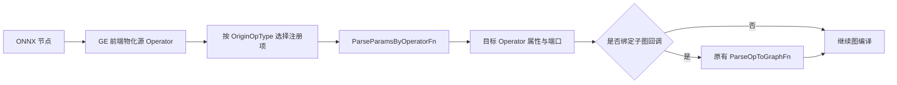
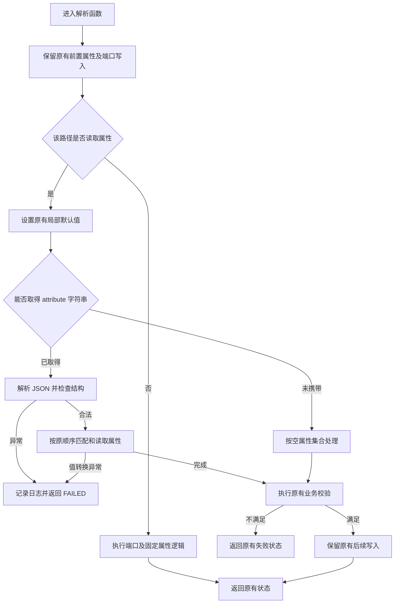
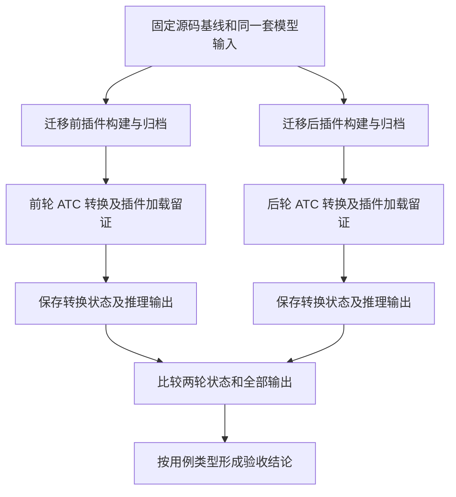

# ops-math ONNX 插件 protobuf 解耦设计

## 1. 需求背景

### 1.1 需求来源

本设计对应 CANN 十月社区任务中的 ops-math ONNX 插件适配任务，迁移范围和验收依据为下发的《ops-math 算子 onnx 插件 protobuf 解耦任务书》及配套用例。社区任务编号和目录按 [PR #2125](https://gitcode.com/cann/cann-ops-competitions/pull/2125) 中的 `10-14-ops-math-onnx` 组织；接口迁移方向参见 [ops-math Issue #2892](https://gitcode.com/cann/ops-math/issues/2892)。

### 1.2 背景介绍

存量 ONNX 插件通过 `Message*` 接收节点，依赖 `NodeProto`、`AttributeProto` 及其生成头文件遍历属性。这使 Host 侧参数适配与 protobuf 表示绑定，增加编译依赖，也使单元测试必须构造 protobuf 对象。本任务已有以 `ge::Operator` 为源参数的框架接口，拟利用该接口完成等价迁移。

本任务不改变算子的数学公式、输入输出 Tensor 计算含义、广播规则或设备侧算法。需要设计的是节点信息到 GE 算子属性及端口的映射，不能套用新 Kernel 开发中的分核、UB 分块或 TilingKey 设计。

### 1.3 设计目标

本方案拟将 ops-math 存量 ONNX 插件的参数解析入口从 `ParseParamsFn` 迁移到 `ParseParamsByOperatorFn`。插件通过 `ge::Operator` 获取节点信息，通过 nlohmann/json 解析属性，消除目标插件源码对 ONNX protobuf 生成类型的直接和间接依赖。

迁移以既有解析行为为约束：同一个合法 ONNX 节点应生成相同的目标算子属性、张量描述、动态端口及子图构建输入。任务书明确要求修正的 Cast 无效 dtype 判据单独处理。本文规定拟实现的方案和后续验证要求，不作为已经完成实现、构建或精度实验的证明。

## 2. 需求分析

### 2.1 迁移对象

迁移范围按任务书的“文件 × 算子”统计，共 57 个插件文件、124 个条目。同一算子的多组 ONNX opset 注册归入同一个条目，不能用 `.ParseParamsFn` 的文本出现次数代替条目数。

| 目录范围 | 插件文件数 | 算子条目数 | 主要内容 |
| --- | ---: | ---: | --- |
| `common/src/framework/` | 14 | 81 | 通用插件、Sequence 六个算子、批量注册的 63 个算子 |
| `conversion/` | 14 | 14 | 形状变换、切片、拼接、填充等 |
| `experimental/math/asinh/` | 1 | 1 | 该目录中的 Max 插件 |
| `math/` | 25 | 25 | 类型转换、归约、索引和其他数学算子 |
| `random/` | 3 | 3 | 随机生成和采样 |
| 合计 | 57 | 124 | 完整文件清单见3.9 节 |

### 2.2 功能要求

1. 保留现有解析函数名，将源参数改为 `const ge::Operator&`，替换对应注册入口；同文件内接收 protobuf 类型的解析辅助函数一并解耦。
2. 需要读取属性的路径通过 `GetAttr("attribute", ...)` 获取 JSON；不读取属性的路径不新增 JSON 解析。
3. 保留默认值、属性别名、重复属性处理方式、数值转换、布尔转换、失败时机和写入顺序。
4. 原来写入节点名的位置改用 `GetOpName(op_src)`；原来不写 `name` 的插件不新增该属性。
5. 保留每组 `OriginOpType`、目标 GE 算子类型、`FrameworkType`、`ImplyType`、端口名称及 `ParseOpToGraphFn` 绑定。
6. 优先复用 `math_onnx_plugin_util.h`，不新建另一套 dtype 映射、张量转换或通用解析框架。

### 2.3 改造边界

实现阶段修改目标插件及配套 framework UT，必要时在现有公共工具中补充最小辅助能力。算子 Kernel、Tiling、aclnn 接口、算子原型和子图计算逻辑保持既有实现。

解析入口换成引用后，旧 `Message*` 判空及 `NodeProto` 转型失败分支不再适用，应随类型依赖一起移除。不得通过创建临时 protobuf 对象或隐式转型恢复旧接口。

本次交付仅为设计文档。代码迁移、UT、模型生成、ATC 转换和设备推理均属于后续实施工作；性能与内存不设新增验收指标。

## 3. 详细设计

### 3.1 总体方案

#### 3.1.1 处理链路

ONNX 前端负责将节点物化为源 `ge::Operator`。插件只消费前端提供的属性和端口信息，产生目标 `ge::Operator`；需要拆图的算子继续把解析结果交给原有子图回调。



此处解耦的是插件与 protobuf 表示层之间的关系。GE 前端内部如何读取 ONNX 模型不属于本方案的修改范围。

#### 3.1.2 按实际行为选择迁移方式

| 类型 | 代表对象 | 迁移方式 |
| --- | --- | --- |
| 不读属性、不写解析属性 | `similar_opp` 宏生成函数、SqueezeV3、UnsqueezeV3、Slice 新分支 | 替换签名和注册，保留直接成功路径 |
| 不读属性，但读取端口或写固定属性 | Sequence、Max、Min、Mean、Sum、Xor、Clip 输入分支 | 替换节点名、端口数量来源，保留原有校验及写入 |
| 读取标量或列表属性 | Cast、Flatten、CumSum、Pad、DeformableOffsets 等 | 获取 JSON，按原函数的匹配规则有序遍历 |
| 解析结果供子图使用 | Reduce 系列、随机算子、OneHot、旧 Slice 等 | 在前述迁移基础上保持传递给子图的属性类型、张量与端口契约 |

最后一类可以同时属于前两类，分类只用于确定改造动作，不作为重新组织源码的理由。

### 3.2 接口与注册设计

#### 3.2.1 解析接口

解析函数保持原来的命名和可见性，签名统一为：

```cpp
domi::Status ParseParamsXxx(const ge::Operator& op_src, ge::Operator& op_dest);
```

例如 `parse_params_reduce_sum`、`parseParamsRepeatWithPad` 和 `ParseParamsRandomuniform` 保留既有拼写。解析辅助函数如 `OpConcatUpdateInfo`、`OpMinUpdateInfo` 及 Split 的属性解析函数也需要同步替换参数类型。

#### 3.2.2 源信息映射

| 旧数据来源 | 新数据来源 | 保持要求 |
| --- | --- | --- |
| `node->attribute()` | `op_src.GetAttr("attribute", attrs_string)` 后解析 | 保留属性数组顺序，不转换为按名称去重的字典 |
| `node->name()` | `GetOpName(op_src)` | 仅替换原来写节点名的位置，保留空名称 |
| `node->input_size()` | `op_src.GetInputsSize()` | 保留原来的类型转换、校验和动态输入注册方式 |
| `node->output_size()` | `op_src.GetOutputsSize()` | 保留输出顺序、数量和端口名称 |
| `attr.i()/f()/s()/ints()` | 对应 JSON 值字段 | 区分算子默认值与 protobuf 字段零值 |
| `node->input(index)` 的空名判断 | 前端提供的输入位置及存在性信息 | 不能用端口总数直接证明空占位等价，见 3.5.4 节 |

`op_src` 只读，不向其写属性或注册端口。`name` 是已有解析属性，与目标 Operator 自身名称不是同一个概念；不调用 `SetName` 替代 `SetAttr("name", ...)`。

#### 3.2.3 注册项

每组注册仅将 `.ParseParamsFn(原函数)` 替换为 `.ParseParamsByOperatorFn(原函数)`。保留原函数与原 `OriginOpType` 的对应关系，不合并多组 opset 分支。

`similar_opp_onnx_plugin.cpp` 在宏定义中替换签名和注册接口，宏生成函数保留直接返回成功的行为。宏调用表中的 ONNX 名称、GE 目标名称和函数后缀保持原样，尤其保留 `Not → LogicalNot`、`Div → RealDiv` 等映射，以及各算子不同的 opset 覆盖集合。

### 3.3 JSON 属性解析设计

#### 3.3.1 输入表示

`op_src` 的 `attribute` 属性是 `ge::AscendString`，其字符串内容是包含属性数组的 JSON 对象。例如：

```json
{
  "attribute": [
    {"name": "axis", "type": 2, "i": 2},
    {"name": "min", "type": 1, "f": "-0.5"},
    {"name": "mode", "type": 3, "s": "constant"},
    {"name": "axes", "type": 7, "ints": [0, 2]}
  ]
}
```

示例只说明字段表示，不表示上述属性属于同一个算子。

| ONNX 属性类型 | `type` | JSON 值字段 | 字段省略时的 protobuf 值 |
| --- | ---: | --- | --- |
| FLOAT | 1 | `f`，字符串 | `0.0` |
| INT | 2 | `i`，JSON 整数 | `0` |
| STRING | 3 | `s`，字符串 | 空字符串 |
| FLOATS | 6 | `floats`，数字数组 | 空数组 |
| INTS | 7 | `ints`，整数数组 | 空数组 |

使用仓内现有 nlohmann/json 依赖。整型字段按原函数的目标整数类型读取或转换，不经浮点中转，避免大整数精度损失；不把数字字符串自动当作 `i` 的合法输入。

#### 3.3.2 属性缺失与值字段省略

必须先判断某个属性对象是否按该插件规则命中，再处理其值字段：

| 场景 | Flatten 的 `axis` | Clip 属性分支的 `max` |
| --- | --- | --- |
| 未出现该属性 | 使用原默认值 `1` | 使用源码原有的 FP32 上界常量 |
| 属性命中，但没有值字段 | 缺 `i`，取 `0` | 缺 `f`，取 `0.0` |
| 属性存在但 `type` 不匹配，且原代码检查类型 | 按未命中处理 | 按未命中处理 |
| 需要读取的值字段类型错误 | 返回 `FAILED` | 返回 `FAILED` |

不能把 `attr.value("i", 算子默认值)` 或 `attr.value("f", 算子默认值)` 作为通用取值方式，否则会混淆前两种情况。

#### 3.3.3 匹配与重复属性

属性分发以每个插件现有代码为准：

- 原来同时检查 `name` 和 `type` 的分支，继续检查数值形式的类型编号；不匹配时保持原来的跳过或失败行为。
- Cast、EyeLike、Transpose、部分 Slice、RepeatWithPad 等原来只按名称匹配的分支，不额外增加类型枚举白名单。
- Cast、OneHot、Concat 等存在提前结束语义的分支保留首个命中值；没有 `break` 的标量赋值保留后值覆盖前值。
- 原来用 `push_back` 累加列表的分支继续累加；原来有条件 `clear` 的分支保留条件，不统一替换为整组覆盖。
- 多数插件忽略无关属性；BitShift 的严格属性匹配和符号位插件的命中计数按各自规则处理。

只对实际需要读取的字段做类型检查。未知属性中的未消费字段不应触发新的数值转换错误。

#### 3.3.4 浮点标量

浮点值先作为字符串读取，再转换为与原 `attr.f()` 一致的 FP32 值；缺 `f` 的已命中属性直接取零。

转换应检查是否成功消费完整的数值表示，空字符串或非数字字符串返回 `FAILED`。不直接用 `atof` 将非法字符串静默变成零。转换策略须保留合法 FP32 的正负零、次正规数，以及框架允许的非有限值表示；不得仅因下溢标志就拒绝合法次正规值。随机种子的浮点到整数转换仍在各插件原有位置完成，保持原来的目标类型和向零截断行为。

若多个目标文件需要共用该转换，可在现有 `math_onnx_plugin_util.h` 中增加最小字符串转换辅助函数，职责仅限数值转换，不承担属性查找、默认值选择或属性去重。

#### 3.3.5 解析流程与异常处理



图中的前置、循环内及后置写入均以原函数为准，不实施统一的“全部成功后一次性写回”。异常不得跨越框架回调边界：捕获 JSON 解析和类型异常、数值转换异常及未知异常，记录节点和属性上下文后返回 `FAILED`。

有属性解析的路径按以下规则处理容器：

| 输入情况 | 处理 |
| --- | --- |
| 未设置源 `attribute` 属性 | 使用空属性集合，再执行该算子的缺省或必填校验 |
| JSON 对象没有 `attribute` 键 | 同上 |
| `"attribute": []` | 同上 |
| 已取得字符串，但内容为空或 JSON 语法错误 | `FAILED` |
| 顶层不是对象、`attribute` 不是数组、数组元素不是属性对象 | `FAILED`，不把结构错误当作缺省 |
| 字段缺省且有 protobuf 零值语义 | 按 3.3.2 节处理 |

业务返回码保持原样。例如 Unsqueeze 旧属性分支缺少有效 axes 返回 `PARAM_INVALID`；Concat 辅助函数的 `PARAM_INVALID` 经入口函数转换为 `FAILED`，两层行为分别保留。

### 3.4 属性转写与工程行为

#### 3.4.1 保持张量及属性类型

`SetAttr` 的键、值类型和张量描述共同构成接口契约，不能仅比较数值。

| 对象 | 必须保持的表示 |
| --- | --- |
| Cast `dst_type` | ONNX dtype 映射后的 GE dtype 整数 |
| ArgMax/ArgMin `dimension` | `CreateScalar` 生成的 INT32 标量张量 |
| Clip 旧分支 `min/max` | FP32 标量张量 |
| Pad 旧分支 `paddings` | 按原顺序重排的 INT32 张量 |
| ReduceMean 等的 `axes` | 按对应源码保留 INT32 元素、形状和 format |
| ReduceL1/ReduceL2 `axes` | 原有整数列表，不改成 Tensor |
| ReduceSumSquare `axis` | 原有 INT64 列表，保留单数键名 |
| RandomUniform `shape` | INT32 张量；空列表仍生成原有空张量 |
| RandomNormal `shape` | 原有整数列表；空列表仍失败 |

复用 `Vec2Tensor` 和 `CreateScalar`。各归约插件在空 axes 时的张量形状并不完全相同，需按文件保留，不能统一指定为标量或 `[0]`。`keepdims` 也不统一转换：CumSum、部分 Reduce 按 `i == 1` 转布尔，TopK 按原有非零转布尔，ArgMax/ArgMin 的 `keep_dims` 保留原整数。

#### 3.4.2 动态输入输出

端口数量分为源端口数量与源码固定常量两种。Einsum、SequenceConstruct、PhonyConcat、PhonySplit、Split、Transpose 等需要替换数量来源；Clip、部分 Reduce 和随机算子中的固定注册数量继续使用固定值。

保留 `x`、`args`、`inputs`、`output`、`y` 等原有端口名称和注册顺序，不按命名偏好统一。输入数量校验也不统一：Sum 的零输入继续失败，Max 参数解析阶段的零输入继续按原路径处理，Trilu 的输入数量异常继续记录日志而不在解析阶段新增失败。

#### 3.4.3 名称、子图与失败副作用

原来使用 `node->name()` 写入 `name` 的位置改用源 Operator 名称。`original_type` 保留源码中写死的字符串，不根据当前注册的 opset 自动重写。

`ParseOpToGraphFn` 函数体及绑定关系保持原样。需要提供给子图的 `axes`、`shape`、`input_size`、`N`、`no_min`、`no_max` 等数据不能改名、换型或调整来源。

失败时已写出的内容属于可观察行为。例如 ArgMax、Clip、RandomUniform 和部分 Reduce 在解析前已注册端口或写入 `original_type`；旧 Slice 可能在必填校验失败前已写 `axes`；符号位插件在循环中先写属性再检查命中数量。迁移不增加全局回滚，也不提前执行这些写入之后的操作。

### 3.5 重点算子设计

#### 3.5.1 Cast 的 dtype 判据修正

沿用首个 `to` 属性和现有 `GetOmDtypeFromOnnxDtype` 映射。缺少 `to` 时返回 `FAILED`；命中但省略 `i` 时按零映射。

公共工具在映射失败时返回 `ge::DT_UNDEFINED`，迁移后必须用该返回约定判失败，不再比较 `-1`。判断应发生在写入 `dst_type` 之前。不支持的 dtype 在解析阶段失败是任务书要求的明确修正，合法 dtype 的映射不变。

#### 3.5.2 Reduce 系列的多分支

保留各注册组已有的回调划分，不按 ONNX 标准重新解释源码支持范围。旧属性路径继续解析 axes；带 `13` 后缀的对应路径继续记录 `input_size` 并保留源码中对属性 axes 的兼容处理，由既有子图函数决定输入来源。

旧 ReduceMean、ReduceMax、ReduceMin、ReduceProd 对 `noop_with_empty_axes=1` 的告警及恒写零行为，与新分支的原值透传分别保留。ReduceLogSumExp、ReduceSum、ReduceLogSum、ReduceSumSquare、ReduceL1 和 ReduceL2 的属性键、列表或 Tensor 表示各自按源码处理，不复用带有业务策略的统一 Reduce 解析器。

#### 3.5.3 Pad、Slice 与尺寸变换

- Pad 旧分支保留 `pads` 必须出现、长度必须为偶数的规则，并将前后半区按原方式交错写入 `paddings`；新分支只解析原有 `mode` 并写 `paddings_contiguous`。
- Slice 旧分支继续累加 `starts/ends/axes`，缺 starts 或 ends 时失败；新输入分支不读取属性，不新增 JSON 校验。
- Squeeze 旧分支 axes 缺省为空，Unsqueeze 旧分支 axes 为空返回 `PARAM_INVALID`；二者的新输入分支保留直接成功行为。
- DepthToSpace 的 `blocksize < 2` 和 SpaceToDepth 的 `blocksize <= 0` 分别失败；保留原有 format 更新顺序及失败传播，不新增 mode 枚举校验。
- NPUSlice 的属性键沿用源码中的 `offsetss`，不在解耦时顺手改成 `offsets`。

#### 3.5.4 Clip 的属性路径与可选输入

属性路径保留原有 FP32 上下界、后值覆盖前值以及标量 Tensor 输出。输入路径不读取属性，继续在输入校验前注册固定端口并写入 `original_type`。

对于没有中间空占位的输入，依据 `GetInputsSize()` 可得到：少于两个输入失败；两个输入表示只有 min；三个有效输入表示 min、max 均存在。给定 UT 覆盖这些情况。

但旧代码还依据 ONNX 输入名是否为空判断存在性，例如 `[X, "", max]`。端口总数本身不能区分这个模型与 `[X, min, max]`，给定 UT 也明确未覆盖该空名形态。因此，不能把“用输入个数替代所有空名判断”视为已经证明等价。

实现前需静态核对所用 GE 前端是否向源 Operator 暴露按位置的输入存在性信息：有正式契约时据此计算 `no_min/no_max`，保留位置，不压缩端口；如果没有可用信息，需向上游提交接口缺口，由框架侧提供不依赖 protobuf 的存在性元数据，或由任务维护者明确支持边界。不得读取内部 protobuf、猜测 TensorDesc 名称含义，或将仅 max 输入静默解析为 min 输入。该场景列入后续模型验证的必查项。

#### 3.5.5 随机算子

RandomNormal 保留 dtype、mean、scale、seed 默认值和 shape 非空校验；RandomUniform 保留空 shape 成功、high/low 写入 max/min 以及 INT32 shape Tensor 的行为。

RandomNormalLike 和 RandomUniformLike 保留 dtype 未提供时的哨兵值及 `has_dtype_attr`。只替换参数读取方式，不改动后续根据输入 dtype 决定输出 dtype 的逻辑。两者原来只按名称匹配属性，不能照搬 RandomNormal/RandomUniform 的类型过滤。

各随机插件的 seed 目标类型按原实现保留：不能把全部 seed 统一改为浮点、INT64 或固定种子。随机输出的一致性验证需固定环境与种子，出现不可复现输出时记录为未通过，不能只凭 shape/dtype 相同替代数值判据。

#### 3.5.6 严格匹配与计数

BitShift 保留“任何不符合 direction 与 STRING 匹配条件的属性导致失败”的行为；空属性集合仍沿原成功路径处理，不新增 direction 必填或 LEFT/RIGHT 枚举校验。

NPUSignBitsPack 和 NPUSignBitsUnpack 保留原来的命中次数判据及循环内写入。这是计数判断，不是属性名集合判断；不新增去重或把“命中两次”改为“两个不同名称均存在”。重复属性按原计数和覆盖顺序处理。

### 3.6 依赖与文件组织

#### 3.6.1 头文件依赖

目标插件移除 `onnx_common.h`、`onnx/proto/ge_onnx.pb.h`、`Message`、`NodeProto`、`AttributeProto` 及其类型别名和转型。只按实际使用显式引入：

- `graph/operator.h`、`register/register.h` 和日志头；
- `math_onnx_plugin_util.h` 中已有的名称、dtype、format 和 Tensor 辅助能力；
- 需要属性解析的文件使用 `nlohmann/json.hpp`；
- 子图函数原有的 Graph、算子原型及其他直接依赖。

DeformableOffsets 的属性列表辅助函数也要改为消费 JSON 列表或普通整数容器，保留一元素扩展、累加和清空条件，避免主入口解耦后辅助函数仍依赖 protobuf。

#### 3.6.2 构建依赖边界

源码解耦、ONNX 编译目标去依赖、整个仓库去依赖是不同层次。当前共享构建逻辑仍生成 ONNX proto 并给 framework UT 提供 protobuf 头和运行库；范围外的 Shape、Bernoulli 插件仍包含 `onnx_common.h`。TF 和 AICPU 目标也有独立的 protobuf 使用。

因此，本轮实现首先保证 57 个目标插件及其新增 UT 无 protobuf 类型和头文件依赖，不直接删除根 CMake 的 protobuf 配置或其他目标的依赖。只有全部消费者清点完成后，才能针对已无使用的 ONNX 构建边做最小清理；这需要单独核对，不能以文本替换完成作为整库链接去依赖的证明。

#### 3.6.3 文件归档

设计交付文件为 `04_tasks/01_community-task-2026/tasklist/10-14-ops-math-onnx/YY12YY/docs/design.md`，归档于 `cann-ops-competitions` 的任务及个人目录。实现代码和 framework UT 后续仍在 ops-math 仓库的原路径开发。

未来实现仍在3.9 节列出的原插件文件内完成。专属算子的 UT 放入 `<算子目录>/tests/ut/framework/`；common 插件的 UT 放入 `common/tests/ut/framework/`。文件名称使用任务包提供的命名，保留 `unsequeeze_onnx_plugin.cpp` 等现存路径，不在本任务中重命名。

本设计 PR 仅提交上述 `design.md`，不附构建产物、知识库副本、模型文件或实验日志，也不创建内容空缺的自验证报告。

### 3.7 支持硬件

| 硬件范围 | 设计适用性 | 后续验证要求 |
| --- | --- | --- |
| Atlas A2 | Host 侧插件适配方案适用，任务书推荐验证平台 | 在同一硬件和软件环境完成迁移前后两轮验证 |
| Ascend 950 | Host 侧方案相同，具体算子可用性依赖配套环境 | 按任务书选用该平台时，保留平台兼容性证据 |

任务书允许选择其中一种硬件完成验证。本次仅交付设计，不将平台适用性判断写为已完成真机验证；设备侧支持数据类型和形状继续由原算子及其注册范围决定。

### 3.8 算子约束限制

- 仅迁移任务清单内插件的参数解析及其辅助逻辑，保持各文件支持的 domain、opset 和 GE 目标算子映射。
- 不扩展原算子的 dtype、shape、广播、轴范围或属性值域；各插件原有的透传和失败规则分别保留。
- JSON 属性采用任务包约定，标量 f 为字符串，i 和列表元素为数字；无属性路径不引入额外解析。
- 本方案不引入 Kernel、aclnn 或 Tiling 接口；子图构建沿用现有实现。

### 3.9 逐文件迁移要点

以下路径均相对 ops-math 仓库根目录。每行对应一个插件文件；其中 Sequence 覆盖六个条目，similar_opp 覆盖 63 个条目，其余各行对应一个条目。

#### 3.9.1 common 范围

| 插件路径 | 对象 | 实现时保持的重点 |
| --- | --- | --- |
| `common/src/framework/concat_from_sequence_onnx_plugin.cpp` | ConcatFromSequence | axis/new_axis 的默认零值、名称和 original_type |
| `common/src/framework/deformable_offsets_onnx_plugin.cpp` | DeformableOffsets | 列表辅助函数、一元素扩展、dilations 清空、format 更新 |
| `common/src/framework/einsum_onnx_plugin.cpp` | Einsum | equation 非空、后值覆盖、动态输入 x 及 N |
| `common/src/framework/eyelike_onnx_plugin.cpp` | EyeLike | 只按名称读取 dtype/k，dtype 默认 1、k 默认 0 |
| `common/src/framework/phony_concat_onnx_plugin.cpp` | PhonyConcat | 列表非空才清空默认值、N 与源输入数、keep_input_offset |
| `common/src/framework/phony_split_onnx_plugin.cpp` | PhonySplit | num_split 与源输出数、列表清空条件、keep_output_offset |
| `common/src/framework/random_normal_like_onnx_plugin.cpp` | RandomNormalLike | dtype 哨兵、has_dtype_attr、浮点和 seed 转换 |
| `common/src/framework/random_uniform_like_onnx_plugin.cpp` | RandomUniformLike | dtype 继承标志、high/low 默认值、固定端口 |
| `common/src/framework/reduceL1_onnx_plugin.cpp` | ReduceL1 | 整数列表 axes、keepdim、固定 p=1、noop 告警 |
| `common/src/framework/reduceL2_onnx_plugin.cpp` | ReduceL2 | 整数列表 axes、keepdim、固定 p=2、noop 告警 |
| `common/src/framework/repeat_with_pad_onnx_plugin.cpp` | RepeatWithPad | 只按名称读取 axis/capacity，保留函数拼写 |
| `common/src/framework/sequence_onnx_plugin.cpp` | 六个 Sequence 算子 | 不读属性；仅 Construct 按源输入数注册 inputs |
| `common/src/framework/similar_opp_onnx_plugin.cpp` | 63 个批量注册算子 | 宏生成函数不读属性；保留全部映射及函数后缀 |
| `common/src/framework/split_to_sequence_onnx_plugin.cpp` | SplitToSequence | axis 默认 0、keepdims 默认 1，原整数透传 |

#### 3.9.2 conversion 与 experimental 范围

| 插件路径 | 对象 | 实现时保持的重点 |
| --- | --- | --- |
| `conversion/clip_by_value/framework/clip_onnx_plugin.cpp` | Clip | 两组回调、FP32 标量 Tensor、可选输入存在性 |
| `conversion/concat/framework/concat_onnx_plugin.cpp` | Concat | 首个有效 INT axis、必填失败、辅助函数状态转换 |
| `conversion/depth_to_space/framework/depth_to_space_onnx_plugin.cpp` | DepthToSpace | blocksize 下限、mode 字符串、NCHW 和更新顺序 |
| `conversion/flatten/framework/flatten_onnx_plugin.cpp` | Flatten | axis 默认 1，命中且缺 i 时为 0 |
| `conversion/pad_v3/framework/pad_onnx_plugin.cpp` | Pad | 旧分支 pads 交错重排与新分支 mode/paddings_contiguous |
| `conversion/reshape/framework/reshape_onnx_plugin.cpp` | Reshape | allowzero 默认 0，shape 保留为模型输入 |
| `conversion/slice/framework/npu_slice_onnx_plugin.cpp` | NPUSlice | offsetss/sizes INT32 Tensor、源端口数量 |
| `conversion/space_to_depth/framework/space_to_depth_onnx_plugin.cpp` | SpaceToDepth | blocksize 必须大于 0，format 失败传播 |
| `conversion/split_d/framework/split_onnx_plugin.cpp` | Split | 属性辅助函数、split 与输出数校验、input_size/num_split |
| `conversion/squeeze/framework/squeeze_onnx_plugin.cpp` | Squeeze | 属性分支 axis 列表与不读属性的新分支 |
| `conversion/strided_slice_v2/framework/slice_onnx_plugin.cpp` | Slice | 旧分支累加及 axes 写入时机、新分支直接成功 |
| `conversion/transpose/framework/transpose_onnx_plugin.cpp` | Transpose | perm INT32 列表累加、args 动态输入、固定 output |
| `conversion/trilu/framework/trilu_onnx_plugin.cpp` | Trilu | upper 默认 1、异常输入数只记录日志 |
| `conversion/unsqueeze/framework/unsequeeze_onnx_plugin.cpp` | Unsqueeze | 旧分支空 axes 返回 PARAM_INVALID、新分支不读属性 |
| `experimental/math/asinh/framework/max_onnx_plugin.cpp` | Max | 独立文件仍需迁移，N、x/y 与原拆图输入 |

#### 3.9.3 math 与 random 范围

| 插件路径 | 对象 | 实现时保持的重点 |
| --- | --- | --- |
| `math/accumulate_nv2/framework/mean_onnx_plugin.cpp` | Mean | 不读属性，N 与源输入数、固定输出 |
| `math/accumulate_nv2/framework/sum_onnx_plugin.cpp` | Sum | 不读属性，零输入失败，N 和动态输入 x |
| `math/addcmul/framework/addcmul_onnx_plugin.cpp` | Addcmul | 首个 value 必填、浮点转换、args/output 固定端口 |
| `math/arg_max_v2/framework/argmax_onnx_plugin.cpp` | ArgMax | select_last_index=1 失败、dimension 标量、keep_dims 整数 |
| `math/arg_min/framework/argmin_onnx_plugin.cpp` | ArgMin | 与源码一致的 select_last_index 约束及失败前写入 |
| `math/bitwise_xor/framework/xor_onnx_plugin.cpp` | Xor | 不读属性，固定 x/y 端口及 name |
| `math/cast/framework/cast_onnx_plugin.cpp` | Cast | 首个 to、dtype 映射及 DT_UNDEFINED 判据修正 |
| `math/cumsum/framework/cumsum_onnx_plugin.cpp` | CumSum | exclusive/reverse 仅在值等于 1 时为真 |
| `math/is_inf/framework/isinf_onnx_plugin.cpp` | IsInf | detect_negative/positive 默认 1、非 1 失败 |
| `math/maximum/framework/max_onnx_plugin.cpp` | Max | 与 experimental 中同名文件分别检查、保留 N 和端口 |
| `math/minimum/framework/min_onnx_plugin.cpp` | Min | OpMinUpdateInfo 及四组回调共同解耦、original_type 各自保留 |
| `math/mod/framework/mod_onnx_plugin.cpp` | Mod | 读取属性名仅用于 fmod 告警，不新增业务校验 |
| `math/one_hot/framework/onehot_onnx_plugin.cpp` | OneHot | 首个 axis、默认 -1、固定三个输入 |
| `math/reduce_log_sum_exp/framework/reduce_log_sum_exp_onnx_plugin.cpp` | ReduceLogSumExp | 两组回调、axes Tensor 描述、input_size 与 noop |
| `math/reduce_max/framework/reduce_max_onnx_plugin.cpp` | ReduceMax | 旧 noop 告警且写零、新 noop 透传、axes Tensor |
| `math/reduce_mean/framework/reduce_mean_onnx_plugin.cpp` | ReduceMean | 空 axes Tensor、两组端口差异、noop 的不同处理 |
| `math/reduce_min/framework/reduce_min_onnx_plugin.cpp` | ReduceMin | 两组回调及对应 axes/keep_dims/noop 契约 |
| `math/reduce_prod/framework/reduce_prod_onnx_plugin.cpp` | ReduceProd | axes 累加、空张量和两组 noop 行为 |
| `math/reduce_sum/framework/reduce_log_sum_onnx_plugin.cpp` | ReduceLogSum | 保留原小写函数名、空 axes 的原有形状、新分支 input_size |
| `math/reduce_sum/framework/reduce_sum_onnx_plugin.cpp` | ReduceSum | 原 axes Tensor、动态 output 命名及新分支兼容属性 |
| `math/right_shift/framework/bitshift_onnx_plugin.cpp` | BitShift | 严格属性匹配、失败前端口与 original_type |
| `math/sign_bits_pack/framework/npu_sign_bits_pack_onnx_plugin.cpp` | NPUSignBitsPack | size 命中次数必须符合原判据，循环内写属性 |
| `math/sign_bits_unpack/framework/npu_sign_bits_unpack_onnx_plugin.cpp` | NPUSignBitsUnpack | size/dtype 命中计数、重复属性覆盖与失败副作用 |
| `math/square_sum_v1/framework/reduce_sum_square_onnx_plugin.cpp` | ReduceSumSquare | axis INT64 列表、两组回调与端口差异 |
| `math/topk/framework/topk_onnx_plugin.cpp` | TopK | 新分支布尔转换、旧 k 标量及 PARAM_INVALID |
| `random/dsa_random_uniform/framework/random_uniform_onnx_plugin.cpp` | RandomUniform | 空 shape 合法、INT32 Tensor、high/low 到 max/min |
| `random/stateless_random_normal_v2/framework/random_normal_onnx_plugin.cpp` | RandomNormal | shape 非空、原列表类型、dtype 和种子转换 |
| `random/stateless_sample_multinomial/framework/multinomial_onnx_plugin.cpp` | Multinomial | 只按名称解析、seed 浮点及 sample_size 默认值 |

## 4. 可维可测分析

### 4.1 精度、性能与内存标准

| 验收项 | 设计要求 | 来源及适用范围 |
| --- | --- | --- |
| 解析行为 | 属性、Tensor 描述、端口及返回状态与原实现一致，Cast 判据按明确例外修正 | 任务书及目标插件源码 |
| 数值精度 | 同环境迁移前后输出完全一致；golden 另作混合容差辅助比对 | 任务书及给定模型验证工具 |
| 性能 | 不设性能验收指标；不改变设备侧计算逻辑 | 本任务为 Host 侧等价重构 |
| 内存 | 不设新增内存验收指标 | 不涉及 Kernel 或设备内存方案变更 |

本节均为实现后的计划，当前未执行 UT、编译、ATC 或设备实验。

### 4.2 静态核对

逐文件核对签名、所有解析辅助函数、注册回调、头文件和属性读取；检查 `OriginOpType`、目标算子、`ImplyType`、子图回调以及宏注册表未改变。

对比各成功与失败路径的返回状态、已写属性及动态端口，重点覆盖名称来源、重复属性、零值省略、张量描述和计数规则。插件与 UT 均不得构造 protobuf 对象。检查所有 57 个路径的差异及 `git diff --check`，不能只抽查典型算子。

### 4.3 Framework UT

以任务包的 57 个 UT 文件为基础，静态可数得 624 个 `TEST` 声明；执行时以真实发现并运行的用例清单为准。通过仓内 `OP_HOST_UT` 开关纳入构建，运行 `Onnx*PluginTest.*`，同时保留原有相关回归。

| 覆盖维度 | 观察点 |
| --- | --- |
| 正常属性 | 每个目标属性的键、C++ 类型、值及 Tensor 数据 |
| 缺省与零值 | 属性不存在、空属性数组、缺 i/f/s/ints 字段的区别 |
| 结构及转换异常 | 非法 JSON、错误容器、已消费字段类型错误、非法浮点字符串 |
| 特殊匹配 | 类型不匹配、首值/末值/累加、未知属性、命中计数 |
| 端口与失败路径 | 数量、名称、注册顺序、失败前已有属性 |
| 不读属性的路径 | 非法属性 JSON 不改变原有返回结果 |
| 注册关系 | 静态比对完整注册表，后续通过真实转换核验生效路径 |

现有公共 API 没有经本方案核实可用的运行时注册查询入口，不能编造查询接口或用解析函数直接调用证明注册已生效。给定 UT 未覆盖的 Clip 空占位及各 Tensor 边界需补充对应验证。

### 4.4 两轮模型验证

使用任务包 56 个模型生成脚本覆盖插件范围，两份 Max 文件共用模型脚本，但需分别核对各构建配置的实际插件来源。宏生成插件和多 opset 分支的代表模型不等于每个注册项均已有整网覆盖，应维护“文件—注册分支—模型”的对应表补齐关键差异。



两轮使用同一模型、同一输入、相同硬件和运行环境，通过 `ASCEND_CUSTOM_OPP_PATH` 注入各轮插件，并保存实际加载路径及重复注册被跳过的日志证据。不得将内置插件的输出作为迁移后插件已生效的证明。

验收区分以下情况：

1. 常规模型：两轮均转换成功，输出数量、dtype、shape 和数值完全一致，主判据不设置浮点容差。
2. 预期非法模型：两轮均在转换阶段失败，按用例声明核对错误内容。Cast 不支持 dtype 的失败阶段允许从旧引擎选择阶段前移到新参数解析阶段，不要求两者错误文本逐字相同。
3. 平台不支持或声明只比较行为的模型：按任务书和用例元数据核对两轮结论及相应错误证据；成功时仍比较输出，不能将一般性失败自动改判为平台容错。
4. 有 golden 的模型：另执行任务包的混合容差辅助判据并核对 dtype/shape；FP32 使用 `rtol=2^-10`、`atol=2^-16`，整体匹配率至少为 `0.99`，同时满足逐元素硬上限 `max(fixed_limit, 32*ULP)`；其他浮点类型按用例精度配置处理。无 golden 不等于无需进行两轮主判据验证。整数、布尔按精确一致处理。

旧接口插件的加载兼容库仅用于旧轮环境适配，不作为迁移后插件的依赖。插件构建、全部 UT 和两轮模型验证均达到任务书要求后，才具备提交实现验收的条件。

### 4.5 实施次序与风险控制

#### 4.5.1 实施次序

1. 固定任务清单、上游源码基线和原注册表，保存原解析行为记录。
2. 先完成无属性路径的接口迁移，再处理标量与列表属性，最后处理 Tensor、动态端口和多分支插件；每类均同步准备 UT。
3. 单独核对 Cast 判据、Clip 空占位契约、随机 dtype 继承、失败副作用和符号位计数。
4. 完成全范围静态审查、构建、UT 和两轮模型验证，收集插件加载证据。
5. 按任务书要求整理后续实现交付件；本设计不预填实验结论。

#### 4.5.2 主要风险

| 风险 | 影响 | 设计措施 |
| --- | --- | --- |
| 将所有插件套入同一个 JSON 校验模板 | 改变无属性路径及特殊匹配行为 | 按现有函数是否消费属性选择流程 |
| 将缺字段视为算子默认值 | 零值被改写 | 分离属性命中与值字段缺省 |
| 属性字典化、统一布尔化或统一 Tensor 形状 | 重复属性、类型和空列表语义改变 | 保留有序遍历及每个文件原表示 |
| Clip 可选输入信息未完整传递 | 仅 max 输入被误判 | 先核对前端契约，信息缺失则反馈框架接口缺口 |
| 子图入参或失败前写入发生变化 | 图结构或错误行为改变 | 对比子图消费属性及各失败路径 |
| 将源码解耦当作整仓构建去依赖 | 误删其他目标所需库 | 清点实际消费者，限定依赖清理范围 |
| 宏和多 opset 注册漏迁移 | 部分模型仍进入旧回调 | 完整注册表比对并结合模型验证 |

### 4.6 兼容性分析

合法模型保持原有注册、解析和子图契约，属性缺省与字段零值分别处理，失败副作用按原路径保留。Cast 的不支持 dtype 判定按照任务书修正；Clip 中间空输入的表示能力按 3.5.4 节作为框架契约核对项。目标插件源码去依赖与共享构建目标去依赖分开确认，不移除范围外消费者需要的库。

### 4.7 可维护性设计

保留原插件文件和函数命名，复用仓内公共工具，避免统一解析器隐藏各算子的语义差异。以逐文件清单关联解析分支、UT 和模型验证，后续修改可定位到属性规则及其回归用例。设计和源码继续分别维护在社区任务交付目录与 ops-math 实现仓库。

## 5. 设计依据

- [社区任务设计模板](https://gitcode.com/cann/cann-ops-competitions/blob/master/04_tasks/01_community-task-2026/resources/design_template.md)及[任务级提交规范](https://gitcode.com/cann/cann-ops-competitions/blob/master/04_tasks/01_community-task-2026/README.md)，用于组织需求背景、需求分析、详细设计、可维可测分析与交付路径。
- 用户提供的《ops-math 算子 onnx 插件 protobuf 解耦任务书》及配套 UT、模型验证说明，作为范围和验收要求。
- [接口迁移需求 Issue #2892](https://gitcode.com/cann/ops-math/issues/2892)，用于核对迁移方向；其中早期示例不能替代当前源码和任务包的具体属性契约。
- [仓库文档贡献指南](https://gitcode.com/cann/ops-math/blob/master/docs/CONTRIBUTING_DOCS.md)及[文档目录说明](https://gitcode.com/cann/ops-math/blob/master/docs/README.md)，用于确定 Markdown 结构和归档位置。
- [公共工具 math_onnx_plugin_util.h](https://gitcode.com/cann/ops-math/blob/master/common/inc/framework/math_onnx_plugin_util.h)，用于核对 dtype 映射、名称、format 与 Tensor 辅助能力。
- [已迁移的 ReverseSequence 插件](https://gitcode.com/cann/ops-math/blob/master/common/src/framework/reverse_sequence_onnx_plugin.cpp)，用于核对 Operator 入参、JSON 异常捕获和新注册入口。
- 3.9 节列出的目标插件源码，以及 [ONNX 构建函数](https://gitcode.com/cann/ops-math/blob/master/cmake/func.cmake)与[framework UT 构建逻辑](https://gitcode.com/cann/ops-math/blob/master/cmake/ut.cmake)，用于核对实际语义和依赖范围。
- [混合容差精度标准](https://gitcode.com/cann/opbase/blob/master/docs/zh/ops_precision_standard/mixed_tolerance_standard.md)，用于规定后续 golden 辅助比对方法。
