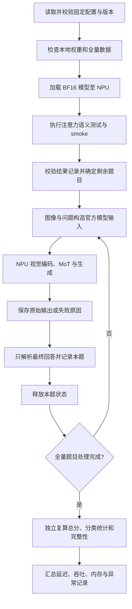

# 需求背景（required）

## 需求来源

昇腾社区“10月社区任务-HY-Embodied-0.5-X模型接入与EmbSpatial-Bench评测”：在 `cann-recipes-embodied-ai` 新增模型的昇腾推理样例，完成 EmbSpatial-Bench 全量评测，样本级 Accuracy 不低于 80.0%。

| 项目 | 内容 |
| --- | --- |
| 任务书 | [新增 HY-Embodied-0.5-X 并完成 EmbSpatial-Bench 评测](https://www.hiascend.com/p/resource/202610/d76fcfedf6f14f91b1a9a76c5bf94a96.zip) |
| 任务入口 | [昇腾社区任务详情](https://www.hiascend.com/activities/task-center/details/3d47bc05b1c043ae935a009b1d452ba6) |
| 实现仓库 | [cann/cann-recipes-embodied-ai](https://gitcode.com/cann/cann-recipes-embodied-ai) |
| 实现位置 | `manipulation/hy-embodied-0.5-x/infer_with_torch/` |
| 文档版本 | v1.0，2026-10-14，li12345abc123；首次设计 |

## 背景介绍

### 模型功能

HY-Embodied-0.5-X 是具身多模态模型，采用 MoT 架构，总参数约 4B、单次激活约 2B。模型接收图像与文本，输出场景理解和空间关系回答；支持 direct 与 thinking 两种生成模式。该任务以单图多选空间理解为正式评测范围，模型权重保持不变。

输入由图像、问题和四个候选项组成，经过官方 processor、chat template、视觉编码器和语言主干生成文本。thinking 模式的推理内容位于 `<think>`，最终回答位于 `<answer>`；计分仅使用最终回答。

### 上游实现分析

复用上游 `HyEmbodiedPipeline` 的加载、消息构造及生成契约。上游通过 `AutoProcessor` 和 `AutoModelForImageTextToText` 加载模型，本地权重目录的 chat template 优先于 processor 内置模板。

指定 Transformers 源码中的 `hunyuan_vl_mot` 原生模型直接依赖 `flash_attn_func` 与 `flash_attn_varlen_func`。语言主干先执行文本因果注意力，再以视觉段双向注意力覆盖相应输出；视觉编码器另有定长和变长注意力调用。适配应保留这些语义，不能仅替换设备字符串。

| 对象 | 设计处理 |
| --- | --- |
| 模型结构、MoT 路由及权重 | 保持官方结构和权重映射 |
| processor、图像预处理及 chat template | 使用同一固定版本与配置 |
| CUDA FlashAttention 调用 | 通过明确的 NPU 注意力适配层替换 |
| device、随机数和运行计时 | 使用 NPU 执行、固定种子及设备同步 |
| KV Cache 与 lm head | 在 NPU 上执行，按样本释放状态 |
| 训练相关组件 | 不进入推理样例依赖和评测路径 |

# 需求分析（required）

## 需求描述

交付单图及批量推理入口、模型局部适配、固定评测配置、全量评测工具、独立复算工具、测试及说明文档。正式评测使用官方 human-verified evaluation split 的全部 3,640 题，输出总分及六类空间关系统计，并记录延迟、吞吐和 Host/NPU 内存。

目标为 Atlas A3 单卡、BF16 推理；正式平台、卡型、卡数、峰值显存目标与评测参数通过 RFC 固定。模型核心计算不得静默回退 CPU，不以 SFT、答案泄漏、人工修正或选择性计分提高结果。

## 需求拆解

| 模块 | 需求 | 交付内容 |
| --- | --- | --- |
| 环境与版本 | 固定 Recipes、HY、Transformers、权重及数据版本 | 依赖文件、版本清单和环境检查入口 |
| 模型加载 | 本地权重加载，检查缺失和尺寸不匹配，使用 BF16/NPU | NPU pipeline 与加载校验 |
| 注意力适配 | 定长、变长、GQA、因果、双向及解码语义一致 | 局部 patch、适配层与语义测试 |
| 推理接口 | 本地图像、prompt、批量输入及 direct/thinking | CLI、显式参数及逐样本结果 |
| 正式评测 | 全量样本、固定顺序、严格答案解析及异常计错 | JSONL、总分/分类 JSON 和 CSV |
| 可复现 | 固定协议、断点续跑、同题唯一及独立计分 | 协议快照、结果校验和复算入口 |
| 稳定性与性能 | smoke、重复运行、延迟/吞吐及内存采集 | 测试入口与实验记录 |

### 依赖与版本

| 依赖 | 设计基线 |
| --- | --- |
| HY 上游 | `cf23678a76dc9c445ab7f7aea7a9a8f60e910a63` |
| Transformers | `9293856c419762ebf98fbe2bd9440f9ce7069f1a` |
| 权重 | `tencent/HY-Embodied-0.5-X`，revision `79f8301d8a80dd03ba778c58d6429e414e9ef5d3` |
| EmbSpatial 代码 | `75792fc5957b0142fab8ff1d47574ffcf73e02c9` |
| 数据 | `Phineas476/EmbSpatial-Bench` 的 human-verified evaluation；dataset revision 写入固定配置 |
| Python / PyTorch / torch_npu | Python 3.12、PyTorch 2.10.0、torch_npu 2.10.0.post6 |
| CANN | 9.1.X；实际安装版本和驱动记录在环境清单 |

依赖安装限定在样例独立环境。Recipes 提交号、数据 revision、正式生成参数与资源目标一起写入 RFC 和实验配置；执行时校验版本，遇到不匹配直接报错。参考 [Ascend PyTorch 兼容性表](https://github.com/Ascend/pytorch/blob/master/COMPATIBILITY.en.md)选取配套运行时，不自动升级依赖。

### 输入输出与参数

| 参数 | 含义与约束 |
| --- | --- |
| `model_path` | 本地权重目录，包含配置、processor、tokenizer、chat template 与全部权重分片 |
| `image` / `images` | 单图或批量图像输入；每题图像与问题一一对应 |
| `prompt` | 原问题、原始 A/B/C/D 候选项及固定回答格式说明 |
| `device` / `dtype` | `npu:<id>` / BF16；设备不存在或 dtype 不匹配时报错 |
| `enable_thinking` | 通用推理支持开关；正式评测按 RFC 固定 |
| 生成参数 | 显式配置 `max_new_tokens`、temperature、top-p、seed、采样开关及 KV Cache |
| 输出 | 原始生成文本、最终答案、耗时、token 数和状态；异常保留原因 |

正式 generation 方案采用 thinking 模式，temperature 0.05；完整解码配置在正式运行前锁定，不能在同一评测中途改参。direct 模式用于功能验证。likelihood 模式采用独立协议和结果标识，不能与 generation 混合计分。

# 详细设计（required）

## 模型与评测分析

### 注意力计算

注意力保持 `O = softmax(QKᵀ / √d + M)V`，其中因果 mask、视觉段双向 mask、GQA 的 KV 头映射和 packed 边界均来自原模型语义。

对长度为 `S_q`、`S_k` 的非等长因果注意力，mask 按 FlashAttention 的右下对齐语义构造：查询位置 `i` 允许访问的键位置满足 `j ≤ i + S_k - S_q`。不直接使用具有不同非等长对齐语义的默认因果选项。完全被遮蔽的查询行输出零；packed 序列独立计算，禁止跨段访问。

模型配置包含 32 层语言主干、hidden size 2048、16 个查询头、4 个 KV 头及 head dimension 128。适配层从实际张量和配置读取维度，不按评测样本或固定图像规模分流。

### 数据与计分

| relation | 样本数 |
| --- | ---: |
| close | 612 |
| far | 594 |
| above | 596 |
| under | 602 |
| left | 616 |
| right | 620 |
| 合计 | 3,640 |

总 Accuracy 为 `正确题数 / 3640 × 100%`，80.0% 对应至少 2,912 题正确。分类统计分别计算，不以六类宏平均替代总分；使用未舍入数值判定是否达标。

## 实现方案

### 模块划分与调用

```text
manipulation/hy-embodied-0.5-x/infer_with_torch/
├── README.md
├── requirements.txt
├── configs/               # NPU、生成与正式评测配置
├── patches/               # 针对固定上游版本的局部 patch
├── src/
│   ├── npu_pipeline.py        # 模型加载和推理接口
│   ├── npu_attention.py       # 注意力语义适配
│   ├── infer.py               # 单样本/批量 CLI
│   ├── evaluate_embspatial.py # 全量推理、记录及断点续跑
│   └── score_results.py       # 独立复算和结果完整性检查
├── tests/                 # 接口、语义、解析与稳定性测试
└── doc/                   # 适配说明和实验协议
```

样例复用上游 pipeline，不复制完整模型源码。patch 只处理必要的导入和后端调用，应用前校验目标版本及匹配位置，失败时停止。公共 `module/` 仅接收经过复用性审查和回归验证的改动。

### Host 侧设计

1. 读取配置并检查依赖版本、设备、权重分片、processor 与模板；模型加载时检查 missing、unexpected 和 mismatched keys，对未解释的差异报错。
2. 校验数据 split、唯一 `question_id`、六类统计、四选项完整性及图像可解码性。由白名单字段构造 prompt，ground truth 和对象坐标仅用于独立计分，不能进入模型上下文。
3. 复用官方图像预处理及消息模板，将模型参数、视觉输入、文本 tensor 与运行状态放到指定 NPU。Host 承担文件读取、tokenizer、文本解析和记录写入。
4. 正式评测按固定顺序、batch size 1 执行；每题开始前初始化独立输入与生成状态，结束后释放 KV Cache、图像 tensor 和输出引用。
5. 记录运行配置与上游版本、设备和执行命令。生成协议、答案解析、数据版本或预处理发生变化时建立新的完整运行，不能合并旧结果。

批量推理作为独立功能入口，使用 padding mask 和原始输入长度截取输出；不同样本不得共享 KV Cache 或视觉段状态。正式评测不使用动态分批策略改变固定协议。

### NPU 计算与注意力适配

第一阶段使用 PyTorch NPU 的 scaled dot-product attention 构建语义明确的参考路径，显式处理布局、GQA 和 mask；禁止安装虚假的 CUDA FlashAttention 模块或使用 CPU 注意力回退。后续融合注意力路径仅在支持同等语义且通过对应回归后启用。

| 路径 | 处理方法 |
| --- | --- |
| 定长注意力 | 根据真实布局整理 Q/K/V，保持原缩放因子与输出布局 |
| 变长注意力 | 校验累计长度、单段长度与边界；按段执行并写回原位置 |
| GQA | 查询头数必须为 KV 头数的整数倍，使用一致的头映射 |
| 文本 prefill | 保持因果可见区域、padding 和位置编码 |
| 视觉段 | 保留原视觉分段及段内双向注意力，按原逻辑覆盖对应输出 |
| KV Cache decode | 保持缓存位置、可见范围和非等长语义 |
| 不支持的参数 | 明确报错，不能忽略参数或悄悄更换计算方式 |

MoT 分支、视觉编码器、语言主干、KV Cache 和 lm head 都在 NPU 上执行。模型参数和关键 tensor 做设备检查，并通过 profiler 检查核心计算实际落点；CPU 图像解码及文本处理与核心模型计算分开记录。

### 内存与执行策略

权重采用 BF16，一次加载后复用，权重内存按实际参数与 dtype 汇总；约 4B 参数的理论权重规模约 8 GB，不等同于推理峰值内存。视觉输入、激活、注意力中间量、KV Cache 和运行时缓存共同构成资源预算。

单层 KV Cache 的容量按 `2 × B × S × H_kv × d × bytes(dtype)` 计算，再按实际缓存层结构汇总。显式 attention mask 的规模为 `S_q × S_k`；注意力分数矩阵规模为 `B × H_q × S_q × S_k`，需结合后端实际实现核算中间内存。

推理前根据图像 token、文本长度和最大输出长度检查资源上限。正式协议的上下文和生成限制不在 OOM 后临时缩短；该题记录失败并计错。变长段处理保持边界隔离，单题结果落盘后释放该题状态，避免跨题积累。

### 答案解析与独立复算

thinking 模式先排除 `<think>` 内容，再解析唯一合法 `<answer>` 或 RFC 允许的最终答案行；不扫描推理过程寻找 A/B/C/D。候选字母/索引映射固定，重复答案块、歧义答案、未闭合 thinking、空输出或不符合协议的回答均判为不可解析。

逐题记录包含 `question_id`、relation、原始输出、解析答案、ground truth、是否正确、输入/输出 token 数、耗时、状态与错误原因。独立复算脚本重新解析和比对全部结果，并检查 ID 覆盖、重复和分母完整性；不直接信任结果中的 `correct` 字段。

### 断点续跑与异常处理

运行开始保存完整配置与版本清单；续跑先校验与原运行完全一致，并检查已完成 ID 的唯一性及记录完整性。JSONL 按完整记录持久化，末尾因中断形成的不完整记录单独识别并重建；已持久化的成功或失败样本不重新挑选结果。

固定 seed 策略与推理顺序属于正式协议。采用逐题种子时以全局 seed 和稳定的题目序号确定种子，并作为显式协议项，确保续跑不受先前随机状态消耗影响。

可恢复的缺图、输出解析失败、OOM、超时等记录为错误样本。NPU 上下文失效等不可继续的异常终止运行并保留已完成记录；恢复时处理剩余题目。中间进度不作为全量达标结论，完整报告要求所有 3,640 题均有可审计记录。

### 执行流程



## 支持硬件

设计目标为 Atlas A3 单卡。正式验收配置以 RFC 固定的平台、卡型、卡数及峰值显存目标为准；仅声明实际验证过的平台。

## 约束限制

- 本任务交付推理与空间理解评测，不改变权重、不进行 SFT 或训练。
- 正式基准只使用 human-verified evaluation 的单图四选项任务；视频、动作执行和其他基准不计入该验收分数。
- 不提交权重、数据集、base64 图像、缓存图片、凭据或大体积模型输出；提供获取方式与可审计制品索引。
- 上游代码与权重按其各自 License 使用，局部修改保留相关声明；License、依赖版本和目标仓贡献规范列入交付检查。

# 可维可测分析

## 精度标准/性能标准

| 维度 | 测试与判定 | 依据 |
| --- | --- | --- |
| 注意力语义 | 定长/变长、因果非等长、双向、GQA、decode、全遮蔽行和 packed 隔离；BF16/FP16 对照参考值 | 固定上游注意力语义与算子精度测试 |
| 功能 smoke | 至少 10 个固定样本，覆盖六类 relation、direct/thinking、缺图、不可解析与超长输出；检查 NaN/Inf、空答案及状态污染 | 任务书 2.4 和自验 README |
| 全量精度 | 全部 3,640 题，至少 2,912 题正确；异常与不可解析均计错 | 任务书 2.3、3 和自验 README |
| 分类统计 | 六类分别报告正确数、总数和 Accuracy，总分使用样本级统计 | 任务书 2.3 |
| 解析与完整性 | 四个选项、非法/歧义输出、thinking 隔离、重复 ID、缺题、异常计错及分母固定 | 任务书 2.3、2.4、4 |
| 续跑一致性 | 同协议中断/恢复，ID 不重复、既有结果不变、最终覆盖和分母不变 | 任务书 2.4 |
| 性能 | 10 个 smoke 样本各至少重复 5 次；记录 TTFT、端到端耗时、token 数及吞吐，汇总均值、P50、P95 | 自验 README；无强制性能提升指标 |
| 内存 | profiler 开启 `profile_memory`；采集加载后、预热后及评测期间 Host/NPU 内存；连续 100 题及 20 个固定样本两轮 | 自验 README |
| 公共回归 | 公共模块如有变更，验证全部直接调用样例，检查默认接口行为与精度 | 任务书 3、4 |

TTFT 从提交本题模型推理到首个新 token 可观测的时间，端到端耗时包含本题输入处理、生成及结果处理，计时范围写入报告。异步 NPU 计时在边界同步；profiling、模型加载和正式推理耗时分别记录。输出吞吐说明使用的 token 数与生成阶段时间范围，不把首 token 延迟或预处理耗时混作纯 decode 吞吐。

内存同时记录 allocated、reserved、峰值和 Host RSS，以预热后的相同生命周期边界比较。区分分配器缓存与仍被引用的模型状态，检查跨题及第二轮运行的 KV Cache、图像和输出残留。

正式运行交付逐题制品索引、独立复算命令、完整配置、环境与版本、任务书要求的权重/数据/配置校验标识、所有完整 seed 的结果、六类统计、性能和内存记录。抽样结果或尚未完成的运行不能标记为正式验收通过。

## 兼容性分析

新增能力封装在模型样例目录，维持上游 pipeline 的输入和输出契约。CLI 新增 NPU 配置和评测入口，不改变其他样例默认行为。注意力 patch 针对固定版本、显式启用和局部生效；升级上游时重新核对 patch 与语义测试，不进行全局 monkey patch。

模型和评测工具解耦：相同输出可以离线复算，生成模式、thinking、模型版本或协议变化形成独立实验。推理入口支持单样本与批量，正式基准采用固定的单样本协议。服务化入口为可选扩展，不作为本次全量评测的必要依赖。

相关技术依据：

- [HY 固定版本的推理接口](https://github.com/Tencent-Hunyuan/HY-Embodied-0.5-X/blob/cf23678a76dc9c445ab7f7aea7a9a8f60e910a63/docs/inference.md)
- [Transformers 固定版本的原生模型实现](https://github.com/huggingface/transformers/blob/9293856c419762ebf98fbe2bd9440f9ce7069f1a/src/transformers/models/hunyuan_vl_mot/modeling_hunyuan_vl_mot.py)
- [EmbSpatial 固定版本官方仓](https://github.com/mengfeidu/EmbSpatial-Bench/tree/75792fc5957b0142fab8ff1d47574ffcf73e02c9)
- [目标仓贡献指南](https://gitcode.com/cann/cann-recipes-embodied-ai/blob/master/CONTRIBUTION.md)
