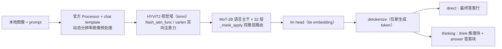
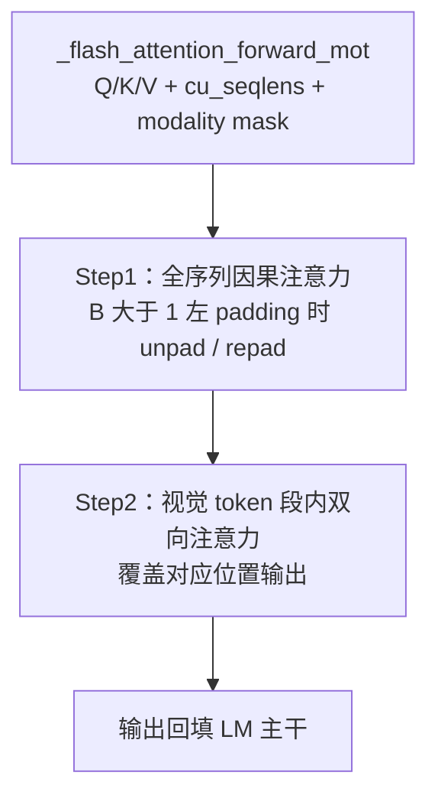
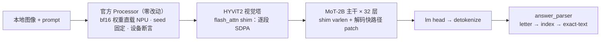
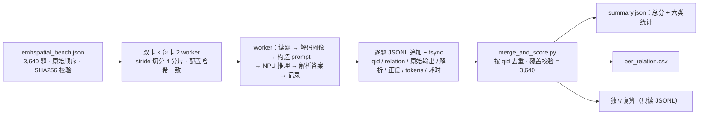

# HY-Embodied-0.5-X NPU 接入与 EmbSpatial-Bench 评测设计文档

| 项目 | 内容 |
| --- | --- |
| 社区任务 | 10月社区任务：新增 HY-Embodied-0.5-X 并完成 EmbSpatial-Bench 评测（tasklist 10-16） |
| 贡献者 / TeamName | yitaa / Recipes SIG |
| 设计仓 / 目标分支 | `cann/cann-ops-competitions` / `master` |
| 实现仓 / 计划样例目录 | `cann/cann-recipes-embodied-ai` / `manipulation/hy-embodied-0.5-x/infer_with_torch/` |
| 前置 RFC | 按任务书 2.1 要求，开发前在上游仓提交 RFC，锁定目标 Atlas 平台 / 卡数、上游与权重版本、软件栈、精度类型、峰值显存目标与完整评测协议；平台未确认前不进入最终验收 |
| 核心门槛 | EmbSpatial-Bench human-verified evaluation 全量 3,640 题，样本级 Accuracy ≥ 80.0%（正确 ≥ 2,912 题） |
| 文档状态 | 前期设计与技术架构方案，提交评审；评审通过后进入开发 |

# 1. 需求背景（required）

## 1.1 需求来源

通过 CANN 社区任务完成 `cann-recipes-embodied-ai` 开源仓具身多模态模型样例贡献的需求。依据《新增 HY-Embodied-0.5-X 并完成 EmbSpatial-Bench 评测》任务书（Recipes SIG，难度 L3），在目标 Atlas 平台上新增标准化 NPU 推理样例，并在锁定的完整评测协议下完成 EmbSpatial-Bench 基准评测、取得不低于 80% 的 Accuracy。

## 1.2 背景介绍

### 1.2.1 HY-Embodied-0.5-X 模型与上游推理栈

HY-Embodied-0.5-X 是面向真实机器人"理解—推理—行动"闭环的具身多模态模型，基于 MoT（Mixture-of-Transformers）架构：总参数约 4B、单次激活约 2B，支持图像/视频输入、thinking / direct 两种生成模式和 OpenAI 兼容服务，在 10 个主流具身任务规划基准上达到 SOTA，尺寸适合边缘侧部署。

上游源码与推理入口获取路径（设计调查基线，最终以 RFC 锁定为准）：

| 对象 | 路径 / 基线版本 |
| --- | --- |
| 上游模型仓 | `Tencent-Hunyuan/HY-Embodied-0.5-X` @ `cf23678a76dc9c445ab7f7aea7a9a8f60e910a63` |
| 上游推理入口 | 官方仓 `src/hy_embodied/inference/`（`HyEmbodiedPipeline`）、`src/hy_embodied/cli/infer` 与 `docs/inference.md` |
| 模型结构实现 | transformers @ `9293856c419762ebf98fbe2bd9440f9ce7069f1a`，`src/transformers/models/hunyuan_vl_mot/modeling_hunyuan_vl_mot.py`（原生注册 `hunyuan_vl_mot`，PyPI 4.57.0 / 5.0.0 均不含该模型，须源码安装锁定 commit） |
| 模型权重 | HF `tencent/HY-Embodied-0.5-X`，revision `79f8301d8a80dd03ba778c58d6429e414e9ef5d3`，2 个 safetensors 分片共 7.57GB（逐文件 SHA256 登记于实验记录，权重不入库） |
| CUDA 侧关键依赖 | `flash_attn==2.8.3`（模块级硬导入）、CUDA device / autocast / stream / RNG；`triton`、`liger-kernel`、`deepspeed` 为训练链依赖，推理样例不引入 |

模型结构概要：

- 视觉塔：HYViT2（timm 实现，SigLIP 风格动态分辨率，patch 16 / merge 2，head_dim 72），注意力直接调用 `flash_attn_func` / `flash_attn_varlen_func`；
- 语言主干：MoT-2B，32 层，hidden 2048，GQA 16 Q-head : 4 KV-head，head_dim 128，每层 text / vision 双路径 qkv / o / mlp / norm，由 modality mask 路由；
- vocab 120818，tie embedding；输出头与 KV Cache 随 bf16 权重加载。

### 1.2.2 上游（CUDA）实现现状分析

#### 1.2.2.1 支持的输入 / 输出与数据类型

对 `HyEmbodiedPipeline` / CLI 契约的分析，上游当前支持能力如下：

| 参数 | 含义 | 类型 | 上游支持情况 | 约束 |
| --- | --- | --- | --- | --- |
| image | 输入图像 | PIL.Image / 本地路径 | RGB，动态分辨率（min_pixels=25088，max_pixels=4194304，patch 16 / merge 2，bicubic） | 视频输入本期不纳入 |
| prompt | 输入文本 | str | 经官方 chat template 组装，thinking 开关由模板控制 | 非空 UTF-8 |
| 输出 completion | 生成文本 | str | direct：最终答案行；thinking：think 推理块 + answer 答案块 | 仅解码新生成 token |
| dtype | 权重与前向精度 | torch.dtype | bf16 直载直算，softmax / norm 内部 fp32 累加 | 上游默认 |
| 解码参数 | temperature / top_p / top_k / max_new_tokens 等 | float / int | CLI 默认 temperature=0.05、thinking 关闭、max_new_tokens=32768 | 可显式设置 |

#### 1.2.2.2 上游实现描述

`HyEmbodiedPipeline.from_pretrained()` 以 bf16 加载 `AutoModelForImageTextToText`（`trust_remote_code=False`，模型代码全部在锁定 commit 的 transformers 内），移至指定设备并置 eval；processor / chat template 由权重目录决定；`generate` / `generate_batch` 提供多模态输入契约。

与 NPU 迁移直接相关的三个关键事实：

1. **flash_attn 模块级硬依赖**：`modeling_hunyuan_vl_mot.py` 顶层 `from flash_attn import flash_attn_func, flash_attn_varlen_func`，且 `_supports_sdpa=False`——无法通过 `attn_implementation='sdpa'` 绕开，仅做 `.to('npu')` 不能完成适配；
2. **MoT 专用注意力** `_flash_attention_forward_mot`：Step1 对全序列做因果注意力（B 大于 1 左 padding 时在调用侧做 unpad / repad），Step2 对每个视觉 token 段以该段 Q/K/V 做双向注意力并覆盖对应位置输出；
3. **MoT 双路径路由** `_mask_apply`：每层按 modality mask 在 text / vision 双路径间选择回填，调用频繁且含同步操作。

#### 1.2.2.3 上游推理实现流程图





### 1.2.3 EmbSpatial-Bench 基准现状

EmbSpatial-Bench 是面向具身场景的空间理解多选题基准（egocentric 视角六类空间关系），官方主指标为样本级 Accuracy，提供 generation 与 likelihood 两种评测方式。本任务使用官方 human-verified evaluation split 全量数据（HF dataset `Phineas476/EmbSpatial-Bench` 的 `embspatial_bench.json`，SHA256 `f9427218bb69afa218ca075e7efc1ca7a0a2379f87c0b55e4813ca19b9de0fa8`；不使用 `embspatial_sft.json`）。

| relation | 样本数 | relation | 样本数 |
| --- | ---: | --- | ---: |
| close | 612 | under | 602 |
| far | 594 | left | 616 |
| above | 596 | right | 620 |
|  |  | **总计** | **3,640** |

question_id 唯一性与六类分布须在开发前实测核验并与本表一致（data_source：ai2thor 1239 / mp3d 1201 / scannet 1200），不一致则停止并核对数据源。

## 1.3 任务功能分析

本样例功能 = 图像 + prompt 的 NPU 推理（保持 direct / thinking 输出契约） + EmbSpatial-Bench 标准化评测：

- 输入：本地图像、prompt（正式评测为原问题 + 原始 4 候选项）、NPU 运行配置（权重路径、设备、dtype、最大 token、temperature、top-p、seed 和 thinking 开关均可显式设置）；
- 输出：模型原始 completion、解析答案、逐题评测记录与汇总统计；
- 精度公式：Accuracy = 正确回答数 / 全部评测样本数 × 100%（按 3,640 题样本级计算，不用六类宏平均替代）。

# 2. 需求分析（required）

## 2.1 需求描述

在 `cann-recipes-embodied-ai` 新增 `manipulation/hy-embodied-0.5-x/infer_with_torch/` 样例：将上游 CUDA 推理栈（device / autocast / FlashAttention / stream / 随机数）适配到 NPU，MoT 路由、视觉编码器、语言主干、KV Cache 和 lm head 的关键计算全部在 NPU 执行、无 CUDA 残留与核心 CPU 静默回退；复用上游 `HyEmbodiedPipeline` / CLI 契约或通过可维护 patch 适配，不复制完整上游代码；在 RFC 锁定的完整评测协议（generation + thinking、全量 3,640 题）下取得不低于 80% 的 EmbSpatial-Bench Accuracy，并交付可复现的适配与实验记录。

## 2.2 需求拆解

| 编号 | 需求 | 设计落点 | 计划验证 / 交付证据 |
| --- | --- | --- | --- |
| RQ01 | 平台、版本、权重、数据与评测协议锁定 | §3.2.2 | RFC、lock 清单、SHA256、环境清单 |
| RQ02 | 图文推理样例，direct / thinking 输出格式正确 | §3.2.1–3.2.3 | CLI 入口、固定 smoke、输出格式单测 |
| RQ03 | 关键计算全程 NPU、无 CUDA 残留 / CPU 静默回退 | §3.2.2、§3.2.3 | 加载后全参数设备断言、调用扫描 |
| RQ04 | 全量 3,640 题、无答案泄漏、六类分项统计 | §3.2.4 | 逐题 JSONL、输入构造规则、独立复算 |
| RQ05 | Accuracy ≥ 80%、异常计错、不择优挑分 | §3.2.4、§4.1 | 正确 ≥ 2,912 题、异常清单、完整 run 索引 |
| RQ06 | 断点续跑、同 qid 不重复计分 | §3.2.4 | 崩溃 / 恢复测试、配置哈希校验 |
| RQ07 | 不少于 10 个固定 smoke 样本 | §3.2.1、§4.1 | smoke 用例定义与结果（六类 + direct + 异常路径） |
| RQ08 | 性能与内存基线记录 | §4.1 | TTFT / 吞吐 / 端到端 / NPU 与 Host 峰值内存记录 |

# 3. 详细设计（required）

## 3.1 任务分析

### 3.1.1 数学公式

- 注意力语义基线（适配层必须保持）：`Attention(Q, K, V) = softmax(Q·K^T / sqrt(d) + M)·V`，其中 d 为 head_dim（LM 侧 128，视觉侧 72），softmax 在 fp32 中累加；GQA 按 16:4 组共享 KV；
- MoT 语义：Step1 全序列因果注意力输出 + Step2 视觉段（cu_seqlens 给出的 [s, e) 段）双向注意力对相应位置的覆盖；
- 评测指标：`Accuracy = 正确回答数 / 3,640 × 100%`，每类 relation 另报 `正确数 / 总数 / Accuracy`；
- KV Cache 预算：每 token KV 字节 = 层数 32 × 2(K/V) × KV-heads 4 × head_dim 128 × bf16 2B = 65,536 B/token；2048 输出上限下单样本 KV 为百 MiB 量级（另计权重约 7.57GB、输入与视觉 token、激活与工作空间），单卡 64GB HBM 余量充足，具体以 RFC 显存目标与实机 profile 为准。

### 3.1.2 支持数据类型

| 项 | 类型 / 精度 | 说明 |
| --- | --- | --- |
| 权重 / 前向 / KV Cache | bfloat16 | 与上游官方一致，bf16 直载直算，不使用 autocast |
| softmax / 归一化累加 | float32 | SDPA（NPU CANN 注意力核）内部保证，与 flash-attn 数值语义一致 |
| token / 位置 / 索引 | int | 保持整数类型，不统一转 bf16 |
| 图像输入 | RGB uint8 → 归一化张量 | 完全使用官方 processor，不做额外缩放 / 增强 |

### 3.1.3 支持形状与输入规模

- 单请求 B=1 顺序推理（与官方 CLI 语义一致），批式接口顺序遍历输入列表、每题独立状态；
- 图像动态分辨率：25088–4194304 像素（官方 processor 约束）；
- 输出上限 max_new_tokens 拟锁定 2048（选型依据见 §3.2.4）；输入超限显式报错，不静默截断问题 / 选项。

## 3.2 样例实现

### 3.2.1 总体设计与目录结构

计划新增目录如下：

```text
manipulation/hy-embodied-0.5-x/infer_with_torch/
├── README.md                    # 模型/平台/权重 License/环境/安装/运行/评测/结果/限制
├── requirements.txt             # 锁定版本依赖（不做自动升级）
├── configs/
│   ├── infer_npu.yaml           # 权重路径占位符、device、dtype、解码参数、thinking 开关
│   └── embspatial_npu.yaml      # 评测协议配置（prompt 模板与解析规则版本）
├── doc/
│   ├── adaptation_notes.md      # NPU 适配与优化过程文档
│   └── experiment_records.md    # 实验记录（环境、哈希、命令、结果索引）
├── src/
│   ├── flash_attn_npu/          # flash_attn 兼容 shim（安装为 flash_attn）
│   ├── hy_embodied_patch.py     # shim 注册 + 解码快路径 patch + 设备断言
│   ├── infer.py                 # 单图/批式推理入口（CLI）
│   ├── evaluate_embspatial.py   # 全量评测：断点续跑/逐题 JSONL/汇总
│   ├── merge_and_score.py       # 分片合并 + 计分 + 独立复算
│   └── smoke_cases.py           # 固定 smoke 样本定义
└── tests/                       # 单测：解析/数值/工具链
```

设计原则：**复用不复制**——上游 `HyEmbodiedPipeline` / processor / 模型代码零 patch 原样运行，NPU 适配集中在 `hy_embodied_patch.py`（运行时注册）与 `flash_attn_npu/` shim 两个可维护的局部模块；公共能力不进入 `module/`（无第二个调用方，不满足复用门槛，如需抽取须先证明可复用并回归全部直接调用样例）。

### 3.2.2 host 侧设计（环境、加载与配置）

1. **版本 fail-fast**：入口处校验 transformers 是否为锁定 commit `9293856c`（原生注册 `hunyuan_vl_mot`）、torch_npu 与 CANN 配对版本；依赖不匹配立即报错，不自动升级到未经验证版本；
2. **设备与精度**：`HyEmbodiedPipeline.from_pretrained(device="npu")`，权重 bf16 直载、`.to(npu)`、eval 模式；不使用 autocast（权重已 bf16、前向 bf16）；
3. **随机性固定**：显式 `torch.npu.manual_seed_all(42)` 与 torch 侧 seed，`do_sample=True` 时固定 NPU RNG 状态；
4. **防 CPU 回退**：关键模块加载后断言全部参数 / buffer 在 NPU（`assert_model_on_device`）；generate 循环中禁止隐式 `.cpu()` 中转；
5. **长度与模板**：对齐官方 `generation_config.json`（eos / pad），processor 使用本地 `chat_template.jinja`，处理特定 commit 的 processor / chat template、图像尺寸与回答格式；
6. **协议配置哈希**：正式评测启动时对模型 / 权重 SHA、数据 SHA、prompt 模板、解码参数、thinking、max_new_tokens、seed 的规范化 JSON 计算 SHA256 并写入逐题记录；断点续跑时校验，不一致拒绝继续、要求重新完整评测。

### 3.2.3 kernel 侧设计（NPU 上的推理执行）

#### 3.2.3.1 flash_attn → NPU shim（核心适配点）

提供名为 `flash_attn` 的本地 shim 包（`src/flash_attn_npu/`），由 `hy_embodied_patch.register_flash_attn_shim()` 注册进 `sys.modules["flash_attn"]`，仅实现上游实际触达的两个入口 `flash_attn_func` 与 `flash_attn_varlen_func`：

1. 语义按段（cu_seqlens）循环调用 `F.scaled_dot_product_attention`（NPU 上由 CANN 注意力核实现，softmax fp32 累加），显式 `is_causal` / mask，`softmax_scale` 对齐 `head_dim**-0.5`，与 flash-attn v2 数值语义一致；
2. GQA 优先 SDPA `enable_gqa=True`，失败回落 KV repeat；段内因果 / 双向语义与上游一致（覆盖 LM 侧 Step1 因果 + Step2 视觉段双向、视觉塔双向 varlen 三类调用路径）；
3. B==1 快路径：单段直接整张量 SDPA，避免逐段 `.tolist()` 读取 cu_seqlens 造成的 D2H 同步；
4. 上游 transformers 代码零 patch，MoT 路由 / 视觉塔 / KV Cache / lm head 全部原样在 NPU 执行；
5. 后续性能优化可在 shim 内切换 `torch_npu.npu_fusion_attention`，对上层零改动。

数值验证方案：与手写 fp32 参考实现逐段对比（短序列 oracle，覆盖 S_q=1、S_q≠S_kv、prefill、左 padding、GQA、多视觉段），CPU fp32 侧要求误差在 1e-6 量级；NPU bf16 与 CPU fp32 的差异按 bf16 正常量级（1e-2 量级）评判，同时报告最大 / 均方误差。

#### 3.2.3.2 解码性能优化设计（运行时 monkey-patch，不复制上游代码）

按上游实现分析，直接运行的解码热点集中在三处，全量评测耗时将不可接受，因此设计以下仅作用于解码步（S_q==1）的快路径 patch；prefill / 批式 / 多 token 步进自动回落原实现：

| patch | 上游热点（逐 token × 32 层） | 快路径设计 | 语义等价性论证 |
| --- | --- | --- | --- |
| `patch_mot_decode_fastpath` | Step2（视觉段覆盖）对 S_q=1 是 no-op，但含隐式同步 + 空切片内核 | S_q==1 时单次融合注意力完成 Step1+Step2 | 解码步无视觉 Q，覆盖目标位置为空，等价 |
| `patch_mask_apply_decode_fastpath` | `_mask_apply` 每层 2 次调用、每次 2 个 `.any()` 同步 + 布尔 gather/scatter | S==1 时双路径各算一次 + `torch.where` 选择 | M=1 时 GEMM 数值逐位一致 |

两类 patch 均为控制流 / 调度级优化，计算语义与上游一致；预期显著提升解码吞吐（正式基线数值以实机 profiling 为准，性能不设强制收益门槛）。

#### 3.2.3.3 资源生命周期

模型与只读权重随进程复用；每题 KV Cache、路由张量、图像张量独立创建、结束后移除全部引用，避免跨样本状态污染；日志只保留 CPU 字符串 / 标量 / 哈希，不持有 NPU Tensor。

### 3.2.4 评测工具链设计

**评测协议（开发前经 RFC 锁定，正式评测前冻结、中途不改参）**：

| 项 | 拟锁定值 |
| --- | --- |
| 方式 | generation（官方主协议，多选生成）+ thinking 开启 |
| 范围 | human-verified evaluation split 全量 3,640 题，按文件原始顺序，禁止抽样 |
| 每题输入 | 1 张对应图像（base64 解码）+ 原问题 + 原始 4 候选项；不写入 ground truth、`objects` bbox 或任何答案字段 |
| 解码参数 | temperature=0.05（官方 CLI 默认）、do_sample=True、top_p=1.0、top_k=0、seed=42、use_cache=True |
| max_new_tokens | 2048：分层抽取 60 题做选型实验（六类各取前 10 题、固定 question_id），取最小零截断档并冻结；截断输出按不可解析计错、不移出分母 |
| 答案解析 | 仅依据 answer 字段内容；letter（A/B/C/D，大小写与前后缀形态不限）→ 候选索引 → 候选项全文精确匹配，三者依次尝试；全部失败记不可解析计错；thinking 推理文本不泄漏给解析器；不得重试、人工修正或从分母删除 |
| 计分 | Accuracy = 正确题数 / 3,640 × 100%；六类 relation 分别报告正确数 / 总数 / Accuracy；总分不用宏平均 |

Prompt 模板（smoke 验证后冻结，实验记录保留版本与理由）：

```text
{question}
A. {option_0}
B. {option_1}
C. {option_2}
D. {option_3}

Answer with the option's letter (A, B, C, or D) only.
```

**工程实现**：

- `evaluate_embspatial.py`：支持 dataset revision / split / thinking / 解码参数显式配置；逐题 JSONL 追加写 + fsync（崩溃安全）；resume 时读已完成 question_id 集合并校验配置哈希，同一 qid 不重复计分；每题捕获 OOM / 超时（token 数与墙钟双阈值）计错并记录异常类别；
- 双卡 × 每卡 2 worker = 4 分片，数据顺序 stride 切分（question_id 全局唯一）；各分片配置哈希必须一致；
- `merge_and_score.py`：按 qid 去重合并、覆盖校验（恰好 3,640 题、无缺失无重复）后计算总分与六类统计，输出 summary JSON / CSV；**模型输出与计分解耦**——独立复算只读 JSONL 即可重算全部指标，不加载模型；
- 逐题记录：question_id、relation、data_source、原始输出全文、解析答案、ground truth、是否正确、不可解析原因、输入 / 输出 token 数、TTFT、端到端耗时。

### 3.2.5 NPU 推理与评测实现流程图





### 3.2.6 与上游实现的差异点及原因

| # | 差异点 | 上游（CUDA）实现 | 本样例（NPU）设计 | 原因 |
| --- | --- | --- | --- | --- |
| 1 | 设备 / 精度管理 | cuda device + autocast | `npu` 设备 + bf16 直载，不用 autocast | NPU 平台；权重已 bf16，前向 bf16 与官方一致 |
| 2 | flash_attn | CUDA flash-attn 2.8.3 | 本地 shim：逐段 SDPA（CANN 注意力核） | 上游模块级硬导入且 `_supports_sdpa=False`；零 patch 保持上游代码原样、规避 CPU 回退 |
| 3 | MoT 解码 Step2 | 每 token 每层执行 | S_q==1 快路径跳过 | 消除隐式同步与空内核；该步对 S_q=1 是 no-op，语义不变 |
| 4 | `_mask_apply` 路由 | `.any()` 同步 + gather/scatter | S==1 双路径各算一次 + `torch.where` | 消除同步热点；M=1 GEMM 数值逐位一致 |
| 5 | max_new_tokens | CLI 默认 32768 | 2048（选型实验锁定） | thinking 输出长度 p99 远低于默认值，取最小零截断档控制全量时长 |
| 6 | 随机性 | 未固定 | torch + NPU 双侧 seed=42 | 评测可复现要求 |
| 7 | 训练链依赖 | triton / liger / deepspeed | 不引入 | 推理样例不触达，缩小依赖面 |

## 3.3 支持硬件

| 支持的芯片版本 | 涉及勾选 |
| --- | --- |
| Atlas 800T A2（Ascend 910B，单机 2 卡 × 64GB HBM；目标平台，以 RFC 锁定为准） | √ |
| 同代其他 Atlas A2 型号 | 暂不支持，须另行完整验证并修订 RFC 后生效 |

拟锁定软件栈：CANN 9.1.0 / Ubuntu 22.04 aarch64 / Python 3.12 / torch 2.10.0+cpu / torch_npu 2.10.0 / transformers 源码安装 @ `9293856c`，以 RFC 评审确认与实机验证为准。

## 3.4 约束限制

1. 仅推理样例：不含 SFT / 训练 / 量化能力（任务书明确不要求，如需训练另立任务并重新审查数据合规性）；
2. 正式计分仅 generation + thinking 协议；likelihood 方式与其他协议结果不得混报；
3. transformers 必须为锁定 commit（源码安装），版本缺失时快速报错，不自动升级；不引入 flash_attn CUDA 包 / triton / liger / deepspeed；
4. 并行规模上限为单机 2 卡 × 每卡 2 worker（stride 分片），不支持多机；Pipeline 非线程安全，串行调用；
5. 视频输入、多图对话、OpenAI 兼容 server 本期不交付（CLI 与仓内样例入口已满足任务要求，server 可作为后续扩展）；
6. max_new_tokens 截断输出按不可解析计错，不可重试 / 人工修正 / 移出分母；
7. 权重、数据集、base64 图像、缓存与大体积日志不入库，仅提供获取方式与 SHA256；
8. 上游 License：权重遵循 `tencent/HY-Embodied-0.5-X` 发布许可（License: other，随 README 链接），仅本地推理使用；评测数据 CC-BY-4.0 仅评测使用；样例代码 Apache-2.0 与本仓一致。

# 4. 可维可测分析

## 4.1 精度标准 / 性能标准

| 验收标准 | 描述 | 标准来源 |
| --- | --- | --- |
| 精度标准 | EmbSpatial-Bench human-verified evaluation 全量 3,640 题样本级 Accuracy ≥ 80.0%（正确 ≥ 2,912）；六类 relation 分项（正确数 / 总数 / Accuracy）同步公开；异常与不可解析输出计错；原始逐题结果可独立复算 | 任务书第 3 章 |
| 性能标准 | 本任务不设强制性能收益，但须交付可作后续优化基线的记录：首 token 延迟（均值 / P50 / P95）、输出 token 吞吐、端到端耗时、NPU / Host 峰值内存（profiler 三阶段 + 全程监控） | 任务书 2.4 |

测试设计（对应交付）：

| 测试组 | 覆盖 |
| --- | --- |
| `test_answer_parser` | letter / index / exact-text 三级解析、A/B/C/D 四种选项、大小写与前后缀形态、thinking 推理文本不泄漏、不可解析输出分类 |
| `test_shim_numerics` | shim 数值一致性（CPU fp32 oracle 短序列对拍、NPU bf16 容差评判） |
| `test_tooling` | 重复 qid 拒绝、样本级计分公式、异常计错、配置哈希敏感、SFT split 拒绝 |
| smoke（≥ 10 个固定样本） | 覆盖六类 relation、direct / thinking、异常图片、超长输出截断，检查无 NaN / Inf、乱码、空答案或跨样本状态污染 |
| 功能与稳定性验证 | 批量推理对照、崩溃 / kill -9 断点续跑（同 qid 不重复计分、不改分母）、混参数续跑拒绝、连续运行内存无持续增长 |

## 4.2 兼容性分析

新增独立样例目录，不修改公共 `module/`、其他样例或仓库公共默认行为，对既有样例无兼容性影响；依赖安装在独立环境并以 requirements.txt 锁定版本，不覆盖宿主共享环境。若后续公共能力需抽取进入 `module/`，将先证明可复用，另列全部直接调用样例并完成功能与精度回归后再合入。

# 5. 参考资料

- 任务书：《新增 HY-Embodied-0.5-X 并完成 EmbSpatial-Bench 评测》（04_tasks/01_community-task-2026/docs）
- HY-Embodied-0.5-X 官方仓：https://github.com/Tencent-Hunyuan/HY-Embodied-0.5-X （`src/hy_embodied/inference/`、`src/hy_embodied/cli/infer`、`docs/inference.md`）
- 模型结构实现：transformers `9293856c` `src/transformers/models/hunyuan_vl_mot/modeling_hunyuan_vl_mot.py`
- EmbSpatial-Bench 官方仓与论文：https://github.com/mengfeidu/EmbSpatial-Bench 、https://arxiv.org/abs/2406.05756
- 评测数据：HF dataset `Phineas476/EmbSpatial-Bench`（`embspatial_bench.json`，human-verified evaluation split）
- 本仓贡献指南：cann-recipes-embodied-ai `CONTRIBUTION.md`
