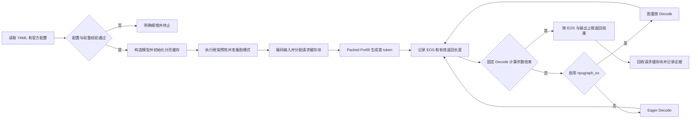
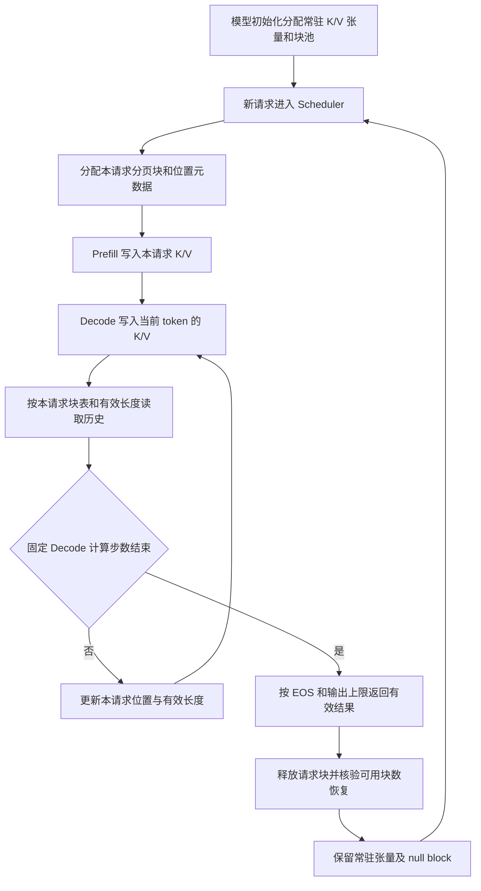

# Qwen3-1.7B 模型样例接入设计文档

## 需求背景（required）

### 需求来源

本需求来源于 HiAscend 社区任务 [Qwen3-1.7B 模型样例](https://www.hiascend.com/activities/task-center/details/73500202c71f4d30bc512daeb749f00d)，目标是在 `cann/cann-recipes-infer` 已有 Qwen Dense 实现基础上，提供 Atlas A2 单卡 BF16 Offline 推理样例。

设计以任务书及测试附件为依据，复用 `QwenForCausalLM`、`Qwen3Config` 和统一执行器，交付独立注册、单卡 YAML、必要兼容处理、用户文档和可复现验证材料。

### 背景介绍

#### 对标模型与计算语义

Qwen3-1.7B 与现有 Qwen3-8B 同属 dense decoder 模型，沿用 RMSNorm、QK-Norm、RoPE、GQA 和 SwiGLU。模型规模、注意力头数及输出头共享声明存在差异，应按官方配置和 checkpoint 接入，不能仅替换权重路径。

| 配置项 | 官方配置及设计含义 |
| --- | --- |
| Decoder 层数 L / hidden size H | 28 / 2048 |
| FFN intermediate size M | 6144；SwiGLU dense MLP |
| Q heads / KV heads | 16 / 8；每 2 个 Q head 对应 1 个 KV head |
| head dimension D | 128 |
| vocabulary size V | 151936 |
| RMSNorm eps | 1e-6；QK-Norm 沿用 Qwen3 配置 |
| RoPE | theta=1000000；无额外 rope_scaling |
| Attention bias | false |
| embedding / lm-head | `tie_word_embeddings=true`；逻辑绑定与实际保存项分别核验 |
| 权重与 tokenizer | 官方 `Qwen/Qwen3-1.7B`，固定 revision `70d244cc86ccca08cf5af4e1e306ecf908b1ad5e` |

以上数值用于核对，运行时从官方 `config.json` 读取，不作为实现中的规模硬编码。官方配置的位置上限不等于本任务已验证的上下文容量。

#### 仓库实现现状

| 现有能力或限制 | 本次处理 |
| --- | --- |
| `models/qwen/` 提供统一 `QwenForCausalLM`，支持 Qwen3-8B 与 Qwen2.5-7B-Instruct | 复用配置驱动的模型构造和 forward，不复制 1.7B 模型实现 |
| 注册表已有 `qwen3_8b`，尚需独立 1.7B 注册 | 在 `executor/core/support_models.py` 增加 `qwen3_1_7b` |
| QKV 和 gate/up 使用融合线性层及源权重映射 | 分别核验 Q/K/V、gate/up 来源及 shape，防止部分分片被误记为完整加载 |
| 默认权重辅助函数捕获异常后仅记录日志，公共加载器未强制拒绝所有缺失项 | 在 Qwen 非量化加载路径检查完整性，并传播 shape 和复制错误 |
| 既有 Packed Sequence、Paged KV Cache 和 `npugraph_ex` 路径 | 复用现有契约，验证不等长 batch、请求隔离、回收及 Decode replay |
| 离线调度以固定 Decode 计算步数结束，首次完成判定可能已追加超出返回上限的 token | 区分计算步数与有效返回长度，补全局/请求上限及 EOS 边界 |

### 任务材料差异与设计假设

| 编号 | 差异或未决口径 | 当前设计处理 |
| --- | --- | --- |
| Q01 | 主任务书允许不同后端输出存在差异时结合参考解释；附件要求 eager/图输出保持一致 | 先按完整有效 token 相等验证；发生差异保存完整输出和首个分歧位置，提请维护者确认，不能自行降低验收标准 |
| Q02 | 首次 1.7B 性能无仓内基线，旧模型共享路径修改又要求回归 | 为 1.7B 建立首份基线；旧模型提前采集同机原版结果，不以 8B 耗时作为 1.7B 门槛 |
| Q03 | 旧模型回归波动范围需在 RFC 预先明确，任务未规定固定百分比 | 建议候选平均时延不超过同配置原版均值的 110%，待维护者确认后冻结；不是任务书规定的 10% 指标 |
| Q04 | 仓库 default 入口与固定提示词自验的模板、截断处理不同 | 分别记录参数映射和最终输入 token；固定样本及参考端显式采用 non-thinking 和左侧截断，不把入口默认行为视为等价 |

## 需求分析（required）

### 需求描述

在统一模型协议下支持 Atlas A2 单逻辑设备、1TP、BF16、Offline、batch=1 和至少两个不等长请求组成的 batch，完成 Prefill、Decode、EOS、输出上限、Packed Sequence、分页缓存和请求清理。至少交付一个 `npugraph_ex` YAML，并与 eager 模式进行验证。

本次仅建立模型样例及首次性能基线，不包含量化、Online PD、长上下文扩展、多卡性能优化或新增 Ascend C 算子。复用现有模型 forward，不借用 `qwen3_8b` 名称加载 1.7B 权重。

### 接口与参数分析

| 接口或配置 | 契约 |
| --- | --- |
| 构造函数 `(config, infer_config, comm_manager, prefix)` | 沿用 `QwenForCausalLM`，从官方配置读取维度与算法属性 |
| `forward(input_ids, position_ids, forward_metadata, **kwargs)` | 沿用执行器 Packed 输入、请求位置、分页元数据及输出契约 |
| `load_weights(weights)` | 接收官方 checkpoint 权重流；核验名称、shape、必需项和融合分片覆盖 |
| `get_cache_info()` | 复用 Qwen 的 FullAttention 缓存描述，物理分配与请求块生命周期仍由框架负责 |
| `model_config.model_name` | 独立注册名 `qwen3_1_7b`，映射既有模型类与 `Qwen3Config` |
| `model_config.model_path` | 固定 revision 的官方配置、BF16 权重和 tokenizer 本地目录；交付 YAML 使用占位符 |
| `data_config.input_truncated_len` | 拟验证上限 2048；记录实际输入 token 数和约定截断行为 |
| `scheduler_config.*` | 输出上限 128；batch 覆盖 1/2；有效返回不得突破全局或请求上限 |
| `parallel_config.*` | 单卡 1TP，相关并行字段均为 1；非法组合明确失败 |

### YAML 与启动约定

拟交付以下默认配置，`model_path` 由使用者替换为固定 revision 的本地权重目录：

```yaml
model_config:
  model_name: "qwen3_1_7b"
  model_path: "/path/to/Qwen3-1.7B"
  exe_mode: "npugraph_ex"
  with_ckpt: true
  enable_profiler: false
  enable_cache_compile: false
  enable_static_kernel: false
data_config:
  dataset: "default"
  input_truncated_len: 2048
  temperature: 0.0
  top_p: 1.0
  top_k: 0
  seed: 17
parallel_config:
  world_size: 1
  attn_tp_size: 1
  moe_tp_size: 1
  embed_tp_size: 1
  lmhead_tp_size: 1
scheduler_config:
  max_new_tokens: 128
  batch_size: 1
  max_prefill_tokens: 2048
```

在代码仓根目录拟执行：

```bash
bash executor/scripts/infer.sh --model qwen --mode offline \
  --yaml qwen3_1_7b_1tp.yaml
```

`--model qwen` 定位模型目录，YAML 的 `model_name` 用于注册。eager 对照时仅修改 `exe_mode`；性能测量配置另行开启 Profiler，保存最终完整 YAML。batch=2 时，`max_prefill_tokens` 应覆盖两条输入长度之和。保留 `moe_tp_size: 1` 是统一字段要求，不表示该模型包含 MoE。

### 需求拆解

| 工作项 | 实现边界 | 完成判据 |
| --- | --- | --- |
| 配置及注册 | 独立注册、四段 YAML、统一入口 | 1.7B 配置可发现并正确构造；非法配置失败 |
| 模型兼容 | config 驱动维度、RoPE、QK-Norm、bias、输出头 | 不包含 8B 或 1.7B 规模硬编码，官方配置正确生效 |
| 权重加载 | BF16 必需项、重复项、未知项、shape、融合分片 | 无未解释遗漏或静默失败；异常权重负例被拒绝 |
| 输出与缓存 | 返回长度、EOS、Packed、不等长 batch、分页读写及回收 | 输出边界正确；请求之间不污染，缓存块可复用 |
| 图模式 | 初始化、warmup、捕获、Decode replay | 正式 Decode 正常；固定 shape 稳态不反复编译 |
| 自验及文档 | 五样本、四组性能、20 批内存、共享路径回归 | 命令、完整输出、原始结果、版本及校验索引可追溯 |

### 交付件与证据规划

拟沿用当前 Qwen 目录，测试和元数据文件名可按 RFC 与仓库约定调整：

```text
executor/core/support_models.py                   # qwen3_1_7b 注册
executor/core/scheduler/scheduler.py               # 必要的离线返回边界修复
models/qwen/
├── models/modeling_qwen.py                       # 必要的 BF16 加载兼容
├── config/qwen3_1_7b_1tp.yaml
├── tests/                                       # 固定样本、参考映射及自验脚本
├── agentic/baseline/                             # 元数据、完整小型样本和结果索引
└── README.md                                    # 用户操作指南
tests/core/                                      # 公共调度边界回归
```

设计文档单独提交至社区任务设计仓；仅在确需独立技术说明时补充 `docs/models/qwen/` 文档。RFC、设计评审、实现、代码 PR、CI 和验收分别记录状态。证据关联代码 commit、模型与 tokenizer revision、文件校验、完整 YAML、输入、命令、退出码、环境及日志；权重、数据集、二进制和大日志不加入 Git。

## 详细设计（required）

### 算子分析

#### 数学公式

以下描述单层计算语义，线性层存储转置遵循 PyTorch；实际归一化的计算精度、转换顺序和融合残差舍入，应与固定版本官方 Qwen3 参考核验，不能仅按实数公式判断 BF16 等价。

**归一化与残差。** 设输入为行向量 x，归一化维度为最后一维：

```text
RMSNorm(x, w) = x / sqrt(mean(x * x) + eps) * w
u = RMSNorm(h, w_input)
a = h + Attention(u)
v = RMSNorm(a, w_post_attention)
h_next = a + MLP(v)
```

复用现有 `QwenRMSNorm` 及融合 add/norm 路径，核对残差先后次序。QK-Norm 分别沿每个 head 的 D 维进行，不能改为对全部 head 联合归一化。

**Attention。** 令位置为 p，Q/K/V 从 u 投影得到：

```text
Q = RoPE(RMSNorm(Linear_Q(u), w_q), p)
K = RoPE(RMSNorm(Linear_K(u), w_k), p)
V = Linear_V(u)
A = softmax(Q * K^T / sqrt(D) + causal_mask) * V
Attention(u) = Linear_O(A)
```

按配置处理 16 个 Q heads 与 8 个 KV heads 的 GQA 对应关系；Q、K 应用 RoPE，V 不应用。Prefill 使用因果 mask，各请求有效长度和位置独立；Decode 读取当前请求有效历史及本步写入的 K/V，不读取其他请求槽位。

**MLP 与输出。**

```text
SiLU(z) = z * sigmoid(z)
MLP(v) = Linear_down(SiLU(Linear_gate(v)) * Linear_up(v))
logits = lm_head(RMSNorm(h_final, w_final))
```

QKV 与 gate/up 使用现有融合参数加载映射。输出头与 embedding 的绑定由官方配置及实际 checkpoint 决定；保持 Qwen3 原有的语言输出计算。

#### 支持数据类型与形状

| 张量 | 逻辑形状 | 类型或说明 |
| --- | --- | --- |
| packed token ids / positions | `[T]` | 沿用执行器整数类型，T 为 batch 内 token 总数 |
| hidden states | `[T, H]` | BF16 主路径，H=2048 来自配置 |
| Q | `[T, 16, D]` | BF16，D=128 来自配置 |
| K / V | 各 `[T, 8, D]` | BF16，分页写入与读取沿用框架布局 |
| KV Cache | 每层两份分页张量 | 块数、块长及物理排布按实际 cache_info 和分配器读取 |
| MLP 中间张量 | `[T, M]` | BF16，M=6144 来自配置 |
| 返回 logits | `[batch, 1, V]` | Prefill 取各请求末 token；沿用现有实现转换为 float 后采样 |

本次拟验证输入上限 2048、输出上限 128、batch=1/2。模型配置的理论长度与实际验证范围应在用户文档中区分。

### 算子实现

#### 实现方案

复用 `OfflineInference`、`Scheduler`、`ExecutionEngine` 和 Qwen 模型类。模型负责计算、权重与缓存描述；执行器负责预热和图执行，调度器负责请求、输出状态与分页块生命周期。

##### 整体推理流程图



EOS 和返回上限控制有效结果，离线计算结束仍遵循既有固定步数约束。图模式捕获发生在预热阶段，正式 Decode 应复用已有图，不在每次循环重新捕获。

#### Host 侧设计

##### 配置与权重加载

核对 hidden/FFN size、层数、Q/KV heads、head_dim、vocab、RoPE、QK-Norm、attention bias、embedding/lm-head 和权重命名。新增注册仅指向既有类，不新增模型 forward 接口。

使用官方原始 BF16 safetensors，不进行量化转换。通过镜像取得文件时，逐项比对固定官方 revision 的 LFS SHA256 或 Git blob ID，并保存本地文件 SHA256。权重审计包含源参数名称、shape、dtype、源到目标映射和加载覆盖。

Qwen 非量化路径拟拒绝重复源参数、未预期参数、缺失必需项和 shape 错误。融合目标须逐一覆盖 Q/K/V 或 gate/up，不能仅因目标被写入一次就认定加载完整。默认辅助加载函数会记录并吞掉异常，因此该路径应在复制前校验 shape，并让复制失败向上抛出，避免继续使用未初始化参数。

`tie_word_embeddings=true` 是逻辑约束，不能替代 checkpoint 审计。存在独立 lm-head 项时正确加载并核验关系；缺少共享别名时依据配置处理必要绑定，不能按模型名称或规模硬编码。保留量化及其他模型默认辅助函数的行为，避免扩大共享修改范围。

##### 分页缓存与请求所有权

`ExecutionEngine` 根据模型 `cache_info` 分配常驻 K/V 张量，并创建管理器；`Scheduler` 通过 `KVCacheManager` 为请求分配、更新和回收物理块。每个请求使用自己的 position、slot_mapping、block_table 及有效长度。

Prefill 将不等长请求打包，按各请求边界完成注意力和末 token 选择。Decode 每步写入本请求的新 K/V，再读取其有效历史。请求完成后释放请求块；常驻张量和块池 null block 保留，不能将其视为泄漏，也不能要求每次回到进程启动内存。

验证块数恢复、不同内容及长度请求交替、peer 扰动、重复请求和新进程对照，检测分页读写、回收、地址复用及跨请求状态污染。图地址可复用不等于旧请求状态可继续读取。

##### KV Cache 生命周期流程图



物理块可以复用，但新请求须重新建立块表、位置和有效长度，只读取本请求已写入的有效 K/V。EOS 仅决定有效返回范围，离线计算仍完成框架规定的固定步数。

##### 输入映射与输出边界

固定样本采用官方 chat template、`enable_thinking=false`、greedy、seed=17、输出上限 128。参考端和样例端保存并核对最终输入 token，同时明确 BOS/EOS、截断及生成配置的映射；参考接口额外默认值应显式说明。

仓库 default 入口先裁剪正文，再由 Scheduler 处理模板及截断；固定提示词自验与参考端拟显式采用左侧截断。两条路径分别验证，不把原始文本相同当作模型输入相同。超长输入保存截断前后长度和最终 token。

离线有效返回长度应同时受全局 `max_new_tokens` 与请求 `max_tokens` 约束。EOS 位于有效范围内时返回 `stop`；EOS 位于被截断范围外时返回 `length`。保留固定 Decode 计算步数及 online 原行为，覆盖全局 cap=1、请求 cap=1、EOS 恰在边界内外及通常 cap=128。

##### 图模式与异常处理

先验证 eager，再核对 `npugraph_ex` 的框架 warmup、捕获及正式 Decode。固定 shape 正式运行记录原生 capture/replay 次数和 Dynamo 图统计，验证实际重放及无反复编译；加载、编译、预热和稳态计时分别归档。

非法模式、并行配置、权重路径、缺失或不兼容权重应明确报错。输入、输出边界和容量异常纳入自验。异常记录包含命令、退出码、触发配置及已采集结果，失败返回非零；不通过静默跳过权重或切换模式掩盖错误。

#### Kernel 侧设计

复用仓内线性层、RMSNorm、RoPE、attention、SwiGLU 和分页更新能力，不新增自定义 Kernel、tiling、分核或 UB 策略。重点核对 GQA 比例、QK-Norm、scale、mask、布局及 Prefill/Decode 元数据。

若出现算子接口或形状不匹配，先保留具体版本、输入、调用栈和最小复现，再判断模型兼容修正范围；不在样例接入中引入未经评审的算子工程。

### 复杂度与内存分析

Prefill 注意力受输入长度平方项影响，Decode 使用分页历史 K/V。模型层数、head 数、hidden/FFN size 和词表均从配置读取，不使用 8B 的计算量或内存作为 1.7B 基线。

分页 KV 的静态量级按实际块数估算：

```text
KV_bytes = L * 2 * physical_blocks * block_size * KV_heads * head_dim * dtype_bytes
```

BF16 主路径的 `dtype_bytes=2`；physical_blocks 按 batch、输入/输出容量、块对齐和分配器保留读取。实际峰值还包括权重、加载分片、图池、临时张量、算子 workspace 和 allocator 保留，不能仅用静态公式宣称容量或无泄漏。Host 内存与 HBM 分开记录。

### 支持硬件

| 平台与依赖 | 本任务设计范围 |
| --- | --- |
| Atlas A2 单卡/单逻辑设备 | 计划在 Ascend 910B2 验证；具体型号、HBM及物理/逻辑映射纳入运行清单 |
| CANN / 驱动 | CANN 9.0.0、驱动 26.1.1；固件及安装包完整版本随元数据记录 |
| PyTorch / torch_npu | 2.8.0 / 2.8.0.post4（v26.0.0） |
| Python / 系统 | Python 3.11.17、Ubuntu 22.04.5、aarch64 |
| 模型依赖 | Transformers 5.0.0，其余遵循 Qwen requirements；NumPy 1.26.4 配合 PyArrow 20.0.0 |
| 参考端 | 官方 Transformers 5.0.0 同模型 BF16 `generate`，固定 eager attention、权重、tokenizer及生成参数 |

容器资源按实际 cgroup 配额记录，不能把整机 CPU 或 Host 内存当作容器可用容量。A3/A5、多卡及其他版本不作为本次通过承诺。

### 算子约束限制

本次为 BF16 Offline 样例，复用框架分页缓存与调度，不替换为 HF Cache 或另建调度器。支持范围以本任务配置、自验矩阵和实机结果为准；尚未验证的更大 batch、长度或其他 dtype 不据配置理论能力宣称支持。

## 可维可测分析

### 精度标准/性能标准

#### 精度标准

固定官方同模型参考，不能使用 Qwen3-8B 输出作为 1.7B 精度标杆。显式锁定权重/tokenizer revision、Transformers、BF16、模板、thinking、seed、截断、EOS、采样和输出长度。固定样本采用 `do_sample=false`、greedy、seed=17、`enable_thinking=false`，参考端与样例端的最终输入 token 应相同。

| 比较层级 | 观测内容 | 判据 |
| --- | --- | --- |
| 配置及权重 | config、必要源参数、融合映射、shape、加载覆盖 | 必需项完整，无静默错误；缺失、重复、未知项及形状负例明确失败 |
| 基础推理 | Prefill、Decode、完整有效 token、EOS和结束原因 | 无 NaN/Inf、异常或越界，正常结束或达到输出上限 |
| 固定生成 | 中文、英文、知识问答、摘要/改写、简单推理五类各至少 1 个固定 prompt | 保存两端完整 token/text；相关通顺，无乱码、异常重复、明显语义断裂或可稳定辨识退化 |
| eager/图模式 | 同一输入、权重及参数的完整有效 token | 先按完全一致自验；不一致时按 Q01 提请确认，不能自行判通过 |
| Packed/KV | batch=1/2、不等长、交替请求、peer扰动、重复请求 | 各请求输出与缓存隔离正确，回收后块数恢复，重复请求无历史污染 |

本方案不选用可选 logits 容差或额外数据集评分替代文本质量判定，也不在验收阶段临时降低标准。固定五样本及参考参数映射在开发前保存，完整输出随小型基线材料交付。

#### 性能测试设计

| 输入 token 数 | 最大输出 token 数 | batch | 执行模式 | 每组运行次数 |
| --- | --- | --- | --- | --- |
| 128 | 128 | 1 | npugraph_ex | 预热至少 1，正式至少 3 |
| 512 | 128 | 1 | npugraph_ex | 预热至少 1，正式至少 3 |
| 1024 | 128 | 1 | npugraph_ex | 预热至少 1，正式至少 3 |
| 2048 | 128 | 1 | npugraph_ex | 预热至少 1，正式至少 3 |

共 4 组、至少 12 次正式运行，预热不计入正式统计。使用仓库 default 自然语言源构造输入并核验实际 token 数；保存每次 Prefill、全部 Decode 步、实际生成 token 数、吞吐及均值/中位数。明确同步点、计时边界及是否包含采样，模型加载、编译/预热与稳态分开。

输出 128 是上限，提前 EOS 时如实记录实际生成量；不得把固定计算步数等同于已返回 128 token。Decode 吞吐的分子分母遵循同一计时口径，不将 Prefill 首 token 算入未覆盖的 Decode 时段。另开启 Profiler 采集四组长度，并保存产物路径和校验信息。

本任务建立首份性能基线，不设优化提升比例。共享路径修改后的旧模型性能按 Q03 在 RFC 提前冻结的波动规则比较，不以 8B 耗时或小算子拼接结果代替 1.7B 基线。

#### 内存与生命周期测试

在输入上限 2048、输出上限 128、batch=2 下连续运行 20 批，覆盖至少 20 个请求，验证无 OOM、正确写入/读取及请求回收。Profiler 开启 `profile_memory`，分别记录权重加载后、Prefill峰值、Decode峰值、每批结束及末批回收后的 Host/NPU 内存。

候选容量预算为 Host 峰值 28GiB、NPU 峰值 56GiB。比较末 5 批与第 6～10 批的结束后占用均值，候选增长上限为 Host RSS 64MiB、NPU allocated 16MiB，并检查是否持续增长。预算与增长口径应提前写入 RFC；常驻缓存、null block、allocator 和图池占用单独解释，不要求全部 reserved 内存回到进程初始值。

#### 边界与异常用例细化

| 用例 | 检查内容 |
| --- | --- |
| 输入边界 | 短输入、RFC最大输入、超长截断；保存截断规则及最终token |
| batch与Packed | 单请求及至少两个不等长请求，检查位置、有效长度和末token选择 |
| 分页边界 | 按实际block_size构造B-1/B/B+1长度，检查slot、尾块及回收 |
| 生成边界 | 首步/中途EOS，全局cap=1、请求cap=1、cap=128，EOS在返回范围内外 |
| 权重异常 | 缺必需项、重复项、未知项、shape不匹配、QKV或gate/up缺分片 |
| 图模式 | warmup与正式Decode、原生replay、固定shape稳态无反复编译 |
| 配置异常 | 无效路径、非法执行模式、不合法并行组合、容量或长度配置错误 |
| 请求隔离 | 不同内容及长度交替、peer扰动、重复请求与新进程对照 |

### 分层验证计划

| 阶段 | 重点用例 | 进入下一阶段的条件 |
| --- | --- | --- |
| V0 静态与依赖 | 注册、config、权重清单、版本、RFC参数与输入映射 | 必需接口和来源明确，待确认口径有记录 |
| V1 加载与边界 | 完整加载及负例、融合分片、返回上限与EOS | 缺失和不兼容明确失败，边界符合契约 |
| V2 eager | 五固定样本、batch1/2、不等长、最大输入和截断 | 功能、文本质量、KV生命周期通过 |
| V3 图模式 | 同输入对照、warmup、捕获、replay与连续请求 | 满足Q01确认的一致性标准，稳态不反复编译 |
| V4 性能与内存 | 四组性能、Profiler、最大配置连续20批 | 逐次原始值及内存证据完整，无OOM或持续泄漏 |
| V5 兼容性 | 两个旧模型及公共修改的全部直接调用方 | 修改前后结果符合预先约定的功能、精度及性能标准 |
| V6 工程交付 | pre-commit、仓库CI、README、报告和包检查 | 各项独立记录，不以静态或单元检查替代实机和平台CI |

### 兼容性分析

独立注册和 YAML 保留已有模型项。修改共享 Qwen BF16 加载逻辑前，枚举 `QwenForCausalLM` 的注册项及直接调用方，采集 Qwen3-8B、Qwen2.5-7B-Instruct 的功能、完整有效 token、结束原因和代表性 Prefill/Decode 基线；量化路径保留原行为。

修改公共 Scheduler 时，列出 offline/online 调用方，运行相关批处理和结束条件测试。正常返回上限场景应保持输出不变；原有越界场景要求修复后满足返回上限，不改变固定计算步数和 online独立结束机制。性能同机、同版本、同配置、同输入及同计时方法比较，保留全部原始值。

提交前执行 `pre-commit run --all-files`、仓库 CI 和 A2 实机验证，分别记录状态。README覆盖环境、权重获取、占位路径、YAML、启动命令、实际测试型号、精度与性能摘要及限制；基线元数据关联完整输出、内存、回归和原始产物获取方式。设计评审、代码合入与任务验收保持独立，不能互相替代。
