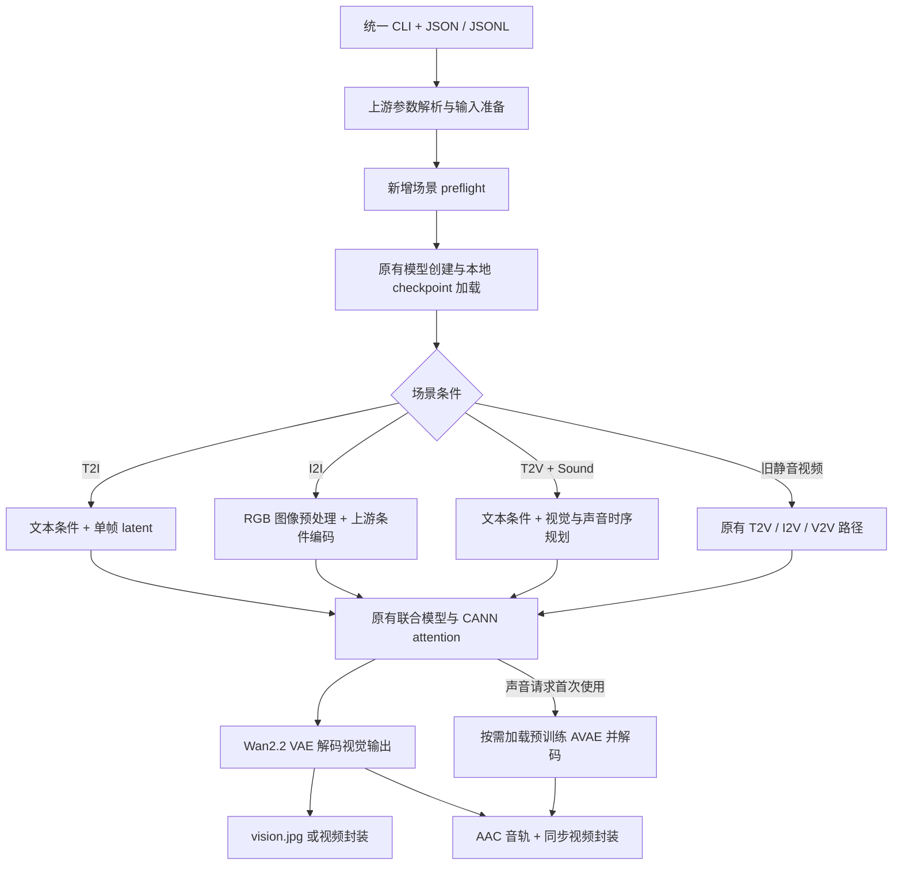

# Cosmos3 T2I、I2I 与 T2V+Sound 昇腾适配设计

版本：v1.1；修订日期：2026-10-19；作者：taotaozhii。

本次修订将文档归档到 10 月第 19 项任务的既有目录，补充需求背景、需求分析、算子分析、Host/Tiling 与 Kernel 设计。以下新增模块、测试脚本和验收数值均为设计或待执行协议；本 PR 仅提交设计文档，不声明已实现或已通过 A2/A3 实机测试。

文档定位：正式开发前的适配设计与自验方案，用于明确实现范围、技术方案和验收条件。

## 1. 需求背景

任务为[10月社区任务-Cosmos3模型T2I、I2I、T2V+Sound场景适配](https://www.hiascend.com/activities/task-center/details/1944d12576964565a952a2f4fe9065c1?menu=tasks)。设计依据为任务书及附件中的 `test_cases/README.md`。任务书原网页及附件须在开发工作区保存快照、下载时间和哈希，开发与最终验收前重新获取并评估变化。这些快照不属于本次单文档 PR 的提交内容。

目标是在现有 Recipes Cosmos3 NPU 样例中补齐三个上游已支持的场景，并在 A2、A3 完成实机验证：

| 场景 | 上游输入契约 | 交付行为 |
| --- | --- | --- |
| T2I | `model_mode: text2image` | 固定 prompt/seed 生成单张可解码 `vision.jpg` |
| I2I | `model_mode: image2image`，`vision_path` | 本地图像真实参与条件编码，替换输入后输出发生变化 |
| T2V+Sound | `model_mode: text2video`，`enable_sound: true` | 生成同时含有效视频轨和非静音音频轨的制品 |

同时维持原有 T2V、I2V、V2V 的默认行为、原始输出精度与稳态性能。开发范围是 `world_model/cosmos3/` 的 overlay、patch、配置和测试，以及 `docs/world_model/cosmos3/` 的文档。不训练新模型，不重构主干，不自行实现音频 tokenizer，不提交完整上游代码。CP/CFGP/FSDP 参数沿用现有实现，本任务不优化多卡策略。


### 1.1 需求来源与业务价值

任务来源为昇腾任务广场的 2026 年 10 月第 19 项社区任务，仓库任务列表中
对应 `10-19-Cosmos3-T2I-I2I-T2V-Sound`。应用面向具身智能和世界模型的
多模态内容生成：T2I 以文本生成静态场景或物体图像，I2I 在已有场景图像上按
指令编辑，T2V+Sound 为同一事件生成视觉运动和配套声音。三者需要复用模型、
入口与资产，避免调用方为每个场景维护不同运行环境。

例如，机器人水杯操作的评估素材可以包含静态工位图、修改物体颜色后的条件图，
以及倒水动作和水流声的视频。该例用于说明三种输入输出关系，不把生成素材直接
等同于物理真实的训练标签，也不扩大到模型训练或下游机器人控制。

### 1.2 现有实现、缺口与根因

固定的上游 `cosmos-framework` 已提供图像和联合音视频的场景 schema、默认参数、
条件构造及保存逻辑。现有 Recipes 样例给出 T2V、I2V、V2V 的 NPU 使用方法，
并提供设备、HCCL、本地 checkpoint 和 CANN FIA attention 适配。
它尚不能作为新增三场景在 A2/A3 上完整可用的验收证据。

从固定源码可定位的适配缺口如下，开发阶段须逐项验证其实际触发条件。

| 现状或缺口 | 源码依据与影响 | 本任务补齐方式 |
| --- | --- | --- |
| 原脚本主要做机械式设备替换 | `npu_adapt.sh` 明确排除 Qwen3-VL CPU 预处理等复杂补丁 | 对图像 processor 的临时张量显式指定 CPU，保留模型 NPU 计算 |
| 音频前端调用复数 STFT | AVAE `SpectrogramConvNeXtEncoder.spectrogram` 使用 `return_complex=True` | 在 NPU 路径只将频谱前端放到 CPU，完成实数表示后回传 |
| 局部精度上下文绑定 CUDA | AVAE LayerNorm 和网络 timestep 存在 CUDA autocast 写法 | 按输入设备选择上下文，数值稳定区域显式 FP32 运算 |
| AVAE 在 tokenizer 初始化时实例化 | `OmniMoTModel.set_up_tokenizers` 调用 `lazy_instantiate` | 以延迟代理隔离首次声音请求的额外加载成本 |
| 缺少三场景验收链 | 入口可接受某个 mode 并不证明图像条件、音轨和性能符合要求 | 增加真实媒体检查、旧场景回归、内存及性能证据 |

选择复用上游语义并以局部 overlay/patch 适配，是为了控制变更范围并保留升级时
可审查的差异。重新实现图像采样器或音频 tokenizer 会扩大数值差异和维护成本，
不属于本任务范围。

### 1.3 任务边界

本任务是模型推理场景适配，交付以 Python/torch_npu 调度、既有 CANN 算子和
局部兼容处理为主。没有独立的新增 `aclnn` API 或自定义 Ascend C 算子，
因此下文的 Host/Tiling 和 Kernel 设计分别说明主机侧请求规划与既有算子的
设备执行契约，不编造新的 `TilingData`、`TilingKey` 或核内 UB 实现。

## 2. 需求分析

需求分为新增场景功能、既有能力保护和工程交付三个方面。每条需求指定实现责任
和验证证据，作为后续开发、自验和评审的共同依据。

### 2.1 功能需求与验收映射

以下约定中的“通过”均指开发阶段需要达到的条件，尚未执行的项保持待验证状态。

| 编号 | 需求及输入边界 | 实现责任 | 验收证据 |
| --- | --- | --- | --- |
| F01 | `text2image`、非空 prompt、固定 seed，生成单图 | 复用上游单帧模式与 Wan VAE | 可解码 JPG、解析参数、输出张量有限性、同 seed 重复记录 |
| F02 | `image2image` 必须包含可解码 `vision_path` | CPU 图像准备、上游图像条件编码和联合模型 | 相同参数下替换原图，原始输出及图像变化，条件入口被实际调用 |
| F03 | `text2video` + `enable_sound=true` | 联合视觉/声音去噪、AVAE 解码、AAC 封装 | 视频与音频均完整解码，非静音，时长与采样率检查 |
| F04 | 同一统一 CLI 支持多个输入文件或 JSONL | 复用 `InferenceArgs` 与上游顺序请求流程 | 模型创建次数、逐样本状态、唯一输出目录 |
| F05 | 静音/图像请求不加载独立 AVAE | 延迟代理和按请求状态 | 首次声音前后加载计数、NPU 内存、混合调用记录 |
| F06 | 无效请求尽早失败且可定位 | 模型创建前静态 preflight 与模型配置后的最终校验 | 六类异常的真实 CLI 非零退出、字段和场景诊断 |
| C01 | 原 T2V/I2V/V2V 语义与精度保持 | 新分支隔离，不修改默认参数和公共 attention | 各平台 baseline/candidate 原始输出比较 |
| C02 | 旧三场景稳态性能无回退 | 新增检查不进入旧场景热路径 | 同环境预热及三次正式计时、波动区间 |
| C03 | A2 与 A3 均完成验证 | 固定模型与输入、分别执行完整矩阵 | 两平台环境、日志、输出与 profiler 证据索引 |
| E01 | 可重复部署、可追踪版本、无大资产入库 | commit、权重哈希、patch 幂等检查 | 两次适配结果、版本清单及仓库 CI |

### 2.2 输入输出、类型与形状约束

请求层输入为 UTF-8 JSON 对象或逐行对象 JSONL，数值计算层沿用上游张量接口。
下表的 `B` 是输出样本数，`T/H/W` 为解析后的帧数和像素尺寸，`D` 为模型维度。
标准验收使用单个样本、单 NPU，其他 batch 组合由上游 schema 处理且不扩展本次结论。

| 数据 | 逻辑形状及类型 | 设备与约束 |
| --- | --- | --- |
| prompt / mode / seed | 字符串、模式枚举、整数 | Host 解析，seed 记录并按上游生成器设置 |
| 视觉条件 | `[B,3,T,H,W]` 或上游逐样本 list；浮点 | 文件解码在 CPU；按上游归一化和形状进入 NPU，图像 `T=1` |
| 视觉 latent / token | VAE 原生 latent；packed token `[N,D]` | NPU BF16 主路径，通道数与压缩因子读取 checkpoint 配置 |
| 声音波形 | `[B,C,N_audio]`；浮点 | 配置为 48 kHz、双声道时 `C=2`；媒体封装使用 CPU FP32 |
| 声音 latent | AVAE 接口 `[B,io_channels,T_audio_latent]` | 不硬编码压缩比；使用 checkpoint 的 hop/latent_fps 和序列规划 |
| 模型输出 | 视觉及可选声音分支 | 生成张量不含 NaN/Inf；请求声音却缺少 sound 必须失败 |
| 制品及元信息 | JPG / MP4、`sample_args.json`、执行日志 | 图像不允许多帧/声音组合；带声音视频必须有可解码音轨 |

宽高由 `vision_size` 或 I2I 的上游 resize 规则推导，不能把档位 `480` 当作
固定的 480×480。I2I 默认最长边与 32 对齐规则不改；空图、损坏文件、未知 mode、
缺失条件和不支持的尺寸组合须诊断失败。模型不支持声音时拒绝声音请求，
不自动改成静音请求。

### 2.3 非功能需求与开发顺序

开发按“基线可复现 → 新增正常路径 → 异常与状态隔离 → 性能和内存”推进。
先完成版本和资产校验、旧三场景基线，再实现静态 preflight、图像路径与
AVAE 兼容处理。最后完成六场景混合调用及双平台完整验收。

可维护性要求补丁只触及明确列出的模块，重复应用不产生重复注入；参数校验
不额外加载完整模型；性能计时与证据采集分开。性能阈值的最终解释须由任务
维护者确认，在此之前保留原始数据，不自行宣布任务验收通过。

## 3. 固定基线、资产与环境

源码、权重和环境必须分别锁定；版本相同不替代资产哈希和真实设备信息。

### 3.1 源码和模型

沿用 v1.0 设计中的固定 revision，不在本次文档修订中升级上游或模型。

| 对象 | 固定版本 | 许可及用途 |
| --- | --- | --- |
| cann-recipes-embodied-ai | `db9b2453ad70ac919f8c42e02a61d16db63f4e66` | Apache-2.0；现有 NPU 样例基线 |
| NVIDIA/cosmos-framework | `a61b292ccbc337c25c0c82d2a8cca75feef96cee` | OpenMDW-1.1；保留其生成语义 |
| nvidia/Cosmos3-Nano | `e59a53c25979a090fa8706c9acc0c254a6e89b92` | OpenMDW-1.1；完整 16B、含 sound 能力 |
| Wan-AI/Wan2.2-TI2V-5B | `921dbaf3f1674a56f47e83fb80a34bac8a8f203e` | Apache-2.0；仅取 `Wan2.2_VAE.pth` |
| sound tokenizer/AVAE | 同一 Nano revision 内的 `sound_tokenizer/` | 复用预训练配置、权重及上游转换 helper |

固定上游提交已具备三个场景，本方案无需升级。资产从上述固定 revision 获取，验证 Git LFS 对象 SHA-256 和普通文件 Git blob ID；只下载到远端资产目录。逐文件 SHA-256 记录在 `world_model/cosmos3/configs/assets.sha256.json`，不以目录名或文件存在代替权重一致性核验。

下列关键权重 SHA-256 沿用 v1.0 的资产锁定记录。本次修订未重新下载权重；
开发时须用固定 revision 的资产元数据及实际文件哈希复核，任一不符即停止测试。

```text
Wan2.2_VAE.pth:
20eb789667fa5e60e7516bf509512f6cb61f01b0aa0695eadaea930c13892b36
sound_tokenizer/diffusion_pytorch_model.safetensors:
a4b6da5975bf89f6853fe589ad4752d281ac79fbdfad52ea90537fa080b4b9c2
```

AVAE 的 diffusers 权重通过上游 `_materialize_avae_ckpt` 转成既有加载器使用的 `.ckpt/.json`，保留键名映射和 Snake 参数形状转换；派生文件另记哈希。禁止使用不具备音频能力的 Edge 或 `COSMOS_SMOKE` 缩小网络替代完整模型验收。

### 3.2 支持硬件与计划环境

以下为计划验证配置，设备型号、软件版本和可用内存须在实际执行时采集确认；表格不表示已完成部署。

| 项目 | A2 | A3 |
| --- | --- | --- |
| 目标 NPU 型号 | Ascend910B3 | Ascend910_9382 |
| 可见设备 | 1 × 64 GiB | 2 × 64 GiB |
| 单次推理 | 1 NPU | 1 NPU |
| CANN / driver | 9.1.0 / 26.1.1 | 9.1.0 / 26.1.1 |
| CPU 架构 | aarch64 | aarch64 |
| Python | 3.12.13 | 3.12.13 |
| torch / torch_npu | 2.10.0+cpu / 2.10.0 | 2.10.0+cpu / 2.10.0 |
| torchvision / PyAV | 0.25.0 / 16.1.0 | 0.25.0 / 16.1.0 |
| 模型精度 | bfloat16 | bfloat16 |
| 输出编码 | PyAV AAC；imageio-ffmpeg 0.6.0 内置 FFmpeg 7.0.2/libx264 | 同左 |

正式比较拟统一 PyAV 16.1.0，并先验证其与 torchvision 0.25 的解码接口兼容性；升级 PyAV 时须复核 `metadata_errors` 等调用参数。baseline 和 candidate 两侧使用相同版本。实际软件清单、设备号、设备负载与启动环境须在各轮测试中采集记录，验证范围限定为测试所用版本。

## 4. 总体架构与数据流

继续使用统一入口 `cosmos_framework.scripts.inference`。新增能力通过输入 JSON 选择，不增加独立推理引擎。overlay 覆盖到固定上游源码后，`npu_adapt.sh` 先完成现有设备和本地 checkpoint 适配，再应用 `adaptor_patches/scenarios.patch`。



### 4.1 T2I

沿用上游 `text2image` 默认配置：单帧视觉 latent、50 步采样、guidance 4、shift 3。由原有模型生成，再用同一 Wan2.2 VAE 解码和上游后处理保存 `vision.jpg`。不把视频首帧截取当作 T2I 实现。

`resolution=480` 是上游分辨率档位，不意味着所有输出均为 480×480。T2I 的 1:1 配置预期产生 640×640；验收以解析后的 `sample_args.json` 和上游尺寸推导为准。

### 4.2 I2I

`vision_path` 指向可实际解码的本地图像。沿用上游 RGB 转换、缩放/裁剪、图像条件编码与 VAE 路径，保留 `image2image` 的 35 步、guidance 6、shift 5。未显式指定宽高比时沿用上游最长边 512、32 对齐处理；固定测试图像的预期输出为 480×288。指定尺寸/宽高比时使用上游 schema 和 `build_sample` 验证，不另写一套尺寸规则。

以固定原图和其确定性水平翻转图分别生成，比较原始输出和最终图像，证明图像条件生效；两次只改变输入图像，其余参数一致。

### 4.3 T2V+Sound

继续采用 `text2video`，仅通过 `enable_sound: true` 开启联合生成。复用上游视觉/声音时序规划、25 Hz 音频 latent、预训练 AVAE 和 48 kHz 双声道输出。上游用于确定音频长度的占位输入不作为生成音频，最终音频必须来自联合去噪及 AVAE decoder。

网络中的声音分支及权重保留。独立 AVAE 用 `LazySoundTokenizer` 代理：图像和静音请求不实例化 AVAE，第一次声音请求加载一次，后续复用；不把完整网络的声音参数省略称为按需加载。若请求声音而模型输出无 `sound`，立即报错，禁止静默输出无声视频。

## 5. NPU 适配与模块职责

新增逻辑集中在场景检查和局部兼容补丁，各模块保留明确的输入与影响边界。

| 文件或模块 | 设计职责 | 兼容边界 |
| --- | --- | --- |
| `npu_adapt.sh` | 在原适配后应用新 patch；正向检查后应用，反向检查识别已应用状态 | 重复执行幂等；冲突或半应用状态失败 |
| `inference/npu_scenarios.py` overlay | `preflight`、资产与编码器检查、AVAE 延迟代理 | 旧静音视频不进入新增检查分支 |
| `scripts/inference.py` patch | 输入准备后、模型创建前调用集中检查 | 保留原 CLI、参数及模型创建方式 |
| 推理模型与 OmniMoT patch | 延迟 AVAE 实例化/转换；核验声音输出 | 不改主干算法和权重 |
| Qwen 图像 processor patch | 在 CPU device 上建立 HF 预处理临时张量 | 避免默认 NPU 张量进入 NumPy；模型计算仍走原设备 |
| AVAE 频谱 patch | NPU 不支持的复数 STFT 在 CPU 执行，实数谱传回原设备 | 保留上游窗口、FFT 和后续学习型编码器 |
| 声音 timestep / LayerNorm patch | autocast 依据实际 tensor 设备；数值稳定区保持关闭 | 避免硬编码 CUDA，不改变上游浮点运算意图 |
| profiler patch | `torch_npu.profiler` CPU/NPU 活动及 `profile_memory=True` | 仅 `--profile` 开启；单独采集，不混入性能测试 |
| `tests/observe_inference.py` | 在统一入口外采集原始输出、耗时、内存、AVAE 状态 | 不替代上游生成逻辑；正式推理无需该观察器 |

共享 `module/` 和 CANN attention backend 不修改，保留现有本地 checkpoint patch 和 CP/CFGP/FSDP 参数。若后续发现必须修改公共模块，须追加直接调用场景清单与相关回归，须重新评估影响范围。

profiler 采用单步活动 schedule，在 batch 结束调用 `step()`，导出 `profile.json`，检查文件实际存在且有 NPU、内存事件。关闭 `record_shapes` 和 `with_stack` 以控制制品体积。仅有进程零退出或日志“开始导出”不能算 profiling 成功。


## 6. 详细设计：算子分析、Host/Tiling 与 Kernel

本节将场景输入落实到张量计算与设备边界，明确复用和新增部分。所有既有 CANN
算子的分核、UB 分块与内部流水仍由相应后端实现，本任务不修改其内核。

### 6.1 算子分析与数学语义

联合模型在给定文本、图像条件和 timestep 时预测视觉及可选声音 latent 的更新量。
用 `v_theta(z,t,c)` 表示该预测，上游采样器根据固定步数和调度更新 latent。
本次不替换采样器、不改 guidance/shift、不改权重，验证关注输入条件、设备转换
与 dtype 是否保留既有语义。

主要计算单元与适配责任如下。

| 计算单元 | 数学或布局契约 | 设计处理 |
| --- | --- | --- |
| Attention | `softmax(scale * QK^T + mask) V`，scale 默认 `d_head^(-1/2)` | 复用 Recipes CANN FIA，不改 mask 方向、序列长度或 scale |
| Linear/Conv/VAE | 使用加载权重进行投影、条件编码、视觉和声音解码 | 保留原通道、权重、padding、stride 与非线性 |
| LayerNorm | `y=(x-mean(x))/sqrt(var(x)+eps)*gamma+beta`，沿末维归一化 | FP32 计算稳定区域，保留 eps、可选 bias 和输出 dtype |
| STFT | 对按上游规则补齐并加窗的波形计算短时傅里叶变换 | 仅在 NPU 路径使用 CPU FP32 频谱前端，保持 FFT 参数 |
| 频谱实数化 | `view_as_real(spec)` 拆出实部/虚部，沿频率通道拼接 | 保留上游顺序；源码变量名虽为 mag/ph，此处不是幅度/相位变换 |
| 媒体封装 | 将原视觉制品与 AVAE 生成波形封装为含 AAC 的 MP4 | 复用上游 mux，检查轨道、时间戳、解码样本数 |

本任务无广播型新算子。Q/K/V 的 batch、head、序列长度约束、LayerNorm 的
归一化维度、卷积参数和 AVAE 的 latent 布局均继承各调用点，不通过隐式 expand
或截断“修复”不匹配的形状。

### 6.2 Host 侧设计与两阶段校验

Host 负责输入准备、请求分类、资产和编码器检查、模型生命周期及结果落盘。
校验必须考虑 `build_sample` 依赖模型配置的事实，按以下顺序执行。

1. 沿用 `from_files` 解析 JSON/JSONL，分配输出目录，完成本地输入路径解析。
2. 在 `pipe.create` 前调用 `preflight`：识别显式 mode、检查 I2I 必需字段及文件
   实际可解码性，声音请求检查本地 sound 配置/权重及媒体编码器可用性。
3. 创建统一 `pipe`，保留原 checkpoint patch 和并行参数。只建立 AVAE 延迟代理，
   不在图像/静音请求阶段加载其完整权重或做派生权重转换。
4. 创建后使用真实 `model_config` 执行原 `build_sample`，完成声音能力、默认帧数、
   分辨率、条件组合等最终校验；静态检查不复制整套 schema。
5. 将合法请求交给原 `pipe.generate`，保持上游保存流程，并检查必需制品。

设计接口为 `preflight(setup_args, sample_overrides_list) -> None`；失败抛出含
场景、输入字段或资产类型的异常，不返回假样本。错误处理沿用入口的同步机制，
不让某个 rank 的静态错误使其他 rank 永久等待。显式记录所用设备和 resolved
参数；多卡行为超出本次验收范围，但不能破坏原有同步错误处理。

### 6.3 Tiling、分核与 Workspace 策略

本任务没有新增 Host tiling 注册函数。其调度职责与底层实现边界如下，
避免用模型层的 batch/序列切分替代硬件算子内部的 tiling。

| 层级 | 输入与分块方式 | 所有者及边界 |
| --- | --- | --- |
| 请求级 | 单模型实例依次处理输入；标准验证 `B=1`、CP/CFGP/DP shard 均为 1 | 上游 CLI/pipe；不同场景不强行拼为一个 batch |
| 模型级 | 视觉 patch/token 和声音 token 按 `SequencePlan` pack | 上游模型；末尾 padding 及有效长度沿用原元信息 |
| Attention | 固定长度走 BNSD；varlen 走 TND 和有效累计结束位置 | 既有 Recipes backend；本次只验证输入契约 |
| Conv/Linear/Norm | 按真实 shape、dtype、设备交由 torch_npu/CANN 调度 | 既有 CANN 算子负责 blockDim、UB 和尾块 |
| Workspace | PyTorch allocator、FIA/卷积内部临时空间、VAE/AVAE 中间张量 | 不新增公开 workspace API，不写固定 UB 容量或固定核数 |

布局转换只在现有调用点做必要的 contiguous，避免每层额外 D2H/H2D。varlen
路径保留 leading-zero cumulative seqlen 到 FIA end-offset 的转换，截取有效 token
计算后按既有后端规则恢复 padding；不得让 padding 参与其他样本的 attention。
大尺寸、长序列的合法性先由 schema 和后端检查，不能用静默降低帧数或步数规避
内存不足。分核效果通过 NPU trace 和算子耗时观察，不声称有自定义满核优化。

### 6.4 Kernel 侧设计：视觉生成与 Attention

视觉路径为条件准备 → Wan VAE 编码（有视觉条件时）→ patchify/pack →
联合模型迭代 → unpatchify → Wan VAE 解码。T2I 使用单帧模式，I2I 通过
`_get_image_edit_sample_data` 建立图像编辑 batch，不能从 T2V 输出截首帧替代。

Recipes `cann/functions.py` 的非 varlen 路径将前端 BSND 转为 BNSD，
调用 `torch_npu.npu_fused_infer_attention_score` 后恢复布局。varlen 路径要求
packed batch 为 1，去除 batch 维后以 TND 调用，使用两组有效累计序列长度。
因果路径使用已有优化 mask 和 sparse mode，非因果路径保留原模式。

本次不改变上述实现；新增图像/声音 token 必须通过既有前端正确传入 layout、
head 数、scale 和序列元信息。目标推理采用 BF16，后端现有检查允许 FP16/BF16；
不把允许 FP16 等同于本任务已经验证 FP16。若后端拒绝某个 shape，保留其诊断，
不得隐式切换到 CUDA 或将整个 attention 放到 CPU。

### 6.5 Kernel 侧设计：AVAE 频谱兼容路径

兼容处理位于 `audio/avae_utils/models.py` 的频谱前端。
输入波形折叠为 `[B*C,T_audio]`，在 FP32 下按原有左右 padding、Hann window、
`n_fft/hop_length/win_length` 执行 STFT，保持 `center=false`、
`normalized=false`、`onesided=true`。不在 NPU 上创建或回传复数张量。

处理流程为：

```text
NPU waveform / folded channels
  -> detach + CPU FP32
  -> 原 padding / window / STFT（CPU complex）
  -> view_as_real + 实部/虚部通道拼接（CPU real）
  -> 恢复原 device 和模型 dtype
  -> 原 SpectrogramConvNeXtEncoder / bottleneck（NPU）
```

实数谱通道数为 `n_fft+2`，立体声按上游顺序恢复为
`[B,C*(n_fft+2),T_frames]`，再进入原编码器；不能把复数绝对值当作替代输入。
CPU 和非 NPU 请求继续走原路径。该兼容处理仅用于推理，不声明支持跨设备
autograd 或模型训练。

对照测试使用固定波形：全零、单脉冲、单/双声道正弦及固定随机数，比较 CPU
参考频谱和兼容路径回传后的结果，检查 shape、dtype、有限性及 real/imag 顺序。
候选单元测试阈值为 FP32 `atol=1e-6, rtol=1e-5`，BF16 回传同时与参考的
相同 cast 结果比较；最终阈值须结合真实数值报告确认，不代替端到端质量验收。
整个学习型 AVAE decoder 保持 NPU 执行，CPU STFT 的传输耗时单独记录。

### 6.6 Kernel 侧设计：LayerNorm 与 timestep 精度

AVAE `avae_utils/modules.py::LayerNorm.forward` 保留末维归一化、原
`self.weight.shape` 和 `eps`。NPU 路径保存输入 dtype，在实际设备的
`autocast(enabled=False)` 区域将输入、weight 和可选 bias 显式转为 FP32，
执行 `F.layer_norm` 后回转输入 dtype。临时 cast 不覆盖模型参数或 state_dict，
没有 bias 时继续传 `None`。

网络 `_encode_sound` 的 timestep 运算也按输入 tensor 的设备选择上下文并
显式保持 FP32，再转回目标 dtype。不得全局替换全部 CUDA 字符串或无差别改变
旧视觉分支；涉及共享 time embedder 时先确认权重 dtype 和各模态调用关系，
精度变化必须通过旧三场景回归。非 NPU 分支保持上游行为。

局部验证覆盖常量输入、低方差、大幅值、BF16 随机输入及无 bias 路径，
以相同参数的 FP32 reference 加目标 dtype cast 对照，记录最大绝对/相对误差。
整图/视频输出仍按第 9 节标准判断，局部容差不放宽旧场景逐元素一致要求。

### 6.7 AVAE 生命周期、内存与请求状态

延迟代理的状态为 `unloaded -> loading -> ready`，加载失败进入 `failed` 并
向调用者报错。首次声音使用才执行派生权重转换、构造真实 AVAE、加载权重、
移除 weight norm 后转 dtype。构造完成前不发布半初始化实例；失败清理临时
引用并保留诊断，下一次是否重试由新的显式请求决定。

代理必须保留 `get_audio_tokenizer_info`、序列规划和模型所访问的属性及方法，
包括 `sample_rate`、`audio_channels`、`encode/decode` 和所需 latent 元信息。
纯元信息查询优先从固定配置获取，不能因属性探测提前加载；开发时枚举真实
调用点，并通过混合序列观察初始化次数。标准 CLI 是顺序处理，当前不增加
多线程共享实例的并发接口。

常驻内存包括完整主模型（含声音分支）、视觉 tokenizer 和首次声音后复用的
AVAE；瞬时峰值还包括权重转换、FP32 临时张量、latent 和 allocator workspace。
16B 主模型仅 BF16 参数量级已约 32 GB，不能据此承诺 64 GiB 卡必然不 OOM。
模型实际分片、权重共享和阶段峰值需实测。请求结束释放 sample 数据、原始输出
观察器引用和 CPU 频谱临时量；不每次强制 `empty_cache` 以制造低 reserved 指标。

延迟加载首次请求允许出现一次可解释的台阶，此后同场景重复项的结束 allocated
不得持续增长。声音开关、输出路径和序列计划必须属于当前请求，不能缓存到下一
个静音请求。若同进程混合调用失败，保留原现场和日志，禁止重启进程后称为通过。

### 6.8 硬件约束与性能优化边界

支持目标为 Atlas A2 / Atlas A3，单次单 NPU，运行时读取实际设备与内存。
设备相关的核数、UB 容量和算子选择由目标 CANN 实现处理；不套用 CUDA 的
共享内存、warp 或 stream 假设。CPU 频谱与 NPU 之间的拷贝在消费者使用前完成，
不引入未经事件同步保证的异步读取。

优化优先级是减少不必要的 AVAE 初始化、复用模型实例、避免重复布局转换，
并把只针对新场景的检查移出旧场景热路径。保持相同帧数、采样步数和 dtype，
不用降低输入规模换取“性能无回退”。若 profile 显示 CPU STFT 成为瓶颈，
后续优化须单独评估；本次不提前承诺自定义 FFT Kernel 或算子融合收益。

## 7. 输入、命令与输出契约

三个最小 JSON 分别放在 `inputs/omni/t2i.json`、`i2i.json`、`t2vs.json`，字段如下：

```json
{
  "model_mode": "text2image",
  "name": "t2i",
  "prompt": "A silver robotic arm on a clean white laboratory workbench."
}
```

```json
{
  "model_mode": "image2image",
  "name": "i2i",
  "prompt": "Make the robot protective covers vivid red. Preserve the framing.",
  "vision_path": "../media/input.jpg"
}
```

```json
{
  "model_mode": "text2video",
  "name": "t2vs",
  "enable_sound": true,
  "prompt": "A silver robot pours water into a ceramic cup. Water trickles and splashes, with a quiet servo motor whir."
}
```

部署时按上游相对路径解析规则准备 I2I 本地图片。自动化测试使用已固定哈希的本地路径，不在测试中依赖临时网络媒体。批量输入使用逐行对象的 JSONL；单个 JSON 文件使用一个对象，不假设上游支持 JSON 对象数组。`configs/a2.yaml`、`a3.yaml` 记录环境和评测协议，不作为新增推理配置解析器。

在已覆盖并适配的上游根目录执行，分别替换 `SCENE` 为 `t2i`、`i2i`、`t2vs`：

```bash
export COSMOS_CHECKPOINT=/path/to/Cosmos3-Nano
export COSMOS_SMOKE=0
SCENE=t2i
torchrun --nproc-per-node=1 -m cosmos_framework.scripts.inference \
  --parallelism-preset=latency \
  -i "inputs/omni/${SCENE}.json" -o "outputs/${SCENE}/unique_run" \
  --checkpoint-path "${COSMOS_CHECKPOINT}" \
  --resolution=480 --seed=0 --no-guardrails
```

保持上游输出目录结构，每个 sample 使用唯一 name 和独立目录；图像产物为 `vision.jpg`，视频产物按上游封装保存。每次保留解析后的 `sample_args.json`、退出码和日志；证据另存原始张量、媒体解码摘要和 SHA-256。检查实际音视频轨与解码内容，不能只检查扩展名。

## 8. 错误处理设计

新增场景在模型创建前尽可能失败。错误保留场景、资产类型或字段信息并返回非零；上游 schema 已能诊断的输入继续使用原异常，不用默认值掩盖错误。

| 自验分类 | 检查方式与预期 |
| --- | --- |
| 缺少 sound tokenizer | 检查 `sound_gen`、配置和实际权重；拒绝不支持声音的 checkpoint |
| 缺少编码器 | 实际探测 PyAV AAC 和 imageio-ffmpeg libx264；明确报告缺失依赖 |
| 错误输入类型 | I2I 使用 PIL 校验实际内容；拒绝把视频或其他文件当图像 |
| 缺少 `vision_path` | 明确报告 I2I 必需字段 |
| 非法尺寸或组合 | 调用上游 schema / `build_sample`；图像必须单帧且不能带声音 |
| 错误 checkpoint | 检查本地权重索引分片；空文件、未下载 LFS pointer 或不合法配置失败 |

远程资产解析仍归原 checkpoint 加载器负责；preflight 不声称已验证尚未下载的远程文件。六类测试通过真实统一 CLI 触发；模拟缺失编码器只用于异常测试，不修改正式环境。正常输出不使用假图像、空音轨或替代模型兜底。

## 9. 可维可测分析与双平台验证

验证分别覆盖功能、精度、性能、内存、异常和兼容性；所有结果须来自固定版本的真实执行。

### 9.1 固定测试矩阵

A2、A3 使用相同模型 revision、prompt、seed 和输入媒体字节。旧三场景输入取固定上游 JSON；I2V/V2V 媒体固定 `cosmos-dependencies` commit `2b17a2413bd86b2cf9b03823637108851e4ddf2d`，I2I 使用固定 Nano example 图像，原图与翻转图分别记哈希。

共同配置：`parallelism-preset=latency`、`resolution=480`、`seed=0`、`--no-guardrails`、bfloat16、NPUs=1，cp/cfgp/dp_shard=1，`COSMOS_SMOKE=0`。最终参数以每次解析文件核对。

| 场景 | 帧数 | 采样步数 | guidance / shift | 平台及前后比较 |
| --- | --- | --- | --- | --- |
| T2V | 189，24 fps | 35 | 6 / 10 | A2、A3 各 baseline / candidate |
| I2V | 189，24 fps | 35 | 6 / 10 | 同上 |
| V2V | 189，24 fps | 35 | 6 / 10 | 同上 |
| T2I | 1 | 50 | 4 / 3 | A2、A3 candidate；重复性 |
| I2I | 1 | 35 | 6 / 5 | A2、A3 candidate；输入替换 |
| T2V+Sound | 189，24 fps | 35 | 6 / 10 | A2、A3 candidate；音视频轨与对齐 |

baseline 为同一固定上游叠加原 Recipes NPU 适配；candidate 再叠加本次变更。两侧使用相同依赖、模型和输入，不通过降低尺寸、帧数或步数规避回归。

### 9.2 精度与制品

1. T2I/I2I：PIL 实际解码，校验格式、尺寸及单图输出；采集模型原始浮点输出并检查 NaN/Inf。I2I 原图/替换图输出必须不同，T2I 同 seed 重复输出应可复现。
2. T2V+Sound：解封装并完整解码视频/PCM；视频 189 帧、24 fps，音频 48 kHz、2 声道，采样数大于零，PCM 有限且 RMS > `1e-7`。A/V 解码时长差 ≤ `0.100 s`，容差包含 AAC padding。音轨有效和主观播放质量分别记状态，程序性检查不能替代人工试听。
3. 旧三场景：保存 VAE 解码前原始输出，同平台、同参数进行 `torch.equal` 比较，数值阈值为 0。若最终封装仅元数据变化，则进一步比较逐帧 RGB 像素。不同芯片之间不要求逐位相同。

### 9.3 性能

每平台每场景预热 1 次、正式 3 次。旧三场景 baseline/candidate 分别测量；新增三场景记录绝对耗时，不要求相对上游提速。

稳态端到端计时覆盖数据准备、生成、VAE/AVAE 解码和输出写入，NPU 同步后计时；不含模型冷启动。冷启动从启动日志另列，不混入三次稳态中位数。原始输出拷贝/保存和 profiler 均关闭，使用 `COSMOS_CAPTURE_RAW=0`。计时记录须明确 `capture_raw=false`，避免把含证据保存的请求耗时混入稳态结果。

为落实“基线重复测量波动下界”，本方案拟采用吞吐率 `1/t` 的基线最小值：候选中位耗时须 ≤ 基线三次耗时最大值。同时完整报告三次原值、min/max、中位数与中位数相对变化，不能仅报告布尔通过。此解释须通过维护者 RFC 确认后作为验收依据。

比较应在同型号、相同配置、负载可比的设备上完成，记录设备号及并发负载。A3 若 baseline/candidate 分用两块同型号卡，需披露设备差异；边界结果或异常波动追加同卡顺序复测。A2 在同一设备顺序运行。

### 9.4 内存、profiling 与连续调用

每场景单独进行完整参数 profiling，启用 `profile_memory`；保存实际 trace 的路径、大小、哈希及 NPU/内存事件检查。性能与 profiling 分轮运行，1 步 API 诊断不替代完整步数验收。

记录 NPU allocated/reserved 峰值及请求结束值；Host 同时记录进程生命周期 `ru_maxrss` 和每 50 ms 采样的请求生成阶段 VmRSS 峰值。明确后者可能遗漏短于采样间隔的尖峰、且不等同于数据准备阶段峰值；生命周期值包含此前阶段，不能称为每请求增量。结合 trace 解释峰值和常驻缓存。

同一模型进程至少连续混合调用 5 次，计划顺序为 T2I → T2V → I2I → I2V → T2V+Sound → V2V → T2I 重复 → I2I 换图。检查唯一输出目录、无前次 sound 状态残留、首次声音前 AVAE 未加载、声音后缓存可解释、结束 allocated/reserved 无持续增长且不 OOM。与同场景重复项及理论常驻权重对照，不能把缓存 reserved 不回零直接判为泄漏，也不能只凭无 OOM 就判通过。

### 9.5 需求与证据对应

每项任务要求都必须在最终验收报告中对应可追溯的执行证据。

| 任务书要求 | 验证工具或证据 | 最终通过依据 |
| --- | --- | --- |
| 三场景双平台可用 | `check_outputs.py`、raw 输出、媒体摘要 | 每平台每场景有效，音视频及 I2I 条件检查通过 |
| 旧三场景精度 | `compare_raw`、原始输出和像素摘要 | 每平台三场景前后逐元素一致 |
| 旧场景性能无回退 | `run_performance.py`、逐次 metrics | 预热1+正式3、中位数、波动范围及条件一致性 |
| 内存与混合状态 | 观察器、`run_profiles.py`、实际 trace | 峰值可解释，无持续泄漏，延迟加载与目录隔离正确 |
| 错误处理 | `check_failures.py` 的六类 CLI 记录 | 各类非零退出且诊断可定位 |
| 工程质量 | CPU 单测、pre-commit、仓库 CI | 各项分别报告真实退出码和日志 |
| 合入要求 | 外部 RFC/Issue、PR、CLA、CI 链接 | 平台实际状态，不能用本地材料代替 |

## 10. 实验组织、恢复与交付

先完成固定资产/环境和旧三场景基线，再验证新增场景和异常，随后运行连续混合调用、完整 profiling、无干扰性能。失败时保留原作业与输出，定位后使用新运行目录，不覆盖既有证据。长任务在验证机器上使用 tmux 或等价持久会话执行，记录设备、运行目录和 job ID；断线先查询原 job，不重复启动同一实验。连接凭据不写入代码、文档或分享日志。

代码交付结构：

```text
world_model/cosmos3/
  npu_adapt.sh
  adaptor_patches/scenarios.patch
  cosmos_framework/inference/npu_scenarios.py
  inputs/omni/{t2i,i2i,t2vs}.json
  configs/{a2,a3}.yaml
  configs/assets.sha256.json
  tests/                           # 输出、异常、混合、性能和 profile 检查
  README.md
docs/world_model/cosmos3/
  设计文档.md
  RFC.md
  README.md
```

任务独立目录保留 `任务说明.md`、`进度.md`、任务书快照和 `work/` 作业/实验记录；`delivery/` 保存设计文档及最终验收报告、矩阵、命令与脱敏证据索引。验收报告列出实际代码提交号/patch 哈希、完整环境、输入/权重/输出哈希、每次耗时、内存和失败项。模型权重、输入媒体、输出媒体与大体积 profiler 日志留在远端，材料只提供可追溯位置与哈希，不入代码仓。

提交前重新下载原网页任务书及附件，查看刷新记录和 `changes.diff`，重读变化原文并补齐代码/测试/材料。若刷新失败，写明“尚未确认最新任务书”。实际提交前若又有间隔，再次刷新。所有分享文件须检查凭据、真实地址和带签名下载链接；脱敏工具运行成功不能替代人工检查实际文件。

## 11. 风险与验收约束

CPU STFT 会引入传输和 Host 开销，需从完整 profiling 与性能数据评估；声音非静音不代表感知质量达标，须完成人工试听；单卡验证结论不能扩展至多卡场景。若完整测试出现精度差异、性能回退或无法解释的内存增长，必须先定位并修复，再进行验收。

任务验收须以双平台验证结果、真实证据索引、最新任务书复核和验收材料为依据，并按平台要求完成 RFC/Issue、PR、CI 与合入流程。


## 12. 源码依据与修订记录

本次设计修订已静态核对以下固定源码。链接指向明确 commit；接口和能力描述
以对应源码为准，尚未开发的 `npu_scenarios.py` 与自验脚本是拟新增交付物。

2026-10-19 已重新获取官方任务详情，并核对任务书及 `test_cases/README.md`。
[本次官方附件快照](https://www.hiascend.com/p/resource/202610/bc7943ffb44c40e29fbdfece7e9c9e22.zip)
的 SHA-256 为
`a6749748ea0d43e70d8ba6e2c701d7387a1033da17d16761dd3f45180e2cb68b`。
附件明确本任务为场景适配，并要求旧场景精度/性能回归、六类异常、双平台内存
profiling 和至少五次混合调用，均已映射到上述设计；任务完成前仍须再次刷新。

- [任务目录及任务列表](https://gitcode.com/cann/cann-ops-competitions/tree/master/04_tasks/01_community-task-2026/tasklist/10-19-Cosmos3-T2I-I2I-T2V-Sound)：归档到既有 10 月第 19 项任务。
- [Recipes NPU 适配脚本](https://gitcode.com/cann/cann-recipes-embodied-ai/blob/db9b2453ad70ac919f8c42e02a61d16db63f4e66/world_model/cosmos3/npu_adapt.sh)：设备替换、本地 checkpoint 和 attention 注册边界。
- [Recipes CANN FIA backend](https://gitcode.com/cann/cann-recipes-embodied-ai/blob/db9b2453ad70ac919f8c42e02a61d16db63f4e66/world_model/cosmos3/cosmos_framework/model/attention/cann/functions.py)：BNSD/TND、有效序列长度及布局转换。
- [上游统一 CLI](https://github.com/NVIDIA/cosmos-framework/blob/a61b292ccbc337c25c0c82d2a8cca75feef96cee/cosmos_framework/scripts/inference.py)：输入解析、模型创建和 `build_sample` 顺序。
- [上游场景输入与推理](https://github.com/NVIDIA/cosmos-framework/blob/a61b292ccbc337c25c0c82d2a8cca75feef96cee/cosmos_framework/inference/inference.py)：图像编辑条件、声音注入及生成。
- [上游 AVAE 频谱实现](https://github.com/NVIDIA/cosmos-framework/blob/a61b292ccbc337c25c0c82d2a8cca75feef96cee/cosmos_framework/model/vfm/tokenizers/audio/avae_utils/models.py)：STFT 与实部/虚部通道拼接。
- [上游 AVAE LayerNorm](https://github.com/NVIDIA/cosmos-framework/blob/a61b292ccbc337c25c0c82d2a8cca75feef96cee/cosmos_framework/model/vfm/tokenizers/audio/avae_utils/modules.py)：归一化维度、参数及精度上下文。
- [上游音频辅助逻辑](https://github.com/NVIDIA/cosmos-framework/blob/a61b292ccbc337c25c0c82d2a8cca75feef96cee/cosmos_framework/inference/sound.py)：波形长度、tokenizer 元信息及 AAC 封装。

| 日期 | 版本 | 变更 |
| --- | --- | --- |
| 2026-10-16 | v1.0 | 三场景总体适配、固定资产与双平台验证方案 |
| 2026-10-19 | v1.1 | 修正归档路径；补充需求背景、需求拆解、算子分析、Host/Tiling、Kernel 数据与精度路径、内存状态；明确设计与实测边界 |
