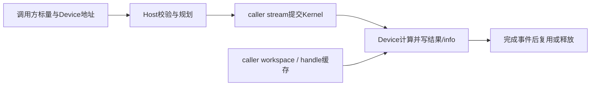
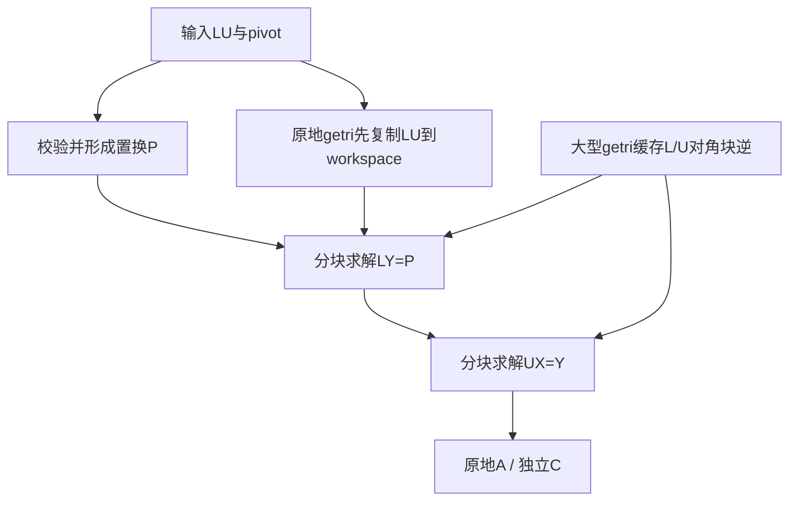

# 单精度复数LU分解与批量求逆（950PR）算子设计文档

## 需求背景

### 需求来源

本需求来源于[10月社区任务：单精度复数LU分解、求解和批量求逆（950）](https://www.hiascend.com/activities/task-center/details/237f144aab534448b58a123650b2fb35?menu=tasks)。依据任务书、api_list.md、四组cases.json及bench_result.json，在`cann/ops-solver`中升级COMPLEX64接口，适配Ascend 950PR。

### 背景介绍

#### 对标接口与计算语义

分析基线为ops-solver `0bf7eebb6a400ca33c135867eae5ce080ff1b13d`。原复数原型采用Host矩阵/info、连续batch和紧凑leading dimension；getri缺少pivot入参，公共头依赖C++类型。拟保留handle、stream及构建框架，迁移公共ABI、Host校验、四个Kernel入口及对应调用者。

本任务实现Cgetrf、Cgetri、CgetriBatched、CmatinvBatched四个计算接口，以及Cgetrf、Cgetri的bufferSize查询接口。矩阵均为COMPLEX64列主序数据，计算使用handle绑定的caller stream。

#### 任务包与验证边界

任务包包含四组cases.json与对应bench_result.json，共652条：Cgetrf 148条、Cgetri 200条、CgetriBatched 89条、CmatinvBatched 215条。设计、精度和性能验证均覆盖完整附件。

#### 接口定义

新增公共复数类型与操作枚举，公开接口保持任务书参数顺序；声明用`extern "C"`保护，头文件同时支持C/C++编译。

```c
typedef struct { float real; float imag; } aclFloatComplex;
typedef enum {
    ACLSOLVER_OP_N = 0,
    ACLSOLVER_OP_T = 1,
    ACLSOLVER_OP_C = 2
} aclsolverOperation_t;

aclsolverStatus_t aclsolverCgetrf_bufferSize(
    aclsolverHandle_t handle, int m, int n, aclFloatComplex *A,
    int lda, int *Lwork);
aclsolverStatus_t aclsolverCgetrf(
    aclsolverHandle_t handle, int m, int n, aclFloatComplex *A,
    int lda, aclFloatComplex *Workspace, int *devIpiv, int *devInfo);
aclsolverStatus_t aclsolverCgetri_bufferSize(
    aclsolverHandle_t handle, int n, aclFloatComplex *A, int lda, int *Lwork);
aclsolverStatus_t aclsolverCgetri(
    aclsolverHandle_t handle, int n, aclFloatComplex *A, int lda,
    int *devIpiv, aclFloatComplex *Workspace, int Lwork, int *devInfo);
aclsolverStatus_t aclsolverCgetriBatched(
    aclsolverHandle_t handle, int n, const aclFloatComplex *const Aarray[],
    int lda, const int *PivotArray, aclFloatComplex *const Carray[],
    int ldc, int *infoArray, int batchSize);
aclsolverStatus_t aclsolverCmatinvBatched(
    aclsolverHandle_t handle, int n, const aclFloatComplex *const A[],
    int lda, aclFloatComplex *const Ainv[], int lda_inv, int *info, int batchSize);
```

## 需求分析

### 需求描述

在Ascend 950PR及配套CANN环境中完成上述接口升级，支持Device数据、列主序、非连续批量指针数组、真实pivot/info、可查询workspace和异步stream执行。核心计算在AI Core完成，不引入CPU fallback。

### 接口与参数分析

| 项目 | 约定 |
|---|---|
| 数据类型与布局 | COMPLEX64，real/imag两个连续FP32，sizeof=8；列主序，无广播 |
| 内存位置 | 矩阵、workspace、pivot、info和批量指针数组均在Device；handle、维数、ld、Lwork在Host |
| leading dimension | 以复数元素计，至少max(1,有效行数)，允许padding；只读写有效区域 |
| 单矩阵输出 | getrf原地输出packed LU；getri输入LU并原地输出逆矩阵 |
| 批量输出 | getriBatched输入LU；matinvBatched输入原始A；均独立输出，不修改输入 |
| pivot | getrf输出min(m,n)个1-based逐步交换记录；getri输入n个；null表示无主元。PivotArray按batch×n排列 |
| info | 0成功，正数表示首次零对角，负数表示非法参数编号；batch逐成员保存 |
| workspace | Lwork以复数元素计；调用方按query分配并保持到stream完成 |
| 异步执行 | 使用handle绑定的caller stream；计算接口避免无必要Host同步 |

### 支持范围

| 接口 | 任务书验收下限 | 附件实际范围 | 用例数 |
|---|---|---|---:|
| Cgetrf | m,n≤4096，方阵/矩形 | m≤4096，n≤8168 | 148 |
| Cgetri | n≤4096 | n=2…4096 | 200 |
| CgetriBatched | n≤4096，batch≤1000000 | n≤3049，batch≤1000000 | 89 |
| CmatinvBatched | n≤32，batch≤1000000 | n≤32，batch≤10000000 | 215 |

设计覆盖全部652条附件，包括49条宽矩形LU和44条超大batch求逆用例。matinv的n=32合法，n>32在Host拒绝。空维数/空batch、有限输入、无主元、奇异及非连续Device成员地址纳入功能验证。

### 需求拆解

拟修改`include/cann_ops_solver*.h`、`src/cgetrf/`、`src/cgetri/`、`src/cgetri_batched/`、`src/cmatinv_batched/`及对应`test/`；在`src/utils/`组织共享复数运算、workspace规划和私有缓存。保持其他算子公开契约，同步迁移旧复数调用者及文档。

| 工作项 | 实现边界 | 完成判据 |
|---|---|---|
| 公共接口 | C ABI、复数类型、参数校验、bufferSize | C/C++编译链接及负向用例通过 |
| 单矩阵路径 | Cgetrf、Cgetri及caller workspace | 矩形、原地、pivot、padding和奇异用例通过 |
| 批量路径 | Device指针数组、逐成员info、handle私有scratch | 混合batch、双stream及生命周期用例通过 |
| 全量验证 | 652条精度与性能、共享路径回归 | 逐条留存真机结果与原始证据 |

## 详细设计

### 算子分析

#### 数学公式

设按顺序执行的行交换为S₁…Sᵣ，r=min(m,n)，定义`P=Sᵣ…S₁`，则：

```text
P*A₀ = L*U
A₀⁻¹ = U⁻¹*L⁻¹*P
L*Y = P，U*X = Y
```

L隐含单位对角，U保存在上三角，严格下三角存L。矩形时L为m×r、U为r×n。ipiv记录每一步交换，不能用最终permutation替代；求逆时按正序pivot构造P，再完成前代、回代。

#### 支持数据类型

复乘使用四实乘或等价实数块展开。拟采用FP32 SIMT与纯FP32 Cube，禁用HF32等降精度模式；复除使用尺度保护，奇异按实部、虚部均为零判断。严格残差敏感路径可用两个FP32数构成补偿表示及FMA，最终舍入为COMPLEX64，并通过完整精度用例验证。

### 算子实现

#### 实现方案



#### Host 侧设计

##### 参数校验与路径选择

1. 校验handle、非负维数、合法ld、顶层指针、Lwork及尺寸溢出。内部地址、字节数和batch任务数使用checked宽整数；列主序地址为`base+8*(uint64(col)*ld+row)`。
2. 从handle获取stream，根据矩阵规模、UB容量和平台核数选择小矩阵驻留、单矩阵分块或批量分块路径。尾panel/列块取有效长度，不假定完整tile或固定核数。
3. Host不解引用Device指针数组、pivot或info。Device侧校验成员null、pivot值及U对角；每成员唯一owner写info，错误成员跳过后续计算。pivot先检查编码范围再减1，避免INT_MIN溢出。
4. Host可判定的参数错误同步返回status；Device内容错误写负info并抑制对应计算，数值奇异写正info。调用方负责保证Device地址有效且输入、输出区域不重叠。

##### Batch分组与workspace

query与compute共用planner，query不读取A内容、不启动Kernel。令`R(x)=ceil(x/32)*32`，非空问题拟采用：

```text
wcap = min(16,m,n)
Wrf = R(8*m*wcap) + R(4*wcap) + 32
Wri = R(8*n*n) + R(4*n) + 32
    + (n>=32 ? R(528*n) : 0)
    + (n>=2048 ? 256*n + 32768*ceil(n/32) : 0)
Lwork = W/8
```

getrf区域为panel、pivot日志、状态，预留16列容量、计算panel初始取8。getri区域为紧凑只读LU、置换map、状态、打包panel/倒数及可选对角块逆缓存；n=4096时为17704964个复数元素，约135.08MiB。空问题workspace为0，返回int前检查上界。分派参数调整时query与compute必须同步更新。

getrf无Lwork入参，容量由调用方遵守query；getri可检查Lwork数值，裸指针均不能证明实际分配长度。caller workspace不与矩阵重叠，释放前等待stream完成。

较大getriBatched没有公开workspace参数，拟由handle按(context,stream)管理私有scratch，每成员预算`R(4n)+R(16n)+R(512n)+32`字节，用于置换、倒数、打包panel与状态。租约保护申请、Kernel提交和完成事件记录；同stream按队列顺序复用，跨stream独立；扩容后旧缓冲保留到事件完成。回收不强制计算接口同步，销毁handle时等待后释放。申请失败返回错误，事件异常时禁止提前释放；调用方在清理完成前保持stream有效。

##### Tiling与静态分派

Host按矩阵规模选择SmallResident、BlockedSingle或BlockedBatch路径。LU panel初始宽度为8，三角块初始阶数为32；实际blockDim、RHS列宽和尾块长度根据平台核数、UB容量及有效尺寸计算。batch任务按矩阵或`(batch_id,RHS列块)`分派，每个输出区域只有一个写owner。

#### Kernel 侧设计

##### Cgetrf分块LU


每个panel依次选主元、交换、复除并更新panel内剩余列。pivot采用复数abs1度量、固定归约顺序，相等时选最小行号。ipiv=null时省略选主元与交换。

panel完成后将同一交换序列传播到左侧L和右侧未处理列；随后计算`U12=L11⁻¹*A12`、`A22←A22−L21*U12`。交换与求解按列区分核，尾部更新按二维tile分核，每输出tile唯一owner。零对角只记录最早info并抑制除零，矩形尾部只处理有效范围。

拟用同stream的Kernel边界保证下一panel读取前本轮更新完成；不引入未经目标SDK验证的全局自旋屏障。

##### Cgetri与CgetriBatched求逆



getri先保存有效LU，原地A承载P、Y、X，后续只读取LUCopy，避免覆盖尚需读取的输入。小n在UB内闭合依赖；中等n以32阶对角求解配合外侧矩阵更新；大型n拟缓存各L/U对角块逆，通过Cube应用于多个RHS列块，减少重复串行求解。RHS独立打包，矩阵乘输入输出不重叠；缓存构造与应用均计入API成本。

getriBatched直接读取Device成员地址，不能假定连续batch，也不能对输入LU再做getrf。小n按1/2/4/8/16/32线程子组协作；大n按(batch_id,RHS列块)分派，C保存中间结果，handle scratch承载打包临时。前代行块从上到下，回代从下到上，依赖由同stream阶段建立，各输出列块独占。

每成员独立info，奇异成员不影响邻居；调用方保证对应输入输出、不同输出成员以及跨batch矩阵区域不重叠。奇异输出不作为有效逆矩阵使用。

##### CmatinvBatched小矩阵融合

每核循环服务一个或一组batch：Device指针取址→有效A搬入UB→部分主元LU→构造P→前代/回代→写独立Ainv及info。n≤32时单个A最多8192字节，UB预算还包括原始A、LU、RHS、pivot、补偿临时、对齐及队列，按总量决定驻留组数。

严格残差敏感时可采用补偿运算或固定一次修正`R=I−C*A，C←C+R*C`，保留原始A并计入UB及完整API成本；n=2可采用尺度保护解析公式。最终路径由全量精度决定，不按case编号特判。全局不申请O(batch*n²)额外工作区。

##### 异步与资源生命周期

核内CopyIn→Compute→CopyOut使用目标SDK队列/事件；消费者完成后才复用缓冲，GM scalar与DMA混用另验证缓存可见性。不同stream不共享可写scratch，setStream与compute并发由调用方串行化。固定主元归约与累加顺序，恢复同输入重复调用应bit-wise一致。

### 复杂度与数据量

LU复杂度为O(m*n*min(m,n))，求逆为O(n³)，批量再乘batch。大矩阵重点减少重复对角求解及扩大矩阵更新并行量；小矩阵重点降低launch、间接寻址与补偿运算成本。最大附件基础Device驻留约15.36GiB，另需workspace、输入备份和Runtime空间。

### 支持硬件

目标硬件为Ascend 950PR，使用配套CANN 9.0.0及以上版本、ACL Runtime、Ascend C编译链和msprof。共享头、handle及旧路径改动按仓库要求在原支持平台回归，不扩展其他平台支持声明。

### 算子约束限制

仅支持COMPLEX64列主序有限输入，无广播。矩阵、workspace、pivot、info和批量指针数组位于Device。Cgetri输入必须是匹配pivot的LU；CgetriBatched和CmatinvBatched要求输入输出及输出成员互不重叠。调用方负责Device地址、分配容量及stream生命周期。

此次公开复数原型、内存域和链接规则均有变化，须迁移仓内调用者，不能让旧参数调用同名新C符号。handle私有缓存扩展需回归创建、stream、销毁及Sgetrf/Sgetri/Cheevj原有行为。新增支持目标为950PR，其他平台按共享改动范围验证，不扩大支持声明。

## 可维可测分析

### 精度标准/性能标准

#### 精度标准

令F为从packed LU重建、逆序回放行交换后的矩阵，A₀为原始矩阵，C为逆矩阵，ε=2⁻²⁴：

```text
ratio_rf = ||F-A₀||₁ / (n*||A₀||₁*ε)
ratio_ri = ||I-C*A₀||₁ / (n*||A₀||₁*||C||₁*ε)
||M||₁ = max_j Σ_i |M[i,j]|
```

| 接口 | 精度上限 |
|---|---|
| Cgetrf | max(5*ratio_cpu,0.5) |
| Cgetri / CgetriBatched | max(5*ratio_cpu,0.05) |
| CmatinvBatched | max(5*ratio_cpu,0.5) |

ratio_cpu由同输入COMPLEX64参考链计算，残差可使用complex128。独立LU输入的getri/getriBatched先由LU及pivot还原A₀；matinv使用原始A。batch逐矩阵判定，任一超限则case失败；奇异及零分母问题单独检查info，禁止依靠NaN比较产生通过。

#### 正式性能用例与目标

性能逐条对应652条GPU基线，要求`T_NPU_us≤1000*GPU_avg_ms/0.35`。一次API必要的校验、复制、打包、缓存、求解及收尾Kernel全部聚合，不只计热点。恢复getrf原始A/getri输入LU在计时外；matinv内部LU必须计入。按任务包runner的调用边界及25次迭代保存完整样本。

#### 精度测试设计

对每条case生成同输入COMPLEX64参考结果，使用complex128计算残差。Cgetrf重建PA=LU；Cgetri和CgetriBatched分别验证CPU LU输入与NPU getrf链；批量接口逐矩阵判断ratio和info。

#### 性能测试设计

在950PR上固定源码、库、runner和输入hash，记录实际加载库路径。msprof按一次公开API聚合全部Kernel，以任务包GPU基线逐条计算性能比，并保留原始CSV和未通过项。

### 分层验证计划

| 层次 | 主要内容 |
|---|---|
| ABI/Host | C/C++编译链接、动态符号、参数错误、空问题、planner溢出、exact workspace与不足容量 |
| 950PR功能 | 矩形/尾块、n=1/31/32/33、无主元、pivot tie、多次交换、奇异/近奇异、padding哨兵 |
| 批量与资源 | 散布/逆序Device指针、混合奇异、输入只读、超4GiB地址、两stream、缓存增长/复用/销毁 |
| 全量精度 | 148+200+89+215=652条；另测CPU LU→getri与NPU getrf→getri，区分误差来源 |
| 全量性能 | 固定同一库/runner/输入与匹配GPU基线，逐点保存完整API样本及failed/unverified |
| 回归与确定性 | 恢复同输入重复调用；Sgetrf/Sgetri/Cheevj、handle及受影响调用者 |

环境拟采用950PR、配套CANN9.0.0及以上、ACL、Ascend C、GCC、CMake和msprof；可使用HiDevLab的Ubuntu22.04环境。记录实际SDK构建号、SoC、核数、驱动/固件、HBM和健康状态。

### 兼容性分析

新接口保持任务书规定的函数名和参数顺序，但相对仓内旧复数原型改变了数据内存域、参数数量和返回语义。实现时同步迁移examples、tests和文档，公共头保持C/C++兼容；Sgetrf、Sgetri、Cheevj及handle接口保持原契约。
