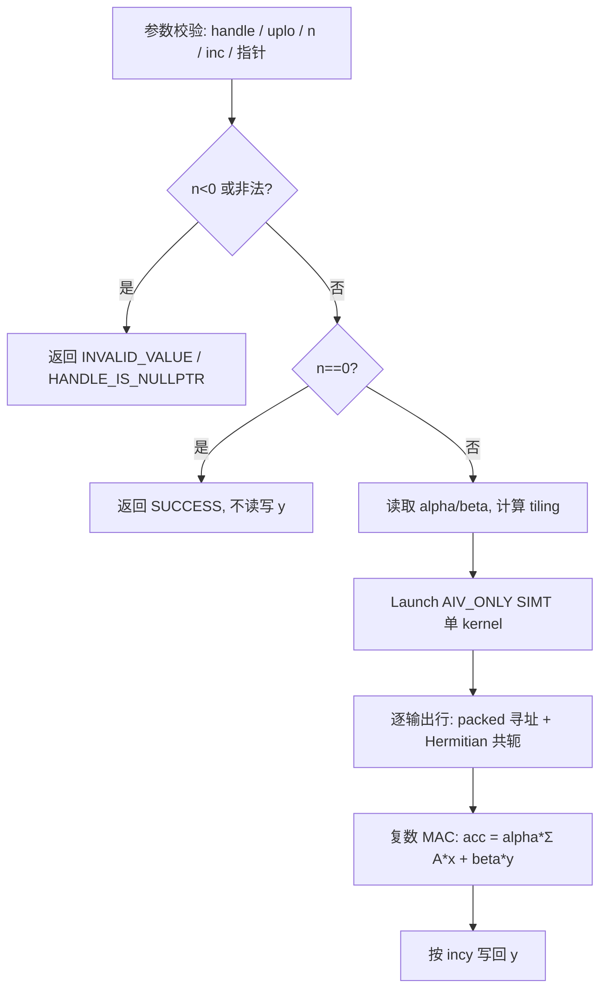

# aclblasChpmv 算子设计文档（Atlas 950PR / arch35）

| 文档版本 | 日期 | 作者/团队 | 说明 |
| --- | --- | --- | --- |
| V1.0 | 2026-10-28 | dzzw123 | 公开版：仅含算子语义、验收口径、整体实现路线与测试方案；核内分块参数、性能标定数值与优化细节在验收阶段于私有仓完成，不在公开文档披露 |

> 本文档提交至公开仓库 `cann-ops-competitions`，面向所有报名本任务的开发者可见。按惯例，公开设计文档描述**方案级**内容，具体实现参数与性能余量留待私有验收仓，避免实现细节外泄。

# 需求背景（required）

## 需求来源

本需求来自 CANN 社区任务「aclblasChpmv 算子开发（Atlas 950PR）」。任务要求在昇腾 NPU（Atlas 950PR，DAV_3510，SOC arch35）上使用 Ascend C 开发 **Hermitian 压缩格式矩阵-向量乘（复数）** 算子 `aclblasChpmv`，功能与参数语义对标标准 BLAS `zhpmv`/`chpmv`（Netlib）及 cuBLAS 复数 Hermitian packed matvec；算子实现最终合入昇腾算子开源仓 ops-blas 的 `blas/spmv/arch35/` 目录，测试代码合入 `test/spmv/chpmv/`。

## 背景介绍

CHPMV 属于 BLAS Level-2，计算：

```
y = alpha * A * x + beta * y
```

其中 `A` 为 `n×n` **Hermitian** 矩阵（即 `A = A^H`），以**压缩打包（packed）**格式逐列存储 `uplo` 指定的三角（含对角）于一维数组 AP（长度 `n(n+1)/2`，无前导维 lda）；`x`、`y` 为长度 `n` 的复数向量，按 `incx`/`incy` 步长访问（支持负步长）。CHPMV 是 SPMV（实对称压缩 matvec）的复数同族算子，二者数学结构完全同构，区别仅在数据类型（复数 vs 实数）与对称性质（Hermitian `A^H` vs 实对称 `A^T=A`）。

CHPMV 广泛用于 Hermitian 特征值求解、量子化学、信号处理的协方差/相关矩阵运算等场景，是复数线性代数栈的基础算子。

### 对标接口与现状分析

| 接口 / 实现 | 现状 | 与本设计的关系 |
| --- | --- | --- |
| `zhpmv`/`chpmv`（Netlib） | 语义基线 + golden | 参数序列 `uplo, n, alpha, AP, x, incx, beta, y, incy`；packed Hermitian |
| `aclblasChpmv`（`include/cann_ops_blas.h`） | 待新增公共声明 | 本次在公共头文件新增声明，不定义产品私有平行接口 |
| `blas/spmv/arch35/`（Ascend 950PR） | 仓内已有 `aclblasSspmv`（实对称压缩 matvec） | 同一算子类、同一硬件；其工程骨架（AIV_ONLY SIMT 单 kernel、packed 寻址、CSV 驱动测试）可直接作为底座复用，本设计在其上做复数语义扩展 |
| `blas/spmv/arch35/aclblasCtpmv`（Ascend 950PR） | 仓内已有（三角压缩复数 matvec） | 同为 arch35 复数 packed 算子，验证过 AIV_ONLY SIMT 路线在 arch35 的可行性 |

### aclblasChpmv 算子功能分析

- 计算 `y = alpha*A*x + beta*y`，`A` 为 Hermitian 矩阵，packed 存储只保留 `uplo` 指定的一半三角形，另一半由 `A = A^H` 隐含（非存三角形元素 = 存三角形对应元素的共轭）；
- 对角线元素为实数（Hermitian 性质）：对角虚部必须为 0，且按参考实现约定忽略对角虚部；
- `alpha`、`beta` 为复数标量；`x`、`y` 为按 `incx`/`incy` 步长访问的复数向量（支持负步长）；
- `n = 0` 为合法 no-op（直接返回 `SUCCESS`，不引用 AP / 不更新 y）；
- `beta = (0,0)` 时不读取 `y`；`alpha = (0,0)` 且 `beta = (1,0)` 无特殊短路要求；
- 不做奇异性检测；调用方须保证输入语义合法。

# 需求分析（required）

## 需求描述

使用 Ascend C 在 Atlas 950PR（arch35）上实现 `aclblasChpmv`，接口签名（待在 `include/cann_ops_blas.h` 新增）：

```cpp
aclblasStatus_t aclblasChpmv(
    aclblasHandle_t handle, aclblasFillMode_t uplo, int n,
    const aclblasComplex* alpha, const aclblasComplex* AP,
    const aclblasComplex* x, int incx,
    const aclblasComplex* beta, aclblasComplex* y, int incy);
```

实现置于 `blas/spmv/arch35/`，测试工程置于 `test/spmv/chpmv/`。不新增产品私有平行接口。

## 需求拆解

1. **功能**：`uplo ∈ {UPPER, LOWER}` 全部正确；支持 `incx`/`incy` 正/负步长；支持 `n = 0` quick return；Hermitian 对称（非存三角形取共轭）；对角按实数处理。
2. **接口与异常**：在公共头新增声明；异常返回码与任务配套 CSV 用例口径保持一致（`INVALID_VALUE` / `HANDLE_IS_NULLPTR`）。
3. **精度**：FLOAT32 档（complex64），`rtol = atol = 2^-13`，`matched_ratio ≥ 0.99`，`max_abs_error ≤ 1e-2`（或 32×ULP）；实部/虚部分别比对；NaN/Inf 等价规则同 MixedTolerance；golden 由 `cblas_chpmv`（Netlib/OpenBLAS）生成。
4. **性能**：NPU 单次算子平均耗时 ≤ 任务书 `gpu_baseline.csv` 中对应 H100 基线的 1/0.4（即 NPU ≥ 0.4× H100）；采样方式按任务书（warmup + 平均）。
5. **工程**：Host + Kernel + Tiling 三件套，kernel 直调；复用仓内 `blas/spmv` 的工程与测试框架。
6. **自验**：覆盖基础、尺寸扫描、步长、填充（含 Inf/NaN）、边界负向、性能用例，输出自测报告。

# 详细设计（required）

## 算子分析

### 数学公式

```
y = alpha * A * x + beta * y,   A = A^H (Hermitian)
```

### packed 存储布局

A 以列主序压缩打包，仅存 `uplo` 指定三角（标准 BLAS packed 布局，0-based）：

| uplo | 元素 A(i,j) 在 AP 中的下标 | 说明 |
| --- | --- | --- |
| UPPER（i ≤ j） | `AP[i + j*(j+1)/2]` | 逐列堆叠上三角（含对角） |
| LOWER（i ≥ j） | `AP[i + j*(2n-j-1)/2]` | 逐列堆叠下三角（含对角） |

非存三角形元素在读取时按 Hermitian 性质取共轭（即 `A(j,i) = conj(A(i,j))`，`i,j` 为另一三角索引）。对角线元素为实数。

> 注：上述为标准 BLAS `zhpmv` packed 布局。实现前将用 Netlib 参考实现与仓内 arch35 既有 packed 算子（`Sspmv`/`Ctpmv`）的索引逻辑三处交叉校验，确保与 golden 完全一致（见「风险与待确认项 #1」）。

### 支持数据类型

| 张量/标量 | 类型 | 说明 |
| --- | --- | --- |
| AP | `const aclblasComplex*`（complex64） | Device 内存，只读，长度 n(n+1)/2 |
| x / y | `aclblasComplex*`（complex64） | Device 内存；y 为输入/输出 |
| alpha / beta | `aclblasComplex` | Host 标量（支持 nullptr → 视作非法入参） |
| n / incx / incy | `int` | Host 标量 |
| uplo | 枚举 | `ACLBLAS_UPPER` / `ACLBLAS_LOWER` |

### 支持形状

- AP：长度 `n(n+1)/2` 的一维打包数组（无 lda）；
- x / y：长度 `1 + (n-1)*|inc|` 的向量；`inc < 0` 时逻辑下标 `i` 对应物理下标 `(n-1-i)*|inc|`；
- 不涉及广播；n 为运行时入参；packed 无前导维，无 L3/L4 非方阵类别。

### 参数与异常行为矩阵

| 参数 | 合法值域 | 非法时返回 |
| --- | --- | --- |
| handle | 非 nullptr | `ACLBLAS_STATUS_HANDLE_IS_NULLPTR` |
| n | n ≥ 0（n = 0 为合法 no-op，返回 `SUCCESS`） | n < 0 → `ACLBLAS_STATUS_INVALID_VALUE` |
| uplo | `{UPPER, LOWER}` | `ACLBLAS_STATUS_INVALID_VALUE` |
| incx / incy | ≠ 0 | `ACLBLAS_STATUS_INVALID_VALUE` |
| alpha / beta / AP / x / y | n > 0 时非 nullptr | `ACLBLAS_STATUS_INVALID_VALUE` |

**校验顺序**（对齐任务书 §2.5 与配套 CSV 期望结果）：`n < 0` → `handle nullptr` → `n == 0` quick return（即使 alpha/beta/AP 为 null 也 SUCCESS）→ 依次校验 `uplo` / `incx` / `incy` / `alpha` / `beta` / `AP` / `x` / `y` → 任一失败 `INVALID_VALUE`。异常分支全部在 Host 侧返回，不下发 kernel。

## 算子实现

### 实现总流程（路线级）



### 工程结构与文件清单（方案级）

```
blas/spmv/arch35/
  chpmv_kernel.cpp      # SIMT kernel：逐输出行归约，Hermitian 共轭处理
  chpmv_host.cpp        # Host：参数校验、tiling 计算、launch 调度
  chpmv_tiling_data.h   # Host/Kernel 共享 tiling 结构体
test/spmv/chpmv/
  chpmv_param.h         # CSV 参数解析
  chpmv_golden.h        # CPU 参考（cblas_chpmv）
  CMakeLists.txt        # 测试注册
  arch35/
    chpmv_test.cpp      # CSV 驱动 GTest
    chpmv_npu_wrapper.h # NPU 调用封装
    chpmv_test.csv      # 驱动用例
```

工程约束沿用仓内 `blas/spmv` 约定：库侧 `arch35/*.cpp` 由构建系统自动 glob 编译；测试侧由 `test/CMakeLists.txt` 遍历子目录自动纳入；kernel 入口统一标注 `KERNEL_TYPE_AIV_ONLY`。

### 实现方案（路线级）

- **核类型**：`AIV_ONLY` 单 kernel（SIMT）。CHPMV 为逐输出元素的归约型 matvec，无矩阵乘（Cube）结构，AIC 不适用；AIV_ONLY SIMT 在 arch35 的 `Sspmv`/`Ctpmv` 已验证可行，且能避免 MIX 路径下 AIC 镜像入口对输出的干扰。
- **算法主体**：每个线程负责一个输出行 `row` 的归约 `y[row] = alpha*Σ_j A[row][j]*x[j] + beta*y[row]`；packed 寻址与 `Sspmv` 同构（只存一半三角形），非存三角形元素读取后按 Hermitian 性质取共轭。
- **复数计算**：标量/向量类型由 `float` 扩展为 `aclblasComplex`，补齐复数乘加与共轭 helper（对标浮点版本的标量运算）。
- **对角处理**：按 Hermitian 定义，对角元素处理为实数（忽略其虚部），与 golden 参考（`cblas_chpmv`）语义一致。
- **步长支持**：`incx`/`incy` 通过逻辑下标 ↔ 物理下标的映射处理正负步长。
- **分块策略（路线级，不披露具体参数）**：依据 `n` 与可用 AIV 核数做输出行的并行分解，核间按连续行区间均分、无重叠、无原子依赖；单核内热路径单一、可向量化。具体 `block/thread` 计数与 UB 分段参数在实现阶段结合 msprof 标定，不在公开文档暴露。
- **精度策略**：kernel 执行的浮点运算序列与 Netlib `zhpmv` 参考实现一致（仅并行调度不同），逐元素误差为 ULP 级，远宽于 FLOAT32 阈值 `2^-13`。

### 支持硬件

| 支持的芯片版本 | 涉及勾选 |
| --- | --- |
| Atlas 950PR / Ascend 950DT（DAV_3510 / arch35） | √ |

### 算子约束限制

- 支持 complex64（FP32 复数）；不支持 FP16/BF16/双精度与实数 dtype；
- 不支持 `incx = 0` / `incy = 0`；
- 不支持非连续 Tensor（超出步长语义的内存访问）；
- A 必须为方阵 Hermitian、packed 存储无 lda；
- 不做奇异性检测；
- 不保证 bit-exact（确定性计算不作要求）。

# 可维可测分析

## 精度标准/性能标准

| 验收标准 | 描述 | 标准来源 |
| --- | --- | --- |
| 精度标准 | FLOAT32（complex64）：`rtol = atol = 2^-13 ≈ 1.22e-4`，`matched_ratio ≥ 0.99`，`max_abs_error ≤ 1e-2`（或 32×ULP）；实部/虚部分别比对；NaN/Inf 等价规则同 MixedTolerance | 任务书 §精度 + 生态算子开源精度标准 |
| golden | `cblas_chpmv`（Netlib/OpenBLAS）单标杆，对 y 的 n 个元素（按 incy 步长）全量逐元素比对 | 任务书 |
| 测试工程口径 | MERE = 2^-13，MARE 离群倍率 10.0（与仓内 test frame 惯例一致） | ops-blas test frame |
| 性能标准 | NPU 单次算子平均耗时 ≤ `gpu_baseline.csv` 对应 H100 基线 × 2.5（即 NPU ≥ 0.4× H100）；warmup 后有效采样取平均 | 任务书 §性能 |
| 内存标准 | 不涉及固定上限；workspace 需求小 | 任务书 |

### 性能可行性（路线级）

CHPMV 为访存受限的 BLAS L2 算子，计算量 `O(n^2)` 但算术强度低（每输出元素一次向量内积），与已在同一硬件（arch35）验证可行的 `Sspmv`/`Ctpmv`（同属 packed 复数/实数 matvec）访问模式同构。基于同类算子已在 arch35 达标的历史，本算子预期可在全 n 区间满足「NPU ≤ 2.5× H100」的验收线；最终性能数值以 950 实机 `msprof` 标定为准（实现阶段调优，不在公开设计文档披露具体余量）。

## 测试设计

测试工程基于 ops-blas `test/frame`（CSV 驱动 + GTest），在 `test/spmv/chpmv/` 下新增，复用仓内 `blas/spmv` 的测试范式（CSV 解析、cblas golden、NPU wrapper）。

### 用例集

任务配套 `chpmv_test.csv` 共 **1200 条**（1000 精度 + 200 性能），本设计全量采纳，覆盖：

| 类别 | 覆盖点 |
| --- | --- |
| 基础 | 小尺寸 × uplo 组合 |
| 尺寸扫描 | 尺寸池（含质数、2 的幂及 ±1、非对齐值） |
| 步长 | incx/incy ∈ {±1, ±2, ±3} |
| 填充 | AP/x/y：均匀/交替/极端/全零/Inf/NaN；以及 null 指针 |
| 边界负向 | n=0 quick return、null 指针、非法 uplo、负维度、零步长 |
| 性能 | 典型 case + 尺寸对数扫描（连续访存 incx/incy=1） |

CSV 列含 `case_name,description,uplo,n,alpha_real,alpha_imag,ap_fill,x_fill,incx,beta_real,beta_imag,y_fill,incy,expect_result,mere_threshold,mare_multiplier,random_seed`；标量 `null` 表示 nullptr。

### 负向用例与异常行为对照

| 异常行为 | 用例 | expect_result |
| --- | --- | --- |
| n = 0 合法 no-op | TC_ED `n0_*` | `ACLBLAS_STATUS_SUCCESS` |
| n > 0 时 AP/x/y 为 nullptr | `ap_fill/x_fill/y_fill = NULLPTR` | `ACLBLAS_STATUS_INVALID_VALUE` |
| uplo 非法 | `uplo=999` | `ACLBLAS_STATUS_INVALID_VALUE` |
| n < 0 | `neg_n` | `ACLBLAS_STATUS_INVALID_VALUE` |
| incx / incy = 0 | `incx0` / `incy0` | `ACLBLAS_STATUS_INVALID_VALUE` |
| handle 为 nullptr | 测试构造（不入 CSV） | `ACLBLAS_STATUS_HANDLE_IS_NULLPTR` |

### 可复现执行口径

| 项 | 说明 |
| --- | --- |
| 精度 | `python verify_accuracy.py --soc ascend950 ...`（自动编译、运行 GTest、解析逐条 PASS/FAIL） |
| 性能 | `python verify_performance.py --soc ascend950`，与 `gpu_baseline.csv` 关联比对，warmup 后有效采样取平均 |
| 记录项 | CANN/驱动版本、SOC、CSV 随机种子、编译参数、逐条结果、精度/性能截图 |

### 交付件

1. 设计文档 PR 合入截图；
2. 测试用例（CSV + CSV 驱动 GTest + 测试步骤 readme）；
3. 用例结果自测报告（精度对比、性能数据、内存占用）；
4. 待验收代码地址（私有仓链接、分支、算子目录 `blas/spmv/arch35/`、`test/spmv/chpmv/`，并邀请 `Ascend-CANN` 为开发者）。

## 兼容性分析

- **不修改公开接口语义**：在 `include/cann_ops_blas.h` 新增 `aclblasChpmv` 声明，签名与参数语义标准化，无 ABI 破坏；未定义任何产品私有平行 API。
- **不影响既有实现**：新增 `blas/spmv/arch35/chpmv_*` 与 `test/spmv/chpmv/`，不改动 `Sspmv`/`Ctpmv` 既有路径。
- **跨产品线一致**：与仓内 `Sspmv`/`Ctpmv` 共享 packed 索引记法、参数校验顺序与错误码口径，便于后续复数 packed 族算子复用。
- **数值兼容**：与 Netlib `zhpmv` 运算序列一致（仅并行调度不同），相对 cblas golden 逐元素差异为 ULP 级，满足 `2^-13` 阈值。

## 风险与待确认项

| # | 事项 | 影响 | 处置 |
| --- | --- | --- | --- |
| 1 | packed 索引公式需与 Netlib 参考及仓内 arch35 既有 packed 算子三处交叉校验 | 中：公式偏差会导致 golden 比对全量失败 | 实现前用 Netlib `zhpmv` + 仓内 `Sspmv`/`Ctpmv` 索引逻辑互证，以 Netlib 为准 |
| 2 | 任务配套 CSV 的返回码口径（非法枚举/参数返回 `INVALID_VALUE` 而非 `INVALID_ENUM`） | 中：口径不一致致用例判定歧义 | 跟随仓内既有实现 + 配套 CSV，保证跨产品线一致 |
| 3 | `cblas_chpmv` 可用性（部分 BLAS 实现未提供 chpmv） | 低 | 优先 Netlib/OpenBLAS `cblas_chpmv`；若缺失则基于 `zhpmv` 自行实现参考 |
| 4 | 性能达标依赖实机 msprof 标定（分块参数、向量化友好度） | 低 | 首轮按同类算子经验取值，950 实机实测后回调 |
| 5 | 复数填充模式（Inf/NaN）在共轭/对角路径的传播 | 低 | 全程 FP32 复数，不做降精度改写；补充专项用例观察 |

## 关联

- 关联任务 Issue：无（按任务要求，本设计文档 PR 不关联 Issue）
- 上游代码仓：`cann/ops-blas`（`blas/spmv/arch35/`、`test/spmv/chpmv/`）
- 设计文档提交仓：`cann-ops-competitions`（本 PR）
