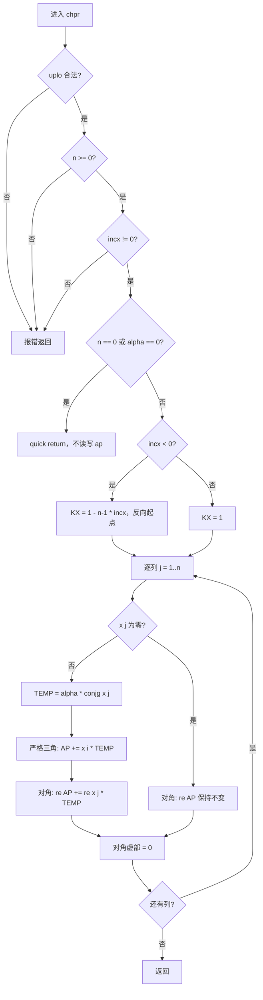

aclblasChpr算子设计文档

# 1. 需求背景

## 1.1 需求来源

本需求为昇腾 CANN 社区 2026 年度算子开发任务。针对 Ascend 950PR（arch35）芯片，基于 Ascend C 编程语言与 Kernel 直调工程模式，开发 BLAS Level-2 单精度复数 Hermitian 压缩存储秩-1 更新算子 `aclblasChpr`，对标 cuBLAS `cublasChpr` 与 Netlib BLAS 参考实现 `chpr.f`，补齐昇腾 ops-blas 开源仓在复数 Hermitian packed 矩阵运算上的能力空缺。

## 1.2 背景介绍

BLAS（Basic Linear Algebra Subprograms）是科学计算、信号处理、阵列处理与深度学习优化器等场景的公共数值基座。Hermitian 秩-1 更新（HPR）是其中被高频引用的一类 Level-2 运算：把一个秩-1 的 Hermitian 外积累加到已有 Hermitian 矩阵上，是 Householder 变换构造、协方差矩阵在线更新、Cholesky/QR 分解前处理的常见步骤。与一般矩阵更新不同，HPR 以 packed（压缩）格式存放矩阵，只需 n(n+1)/2 个复数元素即可表达整个 Hermitian 矩阵，在内存受限的加速器场景中具有实际价值。

在复数 Hermitian 情形下，更新式中的标量 `alpha` 必须是**实数**。这是数学上的硬性要求：`alpha * x * conjg(x^T)` 只有在 `alpha` 为实数时才是 Hermitian 矩阵（对角元为 `alpha * |x[i]|^2`，必为实数）。Netlib `chpr.f` 的 `ALPHA is REAL` 声明与 cuBLAS `cublasChpr` 原型共同确认了这一点，本算子严格遵循。

目前 ops-blas 仓中 `blas/hpr/` 算子族的 arch22 产品线已有 `chpr` 实现，但 Ascend 950PR（arch35）缺少对应的 Kernel 直调实现。同族的实数版本 `aclblasSspr` 已在 arch35 完成开发，其工程接入、编译期模板分派与 packed 索引经验可以借鉴；但实数版每个 packed 元素只有 1 个 float，复数版有 2 个 float 分量并带共轭、对角置零等额外语义，数值实现无法直接复用。

开发完成后，`aclblasChpr` 作为公共 API 的一部分，与既有产品线实现共用同一接口声明，并随实现一并合入 ops-blas 仓 `blas/hpr/arch35/`。

### 1.2.1 算子来源与标杆核查

本任务是在公共 BLAS 接口上补齐一个新硬件代际的 Kernel 实现，不是把既有 TBE/ACLNN 算子迁移为 Ascend C。因此设计文档模板中面向 TBE 迁移类任务的若干审核项，对本算子的结论是**不适用**，而非缺少材料：

| 审核对象 | 核查结论 | 依据 |
| --- | --- | --- |
| 原 TBE 算子源码路径 | 不适用：`aclblasChpr` 无 TBE 实现，仓内也不存在对应的 ACLNN 算子 | 接口为 `aclblas*` 句柄式 BLAS API，声明于 `include/cann_ops_blas.h`，不经过 ACLNN 算子信息库 |
| 算子信息库路径 | 不适用：本任务不注册 ACLNN 算子，无算子信息库 JSON | 同上；算子能力以任务书 §2.4/§2.5 与 Netlib/cuBLAS 语义为准 |
| 可复用工程实现 | 适用 | `blas/hpr/arch22/chpr_host.cpp`（句柄/stream 接入参考）、`blas/spr/arch35/sspr_kernel.cpp`（同族实数版 packed 索引与分核参考） |

本设计不以任何 TBE 源码作为语义来源，语义一律以 Netlib `chpr.f` 与 cuBLAS `cublasChpr` 为准。

### 1.2.2 aclblasChpr 算子现状分析

`aclblasChpr` 是 BLAS HPR 例程的 complex64 版本，对以 packed 格式存放的 Hermitian 矩阵做原地三角更新。相关代码位置如下：

```text
include/cann_ops_blas.h                        # 公共 C API 声明（已存在，本任务不改动）
blas/hpr/arch35/chpr_host.cpp                  # Host 侧校验、tiling 构造、stream 直调
blas/hpr/arch35/chpr_kernel.cpp                # Kernel 入口与 SIMT 子核实现
blas/hpr/arch35/chpr_kernel.h                  # 启动函数声明
blas/hpr/arch35/chpr_tiling_data.h             # Host–Kernel 共享 POD（按值传递）
test/hpr/chpr/chpr_golden.h                    # cblas golden 与参考校验顺序
test/hpr/chpr/chpr_param.h                     # CSV 列映射
test/hpr/chpr/arch35/                          # NPU wrapper、CSV 驱动 GTest、测试 CSV
```

#### 1.2.2.1 标杆支持的数据类型和数据格式

| 项目 | 要求 |
| --- | --- |
| 标量 `alpha` | FLOAT32 **实数**（非复数），Host 内存 |
| 向量 `x` | complex64（实部/虚部均为 FLOAT32），Device 内存，只读 |
| 矩阵 `ap` | complex64，Device 内存，packed 压缩、原地读写 |
| 存储布局 | packed（压缩），共 n(n+1)/2 个复数元素，**无前导维度参数 `lda`** |
| 选择三角 | `ACLBLAS_UPPER`(121) / `ACLBLAS_LOWER`(122)，仅指定三角被引用与更新 |
| 对角语义 | 输入对角虚部假定为 0；输出对角虚部必须置为 0 |
| 步长 | `incx` 任意非零 `int`，支持负步长 |

#### 1.2.2.2 标杆实现描述

Netlib `chpr.f` 的核心语义（1-based Fortran 索引）：

- 参数校验顺序为 `uplo` → `n` → `incx`，任一非法调用 `XERBLA` 报错返回；
- quick return 条件为 `n == 0` 或 `alpha == 0`；
- 负步长时起点为 `KX = 1 - (n-1)*INCX`，即反向遍历向量；
- 逐列推进，第 j 列处理前先判断 `x[j]` 是否为零：
  - `x[j] != 0`：令 `TEMP = ALPHA * CONJG(x[j])`（`alpha` 为实数，共轭只翻转虚部符号），列内严格三角部分执行 `AP(k) = AP(k) + x[i]*TEMP`；对角元素执行 `AP(kk+j-1) = REAL(AP(kk+j-1)) + REAL(x[j]*TEMP)`，即只累加实部（等价于 `+ alpha*|x[j]|^2`），虚部被赋为 0；
  - `x[j] == 0`：走 `else` 分支，只执行 `AP(kk+j-1) = REAL(AP(kk+j-1))`，即**严格三角部分完全不动**，仅把对角元素虚部清零；
- packed 指针 `KK` 逐列前进：UPPER 每列步进 `j`，LOWER 每列步进 `n-j+1`，整体是一次对 `AP` 的顺序单遍扫描。

其中 `x[j] == 0` 分支容易被忽略：它不是"整列跳过"，而是"跳过严格三角、但仍清对角虚部"；且因为不执行加法，`-0.0` 不会被改写成 `+0.0`。实现必须复现该行为，否则含零列的用例会出现虚部非零或符号翻转的差异。

#### 1.2.2.3 标杆算子实现流程图



## 1.3 aclblasChpr 算子功能分析

计算公式：

```text
A := alpha * x * conjg(x^T) + A
```

其中 `alpha` 为实数 `float`；`x` 为 n 元素 complex64 向量；`A` 为 n×n Hermitian 复数矩阵，以 packed 压缩格式存放于 `ap`。逐元素形式：

```text
A(i,j)      += alpha * x[i] * conjg(x[j])     （i != j，仅 uplo 指定三角）
re(A(j,j))  += alpha * |x[j]|^2               （对角，只更新实部）
im(A(j,j))   = 0                              （对角，无条件清零）
```

**packed 索引（0-based，共 `count = n(n+1)/2` 个复数元素）**

| 布局 | 存储位置 | 列基址 | 列内排布 |
| --- | --- | --- | --- |
| UPPER（i ≤ j） | `ap[i + j(j+1)/2]` | `j(j+1)/2` | 行号递增，**对角在列末** |
| LOWER（i ≥ j） | `ap[i + (2n-j-1)j/2]` | `j(2n-j+1)/2` | 行号递增，**对角在列首** |

未存储的另一半由 Hermitian 共轭对称性 `A(j,i) = conjg(A(i,j))` 隐含，实现不引用、不更新。

**n = 4 的布局示例**

UPPER（`count = 10`）：

| ap 下标 | 0 | 1 | 2 | 3 | 4 | 5 | 6 | 7 | 8 | 9 |
| --- | --- | --- | --- | --- | --- | --- | --- | --- | --- | --- |
| 元素 | A(0,0) | A(0,1) | A(1,1) | A(0,2) | A(1,2) | A(2,2) | A(0,3) | A(1,3) | A(2,3) | A(3,3) |
| 列 | 0 | 0 | 1 | 0 | 1 | 2 | 0 | 1 | 2 | 3 |

LOWER（`count = 10`）：

| ap 下标 | 0 | 1 | 2 | 3 | 4 | 5 | 6 | 7 | 8 | 9 |
| --- | --- | --- | --- | --- | --- | --- | --- | --- | --- | --- |
| 元素 | A(0,0) | A(1,0) | A(2,0) | A(3,0) | A(1,1) | A(2,1) | A(3,1) | A(2,2) | A(3,2) | A(3,3) |
| 列 | 0 | 0 | 0 | 0 | 1 | 1 | 1 | 2 | 2 | 3 |

两种布局的列长分别为 `j+1`（UPPER）与 `n-j`（LOWER），随列号线性变化，这一点直接决定了分核必须按元素计数而非按列均分，见 §3.4.2.2。

# 2. 需求分析

## 2.1 需求描述

基于 Ascend 950PR 与 CANN 9.1.0，使用 Ascend C 在 ops-blas 仓 Kernel 直调工程模式下实现 `aclblasChpr` 的 arch35 版本：单精度复数 Hermitian packed 秩-1 更新，`alpha` 为 FLOAT32 实数标量，`ap` 原地更新，支持 UPPER/LOWER 两种压缩布局与任意非零（含负）步长，参数校验顺序与返回码严格对齐任务书 §2.5，精度与性能满足任务书 §3.2/§3.3 判据，最终随测试代码一并合入开源仓。

## 2.2 需求拆解

1. **核心计算**：按复数分量展开 `alpha * x[i] * conjg(x[j])`——实部 `alpha*(xi_r*xj_r + xi_i*xj_i)`，虚部 `alpha*(xi_i*xj_r - xi_r*xj_i)`；对角只累加实部 `alpha*(xj_r^2 + xj_i^2)`。
2. **packed 布局**：实现 UPPER/LOWER 两套索引映射与列基址计算，只访问 `uplo` 指定三角；不引入 `lda`。
3. **Hermitian 语义**：对角虚部输出必须为 0；`x[j] == 0` 的列不回写严格三角元素，但仍清除对角虚部。
4. **参数校验**：`handle` 空 → `HANDLE_IS_NULLPTR`；`n < 0` → `INVALID_VALUE`；`n == 0` 直接成功且不再校验其余参数；`n > 0` 时依次校验 `uplo`、`incx`、`alpha`/`x`/`ap` 非空。
5. **quick return**：`n == 0` 为空操作；`n > 0` 且 `alpha == 0.0` 在全部校验通过之后才返回成功，不启动 Kernel、不写 `ap`。
6. **步长语义**：`incx` 支持负值，等价 Netlib 的 `KX = 1 - (n-1)*incx` 反向遍历；拦截 `incx == 0` 与 `INT_MIN`。
7. **接口一致**：复用 `include/cann_ops_blas.h` 中已有声明，不新增私有接口、不改签名。
8. **架构适配**：Kernel 直调、AIV-only，通过 handle 绑定的 stream 异步下发；Host 侧不在计算路径内同步。
9. **精度性能达标**：golden 取 cblas（Netlib BLAS 3.10）`chpr`，实部/虚部分别按 FLOAT32 档位判定；性能达到 H100 标杆的 0.4 倍以上。
10. **可维可测**：提供 CSV 驱动的 GTest 测试工程与用例集，覆盖布局、尺寸、标量、步长、填充、边界负向与性能七类。

## 2.3 非功能需求

1. **精度**：`rtol = atol = 2⁻¹³`，逐元素 `|a-g| <= atol + rtol*|g|`；用例同时满足 `matched_ratio >= 0.99` 与 `max_abs_error <= 1e-2`（或 32×ULP）判定通过；Inf/NaN 按任务书 §3.2 的等效规则单独判定。
2. **性能**：msprof op 采集单算子 task duration，warmup 后连续 10 次取算术平均，均值不高于 H100 标杆的 2.5 倍。
3. **兼容性**：仅新增 arch35 实现，不改动其他产品线实现与公共头文件，不引入私有旁路接口。
4. **健壮性**：极端值（0、极大值、Inf、NaN）、零列、负步长、非对齐尺寸下行为确定、无越界访问，packed 数组前后设有 guard 区检查。
5. **可移植性**：仅依赖 CANN 标准 Ascend C / SIMT 接口，无硬件私有特性依赖。

## 2.4 外部组件依赖

| 组件 | 适配状态 | 用途 |
| --- | --- | --- |
| CANN 9.1.0 Ascend C / ACL runtime | 已适配 | 编译 Kernel、管理 Device 内存、在 stream 上启动 |
| Ascend 950PR（arch35，`__NPU_ARCH__`=3510） | 已适配 | 唯一正式验收硬件，AIV 核数 56 |
| cblas（Netlib BLAS 3.10） | 仅测试期依赖 | 生成精度 golden，不进入算子运行时 |

不新增 CATLASS、GEMM、TBE、ACLNN 或其他生产第三方依赖。

## 2.5 内部适配模块

| 模块 | 仓内位置 | 适配内容 |
| --- | --- | --- |
| 公共 BLAS API | `include/cann_ops_blas.h` | 已存在声明，直接复用，不修改 |
| 句柄与 stream | `blas/hpr/arch35/chpr_host.cpp` | 从 `aclblasHandle_t` 取 stream，异步 launch |
| tiling ABI | `blas/hpr/arch35/chpr_tiling_data.h` | tiling 结构体（POD）按值传递 |
| Kernel | `blas/hpr/arch35/chpr_kernel.cpp` | Kernel 入口与 SIMT 子核实现 |
| 构建与测试 | `test/hpr/chpr/arch35/` | CSV 驱动 GTest、NPU wrapper、guard 区检查 |

## 2.6 需求模块设计

### 2.6.1 Ascend C 算子原型

在 Ascend 950PR（arch35）上支持 complex64 的 UPPER/LOWER packed 三角原地更新、任意非零步长（含负步长）与实数标量 `alpha`，通过 handle 绑定的 stream 异步启动 Kernel。算子能力与标杆 `cublasChpr` 逐项对齐：参数序列一致、packed 存储一致、对角虚部置零语义一致、零列语义一致。

### 2.6.2 Ascend C 算子相关约束（相对标杆的差异）

| 项目 | 标杆（cuBLAS / Netlib） | 本实现 | 说明 |
| --- | --- | --- | --- |
| `alpha` 指针位置 | Host 传值（cuBLAS 默认 pointer mode = HOST） | Host 或 Device 均可 | 仓内 issue #510 约定，与同族算子保持一致；不改公共签名 |
| 非有限值行为 | 未规定 | 与 golden 逐元素等效判定 | 见 §5.1 |
| 批处理 | cuBLAS 另有 `cublasChprBatched` | 不提供 | 不在本任务范围 |
| 双精度 | Netlib 另有 `zhpr` | 不提供 | 不在本任务范围 |

除上表外，无功能缺失：`uplo`、`n`、`incx`（含负值）、零列、对角语义、quick return 均与标杆一致。

# 3. 详细设计

## 3.1 算子基础信息

| 属性 | 内容 |
| --- | --- |
| 算子名称 | `aclblasChpr` |
| 算子类型 | BLAS Level-2，Hermitian 秩-1 更新，packed 原地更新 |
| 计算公式 | `A := alpha * x * conjg(x^T) + A`，`alpha` 为 FLOAT32 实数 |
| 支持数据类型 | complex64（实部、虚部均为 FLOAT32）+ FLOAT32 标量 |
| 支持硬件 | Ascend 950PR（arch35） |
| 工程模式 | Kernel 直调（非 ACLNN），AIV-only |
| 执行方式 | 异步，依赖 handle 绑定的 stream，调用方自行同步 |
| 实现目录 | `blas/hpr/arch35/` |
| 测试目录 | `test/hpr/chpr/arch35/` |

## 3.2 调用方式

本算子采用 **ops-blas 句柄式 BLAS API + Ascend C Kernel 直调**，不是 ACLNN 或 PyTorch 框架算子。调用方创建 handle 并用 `aclblasSetStream` 绑定 stream，传入 Host `alpha` 与 Device `x`/`ap`；Host 校验与 tiling 后仅向该 stream 异步入队，读回 `ap` 前由调用方同步同一 stream。


## 3.3 接口设计

### 3.3.1 接口声明

接口已在 `include/cann_ops_blas.h` 中声明，与其他产品线共用，本任务不新增、不重复定义：

```cpp
aclblasStatus_t aclblasChpr(
    aclblasHandle_t handle, aclblasFillMode_t uplo, int n, const float* alpha, const aclblasComplex* x, int incx,
    aclblasComplex* ap);
```

参数序列与 cuBLAS `cublasChpr` 逐参数对应；与仓内实数算子 `aclblasSspr` 的差异仅在于 `x`/`ap` 由 `float*` 扩展为 `aclblasComplex*`，`alpha` 与 `incx` 的类型和位置完全一致。

### 3.3.2 参数说明

| 参数名 | 输入/输出 | 数据类型 | 数据排布 | 约束与说明 | 异常行为 |
| --- | --- | --- | --- | --- | --- |
| `handle` | 输入 | `aclblasHandle_t`（scalar，Host） | - | 指向已创建的句柄，携带 stream | `nullptr` → `ACLBLAS_STATUS_HANDLE_IS_NULLPTR` |
| `uplo` | 输入 | `aclblasFillMode_t`（int，Host） | - | `ACLBLAS_UPPER`(121) 或 `ACLBLAS_LOWER`(122) | 其他取值 → `ACLBLAS_STATUS_INVALID_VALUE` |
| `n` | 输入 | `int`（scalar，Host） | - | `n >= 0`，矩阵阶数 | `n < 0` → `INVALID_VALUE`；`n == 0` → `SUCCESS` 且不再校验其余参数 |
| `alpha` | 输入 | `const float*`（FLOAT32 实数，Host 或 Device） | - | 实数标量乘数；`n > 0` 时不可为空 | `nullptr` → `INVALID_VALUE`；`alpha == 0.0` 为合法 no-op（校验通过后返回） |
| `x` | 输入 | `const aclblasComplex*`（COMPLEX64，Device） | ND | 逻辑长度 `n`，物理长度至少 `1+(n-1)*abs(incx)`；只读 | `n > 0` 时 `nullptr` → `INVALID_VALUE`（与 `alpha` 是否为零无关） |
| `incx` | 输入 | `int`（scalar，Host） | - | x 的元素步长（以复数元素为单位），支持负步长 | `0` 或 `INT_MIN` → `INVALID_VALUE` |
| `ap` | 输出（原地） | `aclblasComplex*`（COMPLEX64，Device） | ND | packed 数组，长度 `n(n+1)/2`；仅 `uplo` 指定三角被读写；对角虚部输出为 0 | `n > 0` 时 `nullptr` → `INVALID_VALUE`（与 `alpha` 是否为零无关） |

### 3.3.3 返回值

| 状态码 | 触发条件 |
| --- | --- |
| `ACLBLAS_STATUS_SUCCESS` | 正常下发成功，或命中 `n == 0` / `alpha == 0.0` 的合法 no-op |
| `ACLBLAS_STATUS_INVALID_VALUE` | `n < 0`；`uplo` 非法；`incx == 0` 或 `INT_MIN`；`alpha`/`x`/`ap` 为空；`alpha` 指针位置探测失败 |
| `ACLBLAS_STATUS_HANDLE_IS_NULLPTR` | `handle == nullptr` |
| `ACLBLAS_STATUS_EXECUTION_FAILED` | 平台核数获取失败（`GetAivCoreCount()` 返回 0） |
| `ACLBLAS_STATUS_INTERNAL_ERROR` | `alpha` 为 Device 指针时，标量 D2H 回读失败 |

### 3.3.4 校验顺序

校验顺序是任务书 §2.5 的硬性要求，实现与 golden 侧参考校验函数逐条对齐：

| 顺序 | 条件 | 返回 |
| --- | --- | --- |
| 1 | `handle == nullptr` | `HANDLE_IS_NULLPTR` |
| 2 | `n < 0` | `INVALID_VALUE` |
| 3 | `n == 0` | `SUCCESS`（**立即返回，不再校验 alpha/uplo/incx/x/ap**） |
| 4 | `uplo` 既非 UPPER 也非 LOWER | `INVALID_VALUE` |
| 5 | `incx == 0` 或 `incx == INT_MIN` | `INVALID_VALUE` |
| 6 | `alpha == nullptr` / `x == nullptr` / `ap == nullptr`（依次） | `INVALID_VALUE` |
| 7 | `alpha` 指针位置探测失败 | `INVALID_VALUE` |
| 8 | `alpha == 0.0` | `SUCCESS`（no-op，不下发 Kernel） |
| 9 | 其他 | 构造 tiling、异步启动 Kernel、返回 `SUCCESS` |

该顺序的关键在于两组相对次序：`n == 0` 的快速返回优先于 uplo/incx/指针校验，因此 `n == 0` 叠加非法 `uplo`、零步长或空指针时仍返回 `SUCCESS`；`alpha == 0` 的 no-op 判定位于指针校验之后，因此 `n > 0` 且 `alpha == 0` 叠加空指针时返回 `INVALID_VALUE`。这两条在 CSV 的 L6 边界类用例中有专门覆盖。

## 3.4 整体架构设计

算子采用 **Host 侧接口逻辑 + Device 侧 Kernel 直调** 的两层结构，符合 ops-blas 工程规范。整体流程：参数校验 → `alpha` 取值 → tiling 构造 → stream 直调 → 异步返回。

### 3.4.1 Host 侧设计

Host 侧职责限于契约校验与启动参数构造，计算路径内不做 stream 同步。

**参数校验**：按 §3.3.4 的顺序逐条判定，任一非法条件命中即返回对应状态码；日志中输出具体参数值与算子名，便于定位。非法路径无任何设备开销。

**`alpha` 取值与 Host/Device 兼容**：仓内约定（issue #510）允许标量指针位于 Host 或 Device。Host 侧先探测指针位置——Host 指针直接解引用；Device 指针则通过 handle 绑定的 stream 发起 1 个 `float` 的 D2H 拷贝并同步该 stream 后取回。这是本算子唯一的 Host 同步点，且只出现在 Device 标量路径。标量取回后的零值判定放在这一步之后，因此 Device 上的零标量同样识别为 no-op。

**tiling 数据**：tiling 结构体为纯 POD，按值随 kernel 参数传递（字段见 §3.4.2.1）。`alpha` 在提交前已解引用为值，调用方在 API 返回后修改 Host 标量不会影响已提交任务。

#### 3.4.1.1 分核策略

本算子不做"数据分块搬入 UB"的 tiling，也不需要在 Host 侧计算每核的元素数量——分核边界由 Kernel 侧按元素计数现算（见 §3.4.2.2）。Host 侧只需决定 **block 数**，取 `n` 与设备 AIV 核数中的较小者：

- 上界取 `n`：packed 数组只有 `n(n+1)/2` 个元素，按元素计数切分时 block 数超过 `n` 已无意义（末尾 block 会拿到空 slice 直接返回），同时也避免 tiny case 上多余的启动开销；
- 上界取设备 AIV 核数：不得越过该值（950PR 实测 56），否则 block 会被串行化甚至调度失败；
- 不区分大小核：元素按计数均分后各 block 的负载差不超过 1 个元素，无需"大核/小核"式的不均分补偿。

#### 3.4.1.2 数据分块与 LocalMemory 使用

本算子**不使用 UB（LocalMemory）**。原因有三：

1. **无复用价值**：`ap` 的每个元素在一次调用中只被读一次、写一次，没有跨阶段复用的中间结果，搬入 UB 只是增加一次 GM→UB→寄存器 的往返；
2. **容量不可控**：单核负责的元素数随 `n` 线性增长（`count / numBlocks`）。以 n=4096、56 核为例，单核约 `8.39e6 / 56 ≈ 1.5e5` 个复数元素、约 1.2 MB，单次搬入的规模已远超"把整核数据一次装进 UB"的可行性，必须再按 UB 预算做二级切块，从而引入额外的 tiling 维度与尾块处理，收益与复杂度不成比例；
3. **数据依赖简单**：块内对 `x` 的访问是"列首读一次 + 列内逐行读"，后者在同一列的连续线程间高度集中，硬件 DCache 已足以承接这部分复用。

因此 Kernel 的"数据分块"只有一层，即 §3.4.2.2 描述的按元素计数均分 slice，块内再按列切分；不存在 tile 大小、double buffer、UB 显存规划等参数。相应地，tiling 结构体中也不含 UB 相关字段。

这一取舍的边界是明确的：它是"流式更新 + 无阶段间复用"这一算子形态的直接结果，不适用于存在顺序依赖或大量复用（如三角求解 `trsv`、批量 `trsm`）的算子——那类算子必须用 UB 缓存中间面板并配合跨核屏障与缓存失效机制。

#### 3.4.1.3 tilingKey 规划策略

本算子不使用 ACLNN/TBE 框架的 `tilingKey`。等价的可审计分派信息由 tiling 字段（`uplo` 与 `incx` 符号）+ Host 启动条件承载，并在 kernel 入口展开为编译期模板实例，共 4 种组合（详见 §3.4.2.1）。分派只依据这两个字段，不读取用例名、随机种子或性能基线，也不存在按尺寸切换实现的多路径；四种组合覆盖全部合法输入，无回退路径。

### 3.4.2 Kernel 侧设计

#### 3.4.2.1 tiling 数据与编译期分派

Host 与 Kernel 之间通过一个按值传递的 tiling 结构体交换参数，字段为：每 block 的 SIMT 线程数、矩阵阶数 `n`、`uplo`、实数标量 `alpha` 的值、以及 64 位有符号的 `incx`。该结构体不含 UB 相关字段，也不含每核的元素数量——后者由 Kernel 侧按元素计数现算（见 §3.4.2.2）。

本算子不使用 ACLNN/TBE 意义的 `tilingKey`，分派信息由 tiling 字段承载，并在 kernel 入口展开为**编译期模板参数**的 4 种组合：

| 分派条件 | 说明 |
| --- | --- |
| `uplo == UPPER` 且 `incx >= 0` | 上三角、正向遍历 |
| `uplo == UPPER` 且 `incx < 0` | 上三角、反向遍历 |
| `uplo == LOWER` 且 `incx >= 0` | 下三角、正向遍历 |
| `uplo == LOWER` 且 `incx < 0` | 下三角、反向遍历 |

把 `uplo` 与步长符号做成编译期常量，使列基址、行/列反解与 `x` 物理地址计算中的分支在编译期消失，运行期不再有布局判断。

#### 3.4.2.2 分核策略：按 packed 元素计数均分

分核是本算子性能设计的关键。两种直觉方案都有问题：

- **按列均分**（同族实数版 `sspr` 采用此类做法）：每核分到一段连续列，但列长从 1 线性增长到 n，在 `n` 与核数同量级时（例如 n = 56、56 核）会造成最大约 n 倍的单核负载差，整体耗时由最重的核决定；
- **按列轮转**：第 b 个 block 处理 `b, b+B, b+2B, ...` 这些列。均衡性依赖列数与核数的互质关系，大 n 下接近均衡，但 `ap` 的写地址在各核之间交错，破坏连续写。

本实现改为**按 packed 元素总数均分连续 slice**：第 b 个 block（共 B 个）负责 packed 数组上 `[b*count/B, (b+1)*count/B)` 这一段连续区间，`count = n(n+1)/2`；区间为空时该 block 直接返回。

由于 slice 按元素个数而非按列切分，每核承担的元素数量差不超过 1，三角形斜面带来的负载偏差被消除；slice 内部是 packed 数组上的一段连续区间，写回天然连续。代价是一个 slice 可能跨越列边界、其首尾列只被部分覆盖，因此块内需要逐列把"该列在 packed 中的区间"与 slice 区间求交，只处理交集部分。这会带来一点索引开销，但换来的是核间负载均衡与连续写，对带宽受限型算子更划算。

`count` 与 slice 边界全部以 64 位无符号整数计算，避免 `n` 接近 `int` 上限时 `n(n+1)/2` 溢出。

**线程数**：`numThreads` 决定单个 block 的 SIMT 线程宽度，取 `n` 向上对齐到 32 后夹在 `[128, 1024]` 区间。依据是：块内以列为单位、线程在列内跨行 stride，block 宽度只需覆盖典型列长；列长上限为 `n`，再大也不会提升单列内并行度，反而抬高 SIMT 子核的启动开销与寄存器压力。

#### 3.4.2.3 块内结构：逐列推进 + 列内跨行 stride

块内不做数据搬运，全部访问直连 GM，结构上只有一个列循环，分为三步：

1. **定位列**：用三角数反解求出 slice 起点与终点各自所属的镜像列号，两者归一化为 `[jLo, jHi]` 后按列遍历；
2. **求交**：对每个镜像列，取出该列在 packed 上的两个端点，归一化为 `[colLo, colHi]`，再与 slice 区间求交；交集为空则该列不在本 block 的职责内，跳过；
3. **列内并行**：在交集内以线程宽度为 stride 逐元素推进，每个线程根据 packed 下标反解镜像行号，判断是否命中对角分支，然后完成对应的一次乘加更新。

按列推进、线程在列内跨行 stride，有两个直接收益：

1. **写合并**：同一列内 packed 索引连续，线程编号连续的线程写的正是连续 packed 元素（每元素 2 个 float，8 字节），一个 warp 覆盖 256 字节连续段；
2. **读合并**：`incx == 1` 时列内行号连续对应 `x` 的连续元素，warp 内读地址连续；`incx` 为负或绝对值大于 1 时访问退化为跨步，但列内反复读同一段 `x`，cache line 复用率仍然较高。

列首元素 `x[col]` 在列循环入口读取一次，由它算出的 `temp = alpha * conjg(x[col])` 在列内所有行复用，避免逐元素重复计算。

#### 3.4.2.4 镜像坐标：两套布局共用一条索引映射

UPPER 与 LOWER 的列基址公式不同、对角位置也不同（UPPER 在列末、LOWER 在列首），按字面实现会得到两套索引代码。本实现利用一个观察把它们统一：

> **LOWER 的 packed 数组，恰好等于把矩阵按行列同时逆序后的 UPPER packed 数组。**

即定义镜像坐标 `(j, m)`——`j` 为"从数组尾部数起的列号"，`m` 为该列内"从列末数起的行号"，并记 `Tri(j) = j(j+1)/2`——则：

| 布局 | packed 下标 | 逻辑列 | 逻辑行 |
| --- | --- | --- | --- |
| UPPER | `Tri(j) + m` | `j` | `m` |
| LOWER | `count - 1 - (Tri(j) + m)` | `n-1-j` | `n-1-m` |

于是两种布局共用同一个索引函数与同一套列循环，**对角条件恒为 `m == j`**（UPPER 下即 `i == j`；LOWER 下 `row == col` 等价于 `n-1-m == n-1-j`）。收益有三点：

- 对角判定无需两套逻辑，也不必额外区分"对角在列首还是列末"；
- 两套布局的列区间都归约成"以 `Tri(j)` 为边界的一串区间"，因此 slice 与列的求交、三角数反解可以共用同一套逻辑；
- 新增布局或修正索引只需改一处映射。

LOWER 下 packed 下标随镜像坐标递减，因此设计中统一把列区间两端、以及 slice 首末镜像列号都表示为一个归一化的闭区间 `[下界, 上界]`，再在该区间上遍历与求交。这一表示使 UPPER 与 LOWER 共用同一份列循环与求交逻辑，两者的差异只在区间的映射方向上。

#### 3.4.2.5 列/行反解：三角数及其逆

slice 起点可能落在某列中间，块内需要在不逐列累加的前提下直接定位该偏移所属的列。镜像坐标下列区间以 `Tri(j)` 为边界，这等价于求三角数反函数，即满足 `Tri(j) <= offset` 的最大 `j`。

实现采用"浮点闭式估计 + 整数网格修正"两步：先用 `j ≈ (sqrt(8*offset + 1) - 1) / 2` 得到整数估计（浮点 `sqrt` 在 `offset` 较大时的舍入误差最多使估计偏 1），再在整数上做双向修正，使其精确落在满足条件的网格点上。这样单次定位的代价是 O(1) 次三角数计算，而非 O(√offset) 次累加。

这也是与实数版 `sspr` 的一处差异：`sspr` 逐列遍历自然得到列号，而按元素切分后必须能"跳"到任意偏移所在的列，因此需要这一反解能力。

#### 3.4.2.6 对角、零列与舍入顺序

**对角处理**：命中对角时只更新实部，累加量为 `alpha` 乘以该列向量元素模的平方（按实部、虚部分量展开计算），并把虚部无条件置 0。这里的"无条件"包括零列——Netlib 的两个分支都会执行对角虚部清零，故零列也必须清。

**零列处理**：`x[col] == 0`（实部虚部同时为 0）时，严格三角部分**不回写**。这不仅是省一次访存，而是语义要求：

- 加法 `ap + 0` 会把 `-0.0` 变成 `+0.0`，改变结果位模式；
- `0 * Inf` 会产生 NaN，若零列参与乘法，本应保持原值的元素会被污染为 NaN。

因此实现先在列入口判定整列是否为零列：之后对角分支只跳过实部累加、仍然清虚部，严格三角分支整元素跳过。

**舍入顺序**：实现逐步复现 Netlib 的运算顺序，并把每一次乘法都显式舍入到 FP32 后再参与加减：`temp = alpha * conjg(x[col])` 的实部与虚部分别单独舍入；随后外积的四个乘积项（`xi_r*temp_r`、`xi_i*temp_i`、`xi_r*temp_i`、`xi_i*temp_r`）也各自单独舍入，再在 FP32 中组合成实部与虚部。实现不做"先累积多项再统一合并"，也不做跨项 FMA 收缩。

原因是与 golden 对齐：Netlib 中 `TEMP` 先物化为复数，随后 `AP(K) = AP(K) + X(I)*TEMP` 也是先算乘积再相加。若允许编译器把乘积自由收缩进后续加法的 FMA，有限乘积溢出为 Inf 的中间结果会被融合掉，Inf/NaN 传播形态与 golden 不一致，而任务的 Inf/NaN 判定要求两侧"等效"而非"数值接近"。实现中以显式的"乘后加零"形式表达每一步乘法，从而把舍入点固定在每次乘法之后，保证该形态与 golden 一致，且几乎无性能代价。

#### 3.4.2.7 负步长

`incx < 0` 时不重排输入、不改写步长，而是取物理步长为 `incx` 的绝对值（在 64 位有符号整数中取反；`INT_MIN` 已在校验阶段拦截，无溢出风险），逻辑下标 `l` 映射为：正向时物理位置为 `l * |incx|`，负向时为 `(n - 1 - l) * |incx|`。

即 Netlib `KX = 1 - (n-1)*incx` 的 0-based 等价形式。所有地址计算在 64 位有符号整数中完成，避免 `n` 与 `incx` 双大时 32 位相乘溢出。

#### 3.4.2.8 无跨核同步的单阶段结构

每个 packed 元素由唯一 block 的 slice 覆盖、由唯一线程步进处理，写集合天然互斥，因此**不需要跨核屏障、不需要跨核缓存失效、不需要 UB 缓存或双缓冲**，整个 Kernel 是单阶段 GM 直访。这是本算子的一个重要取舍：

- 算子为纯流式更新（读 1 次 `ap`、写 1 次 `ap`），没有可跨阶段复用的中间结果，引入多阶段只会增加每阶段约 3 us 量级的固定开销；
- 每个元素只被读写一次，`x` 在列内复用由 DCache 自然命中即可，无需显式搬入 UB；
- 不做跨核数据交换，不存在"读他核写的数据"的一致性风险。

相应地，本 Kernel 不涉及跨核缓存失效、显式缓存提示与 UB 分配；在当前规模下这些优化的收益不足以抵消复杂度，故不纳入本版本。

#### 3.4.2.9 Ascend C 实现流程图

```mermaid
flowchart TD
    A[chpr_kernel 入口, AIV-only] --> B{uplo 与 incx 符号}
    B --> C[按分派结果启动对应 SIMT 子核]
    C --> D[按 block 序号计算本 block 的 slice 区间]
    D --> E{slice 非空?}
    E -- 否 --> Z[返回]
    E -- 是 --> F[三角数反解求首末镜像列]
    F --> G[逐列: 列区间与 slice 求交]
    G --> H[读列首 x[col], 计算 temp = alpha*conjg]
    H --> I{当前线程的元素在交集内}
    I --> J{命中对角?}
    J -- 是 --> K[实部累加; 虚部置 0]
    J -- 否 --> L{该列为零列?}
    L -- 是 --> M[跳过, 不回写]
    L -- 否 --> N[ap 实部与虚部分别累加]
    K --> O{交集内还有元素}
    N --> O
    M --> O
    O -- 是 --> I
    O -- 否 --> P{还有列}
    P -- 是 --> G
    P -- 否 --> Z
```

#### 3.4.2.10 与标杆实现的差异及原因

| 维度 | Netlib `chpr.f` / cuBLAS | 本实现 | 差异原因与正确性约束 |
| --- | --- | --- | --- |
| 执行位置 | CPU 参考循环 / GPU kernel | 950PR Host 异步 launch + arch35 SIMT Kernel | 适配 ops-blas 句柄与 stream；API 不在计算路径内同步 |
| 遍历顺序 | 逐列、列内逐行，`KK` 指针单遍扫过 `AP` | 先按元素切 slice，再在 slice 内逐列、列内跨行 | 分核需要；slice 内仍保持"列优先、列内行连续"的访问形状，写回同样是 `ap` 上的单遍连续扫描 |
| 列定位 | 自然累加 `KK` | 三角数反解 + 列区间与 slice 求交 | 按元素切分后无法从 slice 起点累加得到列号 |
| 索引分支 | UPPER/LOWER 各一套循环 | 镜像坐标统一，对角恒为 `m == j` | 减少代码路径与出错面 |
| 并行粒度 | 串行 | 最多 56 block × 最多 1024 线程，列内跨行并行 | 硬件并行要求；写集合互斥，无需同步 |
| 舍入顺序 | `TEMP` 先物化，再逐项乘加 | 每个乘积单独舍入到 FP32 后再组合（同序） | 保持与 golden 相同的舍入与 Inf/NaN 传播形态 |
| `alpha` 位置 | Host 传值 | Host 与 Device 均可，Device 走 stream D2H | 仓内 issue #510 约定，与同族算子一致 |

### 3.4.3 与同族实数算子 Sspr 的差异

同族实数算子 `aclblasSspr`（`blas/spr/arch35/sspr_kernel.cpp`）是最直接的对照，差异集中在四点：

| 维度 | `aclblasSspr`（实数） | `aclblasChpr`（复数） | 差异原因 |
| --- | --- | --- | --- |
| 元素宽度 | 每 packed 元素 1 个 float | 每 packed 元素 2 个 float（实部、虚部交织） | 复数分量必须成对读写，对角还需只写实部 |
| 列基址 | 两套公式分支（UPPER `j(j+1)/2`，LOWER `j(2n-j+1)/2`） | 镜像坐标统一为单一索引映射 | 复数版列逻辑更复杂，统一索引能显著减少分支与出错面 |
| 分核方式 | 按列/行切分，另设 `incx==1` 且 n 在阈值内的 UB 缓存 `x` 快路径 | 按 packed 元素计数均分 slice，无 UB 路径 | 列长不均的负载偏差在复数版更突出；复数版元素量更大，UB 缓存 `x` 的收益不足以抵消同步与容量约束 |
| 共轭与零列 | 无共轭；零列不必特殊处理（`+0` 不影响结果） | 需 `conjg(x[col])`；零列必须跳过严格三角（保 `-0.0` 与 `Inf/NaN`） | Hermitian 与实数对称的数学差异 |

共用的部分：AIV-only 单核类型、以 SIMT 子核启动、单 block 直调、tiling POD 按值传递、编译期模板参数分派。工程结构上本算子比 `sspr` 少一个 UB 阈值分支，文件数量一致（host / kernel / kernel.h / tiling_data 四个）。

## 3.5 支持硬件

| 支持的芯片版本 | 涉及勾选 | 说明 |
| --- | --- | --- |
| Ascend 950PR（arch35，`__NPU_ARCH__`=3510） | √ | 正式验收平台，CANN 9.1.0，AIV 核数 56 |
| 其他 Ascend 950 型号 | × | 同架构结果不替代 950PR 正式验收 |
| Atlas A2/A3（arch22） | × | 已有独立的 arch22 实现，不在本次范围 |
| Ascend 310P（arch20） | × | 需独立 Kernel 适配，不在本次范围 |

## 3.6 算子约束限制

1. 仅支持 complex64（`aclblasComplex`）的 `ap`/`x` 与 FLOAT32 实数 `alpha`；不支持 double、float16、bfloat16 等其他精度。
2. `alpha` 必须是实数。复数标量会破坏 Hermitian 性质，本接口不提供该能力（与 cuBLAS 一致）。
3. `ap` 必须由调用方按 `n(n+1)/2` 个复数元素分配；接口无 `lda`，不支持带 padding 的压缩存储。
4. 仅支持 `ACLBLAS_UPPER` 与 `ACLBLAS_LOWER`；不支持分块（block）布局或全矩阵布局。
5. `incx` 不得为 0 或 `INT_MIN`；不涉及其他形式的非连续张量。
6. 不支持广播、dynamic shape 声明、批处理（batched）语义；`n` 为运行时标量入参。
7. 不保证 `ap` 与 `x` 存在重叠（别名）时的行为；调用方须保证两者不重叠。
8. 不要求确定性计算；单次调用本身确定，但不保证与任何特定实现 bit-exact。
9. 单 block 线程数区间为 128~1024，block 数上限为设备 AIV 核数且不超过 `n`。
10. 异步执行：API 返回时计算可能尚未完成，调用方读回 `ap` 前须同步 handle 绑定的 stream。

# 4. 特性交叉分析

| 交叉特性 | 组合 | 设计处理与验证重点 |
| --- | --- | --- |
| 布局 × 步长 | UPPER/LOWER × `incx` 的 ±1/±2/±3 | 模板参数 4 组合；LOWER 下逻辑行号随镜像行号递减，需重点核对 `x` 索引方向 |
| 布局 × 分核边界 | slice 起点落在列中间 × 两种布局 | `TriInverse` 与列区间求交在镜像坐标下形式一致；跨列 slice 的首末列只处理交集 |
| 对角 × 零列 | `x[j] == 0` × 对角元素 | 严格三角跳过，但对角虚部仍必须清零；`-0.0` 不得被改写 |
| 对角 × 特殊值 | 对角 × `x` 含 Inf/NaN | 对角只累加实部，`alpha*(xj_r^2 + xj_i^2)` 可能溢出为 Inf，按 Inf/NaN 等效规则判定 |
| quick return × 空指针 | `n == 0` 或 `alpha == 0` × `alpha`/`x`/`ap` 为空 | `n == 0` 优先返回成功；`alpha == 0` 必须先过空指针校验 |
| 尺寸 × 线程数 | `n` 从 1 到 4096 | `numThreads` 在 `[128, 1024]` 内随 `n` 对齐 32 增长；小 n 时多线程空转需确认无越界 |
| 分核 × 小尺寸 | `n < 56` | `numBlocks = min(n, 56)`，避免末尾 block 空转 |
| 精度 × 规模 | n 直至 4096 | 每元素只做一次读-加-写，无累加链，误差不随 n 增长；重点看大动态范围输入下的溢出形态 |

# 5. 可维可测分析

## 5.1 精度标准

golden 取 cblas（Netlib BLAS 3.10）`cblas_chpr` 单标杆，对 packed 向量 `ap` 全量验证，`n(n+1)/2` 个复数元素的实部与虚部分别比对（不混合统计，以免一个分量的通过稀释另一分量的失败）。

| 数据类型 | rtol | atol | required_matched_ratio | max_abs_error_limit |
| --- | --- | --- | --- | --- |
| FLOAT32（COMPLEX64 的实部/虚部） | 2⁻¹³ (1.22e-4) | 2⁻¹³ (1.22e-4) | 0.99 | 1e-2 或 32×ULP |

逐元素判定：`|actual - golden| <= atol + rtol * |golden|`。用例通过条件：`matched_ratio >= 0.99` **且** `max_abs_error <= 1e-2`（或 32×ULP）。

**Inf/NaN 判定**：不适用上述判定式。golden 与输出同为 NaN、同为同号 Inf，或一方 NaN 一方 ±Inf，视为等效通过；一方有限另一方非有限判不通过；非有限值元素不计入 `matched_ratio` 与 `max_abs_error` 统计，单独记录总数与通过数。用例通过要求"有限值元素满足上述两条 + 非有限值元素全部等效通过"。

**对角口径**：golden 侧 `cblas_chpr` 本身会把输出对角虚部置 0，本实现同样无条件清零，两侧无需额外 fix-up 即可直接比对；该口径同时作为独立检查项（输出对角虚部必须严格等于 `0.0f`）。

**一致性自检**：golden 侧的参考校验逻辑与 Host 侧校验按同一顺序逐条对齐；此外 §1.3 给出的 n=4 packed 下标表可直接用于小尺寸用例的逐元素人工核对。

## 5.2 性能标准

**测量方法**：Ascend 950PR 上用 `msprof op` 采集单算子 task duration（单位 us）作为单次耗时。`msprof op` 自带 5 次 warmup，不计入样本；warmup 后连续执行 10 次作为有效样本取算术平均。算子返回 `SUCCESS` 方计入有效样本，异常样本不计入并在自测报告中说明。

**判据**：平均单次耗时 ≤ GPU（H100）标杆耗时 / 0.4，即达到标杆的 0.4 倍以上。

| 用例 | uplo | n | incx | alpha | H100 标杆 (ms) | 耗时上限 (us) | 950PR 实测 (us) |
| --- | --- | --- | --- | --- | --- | --- | --- |
| `chpr-base-000` | UPPER | 512 | 1 | 1.0 | 0.011909 | 29.77 | 待实测回填 |
| `chpr-base-001` | LOWER | 1024 | 1 | 1.0 | 0.030999 | 77.50 | 待实测回填 |
| `chpr-base-002` | UPPER | 2048 | 1 | 1.0 | 0.096491 | 241.23 | 待实测回填 |
| `chpr-base-003` | LOWER | 4096 | 1 | 1.0 | 0.570764 | 1426.91 | 待实测回填 |

标杆值取自 `test_cases/gpu_baseline.csv`（H100 实测，锁频 + warmup 后有效采样取均值）；"耗时上限"列即 `gpu_ms / 0.4` 的换算结果。完整性能用例共 200 条（`TC_PF` 前缀），其中前 4 条与任务书 §3.3 典型 case 逐参数一致，其余按阶数对数扫描覆盖 1~4096，判据同为 0.4×GPU 标杆。

**性能分析的定性判断**：本算子是无中间复用的流式原地更新，逻辑访存量固定为 `读 count*16 字节 + 写 count*16 字节`（`count = n(n+1)/2`），n=4096 时约 268 MB，属典型带宽受限型算子。因此优化重心放在"访存形态"而非"计算强度"：按元素切分保证核间负载均衡、列内跨行 stride 保证写合并与（`incx == 1` 时）读合并、`temp` 在列内复用减少重复计算。Kernel 内无 UB 搬运、无多阶段同步，固定开销仅为一次 SIMT 子核启动与一次 block 调度。若实测未达门槛，优先尝试调整线程数区间与 block 数上界（§3.4.2.2 的两个阈值），而非引入 UB 缓存或多阶段结构。

## 5.3 测试覆盖性

测试用例共 **1200 条** CSV（1000 条精度 + 200 条性能 `TC_PF`），由 `gen_csv.py` 以固定种子生成，同种子两次运行输出逐字节一致。列格式：

```text
case_name,description,uplo,n,alpha,x_fill,incx,ap_fill,expect_result,mere_threshold,mare_multiplier,random_seed
```

| 类别 | 前缀 | 条数 | 说明 |
| --- | --- | --- | --- |
| L0 基础 | `TC_L0` | 4 | uplo × 小尺寸（4、8） |
| L1 尺寸 | `TC_SQ` | 46 | 23 种尺寸（1→2048）× uplo |
| L2 标量 | `TC_AB` | 16 | 8 组 alpha（1/-1/0/0.5/2/1000/0.25/-0.5）× uplo |
| L4 步长 | `TC_INC` | 12 | `incx` ∈ ±1/±2/±3 × uplo |
| L5 填充 | `TC_FL` | 12 | 均匀随机 / 全零 / 交替 / 极端值 / Inf / NaN |
| L5b 覆盖 | `TC_CV` | 16 | 中等尺寸（10~400）× uplo |
| L6 边界 | `TC_ED` | 25 | `n=0` quick return（含叠加非法参数）、`alpha=0` no-op、空指针、非法枚举、负维度、零步长与 `INT_MIN` |
| EX 扩展 | `TC_EX` | 869 | 尺寸池 × uplo × alpha × 步长确定性采样 |
| PF 性能 | `TC_PF` | 200 | 4 条典型 case + 小尺寸 + 阶数对数扫描（均 `incx=1`） |

尺寸覆盖 `n ∈ [1, 2048]`（精度）/ `[1, 4096]`（性能），含 1/2/3/5/7 等小质数、2 的幂及其 ±1、非对齐值 33/65/127/1025。`handle` 为空指针无法通过 CSV 列表达（列序按签名去掉了 `handle`），该项由参数装配层固定传入有效句柄，单独由接口单测覆盖。

**保护性检查**：NPU wrapper 在每个 device buffer 前后各留 5 个复数元素（40 字节）的 `0xA5` guard 区，调用后回读校验，用于捕捉 `ap` 越界写。由于 packed 数组长度精确为 `n(n+1)/2`、无 padding，guard 检查对索引越界类问题具有较高分辨率。

**覆盖性说明**：L4 的 ±步长组合与 L0/L5b 的中小尺寸组合重点覆盖索引映射；L5 的全零与极端值用例覆盖零列与 `0*Inf` 语义；L6 的"no-op 叠加非法参数"用例验证 §3.3.4 的校验顺序。

## 5.4 兼容性分析

1. **接口兼容**：`aclblasChpr` 声明已存在于 `include/cann_ops_blas.h`，本任务不修改签名、不重复声明、不新增 950PR 私有平行接口，与其他产品线的 arch22 实现共用同一 API。
2. **行为兼容**：参数语义、校验顺序、返回码、对角与零列语义均对齐 cuBLAS `cublasChpr` 与 Netlib `chpr.f`，可无缝替换同类实现；与同族实数 `aclblasSspr` 逐参数对应，仅 `x`/`ap` 的类型从 `float` 扩展为 complex64。
3. **仓内影响**：仅新增 `blas/hpr/arch35/` 与 `test/hpr/chpr/arch35/` 目录内容，不改动 `blas/hpr/arch22/` 现有实现，不改动公共头文件，不引入新构建依赖。构建系统按目录自动发现算子，无需修改顶层配置。
4. **版本兼容**：适配 CANN 9.1.0 与 Ascend 950PR；arch22/arch20 不声明支持，也不提供伪实现。若后续需要移植，可复用本文的数学契约与测试资料，但 Kernel 与资源参数需独立实现。
5. **测试工程兼容**：新增 arch35 测试目录沿用仓内 CSV 驱动 GTest 结构；注意 `chpr_param.h` 的列名映射——1028 格式基线使用 `<参数>_fill`（`x_fill`/`ap_fill`），而仓内既有 arch22 参数头使用裸列名（`x`/`ap`），新建 arch35 工程时 `ReadMap` 键需与 CSV 表头一致。
