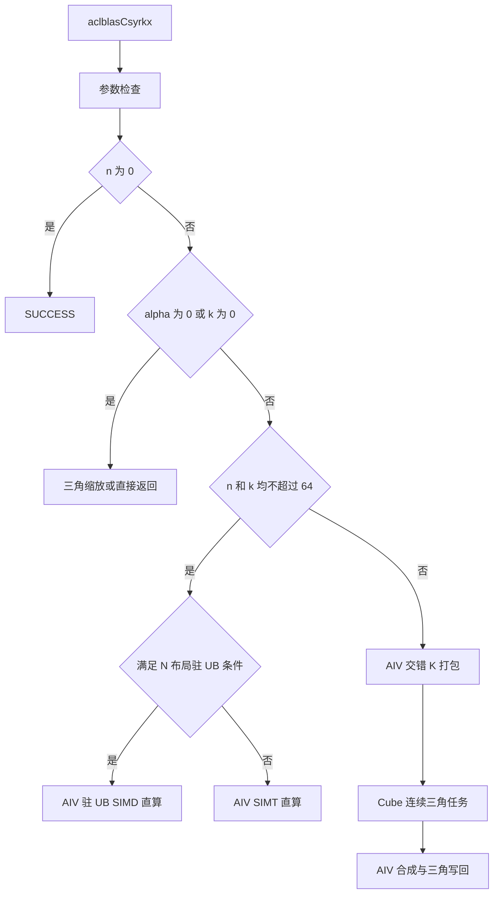

# aclblasCsyrkx 算子设计文档（Atlas 950PR）

| 版本 | 日期 | 作者 | 状态 |
| --- | --- | --- | --- |
| V1.0 | 2026-10-28 | XYTer | 设计评审稿 |

## 一、需求背景

### 1.1 需求来源

[10 月社区任务：aclblasCsyrkx 算子开发（950）](https://www.hiascend.com/activities/task-center/details/00e0335bc557460a9ebdce3ee4d60a9b)要求在 Atlas 950PR 上补齐 complex64 扩展对称秩 k 更新能力。实现采用 CANN 9.1.0 和 Ascend C kernel 直调，接入 [ops-blas](https://gitcode.com/cann/ops-blas) 的统一句柄式接口。

本文按[社区设计模板](https://gitcode.com/cann/cann-ops-competitions/blob/master/04_tasks/01_community-task-2026/resources/design_template.md)组织。接口、错误行为和精度以主任务书为准；性能采用 §3.3 的详细验收口径。

### 1.2 功能与工程现状

对 uplo 指定三角内的元素计算：

```text
trans=N:   C = alpha * A * B^T + beta * C
trans=T/C: C = alpha * A^T * B + beta * C
```

A、B、C 按列主序存储，alpha 和 beta 均为复数。OP_C 与 OP_T 等价，不取共轭；只包含一个交叉乘积，不增加第二个 B、A 交换项，对角线虚部正常参与计算。对于独立输入 A、B，仅按公式计算指定三角，不以镜像另一三角代替计算。

仓内已有 Ssyrkx、Cgemm 及公共 handle、stream、workspace 管理。设计复用 GEMM 的 FP32 Cube 计算和构建体系，在 syrkx 同族目录补充复数接口、路径调度及三角写回。

### 1.3 优化问题

小矩阵的打包和多次启动成本可能超过乘法本身；直接逐元素串行遍历 K 又会反复访问输入。大矩阵若计算完整方阵，再丢弃另一三角，会浪费计算；仅在方阵任务编号上过滤无效块，还可能留下明显的核间负载差异。

因此按规模和布局划分路径，同时优化三角任务域、输入组织和输出合成。两路交错 K 方案与四路实乘积的实数乘加总量相同，优化目标是减少无效三角计算、临时输出和调度开销。

## 二、需求分析

### 2.1 接口定义

在 `include/cann_ops_blas.h` 中新增统一声明，参数类型和顺序与任务书 §2.3 一致：

```cpp
aclblasStatus_t aclblasCsyrkx(
    aclblasHandle_t handle,
    aclblasFillMode_t uplo,
    aclblasOperation_t trans,
    int n, int k,
    const aclblasComplex* alpha,
    const aclblasComplex* A, int lda,
    const aclblasComplex* B, int ldb,
    const aclblasComplex* beta,
    aclblasComplex* C, int ldc);
```

| 参数 | 位置与含义 | 合法条件 |
| --- | --- | --- |
| handle | 绑定执行 stream 的句柄 | 非空 |
| uplo | 更新的三角，包含对角线 | ACLBLAS_UPPER 或 ACLBLAS_LOWER |
| trans | A、B 的逻辑视图 | ACLBLAS_OP_N/T/C；C 按 T 处理 |
| n、k | 输出阶数、缩并维 | 非负 int |
| alpha、beta | Host 上的 complex64 标量指针 | 始终非空；Host 读取后放入 tiling 数据 |
| A、B | Device 上的只读 complex64 矩阵 | N 为 n×k，T/C 为 k×n；n>0 且 k>0 时非空 |
| lda、ldb | 各自的前导维，单位为复数元素 | 不小于 max(1, trans=N ? n : k) |
| C | Device 上的 n×n complex64 输入/输出 | n>0 时非空；仅引用和修改指定三角 |
| ldc | C 的前导维，单位为复数元素 | 不小于 max(1,n) |

complex64 的实部、虚部各为 FP32。前导维 padding 合法，不扩展任意非连续步长或广播接口，不要求支持图编译期未知 shape。

### 2.2 参数检查与退化行为

所有参数检查先于 no-op 判断。空 handle 返回 `ACLBLAS_STATUS_HANDLE_IS_NULLPTR`；非法枚举、负维度、不合法的前导维和违反条件的空指针返回 `ACLBLAS_STATUS_INVALID_VALUE`。资源申请失败沿用仓内状态码。

| 条件 | 行为 |
| --- | --- |
| n=0 | 检查参数后返回 SUCCESS，不访问 C |
| k=0 | 不访问 A/B，只对指定三角计算 beta×C |
| alpha=0 | 仍按 n/k 检查 A/B 指针，通过后走三角缩放 |
| 缩放路径且 beta=1 | 返回 SUCCESS，C 保持原值 |
| beta=0 | 跳过旧 C 的读取，计算乘积或直接写零 |
| 一般复数 beta | 在指定三角内执行完整复数乘加 |

A/B 的内容只读，C 的非选三角及 ldc padding 保持原始位模式。Host 不增加全设备同步，各阶段按同一 handle stream 的顺序执行。

### 2.3 附件差异处理

| 差异 | 本设计采用的规则 |
| --- | --- |
| 附件说明中的 OP_C 共轭描述 | 主任务书 §2.1：OP_C 与 OP_T 等价，不共轭 |
| TC_ED_370 在 n=k=16、alpha=0、A=null 时期待 SUCCESS | 主任务书 §2.4：A 必须非空，返回 INVALID_VALUE；保存原始附件，测试报告单独披露校正项 |
| §7 与附件出现不同采样次数或 ≥GPU 的文字 | 主任务书 §3.3：预热 5 次，有效 10 次；逐例倍率 ≥0.4，200 例倍率算术平均 ≥0.5 |

以上口径用于设计和自测，不把附件冲突隐藏为通过记录。

## 三、详细设计

### 3.1 总体流程与路径选择



UB 是 AIV 的片上数据缓冲。SIMD 让向量 lane 同时处理多个输出行；SIMT 用线程或一个 warp 合作计算输出。当前候选分派如下，条件只依赖输入属性，不依赖用例编号或预知结果。

| 路径 | 条件 | 主要目的 |
| --- | --- | --- |
| 三角缩放 | k=0 或 alpha=0 | 跳过乘积和输入打包 |
| 驻 UB SIMD 直算 | N 布局，32<n≤64，16≤k≤64 | A/B 一次搬入，各输出列复用片上输入 |
| SIMT 直算 | 其余 n≤64 且 k≤64 | 避免多阶段启动；k<16 每线程计算一个输出，k≥16 一个 warp 协作缩并 |
| Cube 乘积 | 其余合法规模 | 复用 GEMM，按有效三角块调度 |
| SIMD 合成 | Cube 路径且 n≥512，或大规模缩放 | 批量搬运和向量合成 |
| SIMT 合成 | 较小输出的 Cube 路径或缩放 | 保持较低的准备成本 |

小 N、较长 K 仍进入 Cube 路径。单独扩大直算的 K 上限并不必然更快，路径边界由相同 shape 的完整接口耗时及相邻尺寸验证决定。上述阈值是当前待验证候选，最终以精度和定向性能结果确定。

### 3.2 复数乘积与交错 K 表达

令 X=op(A)、Y=op(B)，二者逻辑形状均为 n×k。对固定输出位置，实部和虚部为：

```text
Pr(i,j) = sum_p [Xr(i,p)*Yr(j,p) - Xi(i,p)*Yi(j,p)]
Pi(i,j) = sum_p [Xr(i,p)*Yi(j,p) + Xi(i,p)*Yr(j,p)]
```

把每个 p 对应的两项相邻排列：

```text
Xpack(i,2p)   = Xr(i,p)     Xpack(i,2p+1)   = Xi(i,p)
Yreal(j,2p)   = Yr(j,p)     Yreal(j,2p+1)   = -Yi(j,p)
Yimag(j,2p)   = Yi(j,p)     Yimag(j,2p+1)   = Yr(j,p)

Pr = Xpack * Yreal^T
Pi = Xpack * Yimag^T
```

这样使用两路长度为 2k 的实数 GEMM。每个 K 分区只输出 Pr、Pi 两个平面。N 与 T/C 保持各自连续的物理访问方式，通过 GEMM 转置标记表达逻辑视图，不在 Host 构造矩阵副本。

Cube 使用 FP32 输入、累加和输出，不直接以低精度输入替换 complex64 的分量。交错正负项改变了累加次序，可能改善部分相消场景，也可能改变舍入误差，须用完整精度和非有限值用例验证。

### 3.3 Host 侧设计

Host 完成参数校验、Host 标量读取、退化路径判断、分块和工作空间规划。uplo、trans、维度、前导维、标量、分区数和工作区步长通过同一 tiling 结构传入 Kernel。N 与 T/C 分开派发，T 和 C 使用相同路径。

平台接口提供实际 AIV/AIC 核数。输出块初始边长为 GEMM 支持的最大方块；若有效任务数不足以覆盖 Cube 核数，则依次减小块边长，最小为 16。核数取平台核数与有效任务数的较小值。

k≤512 时使用一个 K 分区，k>512 时使用两个分区。交错后 K 维的分区跨度为：

```text
Kspan = ceil(ceil(2k / 16) / P) * 16
```

分区边界按 16 对齐，保持每个原始复数的两项成对归属。尾分区使用实际剩余长度；结果按照固定分区顺序合成，不采用浮点原子累加。

### 3.4 连续三角分核

设输出块边长为 b，q=ceil(n/b)。有效块数为 q(q+1)/2，包含对角块。Host 以该数量选择块大小和核数。

Kernel 在连续三角任务域中枚举块。对线性编号 d，求唯一整数 a 满足：

```text
a(a+1)/2 <= d < (a+1)(a+2)/2
c = d - a(a+1)/2
```

由 (a,c) 及 uplo 得到块坐标，再完成列主序与内部 GEMM 坐标的转换。每核按核数步长分配连续有效任务，避免“方阵编号取模后再过滤”造成的空洞。整数映射避免浮点开方在相邻尺寸上产生编号误差。

非对角块全部属于指定三角；对角块允许在临时输出中计算完整小方块，最终仅读取及写回合法三角。C 的另一三角不作为输入参与搬运。

### 3.5 Kernel 数据流与同步

| 阶段 | 处理方式 | 边界及同步 |
| --- | --- | --- |
| 输入打包 | AIV 按 lda/ldb 搬入交错复数，形成 Xpack、Yreal、Yimag | N/T/C 分开寻址；尾段按实际元素数搬运 |
| Cube 乘积 | 复用 GEMM 的 GM→L1、L1→L0、FP32 Mmad 与 Fixpipe | 沿 K 分块，L1/L0 双缓冲；保持原有生产、消费和释放事件 |
| SIMD 合成 | 每列按最多 1024 个复数分块，固定次序累加各分区 Pr/Pi | 两个 UB 槽交替使用；MTE3 写回完成后才允许复用该槽 |
| 三角写回 | 融合 alpha×(Pr+iPi) 与 beta×C | beta=0 不读 C；上下三角和尾块均按实际连续区间传输 |

最终复数合成为：

```text
Cr = alpha_r*Pr - alpha_i*Pi + beta_r*Cold_r - beta_i*Cold_i
Ci = alpha_r*Pi + alpha_i*Pr + beta_r*Cold_i + beta_i*Cold_r
```

打包、Cube、合成使用同一 stream，跨 Kernel 依赖由 stream 顺序保证。核内按 MTE2、Vector、MTE3 或 MTE2、MTE1、Cube、Fixpipe 的真实数据依赖配对事件。不同任务的输出平面和分区独占各自地址，不读未完成的临时结果。

### 3.6 小矩阵路径

SIMT 路径中，k<16 时单线程按 K 次序完成一个复数点积；k≥16 时 warp 的 lane 分担 K，再以固定 shuffle 树归约。每个输出只有一个线程写回。

驻 UB 路径仅处理当前表中限定的 N 布局。每核搬入 A/B 后，向量 lane 对应连续输出行，B 的当前列元素在 lane 间广播。各核按列分工，输出只覆盖指定三角。A/B 缓冲增加明确的零 padding，允许尾部的非对齐向量读取落在已分配 UB 内；GM 搬运仍只读取实际输入。

UPPER 每列处理行区间 [0,j]，LOWER 每列处理 [j,n)。写回长度由区间确定，避免整向量存储覆盖另一三角。

### 3.7 内存规划

令 I=align512(8nk) 字节，L=align16(n)，P 为 K 分区数。三路打包输入和两路分区输出所需工作空间为：

```text
workspaceBytes = 3*I + 2*(4*L*L*P)
```

工作空间由 handle 的现有管理逻辑分配和复用。形状、偏移和容量检查使用宽整数；先与仓内工作空间上限比较，再申请资源和下发 Kernel。n/k、前导维仍保持公开接口规定的 int 类型。

| 路径中的 UB 区域 | 当前候选预算 |
| --- | ---: |
| 输入打包 | 40 KiB |
| SIMD 合成的两个槽 | 合计 64 KiB |
| 小矩阵驻 UB 输入、padding、C 与输出 | 67,584 字节 |

这些区域属于不同执行路径，不要求同时驻留。Cube 的 L1/L0/L0C 预算沿用共享 GEMM 模板及编译期容量检查。容量计算属于静态规划，不等同于内存安全测试通过。

### 3.8 工程接入与兼容性

| 路径 | 改动职责 |
| --- | --- |
| include/cann_ops_blas.h | 统一公开声明 |
| blas/syrkx/arch35/csyrkx_host.cpp | 参数、分派、工作空间与 launch |
| blas/syrkx/arch35/csyrkx_kernel.h | 同族 Host/Kernel 协议及直调声明 |
| blas/syrkx/arch35/csyrkx_kernel.cpp | 打包、直算、缩放与合成 |
| blas/gemm/arch35/ | 复用实乘积计算，增加默认关闭的三角及两乘积调度信息 |
| test/syrkx/csyrkx/arch35/ | 沿用 CSV/GTest，接入 Netlib golden 与确定性检查 |
| blas/syrkx/README.md 及现有构建入口 | API 说明、硬件支持和单算子构建接入 |

产品实现保持同族目录规模，不另建算子框架或独立性能测试框架。共享 GEMM 中未启用新增字段时保留原三/四乘积路径；共享文件改动须验证原调用方。实验采样脚本、日志、profiler 数据和临时构建产物留在产品仓之外。

## 四、特性交叉与风险分析

| 交叉条件或风险 | 设计处理与检查重点 |
| --- | --- |
| OP_C 与纯虚数输入 | 与 OP_T 使用相同视图，验证无共轭及符号错误 |
| beta=0 与 NaN 旧 C | 分支跳过旧 C 读取，避免无效值传播 |
| 三角边界与 lda/ldb/ldc padding | 输入按各自前导维寻址；输出逐列限制长度，非选区逐位核对 |
| 交错 2K 与长 K 相消 | 固定项次序和分区归约；精度失败时定位累加误差，不放宽阈值 |
| 连续三角任务与尾块 | 覆盖上下三角、整块及边长±1，核对无遗漏、重复或越界 |
| 驻 UB 与小规模分派边界 | 覆盖 n=32/33/63/64，k=15/16/64/65，验证边界切换及 UB 尾部 |
| 共享 GEMM 扩展 | 新字段默认关闭，检查未启用路径的参数、任务数与结果 |
| 仅主 Kernel 加速但接口仍超时 | 将打包、乘积、合成全部计入同一次调用耗时 |

针对未达标 shape，分别判断选路不合适、既有路径效率不足或需要新增路径。只在同 shape 对照和相邻边界验证后改变分派，不从单个成功样例推断全域收益。

## 五、可维可测分析

### 5.1 精度与功能

使用 ops-blas 的 CSV/GTest 框架，golden 为 Netlib BLAS 3.10.0 的 `cblas_cgemm`。N 使用 NoTrans/Trans；T、C 均使用 Trans/NoTrans。Golden 计算后恢复非选三角原值，指定三角的实部和虚部分别判定。

| 检查项 | 判据 |
| --- | --- |
| 有限分量混合容差 | abs(actual-golden) ≤ 2^-13 + 2^-13×abs(golden) |
| 匹配比例 | 实部、虚部分别 ≥0.99 |
| 最大误差 | 按 §3.2 的 1e-2 或 32 ULP 上限检查 |
| 非有限分量 | 同为 NaN、同号 Inf，或 NaN 与任意 Inf 等效；有限/非有限不匹配，异号 Inf 不匹配 |
| 非选三角、padding | 与调用前逐位一致 |
| 确定性 | 重置相同 A/B/C 和标量后独立执行两次，输出逐位一致 |

非有限分量单独计数且必须全部通过，不参与有限分量的匹配率和最大误差统计。覆盖任务附件 1000 条精度用例，并对 200 条性能参数执行正确性检查。

测试数据按任务书覆盖实虚独立采样、均匀/正态各 50%、复数标量、纯虚、大值、相消及 Inf/NaN。补充 UPPER/LOWER×N/T/C、非法枚举、空指针、n/k=0、前导维 padding、三角块边界和路径切换边界。

### 5.2 性能

性能使用附件 200 条参数及 `gpu_baseline.csv`，GPU 对照接口为 cuBLAS cublasCsyrkx，基线环境为 NVIDIA 驱动 550.104.05、CUDA 12.4。NPU 环境为 Atlas 950PR、CANN 9.1.0。

使用 `msprof op` 采集 task duration。工具预热 5 次后采集 10 次有效样本，取算术平均。一次接口调用包含多个 Kernel 时，将对应调用的所有阶段耗时相加。CSV 中的 GPU 毫秒值先转换为微秒，再计算倍率。

```text
caseRatio = gpu_us / mean(npu_call_us[0:10])
每例 caseRatio >= 0.4
200 例 caseRatio 的算术平均 >= 0.5
```

两项必须同时满足。返回值、阶段数量、每阶段 10 条有效记录和 profiler 解析结果均须核对。异常或设备争用记录保留但排除，单独补测受影响用例。

首次全量用于形成完整失败列表。中间仅测试失败项和必要的相邻边界；定向优化收敛后再执行最终全量。结合 msprof op 的 Cube/Vector、访存、流水和分核数据定位成本，不把静态推算写成实测收益。

### 5.3 内存安全与可维护性

任务书 §3.4 不设置独立内存占用指标，仍需验证越界、未初始化读取、缓冲复用和资源生命周期。对打包、驻 UB、三角尾块、K 分区及 beta=0 路径运行插桩内存检查，并保留真实日志。

静态检查覆盖接口契约、宽整数寻址、数据搬运对齐、事件配对、UB/L1/L0 容量以及共享 GEMM 的兼容性。代码、构建配置和测试证据记录同一版本及哈希；历史实验的结果不作为当前源码的通过依据。

### 5.4 验证状态与交付范围

本 PR 仅提交设计文档。当前候选已完成编译，驻 UB 路径及集中结构改动尚未完成真机验证；最终精度、确定性、内存安全和性能验收仍待完成，本文不声明达标。

实现交付包括产品代码、CSV/GTest、README 和设计文档。验收阶段按任务书提供自验证步骤说明，以及精度、性能、内存自验证报告和对应日志共七件材料，全部使用实际测试证据。
