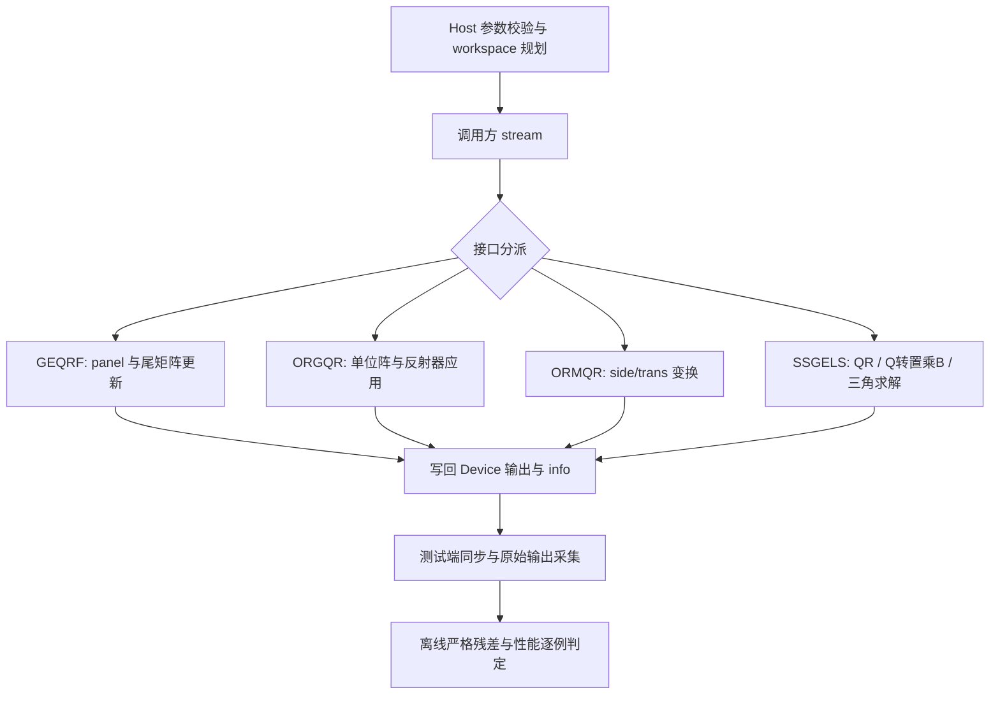

# 需求背景（required）

## 需求来源

任务：**10月社区任务-单精度实数QR分解与最小二乘(950)**，官方目录 `10-3-aclsolverSgeqrf-leastsq-950`；提交账号 AIAFKK。

本文为设计评审稿，提交到 cann-ops-competitions；实现目标仓为 [cann/ops-solver](https://gitcode.com/cann/ops-solver)。文档按[官方设计模板](https://gitcode.com/cann/cann-ops-competitions/blob/master/04_tasks/01_community-task-2026/resources/design_template.md)组织。

本稿依据收到的《Atlas 950 单精度实数QR分解与最小二乘 任务书》快照，SHA256：`99f54d8ba7d8540f6658d8ee7f50abd3248e5db388ab9aeaf183bb03ff3e215e`。另收到任务方回复的转录：必要自验以提供的测试用例为准，更多自构造场景不强制；Xlarft 无测试用例，不做开发验证；性能数据、任务书和验证工程将刷新。回复原帖链接尚未独立核验，最终范围随官方新版对齐。

本设计保留旧版公开接口契约，并优先展开四条有用例的计算链。公开 Xlarft 的最终交付范围列为评审确认项，不将“不做开发验证”解释为已经删除接口。旧版用例清点仅用于准备，不锁定最终验收全集。

## 背景介绍

QR 分解以 Householder 反射器表达正交矩阵，可用于生成显式 Q、对矩阵施加正交变换，以及求解方阵或超定最小二乘问题。目标是在 Ascend 950PR 上实现 FLOAT32 数值路径、列主序数据布局和调用方 stream 语义。

### 参考实现与现状分析

本题采用 **ops-solver Host C API + AscendC/CATLASS Kernel 直调**。参考 [cuSolver 接口语义](https://docs.nvidia.com/cuda/cusolver/index.html)，算法参考 [LAPACK SLARFG](https://github.com/Reference-LAPACK/lapack/blob/master/SRC/slarfg.f)、[SGEQRF](https://github.com/Reference-LAPACK/lapack/blob/master/SRC/sgeqrf.f)、[SORGQR](https://github.com/Reference-LAPACK/lapack/blob/master/SRC/sorgqr.f)、[SORMQR](https://github.com/Reference-LAPACK/lapack/blob/master/SRC/sormqr.f)、[SLARFT](https://github.com/Reference-LAPACK/lapack/blob/master/SRC/slarft.f)和 [SGELS](https://github.com/Reference-LAPACK/lapack/blob/master/SRC/sgels.f)。参考用于明确数学顺序，不把 LAPACK Host 执行作为 NPU 实现。

已核对 ops-solver 上游基线 `b0a2247317f7a1f01341b247c8fa5d7d9d9d7e2e` 的 README、CONTRIBUTING、CMake 和 CI 入口；该基线未提供本题 QR/gels 接口。已有 handle 与 stream 管理可复用。现有 LU 的 Host 指针、隐式搬运和同步方式不直接复制到本题。此处为库接口新增，不使用 TBE/ACLNN 图算子适配层。

| 上游位置 | 本题集成方式 |
| --- | --- |
| `include/cann_ops_solver.h` / `cann_ops_solver_common.h` | 增量加入任务书原型及枚举，保持已有 ABI |
| `src/utils/aclsolver_auxiliary.cpp` | 复用 Create/Destroy/SetStream/GetStream，不更改调用方资源所有权 |
| `src/sgeqrf`、`src/sorgqr`、`src/sormqr`、`src/ssgels` | 各自 Host 校验与下发；共享 QR/反射器内部逻辑 |
| `src/xlarft` | 如最终范围保留公开接口，按该节契约集成，不以内部 T 核代替公开交付 |
| `src/CMakeLists.txt` / 根 CMake | 核对源码收集与 ascend950（dav-3510）编译目标 |
| `test/<op>`、`docs/zh/<op>.md`、`docs/api_list.md`、README | 实现时同步测试入口、调用示例与接口说明 |

# 需求分析（required）

## 需求描述

核心计算必须在 NPU AI Core 完成。计算接口返回 `aclsolverStatus_t`；不添加 CPU fallback，不以输入内容识别用例，不缓存待测输出。所有输入输出遵守物理 leading dimension 与独立 buffer 生命周期。

| 接口 | 输入与输出 | 范围与关键约束 |
| --- | --- | --- |
| Sgeqrf | A 原地存 R 与反射器；TAU 长度 min(m,n) | m,n≥0；lda≥max(1,m)；支持方阵、长矩形、宽矩形 |
| Sorgqr | 读取反射器/tau，A 原地生成 m×n 的 Q | m≥n≥k≥0；lda≥max(1,m)；k<n 仍使用实际 k 个反射器 |
| Sormqr | A/tau 只读，C 原地更新 | LEFT/RIGHT；N/T/C；nq=LEFT?m:n；0≤k≤nq；lda≥max(1,nq)，ldc≥max(1,m) |
| SSgels | A 可破坏，B 为输入，X 为独立 n×nrhs 输出 | m≥n≥0；nrhs≥0；ldda/lddb≥max(1,m)，lddx≥max(1,n) |
| Xlarft（范围待确认） | V/tau 输入，T 为 k×k 三角因子 | n≥k≥0；COLUMNWISE；FORWARD/BACKWARD；四个类型参数均 FLOAT32；其他组合 NOT_SUPPORTED |

旧任务书规模下限为 m/n 最大 4096，SSgels 的 nrhs 最大 128；Xlarft 的 k 最大 256。Host 按每次维数生成 tiling，支持 padding，不要求 lda 等于逻辑维数。不支持 broadcast，不要求图融合。

## 需求拆解

1. 保持任务书参数顺序、位宽、Host/Device 归属、workspace 单位和错误语义。
2. 建立确定的 Householder 与分块更新路径，复用 orgqr/ormqr/gels 的变换逻辑。
3. 先验证 orgqr，再用其输出解释 ormqr；全部必要精度用例保留，缺 GPU 耗时不豁免精度。
4. 在 950PR 上逐例采集完整计算调用所需 kernel 的平均总耗时，与同参数 GPU 参考比较。
5. 随官方刷新材料重建全集并归档差异；设计评审、NPU 自验、平台验收与实现合入分别记录。

# 详细设计（required）

## 算子分析

### 数学公式与反射器表示

令 H_i=I−tau_i v_i v_iᵀ，Q=H_0 H_1 … H_(k−1)，A=QR。geqrf 的 A 上三角/梯形保存 R，下三角保存 v_i 的非平凡部分，隐含对角元素为 1。生成 Q 不能从 R 的对角读取 v_i 的隐含 1。

orgqr 从 m×n 单位阵前 n 列生成 Q。ormqr 对 C 执行 op(Q)C 或 Cop(Q)，其中实数的 T/C 数学相同但枚举分别校验。单个反射器对称，多个反射器不可交换：

| 路径 | 对 C 依次施加的反射器下标 |
| --- | --- |
| LEFT + N | k−1 到 0 |
| LEFT + T/C | 0 到 k−1 |
| RIGHT + N | 0 到 k−1 |
| RIGHT + T/C | k−1 到 0 |

分块表示为 H_block=I−VTVᵀ。geqrf 尾矩阵更新采用 H_blockᵀ，须保持 T 的转置方向。SSgels 先 QR，再计算 Y=QᵀB，最后解 R(0:n,0:n)X=Y(0:n,:)；B 不作为 X 的输出缓冲。直接主精度求解计划将 Host niter 设置为 0，Device dinfo 独立记录。

### 公开接口

以下枚举及原型保留任务书 §2.3，不自行改变位宽、参数顺序或 workspace 单位。Xlarft 原型保留供范围评审使用。


```
typedef void* aclsolverParams_t;

typedef enum {
    ACLSOLVER_OP_N = 0,
    ACLSOLVER_OP_T = 1,
    ACLSOLVER_OP_C = 2
} aclsolverOperation_t;

typedef enum {
    ACLSOLVER_SIDE_LEFT  = 0,  /* 对齐 CUBLAS_SIDE_LEFT */
    ACLSOLVER_SIDE_RIGHT = 1   /* 对齐 CUBLAS_SIDE_RIGHT */
} aclsolverSideMode_t;

typedef enum {
    ACLSOLVER_DIRECT_FORWARD  = 0,  /* 对齐 CUBLAS_DIRECT_FORWARD */
    ACLSOLVER_DIRECT_BACKWARD = 1   /* 对齐 CUBLAS_DIRECT_BACKWARD */
} aclsolverDirectMode_t;

typedef enum {
    ACLSOLVER_STOREV_COLUMNWISE = 0  /* 对齐 CUBLAS_STOREV_COLUMNWISE；本任务不要求 ROWWISE */
} aclsolverStorevMode_t;

typedef enum {
    ACLSOLVER_R_32F = 0,  /* 对齐 CUDA_R_32F */
    ACLSOLVER_C_32F = 1   /* 对齐 CUDA_C_32F；本任务不验收 */
} aclsolverDataType_t;
```

`aclsolverParams_t` 允许传入 `nullptr` 表示默认参数。若实现需要显式 params 对象，须同时交付 `aclsolverCreateParams` / `aclsolverDestroyParams`，语义对齐 `cusolverDnCreateParams` / `cusolverDnDestroyParams`。

公开计算接口如下。

```
aclsolverStatus_t aclsolverSgeqrf_bufferSize(
    aclsolverHandle_t handle, int m, int n, float *A, int lda, int *Lwork);

aclsolverStatus_t aclsolverSgeqrf(
    aclsolverHandle_t handle, int m, int n, float *A, int lda,
    float *TAU, float *Workspace, int Lwork, int *devInfo);

aclsolverStatus_t aclsolverSorgqr_bufferSize(
    aclsolverHandle_t handle, int m, int n, int k,
    const float *A, int lda, const float *tau, int *lwork);

aclsolverStatus_t aclsolverSorgqr(
    aclsolverHandle_t handle, int m, int n, int k,
    float *A, int lda, const float *tau, float *work, int lwork, int *devInfo);

aclsolverStatus_t aclsolverSormqr_bufferSize(
    aclsolverHandle_t handle, aclsolverSideMode_t side, aclsolverOperation_t trans,
    int m, int n, int k, const float *A, int lda, const float *tau,
    const float *C, int ldc, int *lwork);

aclsolverStatus_t aclsolverSormqr(
    aclsolverHandle_t handle, aclsolverSideMode_t side, aclsolverOperation_t trans,
    int m, int n, int k, const float *A, int lda, const float *tau,
    float *C, int ldc, float *work, int lwork, int *devInfo);

aclsolverStatus_t aclsolverXlarft_bufferSize(
    aclsolverHandle_t handle, aclsolverParams_t params,
    aclsolverDirectMode_t direct, aclsolverStorevMode_t storev,
    int64_t n, int64_t k,
    aclsolverDataType_t dataTypeV, const void *V, int64_t ldv,
    aclsolverDataType_t dataTypeTau, const void *tau,
    aclsolverDataType_t dataTypeT, void *T, int64_t ldt,
    aclsolverDataType_t computeType,
    size_t *workspaceInBytesOnDevice, size_t *workspaceInBytesOnHost);

aclsolverStatus_t aclsolverXlarft(
    aclsolverHandle_t handle, aclsolverParams_t params,
    aclsolverDirectMode_t direct, aclsolverStorevMode_t storev,
    int64_t n, int64_t k,
    aclsolverDataType_t dataTypeV, const void *V, int64_t ldv,
    aclsolverDataType_t dataTypeTau, const void *tau,
    aclsolverDataType_t dataTypeT, void *T, int64_t ldt,
    aclsolverDataType_t computeType,
    void *bufferOnDevice, size_t workspaceInBytesOnDevice,
    void *bufferOnHost, size_t workspaceInBytesOnHost);

aclsolverStatus_t aclsolverSSgels_bufferSize(
    aclsolverHandle_t handle, int m, int n, int nrhs,
    float *dA, int ldda, float *dB, int lddb, float *dX, int lddx,
    void *dwork, size_t *lwork_bytes);

aclsolverStatus_t aclsolverSSgels(
    aclsolverHandle_t handle, int m, int n, int nrhs,
    float *dA, int ldda, float *dB, int lddb, float *dX, int lddx,
    void *dWorkspace, size_t lwork_bytes, int *niter, int *dinfo);
```

参数名、顺序、含义、Device/Host 归属不得擅自增删或调换。`geqrf`/`orgqr`/`ormqr`/`SSgels` 维数类型为 `int`；`Xlarft` 维数为 `int64_t`，对齐 cuSolver 64-bit API。


## 算子实现

### Host 侧设计

1. 校验 handle、枚举、维数关系、leading dimension、必要指针与 workspace。负维数等参数错误按任务书返回 INVALID_VALUE；有 info 且可写时在同 stream 写 −i（不计 handle）。Xlarft 原型无 info，错误通过返回状态报告。不得在 Host 解引用 Device 指针。
2. `bufferSize` 与计算共用 workspace 规划器，尺寸乘加先检查溢出。geqrf/orgqr/ormqr 的 lwork 是 float 元素数，Xlarft 的 Host/Device workspace 与 SSgels 的 workspace 均为字节；转换到 int lwork 时再检查可表示性。
3. workspace 计划包括 panel/反射器暂存、块 T、矩阵更新临时量及 gels 的 B 副本/解算临时量，各区间按实际类型对齐且不重叠。不跨调用保存可变计算状态，不把隐式新分配的 Device 内存泄露给调用方。
4. 从 handle 获取调用方 stream，按依赖顺序下发内核。Host 不为读取矩阵而同步；测试采集端为获取结果和测量完成情况显式同步。Host niter 的直接求解值不依赖读取 Device 计算结果。
5. 空维度走对应数学语义：geqrf 无有效输出时快速成功；orgqr 的 k=0 且 m,n>0 时生成单位阵前 n 列；ormqr 的 k=0 保持 C；gels 的 nrhs=0 不进行求解。必要 info 初始化为 0，不能把所有 k=0 一概作为不写输出的空操作。空指针可用条件按最终接口规范逐项核对。
6. kernel 下发失败、数值异常和参数非法分别报告。秩亏或零对角的处理遵循最终 SSgels 规范，不用任意截断或放宽残差掩盖失败。

### Kernel 侧设计

**第一条路径：小矩阵或窄 panel。** 使用确定性 Householder：按固定次序归约范数，采用 SLARFG 式确定符号和小量缩放处理；尾向量为零时 tau=0，避免直接平方和上/下溢。生成反射器后按依赖顺序更新剩余列，写回 R、v 和 tau。

**第二条路径：分块 QR。** 按列 panel 分解生成 V/tau，构造内部块 T，再对尾矩阵施加 I−VTᵀVᵀ。panel 内依赖串行，尾矩阵按互不重叠的行列 tile 分配给多个核；必要的跨阶段依赖通过同 stream 多次 kernel 下发建立。不使用依赖未知驻留核数的全局自旋同步。

**ORGQR/ORMQR。** 共享 apply-reflector/apply-block 内部逻辑，按上表确定顺序。orgqr 写单位阵之前须保护尚待使用的反射器；可从输入 A 复制到 workspace。ormqr 按 side 选择 Q 阶数和矩阵访问方向，所有搬运尊重 lda/ldc，不把右乘当作左乘维数。

**SSGELS。** QR 阶段复用 geqrf；将 B 复制到 workspace 后施加 Qᵀ，保护 B 原值；上三角求解按 RHS 列块并行、按行或对角块保持依赖，最终写独立 X。A 的 padding 和 B 的只读契约纳入检查。

**内部 T / 公开 XLARFT。** FORWARD 构造上三角 T，BACKWARD 按反向反射器乘积构造下三角 T。内部块 T 仅是算法组成部分；若最终保留公开 Xlarft，另覆盖 params=nullptr、类型组合、int64_t 尺寸和 Host/Device workspace 查询，不能用内部核存在代替公开功能完成。

### 分核、分块与性能优化

- 依据逻辑形状及设备可用资源选择小矩阵路径或分块路径，不按输入数值分派；块宽、切换点、核数及缓冲容量由 950PR 探针确定，本设计不虚构实测参数。
- 以向量路径形成 FP32 正确性基线；块更新可评估 AscendC/CATLASS 矩阵乘，但只有通过相同严格残差门的计算模式才能采用。不预设 TF32/半精度足以替代本题 FP32。
- 尾矩阵 tile 按互斥输出区域分核，按资源容量选择缓冲与搬运粒度，尾块只写有效区。归约树、tile 顺序与反射器符号固定，满足串行重复的 bit-wise 确定性。
- 小尺寸重点压低多次 launch 开销；大尺寸重点减少重复搬运、复用 V/T 与矩阵块。kernel 融合须保持同一测量范围和数值门，不能靠省略必要阶段取得性能结果。
- 有限探针优先覆盖小尺寸 launch、4096 方阵、长矩形、右乘及多 RHS 的风险族。连续两轮同路径无可复核收益时重评算法/分块；普通数值或性能 FAIL 保留后继续安全扫描，设备异常或身份失真暂停受影响部分。

### 执行流程



## 支持硬件

| 项目 | 目标与核验方式 |
| --- | --- |
| 设备 | Ascend 950PR（Atlas 950）；必须由真实设备记录确认 |
| CANN | 9.0.0 及以上，并与 ops-solver README 的配套要求一致 |
| 编译 | ops-solver Host C API + AscendC/CATLASS，显式 ascend950 目标 |
| 环境记录 | 设备型号、驱动/固件、CANN、编译器及 CUDA/cuSolver 基线版本 |

当前没有本实现的目标设备构建、NPU 精度或性能证据。编译目标、本地 CPU 参考或设计提交均不代表 950PR 验证通过。

## 算子约束限制

仅 FLOAT32、列主序、单矩阵接口；不支持 broadcast，不要求图融合。SSgels 仅 m≥n，X 独立输出；Xlarft 如保留则仅 COLUMNWISE 与四个 FLOAT32 类型参数组合。功能参数范围与必要验收 case 范围分开：额外自构造场景不强制，不因此删除已声明的合法接口语义。

# 可维可测分析

## 精度标准/性能标准

设 ε=2^−24；矩阵 1-范数为最大列绝对值和。ratio_cpu 必须来自同输入的 FLOAT32 LAPACK 参考链路，以相同公式计算；残差使用升精度运算，不将 FP64 求解器冒充同精度 CPU 基线。

| 接口 | 任务书残差与严格判据 | 来源 |
| --- | --- | --- |
| Sgeqrf | ratio=‖R−QᵀA‖₁/(m‖A‖₁ε) ≤ max(5 ratio_cpu,0.1)；用 NPU 的 v/tau 升 float64 构造完整 m×m Q | §3.2.1.1，SQRT01 |
| Sorgqr | ratio=‖I−QᵀQ‖₁/(mε) ≤ max(5 ratio_cpu,1.5)；I 为 n 阶，保留实际 k | §3.2.1.2，SQRT02 |
| Sormqr | ratio=‖op2−op1‖₁/(nq‖C‖₁ε) ≤ max(5 ratio_cpu,0.1)；op2 用同份 NPU v/tau 经已验证 NPU orgqr 生成 nq×nq Q，再按 side/trans 作用 C | §3.2.1.3，SQRT03；nq 为 Q 阶数 |
| SSgels 方阵 | 各 RHS j 的 ‖B_j−AX_j‖₁/(max(m,n)‖A‖₁‖X_j‖₁ε) 取最大，≤ max(5 ratio_cpu,0.015) | §3.2.1.4，SQRT16 |
| SSgels 超定 | R=B−AX；ratio_opt=‖RᵀA‖₁/(‖A‖₁‖B‖₁ max(m,n,nrhs)ε) ≤ 10 ratio_opt_cpu | §3.2.1.4，SQRT17 |
| 性能 | 逐例 T_NPU≤T_GPU/0.35，即 GPU/NPU≥0.35；同 shape/dtype/布局/调用范围 | §3.3；最终集合按刷新后有效性能记录 |
| 内存 | 无独立峰值数值验收门；仍检查越界、workspace 不重叠与资源生命周期 | §3.4 |

CPU ratio 为零、零范数或空问题时，不自行添加下限或容差；按最终官方验证工程的相应分支处理，无法裁定的项保留原始值待评审。若某例超阈值，保留 FAIL；允许提交原因分析不等于开发者自行豁免该例。

### 测试与证据计划

收到的旧包有 694 条精度目录：Sgeqrf 174、Sorgqr 165、Sormqr 189、SSgels 166。对应 586 条有有效 GPU 耗时；SSgels 超定的 108 条缺 GPU 耗时，仍须保留精度状态。该统计为文档清点，不是 NPU PASS。Xlarft 无随附用例；按收到的回复不强制开发验证，最终交付范围待官方新版确认。

1. 对齐刷新任务书、cases、bench_result 和验证脚本，以完整 shape、leading dimension、side/trans/nrhs 关联；保留新增、删除、错配和缺基线行，不靠尺寸子集匹配。
2. 在 test/<op> 提供单例入口并接入仓库 TEST_NAMES，核对测试实际执行数，避免缺目录、错误架构或零测试被当作通过。
3. Host runner 按物理 leading dimension 分配 Device 缓冲，读取列主序输入，调用公开 bufferSize/计算接口，在调用方 stream 完成采集，保存实际输出、状态与 info。离线参考与判定链路已作 CPU 准备，真实 Host runner 和 NPU 实现待设计评审后接入。
4. Sgeqrf、Sorgqr、Sormqr、SSgels 分别记录数值状态。Sorgqr 未通过时 Sormqr 的参考依赖标为未闭合；已有数值 FAIL 不能被依赖状态遮蔽。
5. 额外 padding、k<n、零维/非法参数、右乘和 N/T/C、非默认 stream、多 RHS、重复确定性作为契约检查或内部诊断独立记录，不增加官方必要 case 数。
6. 每次运行绑定源码 commit、DSO SHA256、命令、设备与软件、输入哈希和原始结果。缺结果、执行失败、参考错误、数值 FAIL、未闭合依赖、缺基线及未运行分别统计，不跨候选拼接 PASS。
7. 设计评审与合入、自测报告、设计合入截图、可复现步骤、源码访问与最终平台回执分别归档；只有对应官方回执能够证明官方验收。

### 性能测量与可维护性

msprof 逐例收敛采集，保留 OpBasicInfo 原始明细并统一 us/ms 单位。一轮计算调用若下发多个必要 kernel，先按该调用求和，再对有效调用取均值；排除 warmup，不把不同 kernel 的单项均值、单个最佳 kernel 或 Host 墙钟替换为完整计算调用。bufferSize 不计 kernel 时间，orgqr/ormqr 的输入 geqrf 准备时间依任务书排除。完整 Host 调用耗时可另列用于分析。

共享 workspace 规划、反射器应用与状态转换置于内部模块，各接口 Host 只负责契约和调度。公开 API、测试入口和文档随实现一并更新；新增公共枚举先检查调用方与已有定义，避免修改已有枚举值或导出 ABI。CI 按目标仓规范执行，本设计 PR 的文档检查不代替实现 PR 的构建/测试。

## 兼容性分析

本题新增公开能力，复用已有 handle，不改变现有算子的参数、同步或资源所有权。计算的 Device 数据/Device info 与 SSgels 的 Host niter、Host workspace 查询输出明确分开。编译和回归检查既有依赖调用方；不能以新增接口为由改动无关算子。硬件适配限本题 950PR，不声称 A2/A3 等型号已支持。

## 当前边界与评审确认项

- 当前提交仅为设计文档；无 NPU 构建、执行或达标声明，也不代表活动报名、平台验收或官方评审已经通过。
- 官方刷新后核对最终必要用例、性能记录和验证工程；旧版 P-01～P-12 摘要表不用于替代完整 case 集合。
- 请结合新版确认“不做 Xlarft 开发验证”后的公开 Xlarft 最终交付范围；本稿保留契约与算法位置，四条有用例链路可继续评审。
- 空问题与零范数的判定、SSgels 数值异常及零对角处理按最终任务规范和验证工程对齐，不自行放宽。
