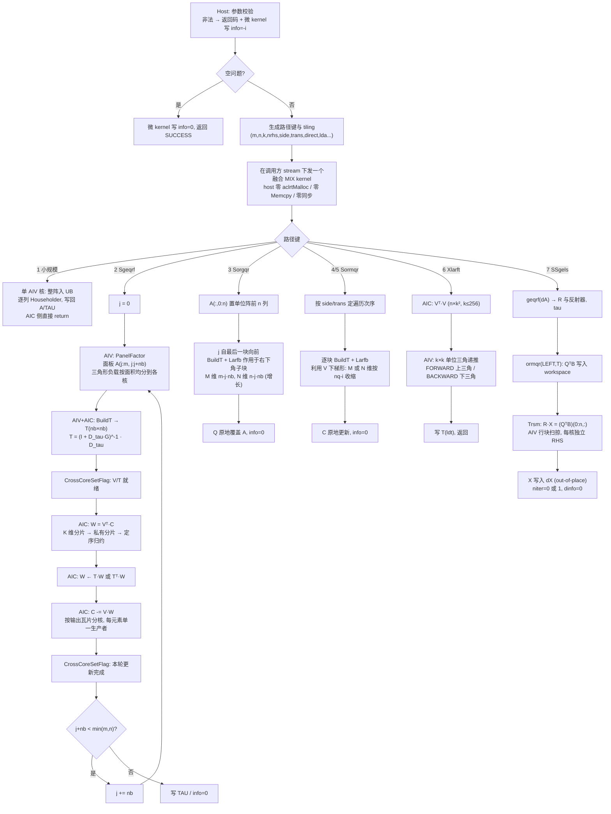

# 需求背景（required）

## 需求来源

10 月社区任务——**Atlas 950 单精度实数 QR 分解与最小二乘（950）**。要求在昇腾 NPU 上基于 AscendC / CATLASS 交付稠密 QR 分解、正交变换与最小二乘求解能力，接口、功能、参数、约束与 cuSolver DN 稠密 QR 系列对齐，精度达到 CANN 生态算子开源标准。

| 项目 | 内容 |
| --- | --- |
| 提交者 | JaneConan |
| 提交目录 | `04_tasks/01_community-task-2026/tasklist/10-3-aclsolverSgeqrf-leastsq-950/JaneConan` |
| 交付接口 | `aclsolverSgeqrf`、`aclsolverSorgqr`、`aclsolverSormqr`、`aclsolverXlarft`、`aclsolverSSgels`（各含 `_bufferSize`） |
| 目标硬件 | Ascend 950PR（Atlas 950），CANN 9.0.0 及以上 |
| 工程模式 | ops-solver **Host C API + AscendC/CATLASS Kernel 直调**（非 aclnn 两段式、非 PyTorch 接口） |
| 合入仓库 | [cann/ops-solver](https://gitcode.com/cann/ops-solver) |
| 设计文档 | 本文档，按 `resources/design_template.md` 组织 |

五个接口作为**同一社区任务一并交付，不允许拆分验收**（任务书 §1、§7.1）。ops-solver 仓当前无 QR / 最小二乘原型（现有为 cgetrf / cgetri / sgetrf / sgetri / cmatinv_batched / cgetri_batched / cheevj / spotrf 族），须全新实现。

## 背景介绍

### QR 系列接口的功能定位

QR 分解是稠密线性代数的基础构件：最小二乘、特征值预处理、正交化都以它为底。本任务交付的五个接口构成一条完整链路——`Sgeqrf` 产出 Householder 形式的 QR，`Xlarft` 把一组反射子压成块三角因子 T，`Sormqr` / `Sorgqr` 分别以隐式 / 显式方式使用 Q，`SSgels` 在其上完成最小二乘求解。

| NPU 交付接口 | 对标 CUDA 接口 | 功能 |
| --- | --- | --- |
| `aclsolverSgeqrf` / `_bufferSize` | `cusolverDnSgeqrf` | A = Q·R，Householder 形式原地写入 A，TAU 长 min(m,n) |
| `aclsolverSorgqr` / `_bufferSize` | `cusolverDnSorgqr` | 由 (A, tau) 生成显式 Q 的前 n 列（m ≥ n ≥ k），原地覆盖 A |
| `aclsolverSormqr` / `_bufferSize` | `cusolverDnSormqr` | C ← op(Q)·C（LEFT）或 C·op(Q)（RIGHT） |
| `aclsolverXlarft` / `_bufferSize` | `cusolverDnXlarft` | H = I − V·T·Vᵀ，由 (V, tau) 生成 k×k 三角因子 T |
| `aclsolverSSgels` / `_bufferSize` | `cusolverDnSSgels` | min‖A·X − B‖_F（须 n ≤ m），X out-of-place |

### 对标基线现状分析

#### 基线支持的数据类型和数据格式

| 项 | 基线（cuSolver DN） | 本任务要求 |
| --- | --- | --- |
| 数据类型 | S/D/C/Z 四套；`Xlarft` 另有 64-bit 通用 API | 仅 **FLOAT32**；`Xlarft` 只验收 dataTypeV / dataTypeTau / dataTypeT / computeType 全为 `ACLSOLVER_R_32F` 的组合，其余返回 `NOT_SUPPORTED` |
| 数据格式 | 列主序（column-major），leading dimension 任意合法值 | 相同：**列主序 ND**，`lda ≥ max(1,m)`、`ldc ≥ max(1,m)`、`ldv ≥ max(1,n)`、`ldt ≥ max(1,k)`，**禁止要求 lda == m 或 lda == n** |
| 维数类型 | `geqrf/orgqr/ormqr/gels` 用 `int`；`Xlarft` 用 `int64_t` | 逐字对齐 |
| workspace | `geqrf/orgqr/ormqr` 以**元素个数**计（`Lwork`）；`Xlarft` / `SSgels` 以**字节**计，`Xlarft` 另含 Host 字节数 | 相同 |
| info | `devInfo` / `dinfo` 为 Device INT32，0 成功、−i 表示第 i 个参数非法 | 相同，**必须真实写入**，序号不计 handle |

#### 基线算法描述

cuSolver 的 QR 系列是教科书式的分块 Householder（compact-WY）实现：

- **geqrf**：右看型分块。每轮对宽度 nb 的面板做非分块分解（逐列生成 `H_j = I − τ_j v_j v_jᵀ`），把该面板的 nb 个反射子压成块反射子 `I − V T Vᵀ`（larft），再对右侧尾随矩阵做一次块更新（larfb，三个 GEMM）。
- **larft**：由 V 的列与 tau 递推出 k×k 的 T，FORWARD 时 T 上三角、BACKWARD 时下三角。
- **ormqr**：对 C 逐块施加 larfb，side / trans 决定乘法方向与面板遍历次序；**利用 V 的下梯形零结构**，第 i 块只作用于第 i 行块及以下。
- **orgqr**：后向累加——Q 初始化为单位阵的前 n 列，自最后一个块反射子向前施加 larfb；**利用 Q 的"增长"结构**，第 j 步只触及右下角子块。
- **gels**：`geqrf` → `ormqr(LEFT, T)` 把 B 变为 QᵀB → 上三角回代 `R·X = (QᵀB)[0:n,:]` → 写出 X。`SSgels` 为迭代精化族接口，主精度与内部精度均为 FP32 时 `niter` 可为 0（直接主精度求解）。

两处"结构利用"不是优化技巧而是 LAPACK flop 计数的前提：`orgqr` 的 `4mnk − 2(m+n)k² + (4/3)k³` 与 `ormqr` 的 `4mnk − 2nk²` 都假定了它；若实现成"每块都对整块做稠密 larfb"，实际算力退化为 `4mnk`（m = n = k 时分别放大 3.00 倍与 2.00 倍）。本设计据此把结构利用列为硬约束，理由见「差异点和原因」D2。

#### 基线实现流程图 ⭐

```mermaid
flowchart TD
    subgraph GEQRF["cusolverDnSgeqrf：右看型分块 Householder QR"]
        A0["输入 A(m×n, 列主序, lda)<br/>TAU / Workspace / Lwork"] --> A1["j = 0"]
        A1 --> A2["nbj = min(nb, min(m,n)-j)"]
        A2 --> A3["面板非分块分解<br/>beta = -sign(x1)·||x||<br/>R_kk = beta, v 归一, tau = (beta-x1)/beta"]
        A3 --> A4["larft：由 (V, tau) 构造 nbj×nbj 的 T"]
        A4 --> A5["larfb：A(j:m, j+nbj:n) -= V·T·(Vᵀ·A)<br/>三个 GEMM"]
        A5 --> A6{"j+nbj < min(m,n) ?"}
        A6 -- 是 --> A7["j += nbj"] --> A2
        A6 -- 否 --> A8["devInfo = 0<br/>R 在上三角, v 在严格下三角, TAU 输出"]
    end

    subgraph LARFT["cusolverDnXlarft：块反射器三角因子"]
        B0["输入 V(n×k, COLUMNWISE) / tau / direct"] --> B1{"direct"}
        B1 -- FORWARD --> B2["自前向后递推<br/>T 上三角"]
        B1 -- BACKWARD --> B3["自后向前镜像递推<br/>T 下三角"]
        B2 --> B4["输出 T(k×k, ldt)"]
        B3 --> B4
    end

    subgraph ORMQR["cusolverDnSormqr：隐式应用 Q"]
        C0["输入 A/tau(反射子) / C(m×n) / side / trans"] --> C1{"side, trans"}
        C1 --> C2["确定面板遍历次序<br/>LEFT·N 与 RIGHT·T 自后向前<br/>LEFT·T 与 RIGHT·N 自前向后"]
        C2 --> C3["逐块 larft + larfb<br/>利用 V 下梯形: 第 i 块只作用于第 i 行块及以下"]
        C3 --> C4["C 原地更新, devInfo = 0"]
    end

    subgraph ORGQR["cusolverDnSorgqr：显式生成 Q"]
        D0["输入 A/tau(反射子), m≥n≥k"] --> D1["A(:,0:n) 置为单位阵前 n 列"]
        D1 --> D2["j 自最后一块向前<br/>larft + larfb 作用于右下角子块<br/>M 维 m-jnb, N 维 n-jnb, 随步进增长"]
        D2 --> D3["Q 原地覆盖 A, devInfo = 0"]
    end

    subgraph GELS["cusolverDnSSgels：QR 最小二乘"]
        E0["输入 dA(m×n) / dB(m×nrhs), n≤m"] --> E1["geqrf(dA)"]
        E1 --> E2["ormqr(LEFT,T): B ← Qᵀ·B"]
        E2 --> E3["trsm: R·X = (QᵀB)(0:n,:)"]
        E3 --> E4["X 写入独立缓冲 dX<br/>niter / dinfo 输出"]
    end
```



# 需求分析（required）

## 需求描述

在 Ascend 950PR 上实现单精度实数 QR 功能组，支持动态 shape、合法 leading dimension padding、Device info 真实写入、调用方 stream 与确定性执行。计算与累加全程 FLOAT32，不以 CPU 计算代替 Device 计算，不依赖 CUDA。

| 接口 | 主要行为 | 输入保留与输出归属 |
| --- | --- | --- |
| `Sgeqrf` | 方阵、高矩阵（m>n）、宽矩阵（m<n，`k = min(m,n)`） | A 原地保存 R（上三角/梯形）与反射器（严格下三角）；TAU 单独输出 |
| `Sorgqr` | 由 k 个反射器生成 Q 的前 n 列，0 ≤ k ≤ n ≤ m | Q 原地覆盖 A；tau 只读 |
| `Sormqr` | side × trans 全覆盖（LEFT/RIGHT × N/T/C，实数下 T 与 C 等价） | 更新 C；A 与 tau 只读 |
| `Xlarft` | FORWARD / BACKWARD，仅 COLUMNWISE，n ≥ k | 输出 T(k×k, ldt)；V、tau 只读 |
| `SSgels` | 求解 `min ‖A·X − B‖_F`，须 n ≤ m，nrhs ∈ [1,128] | dA 可覆盖，dB 保留，dX 独立 out-of-place；`niter` / `dinfo` 输出 |

## 需求拆解

1. **公共类型与 C ABI**：在 `cann_ops_solver_common.h` 追加 `aclsolverParams_t` 与 4 个枚举，提供 10 个公开函数（5 个计算接口 + 5 个 `_bufferSize`），参数名/顺序/Device-Host 归属逐字对齐任务书 §2.3。
2. **Host 校验与空间规划**：校验 shape、leading dimension、指针、workspace 容量；`_bufferSize` 为纯函数；维数与跨度用 64 位计算以防 int 上溢。
3. **基础数学 kernel**：缩放 Householder 生成（防上/下溢）、列内积与 2-范数、反射器应用、上三角回代（trsm）。
4. **分块更新**：compact-WY 块反射子 + 尾随矩阵三次 GEMM 更新，M 维随步进收缩 / 增长。
5. **搬运与 padding**：列主序任意 lda/ldc/ldv/ldt；32 B 对齐约束只作用于当前面板列，不做整阵 pad/restore 往返；GM→L1 用 `Nd2Nz` 直吃列步长。
6. **流与确定性**：全部计算下发在调用方 stream；固定归约与递推次序，规避跨核浮点原子累加；同输入同 stream 串行重复 bit-wise 一致。
7. **可测性**：分别定义五个接口的数学残差口径、接口契约口径、Device info 口径与完整 API 的 kernel 时间统计口径。

## 外部组件依赖

| 依赖 | 说明 |
| --- | --- |
| CANN Toolkit | 9.0.0 及以上，与 ops-solver 仓 README 已验证配套版本一致；实现与自测版本在自测报告中如实登记 |
| AscendC 基础 API | VEC：`DataCopy` / `DataCopyPad`、`Mul` / `Axpy` / `Muls` / `Duplicate`、`ReduceSum` / `WholeReduceSum`、`Sqrt`；CUBE：`Nd2Nz` 搬运、`LoadData`、`Mmad`、`Fixpipe`；跨核：`CrossCoreSetFlag` / `CrossCoreWaitFlag` |
| CATLASS | 可选，用于 `arch35` 下 GEMM 层实现（任务书 §2.2 明文允许 AscendC/CATLASS） |
| ops-solver 既有设施 | handle 管理 `aclsolverCreate/Destroy/SetStream/GetStream`、`aclsolverStatus_t`、`src/utils/`、`test/utils/`、`build.sh --soc=ascend950 --pkg/--run` |
| 性能采集 | `msprof op`，取 `OpBasicInfo.csv` 的 `Task Duration(us)` 按 kernel 名统计调用求平均 |

## 内部适配模块

- **无原型可沿用**：ops-solver 现有算子为 LU / 求逆 / Cholesky 族，无 QR / 最小二乘实现，五个接口全部新建。
- **可借鉴**：`src/cgetrf/cgetrf_kernel.cpp` 的「单融合 kernel + `CrossCoreSetFlag/WaitFlag` 跨核编舞」分块分解范式；`src/utils/kernel/c32/`（`gemm.hpp` 实数 CUBE matmul、`trsm*.hpp` 三角扫掠、`pad.hpp`）。
- **必须按 arch35 校验**：仓内 CUBE 代码（`src/utils/kernel/c32`、`c64`）为 dav-2201 写法，而仓内目前没有 `arch35` 目录。前序在 Ascend950PR 上的独立 GEMM 探针（单核隔离、无跨核同步、无上层算法）显示该写法在 950PR 上不可直接复用（fp32 非转置形状输出异常），根因指向 c310 与 c220 的 fp32 分形/布局约定不同。因此「CUBE 层按 dav-3510（`__DAV_CUBE__` / arch35）重写并逐形状校验」是本设计的前提，而不是可选优化项。
- **算法主干与复数版本同构**：实数/复数的唯一分叉收敛在 `GemmDispatch`（实数 1 次 fp32 Cube 调用，复数 4 次加符号表），故组件实现为模板参数化的 header-only 共用核 `src/common/qr_core/`。本 PR 自身完整、可独立合入，不依赖其他任务先合入（任务书 §5）。

# 详细设计（required）

## 算子分析

### 数学公式

令 `k = min(m,n)`。单列反射器 `H_j = I − τ_j v_j v_jᵀ`，`v_j` 首个活动元素为 1、此前元素为 0：

```text
Q = H_0 H_1 … H_{k-1}
R = Qᵀ A,   A = Q R
```

生成第 j 个反射器时，活动列写为 `x = [α; z]`。先以 `s = max_i |x_i|` 缩放再求 `‖x/s‖₂`，避免直接平方放大上溢/下溢风险；随后采用确定的 LAPACK 符号规则：

```text
β = −sign₀(α)·‖x‖₂ ， sign₀(a) = +1 (a ≥ 0)、−1 (a < 0)
v = x / (α − β) ， v 的首元素归一为 1
τ = (β − α) / β
Hᵀ x = [β; 0] ， R_jj = β ， A(j+1:m−1, j) 存 v(2:end) ， TAU(j) = τ
退化：z = 0 且 α ≥ 0 时 τ = 0、β = α，反射器为恒等（此时不动该列，保证确定性）
```

符号规则 `sign₀(0) = +1` 与参考 LAPACK 一致，是精度判据（§可维可测：以 NPU 输出的 (v, tau) 升 float64 后调 CPU `dorgqr` 构造 Q）成立的前提。

同一面板的 nb 个反射子压成块反射子 `H_b = I − V T Vᵀ`。令 `D_τ = diag(τ)`，`G` 为 `VᵀV` 的**严格上三角**部分（FORWARD）：

```text
T = (I + D_τ G)^{-1} D_τ
```

`I + D_τ G` 是单位上三角，T 的每一列可独立地由一次单位上三角回代得到（无需对 τ 求逆，τ = 0 也适用）：

```text
T(i,i) = τ_i
T(j,i) = −τ_j · Σ_{l=j+1..i} (v_jᵀ v_l)·T(l,i) ， j = i−1 … 1
```

BACKWARD 取镜像形式：`G` 取 `VᵀV` 的严格下三角，递推自后向前，T 为下三角。

块更新（larfb）对尾随矩阵的一次作用分解为三次 GEMM：

```text
LEFT :  C ← C − V·T·Vᵀ·C        W = VᵀC ; W ← T W (trans=N) 或 TᵀW (trans=T) ; C ← C − V·W
RIGHT:  C ← C − C·V·T·Vᵀ        W = C V ; W ← W T (trans=N) 或 W Tᵀ (trans=T) ; C ← C − W·Vᵀ
```

`Sorgqr` 为后向累加：`Q = H_0 … H_{k-1}` 的前 n 列，从单位阵起步、自最后一块向前施加块反射子。`SSgels` 解 `R·X = (QᵀB)[0:n,:]`，`X` 独立写出；`niter` 报告迭代次数（直接主精度求解时为 0）。

### 支持数据类型

| 数据 | 类型 | 存储位置 |
| --- | --- | --- |
| A、C、B、X、tau、V、T、`geqrf/orgqr/ormqr` 的 workspace | `float`，FLOAT32 | Device |
| Cube 累加、向量归约、范数/内积中间量 | FLOAT32 | Device GM / UB / L0 |
| `devInfo` / `dinfo` | `int`，INT32 | Device |
| m、n、k、nrhs、lda/ldc/ldv/ldt、`Lwork`/`lwork` | `int` | Host 标量 |
| `Xlarft` 的 n、k、ldv、ldt | `int64_t` | Host 标量 |
| `_bufferSize` 输出与 `niter` | `int*` / `size_t*` | Host |
| `Xlarft` / `SSgels` 的 workspace | `void*`，以字节计 | Device |

算法全程 FLOAT32，**不降为 FP16 / BF16 / TF32**：950PR 的 Cube 低精度算力远高于 FP32，但任务书 §3.2.1 的残差门是「与 CPU FP32 参考同量级」，`max(5·ratio_cpu, …)` 形式的门限下降低精度必然超阈。

### 支持形状与约束

| 接口 | 维数范围（验收下限） | 布局与容量约束 |
| --- | --- | --- |
| `Sgeqrf` | m, n ∈ [1, 4096]，覆盖方阵、m>n、m<n | A 覆盖 lda×n，lda ≥ max(1,m)；TAU 长度 min(m,n) |
| `Sorgqr` | m ∈ [1, 4096]，0 ≤ k ≤ n ≤ m | A 为 lda×n，lda ≥ max(1,m)；tau 长度 k |
| `Sormqr` | m, n ∈ [1, 4096]，0 ≤ k ≤ nq，nq = (side==LEFT ? m : n) | A 为 lda×k，lda ≥ max(1,nq)；C 为 ldc×n，ldc ≥ max(1,m) |
| `Xlarft` | n ∈ [1, 4096]，k ∈ [1, min(n, 256)]，n ≥ k | V 为 ldv×k，ldv ≥ max(1,n)；T 为 ldt×k，ldt ≥ max(1,k) |
| `SSgels` | m ∈ [n, 4096]，n ∈ [1, 4096]，nrhs ∈ [1, 128] | ldda、lddb ≥ max(1,m)，lddx ≥ max(1,n)，X 与 B 不得共用存储 |

- 空问题（m = 0 / n = 0 / k = 0 / nrhs = 0）在枚举、维数、leading dimension、按 shape 所需指针与 workspace 均合法后成功返回并写 info = 0；
- 非法枚举 / 负维数 / 非法 leading dimension / 空指针 / workspace 不足返回 `ACLSOLVER_STATUS_INVALID_VALUE`（空 handle 返回 `ACLSOLVER_STATUS_HANDLE_IS_NULLPTR`），info 可写时写 `−i`，`i` 为计算接口中**不计 handle** 的参数序号；
- `Xlarft` 的非 FLOAT32 dtype 组合返回 `ACLSOLVER_STATUS_NOT_SUPPORTED`；`storev` 仅接受 COLUMNWISE；
- `Sorgqr` / `Sormqr` / `Xlarft` 的输入是 `Sgeqrf` 输出的 Householder 表示，不是未分解的原始 A（任务书 §7.6）；
- 不支持 broadcast，不引入批量维度；单 case 输入内存 ≤ 4 GB 为构造侧约束。

## 算子实现

### 实现方案

采用 **ops-solver Host C API + AscendC/CATLASS Kernel 直调**：

```text
调用方 → aclsolverXxx_bufferSize(...)           得到 Lwork / lwork_bytes（纯函数）
调用方 → aclrtMalloc(workspace)                  由调用方持有，可跨调用复用
调用方 → aclsolverXxx(handle, ..., workspace, ..., devInfo)
             ├─ Host：参数校验 → 路径选择与 tiling 生成（动态 shape）→ 核函数下发（调用方 stream）
             └─ Device：融合 MIX kernel 完成全部计算，写出 info / niter
```

编译与运行沿用仓内既有方式：

```bash
bash build.sh --pkg --soc=ascend950 --ops=sgeqrf,sorgqr,sormqr,xlarft,ssgels
./build_out/cann-950-ops-solver_*.run --install --quiet
bash build.sh --soc=ascend950 --ops=sgeqrf,sorgqr,sormqr,xlarft,ssgels --run
```

目录（遵循仓内 `src/<op>/` + `test/<op>/` + `docs/zh/<op>.md` 约定）：

```text
include/cann_ops_solver.h                 # 接口原型
include/cann_ops_solver_common.h          # 新增 params 与 4 个枚举
src/sgeqrf/  src/sorgqr/  src/sormqr/  src/xlarft/  src/ssgels/   # *_host.cpp + *_kernel.cpp
src/common/qr_core/                       # header-only 模板核（实数/复数共用组件）
test/sgeqrf/ test/sorgqr/ test/sormqr/ test/xlarft/ test/ssgels/  # *_test.cpp + data/gen_data.py + data/verify_result.py + CMakeLists.txt + README.md
docs/zh/sgeqrf.md … docs/zh/ssgels.md     # 接口文档
```

公开类型（`cann_ops_solver_common.h` 追加，均为追加式改动）：

```c
typedef void* aclsolverParams_t;                       /* 允许 nullptr 表示默认参数 */
typedef enum { ACLSOLVER_OP_N = 0, ACLSOLVER_OP_T = 1, ACLSOLVER_OP_C = 2 } aclsolverOperation_t;
typedef enum { ACLSOLVER_SIDE_LEFT = 0, ACLSOLVER_SIDE_RIGHT = 1 } aclsolverSideMode_t;
typedef enum { ACLSOLVER_DIRECT_FORWARD = 0, ACLSOLVER_DIRECT_BACKWARD = 1 } aclsolverDirectMode_t;
typedef enum { ACLSOLVER_STOREV_COLUMNWISE = 0 } aclsolverStorevMode_t;
typedef enum { ACLSOLVER_R_32F = 0, ACLSOLVER_C_32F = 1 } aclsolverDataType_t;
```

公开接口（**逐字对齐任务书 §2.3，参数名 / 顺序 / 含义 / Device-Host 归属不变**）：

```c
aclsolverStatus_t aclsolverSgeqrf_bufferSize(aclsolverHandle_t handle, int m, int n, float *A, int lda, int *Lwork);
aclsolverStatus_t aclsolverSgeqrf(aclsolverHandle_t handle, int m, int n, float *A, int lda,
                                  float *TAU, float *Workspace, int Lwork, int *devInfo);

aclsolverStatus_t aclsolverSorgqr_bufferSize(aclsolverHandle_t handle, int m, int n, int k,
                                             const float *A, int lda, const float *tau, int *lwork);
aclsolverStatus_t aclsolverSorgqr(aclsolverHandle_t handle, int m, int n, int k,
                                  float *A, int lda, const float *tau, float *work, int lwork, int *devInfo);

aclsolverStatus_t aclsolverSormqr_bufferSize(aclsolverHandle_t handle, aclsolverSideMode_t side,
                                             aclsolverOperation_t trans, int m, int n, int k,
                                             const float *A, int lda, const float *tau,
                                             const float *C, int ldc, int *lwork);
aclsolverStatus_t aclsolverSormqr(aclsolverHandle_t handle, aclsolverSideMode_t side,
                                  aclsolverOperation_t trans, int m, int n, int k,
                                  const float *A, int lda, const float *tau,
                                  float *C, int ldc, float *work, int lwork, int *devInfo);

aclsolverStatus_t aclsolverXlarft_bufferSize(aclsolverHandle_t handle, aclsolverParams_t params,
                                             aclsolverDirectMode_t direct, aclsolverStorevMode_t storev,
                                             int64_t n, int64_t k,
                                             aclsolverDataType_t dataTypeV, const void *V, int64_t ldv,
                                             aclsolverDataType_t dataTypeTau, const void *tau,
                                             aclsolverDataType_t dataTypeT, void *T, int64_t ldt,
                                             aclsolverDataType_t computeType,
                                             size_t *workspaceInBytesOnDevice, size_t *workspaceInBytesOnHost);
aclsolverStatus_t aclsolverXlarft(aclsolverHandle_t handle, aclsolverParams_t params,
                                  aclsolverDirectMode_t direct, aclsolverStorevMode_t storev,
                                  int64_t n, int64_t k,
                                  aclsolverDataType_t dataTypeV, const void *V, int64_t ldv,
                                  aclsolverDataType_t dataTypeTau, const void *tau,
                                  aclsolverDataType_t dataTypeT, void *T, int64_t ldt,
                                  aclsolverDataType_t computeType,
                                  void *bufferOnDevice, size_t workspaceInBytesOnDevice,
                                  void *bufferOnHost, size_t workspaceInBytesOnHost);

aclsolverStatus_t aclsolverSSgels_bufferSize(aclsolverHandle_t handle, int m, int n, int nrhs,
                                             float *dA, int ldda, float *dB, int lddb, float *dX, int lddx,
                                             void *dwork, size_t *lwork_bytes);
aclsolverStatus_t aclsolverSSgels(aclsolverHandle_t handle, int m, int n, int nrhs,
                                  float *dA, int ldda, float *dB, int lddb, float *dX, int lddx,
                                  void *dWorkspace, size_t lwork_bytes, int *niter, int *dinfo);
```

`aclsolverParams_t` 允许传 `nullptr`；本实现不需要显式 params 对象，故不交付 `aclsolverCreateParams/DestroyParams`。

#### 3.2.1 host侧设计：

Host 从 handle 取得调用方 stream，按序完成：参数校验 → 路径选择与 tiling 生成 → 核函数下发。Host **不解引用 Device 数据、不分配内部 Device 缓冲、不等待 stream 完成**；workspace 由调用方查询并持有，`_bufferSize` 只依赖 `(m, n, k, nrhs, lda…)`，与运行时状态无关。

参数非法的处理：返回对应 `aclsolverStatus_t`，并在 info 指针非空时**沿调用方 stream 下发一个写 info 的微 kernel** 写 `−i`（不在 Host 侧做同步写），保证「info 为 Device 输出」的语义与「禁止无必要 Host 同步」同时成立。成功与空问题同样沿 stream 写 `info = 0`。`_bufferSize` 没有 Device info 输出，仅返回状态。维数与跨度计算使用 64 位，并检查 `int` / `size_t` 容量上溢。

##### 1. 分核策略：

核预算以平台查询值（`GetCoreNumAic()` / `GetCoreNumAiv()`）为准，不在 Host 侧写死核数；950PR 实测为 **AIC = 28、AIV = 56**（`cube_vector_combine = split`，AIC 与 AIV 为独立核），blockDim 上限分别取 28 / 56，不超发。

| 接口 / 路径 | 分核维度 | blockDim |
| --- | --- | --- |
| 小规模直通路径（`Sgeqrf` / `SSgels` 的小问题） | 不分核 | 1（AIV） |
| `Sgeqrf` 面板分解（VEC 段） | 面板内列方向，**按三角形面积均分**而非等列数 | `min(nb, AIV)` |
| `Sgeqrf` / `Sormqr` / `Sorgqr` 尾随更新（CUBE 段） | 输出瓦片（M×N）展平后静态取模映射 | `min(瓦片数, AIC)` |
| `W = Vᵀ·C` 的 K 维分片 | K（行）方向分片，**各核写私有分片后定序归约** | `min(⌈M/64⌉, AIC)` |
| `Xlarft` | `Vᵀ·V` 按瓦片分核；k×k 三角递推不分核（k ≤ 256 整块驻留 UB） | `min(⌈k/64⌉², AIC)` |
| `SSgels` 回代段 | nrhs 列方向 | `min(nrhs, AIV)` |

分核公式（以尾随更新为例）：设尾随矩阵为 `M_t × N_t`、瓦片 `128×128`，则瓦片数 `T = ⌈M_t/128⌉·⌈N_t/128⌉`，第 `b` 号核处理 `{ tileId | tileId mod blockDim == b }`。**瓦片到核的映射只依赖 `(M_t, N_t, nb, blockDim)`，与数据无关**，这是满足 bit-wise 确定性要求的前提。

##### 2. 数据分块和内存优化策略：

**(1) 面板宽度 `nb` 的选择**

以平台查询的 UB 容量 `UB_CAP` 与 L1/L0 容量共同约束，实现在 `Init` 时校验，不满足则自动降级：

```text
UB：  nb²·4 (T 块) + nb·align64(M_sub)·4/S (面板列分片, S 为核内分片数) + C_tmp·nb·4 ≤ UB_CAP
L0C： nb²·4 ≤ L0C_CAP
L1 ： 4·nb²·4 ≤ L1_CAP          （开 double buffer）
候选集 nb ∈ {64, 128}；默认 128，窄矩阵与小 k 场景降为 64
```

Cube 侧的瓦片取 16/32/64/128 的二次幂，K 分块交给 FP32 tiling；面板宽度与瓦片宽度的取值在 950PR 上实测标定后定稿，标定结果写入 README。

**(2) workspace 尺寸公式**（FP32 元素；`align64(x) = ⌈x/64⌉·64`）

```text
Sgeqrf:  Lwork = 2·align64(m)·nb          // V 平面（含单位对角、上三角补零），double buffer
                + 2·nb·nb                 // T，double buffer
                + 2·nb·NW                 // W = Vᵀ·C 的中间量，NW = 128
                + (lda % 8 != 0 ? align8(m)·nb : 0)   // 面板列对齐暂存
                + C_sync                  // 同步标志 / 常量区，取 64
         m = 4096, nb = 128 时 ≈ 1.11×10⁶ 元素（约 4.5 MB）
Sorgqr / Sormqr: 同式（V 由输入 A 构造，Y 不额外保存）
Xlarft:  workspaceInBytesOnDevice = (k·k + align64(n)·NB_v)·4，NB_v = 64
         workspaceInBytesOnHost   = 0（本实现 Host 侧无需暂存，仍按契约写出）
SSgels:  lwork_bytes = (Sgeqrf 的 Lwork + align64(m)·nrhs + n·nrhs + C_sync)·4
```

**(3) lda padding 的处理**

GM→L1 的 `Nd2Nz` 以 `srcDValue = lda` 直接吃任意列步长，**不做整阵 pad/restore 往返**；向量侧只在 `lda` 不满足 32 B 对齐时，对**当前面板的列**走 `DataCopyPad`（代价 O(nb·m)，相对该规模预算可忽略）。写回时只写有效行/列，不修改 leading-dimension padding 区。这与仓内既有算子「要求 lda == n」的做法不同，是任务书 §7.3 的硬性要求。

**(4) 原地写回掩码**

面板分解在列主序 A 上原位进行。最后只写回满足 `i/nb < j/nb || j ≥ min(m,n)` 的 R 元素；同一面板内的对角、上三角与下三角反射器保留面板分解写出的内容，宽矩阵额外的 R 列按 R 语义覆盖。不足 nb 的尾块补零，D 更新起点按 nb 对齐。

##### 3. tilingKey规划策略：

本工程不是 aclnn 注册算子，不新增注册式整数 TilingKey；Host 以函数分发 + tiling 结构表达等价的路径选择，逻辑分类如下：

| 逻辑键 | 触发条件 | kernel 行为 | 引擎 |
| --- | --- | --- | --- |
| `0` | m/n/k/nrhs 任一为 0 | 空问题，只写 info = 0 后返回 | AIV |
| `1` | 小规模（`Sgeqrf` / `SSgels` 入口，整阵可驻 UB 且 m ≥ n） | 非分块 QR，单核 UB 内完成 | AIV only |
| `2` | `Sgeqrf` 分块路径 | 面板分解 + 尾随更新（收缩） | mix |
| `3` | `Sorgqr` | 单位阵初始化 + 后向累加（增长） | mix |
| `4` | `Sormqr`，side = LEFT | 行方向块更新，次序由 trans 定 | mix |
| `5` | `Sormqr`，side = RIGHT | 列方向块更新，次序由 trans 定 | mix |
| `6` | `Xlarft` | `Vᵀ·V` + k×k 三角递推（k ≤ 64 时 AIV only），FORWARD/BACKWARD | mix |
| `7` | `SSgels` | geqrf → ormqr(LEFT,T) → trsm → 写 dX | mix |

**设置这些键的理由**：

1. **`1` vs `2`（小规模走纯 AIV）**：950PR 上 AIC 与 AIV 是 `split` 形态的独立核，mix 形态核函数自带固定启动开销与跨核握手；而小规模用例的性能预算只有几十微秒量级（见「性能标准」：最紧的 `Sormqr m=n=k=2` 门限仅 27.4 µs，全量 case 中门限 < 100 µs 的共 31 条），mix 的固定成本在此区间不划算。
2. **`4` vs `5`（side 分路径）**：LEFT 的块更新沿 C 的行方向收缩、RIGHT 沿列方向收缩，操作数的转置侧与瓦片遍历方向都不同，合并会在内循环引入运行期分支。
3. **`6` 独立成键**：`Xlarft` 的输入是**现成的** (V, tau)，与 `Sgeqrf` 内部「边分解边构造 T」的融合形态不同；入口独立但复用同一份 `BuildT` 实现。
4. **`3` 与 `2` 分离**：`Sorgqr` 的 larfb 作用于「正在长出来」的右下角子块，M/N 维随步进**增大**；`Sgeqrf` 的尾随矩阵随步进**减小**。两者的瓦片映射与边界条件相反。

#### 3.2.2 kernel侧设计：

**每次计算接口调用下发一个融合 MIX kernel**，核内以 `CrossCoreSetFlag/WaitFlag` 编舞 AIV 与 AIC：

```text
AIV  : PanelFactor ──→ BuildT ──┐                          ┌─→ 下一面板
                                ↓                          │
AIC  :                        Larfb(W=VᵀC → W=TW → C-=VW) ─┘
```

共用核组件（header-only 模板，`T` 为模板参数，实数实例化即 `T = float`）：

| 组件 | 职责 | 引擎 |
| --- | --- | --- |
| `PanelFactor<T>` | 面板非分块 Householder 分解，产出 v 与 tau（缩放防溢出 + 确定符号规则） | AIV |
| `BuildT<T>` | 由 (V, tau) 构造块三角因子 T（`Xlarft` 的公开入口即此） | AIV（+AIC 供 `VᵀV`） |
| `Larfb<T>` | 块反射子应用，三次 GEMM，按 side/trans 展开 | AIC |
| `BackAccum<T>` | 单位阵初始化 + 后向累加（`Sorgqr`） | AIC + AIV |
| `Trsm<T>` | 上三角回代（`SSgels`） | AIV（+AIC 尾随更新） |
| `GemmDispatch<T>` | **唯一的实数/复数分叉点**；实数 1 次 fp32 Mmad | AIC |

五个接口由上述组件组合而成：

```text
Sgeqrf = loop { PanelFactor → BuildT → Larfb(尾随, 收缩) }
Xlarft = BuildT（独立入口，输入为现成的 V 与 tau）
Sormqr = loop { BuildT → Larfb(side, trans) }
Sorgqr = BackAccum = 自后向前 loop { BuildT → Larfb(子块, 增长) }
SSgels = Sgeqrf → Sormqr(LEFT,T) 作用于 B → Trsm(R) → 写出 dX
```

**面板分解的负载均衡**：面板是下梯形（第 j 列只有 `m − j` 个活动元素），等列数切分会让先启动的核负载远重于后启动的核。按**三角形面积**均分——把累计活动元素数作为切分依据，使各核工作量相当。

**`W = Vᵀ·C` 的归约**：K（行）方向分片，各核写自己的私有分片，再按**固定次序**归约；不使用 `SetAtomicAdd`（浮点加法不满足结合律，原子累加的到达次序跑间变化会破坏 bit-wise 一致性）。`C −= V·W` 按输出瓦片切分，每元素只有一个生产者，次序无关。

**结构利用**：`Sormqr` 的第 i 块只作用于第 i 行块及以下（LEFT）/ 第 i 列块及以右（RIGHT），瓦片范围随步进收缩；`Sorgqr` 自后向前、只触及右下角增长中的子块。二者都由 Host 在 tiling 中算出每轮的 `(M_t, N_t, 偏移)`，kernel 内不引入运行期分支。

**`Xlarft`**：`Vᵀ·V` 按瓦片分核算出 Gram 矩阵，AIV 取严格上/下三角部分做单位三角回代得到 T，写回 `T(ldt)`。k ≤ 64 时整块驻 UB，走 AIV only。

**`SSgels`**：`geqrf(dA)` → `ormqr(LEFT, T)` 把 dB 变为 `QᵀB`（写入 workspace，dB 保留）→ `trsm` 解 `R·X = (QᵀB)[0:n,:]` → 写出 `dX`（out-of-place，不与 B 共用存储）。主精度直接求解时 `niter = 0`；若自测中 SQRT16 / SQRT17 残差逼近门限，复用已保存的 R 与反射器执行一次不动点精化（`F = B − A_orig X`，`R·Δ = (QᵀF)[0:n,:]`，`X += Δ`）并置 `niter = 1`，该路径与直接路径共用全部组件。

**`Trsm` 回代**：上三角、列主序，按行块扫掠；每核独立处理一个或多个 nrhs 列，回代次序固定（保证确定性）。

**同步与流水**：面板段（AIV）与尾随更新段（AIC）之间通过 `CrossCoreSetFlag/WaitFlag` 握手流水；核内 MTE/Vector 依赖用事件与 PIPE 屏障。Host 侧**不在面板之间插入 `aclrtSynchronizeStream`**——这与仓内 `spotrf_catlass` 的「每面板一次 Host 同步」形态不同，是 QR 系列把面板与更新融合进同一 kernel 后的必要形态，也是性能口径（平均单次 kernel 耗时）可解释的前提。

### AscendC 实现流程图 ⭐



### 与基线流程图的差异点和原因 ⭐

| # | 基线（cuSolver / LAPACK） | 本 AscendC 实现 | 差异原因 |
| --- | --- | --- | --- |
| **D1** | 单一分块算法，所有规模同一条路径 | **按规模分成「小规模单核 AIV」与「分块 mix」两条路径**（路径键 1 vs 2） | 950PR 上 AIC/AIV 是 `split` 形态独立核，mix 核函数自带固定启动开销与跨核握手；小规模用例预算只有几十微秒（最紧的 `Sormqr m=n=k=2` 仅 27.4 µs，全量 case 中门限 < 100 µs 的有 31 条），mix 的固定成本占比过高 |
| **D2** | 结构利用内置在库实现中，不显式表述 | **把「利用 V 的下梯形零结构与 Q 的增长结构」列为硬约束**，瓦片范围随步进收缩/增长 | 若按 `4mnk` 的稠密 larfb 实现，`Sorgqr m=n=k=4096` 与 `Sormqr m=n=k=4096 LEFT,N` 的算力需求相对 LAPACK 口径分别放大约 3.00× 与 2.00×；QR 这类含面板串行段的负载不可能持续跑到 Cube 峰值的高占比区间。结构利用是达标前提而非优化项 |
| **D3** | 每个阶段一次或多次 kernel 下发（geqr2 / larft / larfb 分离） | **一次 API 调用下发一个融合 MIX kernel**，面板与尾随更新在核内以 CrossCore 握手流水 | ① 面板（AIV）与尾随更新（AIC）在独立引擎上可重叠，分离下发会让 AIC 在面板期间空转；② 任务书 §3.3 的性能口径是 `OpBasicInfo.csv` 中「按 kernel 名统计调用求平均」，单 kernel 使「平均单次 kernel 耗时」无歧义 |
| **D4** | GPU 上多线程块对同一输出做原子累加，顺序随运行时变化 | **`W = Vᵀ·C` 的 K 维跨核归约改为「各核写私有分片 + 固定次序归约」，全程不用 `SetAtomicAdd`** | 浮点加法不满足结合律，原子累加的到达次序跑间变化会破坏 bit-wise 一致性，而任务书 §2.1-6 要求同输入同 stream 多次执行逐位一致。`C −= V·W` 按输出瓦片切分、每元素只有一个生产者，次序无关 |
| **D5** | `lda` padding 由库内部跨步访问直接处理 | **`Nd2Nz` 以 `srcDValue = lda` 直接吃任意列步长；仅在 `lda` 非 32 B 对齐时对当前面板的列走 `DataCopyPad`** | AIV 向量操作数要求 32 B 对齐，但整阵 pad 会引入 `2·m·n·4` B 的额外往返；只对面板列（O(nb·m)）处理，代价相对预算可忽略。仓内既有算子要求 `lda == n`，不满足任务书 §7.3 |
| **D6** | `larft` 只作为 `geqrf` 的内部步骤，不单独暴露 | **`Xlarft` 是公开接口，与 `Sgeqrf` 内部的 T 构造共用同一份 `BuildT` 实现** | 任务书要求 `Xlarft` 独立交付且维数为 `int64_t`。共用实现避免两份语义漂移，也使该接口的正确性由 `Sgeqrf` 的全量用例间接覆盖 |
| **D7** | 库内部可能使用 TF32 / 混合精度加速 | **全程 FLOAT32 累加，不降精度** | 任务书 §3.2.1 的残差门是「与 CPU FP32 参考同量级」（如 geqrf `max(5·ratio_cpu, 0.1)`），降低精度必然超阈 |
| **D8** | Host 侧可自由分配临时显存、可做同步 | **Host 侧零 `aclrtMalloc` / 零 `aclrtMemcpy` / 零 `aclrtSynchronizeStream`**，workspace 全部来自调用方，tiling 随核函数参数下发 | 任务书 §2.1-3/4 要求 Device 指针、真实 info 写入、走调用方 stream 且禁止无必要的 Host 同步。这也是与仓内既有部分算子（主机指针 + 内部 Malloc + 每步同步）形态的主要区别 |
| **D9** | —（基线无此问题） | **CUBE 层按 `arch35`（dav-3510）实现并逐形状校验，不直接沿用仓内 dav-2201 写法** | 仓内 CUBE 代码面向 c220 且无 `arch35` 目录；950PR 上的独立 GEMM 探针显示 fp32 分形/布局约定与 c220 不同，直接沿用会输出错误结果。详见「内部适配模块」 |

## 支持硬件

| 支持的芯片版本 | 是否涉及 |
| --- | --- |
| Ascend 950PR（Atlas 950） | √ |
| Atlas 800I/T A2（ascend910b） | × |
| Atlas A3（ascend910_93） | × |

- 依赖与目标平台匹配的 CANN 9.0.0 及以上 ACL / AscendC 工具链；构建时只在 `SOC_VERSION` 匹配 `ascend950*` 的分支加入本批实现，其他 SOC 不编译 950 专用向量与 Cube 内核。
- 硬件资源（950PR 实测）：**AIC 28 核、AIV 56 核，L2 128 MB，HBM 128 GB**；`cube_vector_combine = split`。核数在实现中以平台查询值为准，不写死。
- 片上预算：UB、L1、L0A/L0B、L0C 容量以平台查询值（`GetUBSizeInBytes()` 等）为准；`nb` 与瓦片尺寸的取值在 `Init` 时按查询值校验并降级，不依赖某一固定字节数。

## 算子约束限制

1. 公共矩阵必须为有效 Device 分配且为列主序 FLOAT32；Host 无法从裸指针推断实际容量或 dtype，调用方保证分配与类型契约。
2. 输入/输出与 workspace 按接口保留语义使用互不重叠区域；`SSgels` 的 X 独立于 A/B，禁止以覆盖 B 代替 out-of-place 结果。
3. `Xlarft` 仅 `storev = COLUMNWISE`，仅 FLOAT32 四元组，n ≥ k；其他 dtype 组合返回 `NOT_SUPPORTED`。
4. `SSgels` 不支持 m < n；满列秩是正常求解前提，不做列主元秩估计，不承诺秩亏或极端病态矩阵的前向误差。
5. workspace 必须按本次 shape 查询：`geqrf/orgqr/ormqr` 以 FP32 元素计，`Xlarft/SSgels` 以字节计。
6. Device info 与输出在 stream 完成后读取；所有 Device 缓冲区在此之前保持有效，不以 Host API 返回代表 Device 已完成。
7. 核心计算全部在 AI Core 上完成，不存在 CPU fallback；不支持 broadcast，不要求图融合。

# 可维可测分析

## 精度标准/性能标准

1-范数按 LAPACK 定义：`‖M‖₁ = max_j Σ_i |M_ij|`、`‖v‖₁ = Σ_i |v_i|`；单位舍入 `ε = 2^-24 ≈ 5.96e-8`。`ratio_cpu` 由**同精度 FLOAT32 CPU 参考链路**同 case 同式实测产生（CPU BLAS 固定单线程，避免多线程归约次序影响参考值）。

| 验收标准 | 描述 | 标准来源 |
| --- | --- | --- |
| `Sgeqrf` 精度 | `ratio = ‖R − Qᵀ·A‖₁ / (m·‖A‖₁·ε) ≤ max(5·ratio_cpu, 0.1)`；Q 由 NPU 输出的 (v, tau) **升 float64** 后调 CPU `dorgqr`（列数取 m）构造 | 任务书 §3.2.1.1（LAPACK SQRT01） |
| `Sorgqr` 精度 | `ratio = ‖I − Qᵀ·Q‖₁ / (m·ε) ≤ max(5·ratio_cpu, 1.5)`，分母固定取行数 m | 任务书 §3.2.1.2（SQRT02） |
| `Sormqr` 精度 | `ratio = ‖op2 − op1‖₁ / (m·‖C‖₁·ε) ≤ max(5·ratio_cpu, 0.1)`；op2 由**同一份 NPU 输出的 (v, tau)** 经本实现的 `Sorgqr` 生成 Q 后按同一 side/trans 矩乘。**验收顺序：`Sorgqr` 先通过，`Sormqr` 方可验收** | 任务书 §3.2.1.3（SQRT03） |
| `SSgels` 精度（方阵 m = n） | `max_j ‖B_j − A·X_j‖₁ / (max(m,n)·‖A‖₁·‖X_j‖₁·ε) ≤ max(5·ratio_cpu, 0.015)`，逐列判定取最大 | 任务书 §3.2.1.4（SQRT16） |
| `SSgels` 精度（超定 m > n） | `ratio_opt = ‖Rᵀ·A‖₁ / (‖A‖₁·‖B‖₁·max(m,n,nrhs)·ε) ≤ 10·ratio_opt_cpu`，`R = B − A·X`；超定直接以本判据终裁 | 任务书 §3.2.1.4（SQRT17） |
| `Xlarft` 精度 | 任务书 §3.2 未列该接口的残差判据，本设计自定 `‖(I − V·T·Vᵀ) − Π H_i‖₁ / (k·ε)`，并在自测报告中登记口径 | 本设计（任务书未覆盖项） |
| 确定性 | 同输入、同 stream 串行多次执行，输出（含 TAU 与 info）bit-wise 一致 | 任务书 §2.1-6、§3.5 |
| 性能 | 有 GPU 参考值的 case：`T_NPU ≤ T_GPU / 0.35`（即倍率 ≥ 0.35×GPU）。950PR 实测，`msprof op` 采集 `OpBasicInfo.csv`，取 `Task Duration(us)` 按 kernel 名对调用次数求平均；`_bufferSize`、workspace 分配、Host 校验不计入 | 任务书 §3.3 |
| 内存 | 不做要求；自测报告给出各 case 的 `_bufferSize` 查询值与 Device 分配峰值 | 任务书 §3.4 |

**性能基线覆盖说明**（依据任务包 `bench_result.json` 统计）：`sgeqrf` 174 条、`sorgqr` 165 条、`sormqr` 189 条全部有 GPU 参考值；`sgels` 166 条中 58 条有值、108 条 GPU 侧自身返回错误（全部为 m > n 且 n/m ≤ 0.771）；`aclsolverXlarft` 未随包提供用例与基线。**达标率只在有 GPU 参考值的 586 条上统计**，其余 case 照常提供 NPU 实测耗时但不计入比值。

**任务书 §3.3 的 12 条性能 case 与门限**（GPU 列取自任务包 `bench_result.json` 的 `perf.avg_ms`，25 次迭代均值；门限 = GPU / 0.35）：

| 编号 | 接口 | 规格 | GPU 实测 avg | NPU 门限 | 备注 |
| --- | --- | --- | --- | --- | --- |
| P-01 | `Sgeqrf` | m=n=1024 | 3.794 ms | ≤ 10.84 ms | 包内有该 case |
| P-02 | `Sgeqrf` | m=n=4096 | 25.45 ms | ≤ 72.71 ms | 包内有该 case |
| P-03 | `Sgeqrf` | m=2048, n=1024 | 包内无该 case | 待测 | 自测补齐并按同口径登记 |
| P-04 | `Sorgqr` | m=n=k=1024 | 0.835 ms | ≤ 2.39 ms | 包内有该 case |
| P-05 | `Sorgqr` | m=n=k=4096 | 5.211 ms | ≤ 14.89 ms | 包内有该 case |
| P-06 | `Sormqr` | m=n=k=2048, LEFT, N | 2.080 ms | ≤ 5.94 ms | 包内有该 case |
| P-07 | `Sormqr` | m=n=k=2048, LEFT, T | 包内无该组合 | 待测 | 包内仅 LEFT·N 与 RIGHT·T，自测补齐 |
| P-08 | `Xlarft` | n=4096, k=128, FORWARD | 包内无该接口 | 待测 | 无 GPU 基线 |
| P-09 | `Xlarft` | n=2048, k=256, FORWARD | 包内无该接口 | 待测 | 无 GPU 基线 |
| P-10 | `SSgels` | m=n=1024, nrhs=1 | 4.353 ms | ≤ 12.44 ms | 包内有该 case |
| P-11 | `SSgels` | m=4096, n=1024, nrhs=8 | 包内无该组合 | 待测 | 包内 nrhs 恒为 1，自测补齐 |
| P-12 | `SSgels` | m=n=4096, nrhs=32 | 包内无该组合 | 待测 | 包内 nrhs 恒为 1，自测补齐 |

**最紧预算**：`Sormqr m=n=k=2`（RIGHT,T）GPU 9.6 µs → 门限 27.4 µs；`Sgeqrf m=32,n=4` GPU 13.7 µs → 门限 39.1 µs。全量 586 条中门限 < 100 µs 的共 31 条（`sgeqrf` 11 条、`sormqr` 20 条），这些 case 由 D1 的小规模直通路径承担。

## 测试设计

1. **任务包用例全量自验**（`sgeqrf` 174 + `sorgqr` 165 + `sormqr` 189 + `sgels` 166 条）：按各算子目录 `cases.json` 执行，精度按上表残差判据逐条判定。
2. **自构造功能矩阵**（任务包未覆盖、而任务书 §3.5 要求的场景）：

| 类别 | 必测场景 |
| --- | --- |
| 基础功能 | geqrf；geqrf+orgqr 还原 Q；geqrf+ormqr；Xlarft；SSgels |
| 矩形 | m>n、m=n、m<n（仅 geqrf，包内 174 条全为 m≥n）；SSgels 仅 m≥n，m<n 报错 |
| side / trans | `ormqr` 的 LEFT/RIGHT × N/T/C 六组合（包内仅 LEFT·N 与 RIGHT·T） |
| Xlarft | FORWARD / BACKWARD；非法 ROWWISE 报错；非 FLOAT32 返回 `NOT_SUPPORTED` |
| SSgels | nrhs = 1 / 8 / 32 / 128 / 0（包内恒为 1）；m=n 与 m>n |
| padding | lda / ldc / ldv / ldt 的最小合法值及 +8 / +32（包内均为最小值） |
| info | 成功 info = 0；逐参数位非法写入 −i（序号不计 handle） |
| 空问题 | m=0 / n=0 / k=0 / nrhs=0 成功返回 |
| 确定性 | 同一输入重复执行 bit-wise 一致（大 shape 重复 ≥ 8 次） |
| 流 | 非默认 stream（`aclsolverSetStream`）下结果正确 |

3. **入参生成规则**（任务书 §3.5）：A / C / B 取 50% 均匀 [−5,5] 与 50% 正态（μ ∈ [−5,5]、σ ∈ [0.1,2]）；m、n 覆盖 2 的幂与 2 的幂−1；并设 padding 哨兵值以校验实现未越界读写 padding 区。
4. **性能**：`msprof op` 收敛到单条用例采集（避免多用例 kernel 在统计中混叠），`OpBasicInfo.csv` 汇总后与 `bench_result.json` 逐条关联比对。
5. **回归**：`bash build.sh --soc=ascend950 --ops=sgeqrf,sorgqr,sormqr,xlarft,ssgels --run`。

可维护性以公共向量原语、分块调度、`PanelFactor` / `BuildT` / `Larfb` / `BackAccum` / `Trsm` / `GemmDispatch` 模块划分，公共参数校验与 workspace 公式集中定义；精度、语义、内存边界、确定性与性能采集分离，使算法变更可针对相应层次设计回归，而不改变公开接口。

## 兼容性分析

- 新增算子，不改既有接口行为；`cann_ops_solver_common.h` 新增 `aclsolverParams_t` 与 4 个枚举，均为追加，既有引用不受影响。
- 既有算子（cgetrf / cgetri / sgetrf / sgetri / cmatinv_batched / cgetri_batched / cheevj / spotrf 族）返回 `aclError`，本批五个接口返回 `aclsolverStatus_t`（任务书 §2.2 要求）；两套状态码对照表随 `docs/zh/` 各算子文档交付，验收以 `aclsolverStatus_t` 公开接口为准。
- `src/common/qr_core/` 为 header-only 模板，实数与复数实例化互不干扰；本 PR 自足，不依赖其他任务先合入。
- 本批为 ops-solver 仓首批提供 `arch35` 实现的算子集，不影响既有 `ascend910b` / `ascend310p` 编译路径。
- 同一公共头文件供 C/C++ 调用，内部 tiling 与 workspace 布局不暴露为公共属性；调用方只依赖 `_bufferSize` 查询与 stream 生命周期。

## 风险与应对

| 风险 | 影响 | 应对 |
| --- | --- | --- |
| CUBE 层 dav-3510 fp32 布局与仓内 c220 写法不兼容 | 尾随更新结果错误 | 按 arch35 重写并用独立 GEMM 探针逐形状校验后再接入；探针与用例一并交付 |
| 小规模 case 门限仅数十微秒，固定启动开销占比高 | 31 条小 case 不达标 | 小规模走单核 AIV 直通路径（D1），并单独测量启动下沿 |
| 跨核归约次序导致非确定性 | 违反任务书 §2.1-6 | 私有分片 + 定序归约，禁用跨核浮点原子累加（D4） |
| `Xlarft` 无任务包用例与 GPU 基线 | 无法统计倍率 | 自构造 FORWARD/BACKWARD 用例并登记自定残差口径，NPU 耗时如实上报 |
| `sgels` 108 条 GPU 侧自身失败 | 比对样本不足 | 只统计有基线的 58 条，自测补齐 nrhs=8/32/128 与 m>n 组合 |

---

## 修订记录

| 版本 | 日期 | 修改人 | 说明 |
| --- | --- | --- | --- |
| v1.0 | 2026-10 | JaneConan | 首版：按 `design_template.md` 组织需求背景、需求分析、详细设计与可维可测分析；补齐数学公式（Householder 约定、compact-WY 的 `T = (I + D_τ G)^{-1} D_τ`）、五接口约束、workspace 公式、路径键规划、与基线的 D1–D9 差异分析，以及基于任务包 `bench_result.json` 的性能门限表 |
