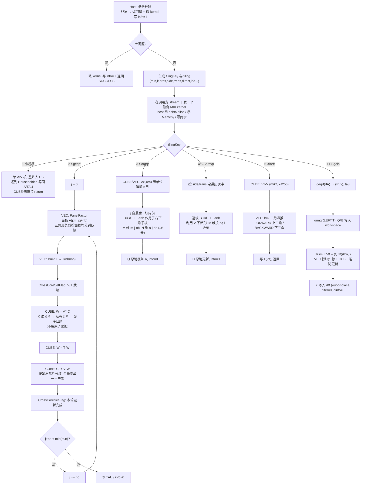

# Atlas 950 单精度实数 QR 分解与最小二乘 设计文档

| 项目 | 内容 |
| --- | --- |
| 任务名称 | 10月社区任务——Atlas 950 单精度实数QR分解与最小二乘(950) |
| 平台任务 ID | `5fd8182c10644df3abb5ebc80297a164` |
| 交付接口 | `aclsolverSgeqrf`、`aclsolverSorgqr`、`aclsolverSormqr`、`aclsolverXlarft`、`aclsolverSSgels`（各含 `_bufferSize`） |
| 目标硬件 | Ascend 950PR（Atlas 950） |
| 合入仓库 | [cann/ops-solver](https://gitcode.com/cann/ops-solver) |

---

# 一、需求背景（required）

## 1.1 需求来源

10月社区任务，要求在昇腾 NPU 上基于 AscendC/CATLASS 开发稠密 QR 分解、正交变换与最小二乘求解能力，接口、功能、参数、约束与对标 CUDA 接口（cuSolver DN）对齐，精度达到 CANN 生态算子开源标准。五个接口作为**同一社区任务一并交付，不允许拆分验收**（任务书 §1、§7.1）。验收通过后合入 ops-solver。

## 1.2 背景介绍

### 1.2.1 QR 系列接口实现优化

QR 分解是稠密线性代数的基础构件：最小二乘、特征值预处理、正交化都以它为底。本任务交付的五个接口构成一条完整链路——`Sgeqrf` 产出 Householder 形式的 QR，`Xlarft` 把一组反射子压成块三角因子 T，`Sormqr`/`Sorgqr` 分别以隐式/显式方式使用 Q，`SSgels` 在其上完成最小二乘求解。

| NPU 交付接口 | 对标 CUDA 接口 | 功能 |
| --- | --- | --- |
| `aclsolverSgeqrf` / `_bufferSize` | `cusolverDnSgeqrf` / `_bufferSize` | A = Q·R，Householder 形式原地写入 A，TAU 长 min(m,n) |
| `aclsolverSorgqr` / `_bufferSize` | `cusolverDnSorgqr` / `_bufferSize` | 由 (A, tau) 生成显式 Q 的前 n 列，原地覆盖 A |
| `aclsolverSormqr` / `_bufferSize` | `cusolverDnSormqr` / `_bufferSize` | C ← op(Q)·C（LEFT）或 C·op(Q)（RIGHT） |
| `aclsolverXlarft` / `_bufferSize` | `cusolverDnXlarft` / `_bufferSize` | H = I − V·T·Vᵀ，由 (V, tau) 生成 k×k 三角因子 T |
| `aclsolverSSgels` / `_bufferSize` | `cusolverDnSSgels` / `_bufferSize` | min‖A·X − B‖_F（n ≤ m），X out-of-place |

### 1.2.2 基线现状分析

#### 1.2.2.1 基线支持的数据类型和数据格式

| 项 | 基线（cuSolver DN） | 本任务要求 |
| --- | --- | --- |
| 数据类型 | S/D/C/Z 四套；`Xlarft` 另有 64-bit 通用 API | 仅 **FLOAT32**；`Xlarft` 仅验收 dataTypeV/Tau/T/computeType 全为 `ACLSOLVER_R_32F` 的组合，其余返回 `NOT_SUPPORTED` |
| 数据格式 | 列主序（column-major），leading dimension 任意合法值 | 相同：**列主序 ND**，`lda ≥ max(1,m)`、`ldc ≥ max(1,m)`、`ldv ≥ max(1,n)`、`ldt ≥ max(1,k)`，**禁止要求 lda == m 或 n** |
| 维数类型 | `geqrf/orgqr/ormqr/gels` 用 `int`；`Xlarft` 用 `int64_t` | 相同，逐字对齐 |
| workspace | `geqrf/orgqr/ormqr` 以**元素个数**计（`Lwork`）；`Xlarft`/`SSgels` 以**字节**计，`Xlarft` 另含 Host 侧字节数 | 相同 |
| info | `devInfo` / `dinfo` 为 Device INT32，0 成功、−i 表示第 i 个参数非法 | 相同，**必须真实写入**，序号不计 handle |

#### 1.2.2.2 基线算子实现描述

cuSolver 的 QR 系列是教科书式的分块 Householder 实现：

- **geqrf**：右看型分块。每轮对宽度 nb 的面板做非分块分解（`geqr2`，逐列生成 Householder 反射子 `H_j = I − tau_j·v_j·v_jᵀ`），把该面板的 nb 个反射子压成块反射子 `I − V·T·Vᵀ`（`larft`），再对右侧尾随矩阵做一次块更新（`larfb`，三个 GEMM）。
- **larft**：由 V 的列与 tau 递推出 k×k 的 T，FORWARD 时 T 上三角、BACKWARD 时下三角。
- **ormqr**：对 C 逐块施加 `larfb`，side/trans 决定乘法方向与面板遍历次序；**利用 V 的下梯形零结构**，第 i 块只作用于第 i 行块及以下。
- **orgqr**：后向累加——Q 初始化为单位阵的前 n 列，自最后一个块反射子向前施加 `larfb`；**利用 Q 的"增长"结构**，第 j 步只触及右下角子块。
- **gels**：`geqrf` → `ormqr(LEFT, T)` 把 B 变为 QᵀB → 上三角回代 `R·X = (QᵀB)[0:n,:]` → 写出 X。`SSgels` 为迭代精化族接口，主精度与内部精度均为 FP32 时 `niter` 可为 0（直接主精度求解）。

两处"结构利用"不是优化技巧而是 LAPACK flop 计数的前提：`orgqr` 的 `4mnk − 2(m+n)k² + (4/3)k³` 与 `ormqr` 的 `4mnk − 2nk²` 都假定了它；若实现成"每块都对整块做稠密 larfb"，实际算力退化为 `4mnk`（m=n=k 时分别是 3.00 倍与 2.00 倍）。本设计据此把结构利用列为硬约束，理由见 3.2.2.3-D2。

#### 1.2.2.3 基线实现流程图 ⭐

```mermaid
flowchart TD
    subgraph GEQRF["cusolverDnSgeqrf：右看型分块 Householder QR"]
        A0["输入 A(m×n, 列主序, lda)<br/>TAU / Workspace / Lwork"] --> A1["j = 0"]
        A1 --> A2["nbj = min(nb, min(m,n)-j)"]
        A2 --> A3["geqr2：面板 A(j:m, j:j+nbj) 非分块分解<br/>alpha = sign(x1)·||x||<br/>R_kk = -alpha, v0 归一, tau = tau'·v0²"]
        A3 --> A4["larft：由 (V, tau) 构造 nbj×nbj 的 T"]
        A4 --> A5["larfb：A(j:m, j+nbj:n) -= V·T·(Vᵀ·A)<br/>三个 GEMM"]
        A5 --> A6{"j+nbj < min(m,n) ?"}
        A6 -- 是 --> A7["j += nbj"] --> A2
        A6 -- 否 --> A8["devInfo = 0<br/>R 在上三角, v 在严格下三角, TAU 输出"]
    end

    subgraph LARFT["cusolverDnXlarft：块反射器三角因子"]
        B0["输入 V(n×k, COLUMNWISE) / tau / direct"] --> B1{"direct"}
        B1 -- FORWARD --> B2["i = 0..k-1 递推<br/>T(0:i,i) = -tau_i·T(0:i,0:i)·(V(:,0:i)ᵀ·V(:,i))<br/>T(i,i) = tau_i, T 上三角"]
        B1 -- BACKWARD --> B3["自后向前镜像递推<br/>T 下三角"]
        B2 --> B4["输出 T(k×k, ldt)"]
        B3 --> B4
    end

    subgraph ORMQR["cusolverDnSormqr：隐式应用 Q"]
        C0["输入 A/tau(反射子) / C(m×n) / side / trans"] --> C1{"side, trans"}
        C1 --> C2["确定面板遍历次序<br/>LEFT·N 与 RIGHT·T 自后向前<br/>LEFT·T 与 RIGHT·N 自前向后"]
        C2 --> C3["逐块 larft + larfb<br/>利用 V 下梯形: 第 i 块只作用于第 i 行块及以下"]
        C3 --> C4["C 原地更新, devInfo = 0"]
    end

    subgraph ORGQR["cusolverDnSorgqr：显式生成 Q"]
        D0["输入 A/tau(反射子), m≥n≥k"] --> D1["A(:,0:n) 置为单位阵前 n 列"]
        D1 --> D2["j 自最后一块向前<br/>larft + larfb 作用于右下角子块<br/>(M 维 m-jnb, N 维 n-jnb)"]
        D2 --> D3["Q 原地覆盖 A, devInfo = 0"]
    end

    subgraph GELS["cusolverDnSSgels：QR 最小二乘"]
        E0["输入 dA(m×n) / dB(m×nrhs), n≤m"] --> E1["geqrf(dA)"]
        E1 --> E2["ormqr(LEFT,T): B ← Qᵀ·B"]
        E2 --> E3["trsm: R·X = (QᵀB)(0:n,:)"]
        E3 --> E4["X 写入独立缓冲 dX<br/>niter / dinfo 输出"]
    end
```



---

# 二、需求分析（required）

## 2.1 外部组件依赖

| 依赖 | 说明 |
| --- | --- |
| CANN Toolkit | 9.0.0 及以上，与 ops-solver 仓 README 已验证配套版本一致；实现与自测在 CANN 9.1.0 / Ascend950PR_9579 上进行，版本在自测报告中如实登记 |
| AscendC 基础 API | VEC：`DataCopy`/`DataCopyPad`、`Mul`/`Axpy`/`Muls`/`Duplicate`、`ReduceSum`/`WholeReduceSum`、`Sqrt`；CUBE：`Nd2Nz` 搬运、`LoadData`、`Mmad`、`Fixpipe`；跨核：`CrossCoreSetFlag`/`CrossCoreWaitFlag` |
| CATLASS | 可选，用于 `arch35` 下 GEMM 层实现（任务书 §2.2 明文允许 AscendC/CATLASS） |
| ops-solver 既有设施 | handle 管理 `aclsolverCreate/Destroy/SetStream/GetStream`、`aclsolverStatus_t`、`src/utils/`、`test/utils/`、`build.sh --soc=ascend950` |

## 2.2 内部适配模块

ops-solver 现有 cgetrf/cgetri/sgetrf/sgetri/cmatinv_batched/cgetri_batched/cheevj，**无 QR / 最小二乘原型**，须全新实现。仓内可借鉴与必须改造的部分：

- **可借鉴**：`src/cgetrf/cgetrf_kernel.cpp` 的「单融合 kernel + `CrossCoreSetFlag/WaitFlag` 跨核编舞」分块分解范式；`src/utils/kernel/c32/`（`gemm.hpp` 实数 CUBE matmul、`trsm*.hpp` 三角扫掠、`pad.hpp`）。
- **必须改造**：仓内全部 CUBE 代码（`c32/gemm.hpp`、`c64/gemm.hpp`、`c64/gemm_segmented.inc` 三个文件）均为 **dav-2201（c220）写法**，而仓中目前**没有任何算子提供 `arch35` 目录**。实测确认该写法在 950PR 上不可直接复用：以等价结构的独立 GEMM 探针在 **Ascend950PR_9579** 上做单核隔离测试（blockDim=1，无跨核同步、无原子累加、无上层算法），`M=N=K=128` 非转置用例输出**全为 NaN**，转置及 256×256×128、64×128×64 等形状输出为量级合理但错误的有限值（超阈率 99.9%）。指纹指向 fp32 的分形/布局约定在 c310 与 c220 不同，而非接口缺失——dav_3510 基础 API 中存在 `TransFixpipeParamsV220ToFixpipeParamsArch3510` 兼容层。因此「CUBE 层按 arch35 重写」是本设计**已证实的前提**，而非可选优化。

**与 10-4-aclsolverCgeqrf-leastsq-950（单精度复数 QR 与最小二乘）共用一套模板化 kernel**：两任务算法主干同构，实现为 header-only 共用核 `src/common/qr_core/`（组件 `PanelFactor / BuildT / Larfb / BackAccum / Trsm`，模板参数 `T ∈ {float, aclFloatComplex}`），唯一分叉收敛在 `GemmDispatch`——实数 1 次 fp32 cube 调用，复数 4 次（4M 分解）加符号表，`kPlanes` 在实数实例化时常量折叠为 1，不引入运行期分支。两仓该目录逐字节相同并以内容哈希校验防漂移；每个 PR 自身完整、不依赖对方先合入（任务书 §5）。

## 2.3 需求模块设计

### 2.3.1 AscendC 算子原型

`cann_ops_solver_common.h` 补充（C 可调用）：

```c
typedef void* aclsolverParams_t;
typedef enum { ACLSOLVER_OP_N = 0, ACLSOLVER_OP_T = 1, ACLSOLVER_OP_C = 2 } aclsolverOperation_t;
typedef enum { ACLSOLVER_SIDE_LEFT = 0, ACLSOLVER_SIDE_RIGHT = 1 } aclsolverSideMode_t;
typedef enum { ACLSOLVER_DIRECT_FORWARD = 0, ACLSOLVER_DIRECT_BACKWARD = 1 } aclsolverDirectMode_t;
typedef enum { ACLSOLVER_STOREV_COLUMNWISE = 0 } aclsolverStorevMode_t;
typedef enum { ACLSOLVER_R_32F = 0, ACLSOLVER_C_32F = 1 } aclsolverDataType_t;
```

公开接口（**逐字对齐任务书 §2.3，参数名/顺序/含义/Device-Host 归属不变**）：

```c
aclsolverStatus_t aclsolverSgeqrf_bufferSize(aclsolverHandle_t handle, int m, int n, float *A, int lda, int *Lwork);
aclsolverStatus_t aclsolverSgeqrf(aclsolverHandle_t handle, int m, int n, float *A, int lda,
                                  float *TAU, float *Workspace, int Lwork, int *devInfo);

aclsolverStatus_t aclsolverSorgqr_bufferSize(aclsolverHandle_t handle, int m, int n, int k,
                                             const float *A, int lda, const float *tau, int *lwork);
aclsolverStatus_t aclsolverSorgqr(aclsolverHandle_t handle, int m, int n, int k,
                                  float *A, int lda, const float *tau, float *work, int lwork, int *devInfo);

aclsolverStatus_t aclsolverSormqr_bufferSize(aclsolverHandle_t handle, aclsolverSideMode_t side,
                                             aclsolverOperation_t trans, int m, int n, int k,
                                             const float *A, int lda, const float *tau,
                                             const float *C, int ldc, int *lwork);
aclsolverStatus_t aclsolverSormqr(aclsolverHandle_t handle, aclsolverSideMode_t side, aclsolverOperation_t trans,
                                  int m, int n, int k, const float *A, int lda, const float *tau,
                                  float *C, int ldc, float *work, int lwork, int *devInfo);

aclsolverStatus_t aclsolverXlarft_bufferSize(aclsolverHandle_t handle, aclsolverParams_t params,
                                             aclsolverDirectMode_t direct, aclsolverStorevMode_t storev,
                                             int64_t n, int64_t k,
                                             aclsolverDataType_t dataTypeV, const void *V, int64_t ldv,
                                             aclsolverDataType_t dataTypeTau, const void *tau,
                                             aclsolverDataType_t dataTypeT, void *T, int64_t ldt,
                                             aclsolverDataType_t computeType,
                                             size_t *workspaceInBytesOnDevice, size_t *workspaceInBytesOnHost);
aclsolverStatus_t aclsolverXlarft(aclsolverHandle_t handle, aclsolverParams_t params,
                                  aclsolverDirectMode_t direct, aclsolverStorevMode_t storev,
                                  int64_t n, int64_t k,
                                  aclsolverDataType_t dataTypeV, const void *V, int64_t ldv,
                                  aclsolverDataType_t dataTypeTau, const void *tau,
                                  aclsolverDataType_t dataTypeT, void *T, int64_t ldt,
                                  aclsolverDataType_t computeType,
                                  void *bufferOnDevice, size_t workspaceInBytesOnDevice,
                                  void *bufferOnHost, size_t workspaceInBytesOnHost);

aclsolverStatus_t aclsolverSSgels_bufferSize(aclsolverHandle_t handle, int m, int n, int nrhs,
                                             float *dA, int ldda, float *dB, int lddb, float *dX, int lddx,
                                             void *dwork, size_t *lwork_bytes);
aclsolverStatus_t aclsolverSSgels(aclsolverHandle_t handle, int m, int n, int nrhs,
                                  float *dA, int ldda, float *dB, int lddb, float *dX, int lddx,
                                  void *dWorkspace, size_t lwork_bytes, int *niter, int *dinfo);
```

`aclsolverParams_t` 允许传 `nullptr` 表示默认参数；本实现不需要显式 params 对象，故不交付 `aclsolverCreateParams/DestroyParams`。

### 2.3.2 AscendC 算子相关约束

| 接口 | 维数范围（验收下限） | 其他约束 |
| --- | --- | --- |
| `Sgeqrf` | m, n ∈ [1, 4096] | 方阵与矩形（含 m<n）；lda 任意合法 padding |
| `Sorgqr` | m ∈ [1, 4096]，0 ≤ k ≤ n ≤ m | 覆盖 k=n 与 k<n |
| `Sormqr` | m, n ∈ [1, 4096]，0 ≤ k ≤ nq | nq = (side==LEFT ? m : n)；side × trans 六组合全覆盖 |
| `Xlarft` | n ∈ [1, 4096]，k ∈ [1, min(n, 256)] | FORWARD/BACKWARD；仅 COLUMNWISE；n ≥ k；仅 FLOAT32 四元组 |
| `SSgels` | m ∈ [n, 4096]，n ∈ [1, 4096]，nrhs ∈ [1, 128] | 须 n ≤ m；X out-of-place，不得与 B 共用存储 |

- 空问题（m=0 / n=0 / k=0 / nrhs=0）成功返回，info 写 0；
- 非法类型/shape/值域返回 `ACLSOLVER_STATUS_INVALID_VALUE` 并在 info 可写时写 −i；`Xlarft` 非 FLOAT32 组合返回 `ACLSOLVER_STATUS_NOT_SUPPORTED`；
- `Sorgqr`/`Sormqr`/`Xlarft` 的输入是 `Sgeqrf` 输出的 Householder 表示，不是未分解的原始 A（任务书 §7.6）；
- 不支持 broadcast，不要求图融合；单 case 输入内存 ≤ 4 GB 为构造侧约束。

---

# 三、需求详细设计（required）

## 3.1 使能方式

ops-solver **Host C API + AscendC/CATLASS Kernel 直调**（任务书 §2.2，非 aclnn 两段式、非 PyTorch 接口）：

```
调用方 → aclsolverXxx_bufferSize(...)  → 得到 Lwork / lwork_bytes
调用方 → aclrtMalloc(workspace)        → 由调用方持有
调用方 → aclsolverXxx(handle, ..., workspace, ..., devInfo)
             ├─ Host: 参数校验 → tiling 生成（dynamic shape）→ 核函数下发（调用方 stream）
             └─ Device: 一个融合 MIX kernel 完成全部计算
```

编译与运行：`bash build.sh --pkg --soc=ascend950 --ops=sgeqrf,sorgqr,sormqr,xlarft,ssgels` 产出 run 包；`--run` 执行 `test/` 下用例。

## 3.2 需求总体设计

### 3.2.1 host 侧设计

#### 3.2.1.1 分核策略

目标硬件 Ascend 950PR 实测拓扑：**28 个 AIC（Cube）核、56 个 AIV（Vector）核，主频 1650 MHz，L2 128 MB，`cube_vector_combine = split`**。AIC 的 blockDim 在 28→29 处出现整倍台阶（428 ns → 853 ns），故 **Cube 侧 blockDim 上限取 28、Vector 侧取 56**，不超发。

| 接口 / 路径 | 分核维度 | blockDim |
| --- | --- | --- |
| 小规模直通路径（`n·align8(m) ≤ 4096` 且 m ≥ n） | 不分核 | 1（AIV） |
| `Sgeqrf` 面板分解（VEC 段） | 面板内列方向，**按三角形面积均分**而非等列数 | `min(nb, 56)` |
| `Sgeqrf` / `Sormqr` / `Sorgqr` 尾随更新（CUBE 段） | 输出瓦片（M×N）展平后静态取模映射 | `min(瓦片数, 28)` |
| `W = Vᵀ·C` 的 K 维分片 | K（行）方向分片，**各核写私有分片后定序归约** | `min(⌈M/64⌉, 28)` |
| `Xlarft` | k×k 递推不分核（k ≤ 256 整块驻留 UB）；`Vᵀ·V` 按瓦片分核 | `min(⌈k/64⌉², 28)` |
| `SSgels` 回代段 | nrhs 列方向 | `min(nrhs, 28)` |

分核公式（以尾随更新为例）：设尾随矩阵为 `M_t × N_t`，瓦片尺寸 `128×128`，则瓦片数
`T = ⌈M_t/128⌉ · ⌈N_t/128⌉`，第 `b` 号核处理 `{ tileId | tileId mod blockDim == b }`。
**瓦片到核的映射只依赖 `(M_t, N_t, nb, blockDim)`，与数据无关**，这是满足任务书 §2.1-6 bit-wise 确定性要求的前提。

#### 3.2.1.2 数据分块和内存优化策略

Ascend 950PR 片上资源：**UB 248 KB（253952 B）、L1 512 KB、L0A/L0B 各 64 KB、L0C 256 KB**，Cube 分形 16×16×16。

**(1) 面板宽度 `nb` 的取值公式**

`BuildT` 需要把 `nb × nb` 的 T 整块载入 UB，面板分解另需列暂存与归约缓冲：

```
UB_panel = nb·nb·4            (T 块)
         + nb·align64(M_sub)·4 / S   (面板列分片, S 为核内分片数)
         + C_tmp·nb·4         (列内积/tau/alpha 暂存, C_tmp = 4)
         ≤ 253952 B
nb = 128 时 T 块占 64 KB，余量 ≈ 186 KB 足够承载分片与 double buffer
```

Cube 侧约束：

```
L0C_tile = nb·nb·4 ≤ 262144  ⇒  nb ≤ 256
L1_AB    = 2·nb·nb·4 ≤ 524288  ⇒  nb ≤ 256（不开 double buffer）
           4·nb·nb·4 ≤ 524288  ⇒  nb ≤ 181（开 double buffer，取 128）
```

综合取 **`nb = 128`**（窄矩阵与小 k 场景降为 64），候选集 `{64, 128}` 在 950PR 实测标定后定稿，标定结果写入 README。注意 950PR 的 **L2 为 128 MB，小于 A3 的 168 MB**，凡依赖 footprint 与 L2 关系的阈值一律按本芯片重新标定，不沿用其他芯片的经验值。

**(2) workspace 尺寸公式**

```
Sgeqrf:  Lwork = 2·align64(m)·nb        // Y（反射子矩阵），double buffer
                + 2·nb·nb               // T，double buffer
                + 2·nb·NW               // W = Vᵀ·C 的中间量，NW = 128
                + (lda 非 8 对齐 ? align8(m)·nb : 0)   // 面板列对齐暂存
                + C_sync                // tiling / 同步标志区
         m = 4096, nb = 128 时 ≈ 1.64×10⁶ 元素（6.6 MB）
Sorgqr / Sormqr: 同式，Y 由输入 A 原址读取，故去掉首项的一半
Xlarft:  workspaceInBytesOnDevice = (k·k + align64(n)·NB_v) · 4，NB_v = 64
         workspaceInBytesOnHost   = 0（本实现 Host 侧无需暂存，仍按契约写出）
SSgels:  lwork_bytes = Sgeqrf 的 Lwork·4 + align64(m)·nrhs·4（QᵀB 暂存） + n·nrhs·4
```

`_bufferSize` 返回值是 `(m, n, k, nrhs, nb)` 的确定函数，与运行时状态无关。

**(3) lda padding 的处理**

GM→L1 的 `Nd2Nz` 以 `srcDValue = lda` 直接吃任意列步长，**不做整阵 pad/restore 往返**；VEC 侧按列访问时，若 `lda` 不满足 32 B 对齐，仅对**当前面板的列**走 `DataCopyPad`（代价 O(nb·m)，相对该规模预算可忽略），而非整个矩阵。这与仓内既有算子「要求 lda == n」的做法不同，是任务书 §7.3 的硬性要求。

#### 3.2.1.3 tilingKey 规划策略

| tilingKey | 触发条件 | kernel 分支 | 引擎 |
| --- | --- | --- | --- |
| `0` | m/n/k/nrhs 任一为 0 | 空问题，只写 `info = 0` 后返回 | AIV |
| `1` | `n·align8(m) ≤ 4096` 且 m ≥ n（`Sgeqrf`/`SSgels` 入口） | 非分块 QR，单核 UB 内完成 | AIV only |
| `2` | `Sgeqrf` 分块路径 | 面板分解 + 尾随更新 | mix |
| `3` | `Sorgqr` | 单位阵初始化 + 后向累加 | mix |
| `4` | `Sormqr`，side = LEFT | 行方向块更新，次序由 trans 定 | mix |
| `5` | `Sormqr`，side = RIGHT | 列方向块更新，次序由 trans 定 | mix |
| `6` | `Xlarft` | `Vᵀ·V` + k×k 三角递推 | mix（k ≤ 64 时 AIV only） |
| `7` | `SSgels` | geqrf → ormqr → trsm → 写 X | mix |

**设置 tilingKey 的理由**：

1. **`1` vs `2`（小规模走纯 AIV）**：950PR 的 `cube_vector_combine = split`，AIC 与 AIV 是独立核，mix 形态核函数自带固定启动开销与跨核同步；而小规模用例的性能预算只有几十微秒量级（`Sormqr m=n=k=2` 预算 27.4 µs、`Sgeqrf m=32,n=4` 预算 39.1 µs，全量 case 中预算 <100 µs 的共 31 条），mix 的固定成本在此区间不划算，单核 AIV 直接算完更快。
2. **`4` vs `5`（side 分路径）**：LEFT 的块更新沿 C 的行方向收缩、RIGHT 沿列方向收缩，操作数的转置侧与瓦片遍历方向都不同，合并会在内循环引入运行期分支。
3. **`6` 独立成键**：`Xlarft` 的输入是**现成的** (V, tau)，与 `Sgeqrf` 内部"边分解边构造 T"的融合形态不同，入口独立但复用同一份 `BuildT` 实现。
4. **`3` 与 `2` 分离**：`Sorgqr` 的 larfb 作用于"正在长出来"的右下角子块，M/N 维随步进**增大**；`Sgeqrf` 的尾随矩阵随步进**减小**。两者的瓦片映射与边界条件相反。

### 3.2.2 kernel 侧设计

#### 3.2.2.1 kernel 侧实现描述

**每次计算接口调用下发一个融合 MIX kernel**，核内以 `CrossCoreSetFlag/WaitFlag` 编舞 VEC 与 CUBE：

```
VEC  : PanelFactor ──→ BuildT ──┐                        ┌─→ 下一面板
                                ↓                        │
CUBE :                        Larfb(W=VᵀC → W=TW → C-=VW)┘
```

共用核组件（与 10-4 复数任务模板共用，`T` 为模板参数）：

| 组件 | 职责 | 引擎 |
| --- | --- | --- |
| `PanelFactor<T>` | 面板非分块 Householder 分解，产出 v、tau | VEC |
| `BuildT<T>` | 由 (V, tau) 构造块三角因子 T（`Xlarft` 的公开入口即此） | VEC + CUBE |
| `Larfb<T>` | 块反射子应用，三个 GEMM，按 side/trans 展开 | CUBE |
| `BackAccum<T>` | 单位阵初始化 + 后向累加（`Sorgqr`） | CUBE |
| `Trsm<T>` | 上三角回代（`SSgels`） | VEC + CUBE |
| `GemmDispatch<T>` | **唯一的实数/复数分叉点**；实数 1 次 fp32 Mmad，复数 4 次 + 符号表 | CUBE |

五个接口由上述组件组合而成：

```
Sgeqrf  = loop { PanelFactor → BuildT → Larfb(尾随, 收缩) }
Xlarft  = BuildT（独立入口，输入为现成的 V 与 tau）
Sormqr  = loop { BuildT → Larfb(side, trans) }
Sorgqr  = BackAccum = 自后向前 loop { BuildT → Larfb(子块, 增长) }
SSgels  = Sgeqrf → Sormqr(LEFT,T) 作用于 B → Trsm(R) → 写出 dX
```

Householder 符号约定对齐 LAPACK：`alpha = sign(x₁)·‖x‖`，`R_kk = −alpha`，`v₀` 归一为 1，`tau = tau′·v₀²`。该约定确定且与 CPU 参考链路一致，是精度判据（§3.2.1.1 要求以 NPU 输出的 (v, tau) 升 float64 后调 CPU `dorgqr` 构造 Q）成立的前提。

#### 3.2.2.2 AscendC 实现流程图 ⭐



#### 3.2.2.3 AscendC 流程图与基线流程图的差异点和原因 ⭐

| # | 基线（cuSolver / LAPACK） | 本 AscendC 实现 | 差异原因 |
| --- | --- | --- | --- |
| **D1** | 单一分块算法，所有规模同一条路径 | **按规模分成「小规模单核 AIV」与「分块 mix」两条路径**（tilingKey 1 vs 2） | 950PR 的 AIC/AIV 是 `split` 形态独立核，mix 核函数自带固定启动开销与跨核同步；小规模用例预算只有几十微秒（`Sormqr m=n=k=2` 仅 27.4 µs，全量 case 中 <100 µs 的有 31 条），mix 的固定成本占比过高 |
| **D2** | 结构利用内置在库实现中，不显式表述 | **把「利用 V 的下梯形零结构与 Q 的增长结构」列为硬约束**，瓦片范围随步进收缩/增长，而非对整块做稠密 larfb | 950PR 的 **FP32 Cube 峰值为 23.6 TFLOP/s**。按 LAPACK 口径折算，最紧的 `Sormqr m=n=k=4096 LEFT,N` 需 8.07 TFLOP/s（峰值的 34%）、`Sorgqr m=4051,n=2941,k=735` 需 6.63 TFLOP/s；若不利用结构、按 `4mnk` 的稠密实现，同样两条分别变为 16.15 与 **18.46 TFLOP/s（峰值的 78%）**——QR 这类含面板串行段的负载不可能持续到峰值的 78%。故结构利用是达标前提而非优化项 |
| **D3** | 每个阶段一次或多次 kernel 下发（geqr2 / larft / larfb 分离） | **一次 API 调用下发一个融合 MIX kernel**，面板与尾随更新在核内以 CrossCore 握手流水 | ① 面板（VEC）与尾随更新（CUBE）在独立引擎上可重叠，分离下发会让 CUBE 在面板期间空转；② 任务书 §3.3 的性能口径是 `OpBasicInfo.csv` 中「按 kernel 名统计调用求平均」，单 kernel 使「平均单次 kernel 耗时」无歧义 |
| **D4** | GPU 上多线程块对同一输出做原子累加，顺序随运行时变化 | **`W = Vᵀ·C` 的 K 维跨核归约改为「各核写私有分片 + 固定次序归约」，全程不用 `SetAtomicAdd`** | 浮点加法不满足结合律，原子累加的到达次序跑间变化会破坏 bit-wise 一致性，而任务书 §2.1-6 要求同输入同 stream 多次执行逐位一致。`C -= V·W` 按输出瓦片切分、每元素只有一个生产者，次序无关，可照常使用原子写 |
| **D5** | `lda` padding 由库内部跨步访问直接处理 | **`Nd2Nz` 以 `srcDValue = lda` 直接吃任意列步长；仅当 `lda` 非 32 B 对齐时，对当前面板的列走 `DataCopyPad`**，不做整阵 pad/restore | AIV 向量操作数要求 32 B 对齐，但整阵 pad 会在大规模上引入 2·m·n·4 B 的额外往返；只对面板列（O(nb·m)）处理即可，代价相对预算可忽略。仓内既有算子要求 `lda == n`，不满足任务书 §7.3 |
| **D6** | `larft` 只作为 `geqrf` 的内部步骤，不单独暴露 | **`Xlarft` 是公开接口，与 `Sgeqrf` 内部的 T 构造共用同一份 `BuildT` 实现**，仅入口不同（前者输入现成 V/tau，后者边分解边构造） | 任务书要求 `Xlarft` 独立交付且维数为 `int64_t`。共用实现避免两份语义漂移，也使该接口的正确性由 `Sgeqrf` 的全量用例间接覆盖 |
| **D7** | 库内部可能使用 TF32 / 混合精度加速 | **全程 FLOAT32 累加，不降精度** | 950PR 的 Cube FP16 算力是 FP32 的 16 倍（378.4 vs 23.6 TFLOP/s），降精度诱惑很大；但任务书 §3.2.1 的残差门是「与 CPU FP32 参考同量级」（如 geqrf `max(5·ratio_cpu, 0.1)`），直接降 FP16 必然超阈。此外当前 CANN 版本在 950PR 上未提供可用的 TF32/HF32 `Mmad` 接口 |
| **D8** | host 侧可自由分配临时显存、可做同步 | **host 侧零 `aclrtMalloc` / 零 `aclrtMemcpy` / 零 `aclrtSynchronizeStream`**，workspace 全部来自调用方，tiling 标量随核函数参数直传 | 任务书 §2.1-3/4 要求 Device 指针、真实 info 写入、走调用方 stream 且禁止无必要的 Host 同步。这也是与仓内既有 `sgetrf_host.cpp`（主机指针 + 内部 Malloc + Synchronize）形态的主要区别 |
| **D9** | —（基线无此问题） | **CUBE 层按 `arch35`（dav-3510）重写，不沿用仓内 c220 写法** | 实测：仓内同族 c220 写法的 GEMM 在 950PR 上单核隔离测试即错（128³ 非转置全 NaN，其余形状超阈率 99.9%），根因是 fp32 分形/布局约定在 c310 与 c220 不同。详见 §2.2 |

## 3.3 支持硬件

| 支持的芯片版本 | 是否涉及 |
| --- | --- |
| Ascend 950PR（Atlas 950） | √ |
| Atlas 800I/T A2（ascend910b） | × |
| Atlas A3（ascend910_93） | × |

## 3.4 算子约束限制

- 仅 FLOAT32；`Xlarft` 仅 `storev = COLUMNWISE`、仅 FLOAT32 四元组、n ≥ k；
- `SSgels` 须 n ≤ m，解 X 为独立输出，不得与 B 共用存储；`dA` 在求解后内容可被破坏；
- `Sorgqr`/`Sormqr`/`Xlarft` 的输入是 `Sgeqrf` 输出的 Householder 表示；
- 列主序、Device 指针、真实 info 写入、支持合法 lda/ldc/ldv/ldt padding；
- 核心计算全部在 AI Core 上完成，不存在 CPU fallback；
- 不支持 broadcast，不要求图融合。

---

# 四、特性交叉分析

| 特性 | 是否涉及 | 说明 |
| --- | --- | --- |
| 动态 shape | 是 | Host 按本次调用的维数生成 tiling，不预编译固定形状 |
| 确定性计算 | 是 | 见 3.2.2.3-D4；tiling 与瓦片映射均与数据无关，kernel 内无跨核原子归约 |
| 多流 / 非默认 stream | 是 | 计算全部下发在 `aclsolverSetStream` 绑定的 stream 上，无隐式默认流依赖 |
| 内存复用 | 是 | workspace 由调用方持有并可跨调用复用；`_bufferSize` 为纯函数 |
| 图融合 | 否 | 任务书不要求 |
| 多卡 / 分布式 | 否 | 单卡单 device 接口 |
| 与 10-4 复数 QR 任务 | 是 | 共用 header-only 模板核 `src/common/qr_core/`，两 PR 各自自足、内容哈希校验防漂移 |

---

# 五、可维可测分析

## 5.1 精度标准 / 性能标准

| 验收标准 | 描述 | 标准来源 |
| --- | --- | --- |
| 精度 — Sgeqrf | `ratio = ‖R − Qᵀ·A‖₁ / (m·‖A‖₁·ε) ≤ max(5·ratio_cpu, 0.1)`；Q 由 NPU 输出的 (v, tau) 升 float64 后调 CPU `dorgqr` 生成 m×m | 任务书 §3.2.1.1（溯源 LAPACK SQRT01） |
| 精度 — Sorgqr | `ratio = ‖I − Qᵀ·Q‖₁ / (m·ε) ≤ max(5·ratio_cpu, 1.5)`，分母固定取行数 m | 任务书 §3.2.1.2（SQRT02） |
| 精度 — Sormqr | `ratio = ‖op2 − op1‖₁ / (m·‖C‖₁·ε) ≤ max(5·ratio_cpu, 0.1)`；op2 由同一份 (v, tau) 经本实现的 `Sorgqr` 生成 Q 后矩乘。**验收顺序：Sorgqr 先通过，Sormqr 方可验收** | 任务书 §3.2.1.3（SQRT03） |
| 精度 — SSgels | 方阵 `max_j ‖B_j − A·X_j‖₁/(max(m,n)·‖A‖₁·‖X_j‖₁·ε) ≤ max(5·ratio_cpu, 0.015)`；超定 `ratio_opt = ‖Rᵀ·A‖₁/(‖A‖₁·‖B‖₁·max(m,n,nrhs)·ε) ≤ 10·ratio_opt_cpu`，`R = B − A·X` | 任务书 §3.2.1.4（SQRT16 / SQRT17） |
| 精度 — Xlarft | 任务书 §3.2 未列该接口的残差判据，本设计自定 `‖(I − V·T·Vᵀ) − Π H_i‖₁ / (k·ε)`，并在自测报告中登记口径 | 本设计（任务书未覆盖项） |
| `ratio_cpu` 产生方式 | 同精度 FLOAT32 CPU 参考链路、同 case、同式实测；CPU BLAS 固定单线程，避免多线程归约次序影响参考值 | 任务书 §3.2.1 |
| 性能 | 有 GPU 参考值的全量 case，NPU kernel 耗时 ≤ GPU 耗时 / 0.35（950PR 实测，`msprof op` 采集 `OpBasicInfo.csv`，按 kernel 名对调用次数求平均；`_bufferSize`、workspace 分配、host 校验不计入） | 任务书 §3.3 |
| 确定性 | 同输入、同 stream 串行多次执行，输出（含 TAU 与 info）bit-wise 一致 | 任务书 §2.1-6、§3.5 |
| 内存 | 不做要求；自测报告给出各 case `_bufferSize` 查询值与 Device 分配峰值 | 任务书 §3.4 |

**性能基线覆盖说明**：任务包 `bench_result.json` 中 `sgeqrf` 174 条、`sorgqr` 165 条、`sormqr` 189 条全部有 GPU 参考值；`sgels` 166 条中 58 条有值、108 条 GPU 侧自身返回错误（均为 m>n 且 n/m ≤ 0.771）；`aclsolverXlarft` 未随包提供用例与基线。**达标率只在有 GPU 参考值的 586 条上统计**，其余 case 照常提供 NPU 实测耗时但不计入比值，差异在自测报告中如实登记。

**测试方案**：

1. **任务包用例全量自验**（694 条）：按各算子目录 `cases.json` 执行，精度按上表残差判据判定；
2. **自构造功能矩阵**（任务包未覆盖、而任务书 §3.5 要求的场景）：`Sgeqrf` 的 m<n（包内 174 条全为 m≥n）；`Sormqr` 的 6 种 side×trans 组合（包内仅含 LEFT,N 与 RIGHT,T）；`SSgels` 的 nrhs = 1/8/32/128/0（包内恒为 1）；lda/ldc/ldv/ldt 的最小合法值及 +8/+32 padding（包内均为最小值）；`Xlarft` 的 FORWARD/BACKWARD、非法 ROWWISE 报错、非 FLOAT32 返回 NOT_SUPPORTED；info 的成功 0 与逐参数位 −i；空问题；确定性（同输入重复执行逐位比对，大 shape 重复 ≥8 次）；非默认 stream；形状覆盖 2 的幂与 2 的幂 −1；入参分布 50% 均匀 [−5,5] + 50% 正态（μ∈[−5,5]、σ∈[0.1,2]）；
3. **性能**：`msprof op` 收敛到单条用例采集（避免多用例 kernel 混叠），`OpBasicInfo.csv` 汇总后与 `bench_result.json` 逐条关联比对；
4. **回归**：`bash build.sh --soc=ascend950 --ops=sgeqrf,sorgqr,sormqr,xlarft,ssgels --run`。

## 5.2 兼容性分析

- 新增算子，不改既有接口行为；
- `cann_ops_solver_common.h` 新增 `aclsolverParams_t` 与 5 个枚举，均为追加，既有引用不受影响；
- 现存算子返回 `aclError`，本批五个接口返回 `aclsolverStatus_t`（任务书 §2.2 要求），两套状态码对照表随 `docs/zh/` 各算子文档交付，验收以 `aclsolverStatus_t` 公开接口为准；
- 与 10-4 复数 QR 任务共用的 `src/common/qr_core/` 为 header-only 模板，两 PR 各自自足，先合入者定稿、后合入者该目录为 no-op diff；
- 本批为 ops-solver 仓首个提供 `arch35` 目录的算子集，不影响既有 `ascend910b` / `ascend310p` 编译路径。
