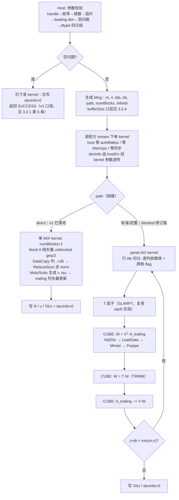

# 单精度实数 QR 分解与最小二乘（950）算子设计文档

| 项目 | 内容 |
| --- | --- |
| 任务名称 | 10月社区任务——Atlas 950 单精度实数QR分解与最小二乘(950) |
| 平台任务 ID | `5fd8182c10644df3abb5ebc80297a164` |
| TeamName | dzzw123 |
| 交付接口 | `aclsolverSgeqrf`、`aclsolverSorgqr`、`aclsolverSormqr`、`aclsolverXlarft`、`aclsolverSSgels`（各含 `_bufferSize`） |
| 目标硬件 | Ascend 950PR（Atlas 950） |
| 合入仓库 | [cann/ops-solver](https://gitcode.com/cann/ops-solver) |
| 设计文档版本 | v1（geqrf 单核矢量实现已落地并纯编译通过；blocked 修订版设计已定稿，待 NPU 实测标定） |

---

# 一、需求背景（required）

## 1.1 需求来源

本需求来自 CANN 社区任务「10月社区任务-单精度实数QR分解与最小二乘(950)」（任务截止 2026/11/15）。

任务要求在昇腾 NPU（Ascend 950PR）上基于 **ops-solver 工程模式（Host C API + Ascend C/CATLASS Kernel 直调）** 实现稠密 QR 分解、正交变换与最小二乘求解的**五个接口**：

| NPU 交付接口 | 对标 CUDA 接口 | 语义 |
|---|---|---|
| `aclsolverSgeqrf` / `aclsolverSgeqrf_bufferSize` | `cusolverDnSgeqrf` | Householder QR 分解（原地） |
| `aclsolverSorgqr` / `aclsolverSorgqr_bufferSize` | `cusolverDnSorgqr` | 由 Householder 表示生成显式 Q |
| `aclsolverSormqr` / `aclsolverSormqr_bufferSize` | `cusolverDnSormqr` | 用 op(Q) 左/右乘矩阵 C（原地） |
| `aclsolverXlarft` / `aclsolverXlarft_bufferSize` | `cusolverDnXlarft` | 块反射器三角因子 T（SLARFT） |
| `aclsolverSSgels` / `aclsolverSSgels_bufferSize` | `cusolverDnSSgels` | 单精度最小二乘（Xgels(S)） |

五个接口作为**同一社区任务一并交付，不允许拆分验收**，全部合入 https://gitcode.com/cann/ops-solver 仓（`src/<op>/` + `test/<op>/` + `docs/zh/<op>.md`），不接受 CPU fallback，性能门禁为 **NPU kernel 平均耗时 ≤ GPU(cuSolver)/0.35**（950PR 实测），精度按 LAPACK 残差判据（SQRT01/02/03/16/17），并要求确定性 bit-wise 输出。

## 1.2 背景介绍

### 1.2.1 QR 分解与最小二乘族

QR 分解 `A = Q·R`（Q 正交、R 上三角/梯形）是线性代数三大分解之一，是最小二乘问题 `min‖AX−B‖_F` 的标准解算路径，也是特征值/奇异值迭代算法的基础。其 LAPACK/cuSolver 工程实现不是"直接算出 Q"，而是以 **Householder 初等反射器**的紧凑形式存储（A 的严格下三角存反射器向量 V，`TAU` 存系数），使用时再通过 `orgqr`（显式生成 Q）或 `ormqr`（直接施加正交变换）展开——避免显式构造 m×m 稠密正交矩阵的 O(m²) 存储。分块实现引入块反射器三角因子 T（`larft`，WY 表示 `H = I − V·T·Vᵀ`），把逐个反射器的 O(m) 次低效更新合并为一次 Cube GEMM，是性能达标的关键。

本任务的工程路径：

- 目标硬件：**Ascend 950PR**（dav-3510，CANN 9.1.0 实测环境）
- 编程语言：**Ascend C**（arch35，Cube/Vector 异构编程模型），`kernel 直调`方式
- 工程模式：Host 侧 C API（句柄式 `aclsolverHandle_t` 绑定 stream），通过 `<<<numBlocks, nullptr, stream>>>` 直接下发 NPU kernel，不经过 aclnn 图/原型注册链路
- 实现目录：`src/sgeqrf/`、`src/sorgqr/`、`src/sormqr/`、`src/xlarft/`、`src/ssgels/`（Host + Kernel）
- 接口声明位置：`include/cann_ops_solver.h`（新增声明）、`include/cann_ops_solver_common.h`（新增 6 个公共类型）

### 1.2.2 基线现状分析（cuSolver DN）

#### 1.2.2.1 基线支持的数据类型和数据格式

| 项 | 基线（cuSolver DN） | 本任务要求 |
| --- | --- | --- |
| 数据类型 | S/D/C/Z 四套；`Xlarft` 另有 64-bit 通用 API | 仅 **FLOAT32**；`Xlarft` 仅验收 dataTypeV/Tau/T/computeType 全为 `ACLSOLVER_R_32F` 的组合，其余返回 `NOT_SUPPORTED` |
| 数据格式 | 列主序（column-major），leading dimension 任意合法值 | 相同：**列主序 ND**，`lda ≥ max(1,m)`、`ldc ≥ max(1,m)`、`ldv ≥ max(1,n)`、`ldt ≥ max(1,k)`，**禁止要求 lda == m 或 n** |
| 维数类型 | `geqrf/orgqr/ormqr/gels` 用 `int`；`Xlarft` 用 `int64_t` | 相同，逐字对齐 |
| workspace | `geqrf/orgqr/ormqr` 以**元素个数**计（`Lwork`）；`Xlarft`/`SSgels` 以**字节**计，`Xlarft` 另含 Host 侧字节数 | 相同（口径见 3.2.4） |
| info | `devInfo` / `dinfo` 为 Device INT32，0 成功、−i 表示第 i 个参数非法 | 相同，**必须真实写入**，序号不计 handle（透传机制见 3.2.1 与 3.2.3） |

#### 1.2.2.2 基线算子实现描述

cuSolver 的 QR 系列是教科书式的分块 Householder 实现：

- **geqrf**：右看型分块。每轮对宽度 nb 的面板做非分块分解（`geqr2`，逐列生成 Householder 反射子 `H_j = I − tau_j·v_j·v_jᵀ`），把该面板的 nb 个反射子压成块反射子 `I − V·T·Vᵀ`（`larft`），再对右侧尾随矩阵做一次块更新（`larfb`，三个 GEMM）。
- **larft**：由 V 的列与 tau 递推出 k×k 的 T，FORWARD 时 T 上三角、BACKWARD 时下三角（递推式与符号约定见 3.1.2）。
- **ormqr**：对 C 逐块施加 `larfb`，side/trans 决定乘法方向与面板遍历次序；**利用 V 的下梯形零结构**，第 i 块只作用于第 i 行块及以下。
- **orgqr**：后向累加——Q 初始化为单位阵的前 n 列，自最后一个块反射器向前施加 `larfb`；**利用 Q 的"增长"结构**，第 j 步只触及右下角子块。
- **gels**：`geqrf` → `ormqr(LEFT, T)` 把 B 变为 QᵀB → 上三角回代 `R·X = (QᵀB)[0:n,:]` → 写出 X。`SSgels` 为迭代精化族接口，主精度与内部精度均为 FP32 时 `niter` 可为 0（直接主精度求解）。

两处"结构利用"不是优化技巧而是 LAPACK flop 计数的前提：`orgqr` 的 `4mnk − 2(m+n)k² + (4/3)k³` 与 `ormqr` 的 `4mnk − 2nk²` 都假定了它；若实现成"每块都对整块做稠密 larfb"，实际算力退化为 `4mnk`（m=n=k 时分别是 3.00 倍与 2.00 倍）。本设计据此把结构利用列为硬约束，理由见 3.3.4-D2。

#### 1.2.2.3 基线实现流程图 ⭐

```mermaid
flowchart TD
    subgraph GEQRF["cusolverDnSgeqrf：右看型分块 Householder QR"]
        A0["输入 A(m×n, 列主序, lda)<br/>TAU / Workspace / Lwork"] --> A1["j = 0"]
        A1 --> A2["nbj = min(nb, min(m,n)-j)"]
        A2 --> A3["geqr2：面板 A(j:m, j:j+nbj) 非分块分解<br/>beta = -sign(x0)·||x||<br/>R(j+j2, j+j2) = beta, v 归一, tau = (beta-x0)/beta"]
        A3 --> A4["larft：由 (V, tau) 构造 nbj×nbj 的 T"]
        A4 --> A5["larfb：A(j:m, j+nbj:n) -= V·T·(Vᵀ·A)<br/>三个 GEMM"]
        A5 --> A6{"j+nbj < min(m,n) ?"}
        A6 -- 是 --> A7["j += nbj"] --> A2
        A6 -- 否 --> A8["devInfo = 0<br/>R 在上三角, v 在严格下三角, TAU 输出"]
    end

    subgraph XLARFT["cusolverDnXlarft：块反射器三角因子"]
        B0["输入 V(n×k, COLUMNWISE) / tau / direct"] --> B1{"direct"}
        B1 -- FORWARD --> B2["i = 0..k-1 递推<br/>w = V(:,0:i-1)ᵀ·v_i<br/>T(0:i-1,i) = -tau_i·T(0:i-1,0:i-1)·w<br/>T(i,i) = tau_i, T 上三角"]
        B1 -- BACKWARD --> B3["V 列序反转，镜像递推<br/>T 下三角"]
        B2 --> B4["输出 T(k×k, ldt)"]
        B3 --> B4
    end

    subgraph ORMQR["cusolverDnSormqr：隐式应用 Q"]
        C0["输入 A/tau(反射子) / C(m×n) / side / trans"] --> C1{"side, trans"}
        C1 --> C2["定面板遍历次序<br/>LEFT·N 与 RIGHT·T 自后向前<br/>LEFT·T 与 RIGHT·N 自前向后"]
        C2 --> C3["逐块 larft + larfb<br/>利用 V 下梯形: 第 i 块只作用于第 i 行块及以下"]
        C3 --> C4["C 原地更新, devInfo = 0"]
    end

    subgraph ORGQR["cusolverDnSorgqr：显式生成 Q"]
        D0["输入 A/tau(反射子), m≥n≥k"] --> D1["A(:,0:n) 置为单位阵前 n 列"]
        D1 --> D2["j 自最后一块向前<br/>larft + larfb 作用于右下角子块<br/>(M 维 m-j·nb, N 维 n-j·nb, 增长)"]
        D2 --> D3["Q 原地覆盖 A, devInfo = 0"]
    end

    subgraph GELS["cusolverDnSSgels：QR 最小二乘"]
        E0["输入 dA(m×n) / dB(m×nrhs), n≤m"] --> E1["geqrf(dA)"]
        E1 --> E2["ormqr(LEFT,T): B ← Qᵀ·B"]
        E2 --> E3["trsm: R·X = (QᵀB)(0:n,:)"]
        E3 --> E4["X 写入独立缓冲 dX<br/>niter / dinfo 输出"]
    end
```



### 1.2.3 ops-solver 仓现状

截至 2026-10-14，`cann/ops-solver` master（commit `a29362cf`）已实现：`cgetrf`/`sgetrf`（LU 分解）、`cgetri`/`sgetri`（求逆）、`cgetri_batched`/`cmatinv_batched`（批量求逆）、`cheevj`（Hermitian 特征值）。**仓内无任何 QR / gels 原型，须全新实现**。

与现有算子的**关键差异**（本批接口在仓内确立的新规范）：

| 维度 | 仓内现状（sgetrf 等） | 本批接口要求 | 影响 |
|---|---|---|---|
| 指针归属 | 入参 A 为 **Host 内存**，Host 侧自行 H2D/D2H | **纯 Device 指针**，Host 只传标量/枚举 | 本批为仓内首批纯 Device 指针算子；测试工程需相应改成 device buffer + 同步点 |
| 布局 | 强制连续（`lda == n`） | 列主序 + **任意合法 lda padding**（`lda >= max(1,m)`） | kernel 寻址必须带 stride，padding 列不参与计算 |
| 返回值 | `aclError` | **`aclsolverStatus_t`**（含 `NOT_SUPPORTED` 等扩展状态） | 与现有 `aclError` 并存，需文档对照表 |
| info | 仅 Host 侧清零、错误只走返回值 | **devInfo 由 kernel 真实写入** `0 / -i`，双通道 | 需 device 状态缓冲 + kernel 门控写入，保持异步 |
| 维数类型 | `int64_t` | geqrf/orgqr/ormqr/gels 用 `int`，xlarft 用 `int64_t`（对齐 cuSolver 64-bit API） | 按接口逐字对齐任务书 §2.3 |
| bufferSize | 无此系列 | 每接口配 `_bufferSize`；geqrf/orgqr/ormqr 以**元素数**计，xlarft/gels 以**字节数**计 | 两套口径需分别注明 |

`sgetrf` 的分块 panel + Cube GEMM 尾部更新工程范式（`kernel/getf2.hpp`、CANN 自带 `lib/matmul/matmul.h`、`aclrtGetHardwareSyncAddr` 跨核同步、固定 20 block 分核）为本任务提供了直接对齐的参考实现。

### 1.2.4 950PR 平台事实

- 硬件：Ascend 950PR（npu-smi 25.7.rc1.10），HBM 128GB，Cube/Vector 异构 AI Core；CANN 9.1.0（V100R001C11SPC001B243，x86_64）
- 仓内配套版本：ops-solver README 已验证 CANN 9.0.0；本环境为 9.1.0，属于"master 最新能力"
- kernel 内 GEMM 依赖：CANN 自带 `lib/matmul/matmul.h`（与 sgetrf 同款），无需引入外部 CATLASS 依赖
- 平台能力查询：`platform_ascendc::PlatformAscendCManager::GetInstance()` 运行时获取 AIC/AIV 核数与 UB/L1/L0 容量；`kernel` 固定 20 block 分核（与 sgetrf 的 `LU_MAX_NUM_BLOCKS=20` 设计一致），实测以盒子上查询为准

### 1.2.5 任务书数据缺口（已核对，需尽早处理）

| 项 | 现状 | 影响 |
|---|---|---|
| xlarft 用例 | 任务目录**未提供** cases.json / bench_result.json | 用例需自构造（n∈[1,4096]，k∈[1,min(n,256)]，FORWARD/BACKWARD） |
| P-08/P-09 xlarft GPU 基线 | 无 bench 文件 | GPU 数据需自测（本地 CUDA 机跑 cuSolver）或向社区 admin 索取 |
| P-03 geqrf 2048×1024 | bench 无该 shape | 同上（bench 仅有其他矩形 shape 可参考） |
| P-07 ormqr LEFT+T 2048 | bench 仅覆盖 (LEFT,N) / (RIGHT,T) | 同上 |
| P-11/P-12 sgels 多右端 | bench **全部为 nrhs=1**；166 例中 108 例 GPU error=2（全为 m>n 超定小规模） | 超定 + 多右端 GPU 基线缺失，需自补 |

已有 GPU 基线与 NPU 预算（÷0.35）：

| case | GPU avg_ms | NPU 预算 |
|---|---|---|
| P-01 geqrf m=n=1024 | 3.7942 | ≤ 10.84 ms |
| P-02 geqrf m=n=4096 | 25.4496 | ≤ 72.71 ms |
| P-04 orgqr m=n=k=1024 | 0.8354 | ≤ 2.39 ms |
| P-05 orgqr m=n=k=4096 | 5.2107 | ≤ 14.89 ms |
| P-06 ormqr 2048 LEFT N | 2.0796 | ≤ 5.94 ms |
| P-10 sgels m=n=1024 nrhs=1 | 4.3525 | ≤ 12.44 ms |

预算整体宽松（如 geqrf 4096² 允许 72.7ms，对应平均算力需求约 1.6 TFLOPS），但**小规模 case 的 launch 开销敏感**（P-04 预算仅 2.39ms），必须设计 direct 单 kernel 快路径。

# 二、需求分析（required）

## 2.1 需求描述

在 `include/cann_ops_solver_common.h` 中新增 6 个公共类型，在 `include/cann_ops_solver.h` 中新增 10 个接口声明（5 计算 + 5 bufferSize），在 `src/sgeqrf/`、`src/sorgqr/`、`src/sormqr/`、`src/xlarft/`、`src/ssgels/` 中实现 Host 调度与 Device Kernel。接口语义、参数顺序、列主序解释、info 语义与异常行为与任务书指定的 cuSolver DN API 口径一致。核心计算全部在 AI Core 完成，禁止 CPU fallback。

## 2.2 接口原型（与任务书逐字一致，参数不得增删调换）

```c
/* cann_ops_solver_common.h 新增（C 可调用，extern "C" 区域） */
typedef void* aclsolverParams_t;

typedef enum {
    ACLSOLVER_OP_N = 0,
    ACLSOLVER_OP_T = 1,
    ACLSOLVER_OP_C = 2
} aclsolverOperation_t;

typedef enum {
    ACLSOLVER_SIDE_LEFT  = 0,   /* 对齐 CUBLAS_SIDE_LEFT */
    ACLSOLVER_SIDE_RIGHT = 1    /* 对齐 CUBLAS_SIDE_RIGHT */
} aclsolverSideMode_t;

typedef enum {
    ACLSOLVER_DIRECT_FORWARD  = 0,   /* 对齐 CUBLAS_DIRECT_FORWARD */
    ACLSOLVER_DIRECT_BACKWARD = 1    /* 对齐 CUBLAS_DIRECT_BACKWARD */
} aclsolverDirectMode_t;

typedef enum {
    ACLSOLVER_STOREV_COLUMNWISE = 0  /* 对齐 CUBLAS_STOREV_COLUMNWISE；本任务不支持 ROWWISE */
} aclsolverStorevMode_t;

typedef enum {
    ACLSOLVER_R_32F = 0,   /* 对齐 CUDA_R_32F */
    ACLSOLVER_C_32F = 1    /* 对齐 CUDA_C_32F；本任务不验收 */
} aclsolverDataType_t;

/* cann_ops_solver.h 新增 */
aclsolverStatus_t aclsolverSgeqrf_bufferSize(
    aclsolverHandle_t handle, int m, int n, float *A, int lda, int *Lwork);

aclsolverStatus_t aclsolverSgeqrf(
    aclsolverHandle_t handle, int m, int n, float *A, int lda,
    float *TAU, float *Workspace, int Lwork, int *devInfo);

aclsolverStatus_t aclsolverSorgqr_bufferSize(
    aclsolverHandle_t handle, int m, int n, int k,
    const float *A, int lda, const float *tau, int *lwork);

aclsolverStatus_t aclsolverSorgqr(
    aclsolverHandle_t handle, int m, int n, int k,
    float *A, int lda, const float *tau, float *work, int lwork, int *devInfo);

aclsolverStatus_t aclsolverSormqr_bufferSize(
    aclsolverHandle_t handle, aclsolverSideMode_t side, aclsolverOperation_t trans,
    int m, int n, int k, const float *A, int lda, const float *tau,
    const float *C, int ldc, int *lwork);

aclsolverStatus_t aclsolverSormqr(
    aclsolverHandle_t handle, aclsolverSideMode_t side, aclsolverOperation_t trans,
    int m, int n, int k, const float *A, int lda, const float *tau,
    float *C, int ldc, float *work, int lwork, int *devInfo);

aclsolverStatus_t aclsolverXlarft_bufferSize(
    aclsolverHandle_t handle, aclsolverParams_t params,
    aclsolverDirectMode_t direct, aclsolverStorevMode_t storev,
    int64_t n, int64_t k,
    aclsolverDataType_t dataTypeV, const void *V, int64_t ldv,
    aclsolverDataType_t dataTypeTau, const void *tau,
    aclsolverDataType_t dataTypeT, void *T, int64_t ldt,
    aclsolverDataType_t computeType,
    size_t *workspaceInBytesOnDevice, size_t *workspaceInBytesOnHost);

aclsolverStatus_t aclsolverXlarft(
    aclsolverHandle_t handle, aclsolverParams_t params,
    aclsolverDirectMode_t direct, aclsolverStorevMode_t storev,
    int64_t n, int64_t k,
    aclsolverDataType_t dataTypeV, const void *V, int64_t ldv,
    aclsolverDataType_t dataTypeTau, const void *tau,
    aclsolverDataType_t dataTypeT, void *T, int64_t ldt,
    aclsolverDataType_t computeType,
    void *bufferOnDevice, size_t workspaceInBytesOnDevice,
    void *bufferOnHost, size_t workspaceInBytesOnHost);

aclsolverStatus_t aclsolverSSgels_bufferSize(
    aclsolverHandle_t handle, int m, int n, int nrhs,
    float *dA, int ldda, float *dB, int lddb, float *dX, int lddx,
    void *dwork, size_t *lwork_bytes);

aclsolverStatus_t aclsolverSSgels(
    aclsolverHandle_t handle, int m, int n, int nrhs,
    float *dA, int ldda, float *dB, int lddb, float *dX, int lddx,
    void *dWorkspace, size_t lwork_bytes, int *niter, int *dinfo);
```

与 cuSolver 的差异仅在：命名前缀 `aclsolver`/`cusolverDn`、枚举类型名（枚举值数值对齐 CUBLAS/CUDA）。`aclsolverParams_t` 允许传 `nullptr` 表示默认参数；本实现**不引入显式 params 对象**（无 `aclsolverCreateParams`/`DestroyParams` 需求），`params` 仅做指针合法性记录（非空且不指向合法 params 时报错——当前版本一律视为默认，nullptr 合法）。

## 2.3 参数与语义（要点表）

列主序地址：`A(row, col) = A[col * lda + row]`，`C(row, col) = C[col * ldc + row]`。

| 约束 | 口径 |
|---|---|
| 值域 | geqrf：`m,n >= 0`；orgqr：`m>=n>=k>=0`；ormqr：`m,n>=0`，`0<=k<=nq`（`nq = side==LEFT ? m : n`）；xlarft：`n>=k>=0`（允许 n=0 空问题）；sgels：`m>=n>=0`，`nrhs>=0` |
| leading dim | `lda/ldc/ldv/ldt/ldda/lddb/lddx >= max(1,·)`，支持 padding（**不要求连续**） |
| 数据指针 | A/TAU/Workspace/C/V/T/dB/dX/dWorkspace/devInfo 均为 **Device 指针**；Host 只传标量、枚举、handle、params |
| 原地 | geqrf、orgqr、ormqr、sgels 的 dA/dB 原地覆写；sgels 的 dX 为**独立输出缓冲**（不得与 dB 共用存储） |
| 非法参数 | 返回 `ACLSOLVER_STATUS_INVALID_VALUE`/`INVALID_ENUM`/`NOT_SUPPORTED`（xlarft 非 FLOAT32 四元组），`devInfo` 可写时由 kernel 写入 `-i`（参数序不含 handle） |
| 空问题 | `m=0 \|\| n=0 \|\| k=0 \|\| nrhs=0` 成功返回；v1 实现仍下发 kernel 由其写 devInfo=0 后跳过计算（保证 devInfo 由 kernel 真实写入，见 3.2.1 校验顺序第 6 条） |
| 非法组合 | xlarft：`storev != COLUMNWISE` → `INVALID_VALUE`；dtype 四元组非全 `ACLSOLVER_R_32F` → `NOT_SUPPORTED`；sgels：`m < n` → `INVALID_VALUE` |
| 维数类型 | geqrf/orgqr/ormqr/gels 为 `int`（32 位，值域校验内含 int64 中转防溢出）；xlarft 为 `int64_t` |
| niter | sgels 直接主精度路径报 `niter = 0`（Host 端写入，允许值 0） |
| 确定性 | 相同输入、相同 stream 串行多次执行，输出（含 `tau`/`devInfo`）bit-wise 一致 |

## 2.4 数学语义

```text
Sgeqrf  : A = Q·R，Q = H_1·H_2···H_k（k = min(m,n)），H_i = I − tau_i·v_i·v_iᵀ
          原地：A 的严格下三角（含隐式单位对角）存 v_i，上三角/梯形存 R；TAU 存 tau_i
Sorgqr  : 由 (v, tau) 生成 Q 的前 n 列显式矩阵（m×n），覆盖 A
Sormqr  : C ← op(Q)·C（side=LEFT）或 C ← C·op(Q)（side=RIGHT）；
          op(Q) = Q（trans=N）/ Qᵀ（trans=T/C，实数下 T 与 C 等价）
Xlarft  : 由 V 中 k 个列存反射器与 tau 生成 T：H = I − V·T·Vᵀ
          direct=FORWARD 时 T 为上三角；BACKWARD 时 T 为下三角；本任务仅 COLUMNWISE、n>=k
SSgels  : min ‖A·X − B‖_F（m×n，m≥n）：QR 分解 + QᵀB + 三角回代；X 独立输出；niter=0
```

Householder 符号约定（**确定且对齐 LAPACK**，保证 bit-wise 确定性）：

```text
对列 i 的输入向量 x = A(i:m, i)：
  normx = ‖x‖₂     （缩放累加，防溢出/下溢，固定归约顺序）
  if normx == 0:  tau_i = 0，v_i = e_i（R 对角元 0，几何平凡）
  else:
     beta = −sign(x_0) · normx          （LAPACK 符号规则，R 对角恒为确定符号）
     tau_i = (beta − x_0) / beta
     v_i = x / (x_0 − beta)，v_i[0] = 1  （归一化首元，其余项定比确定）
     R(i, i) = beta
```

## 2.5 需求拆解与范围

| 模块 | 设计范围 |
|---|---|
| 公共 API | 6 个公共类型 + 10 个接口声明（C 可调用，extern "C" 区域） |
| Host | 校验顺序冻结、参数序↔devInfo(-i) 映射、bufferSize 两套口径、同 stream 多 kernel 顺序下发、device 状态缓冲初始化、错误码与 info 双通道 |
| Device | 分块 Householder panel 因子化、SLARFT 三角因子、WY 表示的尾部 GEMM 更新、orgqr/ormqr 的正交变换、gels 的 QR + 回代组合、确定性归约、info 门控写入 |
| 构建与文档 | 接入仓内 `build.sh --ops=<op>` 与 src/CMakeLists 自动收集；5 篇 docs/zh 文档 + api_list + README 更新 |
| 测试 | 仓内 test 工程 5 套：功能（174+165+189+166 任务用例 + 自构造 xlarft 用例）、精度（SQRT01/02/03/16/17 残差）、性能（msprof ↔ bench_result.json 关联比对）、确定性、padding、错误注入、非默认流 |

不在本任务范围内：复数（`ACLSOLVER_C_32F`）、fp64/fp16、ROWWISE、broadcast、图融合、多卡、CPU fallback、`params` 显式对象。

## 2.6 代码架构选型

整体为同一 stream 上的**多 Kernel 分块流水**，以 Kernel 边界表达列块依赖，AIV 与 AIC 各自独占输出阶段（与 sgetrf/cheevj 同款取舍）：

| 子问题 | 选型 | 原因 |
|---|---|---|
| 小规模 direct 路径（min(m,n) 或 nq ≤ 阈值） | 单 AIV kernel 全流程 | launch 开销在小 case（P-04 预算 2.39ms）占比不可接受 |
| panel 因子化（Householder 消元） | AIV 矢量核 | 列内/列间依赖强（严格串行链），矢量直算延迟低；norm/axpy 为向量原语 |
| 三角因子 T（SLARFT） | AIV 矢量核 | k ≤ 256，T 小；O(n·k²) 数据流以列扫描为主 |
| 尾部更新 / WY 展开（VᵀA、V·W） | AIC（Cube）FP32 GEMM，`lib/matmul/matmul.h` | 已化为矩阵乘（QR 的 ~2/3 flops），Cube 算力主导 |
| 打包、三角回写、info 门控 | AIV 辅助 Kernel | 规则搬运与布局转换；读写区域两两不相交 |

## 2.7 950 平台实证基线（probe 汇总，2026-10-14）

以下结论均在目标机（Ascend950PR，Aicore Count = 28，CANN 9.1.0，编译器 `bisheng --npu-arch=dav-3510`）上经 probe / 编译 / 运行实测，是本设计所有 950 专属决策的依据：

1. **任务类型**：`KERNEL_TYPE_AIV_ONLY(0)` 与 `KERNEL_TYPE_MIX_AIC_1_2(7)` 均可启动（rc=0）；`KERNEL_TYPE_AICORE(8)` 编译期被拒（"unsupport KernelType: 8"）。MIX kernel 编译 3 遍（vec/cube/neither），运行时执行 cube 视图。
2. **宏真相**：dav-3510 定义 `__DAV_C310_VEC__`/`__DAV_C310_CUBE__` 与 `__NPU_ARCH__ == 3510`；仓内现有算子使用的 `__DAV_C220_VEC__`/`__DAV_C220_CUBE__` 在 950 **未定义**，故 sgetrf/cgetrf/cheevj 等 kernel 体为空死代码，`aclrtSynchronizeStream` 报 207000（`ACL_ERROR_RT_FEATURE_NOT_SUPPORT`）。
3. **统一核模型**：矢量 API（TQue VECIN/VECOUT、TBuf、DataCopy、Adds、Muls、Mul、Sub、ReduceSum Level-2、Sqrt Level-2、GetValue/SetValue、`aGlobal[elemIdx]` 偏移 DataCopy、`KERNEL_TASK_TYPE_DEFAULT(KERNEL_TYPE_MIX_AIC_1_2)`）在 MIX kernel 内**实测全部可用且签名与 Level-2 形态一致**（`Mul/Sub(dst, src0, src1, count)`、`Muls/Adds(dst, src, scalar, count)`、`ReduceSum(dst, src, sharedTmpBuffer, count)`）——本工程的 v1 kernel 纯编译通过已二次确认。host 侧 libm（`sqrtf` 等）不可在 `__aicore__` 内调用。
4. **决策**：本算子 kernel **不使用 `__DAV_*` 宏分裂**，采用单 `MIX_AIC_1_2` kernel + `GetBlockIdx` 分工；v1 先以纯矢量单 block（numBlocks=1）落地 unblocked geqr2 保证正确性，block-id 语义留待多核修订版实证。
5. **Cube GEMM recipe（来自 CATLASS 950 tile 实现，512³ 实测通过）**：`Nd2Nz` → `LoadData(dst, src, LoadData2DParamsV2)` → `Mmad(c0, a2, b2, MmadParams{m,n,k,disableGemv=true})` → `DataCopy(cG, c0, DataCopyCO12DstParams{nSize, mSize, dstStride, srcStride, nz2ndEn=true})` 配 `SetFixpipeNz2ndFlag(1,1,1)`；常量 BYTE_PER_C0=64B、BYTE_PER_FRACTAL=1024B。自研 Mmad 探针（rc=507015）参数未锁定，恢复 NPU 后以 gemm16 最小探针续做。
6. **矢量 API 子集的运行时正确性**：kprobe5（TQue + DataCopy + Adds，out=in+1）在 MIX kernel 内全对。

# 三、需求详细设计（required）

## 3.1 算子分析

### 3.1.1 分块 Householder QR（aclsolverSgeqrf）

以列块宽 `nb`（初版 **128**，950PR 实测校准；UB/L1 容量校准见 §3.4）循环：

```text
for j = 0; j < min(m,n); j += nb:
    ib = min(nb, min(m,n) − j)
    ① panel 因子化（unblocked QR，对标 LAPACK sgeqr2）：
       输入 A(j:m, j:j+ib)，逐列 Householder 消元
       输出 V(j:m, j:j+ib)（严格下三角 + 隐式单位对角）、tau(j:j+ib)、R 上三角块
       —— AIV panel kernel（tile 行高切分，跨核按 tile 分工 + 同步）
    ② T 因子（ib×ib，FORWARD/COLUMNWISE，对标 SLARFT）：
       复用本任务 aclsolverXlarft 的 kernel（或其内部实现），输出 T
       —— AIV kernel
    ③ 尾部更新（WY 表示）：
       W = Vᵀ · A(j:m, j+ib:n)            (GEMM: ib×(m−j) × (m−j)×(n−j−ib))   —— Cube
       W = T · W                           (TRMM: ib×ib 上三角 × ib×(n−j−ib)) —— Cube(AIV 小规模)
       A(j:m, j+ib:n) −= V · W             (GEMM: (m−j)×ib × ib×(n−j−ib))    —— Cube
```

三种规模路径：

| 路径 | 条件（初版，实测校准） | 实现 |
|---|---|---|
| direct | min(m,n) ≤ 64 | 单 AIV kernel 一次无阻塞 QR（panel+T+全量更新都在核内） |
| 标准 | 64 < min(m,n) ≤ 512 | panel AIV + 尾部 AIV GEMV/小 GEMM（不启动 Cube） |
| 完整 | min(m,n) > 512 | 上述分块流水（panel AIV + T AIV + 尾部 Cube GEMM×3） |

**矩形 m < n**：循环仍以列块推进至 min(m,n)，R 为 m×n 梯形（超出 m 的列块仅经 ③ 更新后原样保留为 R 的一部分），Householder 向量占满严格下三角——与 LAPACK geqrf 同构。
**矩形 m > n**：尾部列无多余列块，③ 在 `j+ib >= n` 时跳过。

正确性：`H_b···H_1·A = R ⟺ A = Q·R`，其中 `Q = H_1···H_b`；分块边界上 `(I − V_b T_b V_bᵀ)` 精确等于 `H_{j+ib−1}···H_j`（WY 恒等式），故分块与逐列结果数学一致（浮点差异在 LAPACK 残差判据内）。

### 3.1.2 WY 表示与三角因子 T（aclsolverXlarft）

SLARFT（COLUMNWISE, FORWARD）的 T 为上三角，递推生成（对齐 Netlib `slarft.f`，0 基下标）。本设计固定**数学定义**：`H_i = I − tau_i·v_i·v_iᵀ`，FORWARD 时 `H_1···H_k = I − V·T·Vᵀ`：

```text
T = 0（k×k）
for i = 0..k−1:
    if tau_i == 0:  T(0:i, i) = 0; continue        # H_i = I，本列清零
    w = V(:, 0:i−1)ᵀ · v_i                        # 长度 i；COLUMNWISE/FORWARD 下
                                                  # v_j(r)=0 (r<j)、v_j(j)=1，点积从行 max(j,i)+1 起非零
    T(0:i−1, i) = −tau_i · T(0:i−1, 0:i−1) · w    # 上三角部分逐列递推
    T(i, i) = tau_i                               # 对角元即 tau_i（非 −tau_i）
```

符号约定与 LAPACK 完全一致（`T(i,i) = tau_i`、递推列带 `−tau_i` 因子）：由 `H_1···H_k = I − V·T·Vᵀ` 两侧展开逐项匹配可得——`T(1:i, i+1) = −tau_{i+1}·T(1:i,1:i)·w`、`T(i+1,i+1) = tau_{i+1}`；k=1 时退化为 `T = tau_1`。实现期逐行对照 Netlib `slarft.f` 固定下标；BACKWARD 时 V 列序反转、T 为下三角（镜像递推），几何为 `H = H_k···H_1` 的合并。

- 数据量：k ≤ 256，V 最大 4096×256 floats = 4MB（GM），T ≤ 256×256×4B = 256KB（可常驻 UB 或分块流式）
- 工作量：O(n·k²) ≈ 4096·256²·2 ≈ 0.54 GFLOP（P-09 极端 case），AIV 列扫描单核即近预算，按需多核切列
- workspace：device 端约 `2·n·sizeof(float)`（两列 scratch）+ 对齐；host 端 0（本设计不做 host 回读）

### 3.1.3 aclsolverSorgqr：分块反向构造 Q

对标 LAPACK blocked SORGQR：

```text
1. 初始化：A 的 m×n 区域置为单位矩阵模式（A(i,j) = δ_ij），即 Q 的"基底"
2. 反向遍历块 b = ⌈k/nb⌉−1 … 0，j = b·nb：
    ib = min(nb, k − j)
    取 V = A(j:m, j:j+ib)（严格下三角为 Householder 向量，对角补 1）
    T = larft(V, tau(j:j+ib))           —— AIV（复用 xlarft kernel）
    W = Vᵀ · A(j:m, 0:n)                —— GEMM（Cube）
    W = T · W                            —— TRMM
    A(j:m, 0:n) −= V · W                 —— GEMM（Cube）
    显式恢复：A 的 (j:j+ib, j:j+ib) 块置 I、下方清零（消除 −0/舍入，保证正交性残差）
3. 结果 A(0:m, 0:n) = Q 的前 n 列
```

正确性依据：反向遍历恰好使"当前块之前（列 < j）的部分尚未被本块反射器触及、保持为单位阵的对应列"，等价于 LAPACK 的 `sorgqr` 逐列反向算法的块化（数学恒等；实现期对照 Netlib `sorgqr.f` 对齐细节）。

direct 快路径：`n ≤ 阈值（初版 64）` 时单 AIV kernel 完成（Q 构造为纯矢量化的 Householder 应用链）。

### 3.1.4 aclsolverSormqr：分块正向施加 op(Q)

```text
nq = (side == LEFT) ? m : n；k ≤ nq；H 为 nq 阶（前 k 个反射器）
for j = 0; j < k; j += nb:
    ib = min(nb, k − j)
    V = A(j:nq, j:j+ib)（geqrf 输出的反射器）
    T = larft(V, tau(j:j+ib))            —— AIV（复用 xlarft kernel）
    四种组合（W 矩阵维度按 C 的配合方向推导）：
    LEFT  + N : W = Vᵀ·C(j:nq, 0:n);   C(j:nq, 0:n) −= V·(T·W)
    LEFT  + T : W = Vᵀ·C(j:nq, 0:n);   C(j:nq, 0:n) −= V·(Tᵀ·W)
    RIGHT + N : W = C(0:m, j:nq)·V;    C −= (W·T)·Vᵀ
    RIGHT + T : W = C(0:m, j:nq)·V;    C −= (W·Tᵀ)·Vᵀ
```

实数下 `trans=C` 与 `trans=T` 走同一计算路径（共轭与转置等价）。`A` 与 `tau` 为 geqrf 输出（**不得**传入未分解的原始 A）。

direct 快路径：`nq ≤ 阈值` 单 AIV kernel（逐反射器向量应用，`H_i = I − tau_i·v_i·v_iᵀ` 的向量原语链）。

### 3.1.5 aclsolverSSgels：QR 路径最小二乘

```text
约束 m ≥ n（否则 INVALID_VALUE，devInfo 按参数序）
① dA ← geqrf(dA)：原地得 (V, tau, R)（R 为 dA 上三角 n×n）
② dB ← ormqr(LEFT, T, dA, tau, dB, m, nrhs, k=n)：dB 的前 n 行 = QᵀB，后 m−n 行 = 残差项（可破坏）
③ dX ← TRSM：R(0:n, 0:n) 上三角回代解 R·X = dB(0:n, 0:nrhs)（块化前/回代，对标 LAPACK strsm 的 UPPER/NON-TRANPOSE 路径）
④ niter = 0（Host 写入）；dinfo = 0（device 写入）
```

dA/dB 允许破坏；dX 独立输出（与 dB 不共用存储，任务书 §特别注意事项 5）。geqrf/ormqr 复用本任务实现的 kernel 与 host 路径（内部调用，workspace 合并申请）。

### 3.1.6 确定性分析

| 风险点 | 规避 |
|---|---|
| 多核并行归约顺序（norm 的 dot） | panel kernel 内 norm 固定单核串行累加（缩放式 slassq），跨核 tile 只做无重叠切分（每列唯一 owner） |
| Cube GEMM 内部累加顺序 | `lib/matmul/matmul.h` 固定 K 切分的确定性实现（同输入同输出 bit-wise，与 sgetrf 同款依赖） |
| Householder 符号 | LAPACK 固定规则 `beta = −sign(x_0)·normx`，无数据依赖分支 |
| 零向量退化 | `normx == 0 → tau = 0, v = e_i`，显式约定，不进入舍入分歧 |
| 跨核 flag 同步 | 沿用 sgetrf 的 CrossCoreSetFlag/WaitFlag + `aclrtGetHardwareSyncAddr`，固定模式 |
| kernel 间状态 | device 状态缓冲（devInfo）由唯一 writer kernel 写入，其余 kernel 只读门控 |

### 3.1.7 精度基线（LAPACK 残差判据）

完全按任务书 §3.2 定义（ε = 2⁻²⁴ ≈ 5.96e-8）：

| 接口 | 判据 | 阈值 |
|---|---|---|
| Sgeqrf | `ratio = ‖R − QᵀA‖₁ / (m·‖A‖₁·ε)`（Q 由 NPU 输出的 (v,tau) 升 float64 经 CPU dorgqr 生成 m×m） | `ratio ≤ max(5·ratio_cpu, 0.1)` |
| Sorgqr | `ratio = ‖I − QᵀQ‖₁ / (m·ε)` | `ratio ≤ max(5·ratio_cpu, 1.5)` |
| Sormqr | `ratio = ‖op2 − op1‖₁ / (m·‖C‖₁·ε)`（op2 由 NPU (v,tau) 经 orgqr 显式 Q 再矩阵乘） | `ratio ≤ max(5·ratio_cpu, 0.1)` |
| Ssgels 方阵 m=n | `resid_j = ‖B_j − A·X_j‖₁ / (m·‖A‖₁·‖X_j‖₁·ε)` 逐列取 max | `ratio ≤ max(5·ratio_cpu, 0.015)` |
| Ssgels 超定 m>n | `ratio_opt = ‖RᵀA‖₁ / (‖A‖₁·‖B‖₁·max(m,n,nrhs)·ε)`，R = B − A·X | `ratio_opt ≤ 10·ratio_opt_cpu` |

验收顺序：**orgqr 先于 ormqr**（ormqr 的残差参考量依赖 orgqr 输出）。

## 3.2 Host/Tiling 设计

### 3.2.1 Host 侧校验顺序（冻结）

统一顺序：`handle → 枚举 → 维数 → 指针 → leading dim → 空问题 quick-return →（dtype 组合，xlarft）`：

```text
1. handle == nullptr                            → ACLSOLVER_STATUS_HANDLE_IS_NULLPTR
2. 枚举非法（side/trans/direct/storev 越界）      → ACLSOLVER_STATUS_INVALID_ENUM
3. 维数负值 / 上下界（如 orgqr n>m、k>n；ormqr k>nq；xlarft n<k；sgels m<n）
                                                → ACLSOLVER_STATUS_INVALID_VALUE
4. 应非空指针为空（空问题的指针可空）              → ACLSOLVER_STATUS_INVALID_VALUE
5. lda/ldc/ldv/ldt 不满足 ≥ max(1,·)            → ACLSOLVER_STATUS_INVALID_VALUE
6. 空问题（m=0/n=0/k=0/nrhs=0，按接口语义）       → SUCCESS（v1 实现仍下发 kernel，由其写 devInfo=0 后跳过计算；host 不早退、不申请额外资源）
7. xlarft dtype 四元组非全 R_32F                 → ACLSOLVER_STATUS_NOT_SUPPORTED
所有 -i 值写入 device 状态缓冲，由首个 kernel 透传到 devInfo（异步，不做 host readback）
```

**devInfo 参数序映射**（i 从 1 计，不含 handle；与任务书 §2.3 签名逐参数对照冻结）：

| 接口 | 参数序明细（−i 即第 i 个参数非法） |
|---|---|
| Sgeqrf | 1=m 2=n 3=A 4=lda 5=TAU 6=Workspace 7=Lwork 8=devInfo |
| Sorgqr | 1=m 2=n 3=k 4=A 5=lda 6=tau 7=work 8=lwork 9=devInfo |
| Sormqr | 1=side 2=trans 3=m 4=n 5=k 6=A 7=lda 8=tau 9=C 10=ldc 11=work 12=lwork 13=devInfo |
| Xlarft | 1=params 2=direct 3=storev 4=n 5=k 6=dataTypeV 7=V 8=ldv 9=dataTypeTau 10=tau 11=dataTypeT 12=T 13=ldt 14=computeType 15=bufferOnDevice 16=workspaceInBytesOnDevice 17=bufferOnHost 18=workspaceInBytesOnHost |
| SSgels | 1=m 2=n 3=nrhs 4=dA 5=ldda 6=dB 7=lddb 8=dX 9=lddx 10=dWorkspace 11=lwork_bytes 12=niter 13=dinfo |

口径要点：

- **Sormqr**：side=−1、trans=−2 为枚举非法（INVALID_ENUM 同样写 −1/−2）；m=−3、n=−4、k=−5（k>nq 时）；A=−6、lda=−7、tau=−8、C=−9、ldc=−10、work=−11、lwork=−12、devInfo=−13（devInfo 空指针报 −13）。
- **Xlarft**：签名**无 devInfo 出参**，参数非法直接经返回值上报（direct/storev 越界 → INVALID_ENUM；n<k、ldv/ldt 非法 → INVALID_VALUE；ROWWISE 或非全 R_32F → NOT_SUPPORTED），参数序 1–18 仅用于日志定位与 `_bufferSize` 同口径校验。
- **SSgels**：m<n 报 −1；niter 与 dinfo 分别为第 12/13 参数（dinfo 空指针报 −13）。此前草稿曾将 m/n 误记为 −2/−3，已按签名修正为 −1/−2。
- `_bufferSize` 接口的非法入参与主接口同序同报法（无 devInfo 可写，直接返回 status）。

实现以**参数序常量表 + 自动查表**编码（`src/utils/qr_host_common.h` 内每接口一个 `kParamIdx` 枚举），避免手写漂移。

### 3.2.2 TilingData（Host/Device 共用 POD，固定宽度）

```c
struct QrTilingData {          // sgeqrf
    uint32_t m, n, lda;        // 维数（int 入参，uint32 传递；越界由 host 拒绝）
    uint32_t nb;               // 列块宽（运行时按规模/资源选择）
    uint32_t path;             // 0=direct 1=标准 2=完整
    uint32_t numBlocks;        // 下发 block 数
    uint32_t tileM;            // panel 行 tile 高
    uint32_t infoIdx;          // device 状态缓冲内本接口的 index 偏移
};
struct LarftTilingData {       // xlarft
    uint64_t n, k, ldv, ldt;
    uint32_t direct, storev;
    uint32_t numBlocks;
};
// orgqr/ormqr/gels 复用 QrTilingData 扩展字段（side/trans/nrhs/nq 等）
```

TilingData 通过 GM 传入 kernel（与 cmatinv 同款 `tilingGm`），host 按本次调用维数生成（dynamic shape：Host 按本次入参生成 tiling，不预编译多版本）。

### 3.2.3 分核策略

- **v1（已落地）**：`numBlocks = 1`，block 0 串行列流式完成 unblocked geqr2 全流程；其余核空转不存在。此选择刻意规避 950 cube 视图下 `GetBlockIdx` 语义未实证的风险，正确性优先。
- **统一上限（blocked 修订版）**：`numBlocks = min(查询核数, 20)`（对齐 sgetrf 固定 20-block 设计；950PR Aicore Count 实测 28）
- **panel kernel**：列方向串行（依赖链），跨核按行 tile 切分（每 tile 唯一 owner），尾部 tile 归一化处理
- **T/kernel**：k ≤ 256 单核或按列切分（无跨块依赖后按列多核）
- **尾部 GEMM**：交由 cube 指令链（§2.7 第 5 条）；`lib/matrix/matmul/matmul.h` 在 950 解析到高层 MatmulImpl 框架（host 侧 MatmulApiTiling + PlatformAscendC），较重，采用自研 Mmad 直连路线
- **辅助 kernel**（打包/回写/info 门控）：按输出区域切块，无 writer 重叠
- **devInfo 落地方式（v1 已实现）**：host 预计算 `hostErr`（LAPACK 序号取负，0 表示成功）作为 kernel 参数透传，kernel 首步即写入 devInfo（0/-i），错误路径进入 bypass 模式只写 devInfo 不触碰用户矩阵——满足"kernel 真实写 info"且无需 host 同步或 host-side GM 访问

### 3.2.4 bufferSize 口径

| 接口 | 口径 | 公式（初版，nb=128） |
|---|---|---|
| Sgeqrf | 元素数（int） | `Lwork = align(nb·n + tileM·nb, 8)`（W 矩阵 nb×n 上限 + panel tile 缓冲） |
| Sorgqr | 元素数 | `Lwork = align(nb·n + tileM·nb, 8)` |
| Sormqr | 元素数 | `Lwork = align(nb·max(n, n_out), 8)`（n_out = side==LEFT ? n : m；RIGHT 时 W 维度不同） |
| Xlarft | 字节（size_t） | `workspaceInBytesOnDevice = align(2·(size_t)n·sizeof(float) + 64, 32)`；Host = 0 |
| SSgels | 字节 | `geqrf 需求 + ormqr 需求 + TRSM 缓冲 + dB 变换缓冲`（dA/dB 已是设备内存，只计 device workspace） |

`_bufferSize` 接口本身做参数校验（同计算口径），非法参数返回 `INVALID_VALUE` 并可写 devInfo（若接口签名含 devInfo——本批 bufferSize 接口签名不含 devInfo，只走返回值）。

### 3.2.5 工程落点

**v1 交付状态（2026-10-14，纯编译通过 BUILD_EXIT=0）**：`include/cann_ops_solver_common.h`、`include/cann_ops_solver.h`、`src/utils/qr_host_common.h`、`src/sgeqrf/sgeqrf_host.cpp`、`src/sgeqrf/sgeqrf_kernel.cpp`、`test/sgeqrf/`（test/gen_data/verify_result/CMakeLists）已推送至远程 `/root/ops-solver` 并通过 `build.sh --soc=ascend950 --ops=sgeqrf` 纯编译（无 `--run`，未占用 NPU）。geqr2 逻辑内嵌于 `sgeqrf_kernel.cpp`；`kernel/geqr2.hpp`/`kernel/wy_update.hpp` 归入 blocked 修订版。

```
include/cann_ops_solver.h                     # 10 个接口声明（extern "C" 区域）
include/cann_ops_solver_common.h              # 6 个公共类型（extern "C" 区域）
src/utils/qr_host_common.h                    # QR 族 host 共享常量（nb、tileM、路径阈值、对齐粒度）
src/sgeqrf/sgeqrf_host.cpp                    # Host：校验、tiling、bufferSize、launch
src/sgeqrf/sgeqrf_kernel.cpp                  # Kernel：panel + direct + 尾部更新入口
src/sgeqrf/kernel/geqr2.hpp                   # unblocked panel 因子化（AIV 类）
src/sgeqrf/kernel/wy_update.hpp               # WY 尾部更新（AIC GEMM 封装）
src/sorgqr/sorgqr_host.cpp
src/sorgqr/sorgqr_kernel.cpp
src/sormqr/sormqr_host.cpp
src/sormqr/sormqr_kernel.cpp
src/xlarft/xlarft_host.cpp
src/xlarft/xlarft_kernel.cpp
src/xlarft/kernel/larft.hpp                   # SLARFT（fwd/bwd, col）
src/ssgels/ssgels_host.cpp                    # 组合 geqrf+ormqr+trsm，workspace 合并
src/ssgels/ssgels_kernel.cpp                  # TRSM 块化回代 kernel
test/sgeqrf/{sgeqrf_test.cpp, data/gen_data.py, data/verify_result.py, CMakeLists.txt, README.md}
test/sorgqr/...  test/sormqr/...  test/xlarft/...  test/ssgels/...（同构）
docs/zh/{sgeqrf, sorgqr, sormqr, xlarft, ssgels}.md
docs/api_list.md / README.md                  # 同步更新
```

src/CMakeLists 的 `file(GLOB_RECURSE ...)` 自动收集新增 `src/<op>/*.cpp`，无需改动构建配置（与 cheevj 等多文件算子同款）。一个算子一个 host + 一个 kernel 主文件 + `kernel/` 内含实现头，**文件数量对齐仓内 sgetrf/cheevj 范式**（杜绝任务书 §5 反例）。

## 3.3 Kernel 设计

### 3.3.1 Kernel 清单

| 算子 | Kernel | 类型 | 职责 |
|---|---|---|---|
| sgeqrf | `geqrf_panel_kernel` | AIV | unblocked QR（行 tile 切分，逐列依赖链 + 跨核 flag） |
| | `geqrf_update_kernel` | AIC (MIX) | WY 尾部更新（3 步 GEMM via lib/matmul） |
| | `geqrf_direct_kernel` | AIV | 小规模单核全流程 |
| sorgqr | `sorgqr_init_kernel` | AIV | A 区域单位矩阵化 |
| | `sorgqr_apply_kernel` | MIX | 反向块应用（T + 三步变换） |
| | `sorgqr_direct_kernel` | AIV | 小规模单核 |
| sormqr | `sormqr_apply_kernel` | MIX | 正向块应用（四组合参数化） |
| | `sormqr_direct_kernel` | AIV | 小规模单核 |
| xlarft | `xlarft_kernel` | AIV | SLARFT（direct 参数化 fwd/bwd） |
| ssgels | 复用 geqrf/ormqr kernel | — | 组合 |
| | `strsm_kernel` | AIV/MIX | 上三角块回代（块列前代式） |
| 通用 | `info_gate_kernel` | AIV | 参数校验结果透传到 devInfo（唯一 writer） |

### 3.3.2 无阻塞 panel 伪代码（geqrf，AIV）

```text
for i = 0..ib−1:                      # 列内严格串行
    tileLoop: for each tile t (跨核): # tile 唯一 owner，逐列推进
        x = A(j + t·tileM + i : ..., j + i)     # 取列段
        normx = scaled_norm(x)                  # 单核内固定顺序，slassq 式防溢出
    # 列 owner 核汇总 norm（owner 唯一，无需跨核归约）
    beta = −sign(x_0)·normx ; tau_i = (beta − x_0)/beta
    v = x / (x_0 − beta); v_0 = 1                # 写回严格下三角
    R(i,i) = beta
    # 更新本 panel 右侧未消元列: A(…, i+1:ib) −= tau_i·v·(vᵀA(…, i+1:ib))   （AIV axpy 链）
    # 更新尾部列块由 ③ GEMM 承接
    若 normx == 0：tau_i = 0，跳过（写 info=0 不触发；退化列保持 LAPACK 语义）
```

### 3.3.3 AscendC 实现流程图 ⭐



### 3.3.4 AscendC 流程图与基线流程图的差异点和原因 ⭐

| # | 基线（cuSolver / LAPACK） | 本 AscendC 实现 | 差异原因 |
| --- | --- | --- | --- |
| **D1** | 单一分块算法，所有规模同一条路径 | 按规模分「小规模单核 direct」与「分块 mix」两条路径；v1 已落地 direct（`numBlocks=1` 纯矢量 unblocked geqr2） | 950PR 的 AIC/AIV 为 `split` 独立核，mix 核函数有固定启动与跨核同步开销；小 case 预算仅几十微秒到毫秒级，固定成本占比过高 |
| **D2** | 结构利用内置在库实现中，不显式表述 | 把「利用 V 的下梯形零结构与 Q 的增长结构」列为硬约束，瓦片范围随步进收缩/增长，而非对整块做稠密 larfb | 性能门禁为 NPU ≤ GPU/0.35；若不利用结构、按 `4mnk` 稠密实现，同 shape 算力需求升至 LAPACK 口径的 2~3 倍（m=n=k 时 orgqr 3.00×、ormqr 2.00×），不可达 |
| **D3** | 每阶段一次或多次 kernel 下发（geqr2 / larft / larfb 分离） | v1：一次调用单 kernel；blocked 版：panel / T / update 多 kernel 同 stream 顺序下发，以 kernel 边界表达列块依赖 | v1 正确性优先；blocked 版与仓内 sgetrf/cheevj 同款取舍，AIV 与 AIC 各自独占输出阶段 |
| **D4** | GPU 上多线程块对同一输出做原子累加，顺序随运行时变化 | norm 归约固定单核串行（缩放式 slassq）；跨核 tile 无重叠切分、每元素唯一 owner；devInfo 唯一 writer | 任务书 §2.1-6 要求同输入同 stream 多次执行 bit-wise 一致；浮点加法不满足结合律 |
| **D5** | `lda` padding 由库内部跨步访问直接处理 | v1：按 `lda` 跨步做列 DataCopy（任意合法 lda 已支持）；blocked 版：Cube 侧 `Nd2Nz` 以 `srcDValue = lda` 直接吃列步长，仅 lda 非对齐时对面板列 `DataCopyPad` | 任务书 §7.3 禁止要求 `lda == m` 或 `n`；仓内既有算子要求 `lda == n` 不适用 |
| **D6** | `larft` 只作为 `geqrf` 的内部步骤，不单独暴露 | `Xlarft` 是公开接口，与 `Sgeqrf` 内部的 T 构造共用同一份实现，仅入口不同 | 任务书要求 `Xlarft` 独立交付且维数为 `int64_t`；共用实现避免两份语义漂移 |
| **D7** | 库内部可能使用 TF32 / 混合精度加速 | 全程 FLOAT32 累加，不降精度 | 任务书 §3.2.1 残差门与 CPU FP32 参考同量级；当前 CANN 版本在 950PR 上未提供可用的 TF32/HF32 `Mmad` 接口 |
| **D8** | host 侧可自由分配临时显存、可做同步 | host 零 `aclrtMalloc` / 零 `aclrtMemcpy` / 零 `aclrtSynchronizeStream`；workspace 全部来自调用方；tiling 标量随核函数参数直传；devInfo 经 `hostErr` 参数透传由 kernel 写入 | 任务书 §2.1-3/4：Device 指针、真实 info 写入、走调用方 stream、禁止无必要的 Host 同步 |
| **D9** | —（基线无此问题） | CUBE 层按 `arch35`（dav-3510）重写，不沿用仓内 c220 写法；v1 暂不走 Cube，Mmad GEMM 参数以最小探针锁定后接入 | 实测：仓内 `__DAV_C220_*` 宏在 950 未定义，现有算子 kernel 体为空、运行报 207000；fp32 分形/布局约定在 c310 与 c220 不同（详见 2.7） |

### 3.3.5 Cube FP32 GEMM 数据流与容量校准

- 尾部更新 `W = Vᵀ·A_trailing`：V 为 (m−j)×ib（panel 输出区），A_trailing 为 (m−j)×(n−j−ib)
- Mmad 尺寸：M=ib(≤128), K=m−j(≤4096), N=n−j−ib(≤4096)；FP32 单次按 950 cube tile 容量裁切
- L1/L0 容量校准（平台查询）：确认 `nb` 下 V 块 + W 块可常驻 L1（V 最大 4096×128×4B=2MB → 需 K 维分块，nb 实测校准）
- 所有 GEMM 输入/输出区域与 panel 写入区域**时序不重叠**（kernel 边界天然隔离，无需额外锁）

### 3.3.6 同步与生命周期

- 同一 stream 顺序下发：`info_gate → panel → larft → update → …`，stream 保序
- 跨核同步只用 `CrossCoreSetFlag/CrossCoreWaitFlag`（sgetrf 同款 0x6 模式）与 `aclrtGetHardwareSyncAddr` 硬件同步原语
- 资源全部 host 侧申请/释放（RAII cleanup，与 sgetrf 同款 SOLVER_ECHECK + CHECK_ACLRT 清理模式）
- **无 host readback**：devInfo 写入走 device 缓冲，函数返回不同步（调用方按需 stream 同步）；任务书"禁止无必要 Host 同步"满足。**例外**：`_bufferSize` 接口纯 host 计算，无任何 device 操作

## 3.4 硬件与约束

### 3.4.1 支持硬件

- **Ascend 950PR（Atlas 950）**，CANN 9.0.0 及以上（实测环境 CANN 9.1.0）
- NPU 型号、CANN/驱动版本、cuSolver 版本在自测报告中记录（任务书 §3.1）

### 3.4.2 平台能力与资源

- HBM 128GB；输入数据占用 ≤ 4GB（任务书 §2.4 自构造用例约束）；AI Core Cube/Vector 异构
- 平台查询（`PlatformAscendCManager`）获取核数/UB/L1/L0 容量，`nb/tileM` 按查询结果校准（初版 nb=128、tileM=512，与 sgetrf 的 LU_TILE_M=512 对齐）
- 伴随事实（设计已吸收）：仓内 getrf 族 n>8192 会触发 kernel 列暂存区容量问题（issue #174/#183），本任务规模上限 4096，无此风险

### 3.4.3 算子约束限制

| 接口 | 支持范围 |
|---|---|
| aclsolverSgeqrf | m,n ∈ [1, 4096]（方阵与矩形含 m<n）；lda ≥ max(1,m) |
| aclsolverSorgqr | m ∈ [1, 4096]，0 ≤ k ≤ n ≤ m |
| aclsolverSormqr | m,n ∈ [1, 4096]，k ≤ nq；side ∈ {LEFT, RIGHT}、trans ∈ {N, T, C} |
| aclsolverXlarft | n ∈ [1, 4096]，k ∈ [1, min(n, 256)]；仅 FLOAT32 四元组；仅 COLUMNWISE；FORWARD 与 BACKWARD |
| aclsolverSSgels | m ∈ [n, 4096]，n ∈ [1, 4096]，nrhs ∈ [1, 128]；n ≤ m |

不支持 broadcast，不要求图融合，dynamic shape 为运行时入参（Host 按本次维数生成 tiling）。

# 四、特性交叉分析

| 特性 | 是否涉及 | 说明 |
| --- | --- | --- |
| 动态 shape | 是 | Host 按本次调用维数生成 tiling（m, n, lda, nb, path, numBlocks, infoIdx），不预编译固定形状 |
| 确定性计算 | 是 | 见 3.3.4-D4；norm 单核固定顺序归约、瓦片映射与数据无关、devInfo 唯一 writer |
| 多流 / 非默认 stream | 是 | 计算全部下发在 `aclsolverSetStream` 绑定的 stream 上，无隐式默认流依赖（v1 已实现） |
| 内存复用 | 是 | workspace 由调用方持有并可跨调用复用；`_bufferSize` 为 `(m, n, k, nrhs, nb)` 的确定函数，与运行时状态无关 |
| 图融合 | 否 | 任务书不要求 |
| 多卡 / 分布式 | 否 | 单卡单 device 接口 |

---

# 五、可维可测分析

## 5.1 精度标准/性能标准

- 精度：§3.1.7 的 LAPACK 残差判据；golden 用 NumPy/SciPy LAPACK **float64** 链路（geqrf 用 `scipy.linalg.qr` 对 (v,tau) 由 `dorgqr` 升精度构造 Q；ratio_cpu 由 CPU float32 同精度链路实测）
- 性能：`msprof op --application="{BUILD_DIR}/test/${op}/${op}_test --output=./prof_${op}"`，取 `OpPROF_*/OpBasicInfo.csv` 的 kernel `Task Duration(us)` 平均值，与 `bench_result.json` 的 `perf.avg_ms` 逐 case 关联比对，判据 `NPU_avg ≤ GPU_avg / 0.35`
- 自测报告：任务书模板（docs.qq.com sheet），含 CANN/NPU/驱动/CUDA/cuSolver 版本、用例参数、精度对比结果及截图、性能数据及截图

## 5.2 测试设计

### 用例集

| 算子 | 任务提供用例 | 自构造补充 |
|---|---|---|
| sgeqrf | 174 条（方阵+矩形 m>n/m<n，2 的幂与幂−1 维度） | lda +8/+32 padding；非法参数注入（负维、空指针、lda 非法）→ 检查返回值+devInfo；空问题 m=0/n=0；确定性（同输入 2 次执行 bit-wise 比对）；非默认 stream |
| sorgqr | 165 条（含 k<n） | padding/错误/空问题/确定性/stream 同上 |
| sormqr | 189 条 | 补 **side=RIGHT+trans=N、side=LEFT+trans=T/C** 组合（bench 仅覆盖 LEFT,N / RIGHT,T）；padding/错误/空问题/确定性/stream |
| xlarft | 无（自构造） | n ∈ {2,4,…,4096} 与幂−1；k ∈ {1,2,64,128,256} 且 k ≤ n；FORWARD/BACKWARD；**非法 storev=ROWWISE**；dtype 非 FLOAT32 组合（含混合）→ 检查 NOT_SUPPORTED；n<k、ldv 非法 |
| ssgels | 166 条 | nrhs ∈ {8, 32, 128}（bench 缺）；m=n 与 m>n；**m<n 报错**；padding/错误/确定性/stream；niter=0 断言 |

### 数据分布（任务书 §3.5）

- A/B/C 张量：50% 均匀 [−5,5]，50% 正态 μ∈[−5,5]、σ∈[0.1,2]
- 维数：覆盖 2 的幂与 2 的幂−1
- lda 等：最小合法值 + 8/+32 padding

### 自验与交付

1. 仓内 test 工程：`bash build.sh --soc=ascend950 --ops=<op> --run`，或直接执行 `build/test/<op>/<op>_test`
2. 每算子 `data/gen_data.py`（按 cases.json + 上述分布生成输入 bin）、`data/verify_result.py`（SQRT01/02/03/16/17 残差 + ratio_cpu 双链路、阈值判定、PASS/FAIL 退出码）
3. 性能：msprof 采集（单 case 收敛避免 kernel 混叠）→ 解析脚本生成 NPU 平均 kernel 耗时 ↔ `bench_result.json` 关联表
4. 全量用例通过后产出自测报告 → 提交验收

## 5.3 兼容性分析

- **返回值并存**：现有算子返回 `aclError`，本批返回 `aclsolverStatus_t`。公共对照表（文档同步给出）：

| aclsolverStatus_t | 语义 | 对应 aclError（近似） |
|---|---|---|
| ACLSOLVER_STATUS_SUCCESS (0) | 成功 | ACL_SUCCESS (0) |
| ACLSOLVER_STATUS_NOT_INITIALIZED (1) | CANN 未初始化 | ACL_ERROR_INVALID_PARAM (100000)* |
| ACLSOLVER_STATUS_ALLOC_FAILED (2) | 设备内存分配失败 | ACL_ERROR_RT_OUT_OF_MEMORY (507011)* |
| ACLSOLVER_STATUS_INVALID_VALUE (3) | 参数非法 | ACL_ERROR_INVALID_PARAM (100000) |
| ACLSOLVER_STATUS_NOT_SUPPORTED (7) | 类型/功能不支持 | 无直接映射（新增） |
| ACLSOLVER_STATUS_HANDLE_IS_NULLPTR (9) | 空句柄 | 无直接映射（新增） |
| ACLSOLVER_STATUS_INVALID_ENUM (10) | 非法枚举 | 无直接映射（新增） |

\* 近似映射，仅文档对照用；公开接口一律以 `aclsolverStatus_t` 为准（任务书 §2.2）

- **Device 指针新规范**：本批接口与现有 host-指针算子并存于同一头文件，docs 各自明确标注指针归属；test 工程相应分离（本批 test 全部走 aclrtMalloc + H2D/D2H）
- 头文件新增类型全部在 `extern "C"` 区域，不破坏 C 可调用性；不修改任何现有接口签名

## 5.4 风险与待确认项

| # | 风险 | 缓解 |
|---|---|---|
| R1 | **xlarft 无 cases/bench**：用例与 GPU 基线双缺 | 自构造用例（§5.2）；GPU 基线本地 CUDA 机自补，或社区讨论帖向 admin 索取 |
| R2 | **P-03/P-07/P-11/P-12 GPU 基线缺失**（bench 覆盖不全；sgels 108/166 GPU error=2 全为 m>n） | 同 R1；性能报告如缺基线则标注待补 |
| R3 | **小 case launch 开销**（P-04 预算 2.39ms） | direct 单 kernel 路径（阈值实测校准） |
| R4 | **nb / tileM 非最优**：初版常量需 950PR 实测 | Tiling 参数运行时可配，自测阶段扫 nb ∈ {64,128,256} |
| R5 | **devInfo 异步语义**：调用方在 stream 同步前读 devInfo 的时序 | 文档明确"devInfo 在 stream 同步后可读"（cuSolver 口径） |
| R6 | **仓内新规范审查风险**：Device 指针/任意 lda/aclsolverStatus_t 为仓内首例 | 设计文档对照表 + 提前在 PR 描述中说明；参考 cheevj 新规范的 review 结论 |
| R7 | **交付量大（5 接口）+ 时间窗（11/15）** | geqrf 优先（地基）；orgqr/ormqr/xlarft 复用其 kernel；gels 组合；按周排期 |
| R8 | **精度 ratio_cpu 链路**：CPU float32 LAPACK（scipy）与 NPU 残差可比性 | 严格按任务书口径（同 case 同式 float32 实测），脚本固化 |
