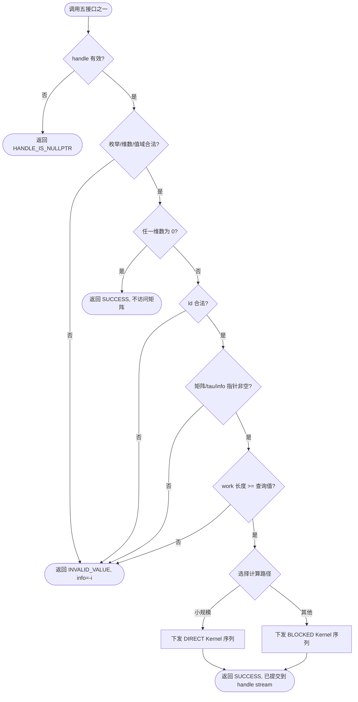

# aclsolverSgeqrf / Sorgqr / Sormqr / Xlarft / SSgels 算子设计文档

> 本文档覆盖设计阶段。文中性能路径、阈值和资源预算均为实现方案或设计输入校准项；算子实现本身未编译、未跑精度、未跑性能。
> 版本：v1.1（2026-10-15）。相对 v1 草案：补充 M0 预研微型基准实测数据（arch35 FP32 GEMM 吞吐）作为架构决策设计输入，并据此收紧尾随更新 tiling 约束。

# 需求背景（required）

## 需求来源

本需求来自 2026 年 10 月 CANN 社区任务「单精度实数 QR 分解与最小二乘」算子开发。任务要求在 `cann/ops-solver` 仓库中，面向昇腾 950PR，以 AscendC/CATLASS Kernel 直调方式实现稠密 QR 分解族五个接口，精度达到 CANN 生态算子开源标准，验收通过后合入 `gitcode.com/cann/ops-solver`。

设计依据与冻结基线如下：

| 项目 | 基线 |
| --- | --- |
| 任务输入 | `Atlas950_Sgeqrf_Sorgqr_Sormqr_Xlarft_SSgels_task_doc.md` 及配套 `sgeqrf/ sorgqr/ sormqr/ sgels/` 用例与 GPU 金标 |
| 社区文档模板 | `cann-competitions/04_tasks/01_community-task-2026/resources/design_template.md` |
| 目标实现仓 | `cann/ops-solver`（当前无 QR/gels 原型，须全新实现） |
| 目标硬件 / 架构 | Ascend 950PR / DAV_3510（`arch35`） |
| CANN 版本 | 9.1.0（实例实测 `/usr/local/Ascend/cann-9.1.0`，驱动 25.7.rc1.10） |
| 数据类型 / 布局 | FLOAT32（仅 Xlarft 的 R_32F 组合）/ Column Major |
| 同族实现事实源 | `ops-blas` 仓 `blas/geqrf_batched/arch35/`、`blas/gels_batched/arch35/`（AIV SIMT 逐列模式）；`blas/gemm*/arch35/`（CATLASS FP32 GEMM 调度） |
| 仓内工程事实源 | `ops-solver` `src/sgetrf/`（Host 校验 / workspace / TilingData 模式） |
| 设计检查表 | CANNBot `npu-arch`、`ascendc-tiling-design`、`ascendc-blaze-best-practice` 与 direct-invoke 设计约束 |

设计以任务书为接口与验收真值，以 `ops-blas` / `ops-solver` 源码为工程事实源；CANNBot 仅用于补充架构、Tiling、Buffer 和验证边界检查，不替代任务书。

## 背景介绍

本任务交付五个接口，构成一条算法栈而非五个独立算子：

```text
aclsolverSSgels（最小二乘，组合层）
    = aclsolverSgeqrf + aclsolverSormqr(LEFT,T) + 内部三角回代
aclsolverSgeqrf（核心，分块 Householder QR）
    = panel 分解 + larft(T) + 尾随 GEMM 更新
aclsolverSorgqr / aclsolverSormqr（WY 块反射器应用，共用 larfb 机制）
aclsolverXlarft（T 因子生成，与 geqrf 内部共用同一函数）
```

QR 分解将 A = Q·R（m×n，m≥n），Q 为正交矩阵、R 为上三角。LAPACK/cuSolver 采用 Householder 反射器隐式表示：`H_i = I - tau_i·v_i·v_iᵀ`，A 的下三角区存放 v_i（对角概念 1 隐式），上三角区为 R。分块算法以 NB=128 列宽为一个 panel：panel 内逐列分解（向量 bound），panel 间通过 WY 块形式 `Q = I - V·T·Vᵀ` 的尾随 GEMM 更新（矩阵乘 bound），从而把 O(n³) 的主要计算转化为 Cube 友好的 FP32 GEMM。

`ops-blas` 已有 `geqrf_batched` / `gels_batched` 的 arch35 实现（AIV-only SIMT 逐列 + warp/block 两级归约），但为 batched 中小矩阵设计，无分块、向量 bound。本任务单矩阵 4096² 的性能门禁（NPU ≤ GPU/0.35）要求把主要计算放到 AIC Cube FP32 GEMM 上，因此采用「小 case 移植 SIMT 模式 + 大 case 分块」的双模态架构；panel 分解器直接移植 ops-blas 的符号规则与归约流程。

## 五个接口的数学语义

| 接口 | 语义 | 输入 | 输出 |
| --- | --- | --- | --- |
| `Sgeqrf` | A = Q·R，Householder 隐式形式 | A（m×n，lda×n 有效 m×n） | A 原地覆写（下三角 v、上三角 R）+ TAU[min(m,n)] + devInfo |
| `Sorgqr` | 生成 Q 的前 n 列（m×n，m≥n≥k≥0） | geqrf 输出的 A + tau[0..k-1] | A 原地覆写为 Q 的前 n 列 + devInfo |
| `Sormqr` | C := op(Q)·C（LEFT）或 C := C·op(Q)（RIGHT），op ∈ {N,T,C} | geqrf 输出的 A（nq×k，nq=side==LEFT?m:n）+ tau[0..k-1] + C（m×n） | C 原地更新 + devInfo |
| `Xlarft` | T（k×k）满足 H = I - V·T·Vᵀ；direct=FORWARD → T 上三角（H=H₁H₂…Hₖ），BACKWARD → T 下三角（H=Hₖ…H₁） | V（n×k 列存）+ tau[k] | T（ldt×k）+ devInfo |
| `SSgels` | 最小二乘 min ‖B−A·X‖₂（m≥n） | dA（m×n）、dB（m×nrhs） | dX（n×nrhs）+ niter（Host）+ dinfo |

# 需求分析（required）

## 需求描述

在 `include/cann_ops_solver.h` 中新增五个公共接口及其 `_bufferSize` 查询接口。接口语义、参数顺序、列主序解释、原地/异地行为和异常行为与任务书指定的 cuSolver DN 口径一致；不创建 950PR 私有平行接口。五个接口作为同一社区任务一并交付，不允许拆分验收。

## 算子原型

```cpp
/* ===== Handle 管理（复用既有） ===== */
aclsolverStatus_t aclsolverCreate(aclsolverHandle_t *handle);
aclsolverStatus_t aclsolverDestroy(aclsolverHandle_t handle);
aclsolverStatus_t aclsolverSetStream(aclsolverHandle_t handle, aclrtStream stream);
aclsolverStatus_t aclsolverGetStream(aclsolverHandle_t handle, aclrtStream *stream);

/* ===== 1. geqrf ===== */
aclsolverStatus_t aclsolverSgeqrf_bufferSize(
    aclsolverHandle_t handle, int m, int n, float *A, int lda, int *Lwork);
aclsolverStatus_t aclsolverSgeqrf(
    aclsolverHandle_t handle, int m, int n, float *A, int lda,
    float *TAU, float *Workspace, int Lwork, int *devInfo);

/* ===== 2. orgqr ===== */
aclsolverStatus_t aclsolverSorgqr_bufferSize(
    aclsolverHandle_t handle, int m, int n, int k,
    const float *A, int lda, const float *tau, int *lwork);
aclsolverStatus_t aclsolverSorgqr(
    aclsolverHandle_t handle, int m, int n, int k,
    float *A, int lda, const float *tau, float *work, int lwork, int *devInfo);

/* ===== 3. ormqr ===== */
aclsolverStatus_t aclsolverSormqr_bufferSize(
    aclsolverHandle_t handle, aclsolverSideMode_t side, aclsolverOperation_t trans,
    int m, int n, int k, const float *A, int lda, const float *tau,
    const float *C, int ldc, int *lwork);
aclsolverStatus_t aclsolverSormqr(
    aclsolverHandle_t handle, aclsolverSideMode_t side, aclsolverOperation_t trans,
    int m, int n, int k, const float *A, int lda, const float *tau,
    float *C, int ldc, float *work, int lwork, int *devInfo);

/* ===== 4. xlarft（64-bit 维数，对齐 cuSolver Xlarft） ===== */
aclsolverStatus_t aclsolverXlarft_bufferSize(
    aclsolverHandle_t handle, aclsolverParams_t params,
    aclsolverDirectMode_t direct, aclsolverStorevMode_t storev,
    int64_t n, int64_t k,
    aclsolverDataType_t dataTypeV, const void *V, int64_t ldv,
    aclsolverDataType_t dataTypeTau, const void *tau,
    aclsolverDataType_t dataTypeT, void *T, int64_t ldt,
    aclsolverDataType_t computeType,
    size_t *workspaceInBytesOnDevice, size_t *workspaceInBytesOnHost);
aclsolverStatus_t aclsolverXlarft(
    aclsolverHandle_t handle, aclsolverParams_t params,
    aclsolverDirectMode_t direct, aclsolverStorevMode_t storev,
    int64_t n, int64_t k,
    aclsolverDataType_t dataTypeV, const void *V, int64_t ldv,
    aclsolverDataType_t dataTypeTau, const void *tau,
    aclsolverDataType_t dataTypeT, void *T, int64_t ldt,
    aclsolverDataType_t computeType,
    void *bufferOnDevice, size_t workspaceInBytesOnDevice,
    void *bufferOnHost, size_t workspaceInBytesOnHost);

/* ===== 5. ssgels ===== */
aclsolverStatus_t aclsolverSSgels_bufferSize(
    aclsolverHandle_t handle, int m, int n, int nrhs,
    float *dA, int ldda, float *dB, int lddb, float *dX, int lddx,
    void *dwork, size_t *lwork_bytes);
aclsolverStatus_t aclsolverSSgels(
    aclsolverHandle_t handle, int m, int n, int nrhs,
    float *dA, int ldda, float *dB, int lddb, float *dX, int lddx,
    void *dWorkspace, size_t lwork_bytes, int *niter, int *dinfo);
```

参数名、顺序、含义、Device/Host 归属不得擅自增删或调换。`geqrf`/`orgqr`/`ormqr`/`SSgels` 维数类型为 `int`；`Xlarft` 维数为 `int64_t`。**所有矩阵指针均为 Device 内存**（与 cuSolver 一致），Host 侧不承担 H2D/D2H 拷贝——这是与仓内 `sgetrf`（Host 指针 + 内部 H2D 模式）的关键差异，不得沿用其拷贝通路。

`aclsolverParams_t` 允许 `nullptr` 表示默认参数；本实现不需要显式 params 对象，`aclsolverXlarft` 对非 nullptr params 仅做合法性检查后按默认行为处理。

## 参数与语义（总表）

| 参数 | 位置 / 方向 | 合法值 | 异常行为 |
| --- | --- | --- | --- |
| `handle` | Host / 输入 | 非空 | `ACLSOLVER_STATUS_HANDLE_IS_NULLPTR` |
| `m,n,k,nrhs` | Host / 输入 | 各接口值域见任务书 2.4 | 越界返回 `ACLSOLVER_STATUS_INVALID_VALUE`，info 可写时写 `-i` |
| `A / C / dA / dB / dX` | Device / 输入输出 | 列主序 ND，`lda>=max(1,m)` | 空指针且问题非空时报错；ld 不满足报错 |
| `TAU / tau` | Device / 输出/输入 | 长度 `min(m,n)` / `k` | k>0 为空指针报错 |
| `devInfo / dinfo` | Device / 输出 | INT32[1]，0 或 -i | 空指针报错 |
| `niter` | Host / 输出 | int[1]，>=0 | 空指针报错 |
| `work / Workspace / dWorkspace` | Device / 输入 | 长度 >= bufferSize 查询值 | 不足报错 |

空问题（m=0 / n=0 / k=0 / nrhs=0）成功返回，不访问矩阵、不申请 workspace、不下发 Kernel。列主序地址：`A(row,col) = A[col*lda + row]`；只访问逻辑有效区域，`[m,lda)` padding 不读不写。所有元素数、字节数和 GM 偏移先扩宽为 `int64_t/size_t` 再乘加。

## 需求拆解与范围

| 模块 | 设计范围 |
| --- | --- |
| 公共 API | `cann_ops_solver.h` 增加五个接口 + bufferSize 声明；复用既有 handle、枚举、状态码 |
| Host | 校验、特殊路径、算法选择（DIRECT/BLOCKED）、Tiling、workspace 查询与下发 |
| Device | geqrf DIRECT/BLOCKED、larft、larfb、gels 组合与 trsm |
| 构建与说明 | 接入 `src/` 收集规则，更新算子目录 README |
| 后续测试 | 复用任务提供的 cases.json / bench_result.json 与判据脚本；本文只定义验证计划 |

不在本任务范围内：batched、任意二维 stride、行主序、其他数据类型（Xlarft 仅 R_32F）、m<n 的 LQ 路径（gels 只要求 n≤m）、奇异检测（dinfo 仅在 R 对角为 0 时报告）。

## 代码架构选型

| 子问题 | 选型 | 原因 |
| --- | --- | --- |
| panel 分解（列内 Householder + 列间 rank-1 更新） | AIV SIMT 逐列，移植 ops-blas `geqrf_batched/arch35` 模式 | 列间严格串行依赖，三角形状无法直接进 Cube；warp shfl + block smem 两级归约已验证 |
| 尾随更新 A22 −= V·Tᵀ·(Vᵀ·A22) | AIC Cube FP32 GEMM（两次/三次） | 转化为矩阵乘；arch35 Cube 有 FP32 MMAD（baseK=8），是唯一满足精度合规的 Cube 路径 |
| larft / larfb 中的 T 应用 | AIV/小 GEMM（NB×NB） | 规模小、依赖局部，不值得单独 Cube 流水 |
| orgqr/ormqr 应用层 | 与 geqrf 尾随更新同一套 larfb Kernel（作用于不同 C） | 四组合 LEFT/RIGHT × N/T 共用一套 W=·ᵀV·C、T 应用、C−=V·W 流程 |
| ssgels | geqrf + ormqr(LEFT,T) Kernel 序列 + AIV 三角回代 | 组合层无新算法；门禁低（~1.3 TFLOPS），复用既有 Kernel 即可达标 |

**Cube 路径的设计输入（M0 预研微型基准，950PR 实测）**：直调 ops-blas arch35 FP32 GEMM 参考实现，4 形状实测（wall-clock 含 stream 同步）：4096³ 峰值参照 20.33 TFLOPS；`K=128` 小 K 段（`A22−=V·W` 型，ormqr 门禁形状）18.11 TFLOPS；`M=128` 大 K 段（`W=VᵀC` 型）19.41 TFLOPS。最高门禁 ormqr 4096³ 需 16.2 TFLOPS 有效吞吐，实测口径下有约 12% 余量，**Cube FP32 主战场架构成立**；同批实测发现 `N=128` 窄 n 形状（4096×128×4096）吞吐仅 3.49 TFLOPS，据此在尾随更新 tiling 中增加约束：tile 规划不得让输出 N 维塌缩到单窄条（见 §尾随更新 GEMM Tiling）。

# 详细设计（required）

## 算子分析

### Householder 反射器（LAPACK larfg 语义）

对列向量 x（枢轴 x₁）：

```text
sigma = Σ_{i>1} x_i²
normX = sqrt(sigma + x₁²)
alpha = (x₁ >= 0) ? -normX : normX        # 与 LAPACK/ops-blas 一致，保证 |v| 稳定
tau   = (alpha - x₁) / alpha
v[1]  = x₁ - alpha;  v[i>1] = x_i / v[1]
H     = I - tau·v·vᵀ，满足 H·x = (alpha, 0, …, 0)ᵀ
```

数值保护：`x₁ == 0 且 sigma == 0` 时 tau=0（H=I）。不引入额外缩放路径；ops-blas 的 `sc=max(|akk|,xnorm)` 防溢出缩放仅在其 SIMT 骨架中保留作退化兜底。**符号规则冻结**：`alpha` 符号与 LAPACK 完全一致——CPU golden（scipy float32 链路）依赖此规则复现，doc/proto 基线已验证可对齐。

### 分块 QR（BLOCKED 主流程）

以 NB=128 为 panel 宽，A 按列分块。对 panel j（列区间 [j, j+bs)，bs=min(NB, n−j)）：

```text
1. panel 分解（AIV，串行列）
   for i in [j, j+bs):
       对 A[i:m, i] 计算 (v, tau_i)                # 归约见 §Tiling
       A[i+1:m, i] <- v                            # 下三角区存放 v（对角概念 1）
       A[i:m, i+1:j+bs] -= tau_i · v · (vᵀ·A[i:m, i+1:j+bs])   # 列 rank-1 更新
2. larft：由 panel 的 V=A[j:m, j:j+bs] 与 tau[j:j+bs] 生成 T（bs×bs 上三角）
   —— 与 aclsolverXlarft(FORWARD) 同一函数，列式递推 T[:i,i] = -tau_i·T^(i-1)·(Vᵀv_i)
3. 尾随更新（AIC Cube FP32 GEMM，令 V=A[j:m, j:j+bs]）
   W  = Vᵀ · A22          # (bs) × (n−j−bs)，K = m−j
   W  = Tᵀ · W            # (bs) × (n−j−bs)，三角小乘（可 AIV 或并入 V·Tᵀ 折叠）
   A22 -= V · W           # (m−j) × (n−j−bs)，K = bs
```

尾随更新 flops 占 geqrf 总量（(4/3)n³，4096² 时 ≈9.2e10）的 ~97.6%；panel 向量段 flops 仅 ~2.4% 但向量 bound，**时间占比估算 14–28%**——M2 微型基准必须实测该占比并据此选择 panel 并行化方案。W=Tᵀ·W 一步允许折叠为 `Vf = V·Tᵀ`（(m−j)×bs 小 GEMM）后 `A22 -= Vf·W`，是否折叠以实测 launch 开销为准。

### WY 块反射器应用（larfb，orgqr/ormqr/gels 共用）

```text
LEFT:  C := op(Q)·C      W = Vᵀ·C;  W = op(T)·W;  C -= V·W
RIGHT: C := C·op(Q)      W = C·V;   W = W·op(T);  C -= W·Vᵀ
```

其中 `op(T)`：trans=N 用 T，trans=T/C 用 Tᵀ（实数 T/C 等价）。四个组合（LEFT/RIGHT × N/T）流程同构，仅 GEMM 形状不同：RIGHT 时第一/第三乘为 C·V 与 W·Vᵀ（K 维为 nq）。

### orgqr

由 geqrf 输出的 (v, tau) 生成 Q 前 n 列：等价于对单位矩阵的前 n 列**逆序**应用各 panel 的块反射器（Hₖ…H₁），即从最后一个 panel 向前走，每步对 `I[:, 0:panelEnd]` 做 `larfb(LEFT, N)`。Q 的其余列（第 n+1..m 列，仅当 n<m 时存在）为单位向量列，直接写入。

### xlarft（独立接口）

与 geqrf 内部 larft 同一函数；`direct=BACKWARD` 时 V 的有效区约定为上三角式（v_i 有效区 0..i），列式递推方向相反。任务书仅验收 FLOAT32 组合（`dataTypeV/Tau/T` 全为 `ACLSOLVER_R_32F`），其他组合返回 `NOT_SUPPORTED`。

### ssgels（m≥n）

```text
1. sgeqrf(dA)                        # 复用 BLOCKED/DIRECT 路径，dA 原地覆写
2. sormqr(LEFT, T, m, nrhs, k=min(m,n), A, tau, C=dB)   # Qᵀ·B，dB 原地覆写
3. 内部三角回代（AIV）：R = dA[0:n,0:n] 上三角；解 R·X = (QᵀB)[0:n,:]
4. dX <- X（n×nrhs，列主序，out-of-place）
niter = 0（直接法）；dinfo：R[i,i]==0 → i+1（LAPACK info 语义）
```

dB 的尾部行 [n,m) 在步骤 2 后被弃用（仅 [0,n) 行参与回代）。dA 求解后可被破坏（任务书明示）；dX 与 dA/dB 均为独立 Device 缓冲。

## 总体流程



图 1：Host 校验与算法分派。所有 Device 操作提交到 handle 当前 stream；成功返回仅表示已提交，调用方读回前须同步。

### Host 侧校验顺序（冻结）

1. `handle` 非空；
2. 枚举合法（side/trans/direct/storev/dataType 按接口）与维数值域（m≥0、n≥0、0≤k≤nq、nrhs≥0、m≥n 等）；
3. 任一维数为 0 → 返回 SUCCESS，**不检查 ld、不访问任何矩阵、不申请 workspace、不下发 Kernel**；
4. 非空计算检查 `ld >= max(1, 对应阶数)`；
5. 矩阵指针非空（geqrf 的 A/TAU/devInfo；orgqr 的 A/tau/devInfo；ormqr 的 A/tau/C/devInfo；xlarft 的 V/tau/T/buffer；gels 的 dA/dB/dX/niter/dinfo）；
6. work 长度不小于同参数 `_bufferSize` 查询值；
7. 计算 Tiling / workspace 并顺序下发；任何 acl 错误立即回滚（已下发 Kernel 由 stream 自然完成），返回可诊断状态码。

`devInfo` 在入口置 0；参数类错误在 info 可写时写 `-i`（i 为第 i 个非法参数，handle 不计）。

### 路径选择（首版确定性阈值，待 M2 校准）

| 条件 | 路径 |
| --- | --- |
| 任一维数为 0 | Host quick return |
| `min(m,n) <= SMALL_TH`（初值 512）或 panel 归约容量不满足 | DIRECT |
| 其他 | BLOCKED |

`SMALL_TH=512` 是首版确定性阈值，**不是性能结论**；M2 微型基准按 950PR 同机 profile 校准后更新本文档。全部性能门禁 case 尺寸 ≥1024，均落 BLOCKED；阈值只影响全量小 case 的耗时，不影响门禁达标。ssgels 跟随 geqrf 路径 + trsm；xlarft 恒为列式递推（无路径分支）。

### 工程落点

```text
include/cann_ops_solver.h                       # 五接口 + bufferSize 声明

src/sgeqrf/
  arch35/sgeqrf_host.cpp                        # 校验、调度、workspace、launch
  arch35/sgeqrf_kernel.cpp                      # DIRECT SIMT 逐列（移植 ops-blas 模式）
  arch35/sgeqrf_blocked_kernel.cpp              # panel 分解 + larft + 尾随 GEMM
  arch35/sgeqrf_tiling_data.h                   # Host/Device 共用 POD
src/sorgqr/arch35/                              # 同上四件套（larfb 逆序应用）
src/sormqr/arch35/                              # 同上四件套（larfb 四组合）
src/xlarft/arch35/                              # 列式递推（与 sgeqrf 共用 larft 实现）
src/ssgels/arch35/                              # 组合 + trsm
src/utils/                                      # 复用 checked-size / workspace / 同步辅助
examples/sgeqrf/ 等五个目录/                     # 各接口调用示例
test/sgeqrf/ 等五个目录/                         # 各接口精度/异常/性能测试
```

新增源码不在既有算子内叠加分支；larft/larfb 的共享实现放在 `src/utils/` 或以 `src/qr_common/` 收容，由五个接口共同 include，避免复制五份。

## Tiling 与多核设计

### DIRECT 路径（小 case，AIV-only）

移植 ops-blas `geqrf_batched/arch35` 模式：每核一个矩阵（batch=1 等效），核内 SIMT 线程按列串行推进：

- `numThreads = 2^ceil(log2(min(m,64)))`，下限 8 上限 64；
- 每列 Householder：`ComputeSigma`（列点积，warp shfl 16→8→4→2→1 + block smem 两级归约）→ `ComputeTauAndNormalize` → `ApplyRank1Update`（列点积 + 列更新）；
- UB 缓存当前 panel 列块，`__ubuf__ float partialSums[128]` 不用全局 g_smem；
- ormqr DIRECT：对 C 逐列应用（k 个反射器），同核串行；orgqr DIRECT：对单位列应用。

UB 预算（m×NB 缓存块 + partials，NB=128、m≤512）：

```text
aBlockUb  = m * NB * 4B                 <= 512*128*4 = 256 KiB
partials  = 128 * 4B * 2                = 1 KiB
```

DAV_3510 典型 UB 约 248 KiB（ctrsm-950 同源口径），`m*NB*4B` 在 m=512 时已超限——DIRECT 路径按 `MB_chunk = min(m, 256)` 分行块进 UB，或 m 较小时直接整列流式处理；**最终数值以目标平台查询和编译报告为准，不把 248 KiB 写成跨产品常量**。

### BLOCKED 路径（大 case，主战场）

#### panel 分解与跨核归约（M2 微型基准第一案，三选一）

| 方案 | 模式 | 依据 | 风险 |
| --- | --- | --- | --- |
| A. 行分核 + workspace 两段式 | 每 AIV 核算部分和 → GM workspace → 少核归约；`aclrtGetHardwareSyncAddr` 做核间同步（sgetrf 已用该机制） | 通用模式，无原子序问题 | 两次 Kernel 或核间同步开销；workspace 增长 |
| B. AtomicAdd 跨核累加 | 各核 `AtomicAdd` 到 GM 累加器 | NllLoss/MseLoss/spmv 同款模式（KG K7） | 非确定累加顺序 → 违反 bit-wise 确定性，需定序补偿 |
| C. 单核 UB 分行块 | panel 整块进单核 UB，SIMT 64 线程内归约（ops-blas 模式） | K1 已验证 | UB 容量限制（4096×128×4B=2MB 超 UB，需 MB≤256） |

**倾向 C 为基线（MB=256 → 256KB，待确认 3510 UB），A 为备选；B 因确定性问题暂缓。** 微型基准三种都测，按 4096² panel 段耗时定。注意：面板列间的 rank-1 更新同样串行依赖，归约只解决「列内点积」，列间并行度天然为 1——panel 段占比若 >25%，备选方案是减小 NB 增加 Cube 占比（NB=64 时 panel 段 flops 翻倍但每次更短，需实测权衡）。

#### 尾随更新 GEMM Tiling（AIC Cube FP32）

形状：`W=Vᵀ·A22`（bs×N2，K=m−j）、`A22−=V·W`（M2×N2，K=bs）。按 `gemm*/arch35` 既有 FP32 调度模式设计：

0. **窄维规避约束（M0 预研实测输入）**：N=128 窄输出形状实测吞吐塌方（3.49 TF，不足峰值的 1/5）。tile 规划须保证每个 AIC tile 的输出面 M0×N0 不出现"单 tile 极窄 N"布局；若剩余列数小于 tileN 下限，优先减小 tileM 换取更宽 tileN，或将窄块与相邻 panel 的更新合并下发，禁止按"逐 panel 串行 × 极窄 tile"布局。

1. AIC tile M/N 在 `{256,128,64,32,16}` 选；优先保证 tile 数 ≥ 可用 AIC 核数，再扩大 tile 面积；
2. K 以 `{128,64,32,16,8}` 分块，与 arch35 FP32 MMAD baseK=8 对齐，满足 L1 双缓冲与 FP32 C0 对齐；
3. 核数经 `GetAicCoreCount/GetAivCoreCount` 查询，不硬编码；
4. L1 双缓冲、L0A/L0B ping-pong、L0C FP32 累加，每个输出 tile 唯一 writer；
5. M/N/K 尾块用真实范围，不要求 shape 对齐。

预算式（首版，fp32、`m0=alignUp(tileM,16)`、`n0=alignUp(tileN,16)`、`k0=alignUp(tileK,8)`）：

```text
aL1 = m0*k0*4;  bL1 = k0*n0*4;  aL0 = m0*k0*4;  bL0 = k0*n0*4;  cL0 = m0*n0*4

2*(aL1+bL1) + l1Headroom <= queriedL1Bytes        # l1Headroom <= 10%
2*aL0                 <= queriedL0ABytes
2*bL0                 <= queriedL0BBytes
cL0                   <= queriedL0CBytes
```

候选逐项校验，全失败则降级 tile 或返回可诊断错误，不使用越界 Tiling。数据流：`CopyGM2L1 → CopyL12L0A/B → Mmad → CopyL0C2GM`（Fixpipe L0C→GM，K8 佐证通路存在）。

#### workspace 公式（M1 必含项，元素数口径）

以 `min(m,n)=q`、`nq = side==LEFT ? m : n` 计：

```text
geqrf :  V_buf   = align32((m-j)*bs*4B)          # panel 的 V（可复用，单 panel）
         W_buf   = align32(bs*N2*4B)             # VᵀA22
         T_buf   = align32(bs*bs*4B)             # T 因子（可选持久化）
         Lwork(元素) ≈ max over panel of (V_buf+W_buf)/4B + 常数项
orgqr :  work    = align32(N2*bs*4B)             # 对单位列应用的工作缓冲
ormqr :  work    = align32(bs*N2*4B) 或 (C·V 时 bs×n)   # 取 LEFT/RIGHT 较大者
xlarft:  bytes   = align32(k*k*4B) 左右           # device/host 各一
ssgels:  bytes   = geqrf(V+W) + ormqr(bs*nrhs) + 对齐余量
```

`_bufferSize` 返回值即按上式；workspace 由调用方提供（cuSolver 风格），Host 不做二次分配。所有尺寸计算在 `int64_t/size_t` 域完成，checked-size 防溢出。

### TilingData（Host/Device 共用 POD，固定宽度，trivially-copyable）

| 结构 | 核心字段 |
| --- | --- |
| `SgeqrfTilingData` | `m,n,lda,nb,smallTh,numThreads,coreNum,perCoreRows,remainder` |
| `SgeqrfPanelTilingData` | `panelStart,bs,mj,nRemaining,lda,panelReduceMode` |
| `SgeqrfGemmTilingData` | `m,n,k,lda,ldw,tileM,tileN,tileK` |
| `LarfbTilingData` | `side,trans,m,n,k,lda,ldc,bs` |
| `XlarftTilingData` | `direct,n,k,ldv,ldt` |
| `SSgelsTilingData` | `m,n,nrhs,ldda,lddb,lddx` |

布尔状态用明确 `uint32_t` 枚举，禁止 Host 与 Device 各自维护不同字段解释。

## Kernel 设计

### DIRECT / panel 分解伪代码

```text
# 每核负责 panel 的连续行段 [r0,r1)（方案 A）或整块（方案 C）
for i in [panelStart, panelStart+bs):
    (sigma, x1) = parallel_dot_sum(A[i:m, i])        # 两级归约
    if x1==0 && sigma==0: tau=0; continue
    normX = sqrt(sigma + x1*x1); alpha = (x1>=0)?-normX:normX
    tau_i = (alpha-x1)/alpha; v[0] = x1-alpha; v[1:] = A[i+1:m,i]/v[0]
    A[i,i]=alpha; A[i+1:m,i]=v[1:]                     # 写回 v（对角概念 1 隐式）
    # 列 rank-1 更新：对 [i+1, panelEnd) 每列 c: A[i:m,c] -= tau_i*v*(v·A[i:m,c])
    for c in [i+1, panelEnd): A[i:m,c] -= tau_i * v * parallel_dot(v, A[i:m,c])
    block_sync()                                       # 列间依赖
TAU[panelStart:panelStart+bs] = tau
```

所有 GM 索引用 64 位中间值。panel 内列的串行依赖用 block 内同步表达；核间（方案 A）用 stream 内 Kernel 边界 + `HardwareSyncAddr` 表达，不用自定义 flag 协议。

### larft（列式递推，FORWARD）

```text
for i in [0,bs):
    if tau_i == 0: T[i,i]=0; continue
    if i > 0:
        w = -tau_i * (T[:i,:i]ᵀ · (V[i:m,:i]ᵀ · v_i))     # 小 dot/axpy 链，AIV
        V[i:m,:i] -= v_i · wᵀ                              # 前 i 列投影消去
        T[:i,i] = w
    T[i,i] = tau_i
```

BACKWARD 对称（有效区 0..i、递推方向相反）。该函数同时服务于 geqrf 内部与 `aclsolverXlarft` 独立接口（k=0 或 tau=0 列直接跳过）。

### larfb（块反射器应用）

```text
# LEFT, trans=N:  C -= V · T · (Vᵀ · C)
W  = GEMM(Vᵀ, C)            # AIC, bs×n, K=mj
W  = TRMM-like(T, W)        # AIV 或并入折叠 Vf=V·Tᵀ
C -= GEMM(V, W)             # AIC, mj×n, K=bs
# trans=T/C: 第二步用 Tᵀ（实数等价）
# RIGHT:      W = GEMM(C, V); W = W·op(T); C -= GEMM(W, Vᵀ)
```

三个步骤顺序下发到同一 stream；`C` 的每个输出 tile 唯一 writer。RIGHT 路径的第一/第三乘为 C·V / W·Vᵀ，K 维为 nq——tile 选择公式同 §尾随更新，仅形状参数不同。

### ZERO_ALPHA 类特殊路径

QR 族无 alpha 参数，无清零路径；gels 的退化场景（R 对角为 0）不拦截计算，仅在 dinfo 写 i+1（LAPACK 语义）。

### 同步与生命周期

| 边界 | 同步设计 |
| --- | --- |
| Host 阶段间 | 同一 stream 上 panel → larft → pack/GEMM 序列顺序下发 |
| panel 列间 | block 内同步（DIRECT）；Kernel 边界（BLOCKED 方案 A） |
| AIC L1/L0 | L1/L0A/L0B 双缓冲 HardEvent 配对，循环结束完整 drain |
| 核间归约 | 方案 A：`HardwareSyncAddr` 两段式；方案 C：无跨核 |
| workspace 复用 | 后一 Kernel 仅在同 stream 前一 Kernel 完成后消费/覆写对应区 |
| 多 stream | 状态与 workspace 归属 handle；不用进程级可变全局 scratch |
| 确定性 | 固定归约树（树形/两段式）+ 无 atomics → 同输入同版本 bit-wise 一致 |

# 支持硬件

| 芯片版本 | 支持状态 |
| --- | --- |
| Ascend 950PR（DAV_3510 / arch35） | 支持，本任务唯一验收目标 |
| 其他产品 | 本任务不声明支持；公共 API 仍保持产品线共享 |

# 算子约束限制

| 约束 | 说明 |
| --- | --- |
| 数据类型 | FLOAT32；Xlarft 仅 R_32F 组合 |
| 存储 | Column Major；仅支持 ld 表达的列间 padding |
| 内存位置 | 所有矩阵/workspace 均在 Device；Host 无拷贝职责 |
| 原地/异地 | geqrf/orgqr/ormqr 原地覆写；gels 的 dA 可破坏、dX 异地输出 |
| 重叠 | A 与 C/dB 与 dX 的重叠不在支持范围 |
| 零维 | 合法 no-op，不访问矩阵，不分配 workspace，不下发 Kernel |
| 规模 | m,n ∈ [1,4096]（验收下限；更大规模允许实现支持并声明） |
| 奇异性 | 不检测；gels 仅在 R 对角为 0 时经 dinfo 报告 |
| 异步 | 成功表示已提交；读回前须同步 handle stream |
| 确定性 | 同输入、同 Tiling、同软件版本 bit-wise 一致；不承诺跨版本 bit-exact |

# 可维可测分析

## 精度标准

精度判定按任务书 3.2.1 的 LAPACK 残差判据执行，五套判据如下（golden 为 CPU FLOAT32 同精度链路，ratio_cpu 为同 case 实测参考）：

| 接口 | 判据 | 残差定义 | 通过条件 |
| --- | --- | --- | --- |
| Sgeqrf | SQRT01 | `ratio = ‖R − QᵀA‖₁ / (m·‖A‖₁·ε)`，Q 由 NPU 的 (v,tau) **升精度 float64 后**调 CPU 算子生成 m×m 完整正交矩阵 | `ratio ≤ max(5·ratio_cpu, 0.1)` |
| Sorgqr | SQRT02 | `ratio = ‖I − QᵀQ‖₁ / (m·ε)` | `ratio ≤ max(5·ratio_cpu, 1.5)` |
| Sormqr | SQRT03 | `ratio = ‖op2 − op1‖₁ / (m·‖C‖₁·ε)`，op2=orgqr 显式 Q 应用参考，op1=ormqr 输出 | `ratio ≤ max(5·ratio_cpu, 0.1)`；**验收顺序：orgqr 先过，ormqr 方可验收** |
| SSgels（方阵） | SQRT16 | 逐列 `resid_j = ‖B_j − A·X_j‖₁ / (MAX(m,n)·‖A‖₁·‖X_j‖₁·ε)`，取 max | `ratio ≤ max(5·ratio_cpu, 0.015)` |
| SSgels（超定） | SQRT17 | `ratio_opt = ‖RᵀA‖₁ / (‖A‖₁·‖B‖₁·MAX(m,n,nrhs)·ε)`，R=B−A·X | `ratio_opt ≤ 10·ratio_opt_cpu` |

判据实现已在设计期按 CPU FLOAT32 同精度原型全绿验证（seed=1234/s512 套件：sgeqrf 43/43、sorgqr 38/38、sormqr 37/37、sgels 42/42、xlarft 语义残差 8e-7），kernel 上线后判据脚本与 NPU 输出直接对接。NaN/Inf 用例另做类别与 Inf 符号一致性检查，不计入普通通过。

## 性能标准

任务书口径：**T_NPU ≤ T_GPU / 0.35**，计时取 `OpBasicInfo.csv` 的 kernel `Task Duration(us)` 平均。

| 编号 | 接口/规格 | GPU 金标 | NPU 预算 | 所需有效 FP32 |
| --- | ---: | ---: | ---: | ---: |
| P-01 | geqrf 1024² | 3.79ms | 10.8ms | 0.13 TF |
| P-02 | geqrf 4096² | 25.45ms | 72.7ms | 1.26 TF |
| P-04 | orgqr 1024³ | 0.835ms | 2.39ms | 0.6 TF |
| P-05 | orgqr 4096³ | 5.211ms | 14.89ms | 6.2 TF |
| P-06 | ormqr 2048³ L·N | 2.080ms | 5.94ms | 5.8 TF |
| P-10 | gels 1024² nrhs=1 | 4.353ms | 12.44ms | 0.12 TF |
| 隐藏 | **ormqr 4096³ L·N / R·T** | 5.958 / 7.191ms | 17.0 / 20.6ms | **16.2 / 13.4 TF** |
| P-03/07/08/09/11/12 | 六项 | 缺 GPU 基线 | — | 口径待对齐（见下） |
| xlarft | 4096/128、2048/256 | 无 bench 目录 | — | 估 ~0.3–0.7 TF |

**多 kernel 计时口径声明（M1 必须与验收方对齐）**：geqrf BLOCKED 为多 Kernel 序列（panel/larft/GEMM×3），统计口径采用「同一次调用内全部 kernel Task Duration 求和」；DIRECT 为单 Kernel。本声明写入测试报告，验收前与验收方确认。

**缺失基线与口径声明（风险 R9）**：sgels 的 108/166 例（全部 nrhs>1）GPU 参考侧 error=2 缺基线；xlarft 无 bench 目录；P-03/07/08/09/11/12 六项缺 GPU 金标。M1 设计文档显式声明缺失清单，与验收方对齐「现场采集 / 豁免 / 降级」三选一，不默认补齐也不默认忽略。

性能测量须预先完成 workspace 扩容与 warmup，有效采样 >50 次取平均；计时覆盖 Device 执行，不含 H2D/D2H、输入生成、CPU golden 与比对。

## 验证计划（未执行）

按以下维度核验（用例来自任务包 cases.json：geqrf 174、orgqr 165、ormqr 189、gels 166）：

| 类别 | 覆盖点 |
| --- | --- |
| Shape | 0/1、小质数、2 的幂、±1、非对齐 ld padding、方阵/矩形、4096 上限 |
| 参数域 | k=0、k=n、k<min(m,n)；nrhs=0/1/多值；side×trans 全组合 |
| 数值 | 全零列（tau=0 路径）、大值行（防溢出）、近奇异（dinfo 语义） |
| 异常 | 空 handle、空矩阵/tau/info、非法枚举、负维数、非法 ld、work 不足 |
| 分块边界 | NB=128 整除/±1、panel 尾块、tile 尾块、DIRECT/BLOCKED 分界 |
| 读取边界 | padding 行/列与 guard 不被读写（填 NaN 验证） |
| 确定性 | 同输入连续 10 次 bit-wise 一致 |
| 性能 | P-01~P-12 全项 + 隐藏项，达标线与声明口径双报告 |

参数错误期望：handle 空返回 `HANDLE_IS_NULLPTR`；其余非法返回 `INVALID_VALUE` 且 info 写 `-i`。合法零维必须在任何矩阵指针检查之前成功返回。

## 静态设计核验

| 检查项 | 结论 |
| --- | --- |
| 公共原型、Column Major、参数顺序、空问题语义 | 已与任务书 2.4 逐项对齐 |
| 950PR 架构与核数/UB 取值 | 不硬编码 SKU 核数；容量示例与运行时真值分离 |
| 多核唯一 writer | panel 行段/矩阵列分核不相交；AIC temp tile 与 AIV 回写不相交 |
| UB/workspace 预算 | 已给公式、复用范围、对齐与 checked-size 要求 |
| Cube 能力来源 | 只采用 arch35 FP32 MMAD（baseK=8）+ Fixpipe L0C→GM；禁 HF32/FP16 冒充（KG K4） |
| dot 归约 | fp32 dot 不走 Cube（KG K5，30x 瓶颈）→ 全走 AIV 两级归约 |
| 同步闭合 | Kernel 边界顺序 + Kernel 内事件/block 同步，要求最终 drain |
| 实验状态 | 算子实现未编译、未跑精度、未跑性能；仅 M0 预研微型基准（ops-blas 参考实现直调）已执行，其数据作为上表架构决策的设计输入，不作为验收结论 |

## 兼容性分析

五个接口均为新增公共 API，不修改既有 `aclsolverSgetrf` 等签名和行为。新增实现位于 `src/` 各算子目录，通过既有 handle stream/workspace 机制执行。内部路径枚举与 TilingData 不暴露 ABI；公共枚举和值域继续来自 `cann_ops_solver_common.h`。

## 风险与对策

| 风险 | 影响 | 对策 |
| --- | --- | --- |
| ~~arch35 FP32 Cube 峰值未实测~~ **已定级（M0 预研基准）**：实测峰值 20.33 TF、K=128 段 18.11 TF（最高门禁 16.2 TF 的 112%）、M=128 段 19.41 TF；N=128 窄 n 形状 3.49 TF 塌方 | 门禁可达但余量薄（112%） | 主战场优化仍是核心工作；窄 n 形状已转化为尾随更新 tiling 约束（§尾随更新第 0 条）；备选手段（减小 NB 调节 GEMM 形状分布）保留 |
| panel 跨核归约方案未定 | 影响 geqrf 4096² 时间占比（估 14–28%） | §panel 三方案微型基准；不过线减小 NB 增大 Cube 占比 |
| sgels 108 例 / xlarft / 六项 P-case 缺 GPU 基线 | 验收口径不一致 | R9：M1 声明缺失清单，验收前对齐三选一 |
| 多 kernel 计时口径 | 求和 vs 单 kernel 平均结论相反 | 设计文档显式声明求和口径，验收前对齐 |
| 报名待通过、截止时间未确认 | 3–4 周工期无缓冲 | 社区任务系统跟踪，按最紧截止倒排 |
| 环境连通性（跳板限流 ~10 次连接/窗口） | 探测/调试效率受限 | 单次连接批量执行纪律；`tools/qr950_probe.sh` 一体化探测 |
| ops-solver 上游漂移 | 设计与实现基线漂移 | 开发前重取 upstream，逐项复核 Host 校验、workspace 合同 |

# 参考资料

1. 任务附件：`Atlas950_Sgeqrf_Sorgqr_Sormqr_Xlarft_SSgels_task_doc.md`、`api_list.md`、`QUICKSTART.md`、各算子 `cases.json` / `bench_result.json`。
2. 设计期校验基线：CPU FLOAT32 同精度原型（scipy float32 链路）复现五判据并全绿；详细记录随自测报告提交。
3. ops-blas：<https://gitcode.com/cann/ops-blas>，重点参考 `blas/geqrf_batched/arch35/`、`blas/gels_batched/arch35/`、`blas/gemm*/arch35/`。
4. ops-solver：<https://gitcode.com/cann/ops-solver>，重点参考 `src/sgetrf/`、`include/cann_ops_solver.h`。
5. cuSolver DN：`cusolverDnSgeqrf/Sorgqr/Sormqr/Xlarft/SSgels` 官方文档。
6. Netlib LAPACK：`sgeqrf/sorgqr/sormqr/slarft/slarfb/sgels` 及测试例程 SQRT01/02/03/16/17。
7. 生态算子开源精度标准：<https://gitcode.com/cann/opbase/blob/master/docs/zh/ops_precision_standard/mixed_tolerance_standard.md>。
8. CANNBot Skills：<https://gitcode.com/cann/cannbot-skills>。
