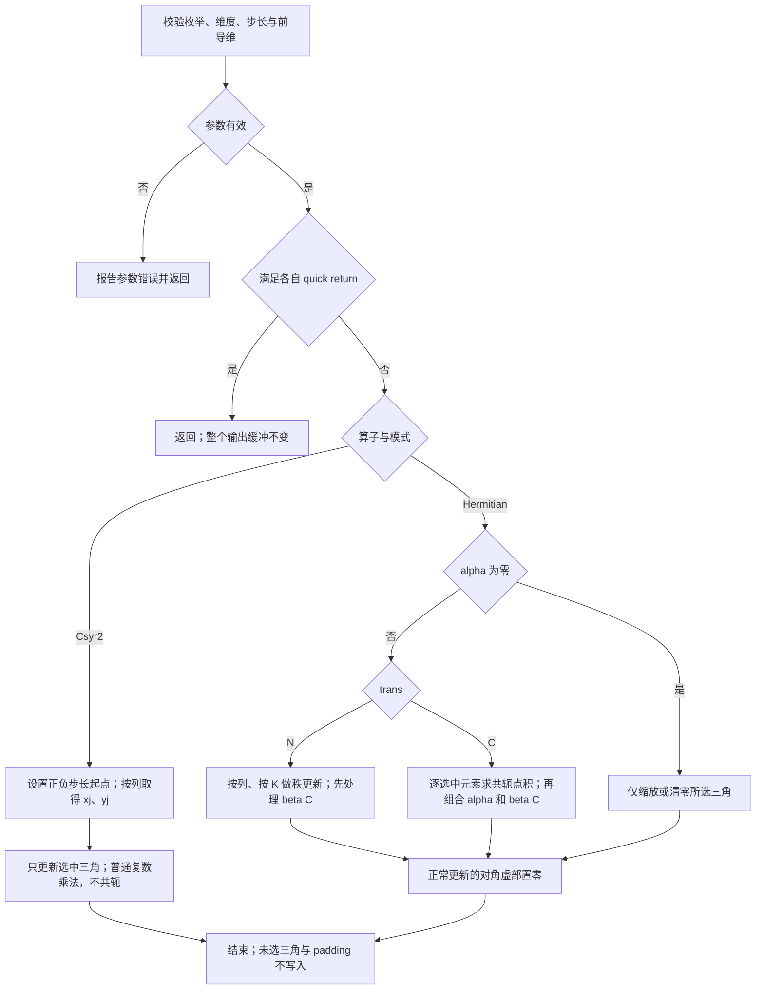
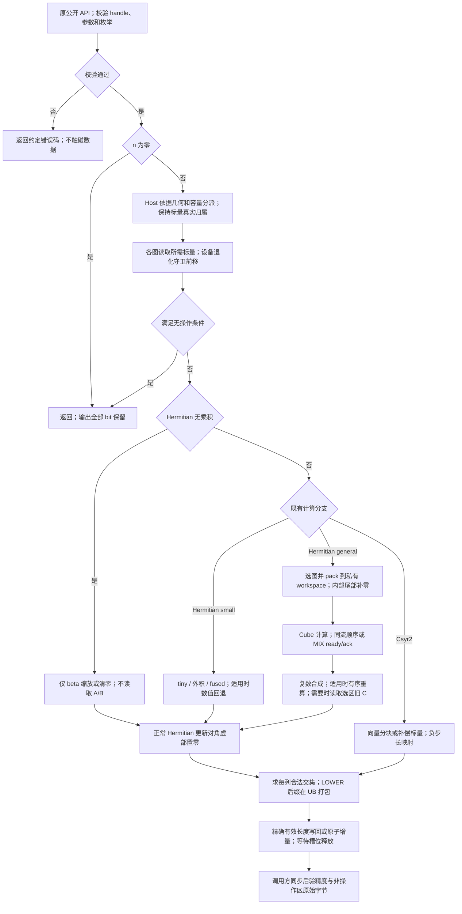

# 一、需求背景

## 1.1 需求来源

本设计对应社区任务 **10-39：Csyr2 / Cher2k / Cherk 精度修复（A2/A3）**，三个已有算子作为一项任务交付。依据输入包 `10月社区任务-Csyr2_cher2k_cherk算子精度修复（A2A3）.zip` 中的 `aclblasCsyr2_Cher2k_Cherk精度修复_A2A3_task_doc.md`、全部测试 CSV 和配套脚本，修复范围为 ops-blas 的 arch22 实现及对应测试，不新增公开 API，不重新开发三算子。

社区目录基线为 `d7497ff0a5c48190ce7b24f67b2209b55304a468`；任务编号见[官方任务列表](https://gitcode.com/cann/cann-competitions/blob/d7497ff0a5c48190ce7b24f67b2209b55304a468/04_tasks/01_community-task-2026/tasklist/README.md)。文档提交位置为 `04_tasks/01_community-task-2026/tasklist/10-39-Csyr2-cher2k-cherk-fix-A2A3/Xztxzt/docs/design.md`。

源码现状固定在 ops-blas **`47d82a0ebcc9f2833d661a5046d8dff6691e1d33`**（下称源码基线）。本文区分“源码已有机制”“静态发现的差异”“拟实施与验证项”；没有执行编译、仿真或 NPU 精度、性能验收。

## 1.2 背景介绍

任务核心是两种不同的正确性：所选三角的计算结果满足混合容差；未选三角及前导维 padding 与调用前逐 bit 一致。数值相等、加零恢复或最终拷回原值，都不能证明满足任务要求的非操作区零写。

令矩阵按列主序存储，`M(i,j)=M[i+j*ld]`。正常更新的操作区为 UPPER 的 `0≤i≤j<n` 或 LOWER 的 `0≤j≤i<n`；`n≤i<ld` 为 padding。Csyr2 的 `M=A, ld=lda`，其余两者为 `M=C, ld=ldc`。

| 算子 | 计算公式 | 对角语义 |
| --- | --- | --- |
| Csyr2 | `A ← αxyᵀ + αyxᵀ + A` | 对称、不共轭；对角虚部参与正常计算 |
| Cher2k，N / C | `C ← αABᴴ + conj(α)BAᴴ + βC` / `C ← αAᴴB + conj(α)BᴴA + βC` | 正常更新后对角虚部为 0 |
| Cherk，N / C | `C ← αAAᴴ + βC` / `C ← αAᴴA + βC` | 正常更新后对角虚部为 0 |

只存储并更新所选三角；对称性或 Hermitian 性质不授权补写另一三角。合法 quick return 保留整个输出缓冲，包括原对角虚部。

### 1.2.1 三算子精度修复范围

本任务采用 Ascend C kernel 直调和句柄式接口，模板中的 Addcdiv、TBE DSL、OPP 算子信息库与 ACLNN 两阶段接口均不适用。公开原型来源为[源码基线 `include/cann_ops_blas.h`](https://gitcode.com/cann/ops-blas/blob/47d82a0ebcc9f2833d661a5046d8dff6691e1d33/include/cann_ops_blas.h)，类型和枚举来源为同版本 `include/cann_ops_blas_common.h`，不存在需要虚构的 TBE 实现文件。

| 算子 | 真实实现文件，均相对 ops-blas 根目录 | 对应测试入口 |
| --- | --- | --- |
| Csyr2 | `blas/syr2/arch22/csyr2_host.cpp`、`csyr2_kernel.cpp`、`csyr2_triangle_copy.h`、`csyr2_precise_scalar.h`，以及该目录的向量分支文件 | `test/syr2/csyr2/arch22/csyr2_test.cpp`、`csyr2_test.csv`、`csyr2_test_numerics.csv` |
| Cher2k | `blas/her2k/arch22/cher2k_host.cpp`、`cher2k_tiling_data.h`、`cher2k_kernel.cpp`；后者包含 `cher2k_kernel_layout.cpp`、`cher2k_kernel_cube.cpp`、`cher2k_kernel_postprocess.cpp`、`cher2k_kernel_entry.cpp`，构成一个设备编译单元 | `test/her2k/cher2k/arch22/cher2k_test.cpp`、`cher2k_test.csv`、`cher2k_test_full.csv` |
| Cherk | `blas/herk/arch22/cherk_host.cpp`、`cherk_tiling_data.h`、`cherk_kernel.cpp`、`cherk_pack_kernel.cpp`、`cherk_compute_kernel.cpp` | `test/herk/cherk/arch22/cherk_test.cpp`、`cherk_test.csv`、`cherk_test_full.csv`、`cherk_benchmark.cpp` |

任务书和包内 Cher2k 脚本所写 `blas/herk/arch22/`、`test/herk/cher2k/arch22/` 与基线目录不一致，应以 **her2k** 为其真实族目录；不新建平行目录。公开头文件、arch35 和其他 BLAS 算子不在本次修复范围。

### 1.2.2 三算子现状分析

源码基线已经具有按三角裁剪的搬入与写回，以及多条数值保护路径。任务书描述的是问题目标，不能据此断言基线仍对另一三角整块覆盖。后续工作先验证已有机制，再修复可定位的合同差异和失败分支。

#### 1.2.2.1 标杆算子支持的数据类型和数据格式

| 对象 | 类型、存储位置与物理布局 | 约束 |
| --- | --- | --- |
| 三算子矩阵、Csyr2 的 x/y | `aclblasComplex={float real,float imag}`，COMPLEX64 / AoS，Device | 矩阵列主序；8 字节/复数；无 dtype 转换或广播 |
| Csyr2 的 α | 任务规定 Host 复数标量指针 | 基线额外接受 Device 指针，见 3.1 |
| Cher2k 的 α、β | 任务规定 Device；α 为 COMPLEX64，β 为 FLOAT32 | 基线还接受 Host 标量路径，不据此改变任务内存归属 |
| Cherk 的 α、β | Device FLOAT32 指针 | 不能按复数指针解释 |
| Hermitian 输入 A/B | N：物理 `ld×k`，逻辑 `n×k`；C：物理 `ld×n`，逻辑 `k×n` | N 时 `ld≥max(1,n)`，C 时 `ld≥max(1,k)` |
| 原地输出 A 或 C | 物理 `ld×n`，逻辑 `n×n` | `ld≥max(1,n)`；仅指定三角作为输入、输出 |
| x/y 的存储跨度 | `n>0` 时 `1+(n−1)|inc|` 个复数 | `inc≠0`，负步长从反向起点取值 |

cuBLAS 的复数 syr2 和 Hermitian 接口是功能对标；其闭源 CUDA 内核不作为可描述的实现来源。[cuBLAS API 文档](https://docs.nvidia.com/cuda/cublas/index.html#cublas-t-syr2)确认列主序、复数 syr2 与非引用三角语义；本次读取页面标识为 cuBLAS 13.5，并非任务性能基线的已知版本。

#### 1.2.2.2 标杆算子实现描述

可检查的算法参考为 Netlib：`ssyr2.f` 在参数校验后处理 `n=0/α=0`，设置正负步长起点，按列只更新选中三角；复数 Csyr2 golden 按此索引与更新语义自行构造，不调用不存在的标准 CBLAS 复数 syr2。[Netlib `ssyr2.f`](https://www.netlib.org/blas/ssyr2.f)的在线源码已读取，但其网页不固定到 3.10.0，验收参考构建仍须锁定任务要求的版本。

Netlib **v3.10.0** 的 [`BLAS/SRC/cher2k.f`](https://raw.githubusercontent.com/Reference-LAPACK/lapack/v3.10.0/BLAS/SRC/cher2k.f)和 [`BLAS/SRC/cherk.f`](https://raw.githubusercontent.com/Reference-LAPACK/lapack/v3.10.0/BLAS/SRC/cherk.f)先检查参数，再处理 quick return 和 α 为零的缩放。N 模式按列、按 K 累加秩更新；C 模式为所选输出求共轭点积，再组合 α、β。Hermitian 对角只使用旧 C 的实部，输出虚部为零；β=0 不依赖旧 C 的有效数值。循环顺序、零项跳过和 α 的乘法位置影响 FP32 舍入，不能只凭代数等价证明精度。

| 基线可见事实 | 当前判断及本设计动作 |
| --- | --- |
| Csyr2 的 `csyr2_triangle_copy.h` 精确处理 UPPER 前缀、LOWER 后缀；补偿标量核使用 64 位偏移 | 已有修复，保留并按实际分支回归。`RequiresPrecise` 的 n=32 检查不是全尺寸数值保证 |
| Hermitian 使用 `blas/common/helper/triangle_store_arch22.h`，合法旧 C 搬入、LOWER 整数索引 Gather、精确字节写回已存在 | 保留地址保护；逐个调用点检查完整选中块、对角块和尾块前提，不能只检查 helper 名称 |
| `cherk_host.cpp::ValidateEnums` 对 OP_T 返回 `INVALID_ENUM` | 与任务要求的 `INVALID_VALUE` 明确不同，拟在本算子 arch22 Host 内修正 |
| Cher2k small-fused 在 α=0、β≠1 时仍进入乘积累加；Cherk 一般路径仅按 k 决定是否先 pack/MMAD | 退化路径仍需审计。Cher2k 可能由无用的 NaN/Inf 乘积污染缩放结果；Cherk 即使最终零写，也不能据此称前置计算已省略。此为静态风险，未上板复现 |
| Csyr2 基线主测试调用 `Csyr2GoldenFp64` / `VerifyTriangleFp64`，保持 double 结果至比较 | 已不是仅使用旧 MERE/MARE。旧 `csyr2_golden.h` 中函数存在不代表主测试调用了它 |
| 基线 Csyr2 测试 README 说明 Cherk/Cher2k 使用 `cblas_zherk/zher2k` | 两者测试入口和公共 golden 的部分 blob 本次不可读取，未独立核实完整调用链；不能将 README 的报告作为当前三算子验收结果 |

上述机制以[三角 helper](https://gitcode.com/cann/ops-blas/blob/47d82a0ebcc9f2833d661a5046d8dff6691e1d33/blas/common/helper/triangle_store_arch22.h)、[Cherk Host](https://gitcode.com/cann/ops-blas/blob/47d82a0ebcc9f2833d661a5046d8dff6691e1d33/blas/herk/arch22/cherk_host.cpp)、[Csyr2 测试入口](https://gitcode.com/cann/ops-blas/blob/47d82a0ebcc9f2833d661a5046d8dff6691e1d33/test/syr2/csyr2/arch22/csyr2_test.cpp)为固定版本依据。

#### 1.2.2.3 标杆算子实现流程图

下图描述可读取的 Netlib 算法控制流及 Csyr2 复数参考映射，不表示 cuBLAS 内部 kernel。



# 二、需求分析

## 2.1 外部组件依赖

依赖任务指定的 **CANN 9.1.0、Atlas A2/A3、Ascend C 编译器和 ACL Runtime**；核数通过平台接口获取，stream 由 handle 持有。精度参考使用 **Netlib BLAS 3.10.0 / CBLAS**，Csyr2 使用自主复数参考；测试依赖仓内 C++ GTest、CSV 框架和 Python 3。不引入 PyTorch、TBE 或 CPU 计算回退。

精度门槛以任务书及[opbase 混合容差标准](https://gitcode.com/cann/opbase/blob/a5e8e716743b20bfb2ffa16e0213c4aa73b823b3/docs/zh/ops_precision_standard/mixed_tolerance_standard.md)为准；在线页面标出的最近修改提交为 `a5e8e716743b20bfb2ffa16e0213c4aa73b823b3`。不得用旧阈值或固定 ULP(1) 替代本任务的 `2^-13` 和动态误差锚点。

## 2.2 内部适配模块

保留 `include/cann_ops_blas*.h` 的 ABI、`aclblasCreate/SetStream` 句柄管理、现有构建目标和 kernel 直调方式。拟改动落在三个真实 arch22 目录：Host 错误码与分派边界、私有 kernel 的退化分支、选区读写及测试接入。Cher2k 的实现片段继续由 `cher2k_kernel.cpp` 包含，不能误增为重复编译单元。

复用基线 `host_utils.h`、`triangle_store_arch22.h`、`scaled_scalar_arch22.h` 等公共 helper。默认不修改公共 helper、handle 布局或测试公共框架；若定位到公共缺陷，必须单独说明受影响调用者和回归范围，不能把其修改当作 arch22 局部改动。

## 2.3 需求模块设计

以“公开接口不变、退化语义正确、选区数值合格、保护区零写、原性能门槛不退化”为准入顺序。所有拟修改项都必须由具体触发条件和独立检查器约束，三个算子一起完成验收。

### 2.3.1 Ascend C 算子原型

复用源码基线的公开原型，不新增 workspace 查询接口、别名接口或参数：

```cpp
aclblasStatus_t aclblasCsyr2(
    aclblasHandle_t handle, aclblasFillMode_t uplo, int n,
    const aclblasComplex* alpha, const aclblasComplex* x, int incx,
    const aclblasComplex* y, int incy, aclblasComplex* A, int lda);

aclblasStatus_t aclblasCher2k(
    aclblasHandle_t handle, aclblasFillMode_t uplo, aclblasOperation_t trans,
    int n, int k, const aclblasComplex* alpha,
    const aclblasComplex* A, int lda, const aclblasComplex* B, int ldb,
    const float* beta, aclblasComplex* C, int ldc);

aclblasStatus_t aclblasCherk(
    aclblasHandle_t handle, aclblasFillMode_t uplo, aclblasOperation_t trans,
    int n, int k, const float* alpha, const aclblasComplex* A, int lda,
    const float* beta, aclblasComplex* C, int ldc);
```

### 2.3.2 Ascend C 算子相关约束

| 项目 | 必须保持的合同 |
| --- | --- |
| handle、枚举 | 空 handle 返回 `HANDLE_IS_NULLPTR`；UPPER=121、LOWER=122；N=111、T=112、C=113。非法枚举返回 `INVALID_ENUM`；两个 Hermitian 接口的合法但不支持的 T 返回 `INVALID_VALUE` |
| 数值参数 | n、k 非负；Csyr2 的 incx/incy 非零；前导维满足 1.2.2.1。非法值返回 `INVALID_VALUE` |
| 标量指针 | α 和适用的 β 均不可为空；先完成规定的参数校验，不能以 n=0 掩盖非法枚举或 ld |
| quick return | Csyr2：n=0 或 α=(0,0)；Cher2k/Cherk：n=0，或 `(α=0 或 k=0) 且 β=1`。不得清理对角或回写原值 |
| 仅缩放 | Hermitian 无乘积且 β≠1：只操作指定三角，对角仅计算 `β*real(Cjj)`；β=0 直接产生零，不能读取旧 C 后乘零 |
| 数据指针 | Csyr2 活跃更新要求 x/y/A 有效；Hermitian 在 n>0、k>0 时按任务表检查 A/B。β=0 表示旧 C 数值不必有效，不能解释为活动输出允许空 C |
| C 为空的现状差异 | Cherk 在 n>0 时拒绝空 C；Cher2k 对“空 C、无乘积、β=0”有额外成功分支并读回标量。保留为已存在的特殊行为，不能把它推广成任务定义的 quick return，或在通常 Device 标量调用中引入读回 |

任务包 Csyr2 的 `TC_ED_151` 把非法 uplo 期望写为 `INVALID_VALUE`，基线 Host 与基线同名 CSV 已为 `INVALID_ENUM`。后续测试迁移应保留该 case、记录期望纠正，不能为迁就旧 CSV 改坏 Host。测试脚本和生成器的注释不具有高于任务合同的优先级。

# 三、需求详细设计

## 3.1 调用方式

调用者创建 handle，绑定 stream，准备 Device 矩阵与规定位置的标量，调用原 API；在需要读取结果时由调用者同步。A/C 为原地输出，调用前快照只属于测试器，产品实现不备份整个矩阵或非操作区。输入 x/y 或 A/B 与输出任意重叠不属于已建立的保证。

Csyr2 任务内的 Host α 路径读取数值后直接分派。基线额外的 Device α 经 `ReadScalarFromHostOrDevice` 执行异步 D2H 后 `aclrtSynchronizeStream`；这是源码事实，不能宣称所有指针模式都完全异步，也不应在此次修复中删除已有兼容能力。Cherk 在设备上读取 α/β；Cher2k 通常的双 Device 标量路径每次在 kernel 中重新取值，不能缓存数值或假造 α=1、β=0。标量内存在对应 stream 消费完成前须保持有效。

## 3.2 需求总体设计

沿用现有计算图，将修复落实为三类边界：**进入计算前判定退化条件；所有旧矩阵读取和最终写回遵守合法区间；数值路径以独立参考验证其适用域**。不为保护另一三角引入完整矩阵备份、CPU 回退或新 API。

| 算子 | 重点触发条件 | 设计与验证重点 |
| --- | --- | --- |
| Csyr2 | 对角短头、n 非对齐、lda padding；负/大步长；α 幅度放大、相消、特殊值；各向量分支交界 | 保留已有裁剪与补偿路径，测试普通、原子增量、窗口及有界分块。只对已复现失效的数值域收紧快路，不能按 case 名选路 |
| Cher2k | N/C、LOWER 后缀；k=0、α=0、β=0/1；3M 长 K 与大幅值；Device 标量改变但地址不变 | 在 small-fused 及其他必要入口先实现无乘积的缩放/返回；核验 3M/4M、MIX 与后备图互斥，防止无效乘积污染结果 |
| Cherk | OP_T；tiny/outer/compact/general 切换；α=0 或 k=0；β=0、对角虚部；长 K 放大与相消 | 修正本地错误码；保留现有 tiny 极值路径和有序规约。一般图的标量守卫前移到读取 A/计算之前，避免将 epilogue 零写当作完整 quick return |

### 3.2.1 host 侧设计

Host 保持参数校验及结构化 tiling，下发真实 n/k/ld/uplo/trans；Device 标量的数值分流放在设备端。不得为了 Host 选路增加流同步。私有 kernel 参数可以携带 α/β 指针以实施守卫，不改变公开 ABI；MIX 所有参与核必须在首次跨核同步前作出一致的退出判断。

#### 3.2.1.1 分核策略

Csyr2 的[基线 Host 分派](https://gitcode.com/cann/ops-blas/blob/47d82a0ebcc9f2833d661a5046d8dff6691e1d33/blas/syr2/arch22/csyr2_host.cpp)先将非单位步长、`8*lda>UINT32_MAX`、α 任一分量超出 [-1,1] 的输入交给通用标量核，n<64 时单核。一般 α 使用四列 band 分配；单位 α 的 UPPER n≤16 使用小列核，n≤2048 使用带状/LOWER 列组，随后按容量进入原子增量、窗口或有界分块。

标量核按三角工作前缀划分列，UPPER 元素前缀 `Hᵤ(c)=c(c+1)/2`，LOWER 为 `Hₗ(c)=c(2n−c+1)/2`；现有代价还包括列数和 1088 行块的搬运次数。分界向 8 列取整后相邻区间共边，避免标量写共享 cache line。四列分块有 `G=ceil(n/4)` 个 band，核 b 的区间为 `[4 floor(Gb/P), min(n,4 floor(G(b+1)/P)))`。LOWER 专路每 16 核一组，保持其列所有权；原子加只提交本核拥有的增量，不构成跨核规约。

Cherk 的 AIV 核数通常为 `min(Pv,n)`，小向量/外积改为 `min(Pv,ceil(n/8))`；AIC 按真实任务数限制。一般 Cube 分开调度选中半区实部双乘积和全方阵交叉平面，后处理分别分配跨对角和完整块，避免仅按矩形块均分导致负载偏斜。compact 使用 128×128，通常使用 256×128。其 Host、任务游标和实现分别位于 `cherk_host.cpp`、`cherk_tiling_data.h`、`cherk_compute_kernel.cpp`。

Cher2k 通常 Cube tile 为 256×128，small-cube 为 64×64；普通候选任务数 `J=(Np/Bm)(Np/Bn)q`，q 为 3 或 4，Host 使用 `min(Pc,J)`，实际 launcher 继续按图细化。direct 三角任务数为 `s(s+1)/2, s=Np/128`。small-fused 按 ldc 对 32 字节行边界的余数，将连续 1/2/4 列归同核；small outer 分配 8 列批次。所有尾任务按逻辑 n 裁剪，不以 Np 扩大用户输出。

#### 3.2.1.2 数据分块和内存优化策略

记 `Aq(x)=q*ceil(x/q)`，Np、Kp 为内部补齐尺寸，float/uint32 为 4 字节，complex64 为 8 字节。UB 预算必须按**同一阶段同时存活的分配**计算：`Σ Aq(bufferBytes) + scratch + 预留 ≤ 可用 UB`。下表是基线分配的静态核算，不是硬件峰值或本次编译报告；不能把模板中的 double buffer 默认加到所有分支。

| 分支 | 基线资源公式及结果 |
| --- | --- |
| Csyr2 四列有界分块 | 单位 α：`72T+192` B，T=512，得到 37056 B；一般 α：`96T+192` B，T=1984，得到 190656 B，代码以 192 KiB 为准入预算 |
| Csyr2 驻留四列双槽 | 四份向量加两份四列输出为 `12I`，`I=A256(8n)`；`PreferFullPair` 先检查 `12I≤192 KiB`，性能拟合不能覆盖这个容量条件 |
| Cherk N-pack | 两个深度 1 队列各 `2*8192*4` B，共 128 KiB；C-pack 的 64×32 AoS、平面、转置及索引共 `7*2048*4=57344` B |
| Cherk 矩形 epilogue | 128×32 或 256×16 均 E=4096；四平面、两平面 AoS、三平面索引共 `9E*4=147456` B。64×64 普通 epilogue 另有 512 B 对角掩码 |
| Cher2k N-preprocess | 一个 AoS 输入槽及三个平面输出槽：`(2+3)*8192*4=163840` B；只有一组队列槽 |
| Cher2k 通用 postprocess | 索引和数据分配合计 `11E*4` B；E=4096 时 180224 B，64×32 consumer 为 90112 B |
| Cher2k small-GEMV | `32*4096 + 40*128 + (8*1024+256)*4 = 169984` B；包含极值检测复用的 outer scratch，不能遗漏 |

Csyr2 的公式可由 `csyr2_unit_tiled_kernel.cpp::Init`、`csyr2_vector_common.h::Allocate` 核对；Hermitian 对应 `cherk_pack_kernel.cpp`、`cherk_compute_kernel.cpp`、`cher2k_kernel_layout.cpp`、`cher2k_kernel_entry.cpp`、`cher2k_kernel_postprocess.cpp`。MIX 的预处理与消费阶段先销毁前一 TPipe 再同步，预算取各阶段峰值，不将互斥阶段相加，也不能在旧分配仍存活时构造新阶段。

一般 Cube 的 Bm=256、Bn=128、Bk=64、L1 K-panel=256：L1 两输入不重叠，`4*(Bm+Bn)*256=384 KiB`；单槽 L0A/L0B/L0C 分别为 64/32/128 KiB。compact 或 small 按实际 tile 重算；A1/B1 是同一 L1 地址空间的视图，不能都从偏移 0 分配。以上是代码资源占用，A2/A3 编译时还须检查合法容量和 SDK 约束。

| 算子 | 当前工作区预算 |
| --- | --- |
| Csyr2 | 计算分支不申请规模相关的 GM workspace |
| Cherk | Np 通常 `A256(n)`，compact 为 `A128(n)`，Kp=`A64(k)`；`W=A512(4*((2+δ)*Np*Kp+2*Np²))`，δ 在 Kp=64 时为 1，否则为 0；small/outer/k=0 无此工作区 |
| Cher2k | Np 按 64/128/256 选路补齐，Kp=`A64(k)`；常规 `W=A32(4*((4+u)*Np*Kp+4*Np²))`，u=`useThreeM`。无乘积或 smallPath=1 为 0；另有 `6NpKp+3Np²` float 的 SG3 预算函数，但当前 Host `sg3MmadEligible=false`，不把该函数存在当作默认活动路径 |

所有乘积与字节加法先用 64 位检查溢出，确认可表达后再转字段类型。现有 Cher2k、Cherk 还分别在 handle 上持久分配 **65792 B、104960 B** 的固定索引 metadata；这与任务 §3.4 对规模无关持久 Device 缓存的检视口径存在差异，不能直接宣布内存项满足。拟在相应 arch22 内改为按所需 tile 在已有 UB 索引区生成，或使用本次按规模申请的 workspace，核对最后消费者后释放/复用；不新增持久缓存，不改共享 handle 布局。其初始化开销须计入性能验证。

#### 3.2.1.3 tilingKey 规划策略

三个接口使用私有结构和直接 kernel launcher，基线没有 ACLNN/TBE 的整数 `tilingKey` 注册机制。本设计保持这一方式，不虚构 0/1 等 key。

| 算子 | 真实分派字段及适用条件 |
| --- | --- |
| Csyr2 | `Csyr2TilingData` 保存 n/uplo/lda/ar/ai/incx/incy；Host 用这些值、核数和容量选择 kernel 符号，边界包括 n=16/64/2048/3072/4096/6144，须测邻近尺寸 |
| Cherk | `skipProduct=(k==0)`；`smallPath=1` 对 n,k≤4，UPPER/N 下 n,k≤16 为 2，≤32 为 7，≤64 为 4；`outerPath` 限 UPPER/N、k=2、n≤128 且 n 为 8 的倍数，并优先于 small；`compactPath` 为 128≤n<768 且 k>64。Device α 不由这些 Host 字段推定 |
| Cher2k | `smallPath=1/2`、`useThreeM`、`directHermitianPath`、`directOutputPath`、`deviceScalars` 共同选图。small ingress 要求 n≤32 或 n≤128且k≤4，并满足输出列对齐策略和标量位置一致；N small-cube 要求 32<n≤128、k≤n及性能标量候选 |
| Cher2k 一般图 | 3M 还要求有乘积、性能标量候选、尺寸条件成立、Kp≤Np、Kp<2048；Kp≥2048 回 4M。C direct 候选为 n≥256、0<Kp≤n、Kp<2048；直接输出进一步受单 K-panel、uplo 和 Device 标量条件约束，launcher 的 UNIT/NON_UNIT 守卫才决定实际执行 |

源依据为[Csyr2 Host](https://gitcode.com/cann/ops-blas/blob/47d82a0ebcc9f2833d661a5046d8dff6691e1d33/blas/syr2/arch22/csyr2_host.cpp)、[Cher2k Host](https://gitcode.com/cann/ops-blas/blob/47d82a0ebcc9f2833d661a5046d8dff6691e1d33/blas/her2k/arch22/cher2k_host.cpp)和 1.2.2.2 所列 Cherk Host。保留现有模式含义，只给必要的私有入口补充分支守卫，不以测试 ID、随机种子或已知答案分派。

### 3.2.2 kernel 侧设计

每个输出元素只归一个任务所有。中间结果可在私有 workspace 内使用补齐矩形，最终 C/A 的访问只能使用逻辑区间；原子增量也遵守相同边界。产品路径不触碰非操作区来“恢复”数据。

#### 3.2.2.1 kernel 侧实现描述

**统一读写边界。** 对起点 r0、实际 R 行的 tile，绝对列 c 的合法行集为 UPPER 的 `[r0,r0+R)∩[0,c+1)∩[0,n)`，LOWER 的 `[r0,r0+R)∩[c,n)`。令交集为 `[s,e)`；空集不发 DMA，否则 GM 复数偏移为 `uint64(c)*ld+s`，字节数为 `8*(e−s)`。因此目的下标最大为 `c*ld+n−1<ld*n`，且不进入另一三角或 padding。地址乘法在提升到 64 位后完成。

完整选中矩形保留二维 DMA；跨对角块逐列精确提交。LOWER 非对齐后缀在 UB 内按 uint32 索引 Gather 到对齐 scratch，实虚 payload 不经浮点加零；GM 长度仍是实际有效长度。公共 `StoreComplexDiagonal` 的调用前提是对角相交的几何关系，不能直接用于任意 `colBase<rowBase` 的无符号减法。读取旧矩阵时同样裁剪；β=0 不调用旧 C 搬入，正常 Hermitian 对角的旧虚部不参与结果。

**Csyr2。** x/y 的逻辑索引 q 映射为 `q*inc`（inc>0），或 `(n−1−q)*abs(int64(inc))`（inc<0），避免 `INT_MIN` 取负溢出。向量路径驻留 x/y 及实虚旋转数据，按列共享 αxj、αyj，生成两项非共轭复数更新；普通路径读改写 A，原子路径仅提交合法区的增量。`Csyr2Precise::Update` 对有限输入采用高低两份 FP32、乘积残差和补偿加法；非有限输入使用显式分量表达式。它不是任意值域的 FP64 等价实现。n=32 的局部扫描与窗口 `HasNonfinite` 各有作用域，补测未覆盖路径的有限大值、相消和非规范数，失败后才调整相应数值分流。

**Cher2k。** 一般路径为 AoS 拆实虚平面/按 trans 共轭和转置 → workspace → 3M 或 4M Cube → 合成 `αP+conj(α)Pᴴ+βC` → 对角置零 → 选区写回。3M 的预加平面和重建会增加舍入及相消风险，4M 也不保证全域精度；不能用关闭 HF32 代替验证。small-fused 当前只在 n=32 补偿累加；small-GEMV 在乘积/和范围可能溢出时调用现有 `scaled_scalar_arch22.h` 的独立指数、53 位有效数路径。修复优先加入无乘积分支，在 α=0 时不累加 A/B，β=0 时不读取旧 C；所有最终写入继续用现有选区协议。[实际入口与数值分支](https://gitcode.com/cann/ops-blas/blob/47d82a0ebcc9f2833d661a5046d8dff6691e1d33/blas/her2k/arch22/cher2k_kernel_entry.cpp)。

**Cherk。** 一般路径 pack 为 Kp×Np 的实/虚平面，Cube 计算实部双乘积与交叉项，epilogue 组合虚部、缩放、清对角后写回。compact 和单 K-panel 直接虚部路径保持各自布局。UPPER/N 的 tiny 极值回退使用现有扩展指数标量 helper；矩形 epilogue 在有限 `|α|>1、β=0、trans=N、k>256` 时使用 `ReferenceOrderProduct`，每次缓存 32 个 K 层、并行 64 行但保持 K 累加顺序。该路径当前已经先做 pack/MMAD，不能描述成 Host 直接跳过 Cube。新增退化守卫在 α=0 或 k=0 时只缩放 C，β=1 则在任何 C 写入前退出；一般数值保护是否需要扩展由反例决定。[计算与有序路径](https://gitcode.com/cann/ops-blas/blob/47d82a0ebcc9f2833d661a5046d8dff6691e1d33/blas/herk/arch22/cherk_compute_kernel.cpp)。

**同步与生命周期。** GM→UB 完成后才能进行 Vector/Scalar 消费；向量结果生成后等待 V→MTE3，再按 MTE3→V/MTE2 释放输出槽。索引借用已死亡产品区时先完成 V→S，标量写索引后再发布给 Vector。原子写结束后恢复非原子状态；所有修改 mask 的早退路径恢复 mask。普通多 kernel 依靠同一 stream 顺序；Cher2k MIX 还要求 `SyncAll`、FIX ready、MTE3 ack 成对及退出排空，设备标量分类必须在进入该握手前一致。测试器的 D2H 同步不能弥补 kernel 内缺失的依赖。

#### 3.2.2.2 Ascend C 实现流程图

图中“设备退化守卫前移”和“合同差异修正”是拟实施项，其余复用基线；不表示这些修改已经完成。



#### 3.2.2.3 Ascend C 与标杆流程差异及原因

Netlib 逐列标量循环直接表达三角语义；Ascend C 将独立输出分核，复用输入并将内部计算补齐为适合 Vector/Cube 的 tile。补齐只适用于内部存储，所以必须在用户输出边界裁剪；流水和 MIX 增加显式同步，但不改变三角所有权。

浮点规约、3M/4M、α 放置、FMA 与原子增量会改变舍入次序，因此比对的是任务混合容差，不能要求与 FP32 标杆逐位相同，也不能用“更接近 FP64”自动豁免任务判据。位一致仅用于非操作区和完整 quick return。基线已有地址保护，本设计新增工作主要是退化入口和错误码差异、固定 metadata 的内存口径、分支回归及真实测试链路核验，不以重写三套 kernel 作为默认方案。

## 3.3 支持硬件

| 硬件 | 要求与证据状态 |
| --- | --- |
| Atlas A2 | arch22；功能、精度、bit 检查全部覆盖。性能主门禁设备为 Atlas 800I A2（910B3），CANN 9.1.0；本次未执行 |
| Atlas A3 | arch22；同样提交功能、精度与 bit 检查，跑通并记录性能；不能以 A2 结果替代。具体板卡、驱动、编译器构建号由实测报告记录；本次未执行 |
| 950 / arch35 | 不属于任务适配或修改范围；禁止因脚本默认值误选 arch35 |

## 3.4 算子约束限制

仅支持任务定义的单精度复数矩阵和标量类型、列主序及 inc/ld 描述的布局；不支持 Hermitian OP_T、batch、广播、高维 ND 语义或任意输入输出别名。n/k 是运行时参数，不表示新增动态图框架接入。

CSV 的 4096 上界、主机样例 512 MB 预算及专路 tile 阈值均不是公开接口上限。大尺寸仍需检查 `ld*n*8`、向量跨度、workspace 和 DMA 字段宽度；不满足快路的合法输入应走安全既有路径。Csyr2 已有大 lda 的 64 位标量回退；不能据此推断两个 Hermitian 算子的全部 DMA stride 都已安全，须逐分支检查，必要时在 arch22 内拆列搬运而非截断字节数。

# 四、特性交叉分析

| 交叉项 | 影响与检验方式 |
| --- | --- |
| 原地更新 × 三角保护 | 只读取需要的旧 A/C。以原始字节快照比较非操作区；保护区 bit 检查通过只能证明最终内容不变，仍须静态核对没有越界读或写后恢复 |
| quick return × 对角语义 | no-op 优先于 Hermitian 对角清零；专门将对角虚部设为非零/特殊 payload，验证整个缓冲不变 |
| β=0 × NaN/Inf | 旧 C 选区可为 NaN；不能通过 `0*C` 清零。无乘积也不能通过 `0*(A*B)` 实现，防止无用项污染 |
| 负步长 × 大地址 | 64 位提升后再乘和取负；覆盖 ±1/±2/±3、INT_MIN 的地址推导、非紧凑 lda；大地址用例的实际资源可行性单独记录 |
| 原子写 × 特殊值 | Csyr2 原子路径只拥有选区；运算次序和非规范数处理可能改变操作区数值，需与普通路径交叉。无操作不提交原子加零 |
| Device 标量 × 异步与图互斥 | 同一地址在先前 stream 任务中更新数值后再次调用；各图重新读取，UNIT/NON_UNIT 互斥。不能依赖调用返回后调用方未同步就修改标量 |
| workspace × 并发 | 同流重复调用测试旧数据污染；并发用独立 handle/stream。现有 handle 缓存不自动支持同一 handle 跨流同时复用；固定 metadata 清理不能提前释放异步消费者依赖的数据 |
| 数值保护 × 性能 | 补偿、宽指数和有序路径会增加开销；全量 PF 输入也先跑精度。另测非单位 α 慢路径，避免性能 CSV 全为单位 α 掩盖其成本 |
| 量化、自动求导、图融合 | 任务不涉及；不增加这些框架能力，不套用 Addcdiv/TBE 模板结论 |

# 五、可维可测分析

## 5.1 精度标准/性能标准

**精度门禁。** 所选三角实、虚分量分别满足 `|actual−golden|≤2^-13+2^-13*|golden|`，匹配率各≥0.99；有限值最大绝对误差 `e_max≤max(1e-2,32*ULP(g_low))`，g_low 是最大误差点 golden 按 FP32 收窄的值，不是固定 1.0。NaN/Inf 按分类及同号 Inf 规则单独检查；高精度有限 golden 仅在按 FP32 RNE 收窄后确实溢出为同号 Inf 时接受对应 Inf，不能容许提前溢出。正常 Hermitian 对角虚部为零。[标准依据](https://gitcode.com/cann/opbase/blob/a5e8e716743b20bfb2ffa16e0213c4aa73b823b3/docs/zh/ops_precision_standard/mixed_tolerance_standard.md)。

非操作三角和 padding 逐个复数 8 字节 `memcmp`，匹配率必须为 100%；quick return 比较全部分配的输出数据。用 uint32 原始位构造有限随机值、±0、不同 NaN payload、±Inf、非规范数，不能先经浮点算术生成再宣称 payload 原样覆盖。包内 `check_untouched_bitwise.h` 只检查非操作区，不自动覆盖完整 no-op；其 `i+j*ld` 还需在大地址测试中提升到 64 位。Python 版本是参考自检，不能替代 Device 原始字节验证。

参考链要记录实际调用的函数和 Netlib 3.10.0 构建。Csyr2 保留基线的 double 参考及任务的非共轭、负步长语义；Hermitian 核验现有 FP64 CBLAS 主参考和任务参考口径，保留单精度语义交叉诊断，不能拿另一版本黄金结果或旧 MERE/MARE 替换当前检查。每次输出匹配率、最大误差位置、动态上限、特殊值失败数和 bit 失败坐标。

**真实用例覆盖。** 已逐行解析三份任务 CSV，共 3670 条、无重名；“原精度”包括负向和边界用例，不等于 1000 条正常计算。

| 算子 | 原精度 / PF / BIT | 总数 | 非成功期望 | 需要补充的覆盖 |
| --- | --- | --- | --- | --- |
| Csyr2 | 1000 / 200 / 22 | 1222 | 9 | 负步长与 LOWER、padding/哨兵正交；各 Host 分派边界及非单位 α；纠正 `TC_ED_151` 的期望 |
| Cher2k | 1000 / 200 / 24 | 1224 | 15 | 8 条 padding BIT 全是 N，补 C；α=0、β≠1 配 NaN/Inf 输入；3M/4M 和 MIX 标量切换 |
| Cherk | 1000 / 200 / 24 | 1224 | 12 | 同样补 C-padding BIT；OP_T 返回码；长 K 的 α 放大/相消；no-op 非零对角虚部 |

Csyr2 BIT 的 n 为 {1,7,8,16,63,64,128}，Hermitian 为 {1,8,16,64}；不能把任务文字中的尺寸集合套到三者所有 BIT。普通合法尺寸主要至 2048，PF 至 4096；三个 PF 均使用单位 α，Hermitian 的 β 均为 0，且输出 ld 紧凑。随机分布仍需核验：包内 `--dist mixed` 只提示后按 uniform 生成；基线 Csyr2 已有 `RANDOM_NORMAL` 填充器，但存在该函数不证明任务全量输入已达到 50% 正态。

**性能门禁。** 在 A2/910B3、CANN 9.1.0 上预热后采样至少 51 次，取平均微秒耗时。测量一次 API 所有实际执行的 kernel（含准备、合成、数值回退和设备空图开销），不混入 CPU golden、H2D/D2H 或 GTest 整例时间；同时记录 stream Event 跨度与 kernel duration 汇总的区别。原地输出每次复位到相同初始值，复位在计时区外且按流有序；不得连续累积不同输入状态冒充相同用例。首调分配与稳态计时分列。

| 算子 | TC_PF_1001 | TC_PF_1002 | TC_PF_1003 |
| --- | --- | --- | --- |
| Csyr2 | UPPER，n=512：≤7.54 μs | LOWER，n=1024：≤9.72 μs | UPPER，n=2048：≤19.05 μs |
| Cher2k | UPPER/N，n=k=1024：≤1458.91 μs | UPPER/N，n=k=2048：≤5240.68 μs | LOWER/C，n=k=1024：≤1081.90 μs |
| Cherk | UPPER/N，n=k=1024：≤738.09 μs | UPPER/N，n=k=2048：≤2616.28 μs | LOWER/C，n=k=1024：≤485.94 μs |

三份 `gpu_baseline.csv` 各 200 条 `gpu_ms` **均为有限正值**，不是空占位。包脚本将其乘 1000、再除 0.8 后，前三条与上述任务门槛在小数舍入范围内相符；因此任务表已是最终阈值，**不得再除一次 0.8**。其他 PF 保存原基线及脚本倍率来源，按 `1000*gpu_ms/0.8` 列明比较值，同时保留未换算值；这属于任务包口径，非本次测得的 GPU 性能。第四条 PF 虽标为 doc case，任务书没有给出第四个表格阈值。

**脚本与测试接入。** 保留三者的全部原行，新增回归另存并校验总数，不运行生成器覆盖已有基线。

| 包内材料 | 已读行为与实施要求 |
| --- | --- |
| 三个 `gen_csv.py`、`append_bit_cases.py` | 独立重建与包内 3670 行逐字段一致；生成器会把 GPU 数值重写为空；追加器遇到任意 BIT 即跳过，不能证明 BIT 集完整。保留原 CSV、基线，按数量和唯一名称验完整性 |
| 三个 `verify_accuracy.py` | 只构建/调用 GTest 并解析 PASS/FAIL，不自行验数值或 bit；忽略子进程退出码，超时/零用例可能以成功码退出。需要求退出码为 0、实际数等于预期、无漏例/重复；过滤串按 GTest 正负模式正确拼接 |
| Csyr2 脚本 | 输入文件名 `syr2_test.csv`，安装目标应为真实 `csyr2_test.csv`；未知 soc 默认到 arch35，性能 CSV 优先查 arch35，均须改为明确的目标架构。基线 GTest 默认精度集合已排除 PF，不能靠 `--gtest_filter=*TC_PF*` 假设能跑 200 条性能 |
| Cher2k 脚本 | CSV 安装和二进制候选仍用 herk/syr2k 旧目录，须与真实 her2k 构建、加载路径对齐 |
| Cherk 脚本 | 核对 `beta="null"` 与 `nullAlpha` 编码确实传成空指针；包内生成器说明旧 parser 尚缺 nullBeta，不能未读现版 parser 就宣称已接入或仍缺失 |
| 三个 `verify_performance.py` | 解析 GTest 整数 ms，未实现所需 warmup/多次 kernel 计时；失败结果可能落为 NO_REF。必须改用实际设备计时记录，失败/漏例/缺基线均不能通过。参数键有重复，不能以字典覆盖替代逐 case 记账 |

三算子的接口核验由负向 CSV 和 GTest 承担，包内没有独立的接口核验可执行脚本。补测空 handle、合法枚举 T 与非法值区分、空标量、非法 ld、负维、零步长；输入包中 Csyr2 的 9 条、Cher2k 的 15 条、Cherk 的 12 条负向记录全部保留。

## 5.2 兼容性分析

保持公开签名、参数顺序、枚举数值、返回类型、列主序、标量归属和原地行为；只修正任务合同明确规定的错误码及退化结果。已有 Host/Device 标量扩展单列回归，不以此扩大任务要求或修改异步合同。A2/A3 分别记录驱动、CANN、芯片、Netlib、构建参数和源码 SHA；arch35 不作功能变更。

实施验收依次核对公开头文件差异为零、三者全部 CSV/负向解析、quick return 全缓冲、操作区数值和特殊值、非操作区 bit、全量 PF 正确性及正式性能。当前基线 Csyr2 已有 1222 主表和 18 条 numerics，默认参数化精度为 1040 条；Cher2k 两份 CSV 均为 1238 条，比任务包多 14 条分块边界回归，且 `TC_ED_203` 已改为 k=0、β=0、空 C。迁移时保留新增回归，并分别保留原非空 C 与现有空 C 的测试意图，不能整表覆盖。Hermitian 测试源码缺失部分在实施前补齐核验，保留证据边界。

本次完成的是材料、固定源码、CSV 全量统计及设计静态验证；未提交算子实现，也未取得 A2/A3 编译、精度或性能通过结论。按上述验证取得结果后，才可声明三算子共同满足任务验收。
