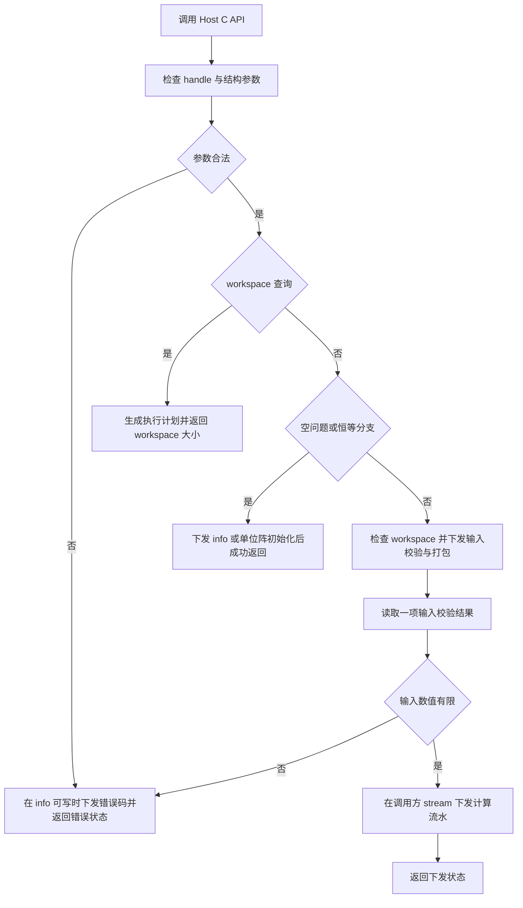
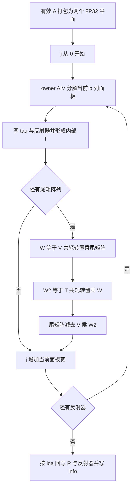
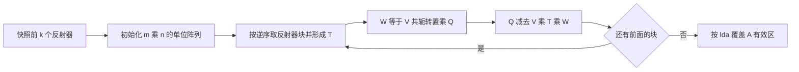
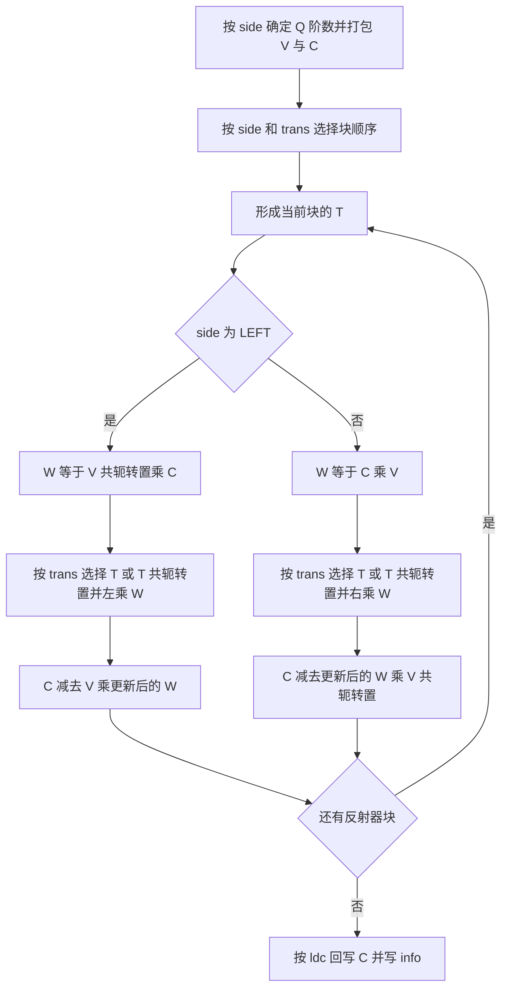
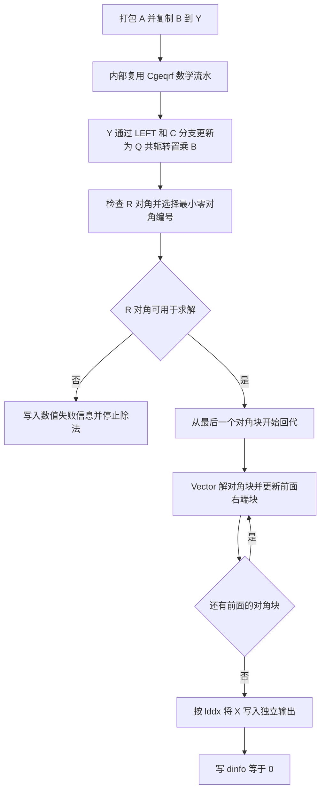

# Atlas 950 单精度复数 QR 分解与最小二乘算子设计

# 需求背景

## 需求来源

本设计对应《10月社区任务-单精度复数QR分解与最小二乘(950)》，面向 Ascend 950PR，统一设计 `aclsolverCgeqrf`、`aclsolverCungqr`、`aclsolverCunmqr`、`aclsolverCCgels` 及其 workspace 查询接口。四个接口组成同一任务，采用 ops-solver Host C API 与 Ascend C/CATLASS Kernel 直调模式。设计文档按社区[设计模板](https://gitcode.com/cann/cann-competitions/blob/master/04_tasks/01_community-task-2026/resources/design_template.md)组织。

本文交付设计方案及后续验证方法，不包含算子实现、实验记录或实测结论。本任务不交付公开 `aclsolverXlarft` 接口；形成块反射器所需的三角因子 T 作为内部组件实现。

## 背景介绍

复数 QR 分解是酉变换、稠密线性求解和最小二乘的基础。将 A 分解为 QR 后，可保存紧凑的 Householder 表示，按需生成显式 Q，或直接把 Q、Qᴴ 作用到目标矩阵。超定最小二乘复用同一分解，通过 QᴴB 和上三角求解得到 X，避免构造正规方程所带来的条件数平方。

目标 ops-solver 仓已有 handle、stream 与状态码管理，但尚无这组复数 QR/gels 接口。已有复数 LU 接口采用 `std::complex<float>`、部分返回 `aclError`，不能直接作为新接口 ABI。新接口按任务书定义 `aclFloatComplex` 和 `aclsolverStatus_t`，复用已有 handle，不把旧算子的 Host 指针处理方式带入本设计。

# 需求分析

## 需求描述

| 能力 | 输入 | 输出及行为 |
| --- | --- | --- |
| Cgeqrf | m×n 复矩阵 A | A 原地保存 R 与反射器尾部，TAU 保存 min(m,n) 个系数 |
| Cungqr | QR 输出中前 k 个反射器及 tau | A 原地输出 m×n 的 Q；使用 k 个反射器生成 n 列，而非只生成 k 列 |
| Cunmqr | QR 反射器、tau、m×n 矩阵 C | 原地更新 QC、QᴴC、CQ 或 CQᴴ |
| CCgels | m×n 的 A、m×nrhs 的 B，m≥n | 独立输出 n×nrhs 的 X；B 保持输入语义，A 可被破坏 |

所有矩阵使用列主序、COMPLEX64 和 Device 存储，支持合法 leading dimension padding。计算遵循调用方 stream，核心分解、变换和求解均在 NPU AI Core 上完成。

## 需求拆解

1. 提供任务书指定的八个 C API，保持参数名称、类型、顺序和 Host/Device 归属。
2. 保证三组 QR 接口的 workspace 查询以复数元素数返回，CCgels 查询以字节返回。
3. 建立统一的复数 Householder 约定，正确处理共轭、左右乘和反射器顺序。
4. 为小矩阵、分块矩阵、非对齐尾块、空问题及非默认 stream 定义执行分支。
5. 提供可复现的精度、性能和确定性验证计划，性能目标为每个有效金标 case 达到 0.35 倍 GPU 性能。

# 详细设计

## 算子分析

### 数学公式

令 r=min(m,n)，第 j 个反射器为 Hⱼ=I−τⱼvⱼvⱼᴴ，vⱼ 在第 j 行以前为零、第 j 行为 1，其后元素存于 A 的严格下三角。定义：

```text
Q = H₁ H₂ … Hᵣ
Qᴴ A原始 = R完整       A原始 = Q R完整
Q输出 = (H₁ … Hₖ) E   E = Iₘ[:, 1:n]

LEFT : C输出 = op(Q) C输入
RIGHT: C输出 = C输入 op(Q)
op(Q) ∈ {Q, Qᴴ}

CCgels: Y = Qᴴ B，R₁₁ X = Y[1:n, :]
```

R完整为 m×n 的上梯形矩阵，未占据的下部补零。CCgels 正常求解路径以满列秩 A 为前提；对严格零对角提供数值失败诊断，不用除零产生的非有限值充当成功输出。

### 支持数据类型与数据布局

`aclFloatComplex` 的大小为 8 字节，real/imag 偏移分别为 0/4 字节，公开布局遵循任务书的两个连续 FLOAT32。维数为 32 位 `int`，info 为 Device INT32，CCgels 的 niter 为 Host INT32。主精度、矩阵乘输入及累加、中间复数运算均保持 FLOAT32，不使用半精度或 HF32 截断。

采用从零开始的内部索引时，公开矩阵元素地址为：

```text
A(i,j) = A_base + 8 × (i + j×lda)
C(i,j) = C_base + 8 × (i + j×ldc)
X(i,j) = X_base + 8 × (i + j×lddx)
```

Host 地址跨度和 workspace 计算使用经过溢出检查的 `size_t`/64 位整数。Kernel 仅搬运有效行列，既不把 lda 当作有效行数，也不读取或回写公开矩阵的 padding。内部按需将交错复数拆为两个 FP32 平面，并转换为 CATLASS 可消费的 RowMajor 工作布局；输出时恢复公开列主序。

### 支持形状与硬件

| 接口 | 支持的验收范围 | 特殊约束 |
| --- | --- | --- |
| Cgeqrf | 0≤m,n≤4096 | 方阵、长矩阵、宽矩阵；lda≥max(1,m) |
| Cungqr | 0≤k≤n≤m≤4096 | lda≥max(1,m)；包括 k<n |
| Cunmqr | 0≤m,n≤4096，0≤k≤nq | nq=LEFT 时的 m 或 RIGHT 时的 n；lda≥max(1,nq)，ldc≥max(1,m) |
| CCgels | 0≤n≤m≤4096，0≤nrhs≤128 | ldda/lddb≥max(1,m)，lddx≥max(1,n) |

支持硬件为 Ascend 950PR（Atlas 950）。不支持 broadcast，不要求图融合；每次调用根据实际维数生成 tiling。leading dimension 可大于有效行数，不限定为紧凑存储，也不将 lda 等限制为 4096。

## 算子原型

公共类型放入 `include/cann_ops_solver_common.h`，函数声明放入 `include/cann_ops_solver.h`。类型及声明如下：

```c
typedef struct {
    float real;
    float imag;
} aclFloatComplex;

typedef enum {
    ACLSOLVER_OP_N = 0,
    ACLSOLVER_OP_T = 1,
    ACLSOLVER_OP_C = 2
} aclsolverOperation_t;

typedef enum {
    ACLSOLVER_SIDE_LEFT = 0,
    ACLSOLVER_SIDE_RIGHT = 1
} aclsolverSideMode_t;

aclsolverStatus_t aclsolverCgeqrf_bufferSize(
    aclsolverHandle_t handle, int m, int n, aclFloatComplex *A, int lda, int *Lwork);

aclsolverStatus_t aclsolverCgeqrf(
    aclsolverHandle_t handle, int m, int n, aclFloatComplex *A, int lda,
    aclFloatComplex *TAU, aclFloatComplex *Workspace, int Lwork, int *devInfo);

aclsolverStatus_t aclsolverCungqr_bufferSize(
    aclsolverHandle_t handle, int m, int n, int k,
    const aclFloatComplex *A, int lda, const aclFloatComplex *tau, int *lwork);

aclsolverStatus_t aclsolverCungqr(
    aclsolverHandle_t handle, int m, int n, int k,
    aclFloatComplex *A, int lda, const aclFloatComplex *tau,
    aclFloatComplex *work, int lwork, int *devInfo);

aclsolverStatus_t aclsolverCunmqr_bufferSize(
    aclsolverHandle_t handle, aclsolverSideMode_t side, aclsolverOperation_t trans,
    int m, int n, int k, const aclFloatComplex *A, int lda, const aclFloatComplex *tau,
    const aclFloatComplex *C, int ldc, int *lwork);

aclsolverStatus_t aclsolverCunmqr(
    aclsolverHandle_t handle, aclsolverSideMode_t side, aclsolverOperation_t trans,
    int m, int n, int k, const aclFloatComplex *A, int lda, const aclFloatComplex *tau,
    aclFloatComplex *C, int ldc, aclFloatComplex *work, int lwork, int *devInfo);

aclsolverStatus_t aclsolverCCgels_bufferSize(
    aclsolverHandle_t handle, int m, int n, int nrhs,
    aclFloatComplex *dA, int ldda, aclFloatComplex *dB, int lddb,
    aclFloatComplex *dX, int lddx, void *dwork, size_t *lwork_bytes);

aclsolverStatus_t aclsolverCCgels(
    aclsolverHandle_t handle, int m, int n, int nrhs,
    aclFloatComplex *dA, int ldda, aclFloatComplex *dB, int lddb,
    aclFloatComplex *dX, int lddx, void *dWorkspace, size_t lwork_bytes,
    int *niter, int *dinfo);
```

`handle` 复用仓内 `aclsolverHandle_t`，通过 `aclsolverGetStream` 获取 stream，不新增调用方上下文。公开头使用 `<stddef.h>`、`<stdint.h>` 等 C 兼容头；历史依赖 `std::complex` 的声明置于 `__cplusplus` 条件段，保持其 C++ 签名。新增 C API 使用已有的 `extern "C"` 条件保护。后续须分别检查 C 与 C++ translation unit 的可包含性，以及 sizeof/offsetof。

### 参数归属与读写约定

| 参数 | 归属 | 约定 |
| --- | --- | --- |
| handle、维数、leading dimension、side/trans、lwork 值 | Host | 按值传入 |
| `_bufferSize` 的 `Lwork`、`lwork`、`lwork_bytes` | Host | 输出标量，不得为空 |
| A、TAU/tau、C、dA、dB、dX | Device | 有效范围按接口形状；输入输出属性见需求表 |
| Workspace/work/dWorkspace | Device | 调用方分配，保持到 stream 上计算结束 |
| devInfo/dinfo | Device | 长度 1，计算接口必须可写；Host 不直接解引用 |
| CCgels 的 niter | Host | 正常直接求解设为 0，表示没有迭代修正 |
| CCgels 查询参数 dwork | Device 占位指针 | 查询不读取或写入，可以为空；不得因此分配隐藏 workspace |

矩阵和 workspace、tau/info 之间不允许有写入相关的重叠；CCgels 的 dX 与 dA/dB/workspace 必须独立。按已知地址跨度检查可识别的重叠，调用方负责提供足够长度的合法分配。原始 C 指针没有 shape/dtype 元数据，Host 可检查维数、布局约定、空指针和地址属性，但不能宣称能从裸指针识别任意错误 dtype 或完整分配长度。

## 算子实现

### Host 侧设计

#### 调用流程与异常处理



校验分为两层：结构错误在 Host 返回；有效输入中的 NaN/Inf 由 NPU 校验。后者要求返回 `INVALID_VALUE`，因此需要在输入校验后读取一个小标量并等待该 stream 的校验阶段完成，这是数据值校验所必需的同步点。打包阶段仅写 workspace，数值非法时不修改 A/C/X。计算流水不做额外的结束同步，调用方在使用 Device 输出前负责等待 stream。查询不读取矩阵内容、不下发计算，也不做数值扫描。

只扫描实际参与运算的值：geqrf 扫描 A；ungqr 扫描反射器尾部及 tau；unmqr 再扫描 C；gels 扫描 A 和 B。padding、反射器表示中未使用的 R、未初始化的输出 X 不参与有限性校验。数值错误归属到对应输入参数，核间按参数序号取最小值，保证错误报告确定。

`devInfo/dinfo` 可写时，成功和空问题都通过 stream 内的 Device 写入置为 0，不能只在 Host 变量中设置。结构参数非法返回 `ACLSOLVER_STATUS_INVALID_VALUE`；Cunmqr 的 T 和非法 side/trans 也使用此状态。空 handle 返回 `ACLSOLVER_STATUS_NOT_INITIALIZED`，不能为其虚构一个参数序号。运行时下发/资源失败按已有状态枚举映射为 `EXECUTION_FAILED`、`ALLOC_FAILED`、`MAPPING_ERROR` 或 `INTERNAL_ERROR`，不把 `aclError` 原样当成 `aclsolverStatus_t`。

以下编号均不计 handle；同时出现多项非法时报告最小编号。在 info 自身为空或不可写时，仅返回错误状态，不尝试写入该地址。

| 计算接口 | 参数序号 |
| --- | --- |
| Cgeqrf | m=1，n=2，A=3，lda=4，TAU=5，Workspace=6，Lwork=7，devInfo=8 |
| Cungqr | m=1，n=2，k=3，A=4，lda=5，tau=6，work=7，lwork=8，devInfo=9 |
| Cunmqr | side=1，trans=2，m=3，n=4，k=5，A=6，lda=7，tau=8，C=9，ldc=10，work=11，lwork=12，devInfo=13 |
| CCgels | m=1，n=2，nrhs=3，dA=4，ldda=5，dB=6，lddb=7，dX=8，lddx=9，dWorkspace=10，lwork_bytes=11，niter=12，dinfo=13 |

合法非空问题的 workspace 空指针按其指针编号报错；容量不足按 Lwork/lwork/lwork_bytes 编号报错。负容量先作为非法标量处理，不参与指针范围计算。非法形状、leading dimension 或枚举不因出现零维而被忽略。

#### 空问题和恒等分支

| 情况 | 行为 | 查询大小 |
| --- | --- | --- |
| geqrf 的 m=0 或 n=0 | 不访问 A/TAU，写 info=0 | 0 |
| ungqr 的 m=0 或 n=0（其余维数须合法） | 不访问 A/tau，写 info=0 | 0 |
| ungqr 的 k=0、m,n>0 | 将 A 有效区写成 Iₘ 的前 n 列，tau 可空，写 info=0 | 0；初始化 kernel 直接写 A |
| unmqr 的 m=0 或 n=0 或 k=0 | C 不变，不访问反射器，写 info=0 | 0 |
| gels 的 m=0、n=0 或 nrhs=0（须 m≥n） | X 有效输出为空或没有右端项；niter=0、dinfo=0 | 0 |

零 workspace 分支允许 work 指针为空，但容量不能为负。未被分支使用的数据指针可以为空；ungqr 的 k=0 且输出非空时仍要求 A 可写。计算接口 info 和 gels 的 niter 始终必需。

#### Tiling 和分核策略

Host 生成统一执行计划，包含 m/n/k/nq/nrhs、公开 stride、面板宽 b、有效尾块、内部平面 stride、workspace 区域偏移、核数及反射器遍历方向。`side/trans` 决定操作而不改变公开布局，计划中的字节偏移与元素数分别命名，避免混用。

初始面板宽 b=32。小矩阵在相关常驻缓冲均满足 UB 预算且最长维度不超过 64 时使用单 AIV 分支；否则使用分块流水。大矩阵的面板由一个 owner AIV 处理，尾矩阵按二维输出 tile 分配给多个 AIC/AIV 组合。对输出形状 Mₒ×Nₒ，tile 数为 ceil(Mₒ/128)×ceil(Nₒ/128)，使用核数 c=min(平台可用核数，tile 数)。每核按固定次序遍历所属 tile，K 轴在核内顺序累加，不用浮点 atomic 或动态 SplitK。

面板、块应用和下一面板之间使用同一 stream 的 kernel 顺序表达依赖，不在不同 block 间放置需要全部核同时驻留的自旋屏障。非默认 stream 与默认 stream 共用同一执行逻辑；不同调用的 workspace 及同步标志相互独立。

#### Workspace 规划

查询接口与计算接口共用同一计划生成器和布局函数，查询结果必须覆盖计算实际使用的全部临时区域，不依赖输入数值。所有工作内存在调用方 workspace 内，计算不额外申请隐藏 Device 大缓冲。

为给出可实现的上界，定义 P(x)=128×ceil(x/128)，P(0)=0；A₂₅₆(x) 为字节数向上对齐到 256。内部复数工作矩阵大小 L(u,v)=A₂₅₆(8P(u)P(v))，含两个 FP32 平面。面板中的逻辑 b=32；零填充后的物理 tile 保持 128×128×32，不能用一个不合法的小尾块替换硬件基本块。

```text
R(c) = A₂₅₆(4 × 4 × 128 × 128 × 2 × c)
F(c) = A₂₅₆(16 × 3 × c + 1024)
S(q,w,c) = L(q,b) + 2L(b,w) + A₂₅₆(8b²) + R(c) + F(c)

W_geqrf = 255 + L(m,n) + S(m,n,c)
W_ungqr = 255 + L(m,k) + L(m,n) + S(m,n,c)
W_unmqr = 255 + L(nq,k) + L(m,n) + S(nq,nw,c)
             nw = LEFT 时的 n，RIGHT 时的 m
W_gels  = 255 + L(m,n) + L(m,nrhs) + A₂₅₆(8n)
                 + S(m,max(n,nrhs),c)
```

上述 W 均为字节上界。255 字节用于对 workspace 起始地址进行内部对齐，不额外要求调用方指针已满足 256 字节对齐。`F` 容纳输入校验结果、每核/槽控制记录及计划元数据，计划结构不得超过保留的 1024 字节。`R` 是每核两个槽、每槽四个 FP32 实数积的环形工作区。查询中的 c 取本调用全部阶段使用核数的最大值，不使用矩阵数据决定核数。

| 临时区域 | 用途与生命周期 |
| --- | --- |
| geqrf/gels 的 A 平面 | 全程保存分解；最后 geqrf 回写公开 Householder 表示，gels 可回写同一表示 |
| ungqr/unmqr 的 V 快照 | 从输入反射器复制并补隐式 1/0，保持至全部块应用结束；保护 ungqr 原地覆盖 |
| ungqr 的 Q 或 unmqr 的 C 平面 | 有效输出工作区，结束后恢复交错列主序 |
| 面板 V、三角 T | 当前块的反射器与三角因子；下一块可复用 |
| 两份 W | VᴴC/CV 与乘 T 后的结果；全部读完后才复用 |
| gels 的 Y 与内部 tau | Y 为 B 的独立副本，复用前 n 行保存 X；tau 长度 n |
| R 与 F | 每调用初始化；环形槽消费确认后释放；不沿用上次调用的标志 |

gels 的三角求解复用块应用的 W/T 临时区，其形状上界已由 max(n,nrhs) 覆盖。三组 QR 查询返回 ceil(W/8) 个 `aclFloatComplex` 元素，并检查不超过 INT_MAX；gels 返回 W 字节。小矩阵可使用紧凑的 UB 计算，查询仍允许采用上述上界，以保证足量。空问题及恒等分支按表返回 0。

### Kernel 侧设计

#### 复数基础运算和 Householder 生成

固定实虚部计算顺序：复乘实部为 aᵣbᵣ−aᵢbᵢ，虚部为 aᵣbᵢ+aᵢbᵣ；共轭操作只改变虚部符号。除法采用按分量缩放的复数除法，避免直接计算分母实虚部平方和溢出。

采用 [LAPACK CLARFG](https://www.netlib.org/lapack/complex/clarfg.f) 的实 beta 约定。对当前列的 α=A(j,j) 和尾向量 x，稳定计算其范数，再生成：

```text
当 x 全零且 Im(α)=0：tau=0，H=I，保留 α。
否则：
  sgn(Re(α)) = Re(α)<0 时为 -1，其余为 +1（包括 ±0）
  beta = -sgn(Re(α)) × sqrt(Re(α)² + Im(α)² + ||x||₂²)
  tau = (beta-α) / beta
  v_tail = x / (α-beta)，v_head = 1
  H = I-tau vvᴴ，Hᴴ [α;x] = [beta;0]
```

范数通过缩放平方和计算：先取实虚分量绝对值最大值 s，再累加 (分量/s)²，最后乘回 s；s=0 单独处理。低于安全阈值时按确定次数的二进制缩放重算，beta 写回前恢复尺度。归约采用固定段长与固定合并树；不因数据内容动态选择不同加法树。上述约定还覆盖仅剩一个复数标量但虚部非零的情况。

复数 H 通常不满足 H=Hᴴ，QR 消元必须用共轭 tau：A_tail←A_tail−v·conj(tau)·(vᴴA_tail)。把实数 QR 的 tau 更新式直接搬来会破坏复数分解。

#### Cgeqrf：分块 QR



面板核内部按列顺序生成 H，并用 Hᴴ 更新面板尚未处理的列。一个 owner AIV 保留当前 v、逐列加载目标列，避免在每个反射器后启动全局同步。m<n 时仍仅生成 r 个反射器，最后一个面板也必须更新右侧全部剩余列。

对一组顺序反射器形成 compact WY 表示 Qₚ=I−VTVᴴ，T 为上三角。令当前块的列序号为 i：

```text
T(i,i) = tau(i)
T(0:i-1,i) = -tau(i) T(0:i-1,0:i-1) (V_prevᴴ v_i)
tau(i)=0 时，该列 T 置零。
```

该递推依据 [LAPACK CLARFT](https://www.netlib.org/lapack/complex/clarft.f)，只作为内部运算。尾矩阵消元使用 Qₚᴴ，因此顺序执行 W=VᴴA_tail、W2=TᴴW、A_tail←A_tail−VW2。T 小矩阵由 Vector 完成，两个大乘积复用 CATLASS。

#### Cungqr：生成显式 Q

首先复制前 k 个反射器到独立 V 工作区，再初始化 Q=Iₘ[:,1:n]。按块起点从大到小执行 Q←QₚQ，对每块用 T 而不是 Tᴴ。输出写回 A 时，全部输入反射器已经在快照中，因此不会覆盖尚未使用的 v。



初始化覆盖完整有效输出，包括原输入的上三角和第 k 列之后的区域。k<n 时仍得到 n 列正交向量；k=0 按 Host 恒等分支直接初始化。

#### Cunmqr：左右酉变换

反射器使用顺序按下表固定，依据 [LAPACK CUNMQR](https://www.netlib.org/lapack/complex/cunmqr.f)。编号从 1 开始；分块实现按相同方向遍历块，块内部的 V/T 始终表示正序乘积。

| side | trans | 单反射器执行顺序 | 当前块公式 |
| --- | --- | --- | --- |
| LEFT | N | k→1，使用 tau | W=VᴴC；C←C−V(TW) |
| LEFT | C | 1→k，使用 conj(tau) | W=VᴴC；C←C−V(TᴴW) |
| RIGHT | N | 1→k，使用 tau | W=CV；C←C−(WT)Vᴴ |
| RIGHT | C | k→1，使用 conj(tau) | W=CV；C←C−(WTᴴ)Vᴴ |

LEFT 的 V 有 nq=m 行，RIGHT 的 V 有 nq=n 行。块作用范围从反射器起点到 nq，RIGHT 不能沿用 LEFT 的维数或工作矩阵转置逻辑。输入 A/tau 保持只读，隐式对角的 1 在打包时构造，不临时覆盖输入 A。`trans=T` 在 Host 阻止进入 Kernel。



#### CCgels：最小二乘求解



对角块宽与面板宽一致，块内按行倒序进行复数回代；不同 RHS 列可以并行，行间依赖不能并行打乱。已求解的 X 块通过 R 的非对角块更新前方 Y，nrhs 较小时走 Vector GEMV，较大时复用 FP32 矩阵乘。Y 的前 n 行最终保存 X，后 m−n 行保留变换后残差部分但不写入 dX。B 全程不写，gels 不生成完整 Q，也不计算 R 的显式逆矩阵。

正常路径固定 Host niter=0，主精度直接分解求解，不将 CUDA 金标中的迭代次数当作必须匹配的输出。无主元 QR 不提供秩亏最小范数解或条件数估计。作为附加数值诊断，严格零的 R(i,i) 令 dinfo=i>0（从 1 开始），抑制 X 写出；该正值诊断不属于非法参数 -i，也不宣称 cuSolver 文档规定了相同的正值编码。Host 成功下发状态与 Device 数值诊断分别读取。

### CATLASS 组件选择与资源预算

已依据 CATLASS [950 FP32 样例](https://gitcode.com/cann/catlass/blob/master/examples/43_ascend950_basic_matmul/basic_matmul_tla.cpp)、[对应说明](https://gitcode.com/cann/catlass/blob/master/examples/43_ascend950_basic_matmul/README.md)及组件源码确定设计起点。采用 950 的 TLA 路径；不照搬 Atlas A2 专属策略，也不使用 MatmulApiTiling 作为 950 设计依据。

| 层次 | 选择 | 理由 |
| --- | --- | --- |
| ArchTag | `Catlass::Arch::Ascend950` | 与目标硬件及 FP32 样例一致 |
| DispatchPolicy | `MmadPreloadAsyncWithCallback` 的 Ascend950 实例 | 支持预取与复数结果消费回调；preload=1，L1A/L1B/L0A/L0B stages=2，L0C stages=1 |
| 数值/调度选项 | useHF32=false、enableShuffleK=false、enableL1Resident=false | 保持 FP32 精度及固定 K 次序；unit flag 按样例约束与 callback 适配 |
| L1/L0 TileShape | 初始均为 128×128×32 | b=32 的更新有小 K，容量充足；真实尾块由逻辑范围与零填充表达 |
| Block | `BlockMmadTla` 与 `PackedTileCopyTla` | 实数输入及输出均为 float，输出工作区采用 RowMajor |
| Scheduler | `GemmIdentityBlockSwizzle<3,0/1>` | 按输出 M/N 比例固定方向；不动态拆分 K |
| Kernel | 自定义复数块应用 wrapper | 顺序发起四个实数积，配对消费后做复数合并和更新 |
| BlockEpilogue | `void`，外部定制 AIV 消费逻辑 | 不假设已有单路 epilogue 能同时取得四个实数积 |

组件源码参考：[dispatch_policy.hpp](https://gitcode.com/cann/catlass/blob/master/include/catlass/gemm/dispatch_policy.hpp)、[callback BlockMmadTla](https://gitcode.com/cann/catlass/blob/master/include/catlass/gemm/block/block_mmad_preload_async_with_callback_tla.hpp)、[arch.hpp](https://gitcode.com/cann/catlass/blob/master/include/catlass/arch/arch.hpp)。以上是未经实测的初始组装方案，后续应验证具体 TileCopy 对布局和尾块的合同，不能据样例的普通 Matmul 吞吐推断 QR 已达标。

采用四个实数积实现一个复数积，实部 Cᵣ=AᵣBᵣ−AᵢBᵢ，虚部 Cᵢ=AᵣBᵢ+AᵢBᵣ。共轭转置通过交换逻辑 stride 并对虚部取负表达；不把转置与共轭混为同一操作。四个积顺序复用 L1/L0 资源，完成后一起标记对应 tile 就绪。AIV 按固定顺序合并，将结果写入 W 或执行目标矩阵减法，再归还槽。两个槽用于相邻 tile 生产与消费重叠，禁止跨 tile 配错实虚结果。

| 消费槽位 | 来源 | 处理 |
| --- | --- | --- |
| Prr、Pii、Pri、Pir | 同一 tile 的四个 FP32 积 | 需自定义配对消费；完整 K 累加结束后才能合并 |
| 目标 C/Q/A tile | 独立目标工作区 | 更新阶段读取；生成 W 阶段不读取 |
| 输出及槽标记 | W/目标工作区、每核控制记录 | 输出写完再释放环形槽 |

该消费逻辑不是 stock BlockEpilogue 的现成模板槽位。AIC→AIV 通知和 AIV→AIC 槽释放分别管理；事件编号按所用事件类型计数不超过 8，控制记录随调用初始化，释放前保证写回可见。

初始实数 tile 的片上容量预算如下，四个实数积不同时占据四份 L0C：

```text
L1  = 2×(128×32 + 32×128)×4 = 64 KiB
L0A = 2×128×32×4 = 32 KiB
L0B = 2×32×128×4 = 32 KiB
L0C = 128×128×4 = 64 KiB
```

上述容量低于 Ascend950 ArchTag 的 L1=512 KiB、L0A/L0B=64 KiB、L0C=256 KiB。实际平台信息与组件静态断言共同约束 tile。调整 tile 或 stages 时同步更新 workspace 查询和控制记录，不把这些初始值当成已经调优的参数。

面板 AIV 最长向量为 4096 个复数；v、双缓冲目标列、复数运算临时区、范数临时区及 T 的预算为 36q+8b²+8192 字节，q=4096、b=32 时约 160 KiB。双缓冲目标列与不重叠的运算临时区复用；不将整个 4096×32 面板常驻 UB。

AIV 复数 tile 消费分成 E 个元素一段，不把 128×128 的四个积整体装入 UB。预算为 64E+8192 字节，包含双缓冲四积/目标数据、输出与合并临时区；E 取不超过 tile 元素数及 UB 容量上限的最大 8 元素对齐值。按 248 KiB UB 估算可取 E=3840，占用 248 KiB；实现时必须把 API 额外临时量纳入预算后重新计算，不越过平台实际 UB 上限。

### 性能优化设计

面板串行依赖是 QR 的关键瓶颈，因此在单面板核内完成逐列消元，减少每个反射器的 launch；大矩阵尾更新使用块反射器，把逐列矩阵向量更新聚合为矩阵乘。小矩阵分支在 UB 内复用完整数据，避免通用分块路径的打包和多阶段 launch 成本。

输入仅做一次交错复数到平面布局转换，全部中间阶段复用平面数据；收尾仅写公开有效区域。面板 T 小、W 宽度有限，优先复用已有缓冲。四个实数积只保留每核环形 tile，不申请四份全尺寸乘积，也不生成 gels 用不到的显式 Q。

nrhs=1 等窄 RHS 采用 Vector 点积和回代路径，避免 padding 到宽矩阵后浪费 Cube 运算。宽尾矩阵采用预取及 AIC/AIV 回调重叠。面板宽、tile 形状及小矩阵阈值的调整必须在精度、确定性和完整流水耗时通过之后保留，不能只依据单个 GEMM 的耗时选型。

## 算子约束限制

输入须为合法 Device 分配和有限 COMPLEX64。Cungqr/Cunmqr 的反射器必须来自约定的 Householder 表示，不能把未分解的原始 A 直接作为输入。Cunmqr 只支持 N/C；CCgels 只支持 m≥n，并要求 X 独立输出。公开接口不携带 batch 参数，不扩展为 batched 或 broadcast 算子。

确定性覆盖同一设备环境、相同维数/输入和相同 stream 的串行重复调用。面板相位、归约树、四实数积的组合次序及三角回代次序固定；输出区域全部确定写入，padding 保持原内容。bit-wise 比较关注有效输出、tau 和 info，不比较 workspace 中未定义的余量。更换设备配套或 tiling 参数不承诺与原配置逐位相同。

# 可维可测分析

## 精度标准与验证设计

测试工程后续复用 ops-solver 的 test 框架。以下是验证计划，尚未运行测试。正确性验收使用任务书的矩阵 1-范数及 ε=2⁻²⁴，不用逐元素比较 Q/R 代替残差判定，因为合法分解存在相位差异。

| 接口 | 残差定义 | 任务书通过条件 |
| --- | --- | --- |
| Cgeqrf | ‖R完整−QᴴA原始‖₁/(m‖A原始‖₁ε) | ≤max(5ratio_cpu,0.1) |
| Cungqr | ‖Iₙ−QᴴQ‖₁/(mε) | ≤max(5ratio_cpu,1.5) |
| Cunmqr | ‖C显式参考−C输出‖₁/(nq‖C原始‖₁ε) | ≤max(5ratio_cpu,0.1) |
| CCgels，m=n | 对每列 j 计算 ‖Bⱼ−AXⱼ‖₁/(m‖A‖₁‖Xⱼ‖₁ε)，取最大 | ≤max(5ratio_cpu,0.015) |
| CCgels，m>n | R_res=B−AX，‖R_resᴴA‖₁/(‖A‖₁‖B‖₁max(m,n,nrhs)ε) | ≤10ratio_opt_cpu |

geqrf 参考 Q 使用 NPU 输出的 v/tau 升为 complex128，再由 CPU 等价 ungqr 构造 m×m 完整 Q；宽矩阵 R完整维度仍为 m×n。CPU 同精度分解另行生成 ratio_cpu。ungqr 除正交性外，加测其输出与同一反射器乘积的关系，避免错误生成单位阵也通过单独正交性判据。

unmqr 须在 ungqr 先通过后验收，使用同一 NPU v/tau 调 NPU ungqr 生成 nq×nq 的 Q，按被测 side/trans 做显式乘法。RIGHT 的分母用 nq=n，不能把矩阵 C 的行数误用为 Q 阶数。CPU 同精度链路对同一 case 另算阈值参考。

gels 的 A/B 残差使用调用前副本，参考同精度 CPU QR 求解。残差计算升到 complex128，以免测量自身舍入掩盖输出误差。超定问题允许 B−AX 非零，采用最优性残差终裁。测试特殊零矩阵时，分母为零且分子为零记 ratio=0；分子非零记为无穷，不用 NaN 通过判定。超定 CPU ratio 为零时仍遵循任务书零阈值，出现非零误差应记录并分析，不自行增加容差。

## 功能覆盖与可维护性

| 类别 | 计划覆盖 |
| --- | --- |
| 基础链路 | 四接口单测，geqrf→ungqr、geqrf→unmqr、gels→AX/最优性残差 |
| 维数 | 1、2 的幂、2 的幂−1、最大 4096；geqrf 的 m<n/m=n/m>n |
| 分块边界 | 31/32/33、63/64/65、127/128/129；多面板、多 tile、矩形尾块 |
| 反射器 | k=n、k<n、k=0、tau=0、纯虚对角、实部为 ±0 的相位边界 |
| 左右乘 | LEFT/RIGHT×N/C 四组合；特别覆盖非方 C，T 和非法枚举报错 |
| leading dimension | 最小合法值、+8、+32；padding 填哨兵并检查保持 |
| CCgels | m=n/m>n，nrhs=1/8/32/128/0；m<n 报错；dB 保持与独立 dX |
| workspace | 查询值足量；少一个元素/字节；负 lwork、非空问题空 work；查询与计算计划一致 |
| 信息 | 各参数逐项非法，核验 -i；info 为空；成功/空问题真实 Device 写 0 |
| 数据值与数值 | NaN/Inf 输入报错，忽略 padding 的非有限值；小/大尺度及严格秩亏诊断 |
| 流与确定性 | 非默认 stream，串行重复有效输出/tau/info bit-wise 一致；还原原地输入后再调用 |
| 公共 ABI | C/C++ 头文件包含、类型布局、八个原型与任务书一致 |

自构造输入采用任务书的实虚部混合分布：50% 均匀 [-5,5]，50% 正态，μ∈[-5,5]、σ∈[0.1,2]。测试构造保证所用输入分配在任务书的 4G 内存范围内。反射器输入通过 geqrf 生成；gels 正常精度 case 使用满列秩矩阵，数值失败 case 单独验证诊断。

内部模块按复数基础运算、Householder 面板、块应用、三角求解、workspace/参数校验划分。四个公开接口共享这些模块，不为每个接口复制同一数学实现。CPU NumPy/SciPy 只作为测试参考，不能成为算子执行 fallback。

## 性能标准与测量设计

给定四目录的 cases.json 分别包含 cgeqrf 174、cungqr 165、cunmqr 189、cgels 166 条。后续以完整参数元组关联 bench_result.json，关联前将 side/trans 的整数与字符串表示归一化；不能仅按 m/n 或 case 下标匹配。

对有效 GPU 金标记录，T_GPU_us=1000×perf.avg_ms，目标 T_NPU_us≤T_GPU_us/0.35。一次 API 调用可能下发面板、打包、矩阵乘、回代、输出等多个 kernel：应统计同次调用全部必要 kernel 的耗时之和，再对重复调用求平均，不以某个最快 kernel 或不同 kernel 名的平均值替代完整计算流水。异步 AIC/AIV 融合核以 profiling 任务边界计一次；另报 stream event 的 API 总时长，说明输入校验同步的额外成本。

计时区间包含本接口需要的打包、info、数值校验及计算 kernel；不包含 workspace 查询、测试数据生成或验证 D2H。ungqr/unmqr 的输入准备 geqrf 在计时区间之外；gels 内部 QR 计入本接口。原地接口每轮恢复同一输入，预热、重复次数和 CUDA 金标口径一致。使用 msprof 按单 case 收集 kernel 明细，记录接口参数、调用次数、NPU 型号及完整环境信息。

提供的 cgels 金标中 108 条为 `perf=null`、`error=2`，只有 58 条具有性能数据。缺失条目不能构造时间、不能按零耗时或跳过后宣称全量达标；后续须补采有效 CUDA 金标或取得社区确认的基线。其余三个接口金标记录均提供 perf。本文不填 NPU 耗时，也不声称任何 case 已通过性能门禁。

## 兼容性分析

新增八个接口按任务书的 cuSolver legacy 参数序列设计。已有 handle 管理实现及状态枚举作为统一入口；旧复数 LU 的 C++ 类型和返回值不作为新接口的模板。接口语义核验参考 [NVIDIA cuSolver](https://docs.nvidia.com/cuda/cusolver/index.html#cuSolverDN-legacy-api)；任务书明确允许 CCgels 主精度直接求解时 niter=0，并要求空问题成功和真实 Device info，以本任务合同为实现依据。

设计源自任务书、公开 API、LAPACK 算法定义及 CATLASS 组件源码。cannbot 的 [Tiling 指南](https://gitcode.com/cann/cannbot-skills/blob/master/ops/ascendc-tiling-design/SKILL.md)和 [CATLASS 设计指南](https://gitcode.com/cann/cannbot-skills/blob/master/ops/catlass-op-design/SKILL.md)用于核验分核、缓冲生命周期、资源预算和平台选型；本文未复用其他贡献者的设计文档，也未把静态核验写成运行验证。
