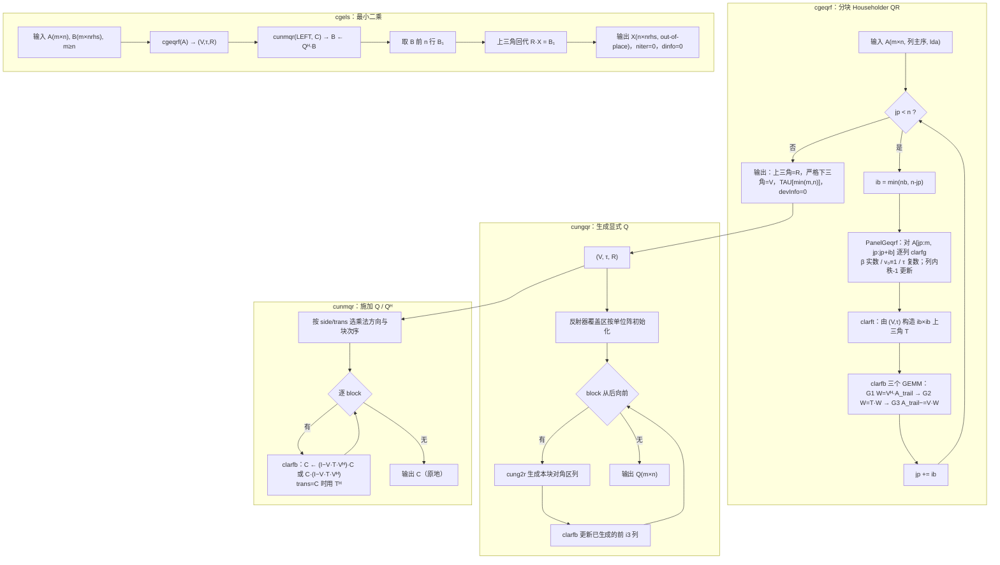
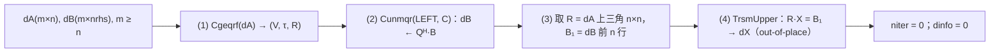
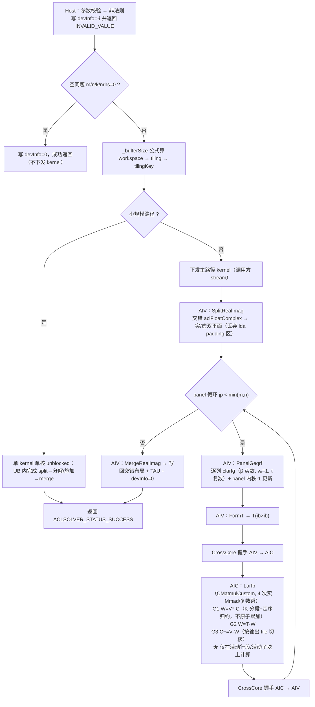

# Atlas 950 单精度复数 QR 分解与最小二乘算子设计文档

> 交付接口：`aclsolverCgeqrf` / `aclsolverCungqr` / `aclsolverCunmqr` / `aclsolverCCgels`（含各自 `_bufferSize`）
> 目标仓：https://gitcode.com/cann/ops-solver
> 适配硬件：Ascend 950PR（Atlas 950）
> 任务书：`Atlas950_Cgeqrf_Cungqr_Cunmqr_CCgels_task_doc.md`
> 本文中标注「实测」的数据均来自对任务包 `cases.json` / `bench_result.json`（694 条）与
> ops-solver 主线（HEAD `0bf7eeb`）源码的逐条核对；标注「待实测」的为上机后补齐项。

---

# 一、需求背景

## 1.1 需求来源

通过 CANN 社区任务完成开源仓算子贡献：在昇腾 NPU 上基于 AscendC/CATLASS 实现稠密复数 QR 分解、
酉变换与最小二乘求解，补齐 `ops-solver` 仓在复数 QR 方向的空白，验收通过后合入
https://gitcode.com/cann/ops-solver 。

## 1.2 背景介绍

### 1.2.1 算子实现优化：本任务无 TBE 前身，基线取 LAPACK / cuSolver

与常规「TBE 算子用 Ascend C 重写」类任务不同，本任务**在 CANN 侧没有可参考的 TBE 实现**：

- `ops-solver` 主线当前算子清单为 `cgetrf` / `cgetri` / `cgetri_batched` / `cmatinv_batched` /
  `sgetrf` / `sgetri` / `cheevj`（见仓内 `src/` 与 `docs/api_list.md`），**无任何 QR / 最小二乘原型**；
- 任务书 §2.1 明确「ops-solver 仓库当前无对应复数 QR / gels 原型，须全新实现」。

因此本文按设计文档 CheckList 的替代口径执行：**以任务书指定的对标实现（NVIDIA cuSolver
`cusolverDnCgeqrf` / `Cungqr` / `Cunmqr` / `CCgels`，其算法等价于 LAPACK `cgeqrf` / `cungqr` /
`cunmqr` / `cgels`）作为 baseline**，§1.2.2.3 给出 baseline 管线流程图，
§3.5.3 给出 AscendC 实现与 baseline 的差异点及原因。

参考实现路径（算法口径溯源，均为公开实现）：

| 用途 | 位置 |
|---|---|
| 接口与参数语义基线 | cuSolver DN legacy API：`cusolverDnCgeqrf` / `Cungqr` / `Cunmqr` / `CCgels` |
| 算法与数值约定基线 | LAPACK 3.7.0 `cgeqrf.f` / `clarfg.f` / `clarft.f` / `clarfb.f` / `cungqr.f` / `cunmqr.f` / `cgels.f` |
| 精度判据基线 | LAPACK TESTING/LIN：`cqrt01.f` / `cqrt02.f` / `cqrt03.f` / `cqrt16.f` / `cqrt17.f` |
| 性能基线数据 | 任务包各算子目录 `bench_result.json`（cuSolver 实测 `perf.avg_ms`） |

### 1.2.2 baseline 现状分析

#### 1.2.2.1 baseline 支持的数据类型和数据布局

| 项 | baseline（cuSolver / LAPACK） | 本任务 |
|---|---|---|
| 数据类型 | COMPLEX64（`cuComplex` = 两个连续 float：real、imag） | 同（`aclFloatComplex`，布局与 `cuComplex` 一致） |
| 数据排布 | 列主序（column-major），支持 `lda > max(1,m)` 的 padding | 同，且**禁止**要求 `lda == m` 或 `lda == n` |
| 指针归属 | Device 指针；`niter` 为 Host 标量，`devInfo`/`dinfo` 为 Device | 同 |
| 返回值 | `cusolverStatus_t` | `aclsolverStatus_t` |
| 维数类型 | `int`（32-bit） | 同 |

#### 1.2.2.2 baseline 实现描述

四个接口构成一条互相依赖的管线，核心是 **分块 Householder QR（WY 表示）**：

1. **`cgeqrf`（A = Q·R）**：按列块宽 `nb` 把 n 列切成若干 panel。每个 panel 内用 `clarfg`
   逐列生成 Householder 反射器 `H = I − τ·v·vᴴ`（`v₀` 隐式为 1，β 恒为实数），把 R 写进上三角、
   把 `v` 的非首元素写进严格下三角、`τ` 写进 `TAU[0:min(m,n)]`；panel 完成后用 `clarft` 构造
   `nb×nb` 上三角因子 `T`，再用 `clarfb` 对尾随列块做一次块更新
   `A_trail ← (I − V·T·Vᴴ)·A_trail`。**panel 内串行、尾随更新是三个 GEMM。**
2. **`cungqr`（由 (V,τ) 生成显式 Q）**：从最后一个 block 向前，先把反射器覆盖区按单位阵规则初始化，
   再对已生成的前若干列反向施加块反射器。
3. **`cunmqr`（用 Q 作用于 C）**：按 `side`/`trans` 决定乘法方向与**块施加次序**，
   每块仍是 `clarfb` 的三个 GEMM。
4. **`cgels`（最小二乘）**：`cgeqrf(A)` → `cunmqr(LEFT, C)` 得 `QᴴB` → 取前 n 行与 R 做上三角回代。

`clarfb` 的三个 GEMM（以 `side=LEFT` 为例）：

```
G1:  W = Vᴴ · C          (M=nb,  N=n_trail, K=nq)   —— 深 K、窄输出
G2:  W = T  · W          (M=nb,  N=n_trail, K=nb)   —— 量极小
G3:  C = C − V · W       (M=nq,  N=n_trail, K=nb)   —— rank-nb 更新，写回受限
```

**关键：baseline 利用了 `V` 的梯形结构与 `Q` 的增长结构**——block i 只触碰活动行段/活动子块。
LAPACK 的 flop 计数正是按此计的（§3.3.6 给出不利用结构的量化代价）。

#### 1.2.2.3 baseline 实现流程图（⭐ CheckList 重点关注项）



### 1.2.3 目标仓现状（ops-solver HEAD `0bf7eeb` 实测）

**可直接复用的既有资产**（这是本设计选择「复用仓内 c64 基建」而非「自研复数 Cube 层」的依据）：

| 仓内资产 | 位置 | 本任务用途 |
|---|---|---|
| 复数矩阵乘 `CMatmulCustom<T>` | `src/utils/kernel/c64/gemm.hpp` | G1/G2/G3 三个 GEMM 的 Cube 实现 |
| 共轭入口 `SetMatrixWithAImagNeg` | 同上 | `Vᴴ`、`−V·W` 的符号处理，无需额外搬运 |
| 上三角求解 `trsm_upper_custom.hpp` | `src/utils/kernel/c64/` | CCgels 的回代 `R·X = B₁` |
| 虚实分离/合并 `SplitRealImag` / `MergeRealImag` | `src/cgetrf/cgetrf_kernel.cpp` | 交错 `aclFloatComplex` ↔ 实虚双平面 |
| 列主序 padding `pad.hpp` | `src/utils/kernel/c64/` | `lda > m` 时的有效区域搬运 |
| 状态码 `aclsolverStatus_t` | `include/cann_ops_solver_common.h` | 已存在，直接使用 |

**需要新增/注意的既有约定差异**：

1. 公共头中**尚无 `aclFloatComplex`**，本任务按任务书 §2.1-7 / §2.3 新增（C 可调用，两个连续 FLOAT32）。
2. 仓内现有复数算子（`aclsolverCgetrf` 等）采用 `aclError` + `std::complex<float>` + **Host 指针**
   （函数体内自行 `aclrtMalloc` + H2D + `aclrtSynchronizeStream` + D2H）+ `int64_t` 维数；
   本任务按任务书 §2.2/§2.3/§7.3 采用 **`aclsolverStatus_t` + `aclFloatComplex` + Device 指针 +
   `int` 维数 + 不做无必要 Host 同步**。两套约定在同一仓内并存，本文 §3.8 给出说明。
3. **复数 Cube 层必须为 arch35 重写（已上机证实，非推测）**。
   `CMatmulCustom` 现用 **dav-2201 基础 API**（`FixpipeParamsV220` / `LoadData3DParamsV2Pro` /
   `Nd2NzParams` / `SetFmatrix`），而 `ascend950 → NPU_ARCH=dav-3510`（仓根 `CMakeLists.txt`
   第 23–35 行），构建脚本为 950 追加 `arch35` 源码目录（`get_soc_arch_dirs`），
   而**当前仓内没有任何算子提供 `arch35` 目录**。
   我方在 950PR（`Ascend950PR_9579`）上对同构的 c220 手写 cube matmul 做了隔离实测，结论是
   **该路径在 c310 上数值错误，而非接口缺失**：

   - `blockDim = 1`、关闭 atomic、无任何跨核握手的最小复现下，`128³ transB=0` 输出**全 NaN**；
     `transB=1`、`256×256×128`、`64×128×64` 则值有限但 99.9% 超阈 ⇒ **不是同步问题，
     是 `Nd2Nz` + `SetFmatrix` + `LoadData3D`(im2col) 这条路径对 fp32 的分形/布局假设
     （`ceil_round(k,8)` / `ceil_round(m,16)`）在 c310 上错位**；
   - 3510 的基础 API 中存在 `TransFixpipeParamsV220ToFixpipeParamsArch3510`，
     说明 **Fixpipe 由兼容层翻译、接口是可用的**，错在布局约定；
   - 对照：同一工程里**纯 AIV 的 panel 分解与 T 构造在 950 上原样正确**
     （1024² 第一个 panel 的 R 与 CPU 参考最大差 3.8e-6）。

   ⇒ 本设计据此把 **GemmDispatch/Cube 层明确列为必须重写的一层**（§3.2 L1），
   算法层（L2）与平面化约定（L1 的 Split/Merge）不受影响。应对见 §6.3-R1。

4. **AscendC 架构宏的假阳性编译（已上机证实，影响所有照搬 c220 写法的代码）**：
   `__DAV_C220_VEC__` / `__DAV_C220_CUBE__` 在 c310 上**不存在**，用它们分流 AIV/AIC 的 kernel
   在 950 上会被预处理器**整段删掉**——编译 0 error、kernel 正常 launch、输出与输入逐位相同。
   必须写成 `#ifdef __DAV_VEC__` / `#elif defined(__DAV_CUBE__)`；注意 c310 上 `__DAV_CUBE__`
   是**无值宏**，`#elif __DAV_CUBE__` 是语法错误，必须用 `defined()`。
   实测宏集合：c220 → `__CCE_AICORE__ 220` + `__DAV_C220_VEC__` + `__DAV_VEC__ 1`；
   c310 → `__CCE_AICORE__ 310` + `__DAV_C310_VEC__` + `__DAV_VEC__`（无值）。
5. 仓 README 已验证的 CANN 版本只列到 **9.0.0**（两个时间戳），而 950PR 开发环境通常为 9.1.0，
   版本口径见 §5.4。
6. **构建约定（已上机证实）**：`SOC_VERSION` 必须给**变体全名**（如 `Ascend950PR_9579`，
   取自 `npu-smi info -t board -i 0` 的 `NPU Name`），裸 `Ascend950PR` 会被 `host_config.cmake` 拒绝；
   另外 `ascendc_library` 的增量构建不可用（merge 步骤 `ld.lld -o` 与输入同名 `.o`，
   第二次 `cmake --build` 必报 `unknown file type`），改源码后须 `rm -rf build` 全量重建。

---

# 二、需求分析

## 2.1 需求描述

用 AscendC/CATLASS 实现 4 个 COMPLEX64 稠密线性代数接口，接口、功能、参数、约束与 cuSolver 对齐，
精度满足 LAPACK 残差判据，性能 ≥ 0.35 倍 GPU 基线，核心计算全部在 AI Core 上完成。
四接口**同一任务一并交付，不允许拆分验收**，本任务**不交付 `aclsolverXlarft`**（在实数 QR 任务中验收）。

## 2.2 需求拆解

1. 列主序 + 任意合法 `lda/ldc/ldda/lddb/lddx` padding，不得要求 `lda == m`。
2. Device 指针；`devInfo`/`dinfo` 真实写入（0 成功，`-i` 表示第 i 个参数非法，**不计 handle**）。
3. 复用 `aclsolverCreate/Destroy/SetStream/GetStream`，计算走调用方 stream，无不必要 Host 同步。
4. **bit-wise 确定性**：相同输入、相同 stream 串行多次执行，输出（含 `tau`/`info`）逐位一致。
5. 空问题（m/n/k/nrhs = 0）成功返回。
6. `Cunmqr` 的 `trans` 仅支持 `N`/`C`，传 `T` 必须报错且不得按转置实现。
7. `CCgels` 须 `n ≤ m`，解 `X` 为**独立输出**，不得与 B 共用存储。
8. 新增 C 可调用的 `aclFloatComplex`，布局与 `cuComplex` 一致。
9. 精度满足任务书 §3.2 的五条 LAPACK 残差判据；性能满足 §3.3 的 0.35 倍门限。

## 2.3 外部组件依赖与内部适配模块

| 类别 | 依赖 |
|---|---|
| 外部组件 | ACL（`acl/acl.h`）、AscendC（`kernel_operator.h`）、CATLASS、CANN Toolkit ≥ 9.0.0 |
| 内部模块 | `ops-solver` 的 handle 管理（`src/utils/aclsolver_handle_internal.h`）、`src/utils/kernel/c64/*`、`src/utils/assert.h`、`src/utils/gm_addr.h` |
| 构建 | 仓根 `build.sh --soc=ascend950 --ops=<算子>`；`CMakeLists.txt` 的 `NPU_ARCH=dav-3510` 与 `arch35` 目录机制 |

## 2.4 算子原型

严格照任务书 §2.3，**参数名、顺序、含义、Device/Host 归属不增删不调换**。

新增类型（`include/cann_ops_solver_common.h`）：

```c
typedef struct {
    float real;
    float imag;
} aclFloatComplex;

typedef enum {
    ACLSOLVER_OP_N = 0,   /* 不转置 */
    ACLSOLVER_OP_T = 1,   /* 转置；Cunmqr 不支持，传入须报错 */
    ACLSOLVER_OP_C = 2    /* 共轭转置 */
} aclsolverOperation_t;

typedef enum {
    ACLSOLVER_SIDE_LEFT  = 0,
    ACLSOLVER_SIDE_RIGHT = 1
} aclsolverSideMode_t;
```

计算接口（`include/cann_ops_solver.h`）：

```c
aclsolverStatus_t aclsolverCgeqrf_bufferSize(
    aclsolverHandle_t handle, int m, int n, aclFloatComplex *A, int lda, int *Lwork);
aclsolverStatus_t aclsolverCgeqrf(
    aclsolverHandle_t handle, int m, int n, aclFloatComplex *A, int lda,
    aclFloatComplex *TAU, aclFloatComplex *Workspace, int Lwork, int *devInfo);

aclsolverStatus_t aclsolverCungqr_bufferSize(
    aclsolverHandle_t handle, int m, int n, int k,
    const aclFloatComplex *A, int lda, const aclFloatComplex *tau, int *lwork);
aclsolverStatus_t aclsolverCungqr(
    aclsolverHandle_t handle, int m, int n, int k,
    aclFloatComplex *A, int lda, const aclFloatComplex *tau,
    aclFloatComplex *work, int lwork, int *devInfo);

aclsolverStatus_t aclsolverCunmqr_bufferSize(
    aclsolverHandle_t handle, aclsolverSideMode_t side, aclsolverOperation_t trans,
    int m, int n, int k, const aclFloatComplex *A, int lda, const aclFloatComplex *tau,
    const aclFloatComplex *C, int ldc, int *lwork);
aclsolverStatus_t aclsolverCunmqr(
    aclsolverHandle_t handle, aclsolverSideMode_t side, aclsolverOperation_t trans,
    int m, int n, int k, const aclFloatComplex *A, int lda, const aclFloatComplex *tau,
    aclFloatComplex *C, int ldc, aclFloatComplex *work, int lwork, int *devInfo);

aclsolverStatus_t aclsolverCCgels_bufferSize(
    aclsolverHandle_t handle, int m, int n, int nrhs,
    aclFloatComplex *dA, int ldda, aclFloatComplex *dB, int lddb,
    aclFloatComplex *dX, int lddx, void *dwork, size_t *lwork_bytes);
aclsolverStatus_t aclsolverCCgels(
    aclsolverHandle_t handle, int m, int n, int nrhs,
    aclFloatComplex *dA, int ldda, aclFloatComplex *dB, int lddb,
    aclFloatComplex *dX, int lddx, void *dWorkspace, size_t lwork_bytes,
    int *niter, int *dinfo);
```

**两套 workspace 口径（实现时最易写反，单列强调）**：
`Cgeqrf`/`Cungqr`/`Cunmqr` 的 `Lwork`/`lwork` 为 **`aclFloatComplex` 元素个数**（`int*`）；
`CCgels` 的 `lwork_bytes` 为 **字节数**（`size_t*`）。

## 2.5 规格与泛化下限（任务书 §2.4 末）

| 接口 | 维数 | 其他 |
|---|---|---|
| Cgeqrf | m, n ∈ [1, 4096]，覆盖方阵与矩形（含 m<n） | lda padding |
| Cungqr | m ∈ [1, 4096]，n,k ≤ m | 覆盖 k=n 与 k<n |
| Cunmqr | m,n ∈ [1, 4096]，k 合法 | side 覆盖 LEFT/RIGHT；trans 覆盖 N/C；**T 必须报错** |
| CCgels | m ∈ [n, 4096]，n ∈ [1, 4096]，nrhs ∈ [1, 128] | 须 n ≤ m；覆盖 m=n 与 m>n |

不支持 broadcast，不要求图融合；dynamic shape 由 Host 按本次调用维数生成 tiling。

## 2.6 与 baseline 相比的差异与约束

| 项 | 说明 |
|---|---|
| 不交付 `Xlarft` | 任务书 §1/§7.1 明确；`T` 的构造作为**内部实现**存在，不对外暴露接口 |
| `trans = T` | baseline（LAPACK/cuSolver `cunmqr`）本身不支持；本实现返回 `ACLSOLVER_STATUS_INVALID_VALUE` 并写 `devInfo = -2` |
| `CCgels` 的 `niter` | baseline 为迭代精化求解器，可返回迭代次数；本实现主精度与内部精度均为 COMPLEX64、直接分解求解，`niter` 恒为 0（任务书 §2.1-4 允许） |
| 确定性 | baseline 不保证跨运行逐位一致；本实现按任务书 §2.1-6 **强制 bit-wise 确定**，设计见 §3.6 |

---

# 三、详细设计

## 3.1 使能方式

采用 **ops-solver Host C API + AscendC Kernel 直调** 工程模式（非 aclnn 两段式、非 PyTorch 接口），
与仓内既有算子一致：Host 侧做参数校验 / workspace 计算 / tiling / kernel 下发，
Kernel 侧用 AscendC 实现计算，通过 `<<<blockDim, nullptr, stream>>>` 在调用方 stream 上下发。

## 3.2 总体设计（分层与复用映射）

```
L3 接口层   aclsolverCgeqrf / Cungqr / Cunmqr / CCgels (+ _bufferSize)
            参数校验 → devInfo=-i → workspace 规划 → tiling → kernel 下发
            ─────────────────────────────────────────────────────────
L2 算法层   PanelGeqrf (AIV 顺序)  |  FormT  |  Larfb  |  BackAccumQ  |  TrsmUpper
            ─────────────────────────────────────────────────────────
L1 复数基元  SplitRealImag / MergeRealImag（交错↔双平面）
            CMatmulCustom<float>（复数 GEMM，4 次实 Mmad）
            trsm_upper_custom（上三角回代）  ·  pad（lda padding）
            ─────────────────────────────────────────────────────────
L0 硬件      AIV（向量：panel 分解、T 构造、规约）  ·  AIC（Cube：三个 GEMM）
```

四个接口共用 L2/L1：`Cgeqrf = PanelGeqrf + FormT + Larfb` 循环；`Cungqr = BackAccumQ + Larfb`；
`Cunmqr = Larfb`（按 side/trans 变化方向与次序）；`CCgels = Cgeqrf + Cunmqr(LEFT,C) + TrsmUpper`。

## 3.3 关键算法设计

### 3.3.1 复数 Householder 反射器与相位约定

设当前列 `x = [α; x₂] ∈ C^p`。构造 `H = I − τ·v·vᴴ` 使 `Hᴴ·x = [β; 0]`，
**采用与 LAPACK `clarfg` 完全一致的约定**：

```
xnrm = ‖x₂‖₂                                  # 缩放式求范数，防上溢/下溢
if xnrm == 0 and imag(α) == 0:
    τ = 0;  β = α                             # 已是目标形态
else:
    ρ = sqrt(real(α)² + imag(α)² + xnrm²)
    β = −SIGN(ρ, real(α))                     # β 恒为实数；SIGN(a,b)=|a|·sign(b)，约定 sign(0)=+1
    τ = ((β − real(α)) − i·imag(α)) / β
    v₂ = x₂ / (α − β)                         # v₀ 隐式为 1
存储：A[j,j] = β ; A[j+1:m, j] = v₂ ; TAU[j] = τ
```

**为什么必须与 LAPACK 一致**：任务书 §3.2.1.1 的 Cgeqrf 判据是把**我方输出的 (v, τ) 升精度到
complex128 后交给 CPU `zungqr` 构造 Q**，再算 `‖R − Qᴴ·A‖₁`。
也就是说被约束的是 **(v, τ) 的存储约定**（`v₀ ≡ 1` 隐式、`H = I − τ v vᴴ`、τ 复数、长度 min(m,n)）；
任何偏离都会让残差失去意义。β 取实数则保证 R 的对角为实，与 cuSolver 结果可直接逐项比对。

**确定性要点**：β 的符号由 `real(α)` 决定且约定 `sign(0) = +1`；范数采用固定缩放策略与固定归约次序；
不使用任何依赖运行期调度的归约。

### 3.3.2 Cgeqrf：分块 WY

```
for jp = 0; jp < min(m,n); jp += nb:
    ib = min(nb, min(m,n) − jp)
    (a) PanelGeqrf(A[jp:m, jp:jp+ib])   # AIV：逐列 clarfg + panel 内秩-1 更新（顺序）
    (b) FormT(V, τ) → T(ib×ib)          # T(i,i)=τᵢ；T(0:i,i) = −τᵢ·T(0:i,0:i)·(V(:,0:i)ᴴ·vᵢ)
    (c) Larfb(A[jp:m, jp+ib:n])         # AIC：G1/G2/G3 三个复数 GEMM
```

- `m < n` 时反射器个数为 m，R 为上梯形，`TAU` 长度 min(m,n)；
- `lda > m` 时按**有效区域**搬运，padding 区既不读也不写；
- 空问题（m=0 或 n=0）直接写 `devInfo = 0` 成功返回，不下发 kernel。

### 3.3.3 Cungqr：生成显式 Q

目标 `Q = H(1)·H(2)···H(k)` 的前 n 列（m×n，m ≥ n ≥ k ≥ 0）。按 LAPACK `cungqr` 的反向顺序：

```
把 A[:, k:n] 的非反射器区按单位阵规则初始化
for i = ⌈k/nb⌉ down to 1:
    i1 = (i−1)·nb ; i2 = min(i1+nb, k) ; i3 = i1
    (a) 块内 cung2r：在 A[i1:m, i1:i2] 上由 (V,τ) 生成本块列
    (b) i3 > 0：Larfb 更新已生成的 A[:, 0:i3]
```

覆盖 `k = n` 与 `k < n`。**本接口是 Cunmqr 验收的先决条件**（任务书 §3.2.1.3：
Cunmqr 的参考值 op2 由本接口的输出构造，Cungqr 未通过时 Cunmqr 残差不可解释），
故实现与调试顺序固定为 Cgeqrf → Cungqr → Cunmqr → CCgels。

### 3.3.4 Cunmqr：施加 Q / Qᴴ

`nq = (side == LEFT ? m : n)`，`0 ≤ k ≤ nq`，`lda ≥ max(1, nq)`，`ldc ≥ max(1, m)`。

| side | trans | 变换 | 块施加次序 |
|---|---|---|---|
| LEFT | N | `C ← (I − V·T·Vᴴ)·C` | 最后块 → 第一块（`Q = H₁···H_k` 左乘） |
| LEFT | C | `C ← (I − V·Tᴴ·Vᴴ)·C` | 第一块 → 最后块（`Qᴴ = H_kᴴ···H₁ᴴ`） |
| RIGHT | N | `C ← C·(I − V·T·Vᴴ)` | 第一块 → 最后块 |
| RIGHT | C | `C ← C·(I − V·Tᴴ·Vᴴ)` | 最后块 → 第一块 |

四种组合**不写四套 kernel**，而是归约为一张「(转置位, 共轭符号, 遍历方向)」参数表驱动同一条 Larfb
路径——`Vᴴ` 的转置由 GEMM 的 A/B 角色与读偏移承担，共轭由 `SetMatrixWithAImagNeg` 的符号位承担，
**不产生额外搬运**。`trans = T` 在 Host 侧即返回 `ACLSOLVER_STATUS_INVALID_VALUE` 并写 `devInfo = -2`。

### 3.3.5 CCgels：最小二乘



- 四步在**同一调用方 stream 上顺序下发，步骤间无 Host 同步**；
- 方阵与超定统一处理，超定仅取前 n 行；`m < n` 返回 `INVALID_VALUE` 并写 `dinfo = -1`；
- `dA` 允许被破坏（任务书 §2.4.4）；`dX` 为独立缓冲，**不与 dB 共用**；
- `nrhs = 0` 成功返回；`nrhs` 多右端时 (2)(4) 按 nrhs 成批处理。

### 3.3.6 复数 GEMM 的 Cube 化与**结构利用的量化依据**

Cube 无原生复数乘，`C = A·B`（`A = Aᵣ + i·Aᵢ`，`B = Bᵣ + i·Bᵢ`）拆为实数 GEMM：

```
Cᵣ = Aᵣ·Bᵣ − Aᵢ·Bᵢ        Cᵢ = Aᵣ·Bᵢ + Aᵢ·Bᵣ          （4M，4 次实 Mmad）
```

仓内 `CMatmulCustom<float>` 已给出该组合的既有形态：以**实虚双平面 GlobalTensor** 为输入
（`aRealGlobal/aImagGlobal/...`），并以 `SetMatrixWithAImagNeg` 提供共轭入口；
其**接口契约与平面约定被本设计沿用**，但其 Cube 实现是 c220 口径、在 950PR 上数值错误（§1.2.3-3），
因此 arch35 变体的**实现载体在两条路线中按实测择一**：

| 路线 | 做法 | 取舍 |
|---|---|---|
| **A（优先）** | 以 **CATLASS** 模板承载三个 GEMM（任务书 §2.2 明文允许 AscendC/CATLASS） | CATLASS 原生面向 arch35/3510，不必逆向 `Nd2Nz`/`SetFmatrix`/`LoadData3D` 的 fp32 分形布局约定；风险与工期可控 |
| **B（兜底）** | 在 `arch35/` 下手写基础 API，重写上述布局约定 | 控制力强，但布局约定的逆向成本不可预估 |

选择依据为一个**最小垂直验证**：单核隔离、关 atomic、无跨核握手下，令一个复数 GEMM 数值正确
（判据见 §5.1），先过数值再谈吞吐。无论走 A 还是 B，**算法层（L2）与平面化约定（L1 的 Split/Merge）
均不受影响**，故该选择不改变本文其余设计。

数值组合方式默认采用 4M（前向误差最稳、确定性最好）；3M（Karatsuba，3 次乘）作为 §5.2 吞吐不足时的备选，
**须以 §5.1 判据实测验证后才可启用**。

**结构利用是性能可行性的前提（实测折算）**。对任务包 `bench_result.json` 逐条按
`T_NPU ≤ T_GPU / 0.35` 折算 NPU 预算，再按复数 FLOPs（一次复乘加 = 8 flops）算所需吞吐：

| case | LAPACK 口径 FLOPs | 朴素分块 FLOPs | 倍数 | 需要吞吐（LAPACK） | 需要吞吐（朴素） |
|---|---|---|---|---|---|
| Cungqr m=n=k=4096 | 367 G | 1100 G | **3.00** | 11.10 TFLOPS | 33.3 TFLOPS |
| Cunmqr m=n=k=4096, LEFT, N | 550 G | 1100 G | **2.00** | 13.55 TFLOPS | 27.1 TFLOPS |
| Cunmqr m=4051, n=2941, **k=735**, LEFT, N | 127 G | 140 G | 1.10 | **13.67 TFLOPS** | 15.0 TFLOPS |
| Cgeqrf m=n=4096 | 367 G | — | — | 3.68 TFLOPS | — |
| CCgels m=n=4096, nrhs=1 | 367 G | — | — | 3.18 TFLOPS | — |

两条设计结论：

1. **必须利用结构**（block i 只处理 V 的活动行段；Cungqr 只更新活动子块）。
   不利用则闸门从 ~13.5 抬到 **27~33 TFLOPS**；作为对照，同类手写分块 QR 在 A3（20 AIC /
   1500 MHz）上的实测折合约为 21.4 TFLOPS-equivalent，即便按 950PR 的核数与频率优势
   （**28 AIC / 1650 MHz**，≈1.54×）线性外推也仅约 33 TFLOPS 的理论上限——**朴素实现没有工程余量**。
2. **两个口径下的靶形状不同，两条都要盯**（本设计强制利用结构，故 useful 口径为操作口径）：

   | 形状 | useful 口径需求 | 结构红利 | NPU 预算 | 性质 |
   |---|---|---|---|---|
   | `Cunmqr m=4051, n=2941, k=735` | **13.67 TFLOPS** | 仅 1.10× | **9.3 ms** | 结构优化省不下来，且绝对预算最紧 |
   | `Cunmqr m=n=k=4096, LEFT, N` | 13.55 TFLOPS | 2.00× | 40.6 ms | 朴素口径下需求最高（27.1 TFLOPS），是「是否真的利用了结构」的检验点 |

   两者 useful 口径需求仅差 0.9%，但性质互补：前者检验**绝对吞吐**，后者检验**结构利用是否生效**。
   两者的主项都是 `G3`（`M≈4096, N≈3000, K=nb` 的 rank-nb 更新，属写回受限型），
   因此 tiling 与标定围绕该形状展开，而非方阵 GEMM。

**4M 对 tile 几何的额外代价**：`CMatmulCustom` 持有 `outBufCO1Real` 与 `outBufCO1Imag` 两块 L0C。
950 的 L0C = 256 KiB、fp32 累加下 `baseM×baseN ≤ 65536`，双平面使有效 tile 面积减半
（如 256×256 → 256×128）。按每 MAC 搬运量 `(1/baseM + 1/baseN)/2`：`0.0039 → 0.0059`，
**搬运量 +50%**。备选是「先算 Cᵣ 再算 Cᵢ」，代价转为 A/B 面板重读一遍。
两种策略均在 §6.2 的标定项中实测后择优，不在设计阶段拍板。

## 3.4 Host 侧设计

### 3.4.1 分核策略

| 阶段 | 分核方式 |
|---|---|
| PanelGeqrf（AIV） | panel 宽 `ib` 列按核划分，核间为三角形依赖（核 j 需吸收核 0..j−1 的反射器）；小规模走单核 unblocked 路径 |
| FormT（AIV） | `T` 为 `ib×ib`（≤128×128），单核或少核完成，量可忽略 |
| Larfb G1（AIC） | 输出仅 `ib×n_trail`，K 维（= nq）很深。**不跨核切 K 做原子累加**（破坏确定性），改为按 K 分段写**私有分片**，再做固定次序归约（见 §3.6） |
| Larfb G3（AIC） | 按**输出 tile** 切核，每元素单一生产者，次序无关，可安全使用累加 |
| TrsmUpper | 复用 `trsm_upper_custom` 的既有分核 |

核数通过 `platform_ascendc::PlatformAscendCManager::GetInstance()->GetCoreNumAic()/GetCoreNumAiv()` 获取，
不硬编码。

### 3.4.2 数据分块与内存优化策略

**平面化 workspace（本设计的核心内存决策）**：对外接口是交错的 `aclFloatComplex`，
而 Cube 需要实虚双平面。采用「**进出各转换一次**」：
入口 `SplitRealImag` 把 A（及 C/B）拆进 workspace 的两张实平面，全程平面化计算，
出口 `MergeRealImag` 写回交错布局。**绝不在每个 panel 迭代内做转换。**

代价量化：4096² 的 COMPLEX64 = 134 MB，一次来回约 0.3 ms @ 1.4 TB/s，
相对 40~115 ms 的 NPU 预算可忽略。

**列步长对齐**：平面内列步长 `ldp = align(nq, 16)`，使 Cube 的 Nd2Nz 与 L1 搬运按分形对齐；
`lda > m` 的 padding 区在 Split 阶段即被丢弃，不参与计算。

**UB 预算**（AIV 侧。950PR 实测规格：**28 AIC / 56 AIV / UB 248 KB / L1 512 KB / L2 128 MB /
1650 MHz**，取自 `npu-smi info -t board -i 0` 与平台配置；按 192 KB 保守设计留余量）：

```
UB_used = panelTile(ib × rowsPerIter × 2 planes × 4B)      # panel 列数据
        + normBuf(rowsPerIter × 4B)                        # 范数规约
        + tBuf(ib × ib × 2 × 4B)                           # T（ib ≤ 128 ⇒ ≤ 128 KB）
        + scalarBuf                                        # 标量与广播
        ≤ 192 KB
⇒ rowsPerIter = ⌊(192 KB − tBuf − others) / (ib × 2 × 4B)⌋，按 64 对齐向下取整
```

**L0C 约束**（AIC 侧）：`baseM × baseN ≤ 65536`（fp32 累加）；4M 双平面 ⇒ 每平面
`baseM × baseN ≤ 32768`，默认取 `256 × 128`，`baseK` 按 fp32 的 c0Size = 8 对齐。

### 3.4.3 tilingKey 规划策略

tilingKey 按「接口 × 执行路径 × 变体」编码，避免 kernel 内运行期分支：

| 位段 | 含义 | 取值 |
|---|---|---|
| bit 0–2 | 接口 | 0=Cgeqrf, 1=Cungqr, 2=Cunmqr, 3=CCgels |
| bit 3 | 规模路径 | 0 = 分块主路径；1 = **小规模单核 unblocked 路径**（见下） |
| bit 4 | padding | 0 = `lda == 有效行数`（可直通）；1 = 需要 padding 搬运 |
| bit 5 | side | 0 = LEFT, 1 = RIGHT（仅 Cunmqr） |
| bit 6 | trans | 0 = N, 1 = C（仅 Cunmqr/CCgels 内部调用） |
| bit 7 | k 关系 | 0 = k == n, 1 = k < n（仅 Cungqr） |

**小规模单核路径的判据**来自性能基线：任务包中 NPU 预算最小的若干条全部来自 Cunmqr，
最紧为 **29.7 µs**（m=n=k=2, RIGHT, C），Cgeqrf 最紧为 42.3 µs（m=32, n=4）。
在该量级下**一次 API 调用下发多个 kernel 即会撞线**，故当问题规模满足
`nq × n_trail ≤ UB 可容纳` 时走单 kernel、单核（或少核）unblocked 路径，不进 Cube。

### 3.4.4 Workspace 规划与 `_bufferSize` 公式

**nb（panel 宽）的取值推导**：三个约束夹出来——

1. **UB 容纳 T**：T 为 `nb x nb` 复数、双平面 ⇒ `8·nb² ` 字节。nb=128 → 128 KB，已占 UB(248 KB)
   的一半以上；nb=64 → 32 KB。叠加 panel 列缓冲与范数规约缓冲后，**nb ≤ 128**。
2. **G3 的 K 不能太小**：`C -= V·W` 的 K 维就是 nb，K 太小则 fixpipe 写回无法摊薄
   （输出大、K 小是典型写回受限形态）⇒ **nb ≥ 64**。
3. **块数 = k/nb，每块一次 AIV↔AIC CrossCore 握手**，块数越多固定开销越多；而 nb 越大，
   panel 内的串行 AIV 工作量越大。两者反向，取区间内偏大一侧。

⇒ 取 **nb = 128（大规模）/ 64（中等规模）/ unblocked 单核路径（小规模，见 §3.4.3）**。
`baseK` 另按 fp32 的 c0Size = 8 对齐。

记 `ldp = align(m, 16)`、`nb` 为 panel 宽（按上述推导取 128 或 64）。
以 `aclFloatComplex` 元素个数计：

| 接口 | Lwork（元素个数） |
|---|---|
| `Cgeqrf` | `ldp·n`（A 的双平面副本） + `nb·nb`（T） + `nb·n`（W） + `align` 余量 |
| `Cungqr` | `ldp·n` + `nb·nb` + `nb·n` + 单位阵初始化暂存 |
| `Cunmqr` | `ldp·k`（V 平面） + `ldc_p·n`（C 平面） + `nb·nb` + `nb·max(m,n)` |
| `CCgels`（字节） | `sizeof(aclFloatComplex) × [ Cgeqrf 项 + ldpb·nrhs（B 平面） + n·nrhs（X 暂存） ]` |

量级校核：m=n=4096、nb=128 时 `Cgeqrf` 的 Lwork ≈ 17.3 M 元素 ≈ 138 MB，
远小于 950PR 的 128 GB HBM，且任务书 §3.4 对内存不设门槛。
`_bufferSize` 与计算接口共用同一套公式（同一函数实现），保证查询值与实际占用一致。

## 3.5 Kernel 侧设计

### 3.5.1 实现描述

每个接口一个核函数入口（`__global__ __aicore__`），入口解析 tilingData 后按 tilingKey 实例化模板类；
AIV 段与 AIC 段通过 CrossCore 标志握手（panel 完成 → 尾随更新开始 → 下一 panel）。
向量段遵循 CopyIn / Compute / CopyOut 三段式，用 `TQue` 的 `EnQue/DeQue` 自动管理流水同步，
不手写 `SetFlag/WaitFlag`；辅助空间用 `TBuf` 一次申请长期持有、按 offset 切分。

### 3.5.2 AscendC 实现流程图（⭐ CheckList 重点关注项）



### 3.5.3 AscendC 流程图与 baseline 流程图的差异点和原因（⭐ CheckList 重点关注项）

| # | baseline（LAPACK/cuSolver） | 本设计（AscendC on 950PR） | 原因 |
|---|---|---|---|
| D1 | 复数元素以交错形式直接参与复数乘加 | **入口一次 `SplitRealImag` 转双平面，出口一次 `MergeRealImag`** | Cube 无原生复数 Mmad，必须按实/虚平面做 4 次实数 Mmad；转换放在进出口各一次（134 MB 约 0.3 ms），放进 panel 循环则被放大数十倍 |
| D2 | `clarfb` 的三个 GEMM 由 BLAS 库统一调度 | **G1 与 G3 分开设计**：G1 深 K 窄输出、K 分段 + 定序归约；G3 按输出 tile 切核 | G1 若按 K 切核做原子累加会破坏 bit-wise 确定性（任务书 §2.1-6 硬要求）；G3 每元素单一生产者，次序无关，可安全并行 |
| D3 | panel 分解与尾随更新串行于同一执行单元 | **AIV 做 panel、AIC 做尾随更新，CrossCore 握手** | 昇腾是 Cube/Vector 异构；panel 的逐列依赖无法 GEMM 化（属顺序地板），放在 AIV 上与 AIC 的尾随更新形成流水 |
| D4 | 不区分问题规模，统一走分块路径 | **增加小规模单核 unblocked 路径**（tilingKey bit 3） | 性能基线中最紧的 NPU 预算为 29.7 µs（Cunmqr 2×2×2），而多 kernel 下发与跨核握手的固定开销即可吃满该预算；小 case 必须单 kernel |
| D5 | `trans` 支持 N/T/C（T 对复数不适用） | **`trans = T` 显式报错**，Host 侧拦截 | 任务书 §7.4 明确「不得按转置实现」 |
| D6 | `cgels` 的解可与 B 共享存储 | **X 为独立输出缓冲** | 任务书 §7.5 |
| D7 | 结果逐位不保证可复现 | **固定分核边界、固定归约次序、`sign(0)=+1`、禁用跨核原子累加** | 任务书 §2.1-6 要求 bit-wise 确定性 |
| D8 | 由库自行选择是否利用 V 的梯形结构 | **强制只在活动行段/活动子块上计算** | §3.3.6 实测：不利用结构使所需吞吐从 ~13.5 抬到 27~33 TFLOPS |

## 3.6 确定性设计

| 来源 | 处理 |
|---|---|
| 跨核归约次序 | G1 的 K 分段结果写**私有分片**，再按固定核序做树形归约；禁用 `SetAtomicAdd` 式跨核累加 |
| 分核边界 | 由 Host tiling 按维数唯一确定，不依赖运行期负载或核空闲状态 |
| 浮点结合序 | 每个输出元素由覆盖完整 K 的一次 Mmad 序列产生；不做 shuffle-K |
| 相位 | `β` 恒实数、符号取自 `real(α)`，约定 `sign(0) = +1` |
| 范数 | 固定缩放策略 + 固定求和次序 |
| 验证 | 同输入重复执行 **≥ 8 次**，对 `A` / `TAU` / `info` 做逐位比对（大尺寸跨核握手的竞态窗口需多次才打开） |

## 3.7 支持硬件

| 支持的芯片版本 | 涉及勾选 |
|---|---|
| Atlas 950（Ascend 950PR） | √ |
| Atlas 800I/T A2（ascend910b） | 本任务不要求 |

实测规格（`Ascend950PR_9579`）：**28 AIC / 56 AIV / L1 512 KB / L2 128 MB / UB 248 KB / 1650 MHz**。
与 A3（20 AIC / 40 AIV / L2 168 MB / 1500 MHz / UB 192 KB）相比：核数 +40%、频率 +10%，
但 **L2 反而小 24%** —— 凡依赖「工作集相对 L2」的门控阈值（如 super-panel 类手法）
**不能从 A2/A3 等比例折算**，必须在 950PR 上重标。

## 3.8 算子约束限制

1. 仅支持 COMPLEX64（`aclFloatComplex`）与**列主序**布局；不支持 broadcast、不要求图融合。
2. `Cunmqr` 的 `trans` 仅支持 `N` / `C`，`T` 返回 `ACLSOLVER_STATUS_INVALID_VALUE`。
3. `CCgels` 要求 `n ≤ m`；`m < n` 报错。
4. `Cungqr` 要求 `m ≥ n ≥ k ≥ 0`。
5. `Cungqr` / `Cunmqr` 的输入必须是 `Cgeqrf` 输出的 Householder 表示，不是未分解的原始 A。
6. 验收规格下限为各维 ≤ 4096（§2.5）；实现不设人为上限，受限于 workspace 与 HBM。
7. 本任务**不交付 `aclsolverXlarft`**。
8. 新增接口采用 `aclsolverStatus_t` + Device 指针约定，与仓内既有 `aclError` + Host 指针的复数算子
   （`aclsolverCgetrf` 等）并存；依据为任务书 §2.2 / §2.3 / §7.3。

---

# 四、特性交叉分析

| 维度 | 取值 | 覆盖说明 |
|---|---|---|
| dtype | COMPLEX64 | 唯一 dtype，无交叉 |
| 形状 | m>n / m=n / **m<n（仅 Cgeqrf）** | Cungqr、Cunmqr、CCgels 按各自约束拒绝非法形状 |
| 规模 | 2 的幂 与 **2 的幂−1**，[1, 4096] | 任务包 `cases.json` 中 2 的幂−1 形状缺失，由自构造补齐 |
| lda padding | 最小合法值 / **+8 / +32** | 任务包 694 条**全部**为最小合法值，padding 场景完全由自构造补齐 |
| side × trans | LEFT×N、LEFT×C、RIGHT×N、RIGHT×C，另加 T 报错 | 任务包仅含 (LEFT,N) 与 (RIGHT,C) 两种，另两种由自构造补齐 |
| k 关系 | k=n、k<n、k=0 | Cungqr / Cunmqr |
| nrhs | 0、1、8、32、128 | 任务包 cgels 的 nrhs 恒为 1，其余由自构造补齐 |
| 空问题 | m=0 / n=0 / k=0 / nrhs=0 | 成功返回，devInfo=0 |
| 非法参数 | 负维数、lda 不足、trans=T、m<n（CCgels）、空指针 | 返回 INVALID_VALUE 且 info = −i |
| 流 | 默认 stream / 非默认 stream | 结果一致 |
| 确定性 | 同输入重复 ≥8 次 | 逐位一致 |
| 硬件 | Ascend 950PR | 单一硬件 |

---

# 五、可维可测分析

## 5.1 精度标准

完全按任务书 §3.2.1 执行（ε = 2⁻²⁴ ≈ 5.96e-8；`ratio_cpu` 为 CPU 同精度 COMPLEX64 参考链路
同 case 同式实测值）：

| 接口 | 溯源 | 残差 | 通过线 |
|---|---|---|---|
| Cgeqrf | CQRT01 RESULT(1) | `‖R − Qᴴ·A‖₁ / (m·‖A‖₁·ε)` | ≤ `max(5·ratio_cpu, 0.1)` |
| Cungqr | CQRT02 RESULT(2) | `‖I − Qᴴ·Q‖₁ / (m·ε)`，I 为 n 阶，分母固定取行数 m | ≤ `max(5·ratio_cpu, 1.5)` |
| Cunmqr | CQRT03 | `‖op2 − op1‖₁ / (m·‖C‖₁·ε)`，m 为 Q 的阶 | ≤ `max(5·ratio_cpu, 0.1)` |
| CCgels（m=n） | CQRT16 | 逐列 `‖B_j − A·X_j‖₁ / (max(m,n)·‖A‖₁·‖X_j‖₁·ε)` 取最大 | ≤ `max(5·ratio_cpu, 0.015)` |
| CCgels（m>n） | CQRT17 | `‖Rᴴ·A‖₁ / (‖A‖₁·‖B‖₁·max(m,n,nrhs)·ε)`，R = B − A·X | ≤ `10·ratio_opt_cpu` |

**实现侧的三条对应保证**：

1. Cgeqrf 的判据用**我方 (v,τ)** 经 CPU `zungqr` 构造 Q ⇒ §3.3.1 的 LAPACK 同款存储约定是硬要求。
2. Cunmqr 的参考值 op2 由**我方 Cungqr** 生成 ⇒ 验收与调试顺序固定为 Cungqr 先于 Cunmqr。
3. CCgels 超定判据**没有绝对地板**（仅 `10·ratio_opt_cpu`），是全任务对数值质量最敏感的一条 ⇒
   G1/G3 的归约次序在该路径上不做任何妥协。
   （注：950PR 当前 CANN 版本**没有可用的 TF32/HF32 `Mmad` 接口**，Cube 的 fp32 本就是精确 fp32，
   不存在「用降精度换吞吐」这个旋钮——这既去掉了一个精度风险，也去掉了一条性能退路。）

验证工具：自研判据脚本先以 CPU（NumPy/SciPy LAPACK）结果充当「假 NPU 输出」自检，
确认 `ratio ≈ ratio_cpu` 后再接入 NPU 输出——判据本身写错比算子写错更难发现。

## 5.2 性能标准

- 判据：`T_NPU ≤ T_GPU / 0.35`，T_GPU 取任务包 `bench_result.json` 的 `perf.avg_ms`；须在 950PR 达标。
- 采集：`msprof op --application="{BUILD_DIR}/test/${op}/${op}_test" --output=./prof_${op}`，
  统计 `OPPROF_*/OpBasicInfo.csv` 的 `Task Duration(us)`。
  **一次 API 调用下发多个 kernel 时，按「该次调用内全部 kernel 的 Task Duration 之和」计**，
  并在自测报告中写明口径（已就此向任务方提出澄清）。
  采集前显式控制 `launch-count` / `skip` 并标定首次 launch 溢价——在 30 µs 量级的小 case 上，
  首次 launch 的固定溢价足以改变判定结论。
**硬件上限与占峰值比（本任务可行性的定量基础）**

950PR 片上常量（同芯片标定值，引自本账号已合入的 Cholesky 算子设计文档
`04_tasks/01_community-task-2026/tasklist/09-Cholesky/L6662004/docs/design.md`）：
**FP32 Cube 峰值 23.6 TFLOP/s**（FP16 378.4，16×）；UB 248 KB / L1 512 KB / L0A·L0B 各 64 KB /
L0C 256 KB；Cube 分形 16×16×16；`cube_vector_combine = split`（AIC/AIV 独立核，mix 核函数自带固定
启动开销）；**AIC blockDim 在 28→29 处耗时翻倍（428 ns → 853 ns）**，故 Cube 侧 blockDim 上限取 28、
Vector 侧 56。**当前 CANN 版本在 950PR 上无可用的 TF32/HF32 `Mmad` 接口**。

在 4M 下「复数口径所需 TFLOPS」与「实 fp32 Cube 吞吐」1:1 对应，于是：

| case | 需求（4M） | 占 23.6 峰值 | 需求（3M） | 占峰值 | 朴素分块 | 占峰值 |
|---|---|---|---|---|---|---|
| Cunmqr m=4051,n=2941,k=735 | 13.67 | **58%** | 10.25 | **43%** | 15.03 | 64% |
| Cunmqr m=n=k=4096, LEFT, N | 13.55 | 57% | 10.16 | 43% | **27.1** | **115%（不可能）** |
| Cungqr m=4051,n=2941,k=735 | 12.30 | 52% | 9.23 | 39% | 15.38 | 65% |
| Cungqr m=n=k=4096 | 11.10 | 47% | 8.33 | 35% | **33.3** | **141%（不可能）** |
| Cgeqrf m=n=4096 | 3.68 | 16% | — | — | — | — |
| CCgels m=n=4096, nrhs=1 | 3.18 | 13% | — | — | — | — |

三条由此确定的结论：

1. **朴素分块在数学上就不可能**（115%/141% 超过硬件峰值）——§3.3.6 的「必须利用结构」不是优化建议，
   而是可行性前提。
2. **Cgeqrf 与 CCgels 只需 13~16% 峰值**，两个接口的性能风险很低。
3. **Cunmqr/Cungqr 在 4M 下需要持续 52~58% 的 fp32 Cube 峰值**，对含串行面板段与 AIV/AIC 握手的
   负载是高要求；换 3M（Karatsuba，3 次实矩阵乘）后降到 **39~43%**。
   ⇒ **3M 很可能不是备选而是必需**，但它改变舍入，必须先在 4M 上取得 §5.1 全绿基线，
   再以同一套判据实测比对后启用（§3.3.6）。

- 闸门排序（实测折算，详见 §3.3.6）：
  **Cunmqr（13.67 TFLOPS，靶心 m=4051/n=2941/k=735）> Cungqr（12.30）≫ Cgeqrf（3.68）> CCgels（3.18）**。
  Cgeqrf / CCgels 的门限宽松是因为 baseline 自身在 panel 串行段也受限
  （同一份基线里 cuSolver 的 Cunmqr/Cungqr 吞吐为 38.7/31.7 TFLOPS，而 Cgeqrf/CCgels 仅 10.5/9.1）。
- 优化顺序据此定为：Cunmqr/Cungqr 的大 case → 4M/3M 选型 → Cgeqrf/CCgels → 小 case 固定开销。
- 具体 NPU 实测数据待上机后在自测报告中给出（本文不预填未实测数字）。

## 5.3 功能自验覆盖（任务书 §3.5）

必测场景：基础功能（geqrf / geqrf+ungqr / geqrf+unmqr / CCgels）、矩形（m>n、m=n、m<n 仅 geqrf）、
side×trans 四种组合 + T 报错、CCgels 的 nrhs=1 与多右端 / m=n 与 m>n / m<n 报错、
lda-ldc padding、info 写入、空问题、确定性、非默认 stream。

入参生成规则：A/C/B 的实部虚部各 50% 均匀 `[-5,5]`、50% 正态（μ∈[-5,5]、σ∈[0.1,2]）；
m、n 覆盖 2 的幂与 2 的幂−1；lda 取最小合法值及 +8/+32；nrhs 取 0、1、8、32、128。

**任务包用例的覆盖缺口（实测，须自构造补齐）**：694 条中 lda padding 为 0 条；
Cgeqrf 无 m<n；Cunmqr 仅含 (LEFT,N)/(RIGHT,C) 两种组合；CCgels 的 nrhs 恒为 1；
2 的幂−1 形状基本缺失；无空问题 / 非法参数 / 确定性 / 非默认 stream 用例。

## 5.4 兼容性分析

- **新增接口，不涉及存量接口的行为变更**；`aclFloatComplex` 为新增类型，不改动既有 `std::complex<float>` 原型。
- CANN 版本：仓 README 已验证版本为 9.0.0；开发与自验环境版本将在自测报告中明确记录
  （CANN 版本、NPU 型号 950PR、驱动版本），若要求以 9.0.0 为准则另行复测。
- 架构：`ascend950 → NPU_ARCH=dav-3510`，构建按 `get_soc_arch_dirs` 追加 `arch35` 目录；
  复数 Cube 层在 arch35 下的落地方式见 §6.3-R1。

---

# 六、工程落地与交付

## 6.1 仓内目录（对齐任务书 §5 建议与仓内既有规范）

```
include/cann_ops_solver.h                 # 新增 8 个原型
include/cann_ops_solver_common.h          # 新增 aclFloatComplex / Operation / SideMode
src/cgeqrf/{cgeqrf_host.cpp, cgeqrf_kernel.cpp, kernel/}
src/cungqr/{...}  src/cunmqr/{...}  src/ccgels/{...}
src/utils/kernel/c64/                     # 复用；必要时补 arch35 变体
test/{cgeqrf,cungqr,cunmqr,ccgels}/{*_test.cpp, CMakeLists.txt, README.md, data/}
docs/zh/{cgeqrf,cungqr,cunmqr,ccgels}.md  docs/api_list.md  README.md
```

四接口作为同一 PR 或一组关联 PR 合入，不拆分；不引入冗余文件。

## 6.2 构建与验证

```bash
bash build.sh --pkg --soc=ascend950 --ops=cgeqrf     # 编译并打 run 包
./build_out/cann-950-ops-solver_<ver>_linux-x86_64.run --install --quiet
bash build.sh --soc=ascend950 --ops=cgeqrf --run     # 跑样例
msprof op --application="build/test/cgeqrf/cgeqrf_test" --output=./prof_cgeqrf
```

**上机后首批标定项**（结论将回填本文与自测报告）：
① ~~fp32 实 GEMM 峰值~~（已有标定值，见 §5.2，不再重复测）；② G3 形状（M=4051, N=2941, K=128/256）吞吐；
③ G1 形状（M=128/256, N=2941, K=4051）吞吐；④ 4M vs 3M、L0C 双平面 vs 先 Cᵣ 后 Cᵢ 两种 tile 策略；
⑤ 交错↔平面转换代价与空壳 launch 固定开销。
每项以 ABBA 四趟、iters ≥ 11 取中位，先标噪声底再比较。

## 6.3 风险与应对

| # | 风险 | 应对 |
|---|---|---|
| R1 | **已证实**：c220 口径的手写 cube matmul 在 c310 上数值错误（§1.2.3-3），`src/utils/kernel/c64/*` 同属该口径，仓内尚无 `arch35` 目录 | 按 §3.3.6 的路线 A/B 择一提供 `arch35/` 变体的 GemmDispatch（**优先 CATLASS**，手写基础 API 兜底）；算法层 L2 与平面化约定不动；以「单核隔离 + 关 atomic + 无握手」的最小 GEMM 用例**先过数值再谈性能**，该用例同时作为路线选择的判据 |
| R1b | **已证实**：`__DAV_C220_*` 宏在 c310 上不存在，会造成**假阳性编译成功**（§1.2.3-4） | 架构分流一律 `#ifdef __DAV_VEC__` / `#elif defined(__DAV_CUBE__)`；CI 中加一条「输出必须不等于输入」的哨兵用例，防止整段 kernel 被预处理器删掉而无人察觉 |
| R2 | Cunmqr/Cungqr 需 13.67/12.30 TFLOPS，余量有限 | §6.2 的标定先给出「% of 可达峰值」停止条件；若 4M 不足则按 §3.3.6 评估 3M（须过 §5.1 判据） |
| R3 | 确定性与跨核原子累加冲突 | G1 私有分片 + 定序归约（§3.6），设计阶段即定死，不事后补 |
| R4 | 性能表 12 行中 6 行、CCgels 108/166 条在 `bench_result.json` 中无可用 GPU 基线 | 全量测 NPU 并照实给出；达标率只在有 GPU 基线的 case 上宣称，无基线项单列成表；已向任务方提出澄清 |
| R5 | 小 case 固定开销（最紧预算 29.7 µs） | tilingKey bit 3 的单核 unblocked 路径；减少 kernel 下发次数与 Host 同步 |
| R6 | 判据脚本自身写错（三处 `m` 含义不同、ratio_cpu 口径） | 先用 CPU 结果自测判据链路，确认 `ratio ≈ ratio_cpu` 后再接 NPU |

---

# 七、参考资料

1. 任务书：`Atlas950_Cgeqrf_Cungqr_Cunmqr_CCgels_task_doc.md`
2. NVIDIA cuSolver 文档（geqrf / ungqr / unmqr / gels）：https://docs.nvidia.com/cuda/cusolver/index.html
3. ops-solver 仓：https://gitcode.com/cann/ops-solver
4. LAPACK 3.7.0 测试例程 CQRT01 / CQRT02 / CQRT03 / CQRT16 / CQRT17
5. 生态算子开源精度标准：https://gitcode.com/cann/opbase/blob/master/docs/zh/ops_precision_standard/mixed_tolerance_standard.md
6. CATLASS：https://gitcode.com/cann/catlass
7. Ascend C 算子开发文档：https://www.hiascend.com/document/detail/zh/CANNCommunityEdition/850/opdevg/Ascendcopdevg/atlas_ascendc_map_10_0002.html
