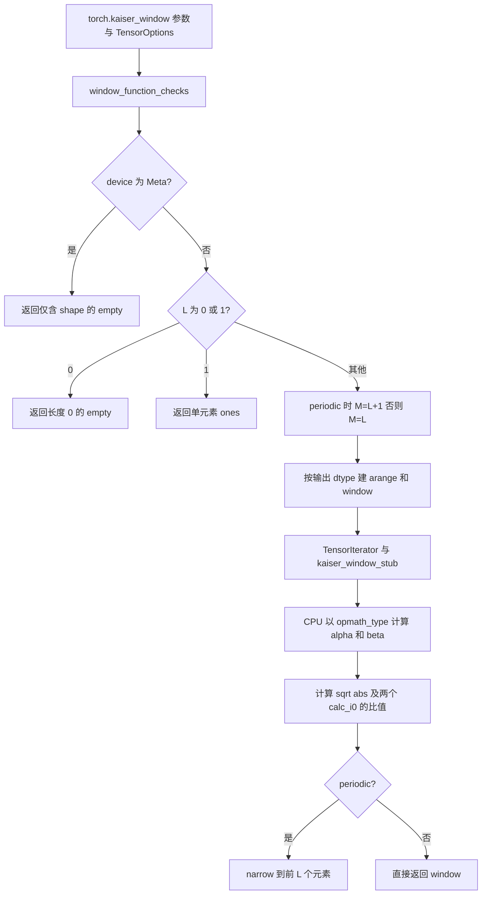
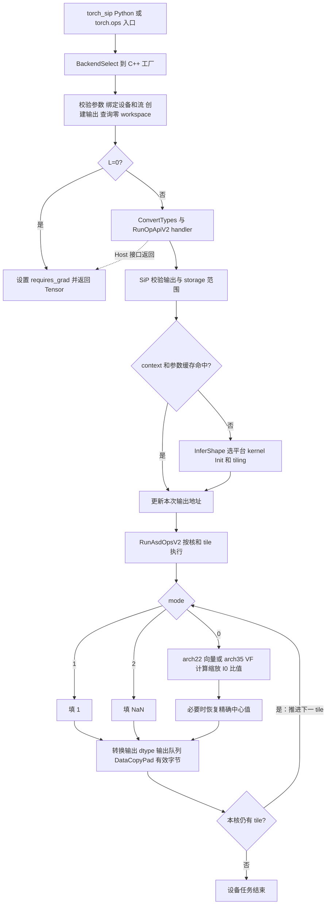

# 一、需求背景

## 1.1 需求来源

本设计对应社区任务 10-40“torch_npu 支持 kaiser_window 接口（A2/A3/950）”，依据任务包 `10月社区任务-torch_npu支持kaiser_window接口（A2A3A5）.zip` 中的 `KaiserWindow_task_doc(A2A3A5).md`、测试说明及完整用例编写。任务书中的 A5 指 Ascend 950 系列；A2、A3、A5 分别验收。设计提交位置为 `04_tasks/01_community-task-2026/tasklist/10-40-torch_npu-kaiser_window/Xztxzt/docs/design.md`，competition 基线为 `d7497ff0a5c48190ce7b24f67b2209b55304a468`。

实际交付接口是 SiP 仓的 `torch_sip.asd_kaiser_window` 及 `AsdSip::asdKaiserWindow`，`torch_npu` 提供 NPU 设备、流和任务队列支撑；不等同于修改原生 `torch.kaiser_window` 的 ATen 后端。本文以 SiP 固定提交 `6ad1d5bd6949dd9b26d3f9db6b6a4e19b8e58a13` 为实现审阅基线，以 PyTorch `v2.7.1` 为竞品基线，陈述源码现状、复用设计和验收计划，不声明本次已编译、上板或通过验收。

## 1.2 背景介绍

Kaiser 窗用于频谱分析和滤波器设计，由长度、周期选项与形状参数生成一维浮点序列。任务要求将索引生成、贝塞尔求值和类型转换融合到 NPU 路径，减少接口下发与等长中间张量，并保留工厂接口的设备、布局及梯度叶子语义。

### 1.2.1 KaiserWindow 接口实现与复用范围

任务书发布时称 SiP 尚无实现；上述固定提交已具备 C 入口、两类芯片 kernel、Torch 注册及测试。本设计复用这些实现，不重复新增 kernel，不套用 Addcdiv 的 TBE、ACLNN 两阶段 executor 或 BLAS handle/plan 模式。模板中的“TBE 源码、算子信息库”分别以真实标杆源码和 SiP 注册配置对应：

| 证据对象 | 真实文件与作用 |
| --- | --- |
| PyTorch 工厂和注册 | `v2.7.1` 的 [TensorFactories.cpp](https://github.com/pytorch/pytorch/blob/v2.7.1/aten/src/ATen/native/TensorFactories.cpp)、[native_functions.yaml](https://github.com/pytorch/pytorch/blob/v2.7.1/aten/src/ATen/native/native_functions.yaml)：工厂、三种 ATen overload 及 CompositeExplicitAutograd 注册 |
| CPU 数值标杆 | [cpu/UnaryOpsKernel.cpp](https://github.com/pytorch/pytorch/blob/v2.7.1/aten/src/ATen/native/cpu/UnaryOpsKernel.cpp) 的 `kaiser_window_kernel`、[Math.h](https://github.com/pytorch/pytorch/blob/v2.7.1/aten/src/ATen/native/Math.h) 的 `calc_i0` |
| SiP C ABI | 固定 SiP 提交的 [include/base_api.h](https://gitcode.com/cann/sip/blob/6ad1d5bd6949dd9b26d3f9db6b6a4e19b8e58a13/include/base_api.h)、[core/base/kaiser_window.cpp](https://gitcode.com/cann/sip/blob/6ad1d5bd6949dd9b26d3f9db6b6a4e19b8e58a13/core/base/kaiser_window.cpp) |
| SiP 信息配置及构建 | [configs/op_list.yaml](https://gitcode.com/cann/sip/blob/6ad1d5bd6949dd9b26d3f9db6b6a4e19b8e58a13/configs/op_list.yaml)、[ops/base/kaiser_window/CMakeLists.txt](https://gitcode.com/cann/sip/blob/6ad1d5bd6949dd9b26d3f9db6b6a4e19b8e58a13/ops/base/kaiser_window/CMakeLists.txt)：Operation 与 arch22/arch35 二进制的对应关系 |
| Torch 扩展 | [sip_pta/csrc/base/kaiser_window.cpp](https://gitcode.com/cann/sip/blob/6ad1d5bd6949dd9b26d3f9db6b6a4e19b8e58a13/sip_pta/csrc/base/kaiser_window.cpp)、[sip_pta/torch_sip/__init__.py](https://gitcode.com/cann/sip/blob/6ad1d5bd6949dd9b26d3f9db6b6a4e19b8e58a13/sip_pta/torch_sip/__init__.py)：完整签名、设备选择、工厂调度 |

以上 SiP 路径均以该提交的本地 Git 树及文件内容核对。GitCode 网页未能在线展开，引用提供固定版本定位，不将网页可访问性或源码存在性视作运行验证。

### 1.2.2 KaiserWindow 标杆现状分析

精度基准是 CPU `torch.kaiser_window(..., dtype=torch.float64)` 的结果收窄至输出 dtype；A100/H100 仅提供性能参照。任务包提及的 PyTorch 2.14 网页以及其作者使用 2.10.0+cpu 的自检记录，不能替代本任务要求的 2.7.1 环境验证。

#### 1.2.2.1 标杆支持的数据类型和数据格式

PyTorch 2.7.1 CPU 正常计算分派覆盖 FP16、BF16、FP32、FP64，输出为一维 dense strided 窗。通用 `window_function_checks` 实际允许浮点或复数通过类型检查，但 Kaiser 的正常 CPU kernel 不分派复数，不能从该公共检查推导复数支持；本任务明确裁剪为三种实浮点类型。

| 参数/行为 | PyTorch 基线 | 本任务接口 |
| --- | --- | --- |
| `window_length` | 非负整数，工厂接收 int64 | `[0, 2^31-1]` |
| `periodic`、`beta` | 默认 True、12.0 | 相同；支持省略 periodic 而单独指定 beta |
| `dtype=None` | 使用全局默认浮点类型 | 固定 FP32，不随 `torch.set_default_dtype` 改变 |
| `device=None` | 服从 PyTorch 工厂设备规则 | 当前 NPU；显式 `npu:k` 选择该设备 |
| `layout` | 文档支持 strided | strided 或 None，None 按 strided |
| `requires_grad` | 默认 False，工厂叶子语义 | 相同；仅对输出叶子累积梯度 |

因此“完全一致”限定为任务裁剪范围内的值语义及明示参数契约，不承诺默认 dtype/device、Meta、FP64 等全部生态行为相同。Python 签名与描述核对自 [PyTorch v2.7.1 的 _torch_docs.py](https://github.com/pytorch/pytorch/blob/v2.7.1/torch/_torch_docs.py)。

#### 1.2.2.2 标杆实现描述

设输出长度为 L。当 L>=2 时，N=L（periodic=True）或 N=L-1（False），对 0<=i<L：

$$
r_i=\frac{2i-N}{N},\qquad t_i=\sqrt{|1-r_i^2|},\qquad w_i=\frac{I_0(\beta t_i)}{I_0(\beta)}.
$$

`TensorFactories.cpp` 先校验选项，Meta 设备仅构造 shape；普通设备在 L=0、1 分别返回 empty、ones。其余情况周期窗将内部长度扩为 L+1，用输出 dtype 建立 `arange` 索引和独立 window，经 TensorIterator 调用 `kaiser_window_stub`，最后对周期窗执行 `narrow`。CPU kernel 以 `opmath_type` 计算，FP16/BF16 运算提升到 FP32，但输入索引此前已按输出 dtype 生成，仍可能损失索引精度。

`Math.h::calc_i0` 对参数取绝对值，以 8 为界进行两段 Chebyshev 展开，再恢复指数因子。该过程不等于 SiP 的 3.75 分段多项式。CUDA 性能标杆的 [UnarySpecialOpsKernel.cu](https://github.com/pytorch/pytorch/blob/v2.7.1/aten/src/ATen/native/cuda/UnarySpecialOpsKernel.cu) 还有 Jiterator/非 Jiterator 分支，后者采用 `max(0,1-x*x)`；本任务的端点行为以 CPU 的 `abs` 和任务书为准，不混用 GPU 数值路径。

#### 1.2.2.3 标杆实现流程图

下图对应 PyTorch 2.7.1 工厂与 CPU 数值路径；`M` 是内部窗口长度，区别于公式中的分母 `N`。



# 二、需求分析

## 2.1 外部组件依赖

验收组合固定为 CANN 9.2.0、torch 2.7.1、torch_npu 2.7.1，同源构建的 asdsip 与 torch_sip；SiP/MKI 的精确依赖提交、驱动及编译器版本需随自测报告记录。`sip_pta/README.md` 的 CANN >=8.5.0 是通用最低说明，不能放宽本任务版本要求。

部署顺序为准备匹配 CANN 和 asdsip 安装包及环境，再在 `sip_pta` 执行 `bash build.sh --install`，由 `import torch_sip` 导入 `sip_custom_ops_lib` 完成注册。实际 [setup.py](https://gitcode.com/cann/sip/blob/6ad1d5bd6949dd9b26d3f9db6b6a4e19b8e58a13/sip_pta/setup.py) 使用 `NpuExtension` 收集 `csrc/**/*.cpp`，链接 torch、torch_npu、torch_python、c10、asdsip 和 mki，并跟随 Torch 的 C++ ABI。运行时须能定位 `libasdsip.so` 等动态库；构建时还依赖 ascend-boost-comm 的 MKI 头文件。部署机制见固定版本 [sip_pta/README.md](https://gitcode.com/cann/sip/blob/6ad1d5bd6949dd9b26d3f9db6b6a4e19b8e58a13/sip_pta/README.md)；本次未执行安装或构建。

## 2.2 内部适配模块

| 模块 | 固定提交中的文件与职责 |
| --- | --- |
| Python 与 typed 入口 | `sip_pta/torch_sip/__init__.py`、`sip_pta/csrc/base/kaiser_window_python.{cpp,h}`：eager 走 typed dispatcher，编译检测分支保留注册 OpOverload |
| 注册与 Tensor 适配 | `sip_pta/csrc/registration.cpp`、`sip_pta/csrc/base/kaiser_window.cpp`、`sip_pta/csrc/pytorch_npu_helper.hpp`：schema、BackendSelect/PrivateUse1、输出和 aclTensor 转换 |
| SiP 接入 | `include/base_api.h`、`core/base/kaiser_window.cpp`、`core/utils/ops_base.cpp`：参数和视图校验、准备态缓存、RunAsdOpsV2 下发 |
| Operation/Kernel | `ops/include/params/kaiser_window.h`、`ops/base/kaiser_window/kaiser_window_operation.cpp`、其下 `kaiser_window/kaiser_window_kernel.cpp`：参数、推导输出、按平台选 kernel |
| Tiling/设备实现 | `ops/base/kaiser_window/kaiser_window/tiling/{tiling_data.h,kaiser_window_tiling.h,kaiser_window_tiling.cpp}`；同级 `op_kernel/{kernel_common.h,kaiser_window.cpp,kaiser_window.h}` 与 `op_kernel/arch35/kaiser_window_arch35.{cpp,h}` |
| 配置/测试 | `ops/base/CMakeLists.txt`、算子 CMake、`configs/op_list.yaml`；`sip_pta/test/base/kaiser_window.py`、`tests/ut/unittest/base/kaiser_window/test_kaiser_window.cpp` |

上述均已存在，实施重点是基线复用及契约回归；若验收暴露缺口，在对应层最小修复，不另建重复注册或 kernel 工程。`core/base/CMakeLists.txt` 通过 glob 纳入 C 入口；Operation、Kernel 与两类 SoC 的构建仍需算子 CMake 和 YAML 同时生效。

## 2.3 需求模块设计

Python/注册层承担调用形态和工厂语义；C++ 适配层创建输出、绑定设备与流；SiP 入口承担直调 ABI 的完整校验；Operation 和 tiling 选择平台与执行参数；设备端仅生成窗口并写输出。正常计算为 O(L)，算子数据 GM 占用为 L×元素字节数，额外数据 workspace 为 0。

### 2.3.1 Ascend C 与 Torch 接口原型

对外 Python 接口：

```python
def asd_kaiser_window(
    window_length: int, periodic: bool = True, beta: float = 12.0, *,
    dtype=None, layout=torch.strided, device=None, requires_grad: bool = False
) -> torch.Tensor: ...
```

支持位置参数 `window_length, periodic, beta`，其余为关键字参数；返回独立、连续、形状 `[window_length]` 的 NPU Tensor，裸入口为 `torch.ops.torch_sip.asd_kaiser_window`。C ABI 为：

```cpp
namespace AsdSip {
extern "C" {
AspbStatus asdKaiserWindowGetWorkspaceSize(size_t* workspaceSize);
AspbStatus asdKaiserWindow(aclTensor* outTensor, int64_t windowLength,
                         bool periodic, double beta,
                         void* stream, void* workspace);
}
}
```

`GetWorkspaceSize` 要求非空指针，返回 0；`outTensor` 由调用方创建，C 入口只写其有效输出区；非空输出必须提供有效 stream，workspace 可为 nullptr。没有新增 ACLNN executor、Tensor 输入或 Python `out=` 参数。

### 2.3.2 接口相关约束

| 项目 | 契约及错误处理 |
| --- | --- |
| 输出 | ND、rank=1、shape[0]=L；L>1 时 stride=1，L=0/1 允许退化连续步长；不支持稀疏、广播、原地更新 |
| dtype | 仅 FP16/BF16/FP32；默认 FP32；FP64、整型、BOOL、复数拒绝 |
| 长度 | 0 至 INT32_MAX，负数或越上界拒绝；Host 标量每次调用可改变，无须编译期常量 |
| beta | Host double，无有限区间准入检查；负值按绝对值计算；正式数值覆盖为 abs(beta)<=88 与指定非有限边界 |
| 空与短窗 | L=0 不下发 kernel；L=1 恒为 1，优先于 NaN/Inf；L>=2 时 beta=±0 全 1，NaN/±Inf 全 NaN |
| 设备/梯度 | 仅 NPU；显式索引需正确切换并恢复设备。requires_grad=True 创建叶子，参数本身无反向公式 |
| 失败上报 | Python schema 负责参数类型；C++ `TORCH_CHECK` 拒绝长度、dtype、layout、device 非法值。SiP 参数错误返回 `ACL_ERROR_INVALID_PARAM`，不支持 dtype 返回 `ACL_ERROR_UNSUPPORTED_DATA_TYPE`；其他状态沿实际调用传播 |

有限 beta 时，L=2 的对称窗为 `[1/I0(beta),1/I0(beta)]`，周期窗为 `[1/I0(beta),1]`；L=3 的对称窗为 `[1/I0(beta),1,1/I0(beta)]`，需单独回归。

支持连续偏移视图作为 C ABI 的输出，但不返回视图给 Python，也不推导其与外部张量的所有权；调用方保证该写入区没有并发冲突。无 CPU 静默回退。任务包只测正常接口场景，不代表这些异常契约可以省略。

# 三、需求详细设计

## 3.1 调用方式

调用链为 `torch_sip.asd_kaiser_window → typed dispatcher/注册 OpOverload → BackendSelect → C++ asdKaiserWindow → ConvertTypes → OpCommand::RunOpApiV2 → AsdSip::asdKaiserWindow → Operation/Kernel → RunAsdOpsV2`。无 Tensor 输入时不能靠输入设备推导 `PrivateUse1`，因此源码同时注册 `BackendSelect` 和 `PrivateUse1`；只照抄任务书的 PrivateUse1 示例会遗漏工厂调度。

eager 的 [kaiser_window_python.cpp](https://gitcode.com/cann/sip/blob/6ad1d5bd6949dd9b26d3f9db6b6a4e19b8e58a13/sip_pta/csrc/base/kaiser_window_python.cpp) 解析七个参数并 typed dispatch；遇到 TorchFunction/TorchDispatch mode 或非规范参数时交回注册 Python 入口，保持分派与报错行为。当前转换实际走 `ConvertTypes/ConvertType(at::Tensor)`，不是调用任务书示例中的 `CreateAclTensorFromAtTensor`；当前下发也不是直接展开 `EXEC_FUNC`。两者共用的目标是 aclTensor 描述符转换和 torch_npu 队列执行，不能混写为源码已经调用某个宏。

## 3.2 需求总体设计

维持既有的单输出、零工作空间方案。Host 预计算长度、分母、核区间、绝对 beta、逆分母、缩放贝塞尔倒数和特殊值模式；设备端复用公共输出队列，按 SoC 分别运行 arch22 高阶向量 API 或 arch35 Reg 指令计算。周期窗直接计算前 L 点，不创建 L+1 的 GM 张量。

### 3.2.1 Host 侧设计

C++ 层确定 dtype/layout/device 后，必要时通过 `OptionalNPUGuard` 切换设备并重新获取当前 stream，用 `at::empty` 创建输出。查询 workspace 后，L=0 直接返回；其余将元数据转换为 aclTensor，在 handler 内调用 SiP 并释放描述符，最后按需设置输出叶子的 `requires_grad`。

C 入口核对输出非空、长度、dtype、格式、shape 和 stride。非空输出进一步检查 storage offset 非负、storage 各维乘积不溢出、`offset+L` 不越存储边界以及地址加法不溢出；连续偏移视图以 `base+offset×sizeof(dtype)` 规范化描述符，不复制数据。空输出在元数据校验后返回，不依赖可读写数据地址。

准备态缓存为每线程单槽，以当前 ACL context 和 `(L,periodic,beta,dtype)` 为键；NaN beta 在参数比较中可等价命中。未命中时执行 InferShape、GetBestKernel、Init/tiling；每次调用都更新新输出地址，Run 后清空缓存的输出指针。缓存不保存窗口数据，不能让同参数调用返回同一块输出存储。

源码注释称 handler 在调用线程同步执行；但 torch_npu `v2.7.1` 的 [OpCommand.cpp](https://github.com/Ascend/pytorch/blob/v2.7.1/torch_npu/csrc/framework/OpCommand.cpp) 在队列开启时将 handler 交给 `enCurrentNPUStream`，[OpParamMaker.cpp::CopyFunc](https://github.com/Ascend/pytorch/blob/v2.7.1/torch_npu/csrc/framework/OpParamMaker.cpp) 复制为队列任务。本文不把该注释当作线程模型证明。缓存的实际执行线程/context、描述符释放时点及连续多流调用的有效性，需在匹配版本中回归；设备异步完成前保留输出存储的有效生命周期。`RunOpApiV2` 返回 void，错误经 handler 的 `TORCH_CHECK` 和队列错误机制上报，不能读取虚构的返回码。

#### 3.2.1.1 分核策略

复用 [kaiser_window_tiling.cpp](https://gitcode.com/cann/sip/blob/6ad1d5bd6949dd9b26d3f9db6b6a4e19b8e58a13/ops/base/kaiser_window/kaiser_window/tiling/kaiser_window_tiling.cpp)。非空长度 L、运行时可用 AIV 核数 Cmax 下：

$$
C=\min(\max(1,C_{max}),\max(1,\lceil L/256\rceil)),\quad
P=\max(64,64\lceil\lceil L/C\rceil/64\rceil),\quad
B=\lceil L/P\rceil.
$$

实际 blockDim=B，第 k 核覆盖 `[kP,min((k+1)P,L))`。P 按 64 元素对齐，各核区间首尾相接且不重叠，末核截断，B 不超过 C；小窗不强制满核。芯片核数从 MKI `PlatformInfo` 获取，不固定为某个板卡核数。

`2i-N` 的乘减先用 int64 生成起点，再进入 int32 向量序列。在 L<=INT32_MAX、0<=i<L 下，分子位于 int32 范围；不可先以 int32 执行 `2*i` 再相减。核区间、尾块及循环更新需连同整数类型验证，不能只证明单个长度合法。现有参数公式已做轻量代数抽查，未执行超大输出分配。

#### 3.2.1.2 数据分块和内存优化策略

公共 [kernel_common.h](https://gitcode.com/cann/sip/blob/6ad1d5bd6949dd9b26d3f9db6b6a4e19b8e58a13/ops/base/kaiser_window/kaiser_window/op_kernel/kernel_common.h) 固定 T=4096 元素；第 j 个 tile 起点 `o=kP+jT`，有效长度 `q=min(T,end-o)`。无输入数据 CopyIn，仅加载固定大小 tiling 元数据。显式 UB 分配为两个输出队列槽、六个 FP32 scratch 数组、一个比较 mask：

$$
U_{explicit}=2Ts+6T\cdot4+\lceil T/8\rceil,
\qquad U_{explicit}+U_{reserve}\le U_{available}.
$$

其中 s=4 或 2，分别得到 131584 B（128.5 KiB）和 115200 B（112.5 KiB）。`U_reserve` 包括编译器、API 临时资源等未在公式列出的占用，必须结合目标 SDK 编译资源核对。当前源码没有运行时查询 UB 后调整 T；arch35 虽在寄存器中计算，仍实例化这套公共分配，不能按仅一个结果数组估算其 UB。缩减 arch35 scratch 属后续可选优化，不能写成既有成果。

GM 数据仅输出 Ls 字节，workspace=0；tiling 下发、框架缓存分配和分配器预留不是等长中间数据 Tensor，不应将进程显存等同于 Ls。输出 `DataCopyPad` 采用 `blockCount=1,blockLen=q*s`，最大 16384 B，只写有效字节，不将补齐数据写到输出末尾。其 UB 源地址需 32 B 对齐、GM 起点可非对齐，见 asc-devkit 固定提交 `d433ffc4f75274b901521dfc42d98542abb98627` 的 [DataCopyPad_UBToGM.md](https://gitcode.com/cann/asc-devkit/blob/d433ffc4f75274b901521dfc42d98542abb98627/docs/zh/api/SIMD-API/basic_api/memory_vector_compute/data_move/DataCopyPad_UBToGM.md)。

#### 3.2.1.3 tilingKey 规划策略

本实现没有独立数值 `tilingKey`、`SetTilingKey` 或按 key 生成的多套模板；不虚构 0/1 key。等价分派信息如下：

| 选择层 | 条件与已有分支 |
| --- | --- |
| 平台 | `ASCEND_910B → KaiserWindowKernel`；`ASCEND_950 → KaiserWindowArch35Kernel`；其他平台无候选 |
| 输出 dtype | tiling.dtype=0/1/2 分别实例化 float/half/bfloat16_t |
| 数值 mode | mode=1：L=1 或 Host beta=±0；否则转换后 beta 非有限取 mode=2；其余 mode=0 |

`KaiserWindowTilingData` 为八个 32 位字段，共 32 B：length、denominator、perCore、dtype、beta、inverseI0e、inverseN、mode；Host/Device 字段顺序必须一致。beta 先取绝对值转 FP32，分母倒数为 FP32；常规路径 `inverseI0e` 在 Host double 域求出再收窄，每次 tiling 一次计算，缓存命中时复用，区别于任务书“每 tile 算一次”的建议。

### 3.2.2 Kernel 侧设计

复用现有两个架构入口及公共 `Kernel<T,Compute>`，每个输出元素唯一归属一核、一个 tile，无归约、原子操作或核间同步。输出值在 FP32 域计算，FP16/BF16 最后以 `CAST_RINT` 收窄，避免以低精度 arange 作为索引输入。

#### 3.2.2.1 Kernel 实现描述

常规模式采用 $b=|\beta|$、$x=bt_i$ 和缩放函数 $I_{0e}(x)=e^{-|x|}I_0(x)$：

$$
w_i=I_{0e}(bt_i)\,I_{0e}(b)^{-1}\,e^{b(t_i-1)}.
$$

负 beta 必须在指数项也使用绝对值；直接照抄任务书中的 `exp(beta*(t-1))` 会破坏偶对称语义。保持 `b*(t-1)` 的求值顺序，避免分别计算两个大乘积再相减。现有代码的 $I_{0e}$ 以 3.75 分段：小区间为 `exp(-x)` 乘关于 `(x/3.75)^2` 的六阶多项式，大区间为关于 `3.75/x` 的八阶多项式除 `sqrt(x)`；具体系数复用源码，不声称是 ATen 的 Chebyshev 系数。

arch22 的 [kaiser_window.h](https://gitcode.com/cann/sip/blob/6ad1d5bd6949dd9b26d3f9db6b6a4e19b8e58a13/ops/base/kaiser_window/kaiser_window/op_kernel/kaiser_window.h) 先标量写入最多 8 个整数分子，再倍增填充；用高阶向量 API 计算 r、abs、sqrt、exp 和 Horner 多项式。当 b<=3.75 只走小区间；tile 端点推导的最小 x²>14.125 时只走大区间；其余两段都计算后逐元素选择。比较长度向上补齐至 64，最大不超过 T，补齐仅在已分配 UB 内；选择、转换和 GM 写回仍限于 q 个有效元素。

arch35 的 [kaiser_window_arch35.h](https://gitcode.com/cann/sip/blob/6ad1d5bd6949dd9b26d3f9db6b6a4e19b8e58a13/ops/base/kaiser_window/kaiser_window/op_kernel/arch35/kaiser_window_arch35.h) 在 SIMD VF 中每组处理 64 个 FP32 lane，以整数 Reg::Arange 形成分子，再转 FP32；两段多项式均在寄存器中计算，逐 lane 选择，用 active mask 将结果写回 UB。当前 arch35 没有 arch22 的整 tile 单分支优化。

mode=1 直接填 1，mode=2 填 quiet NaN，跳过普通公式；普通模式且 N 为偶数时，精确中心 i=N/2 恢复为 1。arch22 标量/向量交接及中心修正使用 V_S、S_V 事件；算术依赖使用 PIPE_V 屏障，输出 EnQue/DeQue 管理计算到搬出的依赖。队列双槽不等于已证明计算与 MTE3 完全重叠。尾块只写 `[o,o+q)`；中心修正也须先检查中心落在本 tile 内。

#### 3.2.2.2 Ascend C 与框架实现流程图



转换描述符由 handler 在 SiP 调用返回后释放。图中的 Host 接口返回不表示设备已经完成；数值读取、跨流消费和测试计时按流依赖同步。

#### 3.2.2.3 与标杆流程的差异及原因

| 差异 | 原因与验证边界 |
| --- | --- |
| 原生 ATen 工厂改为独立 torch_sip schema | 遵循任务指定仓库与部署机制；原生 Torch 接口不会因此自动获得该实现 |
| 不生成 arange GM 张量，不计算周期窗末尾冗余点 | 减少 GM 分配及读写，输出仍满足周期窗等价关系；不能复制低精度标杆的索引量化误差 |
| Chebyshev/direct I0 比值改为 scaled I0 与两段多项式 | 降低指数溢出风险及求值成本；须按 FP64 golden 收窄后的正式阈值验收 |
| Host 计算倒数、显式填充特殊值和中心修正 | 避免 tile 重复标量工作，保证 L=1、非有限 beta、中心 1 的契约；不能以公式自然传播代替短路顺序 |
| 两种架构计算路径 | arch22 高阶向量 API 与 arch35 寄存器 API 的编程和同步方式不同，须分别编译并测精度/性能 |

数学等价不保证浮点逐位等价。主要数值风险包括 FP32 分子转换和 `1-r²` 的端点抵消、3.75 分段附近误差、exp/reciprocal 精度、极小结果下溢及最终舍入。对称窗和重复运行应单独检查；任务要求同参数同环境重复执行逐位一致，不要求与 CPU 或跨芯片逐位一致。

## 3.3 支持硬件

| 任务分档 | 本任务对应产品/架构 | SiP 构建与 kernel | 性能比较 |
| --- | --- | --- | --- |
| A2 | Atlas A2，Ascend910B 系列，arch22/DAV_2201 | ascend910b / KaiserWindowKernel | A100，倍率>=0.8 |
| A3 | Atlas A3，Ascend910_93 系列，arch22/DAV_2201 | ascend910b / KaiserWindowKernel | A100，倍率>=0.8；与 A2 分别采集 |
| A5 | Ascend 950PR/950DT 系列，arch35/DAV_3510 | ascend950 / KaiserWindowArch35Kernel | H100，倍率>=0.4 |

映射依据任务书 §2.2、§3.1、SiP 配置及 [asdKaiserWindow.md 产品支持表](https://gitcode.com/cann/sip/blob/6ad1d5bd6949dd9b26d3f9db6b6a4e19b8e58a13/docs/zh/API_Reference/base/asdKaiserWindow.md)。asc-devkit 上述固定版本的 [platform_ascendc.cpp](https://gitcode.com/cann/asc-devkit/blob/d433ffc4f75274b901521dfc42d98542abb98627/impl/utils/tiling/platform/platform_ascendc.cpp) 亦将 Ascend910_93 归入 ASCEND910B、950 系列归入 ASCEND950。不能将名称含“A2”的 Atlas 200I/500 A2 推理产品混入支持面。具体 SKU、核数、可用 UB 和驱动版本以验收环境记录为准。

## 3.4 算子约束限制

本方案没有输入 Tensor、广播、batch 维、原地更新或对 beta 求导；不支持非连续输出及非 NPU Python device。L 在 Host 运行时已知，可以逐调用改变；任务不要求符号动态 shape，不能将此表述为每个 L 需要重新编译。Python 每次返回独立输出，C 直调的 storage/stream 生命周期由调用方保证。

beta 不截断至 88，也不因超出该值返回参数错误；正式数值验收范围和任意有限 double 的行为必须区分。当前实现把 `abs(beta)` 转为 FP32 后判断非有限，极大但有限的 double 也会走 NaN 填充分支；beta>88 的结果不保证复现原生低精度 I0 的溢出行为。源码宣称的近似误差不是设备误差证明。

零 workspace 仅表示该算子不需要额外数据工作区，不意味着完全没有框架 tiling 元数据、加载缓存或分配器开销。Meta/FakeTensor、完整 torch.compile/图捕获不在任务必需支持范围；Python 保留编译入口不能证明这些能力已可用。

# 四、特性交叉分析

| 交叉特性 | 设计影响与验证方法 |
| --- | --- |
| 默认参数与全局状态 | 缺省 dtype 固定 FP32；修改全局 dtype 后仍检查此行为。device=None 使用当前 NPU，并验证显式多卡调用后的设备恢复 |
| Autograd | 设置 requires_grad 发生在输出创建/提交后；L=0/1/普通窗均检查 leaf 和后续运算 backward 的 grad，不能宣称有参数梯度公式 |
| 多流、线程及缓存 | 输出地址不能缓存复用；覆盖换 beta、dtype、L、设备/context、流和多线程，区分首次初始化与缓存命中；验证队列开启/关闭下的有效生命周期与错误传播 |
| 低精度与特殊值 | 以 FP64 golden 收窄作准，不以低精度 CPU arange 缺陷定义目标；L=1 的 NaN/Inf 优先短路，L>=2 的全 NaN 单列 |
| 偏移视图与尾块 | Python 正常路径不覆盖 C ABI 偏移分支；补充直调的合法视图、越界元数据和有效区外哨兵，结合地址推导与访存工具验证 |
| 编译与注册 | arch22/arch35 二进制、YAML、schema、typed 签名、tiling 字段同步；同源 asdsip/torch_sip 防止缺符号和 ABI 错配 |
| 模式/图执行 | 复用已有 TorchFunction/TorchDispatch 回退；仓内测试 mock 编译检测只验证入口选择，不能替代真实 FakeTensor、编译和图捕获测试 |
| 性能与确定性 | 小窗可能受 Host/下发成本影响，大窗还受多项式和写回影响；无 profiling 不判定硬件瓶颈。优化不能以改变特殊值、舍入或同步契约换取耗时 |

# 五、可维可测分析

## 5.1 精度标准/性能标准

完整读取任务包 CSV 后确认：主表 1200 行且 case_name 唯一，其中精度 1000、性能 200；精度 FP16/BF16/FP32 为 334/333/333，periodic=True/False 为 502/498，长度覆盖 0 至 4194304 共 29 个值。精度中的空窗 3、单元素窗 12、全 NaN 118，正常数值比较 867。性能 small/medium/large 为 113/57/30，前 10 条独立固定，后 190 条取自精度集合；正式数值验证应同时覆盖这 10 条，不能把 200 条都当作已测过的精度子集。

精度基准先在 CPU FP64 计算，再收窄至目标 dtype；比较时可转回 FP64 做差，但不恢复已舍入的信息。逐元素满足 `abs(actual-golden) <= atol+rtol*abs(golden)`，同时要求 matched_ratio>=0.99 和有限比较点最大绝对误差不超过下表上限：

| dtype | atol=rtol | 最大绝对误差上限 |
| --- | --- | --- |
| FP16 | 2^-10 | max(0.1,32×ULP(g_low)) |
| BF16 | 2^-7 | max(0.1,32×ULP(g_low)) |
| FP32 | 2^-13 | max(0.01,32×ULP(g_low)) |

g_low 为最大误差点已收窄的 golden；采用任务书 §3.2 及 `facts.json/verify_accuracy.py` 的明确阈值，不用其他版本通用标准替换。空输出、全 1、全 NaN 单独判语义；全 NaN 用例不进入数值通过率分母，同号 Inf 按收窄规则处理，非有限点不参与有限误差最大值。

性能逐 case 判定：A2、A3 各自满足 `T_A100/T_NPU>=0.8`；A5 满足 `T_H100/T_NPU>=0.4`。两份 GPU CSV 各 200 条、耗时均为有限正数，case_name 及归一化参数均与性能表对应；记录型号分别为 NVIDIA A100-PCIE-40GB、NVIDIA H100 80GB HBM3，torch 均为 2.7.1+cu126。`gpu_ms` 为毫秒，比较 NPU 微秒时乘 1000。A100 范围 0.015855–0.095369 ms，H100 范围 0.005014–0.065891 ms；这些是随包数据，不是本次实测。

验收前须处理以下测试证据差异，保留原包不覆盖：

| 差异 | 判定与处理 |
| --- | --- |
| H100 备注 `collect=60..259` 逐行递增 | 与要求预热 10、采集 60 次不一致；保留耗时原值，核实原始采集日志，不推定已满足统一口径 |
| 生成器的 GPU CSV 输出耗时为空 | 默认重新生成会覆盖已填基线；确定性检查应隔离产物。主 CSV 原件为 CRLF，cases.json 的 SHA 对应 LF 内容，不能混淆字节哈希与记录一致性 |
| 精度脚本摘要包含全 NaN 用例 | 它们虽单独判语义，脚本总通过数仍计入；验收报告单列语义统计与数值通过率。脚本的 `finite` 掩码实际只排除 golden NaN，需对 Inf 规则补充比较器自检 |
| 接口脚本直接与 FP64 golden 比较 | 其 `values_close` 没有按输出 dtype 收窄，也没有动态 ULP 上限；作为接口辅助检查，正式精度使用统一判据 |
| NPU Event 包围 60 次完整 Python 工厂调用 | 可能包含 Host 供给造成的设备空闲，不等于纯 kernel 时长；`perf_counter` 回退则是 Host 墙钟，不能冒充任务规定的 Device 耗时。分别记录接口 Event 区间和 kernel 时间，并核对 GPU 原始计时范围 |
| 性能脚本只在零条可判定时返回 BLOCKED | 部分基线缺失仍可能退出 0；正式结论须要求 200 条全部可判定且逐条达标，不能只看退出码 |

测试计划分三层：任务包 `verify_accuracy.py --device npu` 覆盖 1000 条并补入全部性能参数；`verify_torch_api.py --device npu` 覆盖 17 项正常接口及 CPU 基线；仓内 Python 自测和 C ABI UT 补充异常参数、默认 dtype、梯度累积、模式分派、多流/多卡、偏移视图和缓存切换。额外边界覆盖 4095/4096/4097、每核切分点、两种 periodic 下中心/端点、3.75 分段邻域以及重复执行的位一致性；INT32_MAX 先验证元数据和整数公式，不能以未分配巨型输出的检查宣称全量执行成功。

内存判据为 workspaceSize=0、无等长中间 GM Tensor、每次输出独立；分别记录 Ls 逻辑输出、框架分配和峰值，检查异常及缓存切换后的释放。当前只完成材料解析、公式抽查、注册/构建路径和地址边界静态审阅；不具备 Torch/NPU 执行结果，所有编译、板上精度、性能、内存及同步结论均待实测。

## 5.2 兼容性分析

保持 SiP 现有导出符号、schema、默认值和返回 Tensor 语义，避免破坏裸 `torch.ops` 与 Python 包入口的一致性。扩展依赖 Torch 的参数解析及 dispatcher C++ API，升级 Torch/torch_npu/CANN 时须重建匹配 wheel，并回归七参数签名、错误行为、模式分派、device/stream、Autograd leaf 与 prepared-kernel 缓存。当前 `torch_sip` 包版本号不足以唯一识别二进制，应同时记录 SiP commit、wheel 与库版本。

复用 arch22 与 arch35 的共同 tiling 布局不代表二进制可互换；按目标 SoC 构建和部署。不同平台可出现阈值内的浮点差异，精度与性能分别出具 A2、A3、A5 结果。原生 Torch 调用、FP64/Meta/FakeTensor、完整图编译不因本扩展存在而自动获得兼容保证；需要扩大范围时应独立补齐注册、实现和实测证据。
