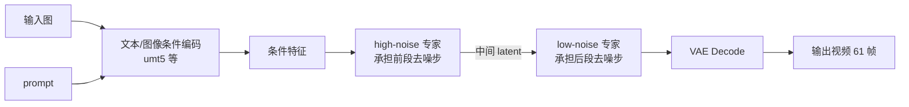
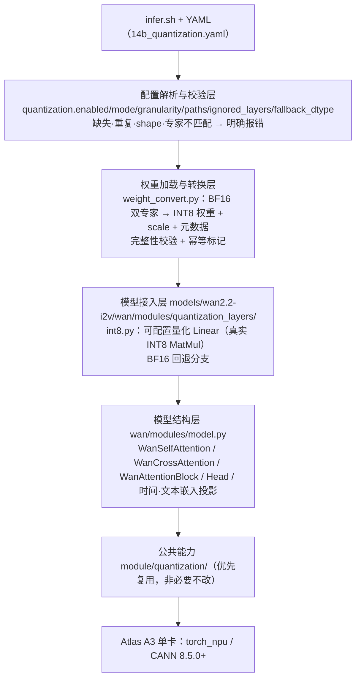
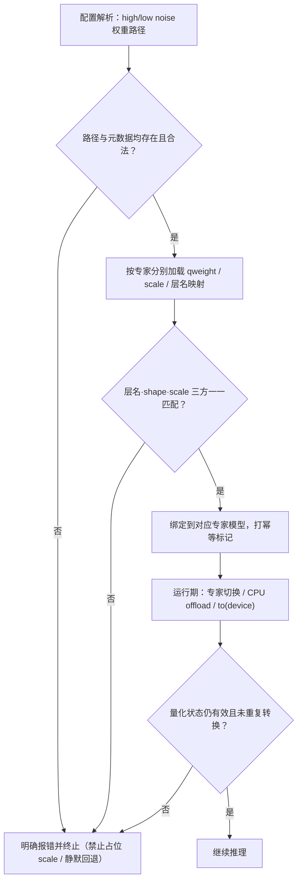
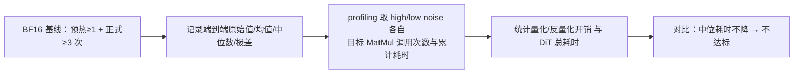

# Wan2.2-I2V MatMul INT8 量化设计文档

| 项目 | 内容 |
| --- | --- |
| 任务名称 | 10月社区任务-Wan2.2-I2V MatMul INT8 量化（A3） |
| taskId | `2e8e0241b7c44160972893075193bd17`（取自任务书目录名，以任务详情页为准） |
| 任务链接 | [昇腾任务中心](https://www.hiascend.com/activities/task-center/details/2e8e0241b7c44160972893075193bd17?menu=trends) |
| 流程说明 | [【社区任务】流程及注意事项](https://gitcode.com/org/cann/discussions/39) |
| 提交人 / 日期 | linjuan6 / 2026-10-15 |
| 设计文档提交目录 | `04_tasks/01_community-task-2026/tasklist/10-5-Wan2.2-I2V-MatMul-INT8/linjuan6/docs/design.md`（目录名 `10-5-Wan2.2-I2V-MatMul-INT8` 与官方仓 tasklist 占位目录一致，已核对） |
| 适配硬件 | Atlas A3（单卡基线）；CANN 8.5.0 及以上 |
| 软件环境 | PyTorch 2.7.1、torch_npu v7.3.0、Python 3.12（建议） |
| 相关代码仓 | `https://gitcode.com/cann/cann-recipes-infer` |
| 代码目标目录 | `models/wan2.2-i2v/`（模型私有）；必要的通用能力进 `module/quantization/` |
| 任务难度 | L2 |
| 文档状态 | **设计评审阶段**；本文不宣称代码、精度、性能或内存已经完成验收 |

---

# 一、需求背景

## 1.1 需求来源

本任务为 CANN 社区任务 2026「10月社区任务-Wan2.2-I2V MatMul INT8 量化（A3）」。要求在 Atlas A3 上为 Wan2.2-I2V A14B 建立 **MatMul INT8 量化闭环**：双专家（high-noise / low-noise）覆盖、热点层选型、量化权重/scale 契约、可复现的校准与转换流程，以及最终视频质量与端到端性能/内存验证。

任务明确定位为**模型量化适配**，不是独立 kernel 或 aclnn 算子工程开发（任务书 §2.2）。

## 1.2 背景介绍

### 1.2.1 Wan2.2-I2V A14B 推理结构

Wan2.2-I2V A14B 在不同扩散时间段使用 **high-noise** 与 **low-noise 两个专家模型**，构成"专家分时段接力"的扩散去噪流程：



两个专家各自为 DiT 结构，内部含 Self-Attention / Cross-Attention 的 q/k/v/o 投影、FFN 两层、时间/文本嵌入投影与输出 Head（任务书 §6 指明目标模块为 `wan/modules/model.py` 中的 `WanSelfAttention`、`WanCrossAttention`、`WanAttentionBlock`、`Head` 及时间/文本嵌入线性层），上述位置均为 `nn.Linear`。

**关键推论（本设计的出发点）**：两个专家的数据分布与敏感层可能不同，因此

- 量化方案、校准与验证必须**分别覆盖两个专家**，只验证其一或只做权重量化均不满足验收；
- 双专家的量化权重/scale 必须**按各自元数据加载**，不允许共用一套 scale 或专家错配。

### 1.2.2 为什么选择 Linear/MatMul 做 INT8

- Diffusion Transformer 中线性层（q/k/v/o 投影与 FFN）在长序列 + 多步去噪下重复调用次数极多，是端到端耗时的主要构成之一；
- 权重形状规整（`[out_features, in_features]`），天然适配 per-channel 权重量化；
- Atlas A3 的 Cube 单元对 INT8 有更高算力密度，因此 W8A8 有机会在不改结构的前提下降低目标 MatMul 累计耗时。

### 1.2.3 目标仓库现状与可复用资产

| 资产 | 位置 | 本任务的处理 |
| --- | --- | --- |
| 模型入口与配置 | `models/wan2.2-i2v/infer.sh`、`models/wan2.2-i2v/config/14b_single.yaml` | 基线复现；新增量化 YAML 时复制全部非量化字段 |
| 模型结构 | `models/wan2.2-i2v/wan/modules/model.py` | 目标改造对象（接入量化 Linear） |
| 仓内量化目录 | `module/quantization/` | **优先复用**其现有接口；仅在确属通用能力时才修改 |
| 多模动态量化参考 | `models/sana-video/patches/quant_module.py` | 仅作参考，**不得假设其 scale 契约适用于 Wan2.2**（任务书 §6 明确要求） |
| 配置说明 | `models/wan2.2-i2v/config/README.md` | 需同步更新新增量化字段 |

> 说明：以上路径与类名均引用任务书 §6 的表述。仓库主线的具体函数签名、`module/quantization/` 现有接口形态需在开发前逐项核对，本文不预置未核实的签名。

### 1.2.4 与"伪量化/纯权重量化"的区别（真实性要求）

验收明确要求：**核心 MatMul 必须真实以 INT8 契约执行**，禁止伪量化充当性能结果（任务书 §3.5、test_cases §性能测试）。因此本设计有三条硬约束：

1. 目标层走设备侧 INT8 MatMul（或等价量化算子），profiling 中须能观察到 INT8 计算算子；
2. 源码分支或配置值**不能**作为生效证据，必须以 profiling 为准；
3. 权重/scale 必须真实参与计算，不允许用占位 scale 或静默回退到 BF16 来"看起来成功"。

---

# 二、需求分析

## 2.1 需求描述

在 Atlas A3 上，为 `models/wan2.2-i2v` 增加**可配置的 W8A8 量化推理能力**：由 YAML 驱动，对 profiling 选定的 Attention/FFN 热点线性层执行真实 INT8 MatMul，对 Head/嵌入层等敏感层提供 `ignored_layers` 配置与 BF16 回退；为 high-noise / low-noise 两个专家分别提供匹配的量化权重与 scale，并在模型切换、CPU offload、设备迁移后保持量化状态正确。交付可复现的校准/转换工具与完整验收材料。

基线固定（test_cases/README.md）：

| 项 | 取值 |
| --- | --- |
| 模型 | `i2v-A14B` |
| 分辨率 / 帧数 | `640*360` / 61 帧 |
| steps | 40 |
| seed | 100 |
| 卡数 | 单卡 |
| `dit_cache.method` | `NoCache` |
| 权重 | Wan2.2-I2V-A14B-BF16 双专家（revision/hash 待固定后记录） |

## 2.2 需求拆解

| 编号 | 需求项 | 内容 | 验收方式 |
| --- | --- | --- | --- |
| R1 | 基线复现 | 按 `models/wan2.2-i2v/README.md` 配环境，`YAML_FILE_NAME=14b_single.yaml` 跑通 BF16 基线，产出完整 profiling（trace / kernel detail / op statistics / memory usage） | 基线日志 + profiling 产物 |
| R2 | 热点 profiling | 分别 profiling 两个专家，统计 q/k/v/o、FFN、嵌入投影、Head 的 MatMul 耗时，形成候选层清单 | op statistics 原始数据 |
| R3 | 量化策略 | 锁定 weight/activation dtype、scale 粒度与 shape、校准方法、bias、输出 dtype、权重元数据 | RFC 固化 + 评审 |
| R4 | 双专家校准 | 用覆盖人物/动物/运动/镜头变化/复杂背景的代表 I2V 样本，分别完成两个专家的激活采集/校准，输出层级敏感度 | 校准产物 + 敏感度表 |
| R5 | 量化 Linear 适配 | 实现可配置量化 Linear/MatMul，至少覆盖 R2 选定的 Attention 与 FFN 热点 | 单测 + 端到端 |
| R6 | 敏感层回退 | Head、嵌入层及其他敏感层支持 `ignored_layers` 配置与 BF16 回退路径 | 配置用例 |
| R7 | 双专家权重加载 | 两套权重按正确量化元数据加载；模型切换 / CPU offload / 设备迁移后量化状态不丢失、不重复转换 | 切换与 offload 用例 |
| R8 | 转换流程 | 可复现的双专家量化/校准脚本 + 元数据 schema + 完整性检查；量化层、scale、模型配置一一匹配，不匹配明确报错 | 校验用例（含错误 scale） |
| R9 | 逐层精度 | 两个专家的量化层输出 + 至少一个 DiT block 与 BF16 基线比对，误差满足 RFC 阈值，无 NaN/Inf | 误差报告 |
| R10 | 最终质量 | ≥5 组固定 I2V 样本，输入图/prompt/seed/生成参数一致，2 名验收人盲测主体/语义/构图/动作/时序/色彩/伪影 | 盲测记录 + 结论 |
| R11 | 性能 | 端到端中位耗时低于 BF16 且超出基线波动范围；目标 MatMul 累计耗时下降；记录量化/反量化开销 | 3 次统计 + profiling |
| R12 | 内存 | INT8 权重存储低于 BF16；运行时峰值不高于 BF16；连续 5 次生成与 offload 后占用不持续增长 | memory profiling |
| R13 | 可复现性 | 原始双专家权重可确定性生成量化产物；第三方可复现启动与测量 | 文档 + 复核 |
| R14 | 工程质量 | 目录/配置/文档/License/代码风格符合贡献指南，CI 通过，不含权重或大文件 | pre-commit + CI |
| R15 | 关闭量化一致 | 量化开关关闭后回到同配置 BF16 路径 | 开关对比用例 |

## 2.3 外部组件依赖

| 组件 | 用途 | 是否新增 |
| --- | --- | --- |
| CANN 8.5.0+ / ACL Runtime | 设备、内存、stream 管理 | 否 |
| PyTorch 2.7.1 / torch_npu v7.3.0 | 模型执行与 NPU 适配 | 否 |
| `module/quantization/` | 量化层与权重转换的公共能力 | 否（优先复用） |
| `models/wan2.2-i2v/wan/modules/` | 模型私有接入点 | 新增子目录 `quantization_layers/` |
| Wan2.2-I2V-A14B-BF16 双专家权重 | 校准与转换源 | 否（外部获取，不入库） |
| 校准样本集 | 激活采集 | 否（外部获取，仅记录索引与 hash） |

## 2.4 接口与配置契约

定量化以 **YAML 配置驱动**，在 `models/wan2.2-i2v/config/14b_quantization.yaml` 中新增 `quantization` 段（字段取自 test_cases/README.md；最终取值以 RFC 为准）：

```yaml
quantization:
  enabled: true
  mode: "w8a8"
  activation_method: "dynamic"       # 最终取值以 RFC 为准：dynamic / static
  weight_granularity: "per_channel"
  activation_granularity: "per_token"
  high_noise_weight_path: "/path/to/high_noise_int8"
  low_noise_weight_path: "/path/to/low_noise_int8"
  ignored_layers: []
  fallback_dtype: "bfloat16"
```

**契约约束**：

1. 量化 YAML 由 `14b_single.yaml` **复制全部非量化字段**后叠加 `quantization` 段；除该段与量化权重路径外，图片、prompt、生成规格、steps、seed、offload、cache 配置必须与 BF16 完全一致。
2. 配置校验（Host/Python 侧，加载期即失败并给出明确错误）：
   - `enabled=true` 但 `high_noise_weight_path` / `low_noise_weight_path` 缺失 → 报错；
   - 量化层与权重文件中层名/形状/scale 不一一匹配 → 报错；
   - scale 缺失、重复、shape 错误、专家归属不匹配 → 报错；
   - **禁止**使用占位 scale，**禁止**静默回退。
3. 运行期不变量：`enabled=false` 时必须完全等价于 BF16 基线路径（R15）。
4. 状态不变量（R7）：CPU offload → 回搬、专家切换、`to(device)` 之后，量化权重与 scale **不丢失、不重复量化**（以幂等标记/一次性转换状态保证）。

## 2.5 范围边界

**在范围内**：q/k/v/o 投影、FFN 两层、时间/文本嵌入投影、Head（是否量化由敏感度决定，默认倾向 `ignored_layers`）。

**不在范围内**（任务书 §2.1）：

- FA/Softmax、RoPE、归一化、残差；
- VAE、T5 等非 DiT 模块；
- FBCache / TeaCache / TaylorSeer 或并行策略优化的收益（不得计入本任务性能收益）；
- 不提交原始或量化权重、输入图片、输出视频等大文件。

---

# 三、详细设计

## 3.1 使能方式

- **入口不变**：仍由 `models/wan2.2-i2v/infer.sh` 拉起，仅把 `YAML_FILE_NAME` 从 `14b_single.yaml` 切到 `14b_quantization.yaml`；
- **模型私有改动**放在 `models/wan2.2-i2v/wan/modules/quantization_layers/`；
- **通用能力**（如确有必要）才进 `module/quantization/`，并附全部直接调用模型的功能/精度/代表性性能回归说明（任务书 §4 第 7 项）。

## 3.2 总体架构（分层）



**分阶段落地**：

- **M1 打通**：BF16 基线 + profiling 完成，锁定候选层清单与 RFC 契约；
- **M2 功能**：单专家量化 Linear 接入跑通，双专家加载、`ignored_layers`、BF16 回退、错误 scale 报错全部可用；
- **M3 精度**：校准集与敏感度分析完成，逐层误差与 blind test 达标；
- **M4 性能与内存**：调优量化层覆盖范围与量化/反量化开销，达成端到端与内存目标；
- **M5 交付**：文档、自测报告、私仓材料、pre-commit/CI/实机结论。

## 3.3 关键设计

### 3.3.1 热点 profiling 与候选层清单（R2）

分别对 high-noise / low-noise 执行基线推理，从 op statistics 汇总各 MatMul 的**调用次数 × 单次耗时**，按累计耗时排序，产出候选层清单（层级名称、shape、耗时占比、调用次数）。筛选原则：

- 累计耗时占比高且被多次调用的 Attention/FFN 投影 → 优先量化；
- 单次调用、占比低或形状极小的层 → 默认不量化，降低精度风险与收益比；
- Head 与嵌入投影 → 默认进入 `ignored_layers` 观察名单，依据 R4 敏感度结果决定。

> 基线耗时数值、权重 revision/hash、参数量等具体数据在基线采集完成后回填，本文不预置数值。

### 3.3.2 量化 Linear 适配（`int8.py`，R5/R6）

设计一个可配置量化 Linear，替换目标 `nn.Linear`，契约如下：

| 项 | 设计 |
| --- | --- |
| 权重量化 | 对称 per-channel（`weight_granularity: per_channel`），scale shape 为 `[out_features]`（或 `[out_features, 1]`，以 RFC 及 `module/quantization/` 既有契约为准） |
| 激活量化 | 动态 per-token（`activation_granularity: per_token`），运行时按 token 维度求 amax 生成 scale |
| 计算路径 | 激活（INT8）× 权重（INT8）→ INT32 累加 → 乘 weight/activation scale → bias → 输出 `bfloat16` |
| bias | 保持 BF16，累加后加回（不量化） |
| 输出 dtype | `bfloat16`（`fallback_dtype` 的同域，保证与下游残差/归一化衔接） |
| 回退 | 层名命中 `ignored_layers` 或未提供量化元数据 → 走 BF16 分支，行为与基线一致 |
| 幂等 | 同一层重复 `load_state_dict` / offload 回搬不重复转换或重复量化 |

伪代码（示意，最终以实际接口为准）：

```python
class QuantLinear(nn.Module):
    def __init__(self, in_features, out_features, bias, quant_cfg):
        self.qweight = None          # int8 [out, in]
        self.w_scale  = None         # per-channel
        self.bias     = bias         # bf16
        self.enabled  = quant_cfg.enabled and name not in quant_cfg.ignored_layers

    def forward(self, x):            # x: bf16
        if not self.enabled:
            return F.linear(x, self.bf16_ref_weight, self.bias)   # BF16 回退
        x_i8, a_scale = dynamic_per_token_quant(x)                # 动态激活量化
        acc = int8_matmul(x_i8, self.qweight)                     # 真实 INT8 MatMul
        y = dequant(acc, a_scale, self.w_scale)
        return (y + self.bias).to(torch.bfloat16)
```

`dynamic_per_token_quant` 需处理两处数值风险：**全零 token**（amax=0 → scale 置 1 或极小下界，避免除零）与 **amax 溢出**（用合适 dtype 计算 amax）。

### 3.3.3 双专家权重/scale 加载与状态管理（R7/R8）



要点：

1. 两个专家各自持有独立的层名 → 权重/scale 映射，**专家归属写入元数据**，加载时交叉校验；
2. offload 回搬只做数据搬运，不触发重新量化（幂等标记）；
3. 任意一处不匹配（层名缺失、多余层、shape 不符、scale 数量不符）都必须**抛错并给出定位信息**。

### 3.3.4 校准与敏感度分析（R4）

- 校准集来源、revision、抽样规则、样本清单与 hash **预先固定并记录**，覆盖人物、动物、运动、镜头变化、复杂背景；**不得**根据验收结果反向修改校准集（test_cases §精度测试）；
- 对两个专家**分别**做激活采集，得到各量化层的激活分布；
- 敏感度分析：逐层/逐组量化后与 BF16 比对输出误差，产出敏感度排序，据此确认量化层清单与 `ignored_layers`；
- 校准产物（scale、统计量）落盘并纳入元数据校验范围。

### 3.3.5 权重转换工具与元数据校验（`weight_convert.py`，R8）

- 输入：BF16 双专家权重 + 校准结果；
- 输出：每个专家的 INT8 权重与 scale 文件 + 元数据（schema 需显式定义并在文档中给出）；
- 不硬编码绝对路径，全部由参数/配置传入；
- 提供完整性检查命令与示例，校验：层集合一致、shape 一致、scale 非空且无 NaN/Inf、专家归属正确；
- 保证确定性：相同输入与配置重复执行产出一致。

### 3.3.6 量化误差控制

| 风险 | 措施 |
| --- | --- |
| 激活离群值抬高 scale，压低下层量化分辨率 | per-token 动态量化；必要时按敏感度把该层放入 `ignored_layers` |
| 权重全零/极小区间导致 scale=0 | scale 下界保护，避免除零 |
| 累加溢出 | 中间累加使用 INT32，输出按 scale 反量化后再转 BF16 |
| 双专家分布差异导致同一策略效果不同 | 两专家独立校准与独立敏感度评估，必要时使用不同层清单 |

## 3.4 精度设计（R9/R10/R15）

1. **逐层对齐**：两个专家的量化层输出与至少一个 DiT block 的输出，与 BF16 基线比较；误差指标与阈值在 RFC 中预先确定；所有结果无 NaN/Inf。
2. **最终质量**：≥5 组固定 I2V 样本，保持输入图、prompt、seed、生成参数一致，由 2 名指定验收人盲测主体、语义、构图、动作、时序、色彩、伪影，判定是否出现**可稳定辨识**的退化。
3. **开关一致性**：关闭量化后输出回到同配置 BF16 路径。
4. **非量化模块不受影响**：FA/Softmax、RoPE、归一化、残差、VAE/T5 保持原路径。

## 3.5 性能设计（R11）



- 每次均生成**完整 61 帧视频**，并在计时结束前完成 NPU 同步；
- **禁止**通过降低分辨率、减少帧数、减少 steps 或修改输入来"制造"收益；
- 收益必须来自真实 INT8 计算：以 profiling 证据为准，源码分支/配置值不算证据；
- 同步统计量化/反量化（Q/DQ）开销，避免 INT8 收益被 Q/DQ 抵消——若出现抵消，优先扩大量化层覆盖或评估融合。

## 3.6 内存设计（R12）

- 分别记录 BF16 与 INT8 的 high-noise 权重、low-noise 权重、scale/元数据与总制品大小；**INT8 总权重存储必须低于 BF16**；
- 记录模型加载后、生成峰值、连续 5 次生成后的 NPU/Host 内存；
- 专家切换、offload/restore、重复加载后占用**不得持续增长**（检查量化产物是否被重复实例化）。

## 3.7 支持硬件

| 支持的芯片版本 | 涉及勾选 |
| --- | --- |
| Atlas A3（单卡基线） | √ |

## 3.8 约束限制

1. 仅量化 Linear/MatMul 类目标层，不量化 FA/Softmax、RoPE、归一化、残差、VAE/T5；
2. 量化权重/scale 必须与专家、层名、shape 三方一致，否则报错，禁止占位与静默回退；
3. 量化与 BF16 对比时，`dit_cache` 与 offload 设置必须一致；
4. 不提交权重、输入图片、输出视频等大文件；
5. 性能收益不得来自 FBCache/TeaCache/TaylorSeer 或并行策略。

---

# 四、特性交叉分析

| 特性 | 设计处理 | 覆盖 |
| --- | --- | --- |
| high-noise 专家 | 独立权重/scale/校准/敏感度 | 功能 + profiling 证据 |
| low-noise 专家 | 独立权重/scale/校准/敏感度 | 功能 + profiling 证据 |
| 专家切换 | 切换后量化状态正确、不重复转换 | 切换用例 |
| CPU offload / restore | 仅搬数据不重量化（幂等标记） | offload 用例 |
| 设备迁移 `to(device)` | 量化元数据随层迁移，不丢失 | 迁移用例 |
| `ignored_layers` | 命中即走 BF16 分支 | 配置用例 |
| 错误 scale（缺失/重复/shape 错/专家不匹配） | 加载期报错，非静默回退 | 异常用例 |
| 量化开关关闭 | 完全等价 BF16 基线 | 开关对比用例 |
| 连续 5 次生成 | 无 NaN/Inf、内存不持续增长 | 稳定性用例 |
| 非目标模块 | 保持原路径不变 | 回归对比 |

---

# 五、可维可测分析

## 5.1 精度/性能/内存标准

| 验收标准 | 描述 | 标准来源 |
| --- | --- | --- |
| 精度（功能） | 相同场景下量化前后生成内容与语义一致，无明显质量损失（语义错误、明显噪声） | 任务书 §3.2 |
| 精度（逐层） | 量化层输出与 DiT block 误差满足 RFC 阈值，无 NaN/Inf | test_cases §精度测试 |
| 精度（主观） | ≥5 组样本，2 名验收人盲测未发现可稳定辨识退化 | 任务书 §3.5 |
| 性能 | 同 batch 端到端中位耗时下降且超出基线波动范围；op statistics 中 MatMul 总耗时减少 | 任务书 §3.3 |
| 内存 | INT8 权重存储低于 BF16；运行时峰值不高于 BF16 | 任务书 §3.4 |

> RFC 中需**预先**给出：误差指标与阈值、基线 3 次结果的波动范围、校准集与判定阈值；不得事后调整以迁就结果。

## 5.2 兼容性分析

| 维度 | 分析 |
| --- | --- |
| 默认行为 | `quantization.enabled=false` 或未提供量化配置时，模型行为与改动前一致（公共模块默认行为不变） |
| 配置兼容 | 新增 `quantization` 段为可选；既有 `14b_single.yaml` 等配置不受影响；`config/README.md` 同步说明 |
| 公共模块 | 优先复用 `module/quantization/` 现有接口；若必须修改，附全部直接调用模型的功能/精度/代表性性能回归 |
| 权重兼容 | BF16 原始权重仍可直接加载使用；量化产物为附加产物，不覆盖原始权重 |
| 硬件兼容 | 目标 Atlas A3；其它平台需另行评估 |

---

# 六、工程集成与交付件

## 6.1 仓内落地结构（对齐任务书 §4 交付明细）

```
models/wan2.2-i2v/
├── config/
│   ├── 14b_quantization.yaml      # 新增：量化配置（由 14b_single.yaml 复制非量化字段）
│   └── README.md                  # 更新：量化字段说明
├── wan/modules/
│   ├── model.py                   # 接入量化 Linear（目标模块）
│   └── quantization_layers/
│       ├── int8.py                # 可配置量化 Linear
│       └── weight_convert.py      # 双专家量化/校准/转换与校验
└── README.md                      # 更新：量化启用与转换步骤
docs/models/wan2.2-i2v/            # 新增：量化原理、支持矩阵、启用/转换、限制与回退
```

## 6.2 私仓 `task_submission/` 材料（任务书 §4）

| 文件 | 说明 |
| --- | --- |
| `1 自验证步骤说明.md` | 复现步骤、命令、输入、配置 |
| `2.1 精度自验证报告.xlsx` / `2.2 精度自验证日志.log` | 逐层误差、盲测记录 |
| `3.1 性能自验证报告.xlsx` / `3.2 性能自验证日志.log` | 端到端与目标 MatMul 统计 |
| `4.1 内存自验证报告.xlsx` / `4.2 内存自验证日志.log` | 权重存储与峰值内存 |

不涉及的项目须明确说明。

## 6.3 自测覆盖（任务书 §3.5）

| 类别 | 必测 |
| --- | --- |
| 正常 | 双专家各自加载量化权重并完整生成 61 帧 |
| 目标层 | Attention/FFN 目标层真实 INT8 执行（profiling 证据） |
| 回退 | `ignored_layers` 命中、BF16 回退路径正确 |
| 异常 | 缺失/重复/shape 错误/专家不匹配的 scale → 报错 |
| 状态 | 专家切换、CPU offload 后恢复、连续 5 次生成 |
| 对照 | 关闭量化等价 BF16 基线 |
| 精度 | 逐层误差 + ≥5 组盲测 |
| 性能/内存 | 3 次统计、目标 MatMul 累计耗时、权重存储与峰值 |

失败须**返回非零状态**，并保留命令、输入、配置与原始结果。

## 6.4 设计文档与 PR

设计文档按社区模板提交至 `cann-ops-competitions/04_tasks/01_community-task-2026/tasklist/<任务目录>/<TeamName>/docs/design.md`，以 PR 形式评审合入。代码 PR 提交至 `cann/cann-recipes-infer` 的 `models/wan2.2-i2v/`，关联 RFC/Issue，通过 pre-commit、仓库 CI 与目标平台实机验证；参考 `CONTRIBUTION.md` 与 `docs/common/new_model_checklist.md`。

---

# 七、开发计划

| 阶段 | 内容 | 参考周期 |
| --- | --- | --- |
| P1 | 环境与 BF16 基线复现、双专家 profiling、候选层清单 | 约 1 周 |
| P2 | RFC 定稿（契约、阈值、校准集）；单专家量化 Linear 接入打通 | 约 1.5 周 |
| P3 | 双专家校准与敏感度、`ignored_layers`、异常与状态用例 | 约 1.5 周 |
| P4 | 逐层精度、5 组盲测、性能与内存达标调优 | 约 1.5 周 |
| P5 | 文档、自测报告、私仓材料、pre-commit/CI/实机结论 | 约 0.5 周 |

---

# 八、风险评估

| 风险 | 影响 | 缓解 |
| --- | --- | --- |
| 两个专家分布差异大，单套策略不达标 | 精度不达标 | 双专家独立校准与敏感度；必要时差异化层清单 |
| 量化/反量化开销抵消 INT8 收益 | 性能不达标 | 扩大量化层覆盖、评估 Q/DQ 融合、减少不必要 dtype 转换 |
| 激活离群值导致量化误差放大 | 精度不达标 | per-token 动态量化；敏感层回退 BF16 |
| Head/嵌入层量化导致语义漂移 | 最终质量不达标 | 默认进入 `ignored_layers`，依据敏感度数据决定 |
| offload/切换后重复量化 | 内存增长、耗时劣化 | 幂等标记 + 状态不变量检查用例 |
| scale 契约与 `sana-video` 参考不一致 | 加载错误 | 不假设其契约可用；以 RFC 契约 + 校验工具为准 |
| 以配置值冒充生效证据 | 验收驳回 | 一律以 profiling 观察到的 INT8 计算算子为证据 |

---

# 九、参考

1. 任务书 `10月社区任务-Wan2.2-I2V MatMul INT8 量化任务书(A3).md`；自验说明 `test_cases/README.md`。
2. 社区设计模板 `cann-ops-competitions/04_tasks/01_community-task-2026/resources/design_template.md`。
3. 目标仓 `cann/cann-recipes-infer`：`models/wan2.2-i2v/`（`README.md`、`infer.sh`、`config/`、`wan/modules/model.py`）、`module/quantization/`、`docs/common/new_model_checklist.md`、`CONTRIBUTION.md`。
4. 参考实现（仅参考，不假设契约）：`models/sana-video/patches/quant_module.py`。
5. 上游模型：Wan-Video/Wan2.2（`https://github.com/Wan-Video/Wan2.2`）。

---

# 十、待确认事项（本文未预置、需实测回填）

1. BF16 基线端到端耗时、双专家各 MatMul 耗时与占比（R1/R2）。
2. 双专家 BF16 原始权重的 revision 与 hash。
3. 校准集来源、revision、抽样规则、样本清单与 hash（R4）。
4. `module/quantization/` 现有接口的确切签名与 scale 契约（决定 `int8.py` 的最终实现形式）。
5. W8A8 的激活方式（动态/静态）与 scale 粒度最终取值（由 RFC 依据算子与校准结果确定）。
6. RFC 中的误差阈值与基线波动范围（由基线 3 次结果确定）。
