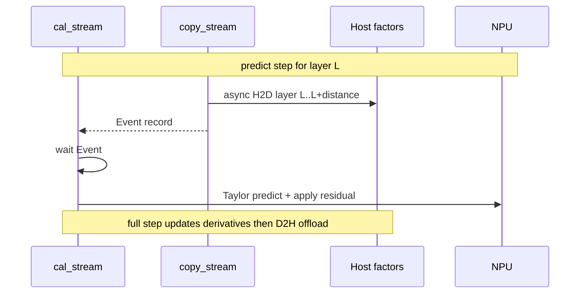

# Wan2.2-I2V 使能 TaylorSeer、Offload 与 Prefetch 设计文档

| 项 | 值 |
|---|---|
| 任务 | 10月社区任务-Wan2.2-I2V 使能 TaylorSeer、Offload 与 Prefetch |
| 任务页 | https://www.hiascend.com/activities/task-center/details/787db3a044464e709f3788099e95cd84 |
| 讨论帖 | https://gitcode.com/cann/cann-recipes-infer/discussions/22 |
| 团队 / 作者 | Eason_Cat |
| 日期 | 2026-10-14 |
| 开发私仓 | https://gitcode.com/Eason_Cat/cann-recipes-infer-Wan22-TaylorSeer |
| 目标合入仓 | https://gitcode.com/cann/cann-recipes-infer |

## 1. 需求背景（required）

### 需求来源

HiAscend / CANN 社区任务：在 `cann-recipes-infer` 的 Wan2.2-I2V A14B 样例上，使能已有 TaylorSeer 缓存算法，并完成 Host↔NPU offload 与异步 prefetch，达到端到端相对 NoCache 基线 **时延降低 ≥ 50%**。

### 背景介绍

- Wan2.2-I2V 为双专家（high/low noise）DiT；仓库已有 TeaCache / FBCache 接线，TaylorSeer 公共能力在 `module/dit_cache`，Wan 侧需 adapter。
- 任务书明确：**非重写** TaylorSeer 算法；不引入量化 / FA / 并行凑加速比；无独立 kernel。
- 验收硬门槛：**Atlas A3 单卡**。

## 2. 需求分析（required）

### 需求描述

1. 在 `models/wan2.2-i2v` 接入 TaylorSeer（residual-total 语义）。
2. 支持 Host offload 与 stream/event 异步 H2D prefetch。
3. 双专家 + CFG 状态隔离；请求级 reset。
4. 四档消融（baseline / TaylorSeer / +offload / +prefetch）+ 盲测 / 稳定性 / 回归证据。

### 需求拆解

| 项 | 方案要点 |
|---|---|
| 缓存单元 | 每层 `WanAttentionBlock` 的 residual-total（`x_out - x_in`） |
| 专家隔离 | high/low 各自 cache + activated_steps；切换时非活跃专家因子迁 Host |
| CFG 隔离 | `enable_separate_cfg=true` 时 stream 分 cond/uncond |
| Offload | 因子 D2H 驻 Host，降低 NPU 占用 |
| Prefetch | 独立 copy_stream + Event，H2D 与 Taylor 预测重叠；按 distance 预取后续 layer |
| 性能门槛 | prefetch 正式 3 次均值 ≤ 基线 3 次均值的 50% |

## 3. 详细设计（required）

### 3.1 环境与基线锁定

| 项 | 锁定值 |
|---|---|
| 硬件 | Atlas A3 单卡（Ascend910，HBM 65536 MiB / chip） |
| CANN | 9.1.0-beta.3（≥ 8.5.0） |
| PyTorch / torch_npu | 2.7.1 / 2.7.1.post2 |
| Python | 3.11 |
| 权重 | Wan2.2-I2V-A14B-BF16 |
| 生成规格 | `i2v-A14B`、`640*360`、61 帧、40 steps、seed=100、单卡 |
| 基线 | `dit_cache.method: NoCache`（`config/14b_single.yaml`） |
| 计时 | warmup 后日志 `Generating video used time`；停止前 `npu.synchronize` |

### 3.2 TaylorSeer 语义（Wan adapter）

| 概念 | 定义 |
|---|---|
| full 步 | 完整 block 计算 + 导数更新 |
| predict 步 | 跳过 block，用 Taylor 公式预测 residual |
| warmup | **按专家本地** activated_steps `< warmup` 时强制 full |
| cutoff | `(total_steps - step) <= cutoff_steps` 强制 full |
| 间隔 full | `(step - warmup) % skip_interval_steps == 0` |
| 导数阶 | `n_derivatives` |

交付参数（prefetch 正式档）：

```yaml
n_derivatives: 1
skip_interval_steps: 6
warmup: 2
cutoff_steps: 1
offload: true
prefetch: true
prefetch_distance: 3
```

### 3.3 Offload / Prefetch 流水



| 模式 | 行为 |
|---|---|
| offload=false | 因子驻 NPU（A14B 仅 residual-total 可稳定放入） |
| offload=true, prefetch=false | 因子 D2H；predict 同步 H2D |
| offload=true, prefetch=true | 因子驻 Host；copy_stream 预取 + Event 与计算重叠 |

说明：本任务 prefetch = **Host→NPU 缓存因子预取**，不是 `torch_npu.npu_prefetch` 权重预取。

### 3.4 代码落点

| 路径 | 说明 |
|---|---|
| `models/wan2.2-i2v/wan/cache/taylorseer.py` | WanTaylorSeer adapter（residual-total、专家隔离、offload/prefetch） |
| `models/wan2.2-i2v/config/14b_taylorseer*.yaml` | 三档优化配置 |
| `models/wan2.2-i2v/config/14b_single.yaml` | NoCache 基线 |
| `docs/rfc/RFC-Wan22-I2V-TaylorSeer.md` | 私仓 RFC |
| `docs/models/wan2.2-i2v/taylorseer_offload_prefetch.md` | 使用说明 |
| `task_submission/` | 自验报告 / 日志 / 盲测材料 |

### 3.5 消融与验收设计

| Case | YAML |
|---|---|
| baseline | `14b_single.yaml` |
| taylorseer | `14b_taylorseer.yaml` |
| taylorseer_offload | `14b_taylorseer_offload.yaml` |
| taylorseer_offload_prefetch | `14b_taylorseer_offload_prefetch.yaml` |

每档：warmup ≥1 + 正式 ≥3；记录均值/中位/极差。精度：≥5 组固定 I2V + 2 人盲测。

### 3.6 非目标

- 多卡 + DiT-Cache
- 量化 / FA / 并行凑 2×
- 提交权重或视频大文件到公开仓

## 4. 自验结果摘要（实机）

正式消融（measure runs only，Atlas A3）：

| case | n | mean_s | vs baseline | gate |
|---|---:|---:|---:|---|
| baseline | 3 | 243.6015 | 100% | — |
| taylorseer | 3 | 121.0420 | 49.69% | — |
| taylorseer_offload | 3 | 129.3845 | 53.11% | — |
| taylorseer_offload_prefetch | 3 | **109.4947** | **44.95%** | **PASS（降 55.05%）** |

其它：

- 非法配置拒绝：PASS
- 稳定性 5× prefetch：全跑通（约 115–153 s）
- 回归 TeaCache / FBCache：170.6 s / 163.3 s OK
- 盲测 5 组 × baseline/prefetch：10/10 OK；均值约 254 s → 121 s
- profiling：msprof 产物已归档于私仓 `res/profiling/`

详细材料见私仓 `task_submission/`。

## 5. 后续合入计划

1. 本设计文档合入 `cann/cann-ops-competitions` 社区任务目录。
2. 代码 PR 指向 `cann/cann-recipes-infer`（`models/wan2.2-i2v/`），关联本设计 / 讨论帖 #22。
3. 双人盲测签字由人工完成评分表后随验收材料提交。
