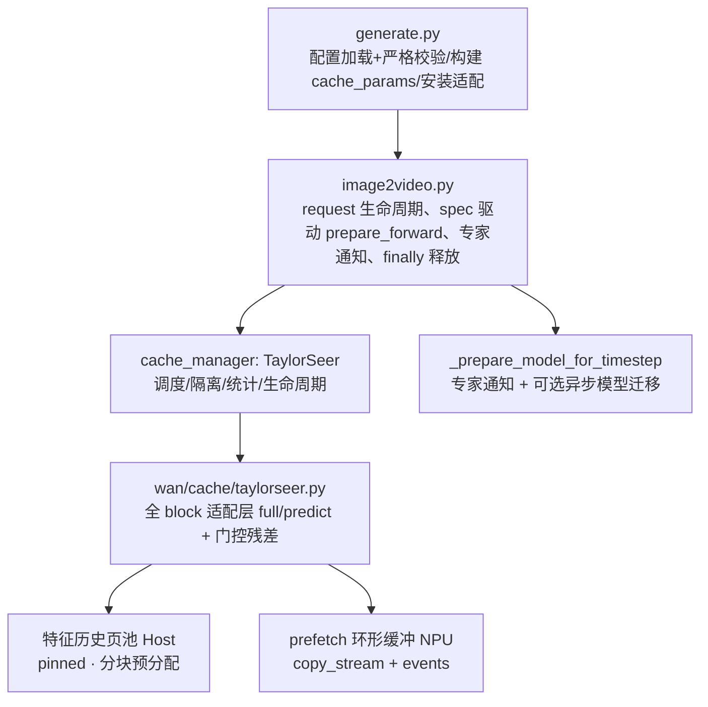
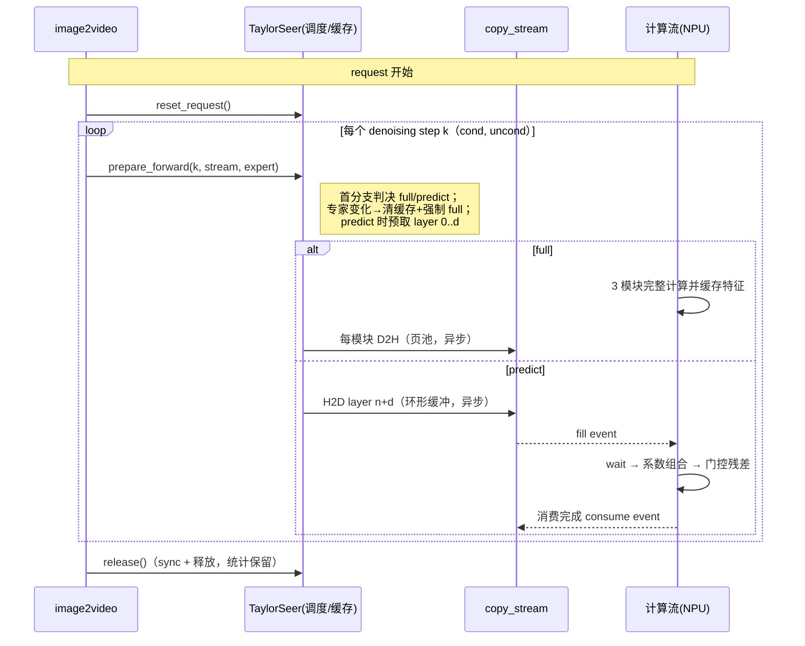

# Wan2.2-I2V TaylorSeer、Offload 与 Prefetch（A3）设计文档

| 项 | 值 |
|---|---|
| 社区任务 | 10 月社区任务：Wan2.2-I2V 使能 TaylorSeer、Offload 与 Prefetch（A3） |
| 贡献者 | HuangRZzzz（GitCode） |
| 需求依据 | 《Wan2.2-I2V TaylorSeer、Offload 与 Prefetch 任务书（A3）》及其 `test_cases/README.md`（接收版本哈希在实现前复核并固化） |
| 目标代码仓 | [cann/cann-recipes-infer](https://gitcode.com/cann/cann-recipes-infer)：`models/wan2.2-i2v/` 与 `module/dit_cache/` |
| 设计仓 | [cann/cann-ops-competitions](https://gitcode.com/cann/cann-ops-competitions)，`04_tasks/01_community-task-2026/tasklist/` |
| 对标基线 | `cann-recipes-infer` master；调研基线 `eaa43e88448ae86cfd1a226cff2feabe8c19eb0c`，开发前复核上游变化 |
| 目标平台 | Atlas A3 单卡；CANN ≥ 8.5.0、PyTorch 2.7.1、torch_npu v7.3.0、Python 3.12 |
| 设计状态 | RFC 评审稿：固定范围、语义、配置与验证方法；不声明任何指标已实测通过 |
| 本次交付 | 仅本设计文档；代码、A3 实测与验收报告为后续阶段 |

## 1. 需求背景（required）

### 1.1 需求来源

HiAscend / CANN 社区任务：在 `cann-recipes-infer` 的 Wan2.2-I2V A14B 样例上完成 TaylorSeer 适配，并将缓存 Host offload 与异步 prefetch 组合为可测量的端到端优化，验收要求同规格下端到端平均时延较 NoCache 基线降低 ≥ 50%（Atlas A3 单卡、`640*360`、61 帧、40 steps、seed=100）。

### 1.2 背景介绍

- TaylorSeer 通过历史特征的高阶差分近似导数、以 Taylor 展开预测后续扩散步特征，从而跳过完整 DiT 计算（论文：From Reusing to Forecasting，arXiv:2503.06923；官方实现：Shenyi-Z/TaylorSeer，含 Wan2.1 视频模型参考）。
- 本任务**不是重新实现算法**：`module/dit_cache/cache_method.py` 已有公共 `TaylorSeer` 类、`CacheManager` 路由与 offload 相关流/事件基础；Wan2.2 侧 `wan/cache/cache_block.py` 当前只接入 TeaCache 与 FBCache，需要补齐适配与可配置、可校验、可回退的 offload/prefetch 组合。
- Wan2.2-I2V A14B 为 high/low-noise 双专家 DiT：现有 `_prepare_model_for_timestep` 负责专家在 CPU/NPU 间切换，本任务需将其与缓存张量预取协同为完整流水。
- 本任务不涉及独立 kernel / aclnn 算子工程；不引入量化、Attention 替换或并行策略变动；多卡 + DiT-Cache 组合维持仓库现有的"禁用"行为，不在首期范围。

### 1.3 现状代码事实（调研基线核验）

| 位置 | 现状 | 设计影响 |
|---|---|---|
| `module/dit_cache/cache_method.py` | `DEFAULT_CACHE_CONFIG` 已有 `TaylorSeer`（n_derivatives/skip_interval_steps/warmup/cutoff_steps/offload）；`CacheManager.from_config` 可路由；构造还需 `cache_params`（HunyuanVideo 传 double/single stream 层数与 num_steps） | 公共能力可复用；Wan 侧需提供流布局与步驱动，并补充 prefetch 参数、校验与生命周期接口 |
| `wan/cache/cache_block.py` | `first_block_forward` 只处理 TeaCache/FBCache；以首块判定 `should_skip` 跳过整网 | TaylorSeer 是"逐层逐模块"预测，不能沿用首块跳过语义；需全 block 适配层 |
| `wan/modules/model.py` | block 循环 `i==0 && should_skip` 时 break；循环后调用 `post_cache_update` | 适配层保持 `should_skip=false`、`post_cache_update` no-op，防止误跳 |
| `wan/image2video.py` | 单卡每步顺序调用 cond、uncond 两次 forward；`_prepare_model_for_timestep` 同步完成专家切换 | 步号/分支必须由外层显式提供；专家切换点与缓存失效/预取联动 |
| `wan/generate.py` | 先执行 `sampling_steps=2` 预热再正式生成；单卡 `offload_model` 默认 true | 预热与正式生成之间、连续请求之间必须重置缓存状态；"offload 开关"指新增缓存管理，与既有模型级 offload 区分 |
| 公共 TaylorSeer offload 路径 | 因子驻 CPU、按需换回；无有界页池/预取协议 | 大张量场景需扩展"特征历史 + 页池 + 环形缓冲预取"通用能力（对 HunyuanVideo 默认路径保持零改动） |

### 1.4 规模定量分析（设计驱动因素）

以任务书固定基线测算（实际形状以首次运行日志固化）：

- latent token 数 `S = 16 × 22 × 40 = 14080`（640×360、61 帧、VAE stride 与 patch 对齐后）；hidden `C = 5120`；BF16 下单个模块特征张量约 **144 MB**。
- 每 CFG 分支缓存 = 40 层 × 3 模块 × (n_derivatives+1) 份：n=2 时约 **52 GB/分支，双分支约 104 GB**；n=1 时约 69 GB。
- 60% 预测步（skip=3）下每周期（1 full + 2 predict）需 H2D 约 208 GB、D2H 约 35 GB。

结论：**因子/特征缓存无法常驻 NPU（64 GB HBM − 28 GB 激活专家 − 激活值）**；offload 是硬需求，prefetch/传导流水是性能达标的关键路径。这也是四档消融中“offload 控制显存”归因的定量依据（§4.4）。

## 2. 需求分析（required）

### 2.1 需求描述

按任务书必做范围拆解为：RFC/基线固定；denoising/双专家/CFG 语义梳理；Wan block Taylor 适配层；`dit_cache` 配置扩展与校验；跨专家/CFG/请求隔离；缓存 Host offload（含释放与异常清理）；独立 copy stream + event + 可复用 buffer 的异步 prefetch；与 `torch_npu.npu_prefetch` 权重预取区分；四档消融；盲测/稳定性/中断清理验证。

### 2.2 固定基线与支持矩阵

| 维度 | 首期合同 |
|---|---|
| 模型/权重 | `i2v-A14B`、Wan2.2-I2V-A14B-BF16；high/low-noise 权重 revision/hash 首次运行前固化 |
| 生成规格 | `640*360`、`frame_num: 61`、`sample_steps: 40`、`base_seed: 100`；四档使用相同输入图、prompt、solver、shift、guide scale |
| 并行 | 单进程单卡：`world_size=cfg_size=ulysses_size=ring_size=tp_size=1`；多卡保持 DiT-Cache 禁用 |
| CFG | 单卡顺序 cond→uncond，独立缓存；`enable_separate_cfg: true`（TaylorSeer 强制） |
| 环境 | CANN ≥ 8.5.0、PyTorch 2.7.1、torch_npu v7.3.0、Python 3.12；四档同环境 |
| 计时 | 预热 1 次 + 正式 3 次；停止计时前完成计算流与 copy stream 同步；记录均值/中位数/极差 |
| 不支持项 | 量化/FA 替换/并行策略改动；多卡 + DiT-Cache；首期不支持动态 shape/并发请求重入 |

### 2.3 需求拆解与追踪

| 编号 | 任务书要求 | 设计落点 | 验证入口 |
|---|---|---|---|
| R1 | RFC 固定基线/版本/输入/配置/计时方法 | §2.2、§4.2 | 环境与实验 manifest |
| R2 | 定义缓存单元、full/predict、warmup/cutoff 语义 | §3.2、§3.3 | 调度单测 + 逐步 JSONL 记录 |
| R3 | Wan block Taylor 适配（不假设 double/single stream） | §3.3 | 适配层单测 + 对比记录 |
| R4 | 配置扩展与非法参数快速失败 | §3.6 | 非法参数/组合启动非零退出 |
| R5 | 跨专家/CFG/请求隔离 | §3.2、§3.4 | 哨兵污染测试、边界切换测试 |
| R6 | offload 生命周期、释放复用与异常清理 | §3.4 | 搬运计数、内存曲线、异常中断 |
| R7 | prefetch 独立流/event/可复用 buffer、消费等待、结束同步 | §3.5 | 顺序扰动测试 + A3 时间线 |
| R8 | 与 `npu_prefetch` 权重预取区分（默认关闭） | §3.5.4 | 配置说明与默认值核验 |
| R9 | 四档消融、e2e −50%、无 OOM/重试 | §4.2 | 四档原始计时与显存记录 |
| R10 | 盲测/稳定性/回退/公共调用方回归 | §4.3、§4.5 | 5 组样本、2 人盲测、连续 5 次生成、HunyuanVideo 回归 |
| R11 | 文档、License、CI 与交付材料 | §4.6 | PR 与检查日志 |

### 2.4 关键语义（本设计定义，评审重点）

1. **步语义**：`step` = denoising step 序号（0..39）。单卡每步 2 次 forward（cond/uncond）；full/predict 判决**每步一次、两分支共享**；分支身份由外层显式传入，不按 block 计数或调用次数推算。预测步必须晚于最近一次完整步。
2. **缓存单元**：每个 `WanAttentionBlock` 的 3 个模块输出（self-attn、cross-attn、ffn 的 y，门控/残差相加前）。该粒度与官方 TaylorSeer-Wan2.1 参考实现一致，且天然兼容 Wan 的单流 block 结构（**不假设公共实现中的 double/single stream**）。predict 时用当前步门控 `e[2]/e[5]` 作用于预测值。
3. **调度**：`full ⟺ k < warmup ∨ (k−warmup) % skip_interval_steps == 0 ∨ (total_steps−k) ≤ cutoff_steps`；缓存为空（首步/专家切换后）强制 full。
4. **CFG 隔离**：cond/uncond 各自独立的特征历史与页池命名空间，禁止混用；`enable_separate_cfg: false` 与 TaylorSeer 组合为非法，启动即报错。
5. **专家隔离**：high↔low 切换瞬间清空全部缓存并强制切换后第一步 full；**不做双专家并行缓存**（缓存总量翻倍会超出 Host 内存预算，且切换后旧专家特征永不复用，双份仅为浪费）。
6. **请求隔离**：每次 `generate()` 入口 `reset_request()`（覆盖预热→正式生成、连续请求）；异常路径 `finally` 释放张量。

## 3. 详细设计（required）

### 3.1 总体架构

复用 `CacheManager` 配置容器与公共 `TaylorSeer` 的有限差分/Taylor 数学语义；通用能力（流布局、显式步驱动、特征历史页池、prefetch 环形缓冲、参数校验、统计、生命周期）**以 opt-in 方式扩展**进 `module/dit_cache/`，不传新参数时 HunyuanVideo 路径行为与代码路径保持不变；Wan 私有逻辑（双专家切换、3 模块 block 适配）全部留在 `models/wan2.2-i2v/`。



### 3.2 调度与状态机

- 调度判决仅在每个 step 的首个分支执行一次，随后写入逐 step 记录：`{step, expert, type, activated_steps, distance}`，供审计与统计。
- 预测系数：对最近 K=min(full 次数, n_derivatives+1) 个完整步的特征历史，按公共增量导数定义（`d_{i+1} = (d_i − d_i^prev)/Δ`，Δ=相邻完整步距离）递归求系数向量，使预测输出等价于 `Σ_i (1/i!)·d_i·x^i`（x=当前步−最近完整步），**数学上与公共实现一致**，但以"特征线性组合"形式在设备侧一次完成，避免物化导数张量。
- 异常防御：无历史时禁止预测（强制 full 并告警）；系数长度与每单元历史长度不一致时显式抛错，不返回可被误用的空张量。



### 3.3 Wan 适配层（`wan/cache/taylorseer.py`）

- 安装：为 high/low 两个专家**全部** block 安装带层号闭包的 forward；`should_skip=false`、`post_cache_update` no-op。
- full 步：按原生算子顺序执行 `norm1→self_attn→(+y·e2)→cross_attn→(+y)→ffn→(+y·e5)`，每个模块输出产出后立即登记缓存；数值路径与原生 block 逐算子同序（仅插入缓存动作）。
- predict 步：以当前步随时计算的门控 `e`，对 3 个模块取系数组合预测值并做残差；不执行 attention/ffn 主体。
- 与 SP（序列并行）路径解耦：多卡时维持现有缓存禁用行为，不打补丁。

### 3.4 Offload 设计（层级流水 + 页池）

1. **存储**：特征历史（每层每模块每份一份张量）驻 Host pinned 内存，由**分块预分配的 PagePool** 管理（固定页大小、块内切分、视角零拷贝、空闲链表分配/回收）；页在池内循环复用，避免反复分配与碎片（PagedAttention 式页管理）。
2. **层级流水**：full 步逐模块计算完成后，在 copy stream 上立即 enqueue `D2H`（`copy_stream.wait_stream(计算流)` 确保数据就绪；不阻塞主流，与后续 block 计算并行——offload 层与 compute 并线）。源张量在拷贝完成前保持引用并标记跨流使用，防止分配器提前复用。
3. **页回收安全性**：历史环形（容量 n_derivatives+1）淘汰的最旧页立即回池；copy stream 先进先出保证其上一轮读取（H2D 预取）先于本次覆写入队，无需额外同步。
4. **生命周期**：`reset_request()`（请求级重置）、`release()`（同步 copy stream、释放页池与事件，统计保留）、异常 `finally` 调用；连续请求不增长驻留。
5. **offload=false 的显存不可行性与处置**：按 §1.4 定量，NPU 常驻需求（n=2 约 104 GB、n=1 约 69 GB）超过 A3 单卡 64 GB HBM。设计采取：启动时按实际形状估算，超过设备总显存即**快速失败**并给出"启用 offload / 降阶数 / 缩小规格"的可执行提示（对应任务书"不支持的组合必须启动失败并返回非零状态"）；同时把该档作为"offload 控制显存"的归因证据保留。**该处置方式需与任务 owner 在评审中确认**（见 §4.4 风险）。
6. 与既有模型级 offload 的关系：非活动专家继续沿用 `_prepare_model_for_timestep` 语义；本设计的 offload 对象是 Taylor 缓存，二者独立可回退。

### 3.5 Prefetch 设计

1. **缓存张量预取**：predict 步按层推进，copy stream 提前 `prefetch_distance` 层将（3 模块 × 历史份数）从 Host 页池搬入 NPU **环形 staging buffer**（槽数 = max(2, prefetch_distance+1)，双缓冲起步；每层一组、全请求复用，总量有界）。每槽一对 event：`fill`（copy 记录）与 `consume`（计算流消费后记录）；消费前 `wait_event(fill)`，覆写前 `wait_event(consume)`，无隐式同步、无脏读。
2. **模型迁移协同**：prefetch 开启时，专家切换的 `D2H(旧) + H2D(新)` 在独立 copy stream 上执行并与彼此重叠后再放行使用；受 HBM 双模型容量限制（28 GB×2 + 激活值 > 64 GB），不做跨 boundary 的整模型提前常驻，仅做切换点流水优化。切换判定仍由 `_prepare_model_for_timestep` 唯一决定。
3. **同步纪律**：计时结束/请求结束前 `copy_stream.synchronize()`；被中断时由 `release()` 兜底同步与释放，无悬挂任务。
4. **与 `torch_npu.npu_prefetch` 的区分**：本设计的 prefetch 是 **Host→NPU 张量搬运**；`npu_prefetch` 是设备权重→L2 预取（官方文档标注面向 A2 系列）。后者作为**附加优化默认关闭**，仅在 profiling 证明目标 MatMul 为 memory-bound 且依赖窗口安全时，按单点验证流程逐步启用（配置独立、可回退）。
5. **统计与审计**：累计 D2H/H2D 字节数、拷贝次数、预取 enqueue 次数、同步等待层数，随 `print_statistics` 输出，供性能归因。

### 3.6 配置与校验

```yaml
dit_cache:
  method: "TaylorSeer"
  enable_separate_cfg: true          # TaylorSeer 必须为 true
  params:
    n_derivatives: 2                 # int ≥ 1
    skip_interval_steps: 3           # int ≥ 2
    warmup: 2                        # int ≥ 0；warmup + cutoff_steps < sample_steps
    cutoff_steps: 2                  # int ≥ 0
    offload: false                   # bool；四档分别 false/true/true
    prefetch: false                  # bool；true ⇒ offload: true
    prefetch_distance: 1             # int ≥ 1
```

校验在模型加载前执行（YAML 解析后立即），非法类型/区间/组合输出可执行错误信息并以非零状态退出；四档消融配置由 `14b_single.yaml` 派生为独立 YAML（`14b_taylorseer.yaml` / `_offload` / `_offload_prefetch`），每次结果关联实际 YAML。参数取值仅依据本 RFC 与 A3 精度/性能实测调整，不改动任务书精度与性能标准。

### 3.7 代码落点

| 路径 | 说明 |
|---|---|
| `module/dit_cache/cache_method.py` | 通用扩展：TaylorSeer 流布局/显式步驱动/特征历史页池/预取环形缓冲/校验/生命周期/统计（旧路径零行为变化） |
| `models/wan2.2-i2v/wan/cache/taylorseer.py` | Wan 适配层：全 block full/predict、3 模块缓存、专家通知与安装入口 |
| `models/wan2.2-i2v/wan/cache/__init__.py` | 导出适配入口 |
| `models/wan2.2-i2v/wan/image2video.py` | 请求重置/释放、prepare_forward 接线、专家通知、模型迁移流水（可选） |
| `models/wan2.2-i2v/generate.py` | 参数校验、cache_params 注入、适配层安装、四档统一入口 |
| `models/wan2.2-i2v/config/*.yaml`、`config/README.md`、模型 README | 四档配置与文档 |
| `docs/models/wan2.2-i2v/taylorseer_offload_prefetch.md` | 原理/启用/参数/限制/回退/排障 |
| `models/wan2.2-i2v/tests/` | 无权重逻辑单测（调度/隔离/校验/页池） + A3 自验脚本 |

### 3.8 内存与传输预算（n=2、640×360、61 帧）

| 项 | 量级 | 说明 |
|---|---|---|
| 特征历史（Host，pinned） | ~104 GB | 2 分支 × 40 层 × 3 模块 × 3 份 × 144 MB；增长来源逐项可解释 |
| staging 环形缓冲（NPU） | ~2.6 GB | 2 槽 × 3 模块 × 3 份 × 144 MB，全请求复用，有界 |
| D2H / 周期（skip=3） | ~35 GB | 仅新特征 |
| H2D / 周期（skip=3） | ~208 GB | 每 predict 分支完整历史；prefetch 与预测/全步计算重叠降暴露 |
| 模型迁移 | 28 GB / 次 | 每请求 1 次专家切换 |

性能达标的关键：D2H 于 full 步内与计算并行、H2D 于 predict 步内与预测计算并行；预留调参档（n=1、skip=4/5）依据盲测质量与 A3 实测选定。

### 3.9 四档消融与验收设计

| Case | TaylorSeer | Offload | Prefetch | 观测项 |
|---|---:|---:|---:|---|
| baseline | 关 | 关 | 关 | 基线 e2e（NoCache） |
| taylorseer | 开 | 关 | 关 | 完整步比例、显存峰值与可行性证据（见 §3.4-5） |
| taylorseer_offload | 开 | 开 | 关 | D2H/H2D 字节、显存峰值、e2e |
| taylorseer_offload_prefetch | 开 | 开 | 开 | 传输/等待时间、重叠证据、e2e（3 次均值 ≤ 基线 50%） |

每档 ≥1 预热 + 3 正式；profiling 时间线证明计算减少、offload 迁移与关键 H2D 与计算重叠且消费前存在正确 event wait。最终质量：≥5 组固定 I2V 样本（人物/动物/快速运动/镜头变化/复杂背景）+ 2 名验收人盲测。存储：四档记录加载后/峰值/结束/连续 5 次生成的内存；异常中断后 stream/event/buffer/cache 可释放。

### 3.10 可维可测分析

| 验收标准 | 描述 | 来源 |
|---|---|---|
| 精度标准 | 生成内容允许变化但保持 prompt 语义一致、无明显质量退化；至少 5 组样本 2 人盲测 | 任务书 §3.2、test_cases |
| 性能标准 | 同机同规格 e2e 平均时延较 baseline 降低 ≥ 50%（3 次均值，无 OOM/重试/规格变化） | 任务书 §3.3 |
| 内存标准 | 无 NPU/Host OOM；重复生成不持续增长；CPU 增长来源可解释；prefetch 无无法解释的双份常驻 | 任务书 §3.4 |
| 工程质量 | pre-commit、仓库 CI、License、目录/配置/文档规范 | 任务书 §3.5 |

### 3.11 兼容性分析

- **Wan2.2 现有方法**：NoCache/FBCache/TeaCache 路径与默认行为不变；关闭 TaylorSeer/offload/prefetch 后回到 `14b_single.yaml` NoCache 行为。
- **公共模块调用方**：`module/dit_cache/` 扩展为 opt-in；HunyuanVideo 未传新参数时沿用原代码路径（流布局默认、layer_counter 驱动、现有 offload 实现不变），提交其功能/精度/代表性性能回归证据。
- **多卡**：维持"world_size>1 时 DiT-Cache 禁用"的现有行为，不改动。
- **`npu_prefetch`**：独立开关、默认关闭，不影响默认链路。

### 3.12 风险与未决问题

1. **`taylorseer`（offload=false）档在 640×360 规格下显存不可行**（§1.4）：拟以"启动即快速失败 + 该档作为 offload 控显存归因证据"处理；需任务 owner 在评审中确认该口径（备选：补一组小规格对照）。
2. **A3 实测参数未取得**：单步 full 耗时、单向 H2D/D2H 带宽、重叠效率决定 2.0× 可达性；实现阶段先行探针（带宽/耗时/overlap 三件套），据实测在 RFC 预留档位中选定最终参数。
3. 模型迁移流水收益受双模型容量限制，仅作切换点重叠优化，不作为主指标来源。
4. 首期不支持项（并发请求、动态 shape、多卡组合）采用显式报错而非静默降级。

## 4. 排期与交付件

1. 设计文档 PR（本文件）→ 评审合入；
2. 公共模块扩展 + Wan 适配层 + 配置/校验（含无权重单测）；
3. A3 探针标定 → 四档消融 → 盲测/稳定性/中断清理 → 回归；
4. 代码 PR（关联 RFC/Issue）+ 自验材料（`task_submission/`：步骤说明、精度/性能/内存报告与日志）。

> 本设计不修改任务书定义的精度、性能、内存标准；实现细节允许在评审意见与实测证据基础上演进，演进记录回写本文档。
